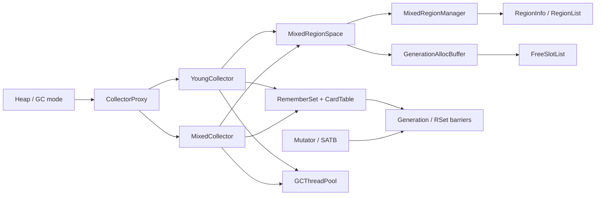
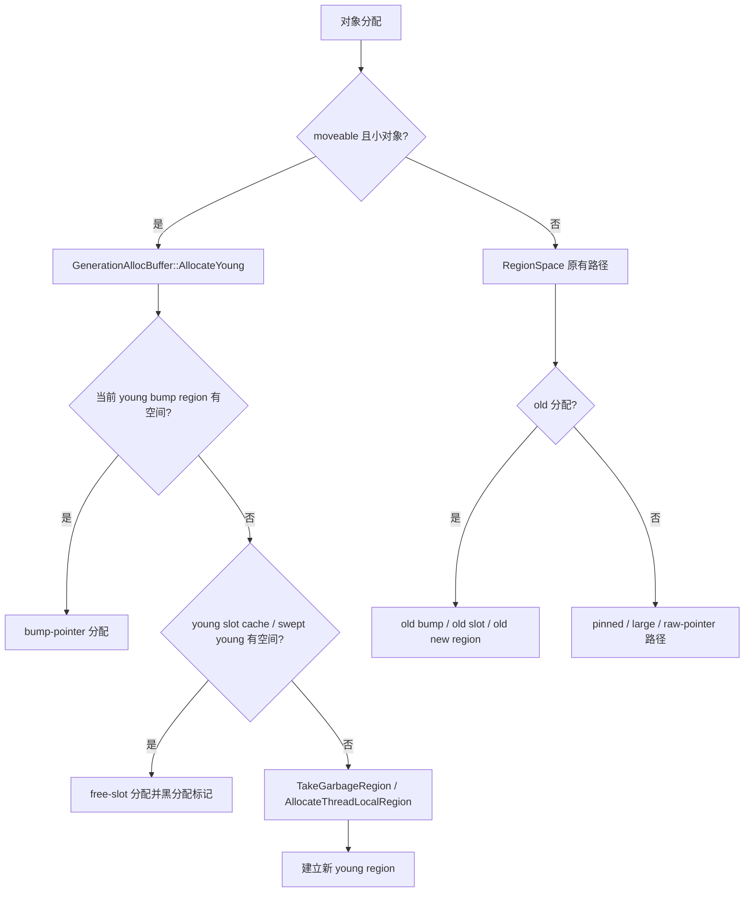
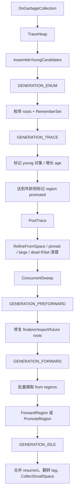
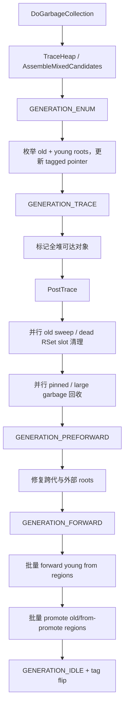
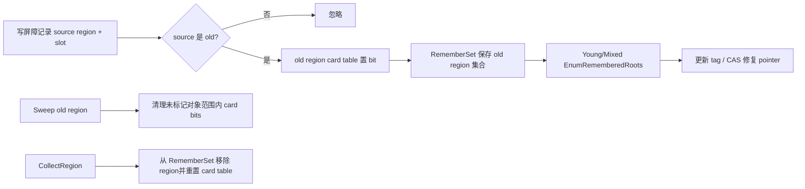
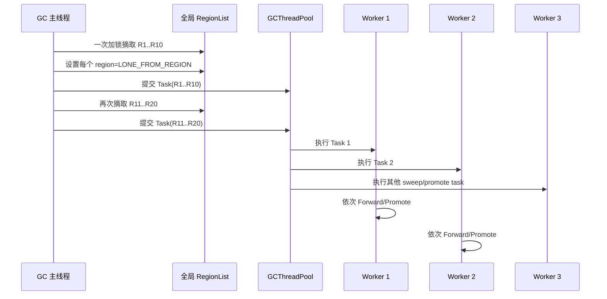
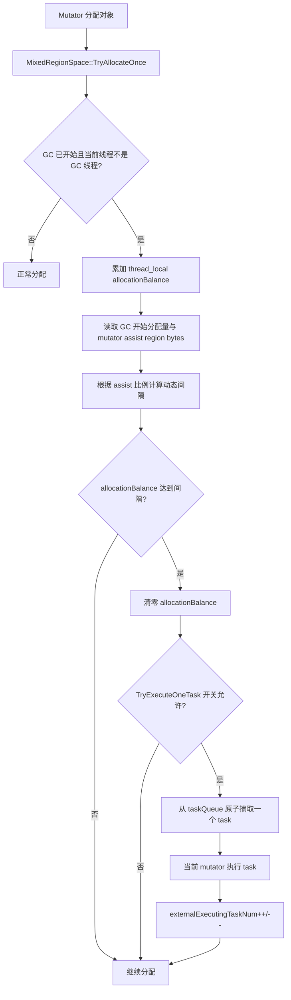
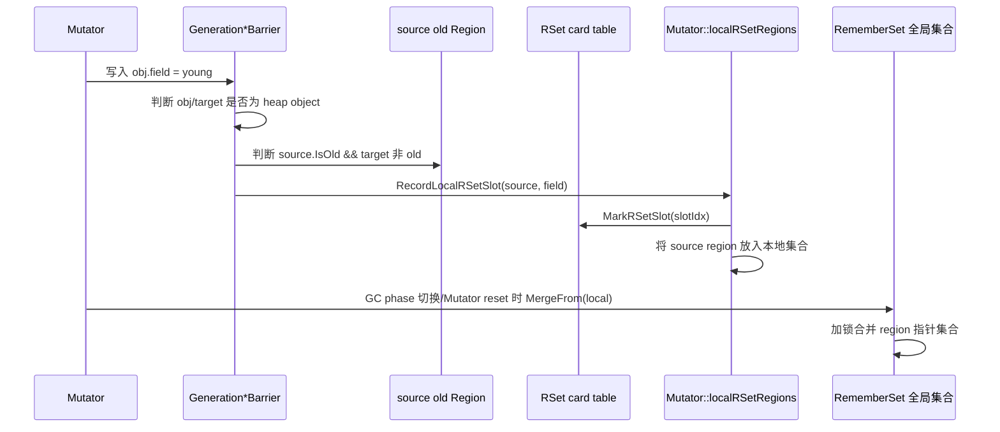
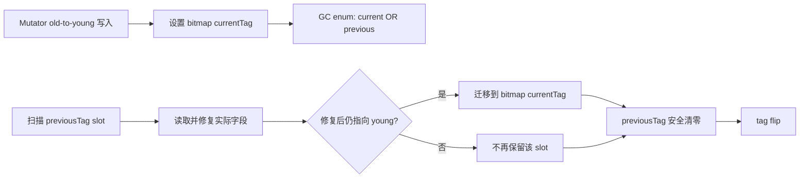

# 分代 GC 设计方案（基于 `36089b43640fa690b0204f10dc564b3ddf9dc263`）

## 1. 范围与目标

本文总结基线提交之后的全部提交（`cb26787b` 至当前 HEAD）引入的分代 GC 设计。核心目标是：在保留原有 Region/WGC 复制回收器的同时，引入 Young GC 与 Mixed GC，按 region 世代组织堆空间，通过对象年龄、转发表和 RememberSet 降低年轻代回收成本，并逐步增加并发 sweep、并发 forward、分配缓冲区缓存和动态 pacer。

## 2. 模块改动总览



主要模块如下：

| 模块 | 主要职责 |
| --- | --- |
| `Heap`、`Allocator`、`CollectorProxy` | 根据 `cjEnableGC`/GC mode 选择 `RegionSpace` 或 `MixedRegionSpace`，并代理 Young/Mixed collector。 |
| `MixedRegionSpace` | 分代分配入口；封装 young/old 分配、mutator assist、slot cache 和 region manager。 |
| `MixedRegionManager` | 管理 young、old、sweep、from、promote、ghost 等多条 RegionList，并实现分代策略。 |
| `YoungCollector` | 年轻代枚举、标记、年龄增长、晋升判定、sweep、forward 和回收后整理。 |
| `MixedCollector` | 在 Young 流程基础上扩展 old region 枚举、old sweep、mixed threshold 和全堆回收。 |
| `GenerationAllocBuffer` | 为 mutator/GC 线程提供 young/old bump-pointer 分配和 free-slot 分配，维护局部缓存。 |
| `RegionInfo`、`RegionList` | 保存 region 元数据、转发信息、年龄 bitmap、RSet card table，并提供并发安全链表操作。 |
| `RememberSet`、`CardTable`、barrier | 记录 old-to-young 槽位，支持 young GC 根枚举和 dead-slot 清理。 |
| `GCThreadPool` | 执行 sweep、large-object 回收、forward/promote 等并发任务，也支持受控的外部线程协助。 |

## 3. Region 与世代模型

### 3.1 RegionList 分类

基线只有通用 region list；分代实现增加并维护：

- young：`recentFullRegionList`、`fromRegionList`、`sweepableYoungRegionList`、`sweptYoungRegionList`；
- old：`oldRegionList`、`oldFromRegionList`、`sweepableOldRegionList`、`oldSweptRegionList`；
- 晋升/转发：`discreteForwardingRegionList`、`ghostPromoteRegionList`、`ghostFromRegionList`、`ghostOldFromRegionList`；
- 大对象和临时对象：`largeRegionList`、`recentLargeRegionList`、`oldLargeRegionList`（后续统一到 `largeRegionList`）、pinned/raw-pointer lists。

`RegionList::SplitList` 与 `SplitByRegionCount` 支持按容量或 region 数量拆分局部任务列表；局部列表在任务中无锁遍历，任务结束后合并回全局列表,这是为了减少任务并行化时锁的竞争。

### 3.2 Region 类型与状态

WEEP_REGION`。`LONE_FROM_REGION` 表示 region 已经从共享链表摘出、正在由单个 forward/promote 任务处理。新增/强化的 `RegionType` 包括 `FROM_PROMOTE_REGION`、`LONE_FROM_REGION`、`OBJECT_MOVE_REGION`、`S

`RouteState` 增加：

```text
NORMAL -> FORWARDABLE -> ROUTING -> ROUTED/COMPACTED -> FORWARDED
                              └----> PROMOTED / HALF_PROMOTED
```

其中 `ROUTING` 通过 CAS 保证同一 region 只有一个线程执行 route/promote；`PROMOTED` 表示对象已建立 forwarding table，`HALF_PROMOTED` 表示部分对象因空间不足而保留在原 region, 这样的region不能被直接collect。

## 4. RegionInfo 关键新增字段与信息

### 4.1 世代与状态字段

- `isPromoted`：本轮/历史上是否被判定为需要晋升；
- `isPromoted0`：ghost/from-space 快照中的晋升标志；
- `isOld`：当前 region 是否属于 old space；
- `isOld0`：ghost 快照中的 old 标志；
- `routeState`：region route/forward/promote 状态；
- `regionType`：region 与 RegionList 的一对一类型映射；
- `unitRole0`、`ownerRegion0`、`nextRegionIdx0`：ghost region 快照字段。

### 4.2 对象年龄

`ageBitmap` 从 `LiveInfo` 中独立出来，按对象地址偏移保存 age。通过原子发布临时哨兵实现惰性并发分配，提供 `GetObjectAge`、`IncObjectAge`、`SetObjectAge`。复制对象时同步复制 age；对象年龄达到策略阈值后设置 region 的 promoted 标志。

### 4.3 转发与 free-slot 信息

- `RouteInfo` 可保存单段/双段 route、`ObjectForwardingTable` 或 `RegionFreeSlotList`；
- `forwardingTable` 支持对象级转发和 promote 后的 self/other-region 路由；
- `freeSlotList` 保存 sweep 后可复用的不同大小 slot，支持 bump-pointer 与 slot 混合分配；
- `rsetCardTable` 是每个 old region 自有的 bitmap（一个指针槽位一个 bit），取代以 young region 为 key 的全局映射。

### 4.4 标记与 ghost

`liveInfo` 增加 mark/resurrect/enqueue bitmap 的按需分配；`PrepareForwardableRegion` 将 liveInfo、region end、unit role、链表索引复制到 `*0` ghost 字段。`inGhostFromRegion` 保护 ghost 生命周期，`DispelGhostFromRegion` ，从PostTrace开始，上一轮GC的旧指针应该都被清理干净了，所以旧一轮GC的信息可以安全移除了。

## 5. MixedRegionSpace 与 GenerationAllocBuffer

### 5.1 分配路径



`GenerationAllocBuffer` 为 young 与 old 各维护最多 3 个 slot region 的局部缓存。slot region中包含了当前region被sweep掉的垃圾内存，可以用于再次分配对象，当前实现按照region粒度建立了free list，并按照slot size进行了区分，尽可能做到了O(1)的复杂度，当前实现在任何时候都有可能从slot region中分配，如果进行性能调优，这里还有空间，可以控制region slot介入的时机，但是可能会导致内存劣化。优先无锁访问缓存；缓存无法满足时移除最大 slot size 最小的 region，清理 free-slot 信息并回收到 manager 列表，再从全局 swept 列表取新 region。GC trace/enum 阶段从 slot 分配的新对象立即黑标记，避免concurrent mark时频繁被加入到satb,这里由于是在gc开始时做了好了sweepable 的snapshot，所以就算没有mark，也不会被提前sweep。值得注意的是，当slot region分配不出来时加回到的list是recent full，所以后面它还有机会被compact

`MixedRegionSpace::TryAllocateOnce` 在 GC 期间根据 mutator 已取 region 字节数和 GC 开始时分配量动态调整 `TryExecuteOneTask` 协助频率；`GCThreadPool` 提供开关限制 enum/generation_enum 等阶段由外部线程执行任务，通过让mutator来协助gc task来加快gc, 并平衡分配与回收的速度。

## 6. YoungCollector 主流程



Young GC 的关键行为：

1. 只把 young region 作为主要 trace target；old-to-young 槽位由 RememberSet 提供根。
2. `EnumRefFieldRoot` 只在必要时调用 `IsHeapAddress`，对旧 tagged pointer 先查 latest version，再进行一次 CAS 修复。
3. `MarkObject` 为对象增加 age；达到 `OLD_AGE` 的 region 进入 promote 列表。
4. `ClassifyYoungRegions` 根据 live ratio、raw pointer 和 promoted 标志选择 forward、sweep 或 promote。
5. `ForwardFromSpace` 以批次（当前为 10 个）在锁内摘取 region、设置 `LONE_FROM_REGION`，任务内部依次 forward/promote，避免每个 region 单独竞争链表锁。

## 7. MixedCollector 主流程



MixedCollector 与 YoungCollector 共用 tag ID、forwarding data、分配 buffer 和大部分阶段；差异在于 `IsTargetRegion` 覆盖为全堆、需要处理 old region sweep、old threshold/pacer 和 old-to-young RememberSet。

## 8. RememberSet、CardTable 与写屏障



`RememberSet` 只保存 old region 集合；每个 old region 自己拥有 card table。`Record` 同时设置 bit 和集合成员，`VisitRememberedSlots` 快照集合后遍历各 region 的 marked slots。old region 被完全回收、转为 free 或 sweep 时必须先从 RememberSet 移除并清理 card table，避免悬垂 region 指针。

## 9. 并发化演进

并发优化主要集中在三层：

1. **region 批处理**：`SplitByRegionCount` 将 sweep、old sweep、large garbage 分成局部列表任务；forward/promote 在锁内批量摘取 10 个 region，并设置 `LONE_FROM_REGION`。
2. **分配局部化**：GenerationAllocBuffer 的 young/old slot cache 减少全局列表锁竞争；`TryExecuteOneTask` 允许 mutator 按 balance 协助 GC，但受阶段开关约束。
3. **元数据无锁/原子化**：age bitmap、RSet card table、route state 使用原子发布/CAS；RegionList 提供 `TakeHeadRegionNoLock`、`RemoveRegionNoLock` 等局部操作。

所有并发任务必须满足：任务持有的 region 已从全局列表摘除；region 类型在摘取锁内完成切换；任务执行期间不能被其他路径再次发现或加入原列表。

### 9.1 为什么并行度会提高

并行度提升不是简单增加 worker 数量，而是减少了任务之间共享状态的粒度：



具体收益有四点：

1. **锁竞争从“每个 region 一次”降为“每 10 个 region 一次”**。摘取完成后，worker 不再调用共享 `TakeHeadRegion`。
2. **任务可提前全部入队**。生产者持续从 from/promote/sweepable 列表拆分任务，worker 可同时消费多个批次，避免单个长任务成为瓶颈。
3. **任务内部只访问私有列表**。`SplitByRegionCount` 产生的局部 list，以及 forward 阶段的 `std::set<RegionInfo*>`，在 task 生命周期内由单一 task 所有；局部删除使用 `NoLock` 接口。
4. **同一阶段内可重叠执行**。young sweep、old sweep、large garbage collection、forward 和 promote 分别形成任务集合，由同一个池调度；同一阶段的多个任务可同时运行，`WaitFinish` 在阶段边界等待该阶段全部任务完成。不同 GC 阶段仍按 collector 的时序串行推进，以保证 region 状态和 barrier 语义一致。

需要注意，region 数量必须足够多才能填满线程池；如果只有少量 region，批量大小 10 不会强行制造并行任务。批量过小会增加锁和任务调度开销，批量过大则降低负载均衡，因此当前实现采用固定小批量并配合 `SplitByRegionCount`。

### 9.2 Mutator 协助 GC 的完整闭环



协助机制的关键细节：

- `allocationBalance` 是线程局部变量，按实际分配字节累计，不需要全局锁。
- `assistBytes` 统计 GC 期间 mutator 已经通过 `TakeRegion` 取走的 region 字节数；预算当前按 GC 起始分配量的一半计算。
- 协助越少，动态间隔越大；随着 assist bytes 接近预算，间隔逐步缩短，促进 mutator 更积极地帮助 GC。
- `TryExecuteOneTask` 先在 `poolMutex` 内从队列取出 task 并增加 `externalExecutingTaskNum`，释放锁后执行，完成后再减少计数并参与 `WaitFinish` 完成条件判断。
- 使用 thread-local `externalTaskExecuting` 防止 mutator 在执行 task 时递归取 task。
- `GCThreadPool::SetTryExecuteOneTaskEnabled` 是阶段开关。外部线程是否可执行任务由 collector 在合适阶段控制；高风险的 enum/generation_enum 任务可以关闭该开关，避免线程身份、栈根或 phase 约束被破坏。
- `WaitFinish` 将外部执行计数纳入等待条件，因此只要 mutator 取出的 task 尚未完成，等待线程不会被错误唤醒。

这形成“GC worker 主动消费 + mutator 按分配压力被动协助”的双通道模型：GC 线程保证基本吞吐，分配压力越大时 mutator 的协助频率越高；当 GC 线程已经完成或阶段禁止外部执行时，协助调用快速返回，不改变分配语义。

## 10. Mutator 与 global RememberSet 的配合

### 10.1 写入路径：先本地记录，再批量合并



所有 generation barrier（enum、trace、preforward、forward、idle、post-trace）都在执行基础 barrier 后补充 RSet 更新。`RSetUpdateBarrier` 只关心 old-to-young 写入，避免记录 old-to-old 或堆外指针。

#### local 到 global 的精确合并时机

`Mutator` 为每个业务线程维护一个 `localRSetRegions` 集合，元素是发生过 old-to-young 写入的 source region 指针。一次写入的具体步骤是：

1. generation barrier 先执行当前 GC 阶段所需的普通写屏障（SATB、forward 或 tag 处理）；
2. `RSetUpdateBarrier::WriteReference` 检查 `obj` 和 `target` 都在堆内；
3. 通过 source/target region 的 `IsOldRegion()` 判断是否为 old-to-young；
4. 调用 `Mutator::RecordLocalRSetSlot(source, field)`；
5. `RecordLocalRSetSlot` 根据 `field - source->GetRegionStart()` 计算 `slotIdx`，原子置位 source region 的 card table，并将 source region 插入当前 mutator 的 `localRSetRegions`。

slot bit 的置位发生在每次满足条件的写入时；region 集合的全局合并则是批量操作，发生在以下边界：

| 合并时机 | 目的 |
| --- | --- |
| mutator 从当前 phase 过渡到 `GC_PHASE_GENERATION_ENUM` | 让本轮 young/mixed 枚举能看到 phase 切换前已发生的跨代写入。 |
| mutator 从当前 phase 过渡到 `GC_PHASE_GENERATION_PREFORWARD` | 把 preforward 前积累的跨代写入补入全局集合，供后续 root 修复/扫描使用。 |
| `Mutator::ResetMutator`、mutator 销毁或线程退出清理 | 防止线程退出时遗留本地 region 集合，保证记录不会丢失。 |

合并代码将 `localRSetRegions` 以 move 方式交给 `RememberSet::MergeFrom`，在 `RememberSet::mtx_` 内一次性执行集合插入，然后清空 mutator 本地集合。这样，写屏障的热路径不需要竞争全局 mutex；只有 phase 边界或线程生命周期边界产生短暂的全局锁竞争。

需要区分两个层次：

- **slot 层**：`MarkRSetSlot` 每次写入都执行，即使 source region 已经在 local/global 集合中，也必须保证新 slot 的 bit 被置上；
- **region 层**：集合使用 set 去重，同一 source region 在一次合并中只保留一个元素，避免全局 RememberSet 膨胀。

这里将“位图写入”和“region 集合合并”分开：

1. 写屏障只需对 source region 的 card table 做一次原子置位，并更新 mutator 的局部 region 集合，不必每次获取 RememberSet 全局 mutex。
2. 在 `GENERATION_ENUM` 或 `GENERATION_PREFORWARD` 的 mutator phase transition，以及 mutator reset/destructor 路径，将局部集合通过 `RememberSet::MergeFrom` 批量并入全局集合。
3. 全局集合只保存 old region 指针；真正的 slot 地址由访问时扫描 region card table 计算。

### 10.2 消费路径：快照集合，扫描 region 自有 bitmap

Young/Mixed collector 调用 `VisitRememberedSlots` 时，RememberSet 先在锁内复制一份 region 集合，随后释放锁，再逐个扫描 region 的 `rsetCardTable`。因此枚举过程不会长时间阻塞 mutator 写屏障；每个 marked bit 转换成 `regionStart + slotIdx * RSET_SLOT_SIZE` 后交给 collector 的引用枚举逻辑。

消费时的并发假设是：card table 的 bit 置位可以与扫描并发，使用原子 OR/读保证不会丢失已发布的记录；集合只做快照，不在扫描期间持有全局锁。扫描得到的 slot 需要再次读取实际字段，因为 card bit 只代表“可能是 old-to-young”，并不保证此刻仍然指向 young。

MixedCollector 在 `EnumRememberedRoots` 中主要执行 latest-version 查找、tag 指针生成和一次 CAS 修复；YoungCollector 还会将目标对象加入年轻根集合并参与 trace。RememberSet 本身不负责 mark 对象，避免与 collector 的 mark bitmap 混淆。

### 10.3 删除与失效处理

当 old region 被完全回收、转成 free region 或从 sweep 队列剔除时，必须按以下顺序处理：

```text
RememberSet::RemoveRegion(region)
        -> region->ResetRSetCardTable()
        -> CollectRegion / ReleaseRegion
```

如果仅清除 bitmap 而不从全局集合移除，下一次 `VisitRememberedSlots` 仍可能访问已复用的 region；如果仅移除集合而不清 bitmap，region 重新成为 old region 后可能携带上一轮的脏槽位。old sweep 和 dead-object RSet 清理分别负责“整 region 删除”和“对象范围删除”两种情况。

### 10.4 正确性边界

- RSet 记录的是 **source slot 所在的 old region**，不是 target young region；这使 old region 被 sweep 时可以直接清理自己的 card table。
- card table 只表示“该槽位可能需要扫描”，不表示槽位当前一定仍指向 young；枚举阶段仍需读取实际字段并进行 heap/old/forward 判断。
- region 的 `isOld` 设置必须先于 `RememberSet::Record`，否则记录会被按非 old source 丢弃。
- region 从 old 列表迁移到 from/ghost/free 列表时，必须同步处理 RememberSet 成员和 card table，避免悬垂指针。

## 10.5 ForwardRegion 的 region 状态不变量

Forward 阶段与普通 sweep 不同：region 可能在多个 worker 之间并发处理，但同一 region 只能被一个任务拥有。当前实现的正确顺序是：

```mermaid
flowchart LR
    A[持有 from/promote RegionList 锁] --> B[摘取最多 10 个 head region]
    B --> C[DeleteRegionLocked: 断开 prev/next，更新计数]
    C --> D[SetRegionType(LONE_FROM_REGION)]
    D --> E[放入任务私有 std::set]
    E --> F[释放 RegionList 锁]
    F --> G[ForwardRegion / PromoteRegion]
```

这里有一个必须保持的设计约束：**region 一旦进入游离状态（`LONE_FROM_REGION`），就不能再用任何 RegionList 记录它。** 原因如下：

1. `CompactRegion`、`RouteOrCompactRegionImpl` 和动态 pin 路径会根据 `region->GetRegionType()` 判断 region 当前属于哪个列表，再决定从哪个列表删除或重新入列；
2. 如果游离 region 仍挂在原 `fromRegionList`/`discreteForwardingRegionList` 中，任务执行期间其他路径可能再次看到同一个节点，造成重复 forward、重复 promote 或重复 collect；
3. 如果 region 同时被放入任务私有 list 和全局 RegionList，链表的 `prev/next` 仍然非空，后续 `PrependRegion`/`DeleteRegionLocked` 会触发链表一致性断言；
4. `LONE_FROM_REGION` 本身就是“暂不属于任何 RegionList、由 task 独占”的状态标志，不能把它当作一个普通列表类型。
5. 这里使用std::set是因为这个容器自带排序属性，可以在小规模的低地址排序，尽可能提前将低地址Region先使用，可以缓解碎片与地址扩张的问题。

因此，批量摘取必须在同一把列表锁内完成“摘链 + 计数更新 + 类型切换”。不能先释放锁再改 type，也不能仅修改 type 而不从链表删除。任务结束后，`ForwardRegion`/`PromoteRegion` 根据结果将 region 转入 `FREE/GARBAGE/RECENT_FULL/OLD` 等最终列表；重新入列前必须确保 `prevRegion == nullptr && nextRegion == nullptr`。

对于 compact 的特殊情况，region 可能被原地压缩并重新加入 `tlRegionList`，也可能因 promote 失败回收到 `recentFullRegionList`。这些转移都应发生在任务已经独占 region 之后，不能让 compact 逻辑通过旧列表再次定位该 region。

## 11. GC 触发与 Pacer

- `cjEnableGC=0/1/2` 支持关闭、RegionSpace/WCollector、MixedRegionSpace/分代 collector 的动态适配；实际 mode 在 Heap 初始化时缓存，避免每次读取环境变量。
- `MixedRegionManager::CheckGC` 同时观察 young used、all used、young/mixed threshold，并通过 request reason 区分可忽略的 heuristic young GC 与 eager/force GC。
- Young threshold 由 young allocation speed 与 GC interval 预测；mixed threshold 受 all-used、headroom、最小阈值和最大容量约束，避免低于 young space 的 1.2 倍。
- `RequestForRegion` 保留原有分配限速；`isLoose=true` 用于 compact/forward 目标 region，MixedRegionManager 可拒绝过快增长，使调用方回退到原地 compact。

## 12. 关键安全约束与已修复问题

- route/promote 必须通过 `TryLockRouting`，防止两个线程同时处理同一 region。
- from/promote region 在 forward 前必须建立 ghost 快照；ghost 清理不能早于所有读屏障和转发访问结束。
- `FindToVersion`/`TryForwardObject` 对 `fromRegion == nullptr` 直接返回，避免非法 region 解引用。
- sweep/collect 前清理 RememberSet 和 card table；删除 region 后不得保留集合中的悬垂指针。
- age bitmap 与 LiveInfo 生命周期分离，free region 初始化时检查并释放 age bitmap。
- pinned 分配路径避免重复 unlock；RegionList 锁内删除和类型切换必须保持原子语义。
- 外部线程执行线程池任务时仅在允许阶段开启，避免 enum/generation_enum 任务越界。

## 13. 端到端摘要

```text
分配 -> young/old bump 或 slot cache
     -> CheckGC / pacer 触发 Young 或 Mixed
     -> 枚举 roots + RememberSet
     -> trace 标记、统计 live、增加 age
     -> sweep / 清理 dead RSet slots
     -> preforward 修复外部 roots
     -> 批量 forward young，批量 promote 晋升 region
     -> 合并列表、翻转 tag、释放 ghost/live metadata
```

该设计以 RegionInfo 为状态核心，以 MixedRegionManager 为列表和策略核心，以 Young/MixedCollector 为阶段编排核心，以 GenerationAllocBuffer、RememberSet 和 GCThreadPool 为性能支撑，形成 bump-pointer、free-slot、复制转发和分代晋升共存的 GC 体系。


## 14. 后续优化方向

以下方案尚未最终确定，主要用于记录当前实现的限制、候选设计以及相应取舍。

### 14.1 为 Mixed GC 增加老年代压缩能力

目前 `MixedCollector` 对老年代主要执行 Mark-Sweep，没有提供完整的内存压缩能力。若直接对 old region 进行 compact，会遇到旧指针识别问题：young 与 old 当前共享同一套 tag。如果一次 Mixed GC 产生的老年代旧指针尚未全部修复，下一次紧接着执行 Young GC，就可能无法仅根据现有 tag 判断旧指针属于哪一轮、哪一代转发关系，导致部分老年代引用不能及时更新。

目前有两种候选方案：

1. **扩展指针标记格式**

   在 tagged pointer 中增加一个 bit，用来区分 young old pointer 与 mixed old pointer。这样，读屏障可以根据来源选择正确的 forwarding data，单次 Mixed GC 不需要额外遍历全部 old region。

   该方案运行期开销相对可控，但改动范围较大：对象引用编码、读写屏障、CAS、聚合写、编译器生成代码以及不同平台的汇编实现都需要同步适配，实施风险较高。

2. **在 MixedCollector 中增加旧指针修复阶段**

   在 Mixed GC 完成 route/forward 后增加一个 phase，遍历所有 old region，主动将对象引用字段中的旧指针更新为最新版本。这样可以在 tag flip 前消除本轮 Mixed GC 遗留的 old pointer。

   该方案改动较集中，不需要改变指针编码，但会增加一次老年代全量扫描，使 Mixed GC 的 CPU 消耗和阶段耗时随 old space 大小增长。

最终选择需要结合 old space 规模、Mixed GC 频率、旧指针密度以及 barrier 热路径开销进行评估。

### 14.2 RememberSet slot 的增量淘汰

当前实现只有在 Mixed GC 清理死亡 old object 时，才会清除对应对象地址范围内的 RSet slot。对于仍然存活的 old object，如果某个字段已经从指向 young object 改为指向 old object，其 card bit 仍会保留。后续 Young GC 的 enum 阶段会继续扫描该 slot，产生无效的字段读取、region 判断和指针处理开销。

单 bitmap 方案不适合直接由 GC 并发清零，因为 GC 清除 bit 与 mutator 写屏障设置同一个 bit 时存在竞争，处理不当会丢失新的 old-to-young 引用。候选优化是为每个 old region 维护两份 RSet bitmap，并使用 tag 轮换：

1. 每个 region 保存 `bitmap[2]`，分别对应 current tag 和 previous tag。
2. Mutator 发生 old-to-young 写入时，只设置 `bitmap[currentTag]` 中对应 slot 的 bit。
3. GC 枚举 RememberSet 时，对两份 bitmap 做逻辑或，确保 current/previous 两个周期产生的记录都能被扫描。
4. 扫描 `bitmap[previousTag]` 中的 slot 并完成旧指针修复后，重新检查字段当前是否仍为 old-to-young。如果仍然需要记录，则把该 slot 迁移到 `bitmap[currentTag]`。
5. 因为遍历slot是在`GENERATION_ENUM Phase`，而切换tag是在forward后，所以mutator此时一定在用currentTag，在遍历完后，可以清空 `bitmap[previousTag]`。
6. 下一次 tag flip 后，两份 bitmap 交换角色，重复上述过程。



这一方案可以在多轮 Young GC 中逐步淘汰不再引用 young region 的 slot，同时避免 GC 清零与 mutator 置位发生在同一份 bitmap 上。实现时需要明确 tag 切换的 phase 边界、mutator phase handshake 和 bitmap 的内存序，不能在仍有 mutator 向 previous bitmap 写入时提前清零。

### 14.3 MixedRegionSpace 的 Arena 分段化

当前 `MixedRegionSpace` 延续了 `RegionSpace` 的连续堆设计，在初始化阶段预留一块完整的大地址空间。其优点是堆地址范围连续、region metadata 映射简单，并且 `IsHeapAddress` 只需要进行上下界判断；缺点是 page 级别的外部碎片难以避免，尤其会影响需要连续 region 的大对象分配。

当前通过按地址排序 from region、优先处理低地址 region 的方式缓解地址扩张和碎片，但不能从根本上解决连续空间不足的问题。候选方案是将 MixedRegionSpace 改为由多个离散 Arena 组成：

1. **引入固定容量的 Arena**

   每个 Arena 具有固定容量，例如 4 MB。程序启动时不再一次性 mmap 最大堆，而是只映射初始容量，并按 young、huge、pinned 等 space 建立若干 Arena。后续根据实际需求增减 Arena。

2. **建立全局与分区两级 Arena 索引**

   `MixedRegionSpace` 维护全局 Arena 索引，用于判断地址是否属于托管堆；每个子 space 维护自己的 Arena 集合，用于分配和回收，并尽量限制普通 region 不跨 Arena。索引可以使用按 Arena 基址组织的哈希集合或映射。

3. **调整 `IsHeapAddress`**

   判断地址时，先按 `Arena::SIZE` 将地址向下对齐到候选 Arena 基址，再查询 `MixedRegionSpace` 的全局 Arena 索引。与连续地址范围检查相比，该路径需要额外一次哈希查询，因此需要关注屏障热路径上的性能，并考虑线程局部缓存或分层地址表。

4. **按真实占用量限制 HeapSize**

   OOM 判断基于各 Arena 中实际被有效 region 占用的内存总量，不计入 free region。这样，虚拟地址空间的离散扩展不会直接消耗逻辑 HeapSize 配额。

5. **为大对象提供弹性 Arena**

   当全局存在大量 free region、但没有足够大的连续空间时，如果实际使用量尚未超过 HeapSize，可临时创建一个足够容纳该大对象的 Arena。`ReclaimRegion` 会回收大部分空闲物理页，因此虚拟地址空间可以适度超过逻辑 HeapSize，而不会等比例增加常驻物理内存。

6. **按对象可移动性隔离碎片**

   Pinned object 使用独立 Arena，避免不可移动对象切碎 movable space。`AcquireRawData` 产生的 raw-pointer region 也可以单独管理，并在满足安全条件后，通过 GC 逐步集中到少量 Arena 中，提高其他 Arena 的整体释放概率。

Arena 分段化能缓解大对象连续空间不足和 pinned/raw-pointer 导致的长期碎片，但会显著改变 region 地址映射、metadata 查找、large object 分配以及 `IsHeapAddress` 的成本模型，应作为独立阶段实施和验证。
