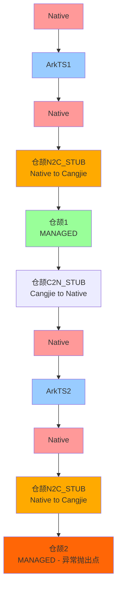
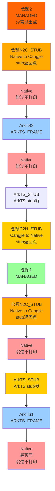
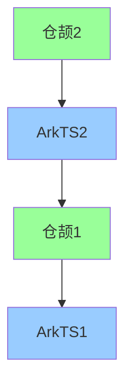
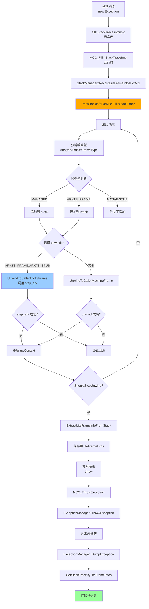
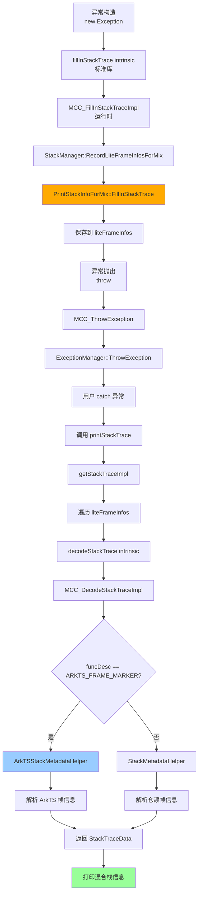
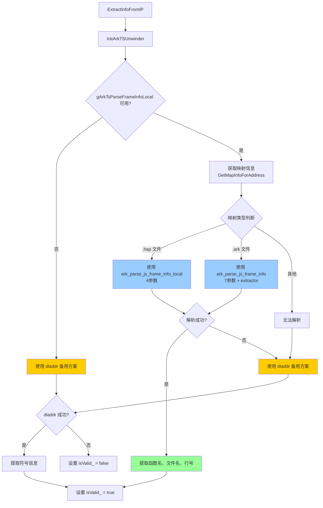

# 仓颉异常抛出混合栈回溯设计文档 v2

## 一、问题背景

在 ArkTS 和仓颉互操作的场景下，当仓颉抛出异常时，老方案只打印仓颉栈帧，无法看到完整的调用链。需要重新设计仓颉异常抛出时的打印方案，支持打印 ArkTS 和仓颉的混合栈。

## 二、互操作调用关系

### 2.1 调用链



## 三、完整栈帧序列

### 3.1 从仓颉2回溯时的栈帧序列

当仓颉2抛出异常时，从下往上回溯：



### 3.2 仓颉所有 STUB 说明

| STUB类型 | 方向 | 说明 | 汇编文件 |
|---------|------|------|----------|
| **N2C_STUB** | Native → Cangjie | Native调用仓颉编译代码的入口stub，保存调用者上下文，设置仓颉执行环境 | `N2CStub.S` |
| **C2N_STUB** | Cangjie → Native | 仓颉编译代码调用Native的出口stub，保存仓颉上下文，检查栈溢出，进入安全区 | `C2NStub.S` |
| **C2R_STUB** | Cangjie → Runtime | 仓颉调用运行时函数的stub | 在代码中识别 |
| **SAFEPOINT** | - | 安全点处理stub，用于GC和线程调度 | `HandleSafepointStub.S` |
| **STACKGROW** | - | 栈增长处理stub，用于处理栈溢出 | `StackGrowStub.S` |

### 3.3 ArkTS STUB 说明

| STUB类型 | 说明 |
|---------|------|
| **ARKTS_STUB** | ArkTS 解释器 stub，包括 stub.an、[anon:ArkTS Code]、/dev/zero 等映射区域 |
| **ARKTS_FRAME** | ArkTS 执行帧，位于 libarkruntime.so 的 interpreter 范围内 |

## 四、预期打印输出

### 4.1 过滤掉 Native 帧和 STUB 帧的输出



### 4.2 预期输出文本

```
com.example.MyException: Test exception
    at com.example.MyClass.method2(MyClass.cj:42)
    at module.arkts.function2(module.arkts:25)
    at com.othr_pkg.OtherClass.method1(OtherClass.cj:18)
    at main.entry(main.arkts:10)
```

## 五、设计约束

1. **仓颉异常只能由仓颉捕获**
   - 不修改异常抛出和捕获机制
   - 只修改打印逻辑

2. **只修改运行时，不修改标准库**
   - 所有修改都在 `runtime/src/` 目录下
   - 不触及 `stdlib/` 目录

3. **只改 printstacktrace，不修改异常抛出的回栈、GC回栈**
   - `ExceptionManager::ThrowException` 不修改
   - `EHStackInfo` 和 `GCStackInfo` 不修改
   - 只修改 `PrintStackInfo` 相关代码

## 六、技术方案

### 6.1 方案选择：方案A - 使用子类扩展

创建 `PrintStackInfo` 的子类 `PrintStackInfoForMix`，专门用于异常处理的混合栈获取，不影响其他使用场景。

### 6.2 关键设计点

#### 6.2.1 不使用 UnwindToCallerContext

- N2C_STUB 会跳过所有 Native 和 ArkTS 帧
- 无法回溯到 Native 和 ArkTS 帧

#### 6.2.2 UnwindToCallerMachineFrame 的局限性

- 只处理标准的帧指针布局（fp、lr）
- 无法理解 ArkTS 的特殊帧布局（JS帧、Native帧、AOT帧、JIT帧等）
- 对于 JIT 帧、AOT 帧等特殊帧类型，无法正确处理

#### 6.2.3 ArkTS 运行时库检测

在运行时检测 libark_jsruntime.so 是否存在：
- 如果不存在，跳过 ArkTS 帧的处理，使用之前的方案只处理仓颉栈
- 如果存在，启用 ArkTS unwinder 集成

#### 6.2.4 集成 ArkTS step_ark unwinder（条件性）

只有在 ArkTS 运行时库可用时才集成：
- ArkTS 运行时提供了 `step_ark` 函数来遍历 ArkTS 栈帧
- 它理解 ArkTS 的复杂帧布局
- 它使用 ArkTS 特定的帧类型识别逻辑
- 通过动态加载 ArkTS 运行时库，调用 step_ark 函数

#### 6.2.5 混合 unwinder 策略

根据当前帧类型选择合适的 unwinder：
- **ARKTS_FRAME/ARKTS_STUB**：使用 ArkTS 的 step_ark unwinder
- **其他帧类型**：使用仓颉的 UnwindToCallerMachineFrame

#### 6.2.6 重置 anchorFA 为 nullptr

- 禁用 anchor frame 终止条件
- 允许跨越仓颉边界

#### 6.2.7 新的终止条件

基于帧的有效性（ip、fa、地址范围）：
- IP 为 nullptr
- FA 为 nullptr
- 帧地址异常（太小或太大）
- **循环检测**：防止相同的帧重复出现导致无限循环

#### 6.2.8 循环检测机制

当前实现中添加了循环检测机制：
```cpp
uintptr_t prevPC = 0;
uintptr_t prevFA = 0;
size_t repeatCount = 0;
constexpr size_t MAX_REPEAT = 3;

while (!ShouldStopUnwind(uwContext.frameInfo.mFrame)) {
    uintptr_t currentPC = reinterpret_cast<uintptr_t>(uwContext.frameInfo.mFrame.GetIP());
    uintptr_t currentFA = reinterpret_cast<uintptr_t>(uwContext.frameInfo.mFrame.GetFA());
    
    if (currentPC == prevPC && currentFA == prevFA) {
        repeatCount++;
        if (repeatCount >= MAX_REPEAT) {
            LOG(RTLOG_INFO, "[FillInStackTrace] Detected repeated frame, stopping unwind");
            break;
        }
    } else {
        repeatCount = 0;
    }
    
    prevPC = currentPC;
    prevFA = currentFA;
    // ... 继续处理
}
```

### 6.3 ArkTS 帧识别策略

#### 6.3.1 基于地址范围的识别

当前实现采用基于地址范围的方式识别 ArkTS 帧：

**1. ArkTS Interpreter 范围**
- 从 `libarkruntime.so` 获取符号 `HANDLE_FAST_NOP` 和 `HANDLE_FAST_EXCEPTION`
- Interpreter 范围：`HANDLE_FAST_NOP` 到 `HANDLE_FAST_EXCEPTION + 64`
- 如果 PC 在此范围内，识别为 `ARKTS_FRAME`

**2. ArkTS Stub 范围**
- 从 `/proc/self/maps` 读取内存映射
- 匹配包含以下关键字的映射：
  - `stub.an`
  - `[anon:ArkTS Code`
  - `/dev/zero`
- 如果 PC 在此范围内，识别为 `ARKTS_STUB`

#### 6.3.2 PAC 地址剥离（AArch64）

在 ARM64 架构上，地址可能带有 PAC（Pointer Authentication Code）签名：
```cpp
#ifdef __aarch64__
constexpr uintptr_t PAC_MASK = 0x0000007fffffffffULL;
uintptr_t strippedPc = pc & PAC_MASK;
#else
uintptr_t strippedPc = pc;
#endif
```

### 6.4 异常处理实际流程

#### 场景1：异常未捕获



#### 场景2：用户 catch 异常并主动调用 printStackTrace



**说明**：
- 场景1：异常未被捕获，由运行时自动打印栈信息
- 场景2：用户 catch 异常后主动调用 `printStackTrace()`，此时标准库会解析已保存的 `liteFrameInfos` 并打印混合栈信息
- 两个场景都使用相同的 `liteFrameInfos`，包含仓颉和 ArkTS 的混合栈信息

## 七、文件清单

### 7.1 新增文件（4个）

1. `runtime/src/UnwindStack/ArkTSFrameRecognizer.h` - ArkTS 帧识别器头文件
2. `runtime/src/UnwindStack/ArkTSFrameRecognizer.cpp` - ArkTS 帧识别器实现
3. `runtime/src/UnwindStack/PrintStackInfoForMix.h` - 混合栈子类头文件
4. `runtime/src/UnwindStack/PrintStackInfoForMix.cpp` - 混合栈子类实现

### 7.2 新增辅助文件（2个）

5. `runtime/src/UnwindStack/ArkTSStackMetadataHelper.h` - ArkTS 帧元数据解析器头文件
6. `runtime/src/UnwindStack/ArkTSStackMetadataHelper.cpp` - ArkTS 帧元数据解析器实现

### 7.3 修改文件（5个）

1. `runtime/src/Common/StackType.h` - 添加 ARKTS_FRAME 和 ARKTS_STUB 枚举值
2. `runtime/src/UnwindStack/StackInfo.cpp` - 增强 AnalyseAndSetFrameType 支持 ArkTS 帧识别
3. `runtime/src/StackManager.h` - 添加 RecordLiteFrameInfosForMix 方法声明
4. `runtime/src/StackManager.cpp` - 实现 RecordLiteFrameInfosForMix
5. `runtime/src/CompilerCalls.cpp` - MCC_FillInStackTraceImpl 调用新方法

## 八、核心组件设计

### 8.1 ArkTSFrameRecognizer 类

```cpp
// ArkTS 帧标记，用于在 liteFrameInfos 中标识 ArkTS 帧
constexpr uint64_t ARKTS_FRAME_MARKER = 0xFFFFFFFFFFFFFFFFULL;

struct ArkTSFrameInfo {
    FrameAddress* framePtr;
    const uint32_t* returnAddr;
    CString functionName;
    CString fileName;
    uint32_t lineNumber;
    uint32_t columnNumber;
};

class ArkTSFrameRecognizer {
public:
    static bool IsArkTSFrame(const MachineFrame& frame);
    static bool IsArkTSFrame(FrameAddress* fa);
    static bool IsArkTSFrameByPc(uintptr_t pc);
    static bool IsInStubRange(uintptr_t pc);
    static bool IsInInterpreterRange(uintptr_t pc);
    static bool ExtractFrameInfo(FrameAddress* fa, ArkTSFrameInfo& info);
    static bool IsArkTSRuntimeAvailable();

private:
    static bool InitArkRanges();
    static bool InitArkStubRange();
    static bool InitArkInterpreterRange();
    static FrameAddress* GetPrevFp(FrameAddress* fa);
    static const uint32_t* GetReturnAddr(FrameAddress* fa);
    
    static uintptr_t arkStubBegin_;
    static uintptr_t arkStubEnd_;
    static uintptr_t arkInterpreterBegin_;
    static uintptr_t arkInterpreterEnd_;
    static bool arkRangeInitialized_;
};
```

#### 8.1.1 ArkTS 帧识别原理

**基于地址范围的识别方式**：

1. **ArkTS Interpreter 范围识别**
   - 通过 dlopen 加载 `libarkruntime.so`
   - 通过 dlsym 获取 `HANDLE_FAST_NOP` 和 `HANDLE_FAST_EXCEPTION` 符号地址
   - Interpreter 范围：`HANDLE_FAST_NOP` 到 `HANDLE_FAST_EXCEPTION + 64`
   - 如果 PC 在此范围内，则为 ArkTS 执行帧

2. **ArkTS Stub 范围识别**
   - 解析 `/proc/self/maps` 文件
   - 匹配包含 `stub.an`、`[anon:ArkTS Code`、`/dev/zero` 的可执行映射
   - 合并所有匹配的映射范围
   - 如果 PC 在此范围内，则为 ArkTS stub 帧

3. **PAC 地址处理**
   - 在 ARM64 上使用掩码 `0x0000007fffffffffULL` 剥离 PAC
   - 在其他架构上直接使用原始地址

#### 8.1.2 IsInInterpreterRange 实现逻辑

```cpp
bool ArkTSFrameRecognizer::IsInInterpreterRange(uintptr_t pc)
{
    if (pc == 0) {
        return false;
    }
    
    uintptr_t strippedPc = StripPac(pc);
    
    pthread_mutex_lock(&gArkRangeMutex);
    if (!arkRangeInitialized_) {
        InitArkRanges();
        arkRangeInitialized_ = true;
    }
    pthread_mutex_unlock(&gArkRangeMutex);
    
    bool inInterpreterRange = (arkInterpreterBegin_ != 0 && arkInterpreterEnd_ != 0) &&
                              (strippedPc >= arkInterpreterBegin_ && strippedPc < arkInterpreterEnd_);
    
    return inInterpreterRange;
}
```

#### 8.1.3 InitArkInterpreterRange 实现逻辑

```cpp
bool ArkTSFrameRecognizer::InitArkInterpreterRange()
{
    constexpr auto ARK_LIB_NAME = "libarkruntime.so";
    
    void* handle = dlopen(ARK_LIB_NAME, RTLD_LAZY);
    if (handle == nullptr) {
        LOG(RTLOG_INFO, "[InitArkInterpreterRange] Cannot open %s: %s", ARK_LIB_NAME, dlerror());
        return false;
    }
    
    void* nopHandle = dlsym(handle, "HANDLE_FAST_NOP");
    void* excepHandle = dlsym(handle, "HANDLE_FAST_EXCEPTION");
    
    if (nopHandle == nullptr || excepHandle == nullptr) {
        LOG(RTLOG_INFO, "[InitArkInterpreterRange] Cannot find HANDLE_FAST_NOP or HANDLE_FAST_EXCEPTION");
        dlclose(handle);
        return false;
    }
    
    arkInterpreterBegin_ = reinterpret_cast<uintptr_t>(nopHandle);
    arkInterpreterEnd_ = reinterpret_cast<uintptr_t>(excepHandle) + 64;
    
    LOG(RTLOG_INFO, "[InitArkInterpreterRange] interpreter range: 0x%lx - 0x%lx",
        arkInterpreterBegin_, arkInterpreterEnd_);
    
    dlclose(handle);
    return true;
}
```

#### 8.1.4 InitArkStubRange 实现逻辑

```cpp
bool ArkTSFrameRecognizer::InitArkStubRange()
{
    FILE* mapsFile = fopen("/proc/self/maps", "r");
    if (mapsFile == nullptr) {
        LOG(RTLOG_INFO, "[InitArkStubRange] Failed to open /proc/self/maps");
        return false;
    }
    
    char line[512];
    uintptr_t begin = 0;
    uintptr_t end = 0;
    
    while (fgets(line, sizeof(line), mapsFile) != nullptr) {
        uintptr_t mapBegin;
        uintptr_t mapEnd;
        char perms[5];
        unsigned long offset;
        unsigned long major;
        unsigned long minor;
        unsigned long inode;
        char pathname[256] = {0};
        
        int parsed = sscanf(line, "%lx-%lx %4s %lx %lx:%lx %lu %255s",
                            &mapBegin, &mapEnd, perms, &offset, &major, &minor, &inode, pathname);
        
        if (parsed < 7) {
            continue;
        }
        
        bool isExec = (perms[2] == 'x');
        if (!isExec) {
            continue;
        }
        
        bool isArkStub = (strstr(pathname, "stub.an") != nullptr);
        bool isArkAnon = (strncmp(pathname, "[anon:ArkTS Code", 16) == 0);
        bool isDevZero = (strcmp(pathname, "/dev/zero") == 0);
        
        if (isArkStub || isArkAnon || isDevZero) {
            if (begin == 0 || mapBegin < begin) {
                begin = mapBegin;
            }
            if (mapEnd > end) {
                end = mapEnd;
            }
        }
    }
    
    fclose(mapsFile);
    
    arkStubBegin_ = begin;
    arkStubEnd_ = end;
    
    return (begin != 0 && end != 0);
}
```

### 8.2 PrintStackInfoForMix 类

```cpp
class PrintStackInfoForMix : public StackInfo {
public:
    explicit PrintStackInfoForMix(const UnwindContext* context = nullptr) : StackInfo(context) {}
    ~PrintStackInfoForMix() override = default;
    void FillInStackTrace() override;

private:
    bool UnwindToCallerArkTSFrame(UnwindContext& uwContext, bool& outIsJsFrame);
    static StepArkFunc LoadArkTSStepArk();
    static bool ShouldStopUnwind(const MachineFrame& frame);
    static bool AccessMem(void* ctx, uintptr_t addr, uintptr_t* val);
};
```

#### 8.2.1 FillInStackTrace 实现逻辑

```cpp
void PrintStackInfoForMix::FillInStackTrace()
{
    UnwindContext uwContext;
    CheckTopUnwindContextAndInit(uwContext);
    
    // 重置 anchorFA 为 nullptr，禁用 anchor frame 终止条件
    anchorFA = nullptr;
    
    // 循环检测机制
    uintptr_t prevPC = 0;
    uintptr_t prevFA = 0;
    size_t repeatCount = 0;
    constexpr size_t MAX_REPEAT = 3;
    
    LOG(RTLOG_INFO, "[FillInStackTrace] Start filling stack trace for mixed stack");
    
    while (!ShouldStopUnwind(uwContext.frameInfo.mFrame)) {
        // 循环检测
        uintptr_t currentPC = reinterpret_cast<uintptr_t>(uwContext.frameInfo.mFrame.GetIP());
        uintptr_t currentFA = reinterpret_cast<uintptr_t>(uwContext.frameInfo.mFrame.GetFA());
        
        if (currentPC == prevPC && currentFA == prevFA) {
            repeatCount++;
            if (repeatCount >= MAX_REPEAT) {
                LOG(RTLOG_INFO, "[FillInStackTrace] Detected repeated frame, stopping unwind");
                break;
            }
        } else {
            repeatCount = 0;
        }
        
        prevPC = currentPC;
        prevFA = currentFA;
        
        // 分析帧类型
        AnalyseAndSetFrameType(uwContext);
        FrameType currentType = uwContext.frameInfo.GetFrameType();
        
        // 只添加仓颉 MANAGED 帧和 ArkTS 帧
        if (currentType == FrameType::MANAGED) {
            stack.emplace_back(uwContext.frameInfo);
        } else if (currentType == FrameType::ARKTS_FRAME) {
            stack.emplace_back(uwContext.frameInfo);
        }
        
        lastFrameType = currentType;
        
        // 根据帧类型选择 unwinder
        if (currentType == FrameType::ARKTS_FRAME || currentType == FrameType::ARKTS_STUB) {
            bool isJsFrame = false;
            if (!UnwindToCallerArkTSFrame(uwContext, isJsFrame)) {
                break;
            }
            if (isJsFrame) {
                uwContext.frameInfo.SetFrameType(FrameType::ARKTS_FRAME);
            } else {
                uwContext.frameInfo.SetFrameType(FrameType::UNKNOWN);
            }
        } else {
            UnwindContext caller;
            if (uwContext.frameInfo.mFrame.UnwindToCallerMachineFrame(caller.frameInfo.mFrame) == false) {
                break;
            }
            uwContext.frameInfo = caller.frameInfo;
        }
    }
}
```

#### 8.2.2 ShouldStopUnwind 实现逻辑

```cpp
bool PrintStackInfoForMix::ShouldStopUnwind(const MachineFrame& frame)
{
    if (frame.GetIP() == nullptr) {
        return true;
    }
    
    if (frame.GetFA() == nullptr) {
        return true;
    }
    
    uintptr_t faAddr = reinterpret_cast<uintptr_t>(frame.GetFA());
    if (faAddr < 0x1000 || faAddr > 0x7fffffffffff) {
        return true;
    }
    
    return false;
}
```

#### 8.2.3 UnwindToCallerArkTSFrame 实现逻辑

```cpp
bool PrintStackInfoForMix::UnwindToCallerArkTSFrame(UnwindContext& uwContext, bool& outIsJsFrame)
{
    static bool arkTSUnwinderInitialized = false;
    static StepArkFunc gStepArk = nullptr;
    
    if (!arkTSUnwinderInitialized) {
        gStepArk = LoadArkTSStepArk();
        arkTSUnwinderInitialized = true;
    }
    
    // 如果 ArkTS unwinder 不可用，回退到机器栈遍历
    if (gStepArk == nullptr) {
        UnwindContext caller;
        if (uwContext.frameInfo.mFrame.UnwindToCallerMachineFrame(caller.frameInfo.mFrame) == false) {
            return false;
        }
        uwContext.frameInfo = caller.frameInfo;
        outIsJsFrame = false;
        return true;
    }
    
    // 构造 ArkStepParam 参数
    ArkStepParam arkParam;
    FrameAddress* fa = const_cast<FrameAddress*>(uwContext.frameInfo.mFrame.GetFA());
    uintptr_t fpValue = reinterpret_cast<uintptr_t>(fa);
    uintptr_t spValue = fpValue;
    uintptr_t pcValue = reinterpret_cast<uintptr_t>(uwContext.frameInfo.mFrame.GetIP());
    
    arkParam.fp = &fpValue;
    arkParam.sp = &spValue;
    arkParam.pc = &pcValue;
    
    bool isJsFrame = false;
    arkParam.isJsFrame = &isJsFrame;
    StepFrameType frameType = StepFrameType::JS_FRAME;
    arkParam.frameType = &frameType;
    arkParam.frameIndex = stack.size();
    
    // 调用 step_ark
    int result = gStepArk(nullptr, AccessMem, &arkParam);
    if (result != 1) {
        LOG(RTLOG_ERROR, "[UnwindToCallerArkTSFrame] step_ark failed with result=%d", result);
        return false;
    }
    
    // 更新 uwContext
    uwContext.frameInfo.mFrame.SetFA(reinterpret_cast<FrameAddress*>(fpValue));
    uwContext.frameInfo.mFrame.SetIP(reinterpret_cast<const uint32_t*>(pcValue));
    outIsJsFrame = isJsFrame;
    
    return true;
}
```

#### 8.2.4 动态加载 ArkTS unwinder

```cpp
StepArkFunc PrintStackInfoForMix::LoadArkTSStepArk()
{
    constexpr auto ARKTS_RUNTIME_LIB = "libark_jsruntime.so";
    constexpr auto STEP_ARK = "step_ark";
    
    void* handle = dlopen(ARKTS_RUNTIME_LIB, RTLD_LAZY);
    if (handle == nullptr) {
        LOG(RTLOG_ERROR, "Failed to load ArkTS runtime library: %s", dlerror());
        return nullptr;
    }
    
    StepArkFunc stepArk = reinterpret_cast<StepArkFunc>(dlsym(handle, STEP_ARK));
    if (stepArk == nullptr) {
        LOG(RTLOG_ERROR, "Failed to load step_ark function: %s", dlerror());
        dlclose(handle);
        return nullptr;
    }
    
    return stepArk;
}
```

#### 8.2.5 AccessMem 实现

```cpp
bool PrintStackInfoForMix::AccessMem(void* ctx, uintptr_t addr, uintptr_t* val)
{
    (void)ctx;
    if (val == nullptr) {
        return false;
    }
    
    // 地址有效性检查
    if (addr < 0x1000 || addr > 0x7fffffffffff) {
        return false;
    }
    
    *val = *reinterpret_cast<uintptr_t*>(addr);
    return true;
}
```

### 8.3 StackInfo::AnalyseAndSetFrameType 增强

在原有的帧类型判断逻辑中，添加 ArkTS 帧识别：

```cpp
void StackInfo::AnalyseAndSetFrameType(UnwindContext& uwContext)
{
    FrameInfo& frameInfo = uwContext.frameInfo;
    MachineFrame& mFrame = frameInfo.mFrame;
    
    if (mFrame.IsN2CStubFrame()) {
        // ... N2C stub 处理
    } else if (mFrame.IsSafepointHandlerStubFrame()) {
        // ... Safepoint 处理
    } else if (mFrame.IsC2RStubFrame()) {
        // ... C2R stub 处理
    } else if (mFrame.IsC2NStubFrame()) {
        // ... C2N stub 处理
    } else if (mFrame.IsStackGrowStubFrame()) {
        // ... StackGrow 处理
    } else if (mFrame.IsExclusiveStubFrame()) {
        // ... Exclusive stub 处理
    } else if (frameInfo.GetFrameType() == FrameType::ARKTS_FRAME) {
        // ArkTS 帧已经被标记（通过 step_ark 返回）
        isReliableN2CStub = false;
    } else if (ArkTSFrameRecognizer::IsInInterpreterRange(reinterpret_cast<uintptr_t>(mFrame.GetIP()))) {
        // 识别为 ArkTS 执行帧
        frameInfo.SetFrameType(FrameType::ARKTS_FRAME);
        isReliableN2CStub = false;
    } else if (ArkTSFrameRecognizer::IsInStubRange(reinterpret_cast<uintptr_t>(mFrame.GetIP()))) {
        // 识别为 ArkTS stub 帧
        frameInfo.SetFrameType(FrameType::ARKTS_STUB);
        isReliableN2CStub = false;
    } else if (mFrame.IsRuntimeFrame()) {
        // ... Runtime 帧处理
    } else {
        // ... 其他帧处理
    }
    
    // ... N2C context 检查
}
```

### 8.4 ArkTSStackMetadataHelper 类

用于解析 ArkTS 帧的元数据（函数名、文件名、行号等）：

```cpp
class ArkTSStackMetadataHelper {
public:
    explicit ArkTSStackMetadataHelper(uint64_t ip, uint64_t pc)
        : ip_(ip), pc_(pc), lineNumber_(0), methodName_("ArkTS_Function"),
          className_(""), fileName_("ArkTS"), isValid_(false)
    {
        ExtractInfoFromIP();
    }

    ~ArkTSStackMetadataHelper() = default;

    uint32_t GetLineNumber() const { return lineNumber_; }
    CString GetMethodName() const { return methodName_; }
    CString GetClassName() const { return className_; }
    CString GetFileName() const { return fileName_; }

    bool IsValid() const { return isValid_; }

private:
    void ExtractInfoFromIP();
    static uintptr_t GetMapBaseForAddress(uintptr_t address);
    static uintptr_t GetLoadOffsetForAddress(uintptr_t address);

    uint64_t ip_;
    uint64_t pc_;
    uint32_t lineNumber_;
    CString methodName_;
    CString className_;
    CString fileName_;
    bool isValid_;
};
```

#### 8.4.1 ArkTS 帧元数据解析流程



#### 8.4.1.1 InitArkTSUnwinder 初始化逻辑

```cpp
bool InitArkTSUnwinder()
{
    pthread_mutex_lock(&gArkTsMutex);
    
    if (gArkTsInitialized) {
        pthread_mutex_unlock(&gArkTsMutex);
        return true;
    }
    
    if (gArkTsInitAttempted) {
        pthread_mutex_unlock(&gArkTsMutex);
        return false;  // 避免重复尝试
    }
    
    gArkTsInitAttempted = true;
    
    // 加载 ArkTS 运行时库
    gArkTsLibHandle = dlopen(ARKTS_RUNTIME_LIB, RTLD_LAZY);
    if (gArkTsLibHandle == nullptr) {
        pthread_mutex_unlock(&gArkTsMutex);
        return false;
    }
    
    // 加载所有需要的函数
    gArkTsParseFrameInfoLocal = dlsym(gArkTsLibHandle, ARKTS_PARSE_JS_FRAME_INFO_LOCAL);
    gArkTsParseFrameInfo = dlsym(gArkTsLibHandle, ARKTS_PARSE_JS_FRAME_INFO);
    gArkTsCreateLocal = dlsym(gArkTsLibHandle, ARKTS_CREATE_LOCAL);
    gArkTsDestroyLocal = dlsym(gArkTsLibHandle, ARKTS_DESTROY_LOCAL);
    gArkTsCreateExtractor = dlsym(gArkTsLibHandle, ARKTS_CREATE_JS_SYMBOL_EXTRACTOR);
    gArkTsDestroyExtractor = dlsym(gArkTsLibHandle, ARKTS_DESTROY_JS_SYMBOL_EXTRACTOR);
    
    // 必须有 parseFrameInfoLocal 和 createLocal
    if (gArkTsParseFrameInfoLocal == nullptr || gArkTsCreateLocal == nullptr) {
        dlclose(gArkTsLibHandle);
        gArkTsLibHandle = nullptr;
        pthread_mutex_unlock(&gArkTsMutex);
        return false;
    }
    
    // 创建 JSStackTrace 单例（增加引用计数）
    int createResult = gArkTsCreateLocal();
    if (createResult <= 0) {
        dlclose(gArkTsLibHandle);
        gArkTsLibHandle = nullptr;
        pthread_mutex_unlock(&gArkTsMutex);
        return false;
    }
    
    gArkTsInitialized = true;
    pthread_mutex_unlock(&gArkTsMutex);
    return true;
}
```

**关键点**：
- 使用 `gArkTsInitAttempted` 避免重复初始化尝试
- 必须调用 `ark_create_local` 创建 JSStackTrace 单例
- 线程安全：使用互斥锁保护全局状态

#### 8.4.2 ArkTS 解析 API

使用动态加载的 ArkTS 运行时库 API：

```cpp
// API 函数指针类型
using ArkTsCreateJsSymbolExtractorFunc = int (*)(uintptr_t* extractorptr);
using ArkTsDestroyJsSymbolExtractorFunc = int (*)(uintptr_t extractorptr);
using ArkTsParseJsFileInfoFunc = int (*)(uintptr_t byteCodePc, uintptr_t mapBase, uintptr_t offset,
                                         const char* filePath, uintptr_t extractorptr,
                                         ArkTSJsFrame* jsFunction);
using ArkTsParseJsFrameInfoFunc = int (*)(uintptr_t byteCodePc, uintptr_t mapBase, uintptr_t loadOffset,
                                         uint8_t* data, uint64_t dataSize, uintptr_t extractorptr,
                                         ArkTSJsFrame* jsFunction);
using ArkTsParseJsFrameInfoLocalFunc = int (*)(uintptr_t byteCodePc, uintptr_t mapBase, uintptr_t loadOffset,
                                               ArkTSJsFrame* jsFunction);
using ArkTsCreateLocalFunc = int (*)();
using ArkTsDestroyLocalFunc = int (*)();

// 符号名称
static constexpr auto ARKTS_RUNTIME_LIB = "libark_jsruntime.so";
static constexpr auto ARKTS_CREATE_JS_SYMBOL_EXTRACTOR = "ark_create_js_symbol_extractor";
static constexpr auto ARKTS_DESTROY_JS_SYMBOL_EXTRACTOR = "ark_destory_js_symbol_extractor";
static constexpr auto ARKTS_PARSE_JS_FILE_INFO = "ark_parse_js_file_info";
static constexpr auto ARKTS_PARSE_JS_FRAME_INFO = "ark_parse_js_frame_info";
static constexpr auto ARKTS_PARSE_JS_FRAME_INFO_LOCAL = "ark_parse_js_frame_info_local";
static constexpr auto ARKTS_CREATE_LOCAL = "ark_create_local";
static constexpr auto ARKTS_DESTROY_LOCAL = "ark_destroy_local";
```

**API 使用场景**：

| API | 参数数量 | 使用场景 | 说明 |
|-----|---------|---------|------|
| `ark_parse_js_frame_info_local` | 4参数 | HAP 文件 | 直接使用运行时已加载的 JSPandaFile 信息，无需额外 extractor |
| `ark_parse_js_frame_info` | 7参数 | .ark 文件 | 需要创建 extractor 并传递文件数据 |
| `ark_create_local` | 0参数 | 初始化 | 创建 JSStackTrace 单例，增加引用计数 |
| `ark_destroy_local` | 0参数 | 清理 | 释放 JSStackTrace 单例，减少引用计数 |

#### 8.4.3 HAP 和 .ark 文件解析

```cpp
void ArkTSStackMetadataHelper::ExtractInfoFromIP()
{
    InitArkTSUnwinder();
    
    // 剥离 PAC
    uintptr_t strippedIp = ip_ & PAC_MASK;
    
    // 如果 ark_parse_js_frame_info_local 不可用，使用 dladdr 备用方案
    if (gArkTsParseFrameInfoLocal == nullptr) {
        Dl_info dlInfo;
        if (dladdr(reinterpret_cast<void*>(ip_), &dlInfo)) {
            isValid_ = true;
            fileName_ = CString(dlInfo.dli_fname);
            methodName_ = CString(dlInfo.dli_sname);
            className_ = CString("ArkTS");
            lineNumber_ = 0;
        } else {
            isValid_ = false;
        }
        return;
    }
    
    // 获取映射信息
    MapInfo mapInfo;
    if (!GetMapInfoForAddress(strippedIp, mapInfo)) {
        isValid_ = false;
        return;
    }
    
    ArkTSJsFrame* jsFrame = new ArkTSJsFrame();
    int result = -1;
    
    // 判断映射类型，使用不同的 API
    if (IsHapMap(mapInfo.pathname)) {
        // HAP 文件：使用 ark_parse_js_frame_info_local（4参数）
        // 该 API 利用运行时已加载的 JSPandaFile 信息，无需额外 extractor
        result = gArkTsParseFrameInfoLocal(strippedIp, mapInfo.begin, mapInfo.offset, jsFrame);
    } else if (IsArkCodeMap(mapInfo.pathname)) {
        // .ark 文件：使用 ark_parse_js_frame_info（7参数）
        // 需要创建 extractor 并传递文件数据
        uintptr_t dataSize = mapInfo.end - mapInfo.begin;
        uint8_t* dataPtr = reinterpret_cast<uint8_t*>(mapInfo.begin);
        
        uintptr_t extractorPtr = GetOrCreateExtractorForPath(mapInfo.pathname);
        if (extractorPtr == 0) {
            delete jsFrame;
            isValid_ = false;
            return;
        }
        
        result = gArkTsParseFrameInfo(strippedIp, mapInfo.begin, mapInfo.offset,
                                      dataPtr, dataSize, extractorPtr, jsFrame);
    } else {
        // 非 .hap/.ark 映射，无法解析
        result = -1;
    }
    
    if (result > 0) {
        isValid_ = true;
        fileName_ = CString(jsFrame->url);
        methodName_ = CString(jsFrame->functionName);
        className_ = CString(jsFrame->packageName);
        lineNumber_ = static_cast<uint32_t>(jsFrame->line);
    } else {
        // 解析失败，使用 dladdr 备用方案
        Dl_info dlInfo;
        if (dladdr(reinterpret_cast<void*>(ip_), &dlInfo)) {
            isValid_ = true;
            fileName_ = CString(dlInfo.dli_fname);
            methodName_ = CString(dlInfo.dli_sname);
            className_ = CString("ArkTS");
            lineNumber_ = 0;
        } else {
            isValid_ = false;
        }
    }
    
    delete jsFrame;
}
```

**API 选择逻辑**：

1. **HAP 文件**：使用 `ark_parse_js_frame_info_local`
   - 参数：`byteCodePc`, `mapBase`, `loadOffset`, `jsFrame`
   - 优势：无需创建 extractor，直接利用运行时已加载的 JSPandaFile 信息
   - 适用场景：OpenHarmony HAP 应用中的 ArkTS 代码

2. **.ark 文件**：使用 `ark_parse_js_frame_info`
   - 参数：`byteCodePc`, `mapBase`, `loadOffset`, `data`, `dataSize`, `extractorptr`, `jsFrame`
   - 需要创建 extractor 解析文件
   - 适用场景：独立的 .ark 字节码文件

#### 8.4.4 SourceMap 翻译问题

当 ArkTS 代码经过编译、混淆等处理后，原始的源码位置信息会被映射到编译后的位置。为了在异常栈中显示正确的源码位置，需要使用 SourceMap 进行翻译。

ArkTS 运行时提供了 `SourceMapTranslateCallback` 回调机制：
- 回调签名：`bool(std::string& url, int& line, int& column, std::string& packageName)`
- 功能：将编译后的位置信息（url、line、column）翻译回原始源码位置
- 设置方式：通过 `JSNApi::SetSourceMapTranslateCallback(vm, callback)` 或 `vm->SetSourceMapTranslateCallback(callback)`
- 获取方式：通过 `vm->GetSourceMapTranslateCallback()`

**当前问题**：
- `ArkTSStackMetadataHelper`（仓颉运行时）没有 `EcmaVM` 头文件引用
- `ark_parse_js_frame_info_local`（ArkTS 运行时）解析后返回的是编译后的位置信息
- 无法直接调用 `GetSourceMapTranslateCallback` 进行翻译
- 不能修改 ArkTS 运行时代码

**已实现方案：通过 dlsym 加载 TranslateJSStackInfo**

由于不能修改 ArkTS 运行时，采用在仓颉运行时中通过 dlsym 动态加载 `DFXJSNApi::TranslateJSStackInfo` 函数。

**关键前提：ABI 兼容性验证**

通过分析 `libark_jsruntime.so` 符号，确认：
- Ark runtime 使用 `std::__h::basic_string`（OHOS SDK libc++ ABI 版本 `__h`）
- 仓颉运行时 OHOS 版本也使用 `std::__h::basic_string`
- 两边 ABI 兼容，可以安全传递 `std::string&` 参数

**符号分析**：

```bash
nm -D libark_jsruntime.so | grep TranslateJSStackInfo
# 输出：
# _ZN5panda9DFXJSNApi20TranslateJSStackInfoEPKNS_10ecmascript6EcmaVMERNSt3__h12basic_stringIcNS5_11char_traitsIcEENS5_9allocatorIcEEEERiSD_SC_

# 解码后：
# void panda::DFXJSNApi::TranslateJSStackInfo(
#     panda::ecmascript::EcmaVM const*,
#     std::__h::basic_string<char, ...>& url,
#     int& line,
#     int& column,
#     std::__h::basic_string<char, ...>& packageName)
```

**实现步骤**：

**1. 添加 CJGetArkVM 函数获取已注册的 arkVM**

```cpp
// schedule.h
unsigned long long CJGetArkVM();

// schedule.cpp
unsigned long long CJGetArkVM()
{
    return g_scheduleManager.arkVM;
}
```

上层通过 `RegisterArkVMInRuntime(vm)` 注册 arkVM 后，仓颉运行时可通过 `CJGetArkVM()` 获取。

**2. 在 ArkTSStackMetadataHelper.cpp 中 dlsym 加载并调用**

```cpp
#ifdef __OHOS__
using ArkTsTranslateJsStackInfoFunc = void (*)(uintptr_t vm, std::string& url, int& line, int& column, std::string& packageName);
#endif

// mangled 符号名
#ifdef __OHOS__
static constexpr auto ARKTS_TRANSLATE_JS_STACK_INFO =
    "_ZN5panda9DFXJSNApi20TranslateJSStackInfoEPKNS_10ecmascript6EcmaVMERNSt3__h12basic_stringIcNS5_11char_traitsIcEENS5_9allocatorIcEEEERiSD_SC_";
#endif

// 在 InitArkTSUnwinder 中加载
#ifdef __OHOS__
gArkTsTranslateJsStackInfo = reinterpret_cast<ArkTsTranslateJsStackInfoFunc>(
    dlsym(gArkTsLibHandle, ARKTS_TRANSLATE_JS_STACK_INFO));
if (gArkTsTranslateJsStackInfo == nullptr) {
    LOG(RTLOG_INFO, "[InitArkTSUnwinder] Failed to load TranslateJSStackInfo: %s", dlerror());
}
#endif

// 在 ExtractInfoFromIP 解析成功后调用
if (result > 0) {
#ifdef __OHOS__
    if (gArkTsTranslateJsStackInfo != nullptr) {
        unsigned long long arkVM = CJGetArkVM();
        if (arkVM != 0) {
            std::string url(jsFrame->url);
            std::string packageName(jsFrame->packageName);
            int line = jsFrame->line;
            int column = jsFrame->column;
            
            gArkTsTranslateJsStackInfo(arkVM, url, line, column, packageName);
            
            // 更新翻译后的信息到 jsFrame
            strncpy(jsFrame->url, url.c_str(), ARKTS_URL_MAX - 1);
            jsFrame->url[ARKTS_URL_MAX - 1] = '\0';
            jsFrame->line = line;
            jsFrame->column = column;
            strncpy(jsFrame->packageName, packageName.c_str(), ARKTS_PACKAGENAME_MAX - 1);
            jsFrame->packageName[ARKTS_PACKAGENAME_MAX - 1] = '\0';
        }
    }
#endif
    // ... 后续赋值逻辑
}
```

**修改的文件**：

| 文件 | 修改内容 |
|------|----------|
| `schedule.h` | 添加 `CJGetArkVM()` 函数声明 |
| `schedule.cpp` | 实现 `CJGetArkVM()` 返回 `g_scheduleManager.arkVM` |
| `ArkTSStackMetadataHelper.cpp` | dlsym 加载 `TranslateJSStackInfo`；解析成功后调用翻译 |

**方案优点**：
1. 不修改 ArkTS 运行时代码
2. 利用现有 `RegisterArkVMInRuntime` 注册机制
3. 仅在 OHOS 平台启用（`#ifdef __OHOS__`）
4. 翻译失败不影响原有解析结果

**注意事项**：
- mangled 符号名依赖 OHOS SDK libc++ ABI，其他平台可能不同
- 需要上层在初始化时调用 `RegisterArkVMInRuntime(vm)` 注册 arkVM
- 如果 `TranslateJSStackInfo` 加载失败或 arkVM 未注册，翻译步骤被跳过

### 8.5 StackInfo::ExtractLiteFrameInfoFromStack 增强

在提取栈帧信息时，处理 ArkTS 帧：

```cpp
void StackInfo::ExtractLiteFrameInfoFromStack(std::vector<uint64_t>& liteFrameInfos, size_t steps) const
{
    size_t count = 1;
    for (const auto& frameInfo : stack) {
        if (count <= steps) {
            FrameType frameType = frameInfo.GetFrameType();
            liteFrameInfos.push_back(reinterpret_cast<uint64_t>(frameInfo.mFrame.GetIP()));
            
            if (frameType == FrameType::MANAGED) {
                // 仓颉帧：提取 PC、funcStart、funcDesc
                liteFrameInfos.push_back(reinterpret_cast<uint64_t>(frameInfo.GetFuncStartPC()));
                FuncDescRef funcDesc = MFuncDesc::GetFuncDesc(reinterpret_cast<Uptr>(frameInfo.GetFuncStartPC()));
                liteFrameInfos.push_back(reinterpret_cast<uint64_t>(funcDesc));
            } else if (frameType == FrameType::ARKTS_FRAME) {
                // ArkTS 帧：提取 PC，使用 ARKTS_FRAME_MARKER 标记
                liteFrameInfos.push_back(reinterpret_cast<uint64_t>(frameInfo.mFrame.GetIP()));
                liteFrameInfos.push_back(ARKTS_FRAME_MARKER);
            } else {
                // 其他帧：填充 0
                liteFrameInfos.push_back(0);
                liteFrameInfos.push_back(0);
            }
            count++;
        }
    }
}
```

### 8.6 StackInfo::GetStackTraceByLiteFrameInfo 增强

在解析栈帧信息时，检测 ARKTS_FRAME_MARKER 并使用 ArkTSStackMetadataHelper：

```cpp
void StackInfo::GetStackTraceByLiteFrameInfo(const uint64_t ip, const uint64_t pc, const uint64_t funcDesc,
                                             StackTraceElement& ste)
{
    if (funcDesc == ARKTS_FRAME_MARKER) {
        // ArkTS 帧：使用 ArkTSStackMetadataHelper
        ArkTSStackMetadataHelper arktsHelper(ip, pc);
        ste.lineNumber = arktsHelper.GetLineNumber();
        ste.methodName = arktsHelper.GetMethodName();
        ste.className = arktsHelper.GetClassName();
        ste.fileName = arktsHelper.GetFileName();
        return;
    }

    // 仓颉帧：使用 StackMetadataHelper
    StackMetadataHelper stackMetadataHelper(reinterpret_cast<uint32_t*>(ip), reinterpret_cast<uint32_t*>(pc),
                                            reinterpret_cast<uint64_t*>(funcDesc));
    stackMetadataHelper.GetMangleNameHelper()->Demangle();

    if (stackMetadataHelper.IsNeedFiltExceptionCreationLayer()) {
        ste.lineNumber = NEED_FILTED_FLAG;
        return;
    }

    ste.lineNumber = stackMetadataHelper.GetLineNumber();
    ste.methodName = stackMetadataHelper.GetMangleNameHelper()->GetMethodName();
    ste.className = stackMetadataHelper.GetMangleNameHelper()->GetPackClassName();
    ste.fileName = stackMetadataHelper.GetFilePathAndName();
}
```

### 8.7 StackManager 修改

```cpp
// StackManager.h
class StackManager {
public:
    // 原有方法，保持不变
    static void RecordLiteFrameInfos(std::vector<uint64_t>& liteFrameInfos, size_t steps = STACK_UNWIND_STEP_MAX);
    
    // 新增：用于异常处理的混合栈记录
    static void RecordLiteFrameInfosForMix(std::vector<uint64_t>& liteFrameInfos, size_t steps = STACK_UNWIND_STEP_MAX);
};

// StackManager.cpp
void StackManager::RecordLiteFrameInfosForMix(std::vector<uint64_t>& liteFrameInfos, size_t steps)
{
    PrintStackInfoForMix printStackInfo;  // 使用混合栈子类
    printStackInfo.FillInStackTrace();
    printStackInfo.ExtractLiteFrameInfoFromStack(liteFrameInfos, steps);
}
```

### 8.8 CompilerCalls.cpp 修改

```cpp
extern "C" ArrayRef MCC_FillInStackTraceImpl(const TypeInfo* arrayInfo, const ArrayRef excepMsg)
{
    ExceptionWrapper& eWrapper = Mutator::GetMutator()->GetExceptionWrapper();
    MIndex msgLength = excepMsg->GetLength();
    if (msgLength != 0) {
        eWrapper.SetExceptionMessage(reinterpret_cast<const char*>(excepMsg->ConvertToCArray()), msgLength);
    }
    std::vector<uint64_t>& liteFrameInfos = eWrapper.GetLiteFrameInfos();
    liteFrameInfos.clear();
    StackManager::RecordLiteFrameInfosForMix(liteFrameInfos);  // 使用混合栈版本
    // ... 后续处理保持不变 ...
}
```

## 九、实施步骤

1. 创建 `ArkTSFrameRecognizer.h` - 定义 ArkTS 帧识别接口
2. 创建 `ArkTSFrameRecognizer.cpp` - 实现 ArkTS 帧识别逻辑
3. 修改 `StackType.h` - 添加 ARKTS_FRAME 和 ARKTS_STUB 枚举值
4. 创建 `PrintStackInfoForMix.h` - 定义混合栈子类
5. 创建 `PrintStackInfoForMix.cpp` - 实现混合栈遍历逻辑
6. 创建 `ArkTSStackMetadataHelper.h` - 定义 ArkTS 帧元数据解析器
7. 创建 `ArkTSStackMetadataHelper.cpp` - 实现 ArkTS 帧元数据解析
8. 修改 `StackInfo.cpp` - 增强 AnalyseAndSetFrameType 支持 ArkTS 帧识别
9. 修改 `StackInfo.cpp` - 增强 ExtractLiteFrameInfoFromStack 处理 ArkTS 帧
10. 修改 `StackInfo.cpp` - 增强 GetStackTraceByLiteFrameInfo 解析 ArkTS 帧
11. 修改 `StackManager.h` - 添加 RecordLiteFrameInfosForMix 声明
12. 修改 `StackManager.cpp` - 实现 RecordLiteFrameInfosForMix
13. 修改 `CompilerCalls.cpp` - MCC_FillInStackTraceImpl 调用新方法

## 十、测试验证

### 10.1 单元测试

创建测试用例验证 ArkTS 帧识别：
- 测试 ArkTS interpreter 范围识别
- 测试 ArkTS stub 范围识别
- 测试 PAC 地址剥离
- 测试 step_ark unwinder 调用

### 10.2 集成测试

创建仓颉-ArkTS 互操作测试场景：
- 测试异常从仓颉抛出，ArkTS 调用仓颉的场景
- 测试多层嵌套调用（ArkTS → 仓颉 → ArkTS → 仓颉）
- 测试 HAP 和 .ark 文件的解析
- 测试 ArkTS 运行时库不可用的场景

### 10.3 预期输出验证

当仓颉2抛出异常时，预期输出：

```
com.example.MyException: Test exception
    at com.example.MyClass.method2(MyClass.cj:42)
    at module.arkts.function2(module.arkts:25)
    at com.othr_pkg.OtherClass.method1(OtherClass.cj:18)
    at main.entry(main.arkts:10)
```

## 十一、风险和注意事项

### 11.1 ArkTS 运行时依赖

- 需要确保 ArkTS 运行时已加载且符号可访问
- 如果 ArkTS 运行时不可用，会回退到只打印仓颉栈
- 动态加载可能导致性能开销

### 11.2 帧布局兼容性

- ArkTS 帧布局可能在不同版本间变化
- Interpreter 范围的符号地址可能变化
- 需要版本检查和兼容性处理

### 11.3 性能影响

- 额外的帧识别可能影响异常处理性能
- 动态加载 ArkTS 运行时库的开销
- 符号提取器的创建和缓存管理
- 需要性能测试和优化

### 11.4 线程安全

- 确保多线程环境下的正确性
- 使用互斥锁保护全局状态（ArkTS 范围初始化、符号提取器缓存）
- step_ark 调用需要在正确的上下文中执行

### 11.5 调试信息

- ArkTS 需要编译时保留调试信息才能获取行号等信息
- HAP 和 .ark 文件需要正确解析
- 如果解析失败，使用 dladdr 作为备用方案

### 11.6 终止条件可靠性

- 需要确保新的终止条件在各种场景下都能正确工作
- 循环检测机制防止无限循环
- 地址有效性检查防止访问非法地址

### 11.7 符号提取器缓存

- 使用缓存避免重复创建符号提取器
- 缓存可能导致内存泄漏，需要在运行时清理时释放
- 缓存键使用文件路径，确保唯一性

## 十二、方案优势

1. **通过子类扩展方式，不影响现有逻辑**
   - PrintStackInfoForMix 继承自 StackInfo
   - 其他栈信息类（EHStackInfo、GCStackInfo）不受影响

2. **清晰的职责分离**
   - ArkTSFrameRecognizer：负责 ArkTS 帧识别
   - PrintStackInfoForMix：负责混合栈遍历
   - ArkTSStackMetadataHelper：负责 ArkTS 帧元数据解析

3. **易于维护**
   - 混合栈逻辑集中在几个专用类中
   - 模块化设计，便于扩展和修改

4. **向后兼容**
   - 其他使用 PrintStackInfo 的地方不受影响
   - ArkTS 运行时不可用时回退到原有逻辑

5. **基于地址范围的识别**
   - 不依赖帧类型字段，更稳定
   - 通过 Interpreter 和 Stub 范围准确识别 ArkTS 帧

6. **动态加载和备用方案**
   - 动态加载 ArkTS 运行时库，降低耦合
   - 多层备用方案确保在各种情况下都能工作

7. **线程安全和资源管理**
   - 使用互斥锁保护全局状态
   - 符号提取器缓存提高性能
   - 运行时清理时释放资源

## 十三、与 v1 设计的差异

### 13.1 帧识别方式

| 方面 | v1 设计 | v2 实现 |
|-----|--------|--------|
| 识别方式 | 基于帧类型字段（fp - sizeof(uintptr_t)） | 基于地址范围（Interpreter 和 Stub 范围） |
| 可靠性 | 依赖帧布局一致性 | 更稳定，不依赖帧布局 |
| 实现复杂度 | 需要理解帧布局细节 | 简化，通过符号和映射文件获取范围 |

### 13.2 循环检测

| 方面 | v1 设计 | v2 实现 |
|-----|--------|--------|
| 循环检测 | 未提及 | 添加了循环检测机制（MAX_REPEAT = 3） |
| 终止条件 | 基于帧有效性 | 增加了循环检测，防止无限循环 |

### 13.3 ArkTS 帧元数据解析

| 方面 | v1 设计 | v2 实现 |
|-----|--------|--------|
| API 使用 | 仅提及 ark_parse_js_frame_info_local（4参数） | HAP 用 `ark_parse_js_frame_info_local`（4参数），.ark 用 `ark_parse_js_frame_info`（7参数） |
| 支持 | 仅提及 local 版本 | 区分 HAP 和 .ark 文件，使用不同 API |
| 初始化 | 未提及 | 需调用 `ark_create_local` 创建 JSStackTrace 单例 |
| 清理 | 未提及 | 需调用 `ark_destroy_local` 释放单例 |
| 备用方案 | dladdr | dladdr，并在多种失败场景下使用 |

### 13.4 符号提取器

| 方面 | v1 设计 | v2 实现 |
|-----|--------|--------|
| 管理方式 | 单一全局提取器 | 缓存多个提取器（按文件路径） |
| 创建时机 | 运行时初始化时 | 按需创建，缓存 |
| 清理时机 | 运行时清理时 | 运行时清理时，遍历缓存释放 |

### 13.5 线程安全

| 方面 | v1 设计 | v2 实现 |
|-----|--------|--------|
| 保护方式 | 提及需要互斥锁 | 使用 pthread_mutex_t 保护全局状态 |
| 初始化检查 | 未详细说明 | 使用 gArkTsInitAttempted 避免重复尝试 |

## 十四、未来改进方向

### 14.1 性能优化

- 缓存 ArkTS 帧的元数据，避免重复解析
- 优化符号提取器的创建和销毁
- 减少 dlopen/dlsym 的调用次数

### 14.2 错误处理增强

- 更详细的日志记录，便于调试
- 更完善的错误恢复机制
- 统计和监控 ArkTS 帧识别的成功率

### 14.3 兼容性改进

- 支持更多 ArkTS 版本的帧布局
- 自动检测和适配不同版本的符号名称
- 提供配置选项调整识别策略

### 14.4 测试覆盖

- 增加单元测试覆盖各种场景
- 增加压力测试和性能测试
- 增加兼容性测试

## 十五、总结

本设计方案通过创建 `PrintStackInfoForMix` 子类，实现了 ArkTS 和仓颉的混合栈回溯。关键技术点包括：

1. **基于地址范围的 ArkTS 帧识别**
   - Interpreter 范围：通过 `libarkruntime.so` 的符号地址
   - Stub 范围：通过 `/proc/self/maps` 的映射信息
   - PAC 地址剥离：ARM64 架构支持

2. **混合 unwinder 策略**
   - ARKTS_FRAME/ARKTS_STUB：使用 ArkTS 的 step_ark unwinder
   - 其他帧类型：使用仓颉的 UnwindToCallerMachineFrame

3. **ArkTS unwinder 集成**
   - 动态加载 ArkTS 运行时库和 step_ark 函数
   - 构造 ArkStepParam 参数，调用 step_ark 遍历 ArkTS 栈帧
   - 如果 ArkTS unwinder 不可用，回退到机器栈遍历

4. **ArkTS 帧元数据解析**
   - 支持 HAP 和 .ark 文件的解析
   - 使用 ark_parse_js_frame_info API
   - 符号提取器缓存管理
   - dladdr 作为备用方案

5. **终止条件优化**
   - 重置 anchorFA 为 nullptr
   - 基于帧有效性的终止条件
   - 循环检测机制防止无限循环

6. **线程安全和资源管理**
   - 互斥锁保护全局状态
   - 符号提取器缓存
   - 运行时清理时释放资源

该方案完整地支持了 ArkTS 和仓颉的混合栈回溯，同时严格遵循了所有设计约束：
- 仓颉异常只能由仓颉捕获
- 只修改运行时，不修改标准库
- 只改 printstacktrace，不修改异常抛出的回栈、GC回栈

通过子类扩展、职责分离、动态加载、备用方案等设计，确保了方案的稳定性、兼容性和可维护性。