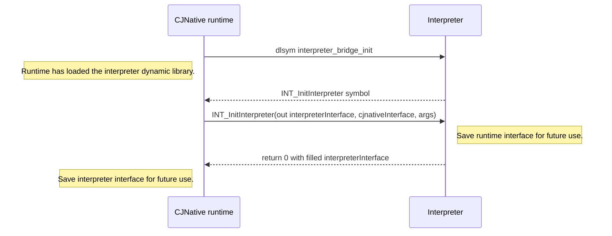
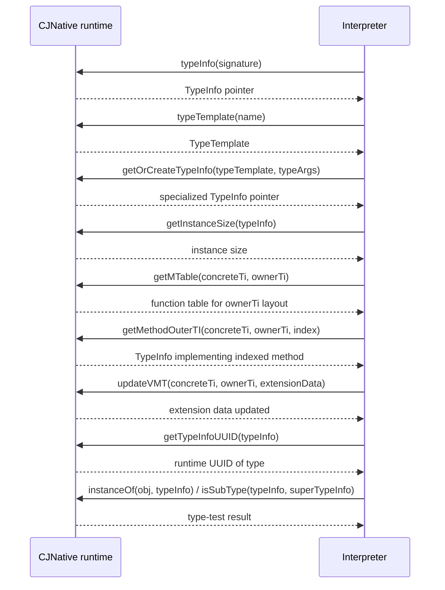
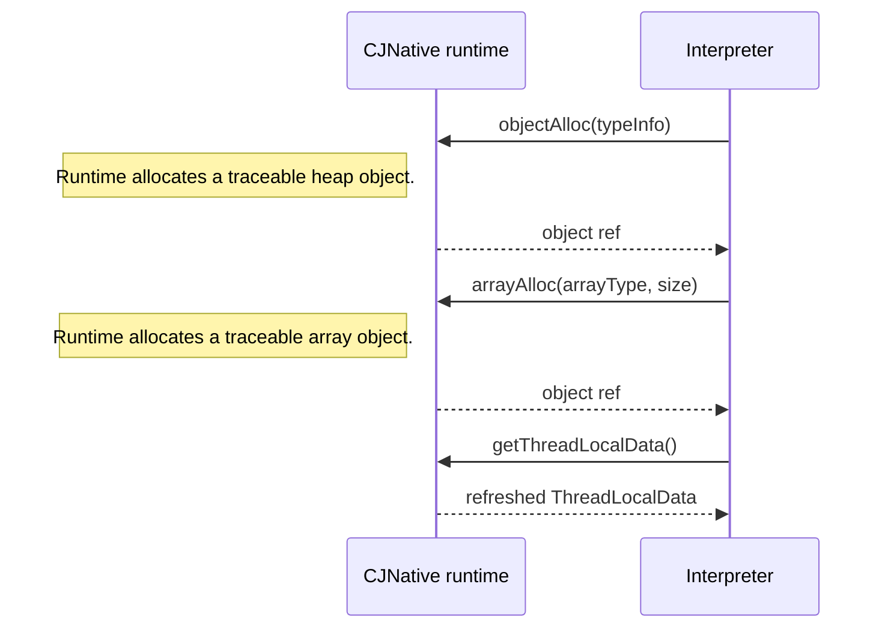
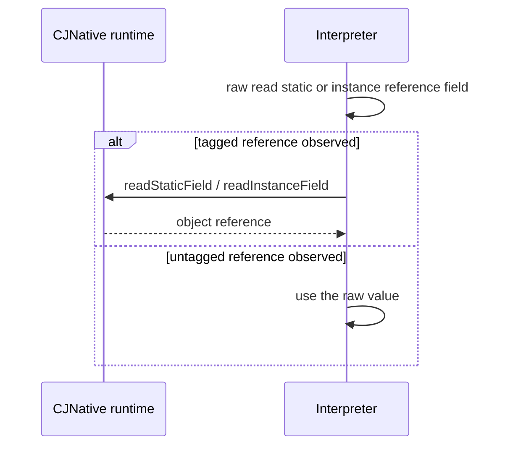
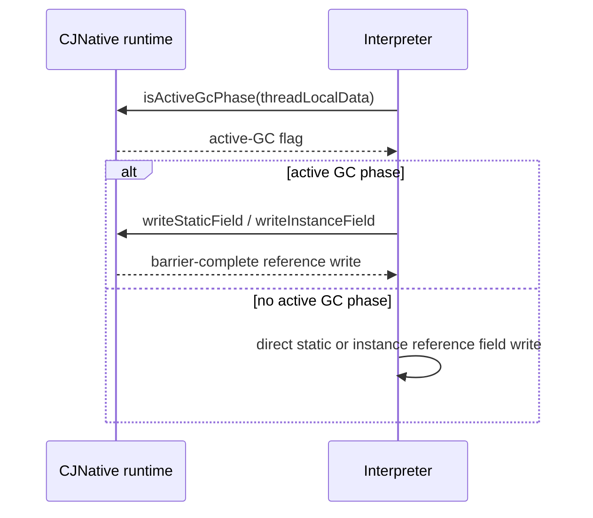
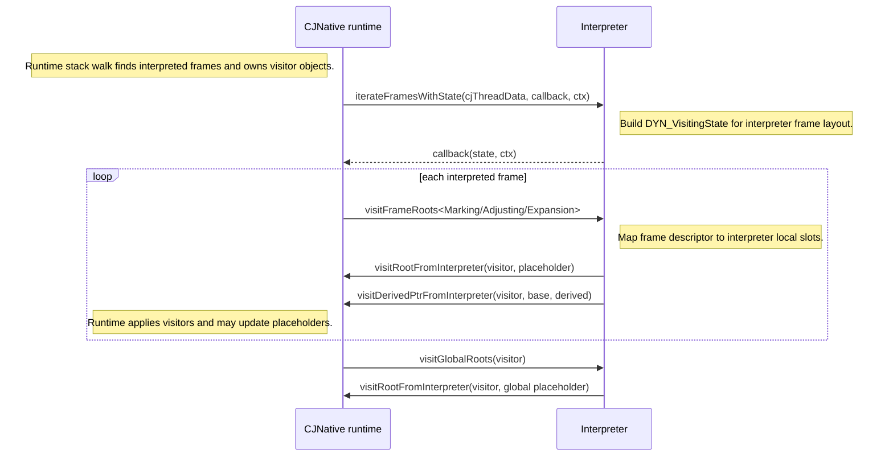
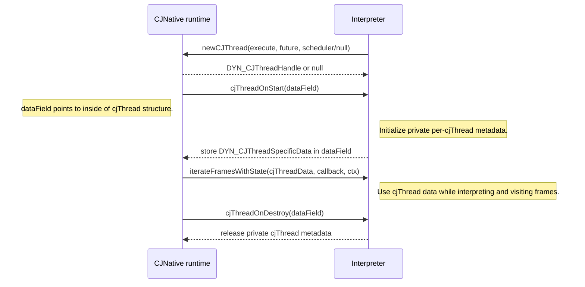
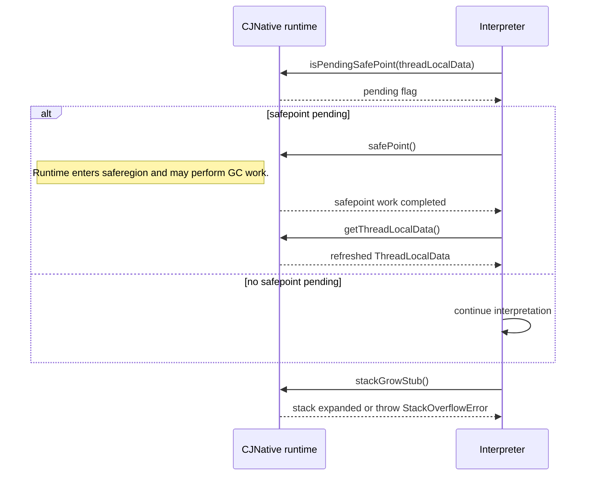
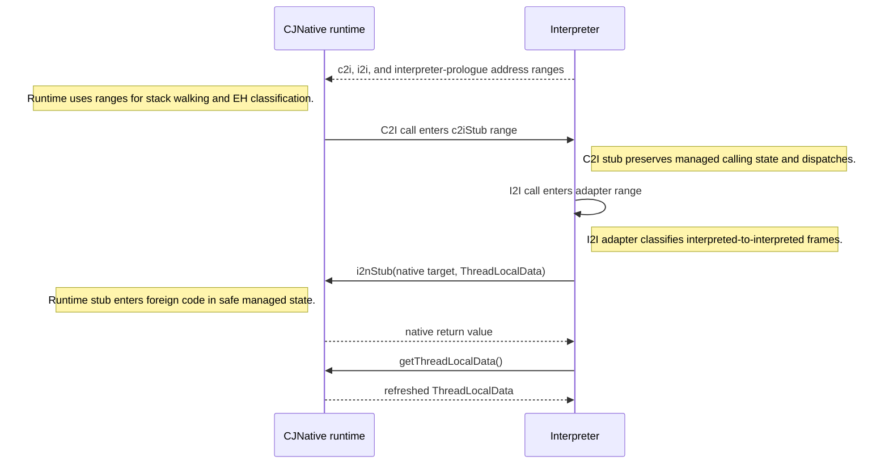
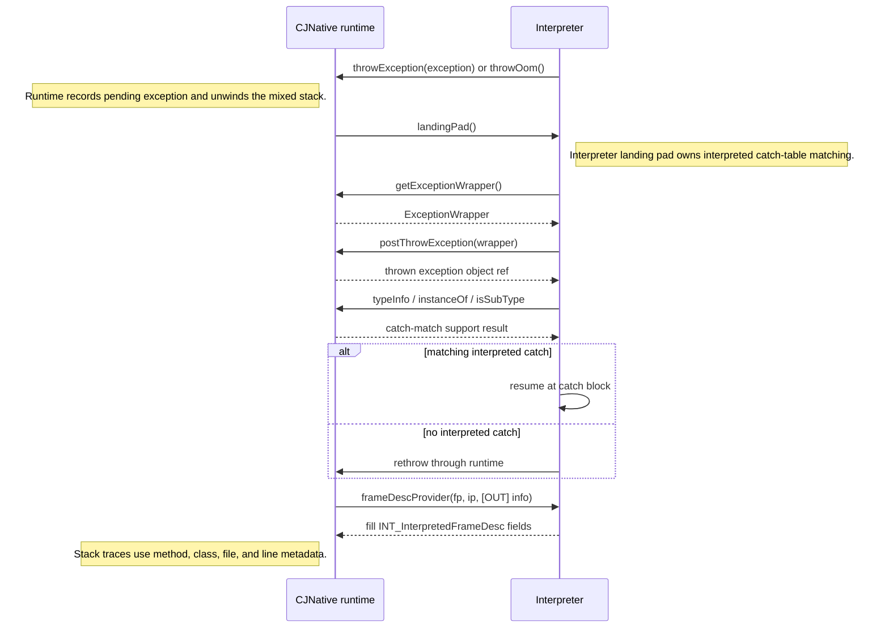

# Runtime Interface for Interpreter

This document describes the runtime interface used by CJNative runtime and an external interpreter to communicate with each other. The ABI is declared in [`runtime/include/Interpreter/RTInterface.h`](https://gitcode.com/Sharapov-Maksim/cangjie_runtime_interpreter_support/blob/rt-interface/runtime/include/Interpreter/RTInterface.h); runtime type mirrors used by the ABI are declared in [`runtime/include/Interpreter/RuntimeTypes.h`](https://gitcode.com/Sharapov-Maksim/cangjie_runtime_interpreter_support/blob/rt-interface/runtime/include/Interpreter/RuntimeTypes.h).

The interface is bidirectional:

- `DYN_CJNativeInterface` is implemented by CJNative runtime and called by the interpreter.
- `INT_InterpreterInterface` is implemented by the interpreter and called by CJNative runtime.

## Calling Model

There are various function types:

- **Compiled** - managed functions produced by Cangjie compiler. To support managed features (GC, exceptions, threading) it may require to keep runtime thread-local data in a dedicated non-volatile register.
- **Runtime** - functions of runtime, implementing complex language fatures. Use `C++` calling convention.
- **Native** - functions declared `foreign` in Cangjie code, implemented on other languages and using `C` calling convention.
- _**Interpreted**_ - appear when interpreter is used. Calling convention is implementation specific.

Transition stubs are responsible for preserving this managed state when control crosses between compiled code, runtime code, native code and interpreted code. C2I _(compiled-to-interpreted)_ and I2C _(intepreted-to-compiled)_ transitions should be implemented by interpreter. However, common I2N transition implementation is provided by runtime, see `DYN_I2NStubFn`. Related section: [Calls And Transition Stubs](#Calls-And-Transition-Stubs).

## Initialization And Ownership

The runtime loads the interpreter dynamic library and resolves `interpreter_bridge_init` symbol. In [`runtime/src/Interpreter/InterpreterSpecific.cpp`](https://gitcode.com/Sharapov-Maksim/cangjie_runtime_interpreter_support/blob/rt-interface/runtime/src/Interpreter/InterpreterSpecific.cpp), runtime then builds a `DYN_CJNativeInterface` table, calls the interpreter init function, receives a filled `INT_InterpreterInterface`, and stores that table for later GC, EH, stack, and thread callbacks.

```c
typedef int (*INT_InitInterpreter)(struct INT_InterpreterInterface *interpreterInterface,
                      struct DYN_CJNativeInterface *cjnativeInterface,
                      int interpreterArgsCount,
                      const char* const* interpreterArgs);
```

The interpreter should copy the runtime callback table (`cjnativeInterface`) and additional arguments (`interpreterArgs`) if it will use them after initialization.

Both interface tables start with an `int64_t version` field. The current supported version is `1` for both `INT_InterpreterInterface` and `DYN_CJNativeInterface`. Runtime sets `DYN_CJNativeInterface::version` before calling `INT_InitInterpreter`; the interpreter should reject unsupported runtime table versions by returning non-zero. After `INT_InitInterpreter` returns successfully, runtime checks `INT_InterpreterInterface::version` and fails initialization if it is not the supported interpreter table version.

`INT_InitInterpreter` returns `0` on success.



## Operated Entities

Most RT-interface values are intentionally opaque to one side of the boundary. The side that owns the entity defines its real binary layout and lifetime.

<details>
<summary>Entities</summary>

```c
typedef void *DYN_ObjRef;
typedef void *DYN_FieldRef;
typedef void *DYN_Placeholder;
typedef void *DYN_VisitingState;
typedef void *DYN_TypeTemplate;
typedef void *DYN_ThreadLocalData;
typedef void *DYN_CJThreadSpecificData;
typedef void *DYN_CJThreadHandle;
typedef const void *DYN_FramePointer;
typedef const void *DYN_InstructionPointer;
typedef const void *DYN_RootVisitor;
typedef const void *DYN_DerivedPtrVisitor;
typedef void *DYN_ExceptionWrapper;
```
</details>

Entity meanings:

- `DYN_ObjRef`: traceable heap object reference owned by CJNative runtime.
- `DYN_FieldRef`: address of a reference field, static or inside an object.
- `DYN_Placeholder`: address of a memory slot that contains a traceable reference.
- `DYN_VisitingState`: state created by interpreter frame iteration and passed across visits to individual interpreter frames.
- `DYN_TypeTemplate`: opaque runtime type template used to represent type info for generics.
- `DYN_ThreadLocalData`: runtime thread-local data for the current cjThread.
- `DYN_CJThreadSpecificData`: interpreter-owned cjThread data stored inside a runtime mutator/cjThread area.
- `DYN_CJThreadHandle`: opaque runtime handle of a cjThread.
- `DYN_FramePointer` and `DYN_InstructionPointer`: frame coordinates supplied by runtime when querying frame metadata or visiting frame roots.
- `DYN_RootVisitor` and `DYN_DerivedPtrVisitor`: runtime visitor objects. Interpreter must not call them directly. It passes them back through `visitRootFromInterpreter` or `visitDerivedPtrFromInterpreter`.
- `DYN_ExceptionWrapper`: runtime exception-wrapper state used during exception handling landing pad processing.

Frame metadata shared with the interpreter:

```c
struct INT_FrameDesc {
    DYN_FramePointer fp;
    DYN_InstructionPointer ip;
};

struct INT_InterpretedFrameDesc {
    size_t lineNumber;
    char*  methodName;
    char*  className;
    char*  fileName;
};
```

### Runtime Type Mirrors

[`RuntimeTypes.h`](https://gitcode.com/Sharapov-Maksim/cangjie_runtime_interpreter_support/blob/rt-interface/runtime/include/Interpreter/RuntimeTypes.h) exposes a binary mirror of runtime `TypeInfo` so an interpreter can inspect or construct type-related metadata without depending on C++ runtime classes. Runtime checks that `DYN_TypeInfo` matches `TypeInfo` layout.

Important type mirror entities:

- `DYN_TypeInfo`: type name, kind/flags, instance or component size, GC bitmap or GC descriptor pointer, field offsets, type arguments, field type descriptors, super/component type, extension data, method table descriptor, and reflection/debug info.
- `DYN_ExtensionData`: generic/interface extension metadata, function table, and optional where-condition function.
- `DYN_GCTib`: GC type information passed either as a pointer or a raw value. The high bit distinguishes raw form from pointer form.
- `DYN_FuncPtr` and `DYN_MTableDesc`: opaque function and method-table descriptors.

<details>
<summary>RuntimeTypes.h</summary>

```c
union DYN_GCTib {
    uintptr_t raw;
    void *ptr;
};

typedef void* DYN_MTableDesc;
typedef void* DYN_FuncPtr;

struct TYPE_INFO_ATTRS DYN_TypeInfo {
    const char* typeInfoName;
    int8_t type;
    uint8_t flag;
    uint16_t fieldNum;
    union {
        uint32_t instanceSize;
        uint32_t componentSize;
    };
    union DYN_GCTib gctib;
    uint32_t uuid;
    uint8_t align;
    int8_t typeArgsNum;
    uint16_t validInheritNum;
    uint32_t* fieldOffsets;
    DYN_FuncPtr finalizerMethod;
    struct DYN_TypeInfo** typeArgs;
    struct DYN_TypeInfo** fields;
    union {
        struct DYN_TypeInfo* superTypeInfo;
        struct DYN_TypeInfo* componentTypeInfo;
    };
    struct DYN_ExtensionData** vExtensionDataStart;
    DYN_MTableDesc* mTableDesc;
    void* reflectOrDebugInfo;
};

struct EXTENSION_DATA_ATTRS DYN_ExtensionData {
    uint32_t argNum;
    uint8_t isInterfaceTypeInfo;
    uint8_t flag;
    uint16_t funcTableSize;
    union {
        void* tt;
        struct DYN_TypeInfo* ti;
    };
    union {
        DYN_FuncPtr interfaceFn;
        struct DYN_TypeInfo* interfaceTypeInfo;
    };
    DYN_FuncPtr whereCondFn;
    DYN_FuncPtr* funcTable;
};
```
</details>

## Interface Tables

The interpreter fills this table for runtime:

```c
struct INT_InterpreterInterface {
    int64_t version;

    size_t cjThreadSpecificDataSize;

    uintptr_t c2iStubStartAddr;
    uintptr_t c2iStubEndAddr;

    uintptr_t i2iAdapterStartAddr;
    uintptr_t i2iAdapterEndAddr;

    INT_IterateFramesWithStateFn iterateFramesWithState;
    INT_VisitFrameRootsExpansionFn visitFrameRootsExpansion;
    INT_VisitFrameRootsMarkingFn visitFrameRootsMarking;
    INT_VisitFrameRootsAdjustingFn visitFrameRootsAdjusting;
    INT_VisitGlobalRootsFn visitGlobalRoots;

    INT_CJThreadOnStartFn cjThreadOnStart;
    INT_CJThreadOnDestroyFn cjThreadOnDestroy;

    INT_FrameInfoProviderFn frameInfoProvider;
    INT_LandingPadFn landingPad;
};
```

The runtime fills this table for the interpreter:

```c
struct DYN_CJNativeInterface {
    int64_t version;

    void* appLibHandle;
    size_t carrierSpecificOffset;
    size_t cjThreadSpecificOffset;
    DYN_NewCJThreadFn newCJThread;

    DYN_TypeInfoProviderFn typeInfo;
    DYN_TypeTemplateFn typeTemplate;
    DYN_GetOrCreateTypeInfoFn getOrCreateTypeInfo;
    DYN_GetInstanceSizeFn getInstanceSize;
    DYN_GetMTableFn getMTable;
    DYN_GetMethodOuterTIFn getMethodOuterTI;
    DYN_UpdateVMTFn updateVMT;
    DYN_GetTypeInfoUUIDFn getTypeInfoUUID;

    DYN_ObjAllocFn objectAlloc;
    DYN_ArrayAllocFn arrayAlloc;
    DYN_SafePointFn safePoint;
    DYN_IsPendingSafePointFn isPendingSafePoint;

    DYN_ThrowExceptionFn throwException;
    DYN_ThrowOOMFn throwOom;
    DYN_GetPendingExceptionFn getPendingException;
    DYN_GetAndClearPendingExceptionFn getAndClearPendingException;
    DYN_GetExceptionWrapperFn getExceptionWrapper;
    DYN_PostThrowExceptionFn postThrowException;
    DYN_GetCurrentCatchFunctionPcFn getCurrentCatchFunctionPc;

    DYN_InstanceOfFn instanceOf;
    DYN_IsSubTypeFn isSubType;

    DYN_VisitRootFromInterpreterFn visitRootFromInterpreter;
    DYN_VisitDerivedPtrFromInterpreterFn visitDerivedPtrFromInterpreter;

    DYN_ReadStaticFieldFn readStaticField;
    DYN_WriteStaticFieldFn writeStaticField;
    DYN_ReadInstanceFieldFn readInstanceField;
    DYN_WriteInstanceFieldFn writeInstanceField;

    DYN_ReadStructFieldFn readStructField;
    DYN_WriteStructFieldFn writeStructField;
    DYN_ReadStaticStructFieldFn readStaticStructField;
    DYN_WriteStaticStructFieldFn writeStaticStructField;

    DYN_ReadGenericFieldFn readGenericField;
    DYN_WriteGenericFieldFn writeGenericField;

    size_t arrayBodyOffset;
    DYN_GetArrayRefElementFn getArrayRefElement;
    DYN_SetArrayRefElementFn setArrayRefElement;

    DYN_GetThreadLocalDataFn getThreadLocalData;
    DYN_IsActiveGcPhaseFn isActiveGcPhase;
    DYN_StackGrowStubFn stackGrowStub;
    DYN_I2NStubFn i2nStub;

    DYN_NativeLoggerFn nativeLogger;
};
```

## Semantic Parts

### Type Metadata

Runtime provides type lookup, generic specialization, instance layout queries, and virtual/interface dispatch metadata to the interpreter. The interpreter uses these functions when executing allocation bytecodes, type tests, field layout logic, generic code, and method dispatch.

```c
typedef struct DYN_TypeInfo* (*DYN_TypeInfoProviderFn)(const char *);
typedef DYN_TypeTemplate (*DYN_TypeTemplateFn)(const char *);
typedef struct DYN_TypeInfo* (*DYN_GetOrCreateTypeInfoFn)(
    DYN_TypeTemplate typeTemplate,
    uint32_t argSize,
    struct DYN_TypeInfo** typeArgs);
typedef uint32_t (*DYN_GetInstanceSizeFn)(struct DYN_TypeInfo* typeInfo);
typedef DYN_FuncPtr* (*DYN_GetMTableFn)(
    struct DYN_TypeInfo* concreteTi,
    struct DYN_TypeInfo* ownerTi);
typedef struct DYN_TypeInfo* (*DYN_GetMethodOuterTIFn)(
    struct DYN_TypeInfo* concreteTi,
    struct DYN_TypeInfo* ownerTi,
    uint64_t index);
typedef void (*DYN_UpdateVMTFn)(
    struct DYN_TypeInfo* concreteTi,
    struct DYN_TypeInfo* ownerTi,
    struct DYN_ExtensionData* extensionData);
typedef uint32_t (*DYN_GetTypeInfoUUIDFn)(struct DYN_TypeInfo* ti);
typedef bool (*DYN_InstanceOfFn)(DYN_ObjRef obj, struct DYN_TypeInfo* ti);
typedef bool (*DYN_IsSubTypeFn)(
    struct DYN_TypeInfo* typeInfo,
    struct DYN_TypeInfo* superTypeInfo);
```

In the runtime implementation, these callbacks map to type lookup in loaded files and to `TypeInfoManager::GetOrCreateTypeInfo`. Interpreted generic code can combine `typeTemplate`, `typeInfo`, and `getOrCreateTypeInfo` to build specialized generic metadata before reading, writing, or allocating generic values.

For dispatch, `getMTable` returns the method table implemented by a concrete type using owner type's method layout. The layout owner is interface, concrete class itself or one of its supertypes. `getMethodOuterTI` returns the `TypeInfo` that owns the implementation in a selected method-table slot: the concrete type if it overrides the slot, or the supertype that provides the inherited function pointer. `updateVMT` refreshes an `ExtensionData` function table for extension dispatch, primarily for ABI-compatible virtual-method additions; if the table is already marked updated, the call is a no-op. `getTypeInfoUUID` returns the UUID assigned to a type by runtime.



### Allocation And Object State

Runtime owns heap allocation. The interpreter asks runtime to allocate objects and arrays, then treats returned values as traceable references whenever necessary.

```c
typedef DYN_ObjRef (*DYN_ObjAllocFn)(struct DYN_TypeInfo*);
typedef DYN_ObjRef (*DYN_ArrayAllocFn)(
    struct DYN_TypeInfo* arrayType,
    uint64_t size);
```

Related `DYN_CJNativeInterface` field:

```c
size_t arrayBodyOffset;
```

`objectAlloc` and `arrayAlloc` can reach GC points. After such calls, interpreter code that keeps its own copy of `DYN_ThreadLocalData` should refresh it through `getThreadLocalData`.



### Field Access And GC Barriers

The interpreter must use runtime callbacks for reference fields and structured value copies whenever runtime barriers may be needed. These callbacks preserve GC correctness across static fields, instance fields, arrays, structs, and generic value fields.

```c
typedef DYN_ObjRef (*DYN_ReadStaticFieldFn)(DYN_FieldRef source);
typedef void (*DYN_WriteStaticFieldFn)(
    DYN_FieldRef destination,
    DYN_ObjRef newValue);

typedef DYN_ObjRef (*DYN_ReadInstanceFieldFn)(
    DYN_ObjRef source,
    DYN_FieldRef field);
typedef void (*DYN_WriteInstanceFieldFn)(
    DYN_ObjRef destination,
    DYN_FieldRef field,
    DYN_ObjRef newValue);

typedef void (*DYN_ReadStructFieldFn)(
    uintptr_t dstPtr,
    DYN_ObjRef obj,
    uintptr_t srcField,
    size_t size);
typedef void (*DYN_WriteStructFieldFn)(
    DYN_ObjRef obj,
    uintptr_t dst,
    uintptr_t src,
    size_t size);

typedef void (*DYN_ReadStaticStructFieldFn)(
    uintptr_t dstPtr,
    size_t dstSize,
    uintptr_t srcPtr,
    size_t srcSize,
    DYN_GCTib tib);
typedef void (*DYN_WriteStaticStructFieldFn)(
    uintptr_t dst,
    size_t dstLen,
    uintptr_t src,
    size_t srcLen,
    DYN_GCTib tib);

typedef void (*DYN_ReadGenericFieldFn)(
    DYN_ObjRef dst,
    DYN_ObjRef srcObj,
    uintptr_t srcField,
    size_t size);
typedef void (*DYN_WriteGenericFieldFn)(
    DYN_ObjRef dstObj,
    uintptr_t dstField,
    DYN_ObjRef srcObj,
    size_t size);

typedef DYN_ObjRef (*DYN_GetArrayRefElementFn)(
    DYN_ObjRef source,
    uint64_t index);
typedef void (*DYN_SetArrayRefElementFn)(
    DYN_ObjRef destination,
    uint64_t index,
    DYN_ObjRef newValue);

typedef bool (*DYN_IsActiveGcPhaseFn)(DYN_ThreadLocalData);
```

For static struct fields, `DYN_GCTib` describes which parts of the value contain references so runtime barriers can trace or update them correctly.

#### Fast paths (static/instance fields)

`isActiveGcPhase` lets an interpreter implement **fast-path write barriers** (into static or object reference field). If no active GC phase is in progress, a reference slot can use a direct fast path where the interpreter knows it is valid.

**Fast-path read barriers** firstly do raw read of (static/instance) reference field value. If a tagged reference is observed after reading field, interpreter should use slow path `readStaticField`/`readInstanceField` callback. Otherwise, previously read reference already contains right value.

Fast-path read flow:



Fast-path write flow:



### GC Root Visiting And Stack Expansion

Runtime owns GC visitors and stack walking. Interpreter owns the layout of interpreted frames and interpreter global roots. The two sides cooperate through visitor callbacks.

Interpreter-provided callbacks:

```c
typedef void (*INT_IterateFramesWithStateFn)(
    DYN_CJThreadSpecificData cjThreadData,
    void (*callback)(DYN_VisitingState, void*),
    void* ctx);

typedef void (*INT_VisitFrameRootsExpansionFn)(
    DYN_VisitingState state,
    INT_FrameDesc frameDesc,
    DYN_RootVisitor stackPtrVisitor,
    DYN_DerivedPtrVisitor derivedPtrVisitor);

typedef void (*INT_VisitFrameRootsMarkingFn)(
    DYN_VisitingState state,
    INT_FrameDesc frameDesc,
    DYN_RootVisitor rootVisitor);

typedef void (*INT_VisitFrameRootsAdjustingFn)(
    DYN_VisitingState state,
    INT_FrameDesc frameDesc,
    DYN_RootVisitor rootVisitor,
    DYN_DerivedPtrVisitor derivedPtrVisitor);

typedef void (*INT_VisitGlobalRootsFn)(DYN_RootVisitor visitor);
```

Runtime-provided visitor adapters:

```c
typedef void (*DYN_VisitRootFromInterpreterFn)(
    DYN_RootVisitor visitor,
    DYN_Placeholder placeholder);

typedef void (*DYN_VisitDerivedPtrFromInterpreterFn)(
    DYN_DerivedPtrVisitor visitor,
    DYN_Placeholder basePtrHolder,
    DYN_Placeholder derivedPtrHolder);
```

The runtime flow during GC is:

1. Runtime unwinds the stack and classifies interpreter frames.
2. Runtime calls `iterateFramesWithState` once for the current `DYN_CJThreadSpecificData`.
3. The interpreter initializes iteration state and calls the runtime-provided continuation with that state.
4. Runtime iterates its discovered interpreter `FrameInfo` objects and calls `visitFrameRootsMarking`, `visitFrameRootsAdjusting`, or `visitFrameRootsExpansion`.
5. The interpreter maps each frame descriptor to its local slots and passes reference placeholders back through `visitRootFromInterpreter`.

For stack expansion, `visitFrameRootsExpansion` reports stack-pointer slots and derived pointers so runtime can update them after moving stack memory.



### cjThread Lifecycle And Thread-Local Data

Runtime tells the interpreter when a cjThread starts or is destroyed. The interpreter can allocate per-cjThread state and store it in the location passed by runtime.

Interpreter interface:
```c
typedef void (*INT_CJThreadOnStartFn)(DYN_CJThreadSpecificData*);
typedef void (*INT_CJThreadOnDestroyFn)(DYN_CJThreadSpecificData*);
```

Runtime interface:

```c
size_t carrierSpecificOffset;
size_t cjThreadSpecificOffset;

typedef DYN_CJThreadHandle (*DYN_NewCJThreadFn)(
    void* execute,
    DYN_ObjRef future,
    void* scheduler);
typedef DYN_ThreadLocalData (*DYN_GetThreadLocalDataFn)();
```

`carrierSpecificOffset` points to runtime mutator data inside `ThreadLocalData`. `cjThreadSpecificOffset` points to the interpreter-specific field inside the runtime mutator object. The interpreter should treat the offsets as runtime layout details and use the callback-provided storage instead of guessing layouts.

The interpreter can store any private per-cjThread metadata through `INT_CJThreadOnStartFn`; later runtime callbacks pass the resulting `DYN_CJThreadSpecificData` back into interpreter frame iteration.

`DYN_NewCJThreadFn` creates and schedules a new Cangjie thread that runs a managed `Future` task. `execute` is the non-null managed-call entry pointer for `Future.execute`; `future` is the non-null `Future` object passed to that entry and kept GC-visible by runtime while the cjThread is being created; `scheduler` is an optional target scheduler handle. Passing null for `scheduler` makes runtime use the current scheduler. The return value is an opaque `DYN_CJThreadHandle`, or null if creation or scheduling fails.



### Safepoints And Stack Growth

The interpreter polls runtime safepoints while executing interpreted code.

```c
typedef void (*DYN_SafePointFn)();
typedef bool (*DYN_IsPendingSafePointFn)(DYN_ThreadLocalData);
typedef void (*DYN_StackGrowStubFn)();
```

`safePoint` enters a runtime saferegion and may trigger GC or other runtime work. `isPendingSafePoint` lets the interpreter cheaply check whether a safepoint is needed before calling the heavier callback. After an explicit safepoint, interpreter code that keeps its own copy of `DYN_ThreadLocalData` should refresh it through `getThreadLocalData`.

`stackGrowStub` is not a normal C helper even though it is exposed through a C function-pointer table. Runtime initializes this field with `CJ_MCC_StackGrowStub`, an architecture-specific assembly stub. Interpreter-owned C2I transition code calls it after its stack-limit check fails, while its frame is still materialized and visible for runtime unwinding.



### Calls And Transition Stubs

Interpreter and runtime expose address ranges so runtime stack analysis can classify frames produced by transition stubs.

Interpreter table fields:

```c
uintptr_t c2iStubStartAddr;
uintptr_t c2iStubEndAddr;

uintptr_t i2iAdapterStartAddr;
uintptr_t i2iAdapterEndAddr;
```

Runtime-provided native-call stub:

```c
typedef void (*DYN_I2NStubFn)();
```

The main transition meanings are:

- C2I: compiled Cangjie code enters interpreted code. The interpreter supplies the C2I stub address range so runtime can classify C2I frames during stack walking and exception handling.
- I2I: interpreted code calls another interpreted function. The interpreter supplies the adapter range for stack classification.
- I2C: interpreted code calls managed compiled Cangjie code. Can be implemented fully in interpreter, runtime does not need I2C info to classify stack frames or for any other things.
- I2N: interpreted code calls native or foreign code. Runtime supplies `i2nStub` where supported, so interpreter can enter native code while preserving managed thread and stack state.
- Interpreter prologue: optional interpreter code range used by runtime stack classification. It can be zero when the interpreter has no separate prologue.

After a transition that calls compiled code, interpreter code that keeps its own copy of `DYN_ThreadLocalData` should refresh it through `getThreadLocalData`, because runtime may update thread-local state while compiled code is executing.



### Exception Handling And Stack Traces

Runtime owns pending exception state and stack unwinding. Interpreter owns interpreted catch-table semantics and translated frame metadata.

Runtime-provided exception callbacks:

```c
typedef void (*DYN_ThrowOOMFn)();
typedef void (*DYN_ThrowExceptionFn)(DYN_ObjRef exceptionObject);
typedef DYN_ObjRef (*DYN_GetPendingExceptionFn)();
typedef DYN_ObjRef (*DYN_GetAndClearPendingExceptionFn)();
typedef DYN_ExceptionWrapper (*DYN_GetExceptionWrapperFn)();
typedef uintptr_t (*DYN_GetCurrentCatchFunctionPcFn)();
typedef DYN_ObjRef (*DYN_PostThrowExceptionFn)(
    DYN_ExceptionWrapper exceptionWrapper);
```

Interpreter-provided EH and stack-trace callbacks:

```c
typedef void (*INT_FrameDescProviderFn)(
    DYN_FramePointer fp,
    DYN_InstructionPointer ip,
    INT_InterpretedFrameDesc* frameInfo);

typedef void (*INT_LandingPadFn)();
```

Typical thrown-exception flow:

1. Interpreter creates or receives an exception object and calls `throwException`, or calls `throwOom` for `OutOfMemoryError`.
2. Runtime records pending exception state and unwinds the mixed stack.
3. If runtime sees an interpreted frame, it treats the interpreter-provided `landingPad` as the landing pad for interpreter frames.
4. The landing pad asks runtime for `getExceptionWrapper`.
5. The landing pad calls `postThrowException` to begin catch processing and obtain the thrown object.
6. Interpreter checks its own catch information, commonly using `instanceOf` and `typeInfo` for type matching.
7. If an interpreted catch block exists, the interpreter continues there. Otherwise it drops/unwinds the interpreted frame and rethrows through runtime.

The interpreter landing-pad implementation is responsible for mapping the thrown object and current interpreted PC to interpreter catch metadata, then either resuming at a matching interpreted catch block or rethrowing through runtime.

`frameDescProvider` is used for precise stack traces. Runtime supplies an interpreted frame pointer and instruction pointer; interpreter fills `INT_InterpretedFrameDesc` with source line, method, class, and file names.



### Diagnostics

Runtime can provide a native logger callback for interpreter diagnostics.

```c
typedef void (*DYN_NativeLoggerFn)(
    int logLevel,
    char* tag,
    char* message);
```

The runtime implementation maps this to runtime logging. Interpreters should use it for platform-integrated logs when available, especially on platforms where standard output is not the preferred logging path.

## End-To-End Interoperation Summary

1. Runtime initializes the interpreter: `InitCJInterpreter` loads the interpreter library, resolves `interpreter_bridge_init`, fills `DYN_CJNativeInterface`, and stores the returned `INT_InterpreterInterface`.
2. Interpreter executes code: it uses runtime callbacks for type lookup, dispatch metadata, allocation, field barriers, safepoints, exception throwing, thread-local refreshes, cjThread creation, and native calls.
3. Runtime services GC and stack growth: it calls interpreter frame/root visitors and passes runtime-owned visitor objects; the interpreter reports placeholders back through runtime adapter callbacks.
4. Runtime services cjThread creation and lifecycle: the interpreter can call `newCJThread`, and runtime calls `cjThreadOnStart` and `cjThreadOnDestroy` so interpreter-specific cjThread state can be initialized and released.
5. Runtime services exceptions and stack traces: it routes interpreted frames to the common interpreter landing pad and queries `frameInfoProvider` for human-readable interpreted frame metadata.

The central rule is ownership preservation: runtime-owned objects, visitors, thread-local state, exceptions, and barriers are only operated through runtime callbacks; interpreter-owned frame layouts, interpreted globals, catch semantics, and interpreter-private cjThread metadata are only interpreted by the interpreter callbacks.
