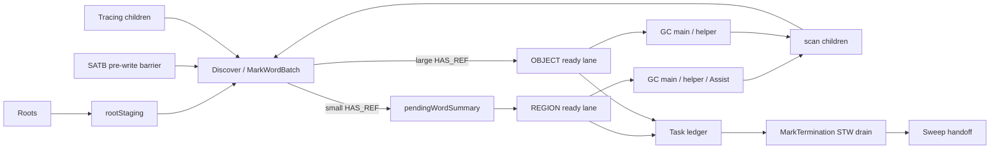

# Cangjie MSGC 总体架构与实现详解

> 当前代码基线：`MSGC-bugfix-regionScan` 分支，提交 `24ca097ace`。本文只把当前 `src/` 中可确认的行为写成“现实现”；旧的 WorkBuf 标记方案只作为已移除历史提及。

## 1. 总体结论

MSGC 是不移动的并发 Mark-Sweep 收集器。当前实现仍保持
`PreEnumRoots → EnumRoots → ConcurrentMark → MarkTermination → PostMarkTermination`
五阶段外形，但 Mark 内核已改为统一调度器：

- 小对象以 Region 为扫描任务，灰状态由 `markBitmap` 与 `scanBitmap` 的差集表达。
- 大对象以单对象 `OBJECT` 任务扫描。
- `pendingWordSummary` 记录某个 Region 中哪些 mark bitmap word 需要重新检查。
- `MSMarkScheduler` 提供 REGION/OBJECT 两条就绪 lane。
- `MSTaskLedger::outstandingTotal_` 同时覆盖 queued 与 leased task，是终止判定的权威值。
- 写屏障仍是 SATB deletion barrier：先发现将被覆盖的旧引用，再执行 store。
- Mutator Assist 只领取 REGION task；GC main/helper 可领取 REGION 与 OBJECT task。
- Sweep、Scavenge 和分配器主体没有因这次 Mark 表示切换而改变职责。

旧实现中的 mutator active log、Global WorkBuf、`PerPGCWork` 和 private partial 不再属于当前 Mark 闭包。

## 2. 组件关系



主要实现文件：

- [`MarkSweepCollector.h`](../../src/Heap/MCollector/MarkSweepCollector.h)
- [`MarkSweepCollector.cpp`](../../src/Heap/MCollector/MarkSweepCollector.cpp)
- [`MSMarkScheduler.h`](../../src/Heap/MCollector/MSMarkScheduler.h)
- [`MSMarkScheduler.cpp`](../../src/Heap/MCollector/MSMarkScheduler.cpp)
- [`MSMarkBatch.h`](../../src/Heap/MCollector/MSMarkBatch.h)
- [`MSWorkUnit.h`](../../src/Heap/MCollector/MSWorkUnit.h)
- [`MSRegionInfo.h`](../../src/Heap/MAllocator/MSRegionInfo.h)

## 3. 堆、Region 与三套 bitmap plane

每个 Region 由 64 字节 `MSRegionInfo` 描述。小对象 Region 通过
`MSBitmapArena` 的按 Region 索引 plane 访问位图：

| Plane | 当前含义 |
|---|---|
| `ALLOC` | `1=free slot`；collect-set 内用于过滤空闲/无对象的 slot |
| `MARK` | 本轮已发现的对象 |
| `SCAN` | 本轮已完成引用字段扫描的对象；仅 `HAS_REF` 小对象 Region 使用 |

因此一个已有小对象在并发 Mark 中的核心状态是：

```text
未发现: mark=0
已发现未扫描: mark=1, scan=0
已扫描: mark=1, scan=1
```

Region owner 计算：

```text
candidates = markWord & ~scanWord
if region is in current collect set:
    candidates &= ~allocWord & validMask
```

`BuildCollectSet()` 已把本轮 sealed Region 从分配供给中移走，因此 collect-set 内不会继续
产生新对象。这里的 `~ALLOC` 是对象存在性过滤：只允许当时已占用的 slots 成为 candidate。
Mark 期间仍在分配的 active/new Region 位于 collect-set 外，并由 generation/epoch 隔离。

## 4. 五阶段执行链

### 4.1 PreEnumRoots

此阶段停止或收口上一轮 Sweep，准备 collect-set 与 bitmap，并建立本轮 active collector。
它也重置 scheduler、统计与 Work Unit pacer 的周期状态。

### 4.2 EnumRoots

Collector 通过 handshake 切换到 mark-setup phase，枚举根并暂存到
`rootStaging_`。这个 `GreyWorkQueue` 只是根枚举的阶段性容器：

1. `EnumAndMarkRoots()` 发现根。
2. `PublishRootStaging()` 把根转成统一 scheduler 输入。
3. staging 在 `EnumRoots` 内即被完全排空。

它不是并发 Mark 的普通工作队列，也不参与终止判定。

### 4.3 ConcurrentMark

GC main 和 helper 反复从 scheduler claim task。小对象 task 由一个 owner 独占
Region 的 scan plane；大对象 task 扫描一个 marked large primary。

每个扫描者持有栈上 `MSMarkWordBatch`，将子引用按
`(regionIdx, wordIdx, mask)` 合并后再更新 mark plane。每个 task 必须先 flush
本地 batch，再完成 lease，避免 ledger 归零时仍有不可见的本地发现。

### 4.4 MarkTermination

进入 STW 后，runtime 关闭并等待并发 worker/Assist，再完成以下闭包：

1. 处理 finalizer resurrection 与其他 deferred root。
2. 把 residual `pendingWordSummary` 与 Region 状态重新对齐。
3. 在 STW 中以 GCWorker capability drain scheduler。
4. 要求 task ledger 为 0，且两条 ready lane 均为空。
5. 清理 weak reference，切换 barrier/phase。

终止不是“某个队列暂时为空”。只要 lease 尚未完成，ledger 就不会归零。

### 4.5 PostMarkTermination

此阶段计算 mark bitmap 上的真实 live 数据，更新阈值与 pacer，处理大对象垃圾，并向
Sweep/Scavenge 发布后续工作。

## 5. 小对象发现与 Region 发布

`AddRefToMarkBatch()` 先解析引用、核对 Region 与 mark epoch，再加入本地 batch。
flush 某个 entry 时：

1. 对 mark word 执行 atomic OR。
2. 计算本次新置位的 bits。
3. 对 `HAS_REF` Region 发布对应的 pending word bit。
4. 调用 `TryPublishRegion()`。

发布遵循 summary-first：

- `IDLE → QUEUED` 的竞争赢家创建一个 ledger task 并压入 REGION lane。
- Region 已是 `QUEUED` 或 `OWNED` 时，producer 只留下 pending bit。
- owner 在 `OWNED → IDLE` 后重新检查残留 summary。
- MarkTermination 在 STW 中再做最终 reconciliation。

这个协议允许多个 producer 并发置 mark bit，但 scan plane 仍保持单 owner 写入。

## 6. 大对象路径

Large/span 不使用小对象 mark plane 表达对象级存活。`AddRefToMarkBatch()` 找到 large
primary 后竞争 `CONTROL_LARGE_MARKED`：

- 首次标记且 `HAS_REF`：发布 `OBJECT` task。
- 已标记：不重复发布。
- `NO_REF`：只需要 marked 状态，不产生扫描 task。

Assist capability 是 `{region=true, object=false}`，因此大对象扫描不会落到 mutator
Assist 上；GC main/helper 使用完整 capability。

## 7. 写屏障

MSGC 使用 deletion-style SATB barrier：

```text
old = load(field)
publish(old)
store(field, new)
```

标量写使用一个栈上 mark batch，并在覆盖旧值前立即 flush。struct/array bulk 写可在同一
操作内合并多个旧引用，但 `BulkRefMarker` 析构前必须 flush，且 flush 发生在 memcpy/
memmove 覆盖旧区域之前。

屏障发布的是 bitmap work，而不是把对象地址追加到 TLS 日志。编译器可以进行 phase gate
和 wrapper lowering，但 Region scan scheduler 的内部状态由 runtime 管理。

## 8. Work Unit、Helper 与 Assist

当前 pacing 的统一单位是 Work Unit：

| 操作 | 成本 |
|---|---:|
| 解析一个引用 | 1 WU |
| 一次 mark word RMW | 8 WU |
| 检查一个 scan word | 1 WU |

默认墙钟预算：

| 执行者 | 单 slice 预算 |
|---|---:|
| GC main | 1000 μs |
| helper | 500 μs |
| mutator Assist | 50 μs |

分配字节按 pacer 的 `workPerByte` 形成债务；达到 512 WU 阈值后可触发 Assist。Assist
只能领取 REGION task，按压力级别偿还 normal/high/critical 比例的债务。

Helper 数量由 task ledger backlog 和 heap runway 共同决定。pressure 分类为：

- runway 大于 100 ms或没有分配：NORMAL；
- 20–100 ms：HIGH；
- 小于 20 ms：CRITICAL。

## 9. 与 Sweep 和分配的交界

- Mark 期间新分配量通过 `AccountMarkAllocationBytes()` 进入 pacer。
- collect-set Region 的 `allocBitmap` 参与 candidate 排除。
- Mark 完成后，Sweep 仍以 mark bitmap 作为存活快照。
- scan bitmap 只服务本轮闭包，不代替 Sweep 的存活依据。
- Worker pool 的 MARK/SWEEP lease 保证同一批 worker 不跨 epoch 混用。

## 10. 正确性不变式

1. SATB 必须在覆盖旧引用前完成发布与必要 flush。
2. mark bitmap 更新先于 pending summary 的 release 发布。
3. 同一 `HAS_REF` 小对象 Region 同时只有一个 scan owner。
4. task lease 完成前，本地 mark batch 必须为空。
5. owner 因预算退出时，必须先发布 replacement，再完成当前 lease。
6. termination 以 ledger 为权威，并验证 ready lanes 为空。
7. collect-set 必须保持 sealed，且 alloc plane 的 free slots 不能进入 mark/scan。
8. large marked winner 至多发布一个 OBJECT task。

## 11. 诊断与阅读顺序

建议按以下顺序定位 Mark 问题：

1. `AddRefToMarkBatch()` / `FlushMarkWordEntry()`：对象是否真正进入 mark plane。
2. `MSRegionInfo::pendingWordSummary` 与 `MSScanState`：Region 是否丢失发布。
3. `MSMarkScheduler::TryPublishRegion()` / `TryClaim()`：task 是否入队、领取。
4. `RunRegionTask()` / `RunObjectTask()`：是否完成扫描和 batch flush。
5. `MSTaskLedger`：是否存在 queued/leased 不匹配。
6. `DrainSchedulerUnderSTW()` 与 verifier：是否存在 residual work。

配合 `cjMSVerifyMark` 可在 Post-Mark/Sweep 之前检查可达对象指向未标记目标等完整性问题。

## 12. 历史方案说明

提交 `24ca097ace` 的目标就是移除基于对象 WorkBuf 的普通 Mark，并建立 Region scan
Mark。旧文档、旧图和旧 benchmark 中的 active log、global full、partial buffer、tail
drain 等词，只能用于解释旧问题，不能用来推断当前控制流或 ABI。
