# Cangjie MSGC 总体架构与实现详解

> 本文是 MSGC 的可独立阅读总览。章节 3～11 与 `Docs` 下的专题文档严格对应；本文讲清组件、流程和实现边界，专题文档再展开字段、函数、锁、位图和优化细节。

## 阅读方式

先读第 1、2 章建立整体模型，再按第 3～11 章顺序阅读堆、Region、分配、Mark、Barrier、Sweep、Scavenge、Assist 和 LLVM 优化。第 12 章以后集中说明跨模块不变式、工程取舍、配置/日志/验证环境和源码索引。

## 目录

1. [文档范围与核心结论](#chapter-1)
2. [总体架构与线程角色](#chapter-2)
3. [堆存储结构](#chapter-3)
4. [Region 结构](#chapter-4)
5. [对象分配架构](#chapter-5)
6. [GC Mark 架构与生命周期](#chapter-6)
7. [Runtime Barrier](#chapter-7)
8. [Sweep 架构](#chapter-8)
9. [Scavenge 架构](#chapter-9)
10. [Assist 协助架构](#chapter-10)
11. [LLVM 与 Runtime 优化](#chapter-11)
12. [关键正确性不变式](#chapter-12)
13. [工程取舍与性能模型](#chapter-13)
14. [配置、日志、环境变量与验证环境](#chapter-14)
15. [源码索引与推荐阅读顺序](#chapter-15)

<a id="chapter-1"></a>
## 1. 文档范围与核心结论

MSGC（Mark-Sweep GC）是仓颉运行时中的非移动式垃圾收集器。它把对象可达性、对象槽回收和物理页归还拆成相互衔接但并不等价的阶段：Mark 决定哪些对象存活，Sweep 恢复死亡槽，Reclaim/Scavenge 决定空 Region 和物理页如何回收。

### 1.1 一句话架构

MSGC 以稳定地址的 Region 堆为基础：small 对象按 size class 放入 32KB Region，large 对象占用连续 Region；根、写屏障和 Assist 共同建立 mark bitmap 闭包；Mark 结束后由后台、Lazy、Assist、并行和 Force-Finish 五类 Sweep 执行方逐步恢复槽位；空闲页再由 FreeManager/Scavenge 归还操作系统。

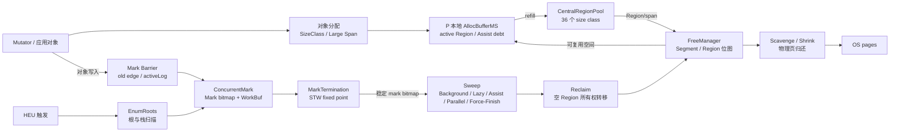

分配侧的多 P、中央池和 FreeManager 关系如下图。“桶”是按 size class 组织的 Region 容器；同一个 size-class bucket 内有按 Sweep 状态区分的四条链；右侧颜色分别表达已使用、逻辑空闲和已释放物理页的 Region。

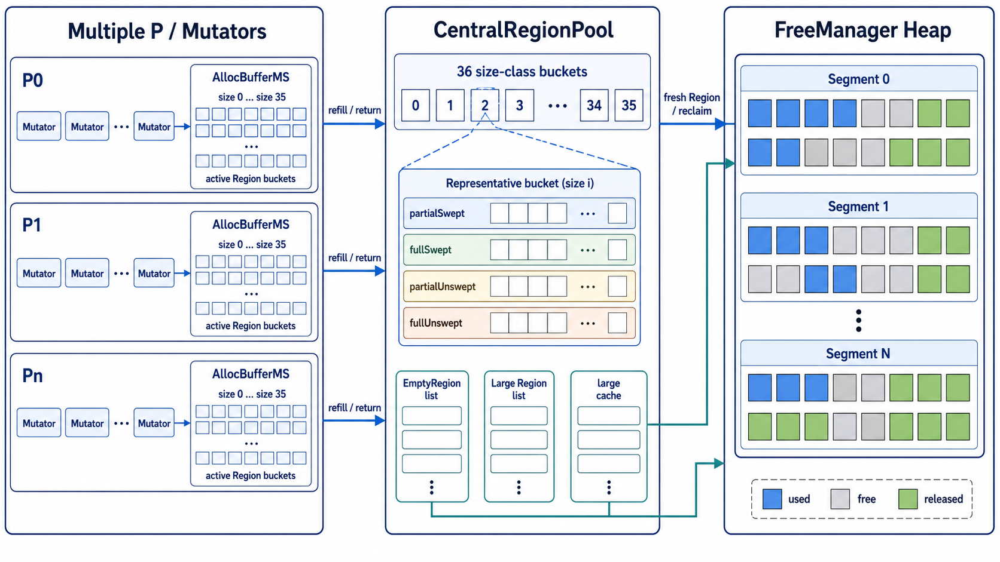

图中地址稳定贯穿整条链路：GC 不搬迁对象，Barrier 只维护 Mark 闭包；Sweep 只恢复槽位，Reclaim/Scavenge 才逐步释放 Region 和物理页。

### 1.2 一个对象的完整生命周期

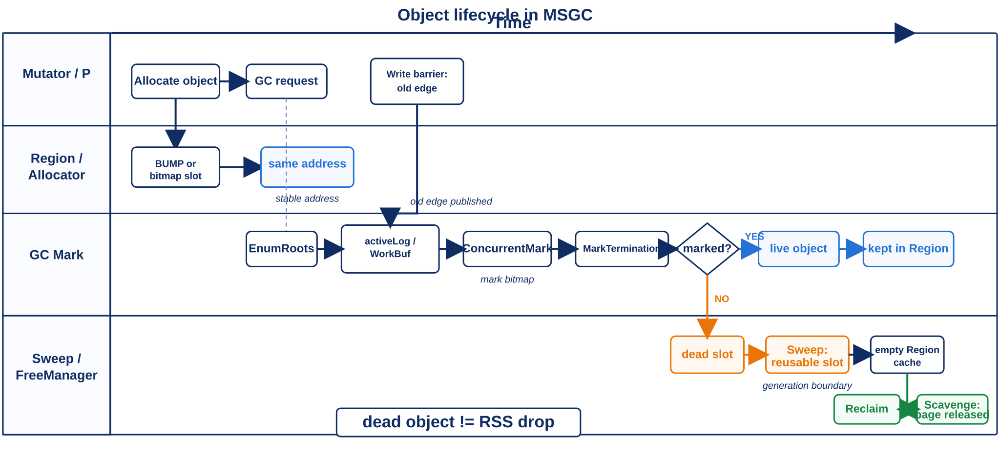

图从左到右表示时间推进：对象先在稳定地址的 Region 中分配；根枚举与写屏障共同把对象图送入 Mark 闭包；MarkTermination 后分为存活对象和死亡槽位两条分支。死亡槽位先经 Sweep 变为可复用空间，再经 empty cache、Reclaim、Scavenge 才可能归还物理页，因此“对象死亡”不等于“RSS 立即下降”。

1. 分配器根据对象大小和类型选择 small class 或 large span。
2. small 对象优先从 P 的 `AllocBufferMS` active Region bump；large 对象注册 primary/follower span 元数据。
3. GC 触发后，根枚举、字段扫描和 Mark barrier 设置 mark 位；含引用对象进入 `WorkBuf`，直到图闭包收敛。
4. MarkTermination 在 STW 下固定最终闭包，弱引用、finalizer 和 large 统计随后处理。
5. Sweep 根据 mark bitmap 把死亡槽恢复为空闲槽，Region 重新进入本地/中央可分配链。
6. 空 Region 可能仍保留在本地或中央缓存；Reclaim 将它 materialize 到 FreeManager，Scavenge 才可能解除物理提交。

所以“对象死亡”“槽位可复用”“Region 可分配”“RSS 下降”是四个不同事件，不能用一个 GC 完成标志替代。

### 1.3 当前实现的几个核心边界

- 对象不搬迁，引用值不需要解 forwarding，因此 MSGC 不需要运行期读屏障。
- 当前普通写入使用 old-only deletion/SATB 语义：先保护将被覆盖的旧引用，再执行 store。
- Mark bitmap 表示发现状态，`WorkBuf` 表示待扫描状态，`activeLog_` 表示写屏障产生的待发布工作；三者共同构成三色语义。
- 普通新对象依靠 Sweep generation 隔离，不逐对象 mark-at-alloc；Mark 期间新建且带 finalizer 的对象需要特殊保护。
- `PostMarkTermination()` 在完成语义后处理后发布统计和后台 Sweep/Scavenge 工作，不等于一次性清扫所有 small Region。
- Runtime 和 LLVM 共享 size class、对象布局、字段偏移、wrapper 参数和 WorkBuf ABI；两边必须配套编译。

### 1.4 与 CopyGC 的根本差异

| 维度 | CopyGC | MSGC |
| --- | --- | --- |
| 对象地址 | 复制到 to-space，地址可能改变 | 生命周期内稳定，不移动 |
| 读屏障 | 处理 forwarding/tagged pointer | 不需要，普通 load/memcpy 可直达 |
| 写屏障 | 随复制阶段变化，通常读写都受影响 | Idle/Mark 两套，Mark 期保护 old edge |
| 分配 | 线性 bump 与复制空间配合 | size class、Region bitmap 和 large span |
| 回收 | 复制时完成整理 | Mark 后分层 Sweep，再独立 Scavenge |
| 编译器重点 | forwarding、tagged pointer、读屏障 | 读屏障消除、内联分配、old-edge barrier |

详细实现： [堆存储结构](02_MSGC_堆存储结构详解.md)、[GC Mark](05_MSGC_GC_Mark架构与实现详解.md)、[Barrier](06_MSGC_Barrier架构与实现详解.md)、[LLVM 优化](10_MSGC_优化实现与效果详解.md)。

<a id="chapter-2"></a>
## 2. 总体架构与线程角色

MSGC 可以看成三条互相衔接的流水线：

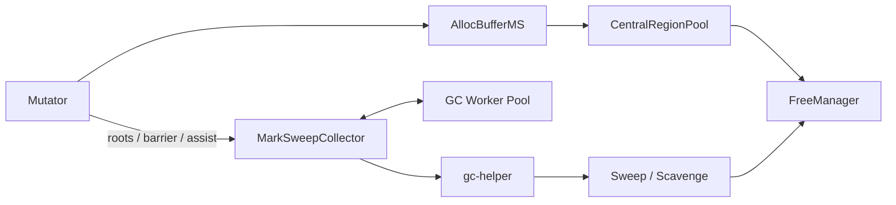

### 2.1 分配流水线

编译器或 Runtime 分配入口先选择 size class/large span，优先使用当前 P 的 active Region。快路径失败后，`SlowAlloc` 依次尝试本地空 Region、中央池、FreeManager 和 Segment Grow；在 refill 前后还可能偿还 Mark/Sweep debt。分配器只转移 Region 所有权，不把同一个 Region 同时放在多个链表中。

### 2.2 可达性流水线

EnumRoots 扫描 Mutator 栈根和 Runtime 全局根，字段扫描与 Mark barrier 都进入统一的“原子置位 mark → 含引用对象入队”路径。P 本地 WorkBuf 满后发布到 Global，GC 主线程和 Worker 消费全局工作；Mark Assist 用分配预算执行同样的扫描。MarkTermination 停止会产生新边的线程，排空剩余工作并确认固定点。

### 2.3 回收流水线

Mark 后的稳定 bitmap 先交给 Sweep。small Region 通过 alloc/mark bitmap 重建空闲槽和 summary，large span 依据 primary 元数据独立处理。清扫完成的 Region 返回本地/中央链；空 Region materialize 到 FreeManager 后，后台 Scavenge 才按预算寻找可归还的物理页，堆尾 Shrink 则是另一条容量策略路径。

### 2.4 线程角色

| 角色 | 常态职责 | 不负责的工作 |
| --- | --- | --- |
| Mutator | 业务执行、分配、根扫描、写屏障、Mark/Sweep Assist | 不扫描其他运行线程的栈，不推进全局 phase |
| GC 主线程 | 驱动阶段、根汇总、Mark 主 lane、STW 收口、阈值更新 | 不承担普通后台 Sweep |
| GC Worker | MARK epoch 扫 WorkBuf，或 SWEEP epoch 清扫 claim 的 Region | 不混用两个 epoch，不负责 root handshake |
| `gc-helper` | finalizer、后台 Sweep、动态并行 Sweep coordinator、Scavenge/Shrink | 不扫描当前对象图，不持有 MARK lease |

### 2.5 Worker Pool epoch 与后台时序

MARK 和 SWEEP 使用同一个物理 Worker Pool，但以互斥 epoch 运行。GC 主线程进入 MARK 时最多借用 `gcThreads - 1` 个 Worker；HEU 高压时，`gc-helper` 作为 Sweep coordinator 取得 SWEEP lease，再借用 Worker 执行并行清扫。两个 epoch 不会同时开放。

一轮典型时序是：旧 Sweep 封口 → 短 STW 清理/翻转 generation → handshake 根枚举 → 并发 Mark → STW MarkTermination → weak/finalizer/large 后处理 → 通知后台 Sweep/Scavenge。Mutator 在 Mark 后继续分配，下一轮 `PreEnumRoots()` 必要时再 Force-Finish 残余旧 Sweep。

详细实现： [对象分配](04_MSGC_对象分配架构与实现详解.md)、[GC Mark](05_MSGC_GC_Mark架构与实现详解.md)、[Sweep](07_MSGC_Sweep架构与实现详解.md)、[Assist](09_MSGC_Assist协助架构与实现详解.md)。

<a id="chapter-3"></a>
## 3. 堆存储结构

MSGC 的堆有两个需要同时观察的维度：空间单位和 Region 存储层。空间单位是“最大虚拟堆 → Segment → Region”；存储层是“P/TLS → CentralRegionPool → FreeManager”。前者回答地址和容量如何组织，后者回答一个 Region 当前由谁持有。

### 3.1 三层空间单位

最大虚拟堆在初始化时预留稳定地址范围，Grow 只提交新的前缀，Shrink 只收缩堆尾连续空闲范围。Segment 是提交容量、FreeManager owner 和 shard 路由的管理单位；Region 是对象布局、bitmap slot 和分配器状态的最小单位，当前 small Region 为 32KB。

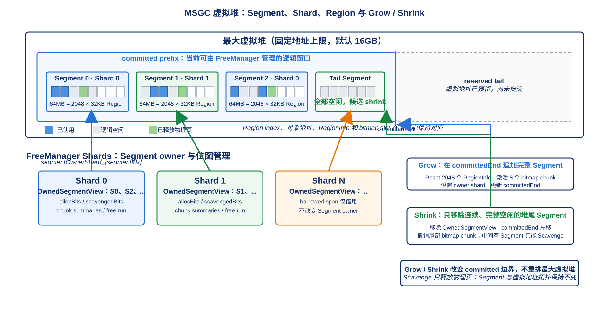

图中每个 Segment 为 64MB，即 2048 个 32KB Region；owner shard 通过 `segmentOwnerShard_` 固定映射并在对应 `OwnedSegmentView` 中管理 allocation/scavenged 位图。Grow 在 `committedEnd` 追加完整 Segment，Shrink 仅移除连续、完整空闲的堆尾 Segment；中间空闲 Segment 只能先 Scavenge，不能直接收缩地址范围。

对象地址、`MSRegionInfo` 和 bitmap arena 通过同一个 `regionIdx` 对齐。给定对象地址，Runtime 可以先计算 Region index，再定位控制面和位图；large span 的 follower Region 通过 primary index 回到同一份 span 元数据。因此 GC 不移动对象，也不需要更新全堆引用。

### 3.2 三层 Region 存储

三层不是三份对象堆，而是围绕同一批 32KB Region 的不同所有权和供给层。对象字节、`MSRegionInfo` 与 bitmap slot 始终由同一个 `regionIdx` 对齐；在层之间移动的是 owner、location 和侵入式 link，不会复制对象，也不会改变地址。

#### P/TLS 层：本地快路径与 barrier log

`ThreadLocalData` 只保存一个 `AllocBufferMS*`，首次需要本地 MSGC 状态时才在 native heap 创建 buffer。一个执行 P 可以调度多个 Mutator；当前进入 Runtime 的执行上下文通过 TLS 找到它的 buffer。这里的 “P/TLS” 表示与执行 P 对应的本地缓存，不能简单等同于“每个协程各有一套”。

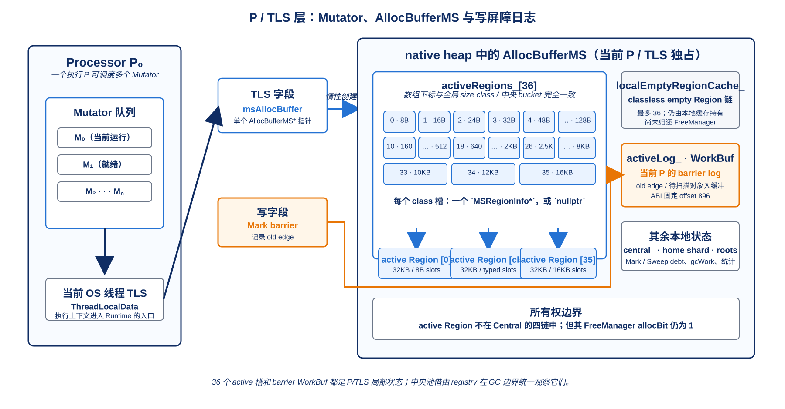

`activeRegions_[36]` 的下标与全局 size-class 表完全一致，每个槽要么保存该 P 为此 class 独占的一个 typed `MSRegionInfo*`，要么为 `nullptr`。因此不会为 36 个 class 预先占满 Region；某个 class 首次分配才需要 refill。`localEmptyRegionCache_` 中的空壳已经和旧 class 解绑定，但仍由该 P 缓存持有。Mark barrier 则把 old edge 发布到当前 P 的 `activeLog_`（`WorkBuf`），而不是直接修改中央 Region 链；中央池通过 buffer registry 在 GC 边界统一观察所有 P 的 active、empty、root 与 WorkBuf 状态。

#### Central 层：跨 P 的 typed Region 池与共享缓存

全局只有一个 `CentralRegionPool`。它有固定的 36 个 `SizeClassBucket`，每个 bucket 以同一份 slot-size 表解释 Region，并同时维护已 Sweep/未 Sweep、partial/full 的四种容器。`partialSwept_` 是 refill 最热路径，使用 tagged-head 的无锁栈；其他三条链由 bucket lock 和 sweep generation 协调。

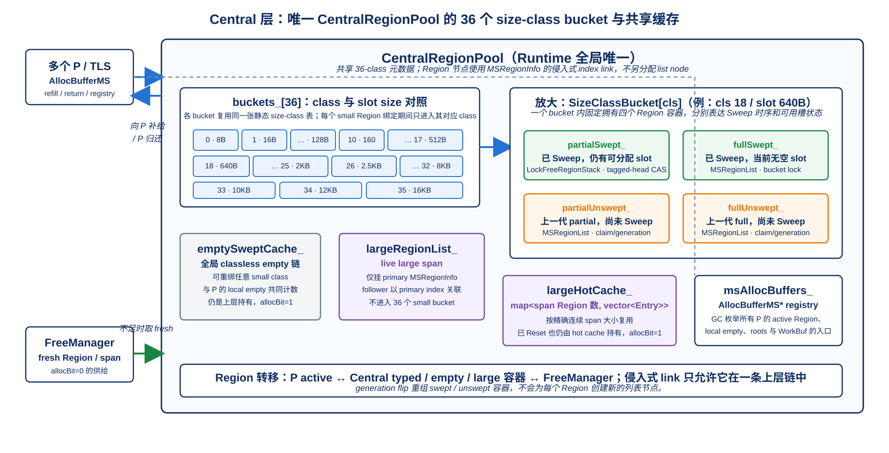

small Region 不会进入错误的 class bucket；large span 也不进入这 36 个 bucket，而由 live `largeRegionList_`（只挂 primary entry）和按精确 span 大小索引的 `largeHotCache_` 单独保存。全局 `emptySweptCache_` 与各 P 的 local empty cache 共同构成 classless empty 供给。它们都是上层缓存：即便 Region 已经没有对象，未 Reset 并交回 page heap 前，FreeManager 的 allocation bit 仍保持 1。

#### FreeManager 层：Segment view、可分配真值与物理页状态

FreeManager 不保存 size class、对象 slot 或 mark bitmap。它把已提交 heap 按 64MB Segment 分给 owner shard，并为每个 Segment 创建 `OwnedSegmentView`；view 的 `allocBits_`、`scavengedBits_`、summary 和连续 free run 才决定 Region 是否可由 page heap 再次发放。下面的蓝色 Region 表示“已被上层某一个位置持有”，并不表示它同时在图中列出的所有容器里。

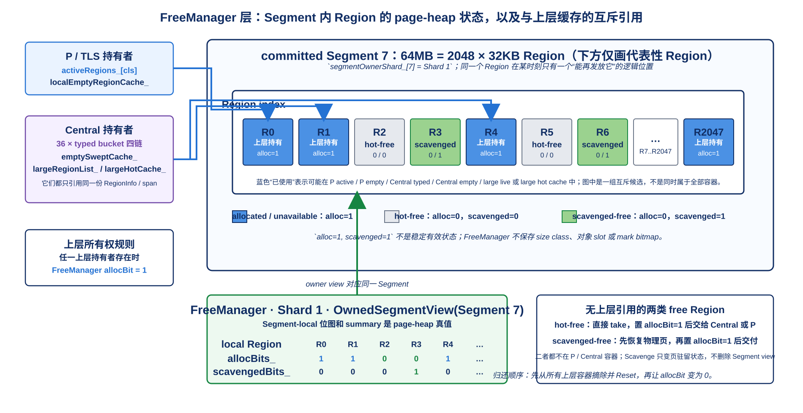

`alloc=0, scavenged=0` 是 hot-free：逻辑空闲、物理页仍可直接复用；`alloc=0, scavenged=1` 是 scavenged-free：逻辑空闲但物理页已释放，重新分配前需恢复页面。两种 free 状态均不应有 P/TLS 或 Central 的引用。反过来，active Region、中央 bucket/empty/large 容器，乃至 large hot cache 中的 span 都要求 `allocBit=1`。所以一个 Region 不能同时出现在 P active 槽和中央 typed 链中，也不能在仍被上层缓存持有时被 FreeManager 当作 free supply；归还必须先摘链、Reset，再把 allocation bit 清零。

### 3.3 缓存与物理内存

P/中央 empty cache 中的 Region 可能已经逻辑空闲，但还没有 materialize 到 FreeManager；FreeManager 中 allocation=0、scavenged=0 的 Region 是 hot-free，allocation=0、scavenged=1 的 Region 才表示物理页已解除提交。因而逻辑 heap、retained、committed heap 和 RSS 不是同一个指标。

详细实现： [堆存储结构](02_MSGC_堆存储结构详解.md)。

<a id="chapter-4"></a>
## 4. Region 结构

Region 是 MSGC 中同时承载对象、分配状态、Mark 状态和 Sweep 所有权的基本单位；`MSRegionInfo` 和 bitmap 是它的控制面与 sidecar 元数据。

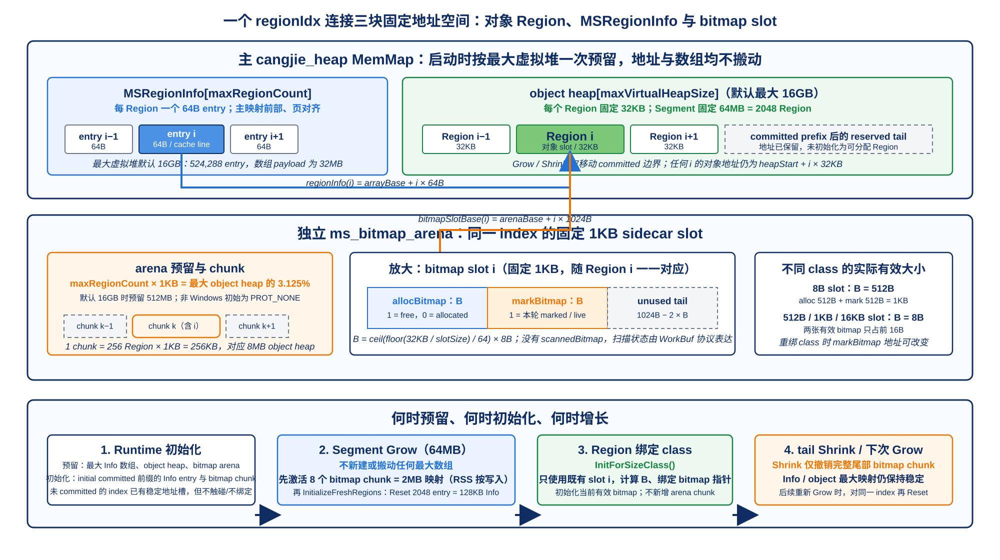

图的关键不是三块空间的相邻地址，而是共同的 `regionIdx`。主 `cangjie_heap` 映射前部是按最大虚拟 Region 数预留的 `MSRegionInfo[]`，后部才是 object heap；bitmap arena 则是独立映射。对 index `i`，对象 Region 起点为 `heapStart + i × 32KB`，控制 entry 为 `arrayBase + i × 64B`，bitmap slot 为 `arenaBase + i × 1KB`。因此 Region 被重新绑定为不同 size class 时地址和 entry 不变，只会重写 entry 字段和该 1KB slot 中实际有效的 bitmap 区间。

初始化与 Grow 也分成三层：Runtime 首先一次预留最大 object heap、Info 数组和 bitmap arena，但只初始化初始 committed 前缀；每次 64MB Segment Grow 不扩容或搬动最大数组，而是激活 8 个 bitmap chunk（2MB sidecar 映射），并对新增 2048 个 entry 执行 `Reset()`（128KB Info）。其中 `Reset()` 的 128KB 确实会在 Grow 时被写入；Unix 上新激活的匿名 bitmap 映射通常按首次写入建立物理页，Windows 则会产生对应的 commit charge，因此不能把“激活 2MB”直接等同于“RSS 立即增加 2MB”。Grow 也不会 memset 整个 64MB object payload。随后某 Region 首次绑定某个 size class 时，`InitForSizeClass()` 才计算该 class 所需的 bitmap 字节数、绑定 `allocBitmap`/`markBitmap` 并初始化有效位；对象 payload 则在该 Region 真正被分配/写入时才按页触碰。tail Shrink 只撤销完全位于新 committed 边界之后的 bitmap chunk；下次 Grow 仍复用原来的 index 和地址槽。

### 4.1 Small Region 布局

一个 small Region 按当前 size class 划分固定大小 slot。BUMP 阶段用 `bump`/`end` 指针连续分配，通常不为每个新对象逐位写 alloc bitmap；Region 进入 PARTIAL 后，分配器根据 alloc bitmap 和 summary 找到死亡槽。对象头、slot stride、对象对齐和清零规则必须由 Runtime、TypeInfo 和 LLVM 同时理解。

### 4.2 Large span 布局

超过 small 最大 class 的对象使用连续 Region span。primary `MSRegionInfo` 保存 span 长度、对象布局和统计信息，follower 记录 primary index。large 的标记、统计、Sweep 和 hot cache 不走 small size-class 的逐槽路径；死亡 span 按长度进入 large hot cache 或 FreeManager 连续空闲路径。

### 4.3 `MSRegionInfo` 控制面

`MSRegionInfo` 是“一个最大虚拟 Region 对应一个 64B cache-line 控制 entry”的固定结构，`allocPtr` 必须位于 offset 0。它描述对象布局、slot 视图和 Sweep 视图；**不**单独描述当前由哪个 P 或中央容器持有。后者由独立的 `location`/`ownerToken` side table 表达，因此 `regionType`、`sweepState` 和 location 是正交状态。

| offset | 字段 | 类型 | 作用 |
| ---: | --- | --- | --- |
| 0 | `allocPtr` | `uintptr_t` | BUMP 分配的当前位置；large primary 中为对象/span 起点。这是编译器快路径 ABI 字段。 |
| 8 | `regionEnd` | `uintptr_t` | small Region 的 `start + 32KB`；large primary 中为整个 span 尾。 |
| 16 | `nextRegionIdx` | `int32_t` | 侵入式中央链/栈的 next Region index。挂入新链前必须恢复为 `INVALID_IDX`。 |
| 20 | `prevRegionIdx` | `int32_t` | 侵入式双向链的 previous Region index；无锁单链栈不使用它。 |
| 24 | `allocBitmap` | `uint64_t*` | 当前 size class 的空闲槽位图，`1=free`、`0=allocated`；指向本 Region 的固定 bitmap slot。 |
| 32 | `markBitmap` | `uint64_t*` | 当前 Mark view 的存活位图，`1=marked/live`；并发 Mark 通过原子 OR 置位。 |
| 40 | `totalSlotCount` | `uint16_t` | `floor(32KB / slotSize)`；large 形态不使用 small 的 slot 语义。 |
| 42 | `freeSlotCount` | `uint16_t` | 当前可分配 slot 数；BUMP 和 Sweep 后 bitmap 分配都会更新它。 |
| 44 | `divMagic` | `uint32_t` | `ceil(2^32 / slotSize)`，以乘法/移位把 Region 内 offset 换算成 slot index。 |
| 48 | `sizeClass` | `uint8_t` | 0～35 的 size-class 下标；classless empty cache 用 `0xFF`。slot size 由全局表推导，不在 entry 内重复保存。 |
| 49 | `sweepState` | `MSSweepState`（`uint8_t`） | `UNSWEPT` 时走 BUMP，`SWEPT` 时可走 bitmap 分配；当前正在 Sweep 的 claim 真值还需结合 generation/location。 |
| 50 | `regionType` | `MSRegionType`（`uint8_t`） | `FREE`、`BUMP`、`PARTIAL`、`FULL`、`LARGE`、`SPAN`、`EMPTY_CACHE` 等布局/用途分类。 |
| 51 | `flags_` | `uint8_t` | `MARKED`、`ENQUEUED`、`RESURRECTED` 位；large 对象的 marked 位通过原子 accessor 修改。 |
| 52 | `sweepGen` | `uint32_t` | Sweep generation：`sg-2` 未 Sweep、`sg-1` 已 claim、`sg` 已 Sweep 或新 Region。 |
| 56 | `reserved` | `uint64_t` | small bitmap 分配时是 word summary；large primary/secondary 时保存 primary Region index；`FREE`/`EMPTY_CACHE` 时为 0。 |

`MSRegionInfo` 本体没有 owner 指针，也没有 `location` 字段。`MSRegionInfoArray::locations_[i]` 和 `ownerTokens_[i]` 位于独立 native side table：前者区分 `ACTIVE_LOCAL`、`CENTRAL_*`、`SWEEP_CLAIMED`、`FREE` 等位置，后者在本地 owner 情况下记录具体 `AllocBufferMS`。这样既保持 entry 固定 64B，又能在 Region 流转时检查所有权协议。

### 4.4 Bitmap 语义

每个最大 Region 在独立 `MSBitmapArena` 中有一个固定 1KB slot；其有效前缀为 `[allocBitmap | markBitmap]`。下面用一个已绑定 class、共有 8 个 slot 的 Region 表示**Mark 已完成、Sweep 尚未执行**的状态：

```text
Region i 的对象区（slot 0 .. 7）
slot index :  0       1       2       3       4       5       6       7
分配视图   :  已分配  已分配  已分配  未分配  已分配  已分配  未分配  未分配
对象字节   : [live] [garbage][live] [  --  ] [live] [garbage][  --  ] [  --  ]
markBitmap :    1       0       1       0       1       0       0       0
              └──────本轮从根可达──────┘   └────MarkTermination 后可判为死亡────┘

此时：slot 1、5 是“已分配但未标记”的死亡对象；对象字节可能仍保留旧值，尚不能复用。
      slot 3、6、7 位于 BUMP 尚未到达的范围，本来就没有对象。
```

对一个 BUMP/`UNSWEPT` Region，不能用 `allocBitmap` 判断“该 slot 是否已经分配”：`InitForSizeClass()` 会先把它置为全 1，但连续 BUMP 分配只推进 `allocPtr`/减少 `freeSlotCount`，不逐位清 bitmap。因此对象区的有效上界是 `allocPtr`。并发 Mark 期间的 `mark=0` 也只表示“尚未标记”，只有 MarkTermination 完成灰对象闭包后，才可将“已分配且 `mark=0`”解释为垃圾。

Sweep 对上例执行 `allocBitmap = ~markBitmap`（并 mask 掉尾部无效位），并清零所有死亡/空闲 slot：

```text
Sweep 后（sweepState = SWEPT）
slot index :  0       1       2       3       4       5       6       7
对象字节   : [live] [ zero ] [live] [ zero ] [live] [ zero ] [ zero ] [ zero ]
markBitmap :    1       0       1       0       1       0       0       0
allocBitmap:    0       1       0       1       0       1       1       1
slot 含义  :  存活    空闲可复用 存活   空闲可复用 存活   空闲可复用 空闲可复用 空闲可复用
```

因此 metadata 不长期保留“空 slot”和“曾经装过垃圾的 slot”的差别：Sweep 后两者都变为 `alloc=1, mark=0`，且 payload 已被清零。`reserved` 只为 `allocBitmap` 提供按 word 的“是否还有 1 bit”摘要，帮助 `AllocFromBitmapFast()` 先定位可用 word；它不是第三张 bitmap，也没有 `scannedBitmap`。

### 4.5 Region 生命周期

下图描述 small Region 的正常生命周期。`regionType`、`sweepState`、Central 链位置与 FreeManager bit 是不同维度：例如中央的 `partialSwept_` 表示“`type=PARTIAL` 且已 Sweep”，而 `EMPTY_CACHE` 表示“对象布局已解绑、但上层缓存仍持有 Region”。

| 图中节点 / 生命周期位置 | `regionType` | `sweepState` 与 location / FreeManager bit | 含义 |
| --- | --- | --- | --- |
| `FREE`、hot-free、scavenged-free | `FREE` | 通常 `UNSWEPT`、location=`FREE`；`alloc=0`，后两者分别是 `scavenged=0/1` | 已交给 FreeManager 的 page-heap 供给；是否驻留物理页由 scavenged bit 决定。 |
| `Take` transient | `FREE` | location=`TRANSIENT`，`alloc=1` | 已从 FreeManager 取走但尚未绑定对象布局的短暂中间态。 |
| `BUMP` / `ACTIVE_LOCAL` | `BUMP` | `UNSWEPT`、location=`ACTIVE_LOCAL`、`alloc=1` | P 当前 class 的连续分配 Region；有效已分配范围由 `allocPtr` 决定。 |
| `partialUnswept_` | `PARTIAL` | `UNSWEPT`、location=`CENTRAL_PARTIAL`、`alloc=1` | 有空 slot，但尚未按本轮 mark 结果重建 bitmap。 |
| `fullUnswept_` | `FULL` | `UNSWEPT`、location=`CENTRAL_FULL`、`alloc=1` | 当前无空 slot，等待 Sweep 发现死亡对象。 |
| `SWEEP_CLAIMED` | 保持 `PARTIAL` 或 `FULL` | `sweepGen=sg-1`、location=`SWEEP_CLAIMED`、`alloc=1` | 被某个 Sweep 执行者独占；当前代码不用 `regionType=SWEEPING`，也不以 `sweepState=SWEEPING` 作为 claim 真值。 |
| `partialSwept_` | `PARTIAL` | `SWEPT`、location=`CENTRAL_PARTIAL`、`alloc=1` | Sweep 已重建 `allocBitmap`，仍有可复用死亡 slot。 |
| `fullSwept_` | `FULL` | `SWEPT`、location=`CENTRAL_FULL`、`alloc=1` | Sweep 后所有 slot 仍存活，当前不能分配。 |
| local/global empty cache | `EMPTY_CACHE` | `SWEPT`、location=`LOCAL_EMPTY_CACHE` 或 `GLOBAL_EMPTY_CACHE`、`alloc=1` | 对象布局和 bitmap 指针已解绑，可重绑任意 small class；尚未交还 FreeManager。 |
| large span（不在下图 small 流程） | `LARGE` | 以 primary 的 flag 标记；primary location=`LARGE_ACTIVE` | large primary/follower 走 span 注册、large list/hot cache 和 FreeManager 连续 Region 路径。 |
| `SPAN` 枚举值（不在当前常规路径） | `SPAN` | 不适用 | 枚举保留的 secondary-span 类型；当前 large 注册逻辑不以它作为常规状态。 |

`LARGE`/`SPAN` 不经过 `BUMP → PARTIAL/FULL` 的小对象逐槽路径。图中每个框都显式写出其 small Region 的 type；Central 的链名和 `ACTIVE_LOCAL` 是 location/容器信息，不是额外的 `MSRegionType`。

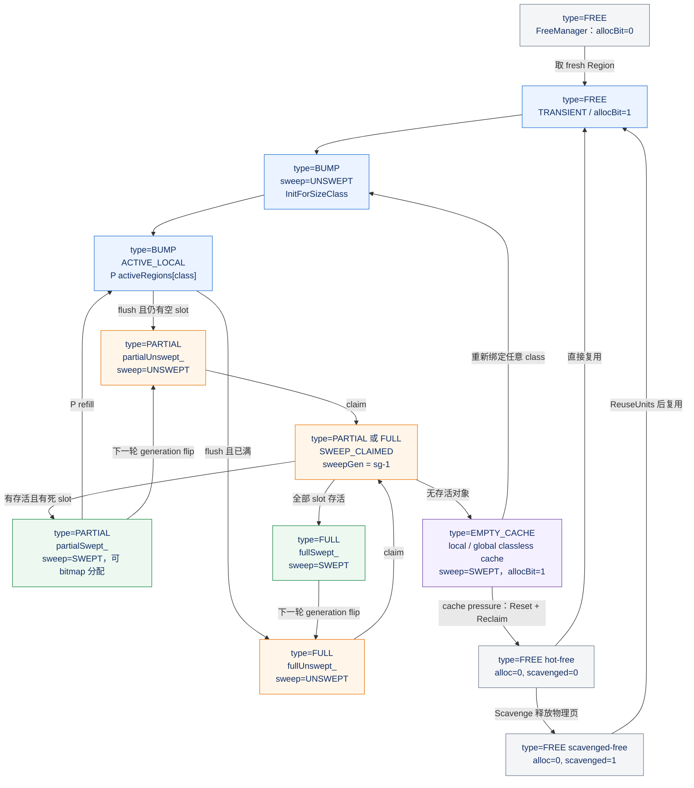

`sweepGen` 使多个 Sweep 执行者只能 claim 一次：`sg-2` 是本轮 unswept，`sg-1` 是已 claim，`sg` 是已 Sweep 或本轮新 Region。`EMPTY_CACHE` 到 `BUMP` 是“复用同一地址、重新绑定 class”，不是重新向 FreeManager 申请；只有 cache 被明确 Reset 并 Reclaim 后，allocation bit 才清为 0。Scavenge 进一步把 hot-free 变为 scavenged-free，改变的是物理页驻留，而不是 Region index、`MSRegionInfo` 地址或主堆拓扑。

large span 不走这套 `BUMP → PARTIAL/FULL` 的逐槽生命周期：primary/follower 注册后由 `largeRegionList_` 管理，死亡 span 在 PostMarkTermination 进入 large hot cache 或直接归还 FreeManager。

详细实现： [Region 结构](03_MSGC_Region结构详解.md)、[堆存储结构](02_MSGC_堆存储结构详解.md)。

<a id="chapter-5"></a>
## 5. 对象分配架构

对象分配是“大小分流 + P 本地快路径 + 中央补给 + FreeManager 兜底”的分层结构。它既要尽量短，又要在当前 GC phase、Sweep generation 和 owner 协议下保持正确。

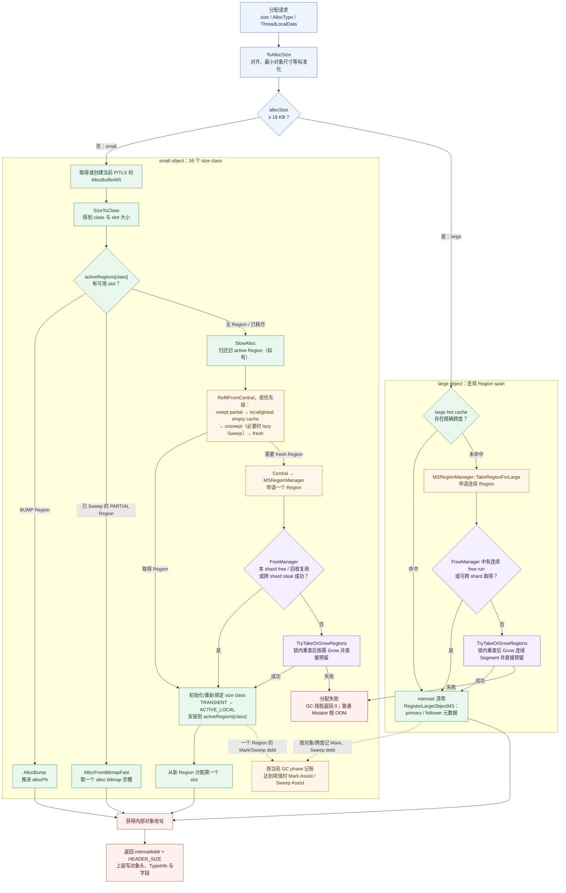

图中 `RefillFromCentral()` 的四个供给来源是实际的优先顺序：先复用已经 Sweep 的 partial Region，再检查 P 本地/全局 empty cache，然后才触碰仍未 Sweep 的 Region，最后申请 fresh Region。`TryTakeOrGrowRegions()` 也不是每次分配都执行：只有 FreeManager 与 non-empty donor bitmap 中可 steal 的 shard 都不能交付所需 unit 时，才在 grow 锁内重查 availability generation，仍失败才把新的 Segment 纳入堆并直接预留请求 span。无论 small 还是 large，成功取得新的 Region/span 后都在这里累计 Mark/Sweep debt；它把分配压力与 Global 的 Mark/Sweep 工作联动，而不会在普通对象分配失败时再隐式发起一轮 GC 重试。

### 5.1 Size class 与 small/large 分流

对象大小先做对齐、最小对象尺寸和类型相关的标准化，再通过 size-class 表得到 class index、slot size 和每个 Region 的 slot 数。当前表有 36 个 class。MSGC Runtime 分配入口把 `allocSize >= 16KB` 直接分到 large span；但 LLVM lowering 仍把 16KB 保留在 size-class wrapper 的上界（见第 11 章），因此 class 35 是一个必须显式记录的跨层边界。Pinned、raw pointer、RawArray 等特殊入口仍然要通过对象模型和 TypeInfo 确认布局，不能简单当作普通引用对象。

### 5.2 Small 快路径

编译器或 Runtime 从当前 P 的 `AllocBufferMS::activeRegions_[class]` 读取 Region，检查 bump 与 end 是否有空间；成功时推进 bump、完成必要的对象初始化并返回稳定地址。Region 用尽或进入 PARTIAL 后，分配器可根据 alloc bitmap/summary 复用 Sweep 恢复的空槽。AArch64 inline path 只是把这些检查和常见写入展开，语义仍由 Runtime 的 slow path 定义。

### 5.3 `SlowAlloc` 与 refill

快路径失败后，`SlowAlloc` 依次执行：检查并偿还 P 级 Mark/Sweep debt；尝试本地 empty cache；从 CentralRegionPool 取得 swept partial/empty Region；向 FreeManager 申请单 Region 或连续 span；必要时 Grow Segment；最终在无法满足限制时返回 OOM。每次 owner 转移都要同步 location/owner side table、侵入式 link 和 generation。

### 5.4 CentralRegionPool 的链

每个 size class 通常维护 active、swept/partial、unswept、full 等状态链；central 只把符合当前请求和 generation 的 Region 交给 P。后台 Sweep、Lazy Sweep 和前台 refill 共同改变这些链，因此 `PARTIAL` 不能简单理解为“已清扫”。P 归还 active Region 时，中央池根据 Region 是否有可用槽、是否为空壳、是否仍有 owner 来重新分类。

### 5.5 Large 分配与回收

large 分配先从按跨度匹配的 hot cache 或 FreeManager 连续 free run 获取 Region，再注册 primary/follower 元数据。large 对象注册时要设置相应的 mark/状态信息，避免当前周期统计把新 span 当成旧 backlog。死亡 span 可以 eager sweep，进入 large hot cache；hot cache 中已 Reset 的 span 仍可能保持 FreeManager allocation bit，复用前要完成明确的 take/owner 转移。

### 5.6 FreeManager 的 Region/span 分配

FreeManager 管理堆中 Region/span 的占用、连续性、shard 归属和物理页状态，而不管理某个 size class 的 slot。Central 无法补给 small Region，或 large 直接申请连续 span 时，`MSRegionManager` 会优先在请求 P 的 home shard 查找 free run；本地不足再通过多 word non-empty bitmap 定位 donor，仍失败才进入 `TryTakeOrGrowRegions()`。Grow 后目标 span 在 owner shard 锁内先标为 allocated，其他 shard 只能取得剩余供给。此前被 Scavenge 释放过的范围会在复用时恢复物理页。由此 Central 负责“按 class 与 Sweep 状态复用”，FreeManager 负责“从堆中交付可用的 Region/span”。

### 5.7 分配与 GC 周期

`PreEnumRoots()` 翻转 Sweep generation 后，新取得的 Region 属于新 generation，上一轮 Sweep 不处理它们；这使普通新对象不需要逐个 mark-at-alloc。Mark 期间新建且带 finalizer 的对象是例外，Runtime 会显式标记并延迟扫描。分配快路径因此必须同时遵守 phase gate、generation 和 owner 三套状态。

详细实现： [对象分配架构与实现](04_MSGC_对象分配架构与实现详解.md)、[堆存储结构](02_MSGC_堆存储结构详解.md)、[Assist 协助](09_MSGC_Assist协助架构与实现详解.md)。

<a id="chapter-6"></a>
## 6. GC Mark 架构与生命周期

GC Mark 的目标是建立“本轮从根可达的对象集合”，而不是立即恢复内存。它由 HEU 触发，经五个 Mark 生命周期阶段推进，并由根扫描、对象字段扫描、Mark barrier 和 Mark Assist 共同完成。small Region 的实际 Sweep 不属于这五阶段：Post-Mark 只发布后台工作，后台、Assist 与 Lazy Sweep 再逐步恢复空槽。

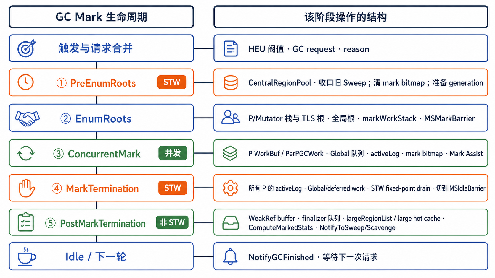

图中 `PostMarkTermination` 的尾部会计算稳定的 mark 统计，并通知后台 Sweep/Scavenge；真正把 unswept Region 重分类到 swept/partial/empty 链的工作则继续与 Mutator 并发。`EnumRoots` 是 Mutator 协作式 handshake，而不是一次全局 STW。`MarkTermination` 的 STW 尾部已经切回 `Idle`，`PostGarbageCollection()` 仅在后续统计完成后发布 `NotifyGCFinished`。

### 6.1 触发与阈值

Region 获取、分配失败、显式 GC 请求和后台压力都可能产生 pending request。HEU 根据 committed heap、已分配字节、历史存活量、分配速率和回收压力更新 heap threshold；请求会合并，不能在已有 GC 阶段中递归启动另一轮。优化分配快路径可能提高分配速率，因此必须同时观察 GC 次数、Assist ratio 和 Sweep backlog。

### 6.2 五阶段 Mark 状态机与 Sweep 发布

| 阶段 | 核心动作 | 主要执行者 |
| --- | --- | --- |
| `PreEnumRoots` | 封口旧 Sweep、等待 claim/assist、短 STW 清理、翻转 generation | GC 主线程和相关停止协议 |
| `EnumRoots` | 非 STW 的 `MS_MARK_SETUP` handshake、Mutator 自扫栈、全局根扫描 | Mutator、GC 主线程、Enum Assist |
| `ConcurrentMark` | 消费 WorkBuf、扫描字段、处理 barrier log | GC 主线程、GC Worker、Mark Assist |
| `MarkTermination` | 停止新边、flush 所有 P 日志、fixed-point drain | STW GC 主线程 |
| `PostMarkTermination` | WeakRef、finalizer、large eager reclaim、Mark 统计、通知 Sweep/Scavenge | Runtime/GC 主线程 |

### 6.3 `PreEnumRoots`：先处理上一轮

新一轮 Mark 前必须确保旧 generation 的 Sweep 不会继续修改将要清理的 mark bitmap 或 Region 链。`PreEnumRoots()` 阻止新 claim，等待后台/Lazy/Assist/parallel Sweep 的 active counter 收口；必要时 Force-Finish 剩余 backlog，然后完成短 STW 的前置清理和 generation flip。GC 先到而 Sweep 未完成，是 MSGC 必须显式处理的跨周期竞态。

### 6.4 `EnumRoots`：并发 Handshake 建立初始灰集合

`EnumRoots` 不是全局 STW：GC 主线程发布 `MS_MARK_SETUP` handshake，Mutator 在各自 safepoint 扫描寄存器保存区、栈 map、线程局部根和运行时句柄；GC 主线程随后串行扫描全局根、线程/分配器注册表及特殊队列。统一发现入口执行“地址范围检查 → 原子设置 mark 位 → 含引用对象入 WorkBuf”；叶对象只需 mark，不必占用队列。

Enum Assist 可以批量帮助尚未完成 handshake 的 Mutator 收集候选根，但不修改全局 phase，也不负责对象图闭包。EnumRoots 的输出是根对象和待扫描灰对象，而不是整堆对象列表。

### 6.5 `ConcurrentMark`：WorkBuf 闭包

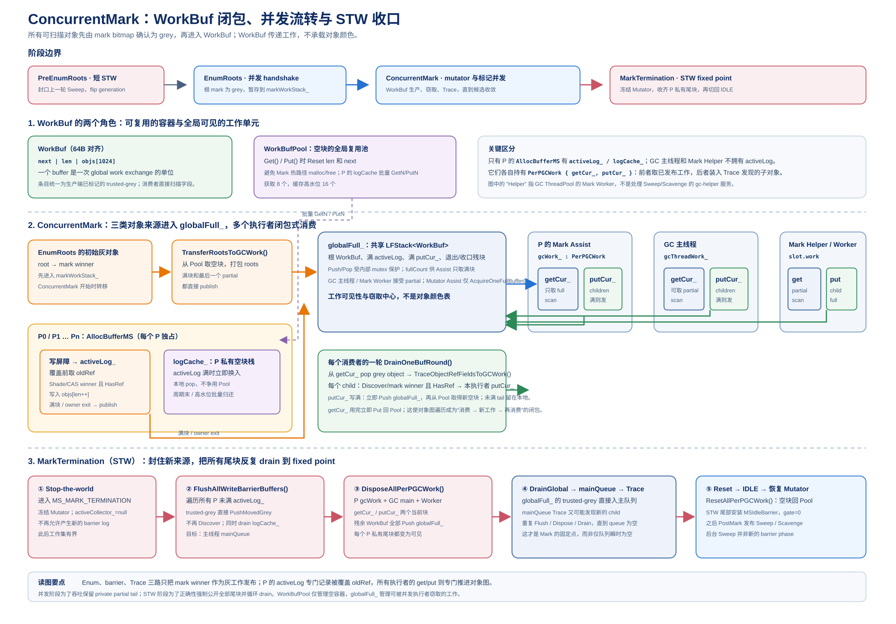

ConcurrentMark 的 WorkBuf 有三类对象来源。EnumRoots 已经完成 grey 标记的根对象先留在 `markWorkStack_`，启动并发标记时由 `TransferRootsToGCWork()` 打包并发布；Mutator 的删除写屏障把已 shade 的 oldRef 写入所属 P 的 `activeLog_`；任一消费者扫描对象字段时，把新发现的 mark winner 写入自己的 `putCur_`。三者都只发布含引用字段的 grey 对象；叶对象只需 bitmap mark，不占用队列。

P 的 `AllocBufferMS` 同时持有 `activeLog_`、`logCache_` 和用于 Assist 的 `gcWork_ : PerPGCWork`。其中 active log 是 barrier 专用日志：满块或 owner 退出时 publish 到 `globalFull_`，并从 P 私有的 logCache 换入空块；logCache 再以 8/16 的批量策略向 `WorkBufPool` 取还。P Assist 的 `gcWork_`、GC 主线程的 `gcThreadWork_` 和每个 Mark Helper 的 `slot.work` 都是另一类 `PerPGCWork`，各含 `getCur_`（消费）与 `putCur_`（产出），并不拥有 active log。主线程/Worker 能取任意已发布 buffer，Mutator Assist 只取 full buffer；各自的 partial `putCur_` 在并发阶段保留本地，以降低持续 barrier 流量下的全局竞争。

#### 消费一轮 `getCur_` 后的分流

一次 `DrainOneBufRound()` 会把当前 `getCur_` 中的对象全部 pop 并 Trace；新发现的 child 写入同一执行者的 `putCur_`。若 `putCur_` 满 1024 项，立即 publish 到 `globalFull_` 并从 Pool 换入新的空块；若未满则保留在本地。当前 `getCur_` 用尽后归还 `WorkBufPool`，并且**不会在同一轮立即消费自己的 partial `putCur_`**，以避免持续 barrier 流量下不断关闭、重开尾块而妨碍并发收敛。

| 执行者 | 本轮 `getCur_` 用尽后 |
| --- | --- |
| P 的 Mutator Assist | 退出本次 assist gate，返回已偿还的 allocation debt；本次调用最多消费一个 full WorkBuf，不会继续取下一块。以后只有新的分配 debt 满足条件时，才再次尝试从 `globalFull_` 取 full buffer。该 P 的 partial `putCur_` 留到写满或 MarkTermination。 |
| GC 主线程 | 回到 `RunConcurrentMarkLoop()` 的下一轮，更新 Global backlog、Worker 数、Assist 比率和 credit，再尝试取得下一块已发布 WorkBuf；主线程可消费 full 或 partial。若 Global 已空、主线程没有当前输入且 Worker/Assist 都不在执行，就进入 tail/quiesce 或 time-budget 判断。 |
| Mark Helper / Worker | 记录本轮扫描量，退出本次 worker gate，并在仍 eligible 时继续下一轮、消费任意已发布 WorkBuf。若没有取得工作，则发布 pending credit 并 backoff 等待；收到停止信号后，`slot.work.Dispose()` 将尚未发布的 `putCur_` 等残块交给 `globalFull_`。 |

并发候选收敛要求 `globalFull_`、各执行者 in-flight 以及当前 `getCur_` 都已清空；它仍不能代替最终正确性封口。MarkTermination 进入 STW 后先停止新边来源，将 P 的未满 active log 直接送入主队列，再 `DisposeAllPerPGCWork()` 公开 P/主线程/Worker 的所有尾块，随后反复 drain Global 和 mainQueue、继续 Trace，直到固定点。最后 `ResetAllPerPGCWork()` 归还空块，并在恢复 Mutator 前安装 Idle barrier。

### 6.6 `MarkTermination`：STW 固定点

MarkTermination 停止会产生新边的 Mutator，按“根工作 → P 本地日志 → Global WorkBuf → in-flight 扫描”顺序收集工作，并循环 drain 到不再产生新对象。未满的 active log 直接转入主线程可消费集合，不再重复 discover，也不依赖已停止线程的 TLS。

### 6.7 `PostMarkTermination`：后处理、统计与 Sweep 发布

固定点后，WeakRef 根据目标 mark 位决定保留或清空；finalizer 判断对象可达性并决定是否进入调度队列；Mark 期间新建的 finalizer 对象要补做保护和延迟扫描。large span 在这里依据 primary 元数据 eager reclaim；随后主线程遍历稳定的 mark bitmap，得到 `markedObjects` 与 `trueLiveBytes`，并通知后台 Sweep/Scavenge。`IDLE` phase 与 Idle barrier 已在前一阶段 `MarkTermination` 的 STW 尾部恢复，因此这里不再切屏障。通知不是同步清扫：small Region 的 `SweepRegion()` 仍由后台、Assist 或 Lazy Sweep 分片执行。

### 6.8 `gcPhase` 切换与 GC 日志

`gcPhase` 是全局的 GC 语义开关，而不是单纯用于展示的阶段名称。`TransitionToGCPhase()` 经 `MutatorManager` 持有 Mutator 列表锁完成发布：先 `Heap::InstallBarrier(phase)` 安装对应 barrier，再以 release 语义写入全局 `gcPhase`，并要求每个 Mutator 在自己的 phase transition 中完成切换。因而阶段切换既改变 Runtime wrapper 的行为，也改变 LLVM inline fast path 读取的 `inlineFastPathGCPhase`；不能只改枚举值而跳过 barrier 安装。

| 时点 | 发布的 `gcPhase` | Barrier / gate | 目的 |
| --- | --- | --- | --- |
| `EnumRoots()` 开始 | `MS_MARK_SETUP` | `MSMarkBarrier`，gate=1 | 触发非 STW handshake，让每个 Mutator 扫描自身根；之后的引用写入已受 Mark barrier 保护。 |
| `ConcurrentMark()` 开始 | `MS_CONCURRENT_MARK` | `MSMarkBarrier`，gate=1 | 保持 deletion barrier 与 active log 生效，允许 GC Worker、Assist、Mutator 并发推进闭包。 |
| `MarkTermination` 进入 STW | `MS_MARK_TERMINATION` | `MSMarkBarrier`，gate=1 | 冻结 Mutator 后收齐最后的 barrier log，并 fixed-point drain。 |
| `MarkTermination` 的 STW 尾部 | `IDLE` | `MSIdleBarrier`，gate=0 | **在恢复 Mutator 前**关闭 Mark barrier，避免最后一次 drain 之后还有新日志进入；此时独立的 Sweep epoch 可重新开放。 |
| `PostGarbageCollection()` | `IDLE`（保持不变） | `MSIdleBarrier`，gate=0 | 在 `UpdateGCStats()` 之后发布 `NotifyGCFinished(gcIndex)`；它不再重复 phase transition。 |

所以 `PostMarkTermination()` 虽然仍是 GC 主线程的后处理代码，却运行在已经恢复的 `IDLE` 状态：它只做 WeakRef/finalizer/large 回收、`ComputeMarkedStats()` 与 `NotifyToSweep/Scavenge()`，不重新开启或关闭 barrier。`IDLE` 不表示 Sweep 已完成；Mark 周期已经结束，而 small Region 仍可由后台、Assist 和 Lazy Sweep 继续回收。Sweep 是否真正完成由 CentralPool 的 `IsSweepDone()` 与各执行方计数决定。

GC 诊断日志以 `MRT_REPORT` 对应的 `VLOG(REPORT, ...)` 为主，按一轮调用链输出：`LogGCEntry()` 先记录 cycle、reason、sweep generation、活动 Region 字节、阈值以及 unswept/缓存概况；`DumpGCStateSnapshot("preGCMark")` 记录起始时各 size class 的四链压力；五个生命周期函数各自输出阶段耗时和关键计数。Mark 完成后，`UpdateGCStats()` 记录 `trueLiveBytes` 驱动的下一轮阈值变化；`PostGarbageCollection()` 发布完成事件；最后 `DumpRegionStatsMS()` 输出 shard、CentralPool 与 Sweep 执行者统计，`LogGCSummary()` 给出 `PreEnum + EnumRoots + ConcMark + MarkTerm + PostMark + PostGC + Other` 的总耗时拆分。相较之下，phase 切换本身的 `DLOG(GCPHASE, ...)` 属于调试通道，不应把它当作常规 GC 报告日志。

详细实现： [GC Mark 架构与实现](05_MSGC_GC_Mark架构与实现详解.md)、[Barrier](06_MSGC_Barrier架构与实现详解.md)、[Assist](09_MSGC_Assist协助架构与实现详解.md)。

<a id="chapter-7"></a>
## 7. Runtime Barrier

Barrier 维护并发 Mark 的对象图闭包。它不是 CPU 内存屏障，而是对象写入前后执行的 GC 语义；phase gate 决定当前使用 Idle 还是 Mark 实现。

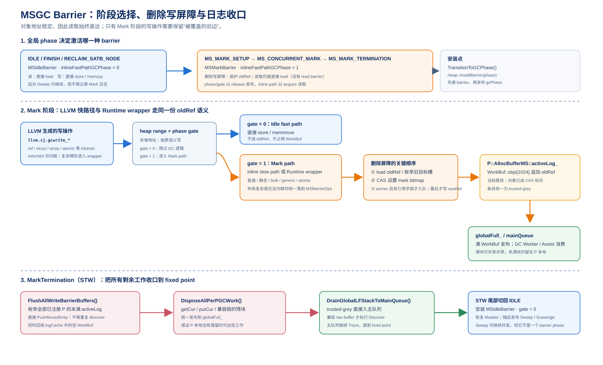

图中的 <code>oldRef</code> <strong>不是由读屏障记录</strong>，而是由 Mark 阶段的删除写屏障在覆盖槽位前读取。MSGC 没有读屏障：对象不搬迁，普通 load 直接返回当前地址；只有 write path 依据 phase gate 决定直写或执行 old edge 保护。满的日志块可并发发布，未满块则留在 P 本地，直到 owner 退出或 MarkTermination 统一收口。

### 7.1 为什么需要写屏障

GC 线程可能已经扫描对象 `A`，Mutator 随后把 `A.child` 覆盖掉。如果旧引用是唯一通往目标的路径，目标可能在扫描前变成不可见。Mark barrier 因而先读取将被覆盖的 old value，若目标尚未 mark，则原子设置 mark 位；只有 mark winner 且对象含引用字段时才把它发布到本 P 的 active log，最后才执行真正的 store。

### 7.2 为什么没有 MSGC 读屏障

CopyGC 中对象会从 from-space 搬到 to-space，旧引用可能指向 forwarding header，读取时必须解 forwarding 或修正引用。MSGC 对象地址在生命周期内稳定，GC 只修改 mark/alloc 状态，不改变引用值；因此普通引用 load、WeakRef 读取和 memcpy 都可以直接访问对象。无读屏障不等于无 safepoint，root handshake、MarkTermination 和调度/异常路径仍需安全状态。

### 7.3 屏障安装与 phase 切换

Runtime 启动时建立 Idle/Mark barrier 对象，并把共享 phase gate 接到 GC 状态。IDLE/FINISH/RECLAIM 使用 `MSIdleBarrier` 或直写；MarkSetup/Concurrent/Termination 使用 `MSMarkBarrier`。MarkTermination 先阻止会产生新边的 Mutator，等待旧调用者、日志和队列收口，再切回 Idle；后续 Sweep 是并发后台工作，不再对应独立的 GC phase。

LLVM 把引用写降为对应 intrinsic；AArch64 inline path 先检查 heap-range，并以 acquire 读取 <code>inlineFastPathGCPhase</code>。gate=0 直接完成原 store/copy；gate=1 时可在内联代码中执行删除屏障，布局复杂、generic、atomic 或无法内联的写法则进入 Runtime wrapper。专用 wrapper 直接复用 <code>MSBarrierOps</code>，generic/atomic 经当前虚拟 barrier，但二者最终都遵守相同的 oldRef 语义。phase publish 使用 release，不能把 gate 更新当作普通对象字段写。

### 7.4 各类写操作

下表中的“Mark”统一指 <code>MS_MARK_SETUP</code>、<code>MS_CONCURRENT_MARK</code> 与 <code>MS_MARK_TERMINATION</code>：三者都安装 <code>MSMarkBarrier</code>、gate=1。<code>IDLE</code>、<code>FINISH</code>、<code>RECLAIM_SATB_NODE</code> 使用 <code>MSIdleBarrier</code>、gate=0；它们保留原写语义，不记录 old edge。

| 写操作 | 编译器 / Runtime 入口 | IDLE 行为 | Mark 阶段的 old edge 处理 | 目的与注意点 |
| --- | --- | --- | --- | --- |
| 普通对象 ref 字段 | <code>MCC_WriteRefField</code>；可由 <code>llvm.cj.gcwrite_*</code> 内联 | 直接 <code>store</code> | 读取一个旧字段 → CAS mark bitmap → mark winner 且 <code>HasRefField</code> 时追加到 <code>activeLog_</code> → 写入 newRef | 最常见的 deletion barrier；顺序不能倒置。 |
| 静态 ref / Root 槽 | <code>MCC_WriteStaticRef</code> | 直接写静态槽 | 与普通 ref 相同地保护旧目标 | 静态槽是 root 侧入口，不能因“不属于对象字段”而绕过屏障。 |
| 对象内 struct 拷贝 | <code>MCC_WriteStructField</code> | <code>memcpy</code> | 根据对象 <code>TypeInfo</code> 枚举目标范围内原有的引用字段，逐个批量标记后再拷贝 | 即便最终是整块内存复制，也必须先保护被覆盖的旧引用。 |
| 静态 struct 拷贝 | <code>MCC_WriteStaticStruct</code> | <code>memcpy</code> | 使用 <code>GCTib</code> 找出静态对象中的旧引用，再执行拷贝 | 静态布局没有普通对象头，需要显式的 <code>GCTib</code>。 |
| ref / struct 数组复制 | <code>CJ_MCC_ArrayCopyRef</code>、<code>CJ_MCC_ArrayCopyStruct</code> | <code>memmove</code> | 以目标数组待覆盖范围为准：ref array 扫旧 ref；struct array 按元素布局扫旧 ref | 只处理 destination 的旧边；不是重新扫描整个 source array。 |
| generic 写与 generic array copy | <code>CJ_MCC_WriteGeneric</code>、<code>CJ_MCC_ArrayCopyGeneric</code> | 无 ref 布局时可直接复制 | 运行时根据 <code>TypeInfo</code> 选择 <code>WriteGeneric</code>、<code>CopyRefArray</code> 或 <code>CopyStructArray</code> | 静态布局未知，通常经过 virtual barrier / wrapper，是固定开销较高的路径。 |
| 原子写、swap、CAS | <code>MCC_AtomicWriteReference</code>、<code>MCC_AtomicSwapReference</code>、<code>MCC_AtomicCompareSwapReference</code> | 保持请求的 memory order | atomic write 先保护所观察到的旧值；swap 对 <code>Exchange</code> 返回的旧值入队；CAS 只在成功覆盖时保护 expected old value | 不能套用普通 store 的重排假设；读原子操作本身仍不是读屏障。 |

对普通、静态、struct 与数组专用入口，MSGC 当前直接调用 <code>MSBarrierOps</code>，避免每次都经 virtual barrier 分派；generic 和 atomic 保留 <code>Heap::GetBarrier()</code>，以承载动态布局与内存序语义。这里的“直接”是 GC 语义上的直写：专用 Runtime 入口在 Idle 仍会快速看到没有 active collector 后跳过记录，而 LLVM gate=0 的内联路径可把这次检查也消掉。两条路径在 Mark 阶段都遵守“先 old edge、后 new value”的同一不变式。

### 7.5 P 的 active log、WorkBuf 和 Global

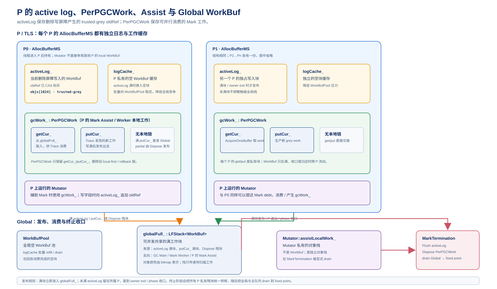

每个 P 的 <code>AllocBufferMS</code> 持有 <code>activeLog_</code> 和 <code>logCache_</code>。Mark barrier 按“读 old → 竞争 mark 位 → winner 且 HasRef 才追加 → 执行 store”运行；日志满时 <code>PublishAndSwapLog</code> 把满块交给 <code>globalFull_</code>，P 从自己的 <code>logCache_</code> 换入空块。<code>logCache_</code> 通过 <code>WorkBufPool</code> 批量取还，因此普通写入不需要每次争用全局池。Mutator 退出、注销或 phase 关闭时，<code>PublishExitedLog</code> 也会发布尚未写满的块。

同一个 <code>AllocBufferMS</code> 还持有 <code>gcWork_ : PerPGCWork</code>，供 P 上的 Mark Assist 或 Mark Worker 保存、窃取和产出待扫描对象：<code>getCur_</code> 是从 <code>globalFull_</code> 取得的消费块，<code>putCur_</code> 是 Trace 发现新对象时写入的生产块；满块直接发布 Global，私有 partial 在 MarkTermination 由 <code>Dispose()</code> 发布。旧的 <code>list1_</code>/<code>list2_</code> rollback 链已经删除。图中单列出的 <code>Mutator::assistLocalWork_</code> 是 Mutator 私有的<strong>对象栈</strong>，不是 WorkBuf 链，MarkTermination 会显式 drain 它。

MarkTermination 调用 <code>FlushAllWriteBarrierBuffers</code> 遍历已注册的 P，把剩余 <code>activeLog_</code> 直接移入主队列并继续 Trace；这些对象已经在屏障中赢得 mark，因此不再重复 discover。随后 <code>DisposeAllPerPGCWork()</code> 交出每个 P 的 <code>getCur_</code>、<code>putCur_</code> 残块，<code>DrainGlobalLFStackToMainQueue()</code> 继续收集到 fixed point。<code>globalFull_</code> 与相关计数只负责工作可见性、窃取和唤醒；对象颜色仍由 Region bitmap 表示。

### 7.6 Barrier 与对象生命周期

新分配对象通常受 generation 隔离，不需要逐对象 mark-at-alloc；Mark 期间新建 finalizer 对象由 Runtime 特殊标记。屏障只保护当前 Mark 需要的 old edge，不负责把所有新对象放入本轮队列。对象含不含引用字段也影响是否需要进入 WorkBuf，叶对象的屏障成本更低。

详细实现： [Barrier 架构与实现](06_MSGC_Barrier架构与实现详解.md)、[GC Mark](05_MSGC_GC_Mark架构与实现详解.md)、[LLVM 优化](10_MSGC_优化实现与效果详解.md)。

<a id="chapter-8"></a>
## 8. Sweep 架构

Sweep 消费 Mark 产生的稳定 bitmap，把死亡对象槽恢复为可分配状态。它与 Mark 解耦、可抢占、可并发，是 MSGC 允许 Mutator 在 GC 后继续分配的关键。

### 8.1 Small Region 的 Sweep 算法

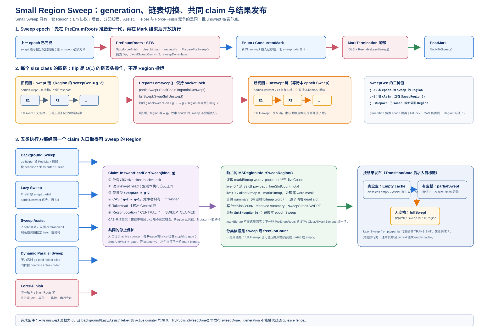

Small Region 的 Sweep 是一套以 <code>sweepGen</code> 和中央链表为边界的并发协议，不是 Mark 结束后由某一个线程顺序遍历整个堆。图中的 <code>g</code> 是当前 Sweep generation：<code>g-2</code> 表示本轮尚待清扫，<code>g-1</code> 表示已经被某个执行方 claim、正在清扫，<code>g</code> 表示已经完成本轮 Sweep（或本轮新分配，天然不属于本轮 Sweep 输入）。因此，generation 同时解决“该不该扫”和“谁已经在扫”两个问题。

#### Sweep 输入何时建立、何时真正开放

上一轮结束、下一轮 <code>PreEnumRoots()</code> 进入 STW 时，收集器先调用 <code>StopAndWaitForAllSweep()</code>，确保前一代不存在仍在运行的 Sweep；随后清空 mark bitmap、把残余 Region 重新分类，并调用 <code>PrepareForSweep()</code>。后者对每个 size-class bucket 做一次 O(1) 的链头切换：旧的 <code>partialSwept</code> 整链移为 <code>partialUnswept</code>，<code>fullSwept</code> 与 <code>fullUnswept</code> 交换；再把全局 generation 增加 2。Region 本身仍保留旧的 <code>g-2</code>，所以新出现的 unswept 链正好是本轮 Sweep 的稳定输入。

“输入已经建立”不等于“允许并发 Sweep”。这些链在 Enum/ConcurrentMark 期间保持关闭，避免 Mark 仍使用 bitmap 时发生清扫。MarkTermination 的 STW 尾部先把 phase 切到 <code>IDLE</code>，再由 <code>ReenableLazySweep()</code> 打开 Lazy/Assist/Helper gate；之后 <code>PostMarkTermination()</code> 调用 <code>NotifyToSweep()</code> 唤醒后台 Sweep。若分配器在 refill 时发现已 swept 的 Region 不够，Lazy 路径也会主动通知后台，并可立刻自己消费一条 unswept 链。这就是图中“链表切换、执行开放、后台唤醒”分开的原因。

#### 五类执行方如何取得工作

| 执行方 | 何时尝试 | 从哪里取得 Region | 完成后的主要去向 |
| --- | --- | --- | --- |
| Background Sweep | <code>gc-helper</code> 收到通知或周期处理 | 依 size class 从 partial、再从 full unswept 链 claim | partial/full 回 central 的 swept 链；empty 进入空 Region cache。 |
| Lazy Sweep | P refill 没有可用 swept Region | 同一 bucket 的 partial、full unswept 链 | empty/partial 可直接改为 <code>TRANSIENT</code> 交还请求 P；full 回 central。 |
| Sweep Assist | P 的 Sweep debt 到期，或消费 central credit | 共享的 unswept claim；可按 batch 归还 debt | empty 优先进入该 P 的 local empty cache，其他结果发布到 central。 |
| Dynamic Parallel Sweep | backlog/内存压力满足条件且取得 SWEEP worker lease | 多个 worker 按 class 轮转，从相同 unswept 链 claim | 发布回 central swept 链或 empty cache。 |
| Force-Finish | 下一轮 <code>PreEnumRoots()</code> 前的 stop 路径 | 仍使用相同的 claim，串行 drain 残余链 | 把旧 generation 收口，保证随后可安全清 bitmap。 |

它们的差异只在唤醒原因、预算、优先的归还位置；取工作和竞争控制完全共用 <code>ClaimUnsweptHeadForSweep()</code>。这样无论是 P、<code>gc-helper</code> 还是临时 worker，都不会形成各自私有的“待扫 Region”视图。

#### claim、竞争与完成发布

claim 时先持有对应 bucket 的锁，查看目标 unswept 链头。只有 <code>sweepGen == g-2</code> 的 Region 有资格被本轮拿走；随后以 CAS 将它改为 <code>g-1</code>，再从链头摘除，并把位置从 <code>CENTRAL_PARTIAL</code>/<code>CENTRAL_FULL</code> 转为 <code>SWEEP_CLAIMED</code>。CAS 失败或链头已被其他执行方摘走就重试。<code>g-1</code> 的 Region 不应仍留在中央链上；它已经脱链，分配器也无法把它当作可用 Region 取得。这组“bucket 锁 + generation CAS + 状态迁移”共同保证一个 Region 至多被 Sweep 一次。

获得 Region 后，<code>MSRegionInfo::SweepRegion()</code> 逐 bitmap word 读取 mark 位：<code>mark=1</code> 的槽保留；<code>mark=0</code> 的槽统一重建为空闲位（其中死亡对象槽会在发布前清零，原本空闲槽保持空闲）。若没有存活槽，整个 32 KiB Region 被清零并成为 empty；否则用 <code>~markBitmap</code> 重建 <code>allocBitmap</code> 的空闲位，更新 bitmap summary、free slot 数和 live bytes，按是否仍有可用槽分类为 partial 或 full。这里不会立即清 mark bitmap；它在下一次 <code>PreEnumRoots()</code> 的 STW 边界统一清除。

最终执行方把 Region 的 <code>sweepGen</code> 写为 <code>g</code>，先完成位置状态迁移，再发布到 empty cache、<code>partialSwept</code> 或 <code>fullSwept</code>。<code>TryPublishSweepDone()</code> 只有在四类条件同时成立时才发布本轮完成：所有 unswept 链为空、后台不在 Sweep、Lazy active 为零、Assist/Parallel active 为零。故“链上已经没有待扫 Region”本身不足以说明 Sweep 完成；仍在 <code>SWEEP_CLAIMED</code> 的 Region 必须先回流。

<code>PARTIAL</code> 只表示槽位使用比例，不表示 Sweep 是否完成；是否可分配由 <code>swept/unswept</code>、<code>sweepGen</code> 和位置状态共同决定。large span 走独立的 primary/follower 路径，不采用这里的 small-slot 位图扫描。

### 8.2 五类执行方

| 执行方 | 触发时机 | 主要作用 |
| --- | --- | --- |
| Background Sweep | `gc-helper` 常规唤醒 | 平滑降低旧 Region backlog |
| Lazy Sweep | 分配 refill 缺货 | 在分配线程上完成最小必要清扫 |
| Sweep Assist | P 的 Sweep debt 到期 | 用分配预算清扫 Region |
| Dynamic Parallel Sweep | HEU 高压且 backlog 高 | coordinator 借用 Worker Pool 加速 |
| Force-Finish | 下一轮 `PreEnumRoots()` 前 | 作为旧 generation 的正确性兜底 |

五类执行方共享 claim、stop、active counter 和 generation 协议，不是五套互相独立的回收算法。后台负责持续进度，Lazy/Assist 负责前台供给，parallel 负责高压吞吐，Force-Finish 保证下一轮清 bitmap 前不会残留旧工作。

### 8.3 Post-Mark 的 Sweep 发布边界

small Region 的 Sweep 输入快照已在 <code>PreEnumRoots()</code> 的 <code>PrepareForSweep()</code> 中建立；<code>PostMarkTermination()</code> 不再移动这些链表。它在 large eager reclaim 之后计算稳定的 mark 统计，并通过 <code>NotifyToSweep()</code> 把已经开放的 Sweep epoch 交给后台系统；它不会在一个调用中遍历所有 small Region。Mutator 可在旧 Region backlog 存在时从已 swept Region 分配；Mark 期间的新 Region 带当前 generation，不会被本 epoch Sweep。large 对象在同一 Post-Mark 阶段 eager reclaim。

### 8.4 停止协议和 Worker epoch

推进下一轮时先阻止新 Sweep claim，再等待 background、lazy、assist 和 parallel active counter 归零，最后发布 sweep-done。Dynamic Parallel Sweep 还必须取得 SWEEP lease；如果 MARK lease 仍占用则降级。MARK/SWEEP 共享物理 Worker 但 epoch 互斥，不能混跑。

`CJ_MS_STW_SWEEP` 将残余 backlog 强制留给下一轮前的单线程 Force-Finish，用来诊断并发 Sweep 是否造成 stale edge、invalid stateWord 或 TypeInfo 污染。

详细实现： [Sweep 架构与实现](07_MSGC_Sweep架构与实现详解.md)、[Assist 协助](09_MSGC_Assist协助架构与实现详解.md)、[GC Mark](05_MSGC_GC_Mark架构与实现详解.md)。

<a id="chapter-9"></a>
## 9. Scavenge 架构

Scavenge 处理的是物理驻留，不是对象可达性。完整回收链是“Mark 判定存活 → Sweep 恢复槽 → Reclaim 转移空 Region 所有权 → Scavenge 解除物理提交 → 可选 Shrink 收缩堆尾”。

### 9.1 FreeManager 状态

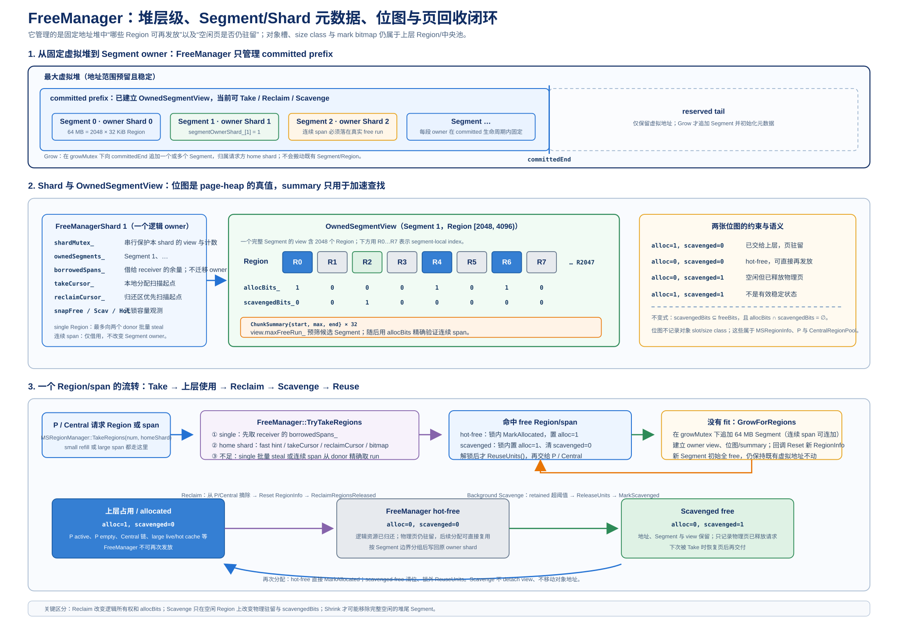

FreeManager 面向固定地址的 <code>committed</code> 堆前缀工作。它把每个 64 MiB Segment（2048 个 32 KiB Region）固定归属给一个 owner shard；<code>segmentOwnerShard_[segmentIdx]</code> 决定该归属。owner shard 内的 <code>OwnedSegmentView</code> 才保存这一 Segment 的 page-heap 元数据：两张 Region 级位图、每 64 Region 的 <code>ChunkSummary{start,max,end}</code>、<code>maxFreeRun_</code>、扫描 cursor 与计数。summary 只用于跳过不可能容纳连续 span 的 Segment，真正的 take/reclaim 仍以位图复验。

这里的 owner 与借用必须分开理解。单 Region 紧缺时，请求 shard 可以把 donor 的少量 Region 放进自身 <code>borrowedSpans_</code>；连续 span 也可以跨 shard 借用，但 Segment 的 owner 和其 view 不迁移。Region 被 Reclaim 时按 Segment 边界重新分组，最终回到原 owner shard。因此 shard 是并发管理和局部性边界，不是对象地址或 RegionInfo 的新层级。

<code>allocBits_</code> 表示 Region 是否已经从 FreeManager 发放（`1=已占用，0=free supply`）；<code>scavengedBits_</code> 表示空闲 Region 是否已经执行过物理页释放。稳定状态为：

| `allocBits_` | `scavengedBits_` | 语义 |
| --- | --- | --- |
| 1 | 0 | 已发放给 P/中央池/large 路径等上层逻辑资源，物理页驻留，FreeManager 不可再次发放。 |
| 0 | 0 | hot-free：逻辑空闲且物理页仍驻留，可直接重新分配。 |
| 0 | 1 | scavenged-free：逻辑空闲，物理页已执行释放；地址、Segment 和 view 仍保留。 |
| 1 | 1 | 非法稳定组合；不变式是 <code>scavengedBits ⊆ freeBits</code> 且 <code>allocBits ∩ scavengedBits = ∅</code>。 |

分配从 <code>MSRegionManager::TakeRegions()</code> 进入：先尝试请求 shard 的 <code>borrowedSpans_</code>，再依据 fast hint、<code>takeCursor_</code>/<code>reclaimCursor_</code> 和位图寻找本地 free run；失败时 single Region 可批量 steal，连续 span 从 donor 重新加锁复验；仍无 fit 才在 <code>growMutex_</code> 下追加一个或多个 Segment。命中 hot-free 后在 shard 锁内置 <code>alloc=1</code>；命中 scavenged-free 还会清 <code>scavenged=0</code>，并在解锁后执行 <code>ReuseUnits()</code>，再交给 P 或 Central。

### 9.2 Reclaim 与 Scavenge

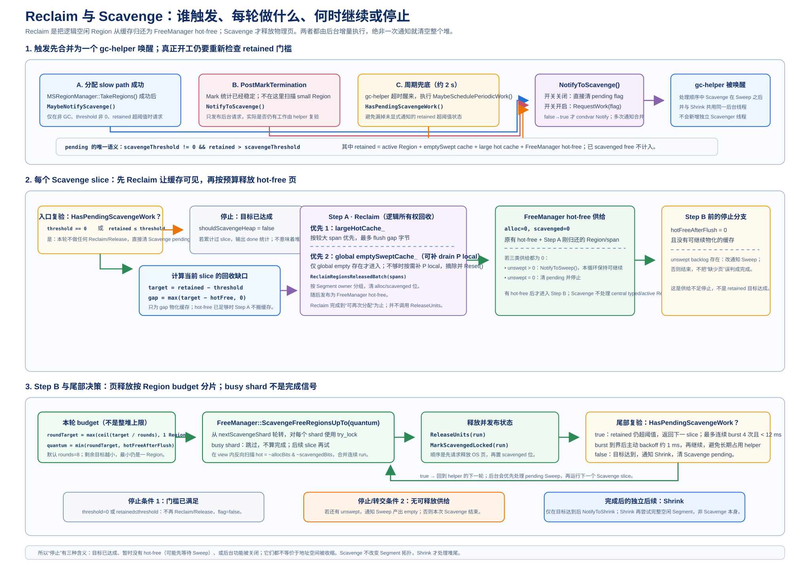

Reclaim 与 Scavenge 的边界是：Reclaim 结束于“这段 Region/span 已从 Central empty/large cache（global empty drain 不足时也可补取 P local empty）摘除，并作为 hot-free 发布回原 Segment owner”；它会清 <code>allocBits_</code>/<code>scavengedBits_</code>，但<strong>不</strong>调用 OS。Scavenge 只消费 <code>alloc=0 &amp;&amp; scavenged=0</code> 的 hot-free Region，调用 <code>ReleaseUnits()</code> 后才写 <code>scavengedBits_</code>。所以 Reclaim 可以让 Region 立即再次分配，Scavenge 则以未来复用时的 <code>ReuseUnits()</code> 成本换取物理页回收。

#### 触发方式：请求合并，不是立即执行

以下来源都会走 <code>NotifyToScavenge()</code>；该接口只是把 <code>shouldScavengeHeap_</code> 置为 pending，只有从 false 变为 true 时才唤醒条件变量，因此并发或高频通知会合并。

| 来源 | 具体入口 | 请求前/后条件 |
| --- | --- | --- |
| 分配成功 | <code>MSRegionManager::TakeRegions()</code> 成功后的 <code>MaybeNotifyScavenge()</code> | 非 GC、scavenge threshold 非 0、存在中央池且 <code>retained &gt; threshold</code> 才请求。 |
| Mark 发布 | <code>PostMarkTermination()</code> | 与 Sweep 通知一同发布，让 Mark 后形成的稳定缓存可由 helper 后续处理；真正执行前仍复验 threshold。 |
| 周期兜底 | <code>gc-helper</code> 的 <code>MaybeSchedulePeriodicWork()</code> | 默认约 2 秒检查一次 <code>HasPendingScavengeWork()</code>，避免遗漏显式通知。 |

后台 Scavenge 开关关闭时，<code>NotifyToScavenge()</code> 只清 pending 而不调度；因此“收到通知”不等于一定释放页。真正的工作判定是 <code>scavengeThreshold != 0 &amp;&amp; retained &gt; scavengeThreshold</code>。其中 <code>retained</code> 是 <code>GetActiveMSRegionCount()</code>、global <code>emptySweptCache_</code>、large hot cache 与 FreeManager hot-free 的和；已 scavenged 的 free Region 不计入 retained。

#### 一个 Scavenge slice 的 Reclaim 与页释放流程

1. <code>BackgroundScavengeLoop()</code> 先复验 pending 条件；不满足就清 flag 并停止，本轮不会移动缓存或触碰页。
2. 满足时计算 <code>target = retained - threshold</code>，再用现有 hot-free 抵扣得到 <code>gap = max(target - hotFree, 0)</code>。
3. Step A（Reclaim）只为这个 gap 物化缓存：先按较大 span 优先 flush <code>largeHotCache_</code>，仍不足才 drain global <code>emptySweptCache_</code>；该 drain 在 global empty 不足时可以补取各 P 的 local empty cache。摘除后 <code>Reset()</code> 元数据，按 Segment owner 分组调用 <code>ReclaimRegionsReleasedBatch()</code>，发布为 hot-free。Step A 不调用 <code>ReleaseUnits()</code>。
4. Step B（Scavenge）按分片预算执行：<code>roundTarget = max(ceil(target / msScavengeRounds), 1 Region)</code>，实际 <code>quantum</code> 不超过当前 hot-free。默认 <code>msScavengeRounds</code> 为 8。
5. <code>FreeManager::ScavengeFreeRegionsUpTo()</code> 从 <code>nextScavengeShard_</code> 轮转，以 <code>try_lock</code> 尝试各 shard；busy shard 仅跳过，不能视为完成。在已取得的 view 中扫描 <code>~allocBits &amp; ~scavengedBits</code>，合并连续 run，先 <code>ReleaseUnits(run)</code>，再 <code>MarkScavengedLocked(run)</code>。

下次 <code>TryTakeRegions()</code> 选中已 scavenged Region 时，会在 shard 锁内置 <code>alloc=1</code>、清 <code>scavenged=0</code>，并在解锁后调用 <code>ReuseUnits()</code>。整个闭环不移动对象地址、不删除中间 Segment 的 view；只有独立的 Shrink 才可能处理堆尾 Segment。

#### 继续、转交与停止条件

| 结果 | helper 行为 | 含义 |
| --- | --- | --- |
| <code>retained ≤ threshold</code> 或 threshold 为 0 | 清 Scavenge pending；如果本轮已做过工作，输出 done 统计。 | 目标已经达到，正常完成。 |
| 没有 hot-free、empty cache 或 large cache，但存在 unswept Region | <code>NotifyToSweep()</code> 并保持后续处理机会。 | 缺少可释放的空 Region，不是 Scavenge 成功；先让 Sweep 产生 empty 供给。 |
| 没有可物化供给且无 unswept backlog | 清 pending 并停止。 | 本轮没有可做的 Scavenge 工作，即使此前触发过通知。 |
| 本 slice 后仍 <code>retained &gt; threshold</code> | 返回下一 slice；连续 burst 最多约 4 轮且少于约 12 ms，之后约 1 ms backoff。 | 增量限速，避免 <code>gc-helper</code> 长时间独占 CPU。 |
| 本 slice 后目标已达成 | <code>NotifyToShrink()</code>，再清 Scavenge pending。 | Shrink 是独立后续，只尝试完整空闲 Segment，不属于 Scavenge 的页释放动作。 |

### 9.3 `gc-helper` 的 Scavenge 调度

<code>TakeRegions()</code> 成功后的 <code>MaybeNotifyScavenge()</code>、<code>PostMarkTermination()</code> 的发布以及最长约 2 秒的周期检查都可能请求 <code>gc-helper</code>。helper 通常按 finalizer → 动态并行 Sweep → 普通后台 Sweep → Scavenge → Shrink 的顺序处理，并以最多约 4 个 burst slice、约 12 ms 窗口和约 1 ms backoff 控制 CPU 占用。多个请求合并为一个 pending flag；每次实际处理都重新检查 retained 门槛。

### 9.4 Shrink 与 RSS

ShrinkHeap 只收缩堆尾连续空闲 Segment，是容量策略，不是任意位置的 Scavenge。P/中央缓存可能让 live bytes 很低但 retained/RSS 仍高；反之 Scavenge 可以降低 RSS，却不降低最大虚拟堆上限。评估内存效果应同时观察 committed、retained、hot-free、scavenged 和 live bytes。

详细实现： [Scavenge 架构与实现](08_MSGC_Scavenge架构与实现详解.md)、[堆存储结构](02_MSGC_堆存储结构详解.md)、[Sweep](07_MSGC_Sweep架构与实现详解.md)。

<a id="chapter-10"></a>
## 10. Assist 协助架构

Assist 把一部分 GC 工作摊到 Mutator 或后台执行，减少单次停顿和后台 backlog。它不取得 GC 主线程的 phase 所有权，必须遵守当前 phase、P 级 debt、时间预算和停止协议。

### 10.1 Enum Assist

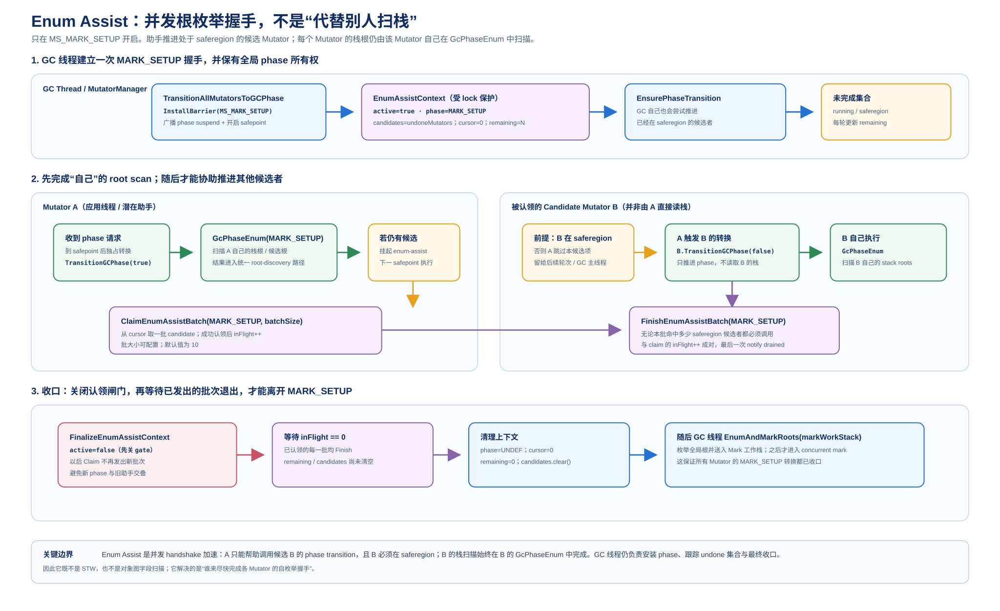

Enum Assist 解决的是 `MS_MARK_SETUP` 中“所有 Mutator 都要完成自己的栈根枚举”的握手进度，不是对象图遍历，也不是 STW。GC 线程通过 `TransitionAllMutatorsToGCPhase(MS_MARK_SETUP)` 安装该 phase 的 barrier、向所有 Mutator 发 phase 请求并开启 safepoint；随后把尚未完成转换的 Mutator 放进 `EnumAssistContext.candidates`，并发布 `active=true`、`claimCursor=0` 与 `remaining=N`。

每个 Mutator 到达 safepoint 时仍是**自己**执行 `GcPhaseEnum(MS_MARK_SETUP)`，扫描自己的栈根和候选根。已经完成自身转换的 Mutator 若发现还有候选者，会在下一次 safepoint 进入 `HandleEnumAssist()`：它从 `ClaimEnumAssistBatch()` 认领一小批候选项；只对已经处于 saferegion 的候选 Mutator 调用 `candidate->TransitionGCPhase(false)`。这个调用只是推进候选者的 phase transition，候选者随即在自己的 `GcPhaseEnum()` 中扫描自己的栈；助手不会直接读取另一个 Mutator 的栈，也不会扫描对象字段。

认领和收口由 `EnumAssistContext.lock` 串行化：

- `ClaimEnumAssistBatch()` 推进 `claimCursor`，并在成功发出一批工作时令 `inFlight++`；batch 大小由 `msEnumAssistBatchSize` 配置，未配置时默认 10。
- 当前助手无论命中了多少 saferegion 候选项，都必须调用 `FinishEnumAssistBatch()` 与这次 `inFlight++` 配对；最后一个完成者唤醒等待方。
- GC 线程自己的 `EnsurePhaseTransition()` 也持续检查 `undoneMutators`，并直接推进已经进入 saferegion 的候选者。因此 Assist 是补充进度，不是唯一执行方。
- `FinalizeEnumAssistContext()` 先置 `active=false`，阻止新的 batch 被发出；再等待 `inFlight==0`，最后才清空 candidates、cursor 与 remaining。这样全局 phase 不会在某个助手尚可能执行 `TransitionGCPhase(false)` 时越过 `MS_MARK_SETUP`。

握手完全收口后，GC 线程才执行 `EnumAndMarkRoots(markWorkStack_)` 枚举全局根并把根对象交给 Mark 工作队列。这里的关键区分是：**Enum Assist 并发地协助 phase 握手；每个 Mutator 自枚举自己的栈；GC 线程拥有 phase、未完成集合和最终收口。**

### 10.2 Mark Assist

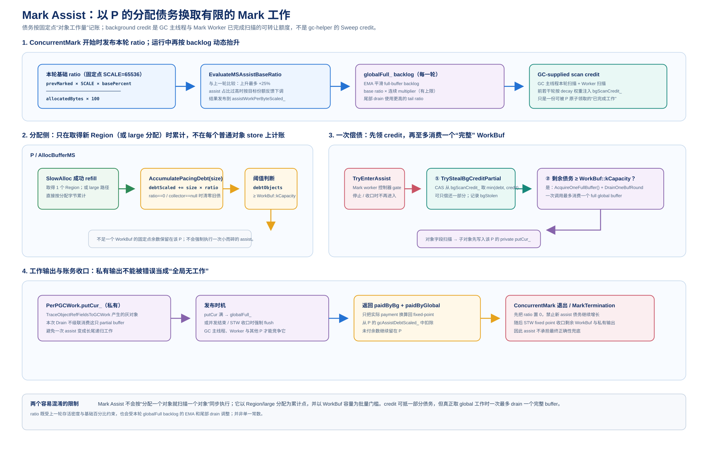

Mark Assist 把并发 Mark 的一部分成本按分配进度摊给 P。它的账本是 `AllocBufferMS.gcAssistDebtScaled_`：单位是固定点“待偿还对象工作量”，比例尺度为 `65536`；它不是一个全局的分配计数器，也不是每个对象写入一次就立即执行一次扫描。

进入 `ConcurrentMark()` 时，收集器根据上一轮的 `prevMarkedObjects`、当前已分配字节和 `msAssistBaseRatioPercent` 计算基础比例：

```text
rawRatioScaled = prevMarkedObjects × 65536 × baseRatioPercent
                 ─────────────────────────────────────────
                       allocatedBytes × 100
```

`EvaluateMSAssistBaseRatio()` 随后做两层平滑：相对上一轮的上升幅度最多增加 25%；若上一轮 Assist 已占处理总量过高，则以“Assist 目标份额”反馈压低比例。并发循环中还会对 `globalFull_` 的 full-buffer backlog 做 EMA 平滑，用连续 multiplier 动态上调基础比例；接近闭包尾段时使用受上限约束的 tail ratio。因此 ratio 同时反映历史 mark 密度、前台/后台处理份额和本轮队列压力。

`AccumulatePacingDebt(size)` 的累计点在成功取得新 Region 的 `SlowAlloc()`（通常一次约覆盖一个 `MS_REGION_SIZE`）以及 large 分配路径；编译器 small-allocation fast path 耗尽 Region 后也会回到这一累计点。它执行 `debtScaled += size × ratioScaled`，并在 collector 不存在或 ratio 为 0 时清除过期债务。只有整数债务达到 `WorkBuf::kCapacity` 才调用 `MSMarkAssist()`，不足一个 buffer 的固定点余数留在当前 P，避免把每次分配变成碎片化同步扫描。

一次 `MSMarkAssist()` 的偿还顺序和上限如下：

1. 先通过 `markWorkerControl_.TryEnterAssist()` 确认当前 Mark 工作尚允许 P 进入；停止或收口期间不会继续做新的 Assist。
2. `TryStealBgCreditPartial(debt)` 以 CAS 从 `bgScanCredit_` 领取 `min(debt, credit)`。这份 credit 来自本轮 GC 主线程和 Mark Worker 已完成的扫描量，并按 `msAssistCreditDecayRounds` 的窗口衰减注入；它只折抵债务，不要求当前 P 再扫描同等对象。
3. 还有债务且不少于一个 `WorkBuf` 容量时，P 只能从 `globalFull_` 取得**一个完整 buffer**，调用一次 `DrainOneBufRound(gcw, true)`。这次调用扫描对象字段、发现子对象，并把子对象暂存到该 P 的 `PerPGCWork.putCur_`；它不在同一 Assist 调用中继续级联消费 partial `putCur_`。
4. 返回值只包含实际领到的 credit 与实际支付的一个 buffer 额度，调用方据此从 `gcAssistDebtScaled_` 扣除；未付部分继续保留在 P。满的 `putCur_` 发布到 `globalFull_`，未满的 buffer 在并发收敛/终止路径统一 flush，不能被误判为“全局无工作”。

当并发 Mark 结束时，收集器先把 `assistWorkPerByteScaled_` 置零，阻止新债务继续增长；`MarkTermination` 再在 STW 下完成最终 fixed point。Assist 是 pacing 和吞吐机制，最终闭包正确性不依赖某一个 P 必须及时还完自己的局部债务。

### 10.3 Sweep Assist

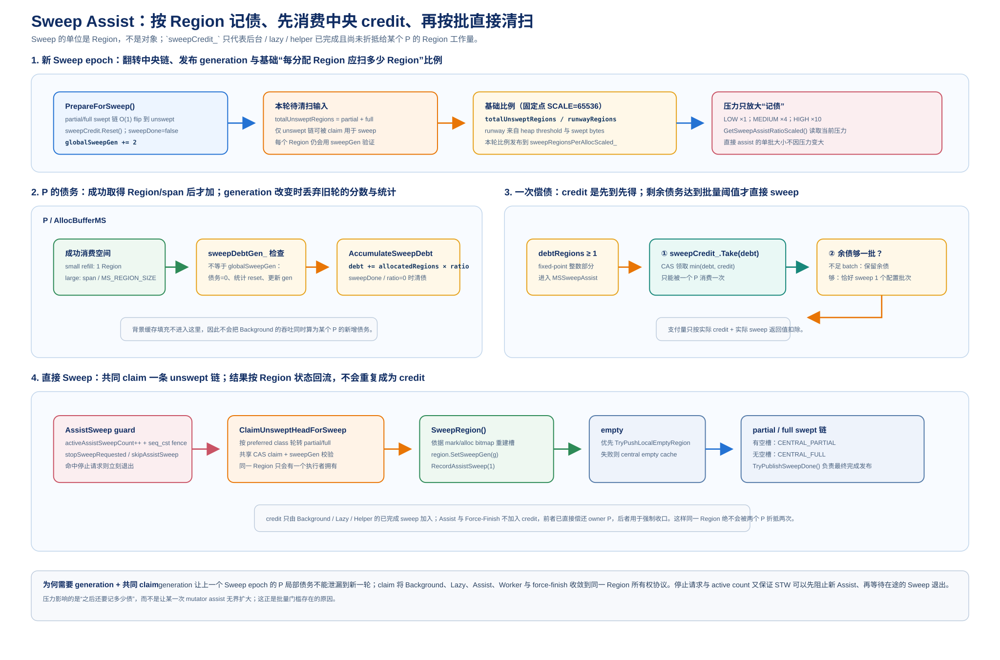

Sweep Assist 的工作单位是 Region。每个 Sweep epoch 开始时，`PrepareForSweep()` 先把每个 size class 中的 swept 链 O(1) 翻转为本轮的 unswept 链，重置 `sweepCredit_`，发布新的 `globalSweepGen_`，并计算基础比例：

```text
sweepRegionsPerAllocScaled = totalUnsweptRegions / runwayRegions
```

其中 `runwayRegions` 来自本轮 heap threshold 与已 swept 字节：含义是“到下一次 GC 触发前，按当前容量还能分配多少 Region”。P 读取比例时还会乘以当前 Sweep 压力：LOW 为 ×1、MEDIUM 为 ×4、HIGH 为 ×10。压力只加快**以后新增债务**的累计，不会把一次 mutator Assist 的直接清扫批量无限放大。

`AllocBufferMS::AccumulateSweepDebt()` 仅在 P 成功消费一个 small Region 或 large span 后调用；后台缓存填充不会进入这条路径。它先比较 `sweepDebtGen_` 与 `globalSweepGen_`：不一致时清掉上个 epoch 遗留的固定点余数和统计，随后以 `allocatedRegions × ratioScaled` 累加 `sweepAssistDebtScaled_`。若 sweep 已完成或比例为 0，则直接清债。这使得旧轮的 P 本地 debt 不会泄漏到新一轮链表和 bitmap 语义中。

当债务的整数部分达到一个 Region 后，`MSCentralRegionPool::MSSweepAssist()` 采用两级偿还：

1. 先从 `sweepCredit_.Take(debtRegions)` 以 CAS 领取 central credit。credit 只由 `BackgroundSweep`、Lazy Sweep 和并行 Helper 已完成的 Region 工作加入；每一个 credit 只能被一个 P 领取一次。它代表别的执行方已经完成的 Sweep，因此只需扣 P 的债，不需要 P 再扫一遍。
2. 对剩余债务，只有达到 `msAssistSweepMaxRegionsPerCall` 配置的完整批量时，才执行一次恰好等于该批量的 `AssistSweep()`；不足一批的余债继续留在 P。这样 P 的分配慢路径有明确上界。

`AssistSweep()` 和后台、Lazy、Worker、Force-Finish 使用同一套 `ClaimUnsweptHeadForSweep()` 所有权协议：对 selected class 顺序尝试 partial/full unswept 链，以 CAS claim 取得 Region，并通过 sweep generation 验证；成功者运行 `SweepRegion()`、设置新的 `sweepGen`，然后按结果回流——完全空闲时优先进入 owner P 的 local empty cache，失败时进入 central empty cache；仍有空槽或已满时分别回到 partial/full swept 链。`RecordAssistSweep()` 不会把这种直接替 owner P 偿还的工作再加入 `sweepCredit_`，Force-Finish 也不加，从而避免同一 Region 被重复折抵。

进入直接 Assist 前后还受 `activeAssistSweepCount_`、`skipAssistSweep_` 和 `stopSweepRequested_` 约束：停扫路径可先阻止新的 Assist，再等待在途 Assist 退出，最后由 `TryPublishSweepDone()` 统一发布完成状态。因此它不能清扫错误的 generation，也不能绕过 STW 和并行 Sweep 的停止协议。

### 10.4 Background 和 Worker 协助

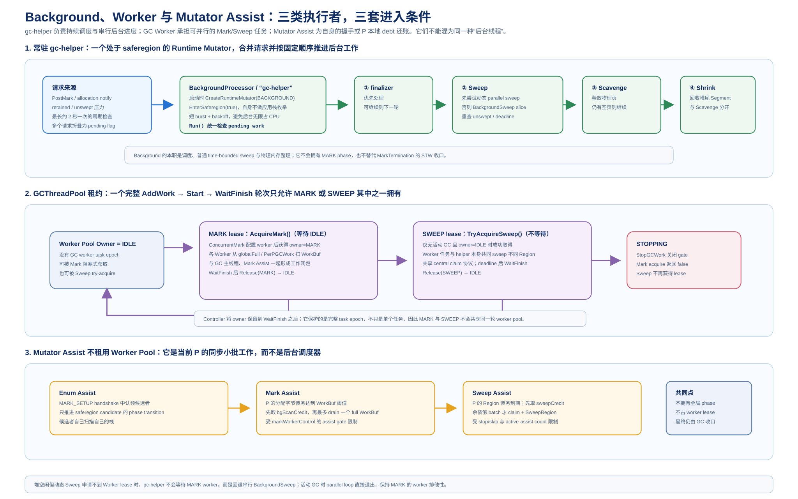

`BackgroundProcessor` 创建一个名为 `gc-helper` 的 Runtime Mutator，并在启动时进入 saferegion。它是常驻的后台调度者：请求可以来自 PostMark、分配压力、显式 notify 或周期检查；多个请求折叠为 pending flag。其运行循环的实际顺序是 finalizer → 动态 parallel Sweep →（若未处理 parallel）普通 Background Sweep → Scavenge → Shrink。每次处理后都会重查 pending 条件，并以短 burst/backoff 控制持续后台工作；因此它既提供稳定进度，也不会把一次唤醒变成无界的后台占用。

GC Worker 是 `GCThreadPool` 中按需启用的任务执行者，不是第二个常驻 GC 主线程。`MSGCWorkerPoolController` 为完整的 `AddWork → Start → WaitFinish` 周期保留 owner，从而保证 MARK 和 SWEEP 不会共享同一轮线程池：

| 执行方 | 如何取得执行权 | 实际工作 | 失败或结束语义 |
| --- | --- | --- | --- |
| `gc-helper` | 自身常驻线程；pending flag/周期检查唤醒 | finalizer、普通限时 Sweep、Scavenge、Shrink；决定是否发起动态 parallel Sweep | 无 Worker 时仍可串行 `BackgroundSweep()`；不拥有 MARK phase |
| MARK Worker | `AcquireMSGCWorkerPoolForMark()`；owner=MARK，若忙则等待 IDLE | 与 GC 主线程一起消费 `globalFull_`/`PerPGCWork` 的 WorkBuf，完成对象图扫描 | `WaitFinish()` 后 `Release(MARK)`；停止时收集器回退为串行 Mark |
| SWEEP Worker | `Heap::IsGcStarted()==false` 且 `TryAcquireMSGCWorkerPoolForSweep()` 只在 owner=IDLE 时成功 | gc-helper 创建任务，Worker 与 helper 通过共同 claim 协议清扫不同 unswept Region | 空闲堆但租约未取得时不等待 MARK，而是回退普通 `BackgroundSweep()`；活动 GC 时本轮 parallel loop 直接退出；完成后 `Release(SWEEP)` |
| Mutator Assist | Enum 的握手认领，或 P 本地 Mark/Sweep debt 达到门槛 | 小批量推进 Enum、Drain 一个 Mark WorkBuf、或清扫一个配置的 Sweep 批次 | 不取得 Worker Pool lease；受 phase、credit、批量阈值和 stop gate 约束 |

这里有三种不应混为一谈的“进度来源”。第一，P 的 Mark/Sweep debt 是**这个 P 因分配产生的本地账本**；第二，`bgScanCredit_` 和 `sweepCredit_` 是**其他执行方已经完成、可一次性转让的工作量**，两者的单位和来源都不同；第三，Sweep pressure 与 Worker helper count 是**调度决策**，用于决定未来应增加多少 debt 或并行度。把它们混成一个全局“GC 负载”会破坏偿还与停止协议的解释。

### 10.5 Assist 的整体作用

前台分配、后台 helper 和 GC Worker 共同消费 Mark/Sweep 工作：前台保证分配不会无限等待，后台提供持续进度，高压时 Worker 提高吞吐；所有工作都必须最终 publish 到可见队列或完成 claim，不能留在私有缓冲中让 GC 误判空闲。

详细实现： [Assist 协助架构与实现](09_MSGC_Assist协助架构与实现详解.md)、[GC Mark](05_MSGC_GC_Mark架构与实现详解.md)、[Sweep](07_MSGC_Sweep架构与实现详解.md)。

<a id="chapter-11"></a>
## 11. LLVM 与 Runtime 优化

优化分为编译器/后端快路径和 Runtime 数据结构优化两层。目标是在不改变稳定地址、Mark 闭包和 Region owner 语义的前提下降低分配、写屏障、队列和物理页管理的固定成本。

### 11.1 LLVM Barrier Pass

前端把普通写、struct 写、数组复制、generic/atomic 操作表示为 Cangjie GC intrinsic。这里要区分三类动作：

1. **Pass 证明并删除屏障**：把确定不需要 GC 语义的操作改成普通 `store/load/memcpy/memmove`；
2. **Pass 缩小屏障范围**：把一个聚合 struct 操作拆成少量引用字段屏障和非引用字节拷贝；
3. **CodeGen 生成快慢路径**：不能删除的操作先变成 MSGC 专用 wrapper，AArch64 后端再决定是否在 callsite 展开；条件不满足时 wrapper 仍调用 Runtime slow path。

主要管线（实际 SDK 还要确认使用的是 New PM、LTO 还是 legacy PM）如下：

```text
CJFillMetadata
  -> CJRuntimeLowering
  -> CJBarrierSplit
  -> 常规 LLVM/CJSpecificOpt
  -> PlaceSafepoints
  -> CJBarrierOpt
  -> CJRewriteStatepoint
  -> CodeGen: CJBarrierLowering
  -> ISel / AArch64 AsmPrinter
```

#### Pass 级优化清单

| Pass/阶段 | 处理对象 | 做的优化 | 不能证明时的结果 |
| --- | --- | --- | --- |
| `CJRuntimeLowering` | `new array`、generic array 及其它 frontend Runtime intrinsic | 主要负责 frontend intrinsic 到 `CJ_MCC_*` 的 Runtime 映射；对数组额外计算总大小，并把 concrete/generic array 分流到 MSGC wrapper | 长度、元素类型或总大小无法安全计算时保留 `CJ_MCC_NewArray*` Runtime 调用；它本身不是 barrier 正确性优化器 |
| `CJBarrierSplit` | constant-size struct/static-struct 的读写 | 根据 TypeInfo/GCTib 找出引用槽；引用槽生成细粒度 `gcread_ref/gcwrite_ref`，中间非引用区生成 `memcpy`；当前适合少量（通常 1～3 个）引用槽 | 动态 TypeInfo、复杂/大量引用或布局不满足拆分条件时保留 bulk barrier |
| `CJBarrierOpt`：栈/非堆消除 | `alloca`、明确的 native/stack 目标 | 栈对象不在 GC heap，直接用普通内存操作 | 目标可能逃逸到 heap、存在别名或未知调用时保留屏障 |
| `CJBarrierOpt`：无引用区间消除 | 非-static `gcwrite_struct` 的常量范围；栈对象上的 array-copy | 能从源布局/常量范围证明不含 managed ref 时直接 `memcpy`；栈 array-copy 可改普通 `memmove` | 目标可能是 heap、范围/布局不确定或包含引用时保留 bulk barrier；不能把 static 变体的消除一律归因于此 pass |
| `CJBarrierOpt`：one-ref scalarize | 带 `AggType` metadata 的单引用小聚合 | 前后非引用字节拆成 memcpy，中间单个引用字段使用 `gcwrite_ref` | 没有可靠 metadata、引用数超过支持范围时保留聚合 barrier |
| `CJBarrierOpt`：fresh-init 消除 | 新分配对象紧接着初始化字段 | 同一 basic block 内由同一个新分配支配、无 safepoint/未知 call/别名覆盖时，初始化写改成 plain store/memcpy；新对象尚无需保护的 old edge | 跨 safepoint、存在未知 call/别名 clobber、对象来源不确定时保留屏障 |
| `CJBarrierOpt`：裸写 verifier | 普通 store/memcpy/memmove | 检查可能写入 heap/global managed ref 的裸内存操作，防止优化误删屏障 | 无法证明安全时报告 “Need write barrier”，而不是静默生成裸写 |
| `CJGenericIntrinsicOpt` | `cj_assign_generic`、`cj_gcread_generic`、`cj_gcwrite_generic` | non-heap、无引用布局复制改成 memcpy；`gcread.generic` 的 fresh destination 还利用 `noalias/new_gen` 和无 clobber 证明消除 helper | `gcwrite.generic` 的 fresh-destination 专项折叠尚未实现；目标是 heap box 或引用布局运行时才可知时，改走 struct-write 或 Runtime generic helper |
| `CJBarrierLowering`：MSGC read | `cj_gcread_ref/weakref/static_ref`、struct/static-struct | MSGC 不搬对象，引用读直接 `load`，struct 读直接 `llvm.memcpy`，不生成 read wrapper | `cj_gcread_generic` 若写入的目标 box 可能在 heap，必须转成保护目标旧边的 struct-write 形态 |
| `CJBarrierLowering`：MSGC write | `cj_gcwrite_ref/static_ref/struct/static_struct`（以及代码中对应的 array-copy wrapper） | 生成 `CJ_MCC_*Fast_MSGC` internal/noinline wrapper，保留参数/调用约定作为后端识别锚点 | 非 AArch64、开关关闭或 intrinsic 不在当前 allowlist 时保持普通 `CJ_MCC_*` Runtime 调用 |
| `CJBarrierLowering`：generic write | `cj_gcwrite_generic` | 把 generic box payload（通常为 `box + 8`）改写成已有 struct-write wrapper，复用 old-edge 保护 | source/destination 形态无法满足转换、size 或 null 语义不明确时回 `WriteGeneric` |

实现口径补充：`CJBarrierSplit` 可以把 static struct 拆成 static ref + memcpy，但当前
`CJBarrierOpt` 源码中的 BarrierSet 主要收集非-static 的 `gc{read,write}` 与 array-copy
形态；因此不能笼统地把所有 static no-ref 消除都归因于 `CJBarrierOpt`。静态变体若未被
其它 Pass 证明，仍保留 intrinsic/wrapper/Runtime 语义。

#### Runtime barrier wrapper 映射与退化条件

| intrinsic/操作 | 首选 wrapper 或 IR 结果 | wrapper/inline 不生效时 | 必须回 Runtime 的典型条件 |
| --- | --- | --- | --- |
| `cj_gcwrite_ref` | `CJ_MCC_WriteRefFieldFast_MSGC` | `MSBarrierOps::WriteReference` | mark 期 active log 无空间、旧值为复杂/非法引用、heap/Region 校验失败、phase/gate 不可确认 |
| `cj_gcwrite_static_ref` | `CJ_MCC_WriteStaticRefFast_MSGC` | `MSBarrierOps::WriteStaticRef` | log 满、旧值需复杂处理、符号/ABI 不匹配；static slot 仍必须按 root 语义保护 old |
| `cj_gcwrite_struct` | `CJ_MCC_WriteStructFieldFast_MSGC` | `MSBarrierOps::WriteStruct` | GCTib 长格式/动态 TypeInfo、非 8 字节对齐、引用范围复杂、预留 log 不足 |
| `cj_gcwrite_static_struct` | `CJ_MCC_WriteStaticStructFast_MSGC` | `MSBarrierOps::WriteStaticStruct` | static GCTib 无法解析、范围不合法或需要 bulk slow path |
| `cj_gcwrite_generic` | 先转 struct wrapper | `CJ_MCC_WriteGeneric` | 目标 box 在 heap 且布局不能静态证明、source 为 null/size 语义不能安全重写 |
| `cj_array_copy_ref/struct` | 代码中有对应 wrapper/发射能力；以 lowering allowlist 与 AsmPrinter dispatch 同时命中为准 | `CJ_MCC_ArrayCopyRef/Struct` 的 Runtime bulk barrier | 当前 Mark phase 的 arraycopy 必须保留 Runtime bulk 路径；Idle 才能安全退化为普通 `memmove`；若当前工具链未把 intrinsic 放入 allowlist，则全程保留 Runtime |
| `cj_atomic_*`、CAS/swap | 保留显式 atomic Runtime API | `CJ_MCC_Atomic*Reference` | 原子内存序、失败值或 old-edge 顺序不能由普通 store/callsite inline 保持时，不做 barrier inline |
| MSGC read | direct load/memcpy | Runtime read API（通常只在通用/未优化路径出现） | 只有 generic read 写入 heap box、布局未知或编译器开关关闭时保留 helper |

因此，“LLVM 优化”不等于“所有屏障都变成机器码内联”：读侧通常是直接消除，写侧是
wrapper 锚定后再由目标后端选择性展开；任何不满足证明、平台或 ABI 条件的路径，都必须回到
语义完整的 Runtime 实现。

### 11.2 AArch64 和分配内联

AArch64 的内联发生在 `AsmPrinter` 识别 MSGC wrapper 之后，不是 Runtime C++ 函数自动变快。写屏障和分配器分别有自己的 gate：

1. wrapper 名称/属性必须命中后端 dispatch；
2. 写屏障的完整 callsite 展开要求 AArch64 Mach-O 与 `EnableMSGCInlineWriteBarrier`；对象/数组分配 emitter 主要要求 AArch64/TLS ABI，并不等同于写屏障的 Mach-O gate；
3. **写屏障**必须能 acquire-load Runtime release-store 发布的 phase/heap 边界；**分配器**当前主要检查 `safepointState`、TLS buffer、Region 和 bitmap，不以 `encodedGCPhase` 做 mark-at-alloc；
4. 代码尺寸估算、跳转表宽度和 branch relaxation 必须覆盖展开后的真实上界。

这些 wrapper 必须保持 `internal + noinline` 的薄函数形态：LLVM 普通优化不能把 wrapper
提前吞掉，否则 `AsmPrinter` 无法按属性/符号识别并替换函数体；所有 miss 最终仍跳到原始
`CJ_MCC_*` slow callee。

#### 写屏障内联清单

| 内联入口 | 内联做什么 | StoreOnly 条件 | 退化到 Runtime 的条件 |
| --- | --- | --- | --- |
| `CJ_MCC_WriteRefFieldFast_MSGC` | 读取 phase gate；取 old；做 heap-range/Region 校验；在 mark 期对 old 的 mark bit 做原子竞争；winner 且对象含引用字段时写入 P 的 `activeLog_`，最后 store new | gate 表示 IDLE/FINISH/RECLAIM/SWEEP；old 为 null、非 heap 或已被其他线程标记 | `activeLog_` 为空/已满、Region/slot/TypeInfo 不合法、old 为 large/特殊对象且当前序列不能处理、phase/gate 不一致 |
| `CJ_MCC_WriteStaticRefFast_MSGC` | 与 ref 版本相同，但 static slot 没有 heap container；直接处理 old root edge 后写入 static field | idle gate、old 为空/非 heap/已标记 | log 不足、old 需要复杂验证、wrapper/符号 ABI 不匹配 |
| `CJ_MCC_WriteStructFieldFast_MSGC` | 读取 GCTib/ref bitmap，定位被覆盖范围的 old 引用；可把同一 bitmap word 的相邻候选合并一次 atomic OR；完成 active log 预留后执行 memcpy | idle gate、size 为 0、目标非 heap、范围无引用字段 | 长格式/动态 GCTib、非 8 字节对齐、范围或 TypeInfo 无法验证、log 容量不足 |
| `CJ_MCC_WriteStaticStructFast_MSGC` | 使用调用者提供的 GCTib 扫描 static 目标 old 引用，再 memcpy | 同上 | GCTib/范围不合法、复杂布局或需要 Runtime bulk barrier |
| `CJ_MCC_ArrayCopyRefFast_MSGC` | Idle 期可直接 memmove；Mark 期不能把 raw old ref 直接塞入 Route-A workbuf，必须由 Runtime bulk barrier 按 old-edge 语义处理 | gate 为 Idle，或能证明没有 GC 语义 | Mark phase、重叠/范围校验复杂、log 预留不足，或当前 lowering/dispatch 未激活该 wrapper |
| `CJ_MCC_ArrayCopyStructFast_MSGC` | Idle 期普通 memmove；含引用的 Mark 期交给 `CopyStructArray`/bulk marker | gate 为 Idle、无引用组件 | Mark phase、动态 component TypeInfo、复杂重叠范围，或 wrapper 未进入 dispatch |

普通写屏障的关键顺序不能交换：必须先为 log 预留，再执行 mark winner，再写入 grey object，
最后覆盖字段。否则可能出现“mark bit 已置位但没有待扫描 WorkBuf”的
marked-but-not-scanned 问题。

#### 对象分配内联清单

对象分配有两层独立开关：`EnableGCFastPath` 决定 `CJBarrierLowering` 是否创建/替换 fast
wrapper，`EnableCJNewObjFast`/`EnableCJNewArrayFast` 决定 AArch64 发射器是否展开对应分配
序列；只关一层时仍可能生成 wrapper 或兼容 stub，最终是否真正内联要看两层都命中。
MSGC Runtime 与 LLVM 共用 36 个 size class（8B～16KB）。`CJBarrierLowering::doNewFastPath`
对常量大小选择最小的 `slotSize >= requestedSize`，生成带
`cj-msgc-sizeclass`/`cj-msgc-slotsize` 属性的 wrapper；动态大小生成带
`cj-msgc-dynamic` 属性的 wrapper。

| 分配入口 | 内联做什么 | 退化到 Runtime 的条件 |
| --- | --- | --- |
| `CJ_MCC_NewObjectFast_MSGC_clsN_szS` | 先检查 safepoint 状态；从 `ThreadLocalData + 88` 取 `msAllocBuffer`，再取 `activeRegions_[class]`；BUMP 直接推进 `allocPtr`；PARTIAL 用 `reservedBitmap` 找 word、在 `allocBitmap` 清空一个空槽（summary 不一致时先修复再重试）；写 TypeInfo/header、更新 `freeSlotCount`、返回对象 | safepoint 不安全、分配大小非编译期常量、分配大小大于 `16KB`、大对象/large span、TLS/active Region 为空、Region 非 BUMP/PARTIAL、BUMP 越界、PARTIAL bitmap 无空槽或校验失败；当前该路径不以 `encodedGCPhase` 做 mark-at-alloc |
| `CJ_MCC_NewObjectFast_MSGC_dynamic` | 先检查 safepoint 状态与 `size != 0`；查只读 size-class/slot-size 表（模块中按需发出约 2049B 的 size-class 表和 72B 的 slot-size 表），再复用 BUMP/PARTIAL 分配序列 | safepoint 不安全、size 为 0/溢出、动态 size 大于 `16KB`、表项/Region 状态异常，或需要 large-object 分配 |
| `CJ_MCC_NewFinalizerFast_MSGC_clsN_szS` | 常量 small size 走同一 BUMP/PARTIAL 分配，并补 finalizer 对象登记/初始化调用 | finalizer 元数据、size、safepoint、Region 或 bitmap 条件不满足；动态 finalizer 是否特化取决于当前 wrapper 物化，不能默认视为静态专用路径 |
| `CJ_MCC_NewArray*Fast_MSGC_clsN_szS` | `CJRuntimeLowering` 对常量长度和元素宽度计算 `array header + payload` 总大小，向上取 size class；AArch64 分配 BUMP/PARTIAL slot，写 array TypeInfo/length；静态数组 emitter 没有独立的 phase/safepoint gate | 长度/总大小溢出、总大小大于 `16KB`、无可用 Region/bitmap、元素布局无法静态确定，或 `EnableCJNewArrayFast` 关闭 |
| concrete dynamic array wrapper | `CJRuntimeLowering` 计算元素大小与总对象大小；AArch64 按 ref/struct/primitive 布局选择对应分配路径，初始化 array header/length | 长度或总大小溢出、size 为 0/大于 `16KB`、元素布局含运行时才可知的引用信息、safepoint/Region/bitmap 检查失败 |
| generic array dispatch wrapper | 按 element kind 分到 `dyn_ref`、`dyn_struct`、`dyn_w1/w2/w4/w8`，各 wrapper 再走 MSGC BUMP/PARTIAL；dispatch 本身保留类型分派 | element kind/宽度/TypeInfo 或总大小不能安全判定时回 `CJ_MCC_NewArrayGenericFast3_MSGC`，最终由 Runtime 处理 |
| 通用 `CJ_MCC_NewObjectFast` / `CJ_MCC_NewFinalizerFast` | 无 MSGC size-class 属性时走 CopyGC 兼容 TLAB bump；MSGC module 若存在 dynamic wrapper，后端可按 MSGC mode 选择 dynamic 路径 | `EnableCJNewObjFast` 关闭、TLS/旧 TLAB 检查 miss、MSGC 未命中特化属性或 fast 检查失败时调用原始 `CJ_MCC_NewObject/NewFinalizer`；MSGC 的 `tlRegion_` 兼容值为 `NullRegion`，误走 CopyGC 路径会稳定 miss |

分配 fastpath 只负责拿到一个已占用 slot 并初始化最小 header，不替代 Runtime 的补货和大对象
逻辑：active Region 耗尽后，SlowAlloc 仍要归还旧 Region、从 cached/CentralPool/unswept/fresh
链补货；large object 仍由 span/FreeManager 管理。当前存在一个必须保留在 ABI 文档中的边界：
Runtime 顶层使用 `allocSize >= 16KB` 进入 large path，而 MSGC LLVM lowering/AsmPrinter 的
size-class 表和 dynamic check 使用 `size > 16KB` 才回 slow，精确 16KB 仍可能生成 small
wrapper。这个跨层不一致意味着 16KB 请求必须在 wrapper miss、Runtime slow path 和测试中重点
验证；若要统一阈值，必须同时修改 Runtime、LLVM 和相关 ABI 测试。

#### AArch64/Runtime ABI 限制

| ABI 项 | 内联假设 | 变更时必须同步 |
| --- | --- | --- |
| CJTLS 与 `X28` | `X28` 指向当前线程 TLS；内联从固定字段读取 `msAllocBuffer`、phase/gate | `ThreadLocalData` 字段顺序、managed entry、phase 刷新和后端 offset |
| `AllocBufferMS` | `tlRegion_` 必须保持 offset 0（MSGC 兼容层指向 `NullRegion`）；真正的 `activeRegions_[class]` 从约 `+8 + class*8` 取；`activeLog_` 为 `+896`，WorkBuf 的 `len/objs` 为 `+8/+16`，容量为 1024 | `MSAllocBuffer` 成员顺序、WorkBuf header/capacity、static_assert 与 AsmPrinter 常量 |
| `MSRegionInfo` | `allocPtr +0`、`regionEnd +8`、`allocBitmap +24`、`markBitmap +32`、`freeSlotCount +42`、`regionType +50`、`reserved +56` 等偏移被 fastpath 直接读取；结构体固定 64B | Region entry 大小、bitmap 表示、BUMP/PARTIAL 枚举、slot/heap 映射 |
| Object/TypeInfo/GCTib | object header、payload、HasRefField、GCTib 和 component TypeInfo 的偏移固定 | 对象模型、TypeInfo/GCTib 编码和引用宽度 |
| 全局符号与内存序 | inline 直接访问 heap start/end、phase gate、RegionInfo 表；Runtime release-store，inline acquire-load | 符号名/可见性、Mach-O relocation、发布顺序和原子内存序 |
| 机器码尺寸 | AsmPrinter 展开远大于表面 `BL`；跳转表和 branch range 必须按保守上界估算 | 当前 `AArch64InstrInfo` 对 NewArrayFast/写屏障有专门估算，但 NewObject MSGC 静态/动态展开仍可能按普通 call 计数；dynamic NewArray 的固定上界也可能小于真实展开，扩展 emitter 时必须补齐上界并回归 branch relaxation |

当前 runtime 的 `ThreadLocalData::msAllocBuffer` 位于 TLS 的 `+88`（非 `__arm__` 布局），
`encodedGCPhase` 位于历史 ABI 保留位置；这些数值由 `ThreadLocal.cpp`、`MSAllocBuffer.cpp`
的 `static_assert` 与 LLVM 后端共同约束。这里列出的数值是“当前实现的 ABI 快照”，不是可以
随意写死在独立工具中的公共 API；任何字段增删都必须同时更新 runtime、LLVM 和生成代码测试。

因此，关闭 inline、非 AArch64/非 Mach-O、wrapper 未命中、ABI 校验失败，或者任一 fastpath
条件失败时，都应保留可链接的 wrapper 并调用 Runtime slow path。Runtime/LLVM 必须成套发布，
不能只替换 dylib 后复用旧的 `.cj` binary；否则即使函数名仍能链接，TLS、Region、WorkBuf
或 phase 语义不一致也会造成静默内存破坏。

<a id="chapter-12"></a>
## 12. 关键正确性不变式

MSGC 的正确性不是某一个函数独立保证的，而是 Mark、Barrier、Sweep、分配器和 LLVM ABI 共同维护的跨模块不变式。

### 12.1 Mark 与 WorkBuf

对象 mark 位原子竞争成功后，含引用对象必须最终进入某个可消费的 WorkBuf；本地 buffer 满时必须 publish，线程退出或 phase 关闭时必须 flush。MarkTermination 结束时，本地 buffer、Global 队列、in-flight 扫描和 active log 必须为空或已转移到最终工作集合。

### 12.2 Barrier 与并发删除

并发写入覆盖旧引用时，old edge 处理必须先于可能丢失该引用的 store。只有 mark winner 且对象含引用字段时才需要入队，但叶对象不能被错误地当成含引用对象跳过必要的字段扫描。bulk、struct、generic 和 atomic 路径都必须遵守同一闭包语义。

### 12.3 Generation 与 Sweep

Sweep 只能处理属于已结束 Mark generation 的 Region。Region 被 claim 后不能同时被分配器或另一个 Sweep 执行方取得；停止新 claim、等待 active counter、发布 swept/done 必须形成完整顺序。新 generation 对象由下一轮负责，不能因旧 bitmap 尚未清理而被误扫。

### 12.4 Region 所有权与物理页

Region 在任意时刻只有一个有效 owner；P active、中央链、large hot cache、FreeManager allocation 位图和 borrowed span 之间的转移必须可追踪。Reclaim 改变逻辑所有权，Scavenge 改变物理驻留，两者不能互相替代；解除提交前必须确认没有上层缓存仍持有对象语义。

### 12.5 Runtime/LLVM ABI

size class、对象头、`MSRegionInfo` 字段偏移、`AllocBufferMS`/`activeLog_` 偏移、WorkBuf 布局、wrapper 参数和 inline 代码尺寸属于共享 ABI。任一侧改变后必须同步重编 Runtime、LLVM 产物和测试 binary；否则错误可能表现为错误回收、TypeInfo 污染、SIGSEGV 或启动挂死。

详细实现： [GC Mark](05_MSGC_GC_Mark架构与实现详解.md)、[Barrier](06_MSGC_Barrier架构与实现详解.md)、[Region 结构](03_MSGC_Region结构详解.md)、[Sweep](07_MSGC_Sweep架构与实现详解.md)。

<a id="chapter-13"></a>
## 13. 工程取舍与性能模型

MSGC 的优化目标不是单一的“GC 越快越好”，而是在吞吐、暂停、RSS、代码尺寸、CPU 争用和实现复杂度之间做平衡。

### 13.1 分配与缓存

P 本地 bump 和 size class 降低普通分配成本，CentralRegionPool shard 和 large hot cache 降低锁/系统调用；代价是空 Region 可能滞留在本地/中央缓存，RSS 下降会滞后。提高缓存命中率通常会牺牲物理页及时归还。

### 13.2 并发与暂停

Mark Worker、Mark Assist、后台 Sweep、Sweep Assist 和动态 parallel Sweep 把工作分摊到 Mutator/后台 CPU，缩短单次 STW；代价是需要维护 phase、epoch、debt、claim、active counter 和多种停止路径。MarkTermination 与 Force-Finish 仍保留作为最终安全余量。

### 13.3 编译器与代码尺寸

读屏障消除和 inline allocation/write barrier 可以降低热路径调用开销，但 generic、复杂 array/struct、atomic 和动态 TypeInfo 仍需 wrapper。过度内联会放大代码尺寸、跳转表和 ABI 风险，因此应结合指令大小、回归 case 和真实 workload 评估。

### 13.4 Scavenge 与 RSS

积极 Scavenge 可以降低 RSS，但会增加 commit/decommit、page fault 和后台 CPU；延迟 Scavenge 可以提高下一次分配吞吐，却保持较高 retained。应同时观察 live bytes、retained/cold-free、scavenged bytes、committed heap 和暂停时间。

详细实现： [优化实现与效果](10_MSGC_优化实现与效果详解.md)、[对象分配](04_MSGC_对象分配架构与实现详解.md)、[Scavenge](08_MSGC_Scavenge架构与实现详解.md)、[Assist](09_MSGC_Assist协助架构与实现详解.md)。

<a id="chapter-14"></a>
## 14. 配置、日志、环境变量与验证环境

### 14.1 构建、运行与验证环境

MSGC 是构建期选择的实现：通过 CMake/build.py 的 `MRT_USE_MARK_SWEEP`（通常由
`MARKSWEEP_FLAG=1` 触发）编译出 Mark-Sweep 路径，运行时不能用一个环境变量把已编译的
CopyGC binary 改成 MSGC。验证时应固定目标平台、编译选项、测试输入和报告文件路径，先
记录本次构建使用的源码版本，再运行同一用例；这样日志中的 Region、线程数和阈值才有可比性。

`MRT_REPORT` 可把报告写到文件。建议每次测试保存完整报告，而不是只截取最后一行；报告
中的 `cycle`、`sweepGen`、阶段耗时、WorkBuf/Assist 计数和 Region 统计需要一起看。参数解析
支持带 `kb`、`mb`、`gb` 后缀的大小以及时间单位；值越界或格式错误时会打印错误并回退到源码
默认值。

### 14.2 日志阅读顺序与一次真实 GC cycle

阅读一轮日志时按下面的因果顺序展开：

1. `GC START`：确认触发原因、当前 generation 和阈值是否真的被越过。
2. `preGCMark`/`PreEnumRoots`：看上一轮 Sweep 是否清空、bitmap 是否重置、分配缓冲和中央池快照是否一致。
3. `EnumRoots`/`ConcurrentMark`：看根是否转入 Global、WorkBuf 是否收敛、Assist 是否承担了欠债。
4. `MarkTermination`/`PostMarkTermination`：看 STW 固定点、weak/finalizer 和 large 回收结果。
5. `Sweep`/`UpdateGCStats`：看本轮实际清扫量、剩余 backlog、live bytes 和下一轮阈值。
6. cycle 后的 `sweep done`/`scavenge done`：这些是异步收尾，不能和 Mark 阶段耗时混为一谈。

下面摘录真实结果文件
`MSGC_RESULT/Result/case6_10g_scale/result/20260623_222500_MSGC_cangjie_compiler_vs_CopyGC_20260507_O1/gc_msgc_run1.log`
中的 cycle 1580（保留原始数值，便于和报告复核）：

```text
2026-06-23 22:25:45.584003 ... === GC START cycle=1580 === sweepGen=3160 reason=3(heuristic)
... active-region bytes 333053952 B, threshold 333027312 B, gcIndex=18446744073709551615
... unswept: 0 regions, emptyCache: 1 regions, hotFree: 336 regions, largeCache: 0 regions
... --- preGCMark ---
... alloc buffers: 3
... alloc-buffer regions: total=41 active=29 cached=12
... central pool: empty=1 large=304
... --- PreEnumRoots ---
... ForceFinishAllUnswept: swept=0 regions, emptied=0, retained=0, freed=0 B
... StopAndWaitForAllSweep: forceSwept=0->0 unswept regions, retained=333086720B activeBytes=333053952B emptySwept=32768B
... ClearAllMarkBitmaps: clearedSmall=9902 regions, clearedLarge=155107 regions, committedRegions=212992
... ReclassifyUnsweptToSwept: partial=0 regions, full=0 regions, total=0
... PreEnumRoots: stage-times stopSweep=7us clearBitmaps=651us stw=992us
... PreEnumRoots: 1005us
... --- EnumRoots ---
... EnumRoots: 25us, roots=1
... Assist enabled: ratioScaled=8 (prevMarked=2843361, allocSize=333086720)
... --- ConcurrentMark (gcThreadWork_ + globalFull_ LFStack) ---
... TransferRootsToGCWork: 54 root objects -> globalFull_
... ConcurrentMark time: 80334us, marked 2843361 objects (assist: 2245 calls, 702464 processed, 0 bgCredit-skip; LFStack: push 0, bgCredit consumed 15858, forceConverged=0)
... [assist] calls=2247 local=400384 bgStolen=15858 globalPulled=342016 postPull=302080 creditInjected=15858 rounds=2093
... --- MarkTermination (STW) ---
... MarkTermination total: 25us, flushed=12 entries, resurrection=0 entries, processed=720 objects, newlyMarked=0
... --- PostMarkTermination ---
... ProcessWeakRefs: 0us
... EnqueueFinalizers: enqueued 0 objects, 3us
... CollectLargeGarbage: freed 1 large objects / 513 regions (16809984 B), cached 1 objects / 513 regions, 43us
... PostMark total: 53us
... --- ConcurrentSweep ---
... EagerSweepBatch: swept=7406 emptied=4804 unsweptBacklog=9844 (deadline=10000us)
... ConcurrentSweep eager: swept=7406 regions, emptied=4804, unsweptBefore=9844, trueLiveRegions=5081, budget=10000us
... ConcurrentSweep total: 10919us
... --- UpdateGCStats ---
... heapThreshold: oldThreshold=333027312B newThreshold=332961776B oldScavengeThreshold=333027312B newScavengeThreshold=332961776B prevLive=166513656B trueLive=166480888B base=166480888B growth=2.00 scavengeGrowth=1.00 preActiveRegion=311689216B activeRegion=265322496B
... live bytes 166480888, activeRegion 265322496, update gc threshold 333027312 -> 332961776
... --- Total ---
... region statistics when gc ends (sweepGen=3162)
... total capacity: 549755813888 B, current heap: 6979321856 B
... active-region bytes: 265355264 B, true live: 166480888 B, true-live utilization: 62.74%
... region-accounting: active=8098 regions, empty=4314 regions, hotFree=0 regions, largeCache=513 regions
... total gc time: 92476 us (PreEnum 1005 + EnumRoots 25 + ConcMark 80334 + MarkTerm 25 + PostMark 53 + ConcSweep 10919 + PostGC 4 + Other 111)
... sweep done: slices=5 swept=2438 empty=0 unswept=0 elapsed=992us
... scavenge done: slices=129 regions=9424 bytes=308805632B elapsed=28347us
```

这轮日志可以这样解释：

- `active-region bytes` 高于 `threshold`，所以 `reason=heuristic` 触发；`gcIndex` 的全 1 值是
  “没有选定特定索引”的哨兵，不是一个真实的大数组下标。
- `preGCMark` 显示有 3 个分配缓冲、41 个关联 Region，其中 29 个 active、12 个 cached；中央池
  当时有 1 个 empty 和 304 个 large Region。`PreEnumRoots` 先等待旧 Sweep，再清除 9,902 个
  small 和 155,107 个 large bitmap，确保新一轮 Mark 不读到旧 generation 的标记。
- `EnumRoots` 只报告 1 个 root，耗时 25us；它建立并发初始灰集合，不应把它误读成完整 STW 根扫描。
  随后的 `TransferRootsToGCWork` 把 54 个 root object 推入 `globalFull_`。
- `ConcurrentMark` 标记了 2,843,361 个对象，用时 80,334us。Assist 进行了 2,245 次调用并处理
  702,464 个对象；`bgCredit consumed` 和 `creditInjected` 说明后台信用被借用/补回，`forceConverged=0`
  表示没有走强制收敛兜底。
- `MarkTermination` 只用了 25us，flush 了 12 个条目，处理 720 个对象且 `newlyMarked=0`，说明
  并发阶段已经接近固定点。`PostMarkTermination` 处理 weak/finalizer，并回收 1 个 large object，
  释放 513 个 Region、约 16.8MB，同时把这组 Region 放入 cache。
- 这份历史结果文件把 Sweep 打印为独立的 `ConcurrentSweep`：10ms eager budget 内扫了 7,406 个
  Region、清空 4,804 个，仍有 9,844 个 unswept backlog。当前源码的阶段模型已把 Sweep 发布边界
  收到 `PostMarkTermination`/`IDLE`，因此阅读新日志时应以当前实现为准，把这几行视为同一收尾工作的
  历史日志口径。
- `UpdateGCStats` 将 true live 记为 166,480,888B、active-region 记为 265,322,496B，并重算下一轮
  threshold。最终汇总给出 92,476us 的 cycle 总耗时；紧随其后的 `sweep done` 和 `scavenge done`
  分别又处理 2,438 个 Region 和约 295MB 物理页，属于 cycle 后的异步收尾。

### 14.3 GC 模式、堆参数与当前环境变量

下表按当前 `src/CjScheduler.cpp`、`Heap.cpp`、`CollectorResources.cpp` 和
`RegionManager.cpp` 的解析逻辑整理；“默认值”是 MSGC 构建下的默认值，平台差异和 CopyGC-only
参数在作用列中注明。`MRT_USE_MARK_SWEEP` 是编译宏，其他名称是运行时环境变量。

| 变量/开关 | 默认值 | 作用与范围 |
|---|---:|---|
| `MRT_USE_MARK_SWEEP` / `MARKSWEEP_FLAG` | 未定义时默认 CopyGC（`MARKSWEEP_FLAG=0`） | 构建期选择 MSGC 代码路径；`MARKSWEEP_FLAG=1` 时开启，不能在进程启动后切换。 |
| `cjEnableGC` | `true` | 是否启用 GC 总开关。 |
| `CJ_GC_DISABLE` | `false` | 抑制 GC 请求，主要用于纯分配或诊断场景；不改变已编译的 GC 类型。 |
| `cjProcessorNum` | `hardware_concurrency()`；取不到时为 `8` | P/调度器并发度；有效范围为 `(0, CPU×2]`。MSGC 用它计算 shard scale，但初始提交量不再随 P 线性增长。 |
| `cjMSShardCount` | `0`（auto） | MSGC shard 数；auto 先取 `ceil(cuberoot(32×P))`，再向下归一化为 P 的最大整除数；显式值也按 P 和可表达范围 clamp/归一化。 |
| `cjMSInitialSegmentCount` | `0`（auto，即 1） | MSGC 初始提交的 64MB Segment 数；与 shard 数独立。显式值优先，为容纳它可抬升有效 max virtual。 |
| `cjMSMaxVirtualHeapSize` | `16GB` | MSGC 最大虚拟堆基线；有效值为 `max(该配置, initialSegmentCount×64MB)`，并受完整 `[metadata|heap]` reserve 以及 `RegionIndex`/`UnitIndex` 可表达范围约束。 |
| `cjHeapSize` | MSGC 分支不读取；初始提交堆默认为 `1×64MB` | CopyGC 才用它设置初始堆（普通平台最小 4MB，OHOS/Android 最小 64MB）；MSGC 初始提交量改由 `cjMSInitialSegmentCount` 控制。 |
| `cjRegionSize` | 普通平台 `64KB`；OHOS/Android `1MB` | 通用/CopyGC Region 参数，受系统页大小和 `2MB` 上限约束；MSGC 的 small Region 仍由 `MS_REGION_SIZE=32KB` 固定，不由此变量改变。 |
| `cjHeapGrowth` | MSGC `1.0`；CopyGC `0.25` | 堆阈值增长倍率。 |
| `cjScavengeGrowth` | 等于 `cjHeapGrowth` | Scavenge 阈值增长倍率；未显式设置时随堆增长倍率继承。 |
| `cjGCInterval` | `0` | GC 间隔门槛；0 表示关闭该时间门控。 |
| `cjBackupGCInterval` | `240s` | 长时间没有常规触发时的备用 GC 间隔。 |
| `cjGCThreads` | `min(4, max(1, P/2))` | MSGC 标记线程总数（包含 GC 主线程），上限为 `P`。 |
| `cjExemptionThreshold` | `0.8` | Region/堆利用率相关的豁免阈值。 |
| `cjHeapUtilization` | `0.8` | 目标堆利用率，用于计算触发阈值。 |
| `cjAllocationRate` | `10240MB/s` | 触发模型使用的分配速率默认值。 |
| `cjAllocationWaitTime` | `1000ns` | 分配速率模型中的等待时间。 |
| `cjGarbageThreshold` | `0.5` | 通用垃圾比例阈值；在 CopyGC 中表示 from-space 垃圾比例，在 MSGC 中仍作为 GC 参数保存。 |
| `cjPinnedRegionSize` | `cjRegionSize` | pinned Region 的大小（通用 `RegionManager` 路径），不能超过 Region 大小。 |
| `cjLargeThresholdSize` | `32KB`，并截断到 `cjRegionSize` | 通用 RegionManager 的 large-object 分流阈值；具体 large span 管理由 MSGC 分配器实现。 |
| `MRT_REPORT` | 未设置/关闭 | GC 报告文件路径；设置后输出完整 cycle、阶段和 Region 统计。 |
| `CJ_MS_STW_SWEEP` | 未设置/关闭 | Sweep 稳定性诊断开关；开启时把残余 unswept backlog 留给下一轮 `PreEnumRoots()` 的 Force-Finish，不是常规调优项。 |

本表保留模式、堆、触发和报告相关的核心变量；Assist/Sweep/Scavenge 的细粒度调参不在总览中展开，
以免把实现细节和整体配置边界混在一起。详细实现： [对象分配](04_MSGC_对象分配架构与实现详解.md)、[GC Mark](05_MSGC_GC_Mark架构与实现详解.md)、[Sweep](07_MSGC_Sweep架构与实现详解.md)、[Scavenge](08_MSGC_Scavenge架构与实现详解.md)。

<a id="chapter-15"></a>
## 15. 源码索引与推荐阅读顺序

### 15.1 Runtime 入口

- `src/Heap/MAllocator`：Region manager、size class、`AllocBufferMS`、CentralRegionPool、FreeManager。
- `src/Heap/MCollector`：MarkSweepCollector、BackgroundProcessor、WorkBuf、Mark/Sweep policy 和 Assist pacing。
- `src/Heap/MBarrier`、`src/Heap/Barrier`：Idle/Mark barrier、bulk/generic/atomic 入口和 phase gate。
- `src/Mutator`：线程根、safepoint、线程退出、P 级分配缓冲和 barrier log 连接。
- `src/Heap/Collector`、`src/Heap/Allocator`：通用 Collector/Allocator 接口和对象模型边界。

### 15.2 LLVM 入口

`CJBarrierSplit` 负责聚合写拆分，`CJBarrierOpt` 删除可证明冗余屏障，`CJBarrierLowering`/`CJRuntimeLowering` 负责 intrinsic/wrapper 降低，AArch64/X86 后端负责 inline sequence、跳转范围和目标 ABI。Runtime/LLVM 联调时要同时检查 pass 顺序、metadata、参数顺序和代码尺寸。

### 15.3 专题文档和阅读顺序

建议严格按本文第 3～11 章阅读：

1. [堆存储结构](02_MSGC_堆存储结构详解.md) → [Region 结构](03_MSGC_Region结构详解.md)
2. [对象分配](04_MSGC_对象分配架构与实现详解.md) → [GC Mark](05_MSGC_GC_Mark架构与实现详解.md)
3. [Barrier](06_MSGC_Barrier架构与实现详解.md) → [Sweep](07_MSGC_Sweep架构与实现详解.md)
4. [Scavenge](08_MSGC_Scavenge架构与实现详解.md) → [Assist](09_MSGC_Assist协助架构与实现详解.md)
5. [LLVM 优化](10_MSGC_优化实现与效果详解.md)

`MSGC_RESULT/Implementation` 用于补充设计演进、实验、回退原因和验证记录；本文负责回答“系统如何组成、流程如何衔接、边界在哪里”，专题文档负责回答“具体函数、字段和优化如何实现”。

详细实现：按上述顺序进入 [堆存储结构](02_MSGC_堆存储结构详解.md)、[Region 结构](03_MSGC_Region结构详解.md)、[对象分配](04_MSGC_对象分配架构与实现详解.md)、[GC Mark](05_MSGC_GC_Mark架构与实现详解.md)、[Barrier](06_MSGC_Barrier架构与实现详解.md)、[Sweep](07_MSGC_Sweep架构与实现详解.md)、[Scavenge](08_MSGC_Scavenge架构与实现详解.md)、[Assist](09_MSGC_Assist协助架构与实现详解.md)和[LLVM 优化](10_MSGC_优化实现与效果详解.md)。
