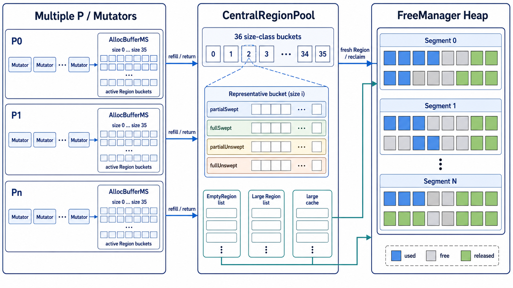
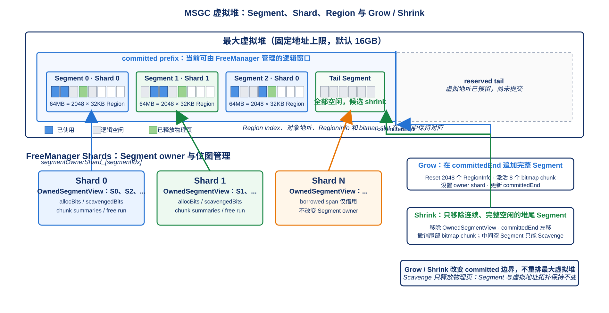
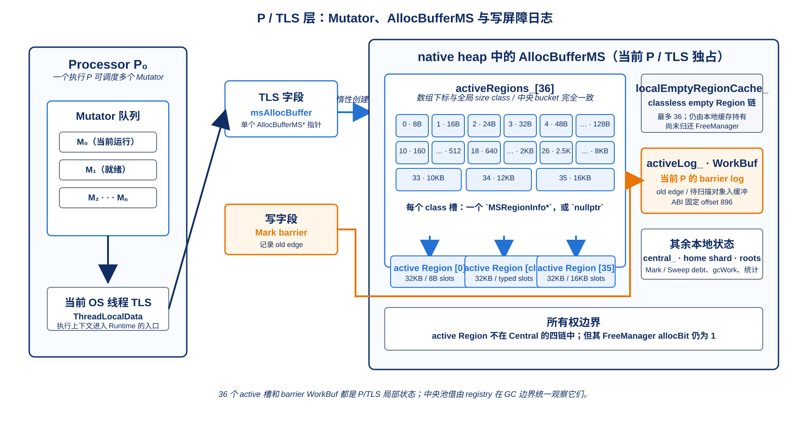
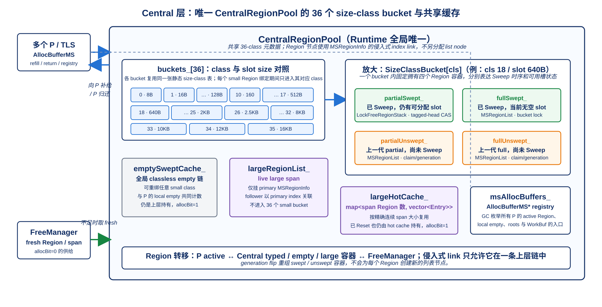
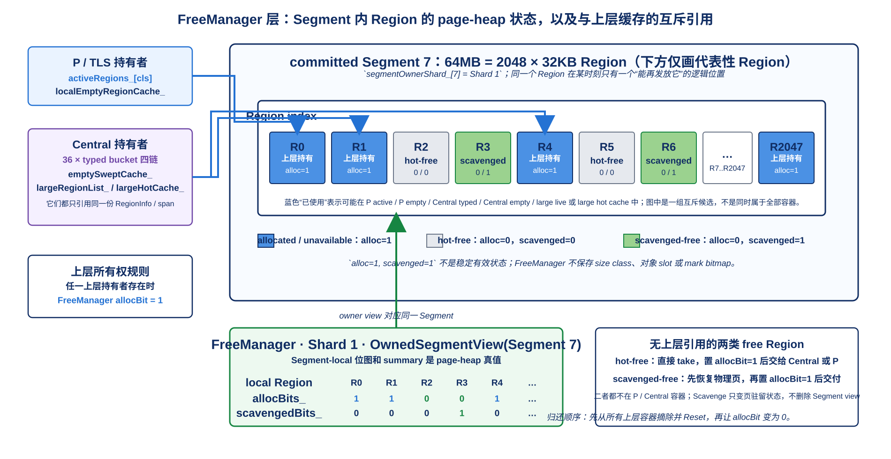

# MSGC 堆存储结构详解

> 本文以当前 Runtime 源码为准，详细说明 MSGC 堆的静态空间组织，以及 TLS、中央池和 FreeManager 三层 Region 存储结构。动态分配、Sweep 与回收算法只给出边界和文档入口。

## 1. 文档范围与核心结论

下图把本章涉及的三层存储关系放在同一张图中：P/TLS 负责当前分配上下文，中央池负责按 size class 组织 Region，FreeManager 负责 Segment/Region 级 page-heap 供给。图中的箭头表示同一个 Region 的所有权/供给关系，不表示复制对象数据。



> 图 2-1：总体资源层次。对象数据仍位于 object heap，图中各层保存的是 Region 指针、链表索引或位图元数据。

本文描述的是 MSGC 堆的**静态组织方式**：地址空间怎样切分，Region 在哪一层由什么结构保存，这些结构何时创建、占用多少空间，以及它们之间通过什么索引关联。

本文不详细复述 `SlowAlloc()`、refill、跨 shard steal、Sweep Assist、Scavenge 和 Shrink 的执行顺序。这些动态过程只在需要解释数据结构变化时简要出现，完整流程见第 10 节所列文档。

先统一三个词：

- **空间单位**：对 object heap 地址范围的容量分层，即最大虚拟堆、Segment 和 Region。
- **存储层**：保存 Region 所有权或可用性元数据的 native 容器，即 TLS/`AllocBufferMS`、`CentralRegionPool` 和 `FreeManager`。
- **保存 Region**：保存 `MSRegionInfo*`、Region index、链表头或一个状态 bit，不是复制 32KB 对象数据。

全文可以先记住以下结论：

1. MSGC 的 object heap 最小固定空间单位是 32KB Region；64MB Segment 包含 2048 个 Region，是提交容量和 FreeManager shard owner 的单位。
2. 默认最大虚拟堆为 16GB，可由 `cjMSMaxVirtualHeapSize` 调整；最大地址范围在 Runtime 初始化时一次预留，当前可分配的 committed 前缀随后按 64MB Segment 扩展或收缩。
3. `regionIdx` 在 object heap、`MSRegionInfo[]`、bitmap slot、中央池侵入式链和 FreeManager Segment 位图之间保持一致，是所有静态结构的共同坐标。
4. TLS 本体只增加一个 `AllocBufferMS*` 指针。`AllocBufferMS` 在 native heap 上惰性创建，直接保存 36 个 size class 的 active Region 指针和一条本地 classless empty Region 链。
5. 中央池只有一个 `CentralRegionPool` 对象，内嵌 36 个 bucket；每个 bucket 有四条 Region 链/栈，不会为每个挂入的 Region 再分配 native list node。
6. `FreeManager` 不保存 size class、对象 slot 或 mark bitmap。它按 Segment 建立 `OwnedSegmentView`，用 `allocBits_`、`scavengedBits_` 和 free-run summary 表示 Region 级 page-heap 状态。
7. 三层结构引用的是同一批 object Region。一个 Region 成为 TLS active 或中央 typed Region 后，在 FreeManager 中必须是 allocated；只有归还 page heap 后，FreeManager 才能再次把它作为 free supply 分配。
8. 本地/中央 empty cache 仍占有 Region，不能视为 FreeManager free；large hot cache 也会持有已 Reset 的 span，是只看 `regionType == FREE` 无法判断实际所有权的例外。
9. 固定 payload 可以准确计算，例如每个完整 Segment 的 FreeManager 位图与 summary 共 704B；`std::mutex`、`vector`、`map`、`deque` 的对象头、节点和 capacity 则依赖目标 ABI 与运行时容量。
10. 本文把大小分成“源码固定值”“按 P/Segment/Region 数线性增长的 payload”和“STL/ABI 相关开销”三类，避免用一个不稳定的 `sizeof` 掩盖真实组成。

## 2. 两个观察维度：空间单位与存储层

“三层空间单位”和“三层 Region 存储”是两条不同的轴，不能一一对应。

### 2.1 空间单位轴

object heap 的容量从大到小为：

```text
最大虚拟堆（默认 16GB，启动时一次预留）
  └─ Segment[0..N)（64MB）
       └─ Region[0..2048)（32KB）
            └─ small object slots，或 large object span 的一个组成 Region
```

| 空间单位 | 固定/默认大小 | 数量关系 | 主要静态职责 |
| --- | ---: | ---: | --- |
| 最大虚拟堆 | 默认 16GB | `maxVirtualHeapSize / 64MB` 个 Segment | 提供稳定 object-heap 地址上限和最大 `regionIdx` 范围 |
| Segment | 固定 64MB | 2048 Region | committed heap Grow/Shrink、shard owner、FreeManager view |
| Region | 固定 32KB | Segment 内 2048 个 | size-class 绑定、中央链节点、Sweep 与 page-heap 分配单位 |

系统页/unit 位于 Region 之下，但不构成第四层 Region 容器。`MSRegionManager` 记录 `unitSize_ = MRT_PAGE_SIZE` 和 `unitsPerMSRegion_ = 32KB / pageSize`，只用于 `madvise`/reuse、清页和地址换算。macOS arm64 常见一个 Region 为 2 个 16KB page，Linux x86_64 常见为 8 个 4KB page；Region 的逻辑大小仍固定为 32KB。

### 2.2 Region 存储轴

同一个已提交 Region 会随所有权状态在三层元数据之间流转，但 32KB 对象字节始终位于原 object-heap 地址：

```text
TLS / AllocBufferMS
  activeRegions_[36] + localEmptyRegionCache_
                    │
                    ▼
CentralRegionPool
  36 × four-list bucket + global empty/large caches
                    │
                    ▼
FreeManager
  shard -> OwnedSegmentView -> alloc/scavenged bits + summaries
```

| 存储层 | 主要对象 | 保存形式 | 是否保存对象数据 |
| --- | --- | --- | --- |
| TLS 层 | 当前执行上下文独占的 active Region、本地 empty 壳 | `MSRegionInfo*` 数组和侵入式链头 | 否 |
| 中央层 | typed swept/unswept Region、中央 empty 壳、large span | Region index 链/栈、hot-cache entry | 否 |
| FreeManager 层 | 已提交 Segment 中 free/allocated/scavenged Region | Segment-local bitmaps、summary、span descriptor | 否 |

这三层不是严格的“三份集合”：

- `activeRegions_[cls]` 与中央四链互斥；一个 typed Region 不应同时位于 TLS active 槽和中央 bucket。
- TLS 本地 empty cache 与中央全局 empty cache 都属于中央缓存体系的供给，只是容器实际分别位于 `AllocBufferMS` 和 `CentralRegionPool`。
- FreeManager 的 `allocBits_` 是底层 page-heap 占用真值。Region 在 TLS、中央链或 large hot cache 中仍被上层持有时，该 bit 不能作为可重新分配的 free bit。
- `MSRegionInfo` 与 location/owner side table 贯穿三层，用于描述布局和当前 owner；其字段级语义见 [MSGC Region 结构详解](03_MSGC_Region结构详解.md)。

### 2.3 静态对象分别位于哪里

```text
native TLS
└─ ThreadLocalData::msAllocBuffer ──────────────┐
                                                ▼
native C++ heap                         AllocBufferMS objects
├─ CentralRegionPool                   ├─ active Region pointers
├─ MSRegionManager                     └─ local list/vector/work state
│   └─ embedded FreeManager
└─ vector/map/deque backing stores

main cangjie_heap mapping
├─ MSRegionInfo[maxVirtualRegionCount]
└─ object heap[maxVirtualHeapSize]

separate ms_bitmap_arena mapping
└─ 1KB sidecar slot × maxVirtualRegionCount
```

因此 TLS、中央池、FreeManager 的对象头和动态容器都属于 native 元数据，不会占用 managed heap，也不会被 MSGC 当成仓颉对象扫描。object heap 中只保存用户对象字节；`MSRegionInfo[]` 和 bitmap arena 是与其索引对应的独立控制面。

## 3. 三层空间单位

### 3.1 最大虚拟堆：稳定地址上限

Segment、shard、Region 以及 Grow/Shrink 的边界关系如下。Grow 只推进 committed 前缀并激活新增 Segment 的元数据；Shrink 只撤销尾部连续 Segment，不搬动仍在使用的 Region。



> 图 2-2：三层空间单位与容量边界。

`RegionSpaceMS::Init()` 读取 `cjMSMaxVirtualHeapSize`，默认值为 16GB，再通过 `ComputeMaxVirtualHeapSize()` 保证虚拟上限至少覆盖传入的初始 heap size：

```text
maxVirtualHeapSize = max(roundUp(initialHeapSize, 32KB),
                         roundUp(configuredMaxVirtualHeapSize, 32KB))
maxVirtualRegionCount = maxVirtualHeapSize / 32KB
```

随后一次建立主 `cangjie_heap` 映射：

```text
mmapBase                                                         maxHeapEnd
  │                                                                   │
  ▼                                                                   ▼
┌────────────────────────────────┬────────────────────────────────────┐
│ MSRegionInfo[maxRegionCount]   │ object heap[maxVirtualHeapSize]    │
│ page-rounded, 64B / Region     │ committed prefix │ reserved tail   │
└────────────────────────────────┴──────────────────┴─────────────────┘
                                 ▲ heapStart         ▲ committedEnd
```

主映射大小为：

```text
metadataBytes = roundUp(maxVirtualRegionCount × sizeof(MSRegionInfo), pageSize)
mainMapBytes   = metadataBytes + maxVirtualHeapSize
heapStart      = mmapBase + metadataBytes
maxHeapEnd     = heapStart + maxVirtualHeapSize
```

这里的“预留”表示虚拟地址范围和稳定上限已经确定，不表示 object heap 的每一页都已驻留物理内存。`committedEnd` 是 FreeManager 允许分配的逻辑边界；OS 仍可惰性建立或回收对应物理页。

bitmap arena 不包含在主映射内。它按最大 Region 数另外预留 `1KB × maxVirtualRegionCount`，并以 256 Region 为一个激活/撤销 chunk。该 sidecar 与 `MSRegionInfo[]` 都是 Region 控制面，不是 object-heap 空间单位。

最大虚拟堆的生命周期覆盖整个 `RegionSpaceMS`：初始化后 `heapStart`、`maxHeapEnd` 和所有 Region index 不再移动；Grow/Shrink 只移动 committed 边界，不重新建立整块最大映射。

### 3.2 Segment：提交容量与 shard owner 单位

Segment 固定为：

```text
kMSShardSegmentBytes = 64MB
segmentRegionCount   = 64MB / 32KB = 2048
```

它有三项静态意义：

1. 初始 committed heap 为 `NormalizeMSShardCount(P) × 64MB`，也就是默认每个 shard/P 至少一个 Segment。
2. `segmentOwnerShard_[segmentIdx]` 为每个最大虚拟 Segment 保存一个 owner shard id；初始 Segment 按 `segmentIdx % shardCount` round-robin 归属。
3. 每个已提交 Segment 在 owner shard 中对应一个 `OwnedSegmentView`；FreeManager 的两张位图和 free-run summary 都以这个 view 为边界。

一个 Segment 同时包含 8 个 bitmap-arena chunk：

```text
2048 Region / 256 Region per bitmap chunk = 8 chunks
```

Grow 时新增 Segment 的 2048 个 `MSRegionInfo` entry 被 Reset，对应 8 个 bitmap chunk 被确保可访问，同时在 FreeManager 中附加一个 view。tail Shrink 真正撤销一个 Segment 时再移除 view、缩短 committed 边界，并按 bitmap chunk 边界撤销尾部 sidecar。这里描述的是各结构的增删粒度；具体加锁和失败重试顺序见第 10 节。

### 3.3 Region：共同索引与最小对象空间单位

Region 固定为 32KB。设 `i = regionIdx`：

```text
objectRegionStart(i) = heapStart + i × 32KB
regionInfo(i)        = arrayBase + i × 64B
bitmapSlot(i)        = arenaBase + i × 1KB

segmentIdx(i)        = i / 2048
segmentLocalIdx(i)   = i % 2048
```

小对象 Region 在一次绑定期只服务一个 size class，`activeRegions_[cls]` 和中央 bucket 都直接引用其 `MSRegionInfo`。大对象则申请连续的多个 Region，primary entry 保存 span 起止地址，secondary entry 通过 primary index 关联；但 FreeManager 仍只把它看成一段连续 Region bit run。

Region 的生命周期比 Segment 短：同一个地址可以先属于某个 small size class，清空后作为 classless empty cache，再 Reset 回 FreeManager，之后重新绑定成另一个 size class 或 large span。`regionIdx`、object 地址、对应 `MSRegionInfo` 槽和 bitmap slot 在这些复用过程中都不改变。

### 3.4 默认 16GB 上限的容量实例

默认最大虚拟堆的静态数量为：

| 项目 | 公式 | 结果 |
| --- | ---: | ---: |
| 最大 object Region 数 | `16GB / 32KB` | 524,288 |
| 最大 Segment 数 | `16GB / 64MB` | 256 |
| `MSRegionInfo[]` 原始 payload | `524,288 × 64B` | 32MB |
| bitmap arena 虚拟预留 | `524,288 × 1KB` | 512MB |
| FreeManager owner 表 payload | `256 × uint16_t` | 512B |

若当前 Processor/shard 数为 `P`，初始 committed 状态为：

```text
initialCommittedBytes   = P × 64MB
initialCommittedRegions = P × 2048
initialSegmentViews     = P
initialBitmapChunks     = P × 8
```

这些公式中的 `P` 取归一化后的 shard 数，0 会退化为 1；如果配置的最大虚拟堆不足以容纳 `P × 64MB`，初始化会直接报错，而不是创建部分 shard Segment。32MB RegionInfo 和 512MB bitmap 是虚拟/元数据容量口径，不能与初始 committed object bytes 或实际 RSS 直接相加后当成物理常驻量。

## 4. 第一层：TLS 与 `AllocBufferMS`

`AllocBufferMS` 承担 MSGC 的 per-P allocation cache 角色，但其物理挂载点是当前 OS 线程的 `ThreadLocalData`。因此更准确的说法是：**每个实际创建了 MSGC 分配缓存的 TLS 执行上下文一份**，通常与 Runtime Processor/P 的执行上下文对应，而不是每个仓颉协程一份。

### 4.1 TLS 中只有一个指针槽

P/TLS 层的具体引用关系见下图：一个 `AllocBufferMS` 有 36 个 size-class 槽，每个槽最多指向一个 active Region，同时维护本地 empty 链和屏障日志状态。



> 图 2-3：P/TLS 层的分配缓存结构。

`ThreadLocalData` 位于 native `thread_local` 数组中，MSGC 增加的直接入口是：

```cpp
AllocBufferMS* msAllocBuffer;
```

当前非 32 位 ARM 的 ABI 静态约束为：

```text
offsetof(ThreadLocalData, msAllocBuffer) = 11 × sizeof(void*)
sizeof(ThreadLocalData)                  = 12 × sizeof(void*)
```

在 64 位目标上就是 offset 88、总大小 96B。TLS 建立时整块数组零初始化，所以初始只有一个值为 `nullptr` 的 8B 指针槽；36 个 active Region、empty cache、债务和 GC work 都不直接内嵌在 TLS 数组中。

`ThreadLocalData` 的前部字段同时被 Runtime、CJThread 和编译器生成代码使用，字段偏移属于 ABI。`msAllocBuffer` 被放在尾部，既提供 O(1) 本地访问，又避免把体积较大的 C++ 对象塞进固定 TLS ABI。

### 4.2 `AllocBufferMS` 的静态结构

首次需要 MSGC 本地状态时，`GetOrCreateAllocBufferMS()` 在 native C++ heap 上执行 `new AllocBufferMS`，随后 `Init(central)` 并把指针写回 TLS：

```text
ThreadLocalData::msAllocBuffer
  │
  └──> AllocBufferMS
         ├─ tlRegion_                         // 兼容旧 LLVM 快路径
         ├─ activeRegions_[36]                // typed active Region
         ├─ localEmptyRegionLock_
         ├─ localEmptyRegionCache_            // classless empty Region
         ├─ central_
         ├─ cachedHomeShardId_
         ├─ stackRoots_
         ├─ gcAssistDebtScaled_
         ├─ wbBufAbiReserved_
         ├─ activeLog_ / logCache_
         ├─ gcWork_ / markAssistStats_
         └─ sweepAssistDebtScaled_ / generation / stats
```

这些字段分成三类：

| 类别 | 字段 | 静态职责 |
| --- | --- | --- |
| Region 保存 | `activeRegions_[36]`、`localEmptyRegionCache_` | 保存本 P 独占的 typed Region 与 classless empty Region |
| 路由与注册 | `central_`、`cachedHomeShardId_` | 指向唯一中央池并缓存 home shard |
| GC 辅助 | root vector、Mark/Sweep debt、WorkBuf、`PerPGCWork`、统计 | 保存当前 P 的根、写屏障日志、Assist 和诊断状态，不保存 Region 所有权 |

首字段 `tlRegion_` 必须保持 offset 0，与历史 `AllocBuffer::tlRegion` 布局兼容。MSGC 把它设置成 `RegionInfo::NullRegion()`，使预编译库中的旧通用快路径失败并回落到 MSGC 慢路径；它不是 `activeRegions_[36]` 的别名，也不保存当前 size class 的 active Region。

### 4.3 `activeRegions_[36]`：每 class 一个 typed Region

数组下标就是 size class：

```text
activeRegions_[cls] -> 当前 P 为 class cls 独占的 MSRegionInfo
nullptr             -> 当前 P 没有该 class 的 active Region
```

数组有 36 个 `MSRegionInfo*`。常见 64 位 ABI 下：

```text
36 × 8B = 288B
```

它最多引用 36 个 32KB object Region，即：

```text
36 × 32KB = 1,179,648B = 1.125MB object-heap capacity
```

1.125MB 是被这些指针引用的 managed object 空间上限，不是 `AllocBufferMS` native 对象大小。未使用的 class 槽为 `nullptr`，不会预先从堆中占一个 Region。

active Region 由当前 owner 单线程修改，因此数组本身是普通指针数组，不是 36 个原子。中央池、GC 或线程退出需要统一观察/归还时，通过 `msAllocBuffers_` registry、STW/锁和 location/owner 协议协调，而不是把每次 active 访问改成共享原子操作。

### 4.4 `localEmptyRegionCache_`：每 P 的 classless 空壳链

本地 empty cache 由：

```text
mutable std::mutex localEmptyRegionLock_
MSRegionList        localEmptyRegionCache_
```

组成，容量上限 `kLocalEmptyRegionCap` 等于 36。cache 中的 Region 已经清空并与原 size class 解绑定，可以在后续 refill 时重绑成任意 class；但它仍由本地 cache 持有，尚未归还 FreeManager。

`MSRegionList` 只保存：

```text
int32_t headIdx_
atomic<size_t> count_
```

Region 节点的 `nextRegionIdx/prevRegionIdx` 位于对应的 64B `MSRegionInfo` 中。常见 64 位 ABI 下 list 对象的核心大小为 16B；每多缓存一个 Region 不会额外分配 list node。

本地 empty cache 最多再引用 36 个 Region，也就是 1.125MB object-heap capacity。因而单个 `AllocBufferMS` 在极端情况下可直接引用：

```text
36 active + 36 local empty = 72 Regions = 2.25MB object-heap capacity
```

这只是容器容量上限。实际数量由使用过的 size class 和 empty Region 产生情况决定；中央的 `emptySweptCount_` 会把所有本地 empty 与全局 empty 一起计数。

### 4.5 路由、根、屏障和 Assist 字段

这些字段不构成新的 Region 缓存，但决定 `AllocBufferMS` 的完整静态占用：

| 字段 | 形态 | 生命周期/用途 |
| --- | --- | --- |
| `central_` | 一个指针 | `Init()` 指向唯一 `CentralRegionPool`，`Fini()` 后清空 |
| `cachedHomeShardId_` | `uint16_t` | 创建时解析一次本 P 的 home shard，refill 时复用 |
| `stackRoots_` | `vector<BaseObject*>` | root handshake 暂存根；vector backing store 按根数量动态增长 |
| `gcAssistDebtScaled_` | `uint64_t` | 当前 P 的 Mark Assist 定点债务 |
| `activeLog_` | `WorkBuf*` | 当前写屏障日志；AArch64 快路径要求对象内 offset 固定为 896 |
| `logCache_` / count | 单链指针与计数 | 当前 P 缓存的空 `WorkBuf`，高水位 16 |
| `gcWork_` | `PerPGCWork` | 每轮并发 Mark 时初始化/重置的本地工作集 |
| `markAssistStats_` | 4 个 `size_t` 逻辑字段 | 当前 P 的 Mark Assist 统计 |
| Sweep debt block | debt、generation、5 个原子统计 | 当前 Sweep generation 的 P 级定点债务与观测值 |

旧的 36 项 typed-spare 原子指针数组已经删除，但其 ABI footprint 没有立即回收，而是并入：

```text
wbBufAbiReserved_[184 + 36 × sizeof(atomic<MSRegionInfo*>)]
```

常见 64 位 ABI 下该 padding 为 `184 + 36 × 8 = 472B`，从而使 `activeLog_` 继续位于 offset 896。这个数组没有 Region 缓存语义，只是编译器与 Runtime 的布局兼容垫片。

Sweep 辅助块的逻辑 payload 为：

```text
sweepAssistDebtScaled_       8B
sweepDebtGen_                4B
MSSweepAssistAtomicStats     5 × 8B = 40B
合计                         52B，实际成员布局还包含对齐 padding
```

### 4.6 生命周期

| 时机 | TLS/`AllocBufferMS` 状态 |
| --- | --- |
| OS 线程 TLS 建立 | `threadLocalData[]` 零初始化，`msAllocBuffer == nullptr` |
| 第一次需要本地 MSGC 状态 | `new AllocBufferMS`；构造器建立 `tlRegion_` 与 ABI 校验 |
| `Init(central)` | 保存中央池指针，解析 home shard，将 36 个 active 槽清空，并注册到中央 `msAllocBuffers_` |
| 日常分配 | 按实际 size class 逐步填充 active 槽；empty Region 可进入本地链；没有按线程预留完整 72 个 Region |
| GC 周期 | root vector、barrier log、`PerPGCWork`、Mark/Sweep debt 和统计按各自 generation 初始化、消费或重置 |
| Runtime mutator 退出 | `DestroyRuntimeMutator()` 删除 TLS 中的 buffer；析构调用 `Fini()` |
| `Fini()` | 发布/清理日志和本地 GC work，归还全部 active Region，将本地 empty 移回中央，汇总退出 P 统计，并从 registry 注销 |
| delete 完成 | native `AllocBufferMS` 及其 vector backing store 释放，TLS 指针重新置空 |

中央池必须比已注册的 `AllocBufferMS` 活得更久，否则 `Fini()` 无法安全归还 Region 和注销。正常 Runtime 销毁顺序会先销毁 mutator/buffer，再删除中央池。

### 4.7 空间占用口径

可以稳定写入文档的大小是：

| 项目 | 64 位目标大小/公式 |
| --- | ---: |
| `ThreadLocalData` 全体 | 96B |
| TLS 中 MSGC 入口槽 | 8B，offset 88 |
| `activeRegions_[36]` | 288B |
| `MSRegionList` 核心字段 | 常见 ABI 为 16B |
| ABI padding | 常见 ABI 为 472B |
| `activeLog_` 固定位置 | offset 896 |
| Sweep debt/stat 逻辑 payload | 52B，另有对齐 |

完整 `sizeof(AllocBufferMS)` 不作为跨平台常量，因为其中包含 `std::mutex`、`std::vector`、`PerPGCWork` 及其内部类型；它们会随 libc++/libstdc++、指针宽度和对齐规则变化。动态 backing store 还随根数量和 WorkBuf cache 实际占用变化。正确的容量表达是“固定字段 + ABI 相关对象头 + 实际动态元素”，而不是把某一台机器上的 `sizeof` 当成所有平台的协议。

## 5. 第二层：`CentralRegionPool`

`CentralRegionPool` 是 Runtime 级唯一的中央 Region pool，角色类似 Go 的 `mcentral`。它位于所有 `AllocBufferMS` 与 `MSRegionManager/FreeManager` 之间：向上保存可重新发给 P 的 typed/empty Region，向下在缓存缺货时取得 fresh Region，同时也是 small Region Sweep generation 的组织中心。

### 5.1 创建位置与整体结构

中央层把每个 size class 的 swept/unswept、partial/full 链集中在一个 bucket 中，并额外维护 large、empty 和 large-hot-cache。下图是这些容器的关系示意。



> 图 2-4：CentralRegionPool 的中央供给结构。

`RegionSpaceMS::Init()` 的创建顺序为：

```text
MSRegionManager::Initialize()
  -> SizeClassInfo::Init()
  -> MSRegionInfoArray::Init()
  -> new CentralRegionPool(msRegionManager)
```

中央池对象位于 native C++ heap，不在 object heap、`MSRegionInfo[]` 主映射或 bitmap arena 中。其主要成员为：

```text
CentralRegionPool
  ├─ Sweep generation / stop gates / counters / pressure / credit
  ├─ buckets_[36]: SizeClassBucket
  │    ├─ partialSwept_       LockFreeRegionStack
  │    ├─ fullSwept_          MSRegionList
  │    ├─ partialUnswept_     MSRegionList
  │    └─ fullUnswept_        MSRegionList
  ├─ msRegionManager_
  ├─ largeRegionList_
  ├─ largeHotCache_: map<regionCount, vector<LargeHotEntry>>
  ├─ emptySweptCache_
  └─ msAllocBuffers_: vector<AllocBufferMS*>
```

构造函数只保存 `MSRegionManager*`。36 个 bucket、所有 list/stack、map/vector 和原子计数依靠成员初值构造成空结构，不按最大 Region 数预分配中央节点。

### 5.2 36 档 size-class 元数据

size-class 表本身是进程级静态数据，供 TLS active 数组、中央 bucket 和 `MSRegionInfo::sizeClass` 共同解释；它不是每个 bucket 复制一份。

```text
class  0..9 : 8, 16, 24, 32, 48, 64, 80, 96, 112, 128
class 10..17: 160, 192, 224, 256, 320, 384, 448, 512
class 18..25: 640, 768, 896, 1024, 1280, 1536, 1792, 2048
class 26..32: 2560, 3072, 3584, 4096, 5120, 6144, 8192
class 33..35: 10240, 12288, 16384
```

相关静态数组为：

| 数组 | 元素 | 常见 64 位 payload | 作用 |
| --- | ---: | ---: | --- |
| `kSizeClasses[36]` | 36 × `size_t` | 288B | class 到 slot size |
| `smallLookup_[129]` | 129 × `uint8_t` | 129B | `size <= 1024` 的 O(1) class 查找 |
| `largeLookup_[61]` | 61 × `uint8_t` | 61B | `(1024, 16384]` 的 O(1) class 查找 |
| `slotsPerRegion_[36]` | 36 × `size_t` | 288B | 每 class 的 `floor(32KB / slotSize)` |
| `slotDivMagic_[36]` | 36 × `uint32_t` | 144B | offset 到 slot index 的无除法换算 |

常见 64 位下这五张表的逻辑 payload 合计 910B。`kSizeClasses` 是编译期常量，其余四张表在 `SizeClassInfo::Init()` 中一次填充，随后覆盖整个 Runtime 生命周期；它们不随 Region 数或 P 数增长。

中央 bucket 数固定为 36，`buckets_[cls]` 与 `activeRegions_[cls]`、`MSRegionInfo::sizeClass == cls` 使用相同下标。size-class 表最后一项是 16KB，但当前普通分配入口对内部大小 `>= 16384B` 已分流到 large path；表的容量上界不等于所有入口都会实际使用 class 35。

### 5.3 两种侵入式 Region 容器

#### `MSRegionList`

普通中央链使用侵入式双向索引：

```text
list object: headIdx_ + count_
Region node: MSRegionInfo::nextRegionIdx + prevRegionIdx
```

`headIdx_` 是 `int32_t`，`count_` 是 `atomic<size_t>`。常见 64 位 ABI 下对象核心大小为 16B，其中包含 `headIdx_` 后为 8B 原子对齐产生的 padding。链表本身不内部分配、不拥有 `MSRegionInfo`；外部 bucket/empty/large/local lock 保护链操作。

#### `LockFreeRegionStack`

refill 最热的 `partialSwept_` 使用单链无锁栈：

```text
atomic<uint64_t> taggedHead_ = {tag: high32 | regionIndex: low32}
atomic<size_t>   count_
Region node next             = MSRegionInfo::nextRegionIdx
```

tag 在每次 Push/Pop 时递增，防止一个 Region 被弹出、复用并再次入栈后出现 ABA。常见 64 位 ABI 下核心大小同样为 16B。它也不分配节点，只复用 RegionInfo 中的 `nextRegionIdx`。

两种容器共同要求：一个 Region 挂链前的 `nextRegionIdx/prevRegionIdx` 必须为 `INVALID_IDX`；同一个 Region 不能同时属于两条中央链，否则不仅破坏计数，也会直接覆盖唯一的一组侵入式 link。

### 5.4 每个 bucket 的四条链

每个 `SizeClassBucket` 内嵌一个 mutex 和四个 Region 容器：

| 容器 | 数据结构 | Region 静态状态 | 同步方式 |
| --- | --- | --- | --- |
| `partialSwept_` | `LockFreeRegionStack` | 已 Sweep，仍有可分配 slot | tagged-head CAS；refill 热路径无需 bucket mutex |
| `fullSwept_` | `MSRegionList` | 已 Sweep，当前没有可分配 slot | bucket `lock_` |
| `partialUnswept_` | `MSRegionList` | 上一代 partial，尚未用本轮 mark 结果 Sweep | bucket `lock_` + Region sweep generation claim |
| `fullUnswept_` | `MSRegionList` | 上一代 full，尚未 Sweep | bucket `lock_` + Region sweep generation claim |

```text
SizeClassBucket[cls]
  mutex
  partialSwept_   -> idxA -> idxB -> ...
  fullSwept_      -> idxC <-> idxD <-> ...
  partialUnswept_ -> idxE <-> ...
  fullUnswept_    -> idxF <-> ...
```

一个 bucket 的四个 Region 容器核心 payload 为：

```text
1 × LockFreeRegionStack + 3 × MSRegionList
= 1 × 16B + 3 × 16B
= 64B（常见 64 位 ABI，不含 mutex 和整体对齐）
```

36 个 bucket 的 Region 容器核心 payload 因而为：

```text
36 × 64B = 2304B
```

`std::mutex` 大小在 libc++、libstdc++ 和各平台间不同，`SizeClassBucket` 还可能有尾部对齐，所以不能只用 2304B 代表 `buckets_` 的完整 `sizeof`。但 Region 数量增长不会增加 bucket 对象大小：新 Region 只修改已有链头/计数和 RegionInfo 内的 link。

generation flip 主要重组已有链：`partialSwept_` 整链转为 `partialUnswept_`，`fullSwept_` 与 `fullUnswept_` 交换；这不会批量创建新节点。`globalSweepGen_` 每轮加 2，Region 用 `sg-2/sg-1/sg` 区分 unswept/claimed/swept，location side table 再表达中央 partial/full 或 Sweep claimant owner。

### 5.5 classless empty cache

中央全局 empty cache 为：

```text
std::mutex          emptySweptLock_
MSRegionList        emptySweptCache_
atomic<size_t>      emptySweptCount_
```

`emptySweptCache_` 保存中央共享的 classless empty Region；它的 list 核心仍是常见 16B。`emptySweptCount_` 不是只统计这条全局链，而是统计全局链加所有 `AllocBufferMS::localEmptyRegionCache_` 的总 Region 数。

因此 empty cache 静态上跨两处存储：

```text
CentralRegionPool::emptySweptCache_       // 全局共享层
AllocBufferMS::localEmptyRegionCache_     // 每 P 本地层
```

两者都保存 `EMPTY_CACHE` Region 的侵入式 index 链，不保存对象内容。Region 在这两类 cache 中仍属于上层缓存体系，FreeManager 的 allocation bit 必须保持 allocated；只有显式 Reset 并交回 page heap 后才成为 FreeManager free。

### 5.6 large Region 的两套中央结构

large 对象不进入 36 个 size-class bucket，而由两套中央结构保存：

#### live large list

```text
std::mutex          largeLock_
MSRegionList        largeRegionList_
atomic<size_t>      largeLiveSpanCount_
```

链上只挂 large span 的 primary `MSRegionInfo`；secondary entry 通过 primary index 关联，不逐个挂链。`GetLargeRegionCount()` 返回的也是 primary 链节点数。

需要注意当前 `largeLiveSpanCount_` 的实际口径：`AddLargeLiveRegion()` 用 `(regionEnd - RegionStart()) / 32KB` 增加计数，而 `RegionStart()` 固定返回 `regionEnd - 32KB`，所以每个 large primary 当前实际只加 1。它等价于 live span/primary 数，不是多 Region span 覆盖的 Region 总数；虽然该字段随后被加入 `GetSweptMSRegionCount()`/`GetActiveMSRegionCount()`，本文仍按当前代码事实描述，不把它误写成 Region footprint。

#### large hot cache

```text
std::mutex largeHotCacheLock_
map<size_t, vector<LargeHotEntry>> largeHotCache_

LargeHotEntry {
    uintptr_t regionStart;
    size_t    regionBytes;
}
```

map key 是 `regionBytes / 32KB`，相同 Region 数的 span 放入同一 vector，取用时做精确大小匹配。常见 64 位 ABI 下每个 `LargeHotEntry` payload 为 16B；此外还有 map tree node、vector 对象、capacity 和 allocator 元数据，其大小随元素分布与标准库实现变化。

large hot cache 持有的是 span 地址与字节数，不使用 `MSRegionInfo` 侵入式链。死亡 large span 在入 cache 前会 Reset primary/secondary entry，因此该 span 的 `regionType` 可能已经是 `FREE`，但 FreeManager allocation bits 尚未释放；这是三层所有权判断中必须显式识别的例外。

### 5.7 `AllocBufferMS` registry

中央池保存：

```text
std::mutex                  msAllocBufferLock_
vector<AllocBufferMS*>      msAllocBuffers_
MSSweepAssistStats          exitedSweepAssistStats_
```

每个 buffer 在 `Init()` 时注册，在 `Fini()` 时注销。vector 的逻辑元素 payload 在 64 位下为 `T × 8B`，其中 `T` 是当前已注册 buffer 数；vector 对象头、capacity 与空闲容量另算。

registry 不拥有 Region，但它是 GC 枚举全部 TLS active Region、本地 empty cache、根/WorkBuf 和 P 级 Sweep 统计的入口。buffer 退出时，同 generation 的 Sweep 统计先合并到 `exitedSweepAssistStats_`，再从 vector 移除。

### 5.8 Sweep 控制面元数据

中央池还内嵌一组不随 Region 数增长的控制字段：

- `globalSweepGen_`、`sweepDone_`；
- Background/Lazy/Assist/Helper 的 stop/skip gate 与 in-flight count；
- 五类 Sweep 完成 Region 计数；
- `sweepRegionsPerAllocScaled_` 和 `MSSweepCreditPool`；
- `sweepPressureMode_` 与 `forceHighSweepPressure_`。

这些字段决定链表中的 Region 由哪个 generation、哪个 Sweep 执行者消费，但不另外保存 Region 节点。Background、Lazy、Assist、Helper 和 Force-Finish 共享同一组 bucket；它们不是五份 Region 队列。

### 5.9 生命周期与空间口径

| 时机 | 中央池静态状态 |
| --- | --- |
| 创建前 | manager、size-class 表和 RegionInfoArray 已就绪 |
| 构造 | 36 个空 bucket、空 empty/large/registry 容器和初始 Sweep 原子状态一次建立 |
| 首次线程缓存创建 | registry 增加一个 `AllocBufferMS*`；bucket 仍按实际 refill 才挂 Region |
| 日常运行 | typed Region 在四链与 TLS active 之间变化；empty 和 large cache 按实际数量增长 |
| GC generation flip | 复用并重组既有链头/计数，不按 Region 新建节点 |
| buffer 退出 | active/empty Region 先归还，统计合并，然后 registry 删除指针 |
| `RegionSpaceMS` 析构 | 先删除 `CentralRegionPool`，默认析构释放 map/vector backing store，再删除 manager |

中央池的可稳定大小口径汇总为：

| 项目 | 常见 64 位 payload |
| --- | ---: |
| 五张 size-class 静态表 | 910B |
| 每 bucket 的四个 Region 容器 | 64B，不含 mutex/对齐 |
| 36 bucket 的 Region 容器 | 2304B，不含 mutex/对齐 |
| 每个普通 `MSRegionList` | 16B core |
| `LockFreeRegionStack` | 16B core |
| 每个 `LargeHotEntry` | 16B |
| registry 元素 | 8B / buffer |

完整 `sizeof(CentralRegionPool)` 还包含 36 个平台相关 mutex、多个全局 mutex、原子字段、`map/vector` 对象头和对齐；动态内存则由 large hot cache 分桶、registry capacity 等决定。本文不把某个 libc++ 版本的值写成跨平台协议。

## 6. 第三层：`FreeManager`

`FreeManager` 是 MSGC 的 Region page heap。它只回答三类问题：已提交范围内哪些 32KB Region 可分配、哪些 free Region 的物理页已经归还 OS、哪里存在满足大对象的连续 free run。它不解释 size class、对象 slot、mark bitmap 或中央 swept/unswept 链。

### 6.1 对象位置与整体层次

FreeManager 以 Segment 为边界，把 Region 的 page-heap 状态编码到 `allocBits_`、`scavengedBits_` 和 run summary 中；上层 TLS/中央池持有的 Region 在 FreeManager 中仍然是 allocated。下图展示一个堆、多个 Segment 以及使用中/free/已释放 Region 的对应关系。



> 图 2-5：FreeManager 的 Region 状态与上层引用关系。

`FreeManager freeManager_` 内嵌在 native `MSRegionManager` 中，不单独 `new`：

```text
MSRegionManager
  ├─ array_ / heapStart_ / unitSize_
  └─ FreeManager freeManager_
       ├─ heap range / count / locks
       ├─ segmentOwnerShard_[maxSegmentCount]
       └─ shards_[P]: FreeManagerShard
            ├─ ownedSegments_
            ├─ ownedViews_: OwnedSegmentView
            │    ├─ allocBits_
            │    ├─ scavengedBits_
            │    └─ chunkSummaries_
            └─ borrowedSpans_
```

`FreeManager` 本体保存：

| 字段组 | 内容 |
| --- | --- |
| 地址与容量 | `heapStart_`、`committedEnd_`、`maxHeapEnd_`、committed/max Region 数 |
| 粒度 | `unitSize_`、`unitsPerRegion_`、`segmentSize_`、`segmentRegionCount_` |
| 并发 | `pageHeapMutex_`、`growMutex_`、每 shard 的独立 mutex |
| 分片 | `shardCount_`、`shards_`、`segmentOwnerShard_` |
| 调度 | `nextScavengeShard_` |

`growMutex_` 串行化 committed 边界的 Grow/Shrink；`pageHeapMutex_` 用于需要稳定观察跨 shard page-heap 元数据的操作；普通本地 take/reclaim 主要依赖各自 `shardMutex_`。这些锁位于 native 对象中，不为每个 Region 创建锁。

### 6.2 `segmentOwnerShard_`：最大虚拟 Segment owner 表

owner 表类型为：

```cpp
std::vector<uint16_t> segmentOwnerShard_;
```

其长度在 `FreeManager::Initialize()` 中一次按**最大虚拟 Region 数**计算：

```text
maxSegmentCount = ceil(maxVirtualRegionCount / segmentRegionCount)
ownerPayload    = maxSegmentCount × sizeof(uint16_t)
```

默认 16GB 上限、64MB Segment 下：

```text
maxSegmentCount = 256
ownerPayload    = 256 × 2B = 512B
```

初始 committed Segment 按 `segmentIdx % shardCount` 写入 owner。新 Grow 的 Segment 由请求方 home shard 拥有并覆盖相应表项。tail Shrink 只移除 committed Segment view，不缩短这张按最大虚拟上限建立的 vector；以后相同虚拟 Segment 再 Grow 时会重新写 owner。

任意 committed Region 的固定 owner 通过所在 Segment 推导：

```text
segmentIdx = regionIdx / 2048
ownerShard = segmentOwnerShard_[segmentIdx]
```

owner 表表达 Segment 的归属，不表示 Region 当前一定 free，也不表示当前使用它的 P 必然就是 owner shard。跨 shard steal 只转移一批已分配 Region 的临时消费权，不修改该表。

### 6.3 `shards_[P]` 与 `FreeManagerShard`

`shards_` 使用 `std::deque<FreeManagerShard>`，初始化时构造归一化后的 `P` 个 shard。使用 deque 可以容纳带 mutex 的稳定 shard 对象，不要求它们像 vector 扩容那样移动。

每个 `FreeManagerShard` 的字段分为：

| 类别 | 字段 | 含义 |
| --- | --- | --- |
| 同步 | `shardMutex_` | 保护本 shard 的 view、bitmap、cursor 和 borrowed queue |
| 容量计数 | `freeRegionCount_`、`scavengedRegionCount_` | owner Segment 中 free/scavenged Region 总数 |
| 搜索位置 | `takeCursor_`、`reclaimCursor_` | 常规 supply 与新归还 supply 的搜索起点 |
| steal 轮转 | `nextStealDonorShard_` | 下次优先探测的 donor shard |
| Segment 归属 | `ownedSegments_`、`ownedViews_` | 本 shard 固定拥有的 Segment index 与 view |
| 临时借入 | `borrowedSpans_` | 已从 donor 分配、等待 receiver 后续消费的 Region 批次；剩余数量由 span 自身的 `num` 表示 |
| 元数据计数 | `bitmapWordCountInUse_`、`summaryChunkCountInUse_` | 当前 view 位图/summary 实际元素数 |
| 无锁观测快照 | `snapFreeRegions_`、`snapScavengedRegions_`、`snapHotFreeRegions_` | 供外部快速读取的 Region 数；连续 run 由各 view 的 summary 精确搜索 |
| 单 Region 快取提示 | `fastTakeHintValid_`、view/word offset | 避免每次从首 view 扫描 |

`ownedSegments_` 与 `ownedViews_` 按 Grow 的地址顺序并行增长：一个有效 committed Segment 对应一个 index 和一个 view。shard 对象数只由 P 决定，Segment 数增加时增长的是这两个 vector 的元素与 backing store。

### 6.4 `OwnedSegmentView`：每个 committed Segment 的静态视图

每个 view 保存：

```text
segmentIdx_              // 全局 Segment index
regionStart_/regionEnd_  // 全局 Region index 半开区间
bitmapWordCount_         // ceil(regionCount / 64)
summaryChunkCount_       // ceil(regionCount / 64)
maxFreeRun_              // 当前 view 内最大连续 free Region 数
allocBits_
scavengedBits_
chunkSummaries_
```

三张动态数组都以 64 个 Region 为一组。设某 view 覆盖 `R` 个 Region：

```text
W = ceil(R / 64)
alloc bitmap payload     = W × 8B
scavenged bitmap payload = W × 8B
summary payload          = W × sizeof(ChunkSummary)
```

`BuildOwnedSegmentView()` 将两张位图初始化为全 0、summary 初始化为空，再把 `maxFreeRun_` 设置为 `R`。初始化末尾会逐 chunk 构建有效 summary，所以 fresh committed Segment 的最终语义是“全部 Region free、没有 Region scavenged”。

最后一个虚拟 Segment 可以小于 64MB，此时 `R` 使用实际 Region 数，三张数组按 `ceil(R/64)` 缩小。默认 16GB 上限和正常 64MB Grow 都使用完整 view。

### 6.5 两张 Region 位图的语义

`allocBits_` 与对象 Region 内的 slot-level `allocBitmap` 完全不同。这里每个 bit 对应一个完整 32KB Region：

| `allocBit` | `scavengedBit` | page-heap 含义 |
| ---: | ---: | --- |
| 0 | 0 | hot-free：逻辑 free，物理页尚未归还 OS |
| 0 | 1 | scavenged-free：逻辑 free，物理页已归还 OS，复用前需 `ReuseUnits()` |
| 1 | 0 | allocated/unavailable：由 TLS、中央池、large cache 或其他上层状态持有 |
| 1 | 1 | 不应作为稳定状态存在；take allocated 时会清 scavenged bit |

因此：

```text
free          = !allocBit
scavengedFree = !allocBit && scavengedBit
hotFree       = !allocBit && !scavengedBit
```

fresh view 的 `allocBits_ == 0`，所以所有 Region 都可分配。take 将目标 bit 置 1；reclaim 清 alloc bit 并同时清旧 scavenged bit；Scavenge 只对 free Region 设置 scavenged bit。FreeManager 对 Region 是否可分配的最终判断是 `allocBit == 0`，不会查看 `MSRegionInfo::regionType`。

这种表示解释了 large hot cache 例外：span 的 `MSRegionInfo` 可以已经 Reset 成 `FREE`，但只要它仍在 hot cache 中，FreeManager 的 alloc bit 就保持 1，因而不会被另一条 fresh allocation 路径重复取走。

### 6.6 `ChunkSummary` 与连续 free run

每个 64-Region bitmap word 对应：

```cpp
struct ChunkSummary {
    uint16_t start; // 前缀连续 free Region 数
    uint16_t max;   // chunk 内最大连续 free Region 数
    uint16_t end;   // 后缀连续 free Region 数
};
```

单项逻辑大小为 6B。summary 只描述 `allocBits_` 中的 0 bit，不关心 free Region 是 hot 还是 scavenged。它支持两类静态加速：

- 请求不超过 64 Region 时，可以跳过 `max < request` 的 chunk。
- 跨 chunk/Segment 搜索时，可用前缀、后缀和 `maxFreeRun_` 聚合连续 run，而不逐 Region 检查整个 Segment。

每次 take/reclaim 更新受影响的 chunk summary，并重算 view 的 `maxFreeRun_`。跨 view/span 请求直接使用这些 view-local summary 搜索，不再维护一份重复的 shard 最大 run 字段。summary 是可由 `allocBits_` 重建的派生元数据，不是第三张分配状态位图。

### 6.7 每个完整 Segment 的固定 payload

完整 Segment 有 2048 Region：

```text
W = 2048 / 64 = 32 words/chunks
```

| 动态数组 | 公式 | payload |
| --- | ---: | ---: |
| `allocBits_` | `32 × uint64_t` | 256B |
| `scavengedBits_` | `32 × uint64_t` | 256B |
| `chunkSummaries_` | `32 × 6B` | 192B |
| 合计 | `32 × (8 + 8 + 6)` | **704B** |

`FreeManager::GetMetadataBytesInUse()` 采用的正是“两张 bitmap 的实际 word 数 + summary 的实际元素数”口径，因此一个完整 committed Segment 计入 704B。

704B 不包括：

- `OwnedSegmentView` 本体中的 index、range、计数、`maxFreeRun_` 和三个 vector 对象头；
- vector capacity 大于 size 时的空闲 backing store；
- `ownedSegments_` 中一个 `size_t` Segment index；
- 所属 `FreeManagerShard` 的 mutex、counter、cursor、snapshot 和 deque 对象头；
- allocator 自身的块头与对齐。

按固定 payload 计算，16GB 全部 committed 的 256 个完整 Segment 共：

```text
256 × 704B = 180,224B = 176KiB
```

再加 512B owner 表 payload。这个数量远小于 32MB `MSRegionInfo[]` 和 512MB bitmap arena 虚拟预留，因为 FreeManager 每 32KB Region 只使用两个状态 bit 加摊销 summary。

### 6.8 borrowed span：临时使用权，不复制 owner view

单 Region steal 会从 donor 一次最多取 4 个连续 Region：第一个立即返回 receiver，剩余部分写入 receiver 的：

```cpp
BorrowedSpan {
    uint16_t    ownerShardId;
    RegionIndex idx;
    RegionCount num;
}
```

三个字段的逻辑 payload 为 10B；常见 ABI 因 `uint32_t` 对齐通常为 12B，但应以目标编译器为准。多个待消费批次保存在 `std::deque<BorrowedSpan>` 中，不能用一个固定数组大小描述其动态占用。

steal 发生时 donor 已在原 owner view 的 `allocBits_` 中把整批 Region 标为 allocated。receiver 的 borrowed queue 只记录尚未逐个发出的 `{idx,num}`；它不建立新的 `OwnedSegmentView`，不移动 bitmap，不改 `segmentOwnerShard_`。Region 最终归还时仍按 owner 表被分组回原 shard。

大对象的连续 steal 直接取得请求的整段，不通过 receiver 的单 Region borrowed queue；但 owner 与 allocation bits 的静态原则相同。

### 6.9 生命周期

| 时机 | `FreeManager` 元数据变化 |
| --- | --- |
| `new MSRegionManager` | 内嵌 `FreeManager` 对象构造，shard/owner/view 容器尚为空 |
| `FreeManager::Initialize()` | 保存最大/committed 地址参数；创建 P 个 shard；按最大虚拟 Segment 数建立 owner 表 |
| 初始 committed heap | 为每个初始 Segment round-robin 写 owner，并在相应 shard 附加一个 fresh `OwnedSegmentView` |
| Region take/reclaim | 只修改既有 view 的 bit、summary、cursor、count 和 snapshot |
| 跨 shard steal | donor bit 置 allocated；必要时 receiver deque 增加一个 `BorrowedSpan` |
| Segment Grow | 先初始化新增 Region/bitmap sidecar，再写 owner 表项并附加 view；三个 view 数组分配 backing store |
| Scavenge | view 保留，只设置 free Region 的 `scavengedBits_`；不会删除 Segment 元数据 |
| tail `ShrinkHeap()` | 将尾部 Region 标成 unavailable，按 owner shard 从尾部摘除 `ownedSegments_`/`ownedViews_`，释放对应数组 backing store |
| manager 销毁 | `FreeManager` 成员析构，deque/vector 自动释放 shard、view、owner 表和 borrowed queue |

普通 idle-Segment page release 与 tail Shrink 必须区分：前者只是把 free 页标成 scavenged，Segment view 仍在；后者才真正缩短 committed heap 并删除 view。动态加锁和搜索顺序见主文档第 4.7、9.5～9.8 节。

### 6.10 空间占用公式

设最大虚拟 Region 数为 `V`，已提交 Segment `j` 覆盖 `Rj` 个 Region，shard 数为 `P`：

```text
owner table payload = ceil(V / 2048) × 2B

Wj                   = ceil(Rj / 64)
view-array payload(j)= Wj × (8B + 8B + 6B)
all view payload     = Σj view-array payload(j)

shard count          = P
owned segment index payload ≈ committedSegmentCount × sizeof(size_t)
borrowed payload     = current BorrowedSpan elements + deque block overhead
```

固定公式之外，`sizeof(FreeManager)`、`sizeof(FreeManagerShard)`、`sizeof(OwnedSegmentView)` 和容器 capacity 都受 `std::mutex/deque/vector` ABI 影响。最终统计中的 `metadataBytes` 当前只报告两张位图和 summary 的实际 payload，不包含 owner 表、对象头、capacity、borrowed queue 或 allocator 开销，阅读日志时需要保持同一口径。

## 7. 同一 Region 在三层中的表示

### 7.1 三种表示都以 `regionIdx` 为锚点

设 object 地址属于第 `i` 个 Region：

```text
i = floor((addr - heapStart) / 32KB)
```

三层不会复制该 Region，而是分别保存：

```text
TLS layer:
  activeRegions_[cls] = &array_[i]
  或 localEmptyRegionCache_.headIdx_/nextRegionIdx 链到 i

Central layer:
  bucket/list/stack head = i
  array_[i].nextRegionIdx / prevRegionIdx 连接其他 Region

FreeManager layer:
  segmentIdx = i / 2048
  localIdx   = i % 2048
  ownedView(segmentIdx).allocBits_[localIdx] / scavengedBits_[localIdx]
```

`MSRegionInfoArray::locations_[i]` 和 `ownerTokens_[i]` 是这三层之间的所有权控制面：location 说明 Region 正在 local active/cache、中央 partial/full、Sweep claimed、large active 还是 free；owner token 在需要时标识具体 `AllocBufferMS` 或 claimant。

### 7.2 典型状态的跨层对照

| 逻辑状态 | TLS 层 | 中央层 | FreeManager bit | `MSRegionInfo/location` 要点 |
| --- | --- | --- | --- | --- |
| fresh page-heap free | 无引用 | 无引用 | `alloc=0` | `regionType=FREE`，location `FREE` |
| P active small Region | `activeRegions_[cls]` | 不在四链 | `alloc=1` | typed BUMP/PARTIAL/FULL，location `ACTIVE_LOCAL`，owner 为 buffer |
| 中央 typed Region | 无 active 引用 | 某 class 的四链之一 | `alloc=1` | location `CENTRAL_PARTIAL` 或 `CENTRAL_FULL` |
| P local empty cache | 本地 empty list | 不在全局 empty 链 | `alloc=1` | `EMPTY_CACHE`，location `LOCAL_EMPTY_CACHE` |
| global empty cache | 无本地引用 | `emptySweptCache_` | `alloc=1` | `EMPTY_CACHE`，location `GLOBAL_EMPTY_CACHE` |
| small Region 被 Sweep claim | 无 active/链引用 | 已从 unswept 链摘除 | `alloc=1` | location `SWEEP_CLAIMED`，claim 完成后再进入中央或 empty cache |
| live large span | 无 active small 引用 | primary 在 `largeRegionList_` | span 全部 `alloc=1` | primary 为 `LARGE_ACTIVE`；secondary 通过 primary index 关联 |
| large hot cache | 无 TLS 引用 | `LargeHotEntry{start,bytes}` | span 全部 `alloc=1` | entries 已 Reset 时可表现为 `FREE/FREE`，实际仍由 hot cache 持有 |
| reclaimed hot-free | 无引用 | 无引用 | `alloc=0, scavenged=0` | entries 已 Reset 为 `FREE` |
| scavenged free | 无引用 | 无引用 | `alloc=0, scavenged=1` | 逻辑仍 free，物理页已归还 OS |

这张表说明，任何一个字段都不能独立表示完整所有权：

- `regionType` 说明对象布局，不说明 Region 是否还在 TLS/中央/FreeManager。
- 中央链说明 typed/empty/large pool membership，但 large hot cache 不使用侵入式 Region 链。
- FreeManager allocation bit 说明 page heap 是否可重新分配，但不说明 allocated Region 当前属于哪个 size class 或哪个 P。
- location/owner 能检查大多数上层流转，但 large hot cache 的 entries 已 Reset，是需要结合 hot-cache map 和 FreeManager bit 判断的特例。

### 7.3 侵入式 link 的唯一性

一个 `MSRegionInfo` 只有一组：

```text
nextRegionIdx
prevRegionIdx
```

因此同一 Region 在任意时刻最多挂在一条使用这些字段的链/栈中。以下组合都不允许同时成立：

- TLS local empty list 与中央 global empty list；
- 中央 partial 与 full 链；
- swept 与 unswept 链；
- small bucket 链与 large live list。

Region 被 Pop/Remove 后必须先把 link 恢复为 `INVALID_IDX`，才能切换到另一条链。FreeManager 位图不使用这组 link，因此它会与上层链同时存在，但语义是“allocated=1”，不是“同一 Region 同时可从两边分配”。

### 7.4 所有权互斥不变式

当前静态结构应维持：

1. `activeRegions_[cls] != nullptr` 时，该 Region 不在任何中央 bucket，location 为该 buffer 的 `ACTIVE_LOCAL`。
2. Region 在任意中央 typed/empty/large 容器或 TLS cache 中时，FreeManager 的 `allocBit` 必须为 1。
3. FreeManager 的 `allocBit` 变为 0 之前，Region 必须已从 TLS/中央所有容器摘除，并完成必要的 `MSRegionInfo::Reset()`。
4. `allocBit=0` 的 Region 可以是 hot-free 或 scavenged-free；两者都可分配，后者需要先恢复物理页。
5. Segment owner 固定决定 bitmap 和 reclaim 路由；临时 receiver P/shard 不获得第二份 view，也不改变 owner。
6. `MSRegionInfo`、bitmap slot 和 object address 的 index 对应终生稳定；复用只改变内容与 owner 状态，不改变槽位。

这些不变式将“谁可以把该 Region 再发出去”限定为一个唯一位置：TLS owner 只在自己的 active Region 中分配对象，中央池只发出自身链/cache 中的 Region，FreeManager 只发出 `allocBit=0` 的 Region。

## 8. 生命周期总表

### 8.1 Runtime 与堆生命周期

| 阶段 | 空间单位/主映射 | TLS 层 | 中央层 | FreeManager 层 |
| --- | --- | --- | --- | --- |
| 参数初始化 | 确定初始 heap、默认/配置最大虚拟 heap | 尚无 MSGC buffer | 尚无中央对象 | 尚未初始化 |
| `RegionSpaceMS::Init()` 主映射 | 一次预留 `[MSRegionInfo[max] | object heap[max]]` | 无变化 | 尚未创建 | `MSRegionManager` 随后创建 |
| manager 初始化 | 确定 heapStart/maxHeapEnd，初始化初始 committed RegionInfo；预留并激活 bitmap 前缀 | 无变化 | 尚未创建 | 创建 P 个 shard、最大 owner 表、P 个初始 Segment view |
| size-class/RegionInfoArray 初始化 | 发布稳定 index/address 关系，创建 ownership side tables | 无变化 | size-class 表已就绪 | view/bit 已可供分配 |
| `new CentralRegionPool` | 无新 object-heap 空间 | 以后可注册 buffer | 36 个空 bucket 和辅助容器建立 | 保存的 manager 被中央引用 |
| Runtime 正常运行 | committed 前缀内 Region 被反复复用 | buffer 按线程惰性创建 | 链/cache 按实际 Region 数填充 | bit/summary 持续反映 page-heap 状态 |
| `RegionSpaceMS` 析构 | 最终释放主映射 | 所有 buffer 应已注销 | 先 delete 中央池 | 后 delete manager；FreeManager 容器和 bitmap arena 清理 |

`MSRegionInfoArray::locations_`/`ownerTokens_` 有独立的 `Cleanup()` 释放入口，下一次 `Init()` 也会先删除旧数组；但当前 `RegionSpaceMS` 析构没有显式调用该 `Cleanup()`。因此正常析构表中的“主映射和 bitmap arena 清理”不能扩展理解成 ownership side table 也已在此路径释放。这是当前源码生命周期，不在本文档任务中修改实现。

### 8.2 线程/Processor 缓存生命周期

| 阶段 | 发生的静态结构变化 |
| --- | --- |
| TLS 建立 | 只得到 96B `ThreadLocalData`，其中 `msAllocBuffer` 初始为 null |
| 首次需要 MSGC 本地状态 | native heap 创建一个 `AllocBufferMS`，TLS 写入指针，中央 registry 增加一个元素 |
| 第一次使用某个 size class | 对应 `activeRegions_[cls]` 才从 null 变为 Region 指针；不会提前为 36 类全部取 Region |
| empty Region 产生 | 可进入 buffer 内已有的 `MSRegionList`；只修改 head/count 和 RegionInfo link |
| GC 周期开始/结束 | root、WorkBuf、PerPGCWork、debt/stats 按各自协议初始化或清理，`AllocBufferMS` 对象本身复用 |
| mutator 退出 | active Region 和 local empty 先归中央；buffer 从 registry 删除后释放，TLS 指针置空 |

### 8.3 Segment 生命周期

| 阶段 | `MSRegionInfo/bitmap` | 中央/TLS | FreeManager |
| --- | --- | --- | --- |
| 最大虚拟范围预留 | entry 与 bitmap slot 地址已经可计算，但尾部未主动构建有效内容 | 无 Region 引用 | owner 表已有对应槽，未 committed Segment 没有 view |
| 初始 commit | 初始 `P × 2048` entries 初始化；对应 bitmap chunks 激活 | 尚为空 | 每个初始 Segment 创建 fresh view，所有 alloc bits 为 0 |
| Segment Grow | 新增 2048 entries Reset，确保 8 个 bitmap chunks 可访问 | 还未自动进入中央 | 请求 shard 获得 owner，附加 fresh view |
| Region 被取走 | Region 按需要绑定 small/large 元数据 | 进入 TLS/中央/large cache 体系 | alloc bit 置 1，summary 更新 |
| Region 归还 page heap | entry Reset，已从所有上层容器摘除 | 不再引用 | alloc bit 清 0，成为 hot-free |
| Scavenge | RegionInfo/view 都保留 | 无重新挂链 | free Region 的 scavenged bit 置 1，物理页释放 |
| idle page release | entry、bitmap slot、view 继续存在 | 无变化 | 只改变 scavenged 状态，不减少 committed Segment 数 |
| tail Shrink | 尾部 Region 不再属于 committed heap，对应 bitmap chunks 可撤销 | 必须已清空相关 TLS/中央 cache | 标 unavailable、摘除 view、缩短 committedEnd；owner vector 容量保留 |
| 相同地址再次 Grow | 原虚拟地址和 index 复用，entry 再 Reset，bitmap chunk 再激活 | 重新从空状态开始 | owner 表重写并创建新 view |

### 8.4 GC generation 对静态容器的影响

GC 不会重建 `CentralRegionPool` 或 36 个 bucket。每轮主要改变已有结构的内容：

- active Region 在 MarkSetup/flush 边界按协议被观察或归类；
- `PrepareForSweep()` 重组 swept/unswept 链并推进 `globalSweepGen_`；
- Sweep claimant 从链中摘一个 Region，处理完成后再挂回 partial/full/empty 容器；
- P 级 Mark/Sweep debt 和统计按 generation 重置或 lazy 切代；
- `MSRegionInfo[]`、bitmap arena、FreeManager view 和 Segment owner 表都继续复用。

因此 GC 周期是容器内容和 Region 状态的生命周期，不是堆静态结构的创建/销毁生命周期。

## 9. 空间占用公式与实例

### 9.1 源码固定项

| 项目 | 固定值 | 备注 |
| --- | ---: | --- |
| object Region | 32KB | managed object 空间单位 |
| `MSRegionInfo` | 64B | 每最大虚拟 Region 一个 entry |
| bitmap arena slot | 1KB / Region | 最大 sidecar 容量，独立虚拟映射 |
| bitmap activation chunk | 256 Region / 256KB sidecar | 对应 8MB object heap |
| Segment | 64MB / 2048 Region | committed、owner 和 view 单位 |
| size-class 数 | 36 | TLS active 数组和中央 bucket 数 |
| 完整 Segment FreeManager payload | 704B | 两张 Region bitmaps + 32 个 summary |
| TLS `activeLog_` offset | 896 | 编译器/Runtime ABI 合同 |

这些值由常量或 `static_assert` 固定，可以跨同一源码支持的平台讨论。`std::mutex`、STL 容器对象头和分配器块头不属于这一类。

### 9.2 按最大虚拟堆增长的元数据

设最大虚拟 object heap 为 `V`，Region 大小为 `R=32KB`：

```text
N = ceil(V / R)                                  // max virtual Region count
S = ceil(N / 2048)                               // max virtual Segment count

MSRegionInfo payload = N × 64B
bitmap arena reserve = N × 1KB
owner table payload  = S × 2B
```

`MSRegionInfoArray` 另为每个最大虚拟 Region 建立：

```text
atomic<uint8_t>   location
atomic<uintptr_t> ownerToken
```

常见 64 位 ABI 下两张 ownership side table 的逻辑 payload 约为 `N × (1B + 8B) = 9N B`，外加两次数组分配的 allocator 开销。它们位于 native heap，不在 64B `MSRegionInfo` 本体内。

主映射、bitmap arena、ownership side table 和 `segmentOwnerShard_` 都按最大虚拟上限建立；后续 committed heap Grow 不扩大这些最大容量结构。

### 9.3 按 committed Segment 数增长的元数据

设当前 committed Segment 数为 `C`，第 `j` 个 view 覆盖 `Rj` 个 Region：

```text
FreeManager fixed view payload
  = Σj ceil(Rj / 64) × 22B

若全是完整 Segment：
  = C × 704B
```

还会随 `C` 增长但不包含在 704B 内的项目有：

- `ownedSegments_` 的 `C × sizeof(size_t)` 元素 payload；
- `ownedViews_` 的 `C × sizeof(OwnedSegmentView)` 元素与 capacity；
- 每个 view 三个 vector 的 allocator/capacity 开销；
- Grow 触发时 vector 可能保留的额外 capacity。

bitmap arena 的**已激活**前缀也随 committed Region 数增长。一个完整 Segment 对应：

```text
2048 × 1KB = 2MB bitmap sidecar
```

这是可访问的 sidecar 虚拟范围；有效 small bitmap 字节还取决于 Region 是否已经绑定 size class 以及该 class 的 slot 数。

### 9.4 按 P 和线程缓存数增长的元数据

设 Runtime shard/Processor 数为 `P`，已创建 `AllocBufferMS` 的 TLS 数为 `T`：

```text
initial committed object heap = P × 64MB
initial Segment view payload  = P × 704B
FreeManagerShard object count = P

active Region pointer payload = T × 36 × 8B    // 64-bit
central registry payload      = T × 8B         // 不含 vector capacity
local empty list core         = T × 16B        // 不含 mutex/对齐
```

`T` 不一定等于当前仓颉协程数；只有实际创建 TLS buffer 的执行上下文才计入。单个 buffer 最多引用 36 active + 36 local empty Region，但这些 32KB Region 已经包含在同一个 object heap 中，不能再作为额外 native 元数据或额外 heap capacity 重复相加。

### 9.5 中央池固定与动态占用

中央层可以分为：

```text
进程级 size-class table payload       910B
36 bucket Region-container core      2304B
global empty/large list core          每条常见 16B
large hot entry payload               每项常见 16B
registry pointer payload              T × 8B
```

此外有 36 个 bucket mutex、global empty/large/hot/registry mutex、Sweep 原子/credit/统计，以及 `map/vector` 对象头、node 和 capacity。前两项 910B/2304B 是结构组成的稳定逻辑量，不是完整 `sizeof(CentralRegionPool)`。

### 9.6 默认 16GB 实例

默认 `V=16GB` 时：

| 元数据/空间 | 预留或 payload | 建立时机 |
| --- | ---: | --- |
| object heap 最大虚拟范围 | 16GB | Runtime 初始化一次预留 |
| `MSRegionInfo[]` | 32MB | 主映射前部按最大 Region 数预留 |
| bitmap arena | 512MB 虚拟范围 | 独立映射按最大 Region 数预留 |
| location side table | 512KiB logical payload | `MSRegionInfoArray::Init()` 按最大 Region 数创建并初始化 |
| owner-token side table | 4MiB logical payload | 同上 |
| FreeManager Segment owner 表 | 512B payload | `FreeManager::Initialize()` 一次建立 |
| FreeManager view arrays（全部 16GB committed） | 176KiB payload | 256 个完整 Segment view |
| size-class 静态表 | 910B payload | Runtime 启动一次初始化 |
| 中央四链容器 core | 2304B | `CentralRegionPool` 构造时内嵌建立 |

如果初始只有 `P` 个 Segment committed，则启动时与 `P` 相关的是：

```text
object committed prefix        = P × 64MB
主动初始化的 RegionInfo 前缀  = P × 2048 × 64B = P × 128KiB
激活的 bitmap arena 前缀       = P × 2MB
FreeManager view-array payload = P × 704B
```

owner 表仍按 256 个最大 Segment 建立，ownership side table 仍按 524,288 个最大 Region 建立。`AllocBufferMS` 数量初始可以为 0，随后由实际线程惰性增加。

### 9.7 RSS 与“占用大小”的边界

阅读上述数字时需要区分：

- **虚拟预留**：16GB object range、512MB bitmap arena，不等于相同大小的常驻物理内存。
- **主动触碰/初始化**：初始 RegionInfo 前缀、已激活 bitmap chunk、ownership side tables 更可能形成实际页或 native allocation。
- **逻辑 payload**：704B/Segment、910B size tables、list core 等，不包含 allocator 与 capacity。
- **被引用的 object capacity**：TLS 的 1.125MB active/1.125MB empty 上限仍是 16GB object heap 的子集，不是额外内存。
- **侵入式节点**：中央/本地 list 的 link 已计入每 Region 64B `MSRegionInfo`，不能再按 Region 数添加一个 list-node 大小。

因此评估 RSS 时应结合 committed heap、Scavenge 状态、实际触页和 native container capacity；评估静态设计时才使用本节的分层公式。

## 10. 动态流程边界与源码索引

### 10.1 本文与动态流程文档的边界

本文只回答“有哪些结构、放在哪里、能保存多少、何时存在”。以下问题由其他章节展开：

| 动态问题 | 推荐入口 |
| --- | --- |
| small/large 分配入口与大小分流 | [MSGC 总体架构与实现详解](01_MSGC_总体架构与实现详解.md) 第 4.1～4.2 节 |
| `SlowAlloc()` 如何按本地/中央/FreeManager refill | 总体文档第 4.3、4.5 节 |
| Region 分配时 Mark/Sweep debt 怎样记账和还账 | 总体文档第 4.4 节 |
| large span 怎样申请、注册和进入 hot cache | 总体文档第 4.6 节 |
| FreeManager local take、steal、Grow、reclaim、Shrink | 总体文档第 4.7、9.3～9.8 节 |
| 五类 small Sweep 如何共同消费中央四链 | 总体文档第 8 章 |
| RegionInfo 字段、bitmap slot 与对象位语义 | [MSGC Region 结构详解](03_MSGC_Region结构详解.md) |

实现演进资料可继续参考：

- [Step1 分配器实现详解](../Implementation/Step1_分配器实现详解.md)：分配器整体、中央池、TLS 与 large path。
- [Step23 按 P 分流的 FreeManager Shard 化整体设计](../Implementation/Step23_按P分流的FreeManager_Shard化整体设计.md)：owner、borrow/steal、Grow/Shrink 的设计背景。
- [Step31 MSGC Go 风格 Sweep Assist 设计](../Implementation/Step31_MSGC_Go风格SweepAssist设计.md) 与 [Step34 Sweep Assist 配速化](../Implementation/Step34_MSGC_SweepAssist配速化_proportional_credit落地方案.md)：P 级 Sweep debt 的动态设计。

`Implementation` 文档中可能保留某个演进阶段的旧字段或旧流程，例如已经删除的 typed spare cache。发生冲突时以当前 `src/` 和本专题记录的现状为准。

### 10.2 源码索引

| 主题 | 主要源码 |
| --- | --- |
| Runtime 最大虚拟堆参数 | `src/CjScheduler.cpp`、`src/CangjieRuntimeApi.cpp` |
| 主映射与组件初始化顺序 | `src/Heap/MAllocator/MSRegionSpace.{h,cpp}` |
| Region/Segment 容量与 manager | `src/Heap/MAllocator/MSRegionManager.{h,cpp}` |
| 64MB Segment 与 home shard 路由 | `src/Heap/MAllocator/MSShardRouting.h` |
| 32KB Region 与 36 size classes | `src/Heap/MAllocator/MSSizeClass.{h,cpp}` |
| TLS ABI | `src/Mutator/ThreadLocal.{h,cpp}` |
| TLS Region cache | `src/Heap/MAllocator/MSAllocBuffer.{h,cpp}` |
| 中央四链、empty/large/registry | `src/Heap/MAllocator/MSCentralRegionPool.{h,cpp}` |
| FreeManager shard/view/bit/summary | `src/Heap/MAllocator/MSFreeManager.{h,cpp}` |
| `MSRegionInfo` 与 location/owner | `src/Heap/MAllocator/MSRegionInfo.{h,cpp}` |
| bitmap arena | `src/Heap/MAllocator/MSBitmapArena.{h,cpp}` |
| mutator 退出时 buffer 销毁 | `src/Mutator/MutatorManager.cpp` |

### 10.3 推荐阅读顺序

如果目标是理解静态堆组织，按本文第 2～9 节阅读即可；如果要跟踪一次真实分配，先看本文第 4～6 节的数据结构，再转总体文档第 4 章；如果要分析 GC 后 Region 为什么出现在某条链，先看现有 Region/Bitmap 专题，再转总体文档第 8～9 章。
