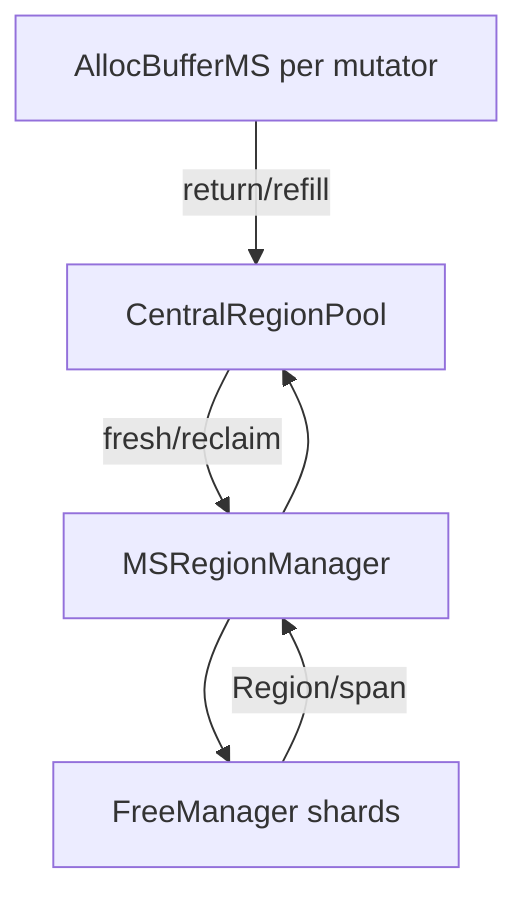

# MSGC 堆存储结构详解

> 当前代码基线：`MSGC-bugfix-regionScan` / `24ca097ace`。本文以当前 `src/Heap/MAllocator` 为准。

## 1. 空间层次

MSGC managed heap 的固定空间单位：

```text
reserved virtual heap
  └─ committed Segment（当前 shard/page-heap 管理单位）
       └─ Region（32KB）
            ├─ same-size small-object slots
            └─ large span 的一个组成 Region
```

`regionIdx` 是所有 sidecar 的共同坐标：

```text
object address = heapStart + regionIdx * 32KB + offset
MSRegionInfo    = regionInfoArray[regionIdx]
ALLOC plane     = allocPlaneBase + regionIdx * 512B
MARK plane      = markPlaneBase  + regionIdx * 512B
SCAN plane      = scanPlaneBase  + regionIdx * 512B
```

每个 plane 为每个可能 Region 固定保留 64 个 `uint64_t` word，即 512 字节。实际使用的
word 数由 size class 决定。

## 2. 三层 Region 所有权



### 2.1 `AllocBufferMS`

当前 fixed ABI prefix 是：

```cpp
MSRegionInfo* activeRegions_[36][2];
```

第二维为：

- `NO_REF`
- `HAS_REF`

同一个 size class 按是否含引用分开 Region，避免 `NO_REF` Region 提交/扫描 SCAN plane。
一个 mutator 最多同时持有 72 个 active Region pointer，但只为实际用到的组合 refill。

Runtime-only 字段包括：

- `central_`
- `cachedHomeShardId_`
- 根 staging vector + overflow chunks
- `gcAssistDebtScaled_`
- `markAssistStats_`
- Sweep Assist debt/generation

当前没有 mutator 灰对象日志、空 buffer cache 或 `PerPGCWork`。Mark 的普通工作位于
Region bitmap 与全局 scheduler。

### 2.2 `CentralRegionPool`

中央池按 `[sizeClass][scanClass]` 建 bucket，并保存：

- swept/unswept 的 small Region 供给；
- 本轮 collect-set；
- classless empty swept cache；
- large hot cache；
- Sweep generation、credit、stop/active 与 worker 协作状态；
- 已注册的 `AllocBufferMS` 集合。

注册表用于：

- GC 枚举每个 mutator 的 root staging；
- 归还 active Regions；
- 聚合 Mark/Sweep Assist 统计；
- mutator 退出收口。

它不再承担收集 TLS grey-log 的职责。

### 2.3 `MSRegionManager` / `FreeManager`

`MSRegionManager` 负责 managed 地址与 Region index 的转换，并向下请求单 Region或连续
large span。`FreeManager` 按 Segment/shard 管理 Region 级：

- allocated；
- hot-free；
- scavenged/cold-free；
- 连续 free run；
- grow/shrink 的 committed 前缀。

FreeManager 不理解 size class、mark/scan bit 或对象 TypeInfo；这些属于上层 Region。

## 3. 主映射与 sidecar

### 3.1 `MSRegionInfo[]`

每个可能 Region 有一个 64 字节、cache-line 对齐的 metadata entry。当前结构明确
`static_assert(sizeof(MSRegionInfo) == 64)`，字段详见
[03_MSGC_Region结构详解](03_MSGC_Region结构详解.md)。

### 3.2 三个 bitmap plane

`MSBitmapArena` 分别管理 ALLOC、MARK、SCAN：

| 常量 | 值 |
|---|---:|
| `kMaxBitmapWords` | 64 |
| `kPlaneStrideBytes` | 512B/Region/plane |
| `kRegionsPerChunk` | 256 |
| `kChunkBytes` | 128KB/plane chunk |

每个 plane 独立 reserve/commit。`InitForSizeClass()`：

- 始终确保 ALLOC 与 MARK；
- 仅 `HAS_REF` Region 确保 SCAN。

这种分离比旧的单 1KB slot 内拼接两张变长 bitmap 更直接：坐标稳定，
`regionIdx * 512B` 即能到达任一 plane。

## 4. Small Region 存储

每个 small Region 绑定：

- 一个 size class；
- 一个 scan class；
- 一种 alloc mode：BUMP 或 BITMAP。

### 4.1 BUMP

Fresh Region：

```text
address = allocPtr
allocPtr += slotSize
```

发布到需要 bitmap 分配/清扫的状态前，`MaterializeBumpAllocationBitmap()` 把 bump 前缀转换为
ALLOC plane 表示。

### 4.2 BITMAP

当前 ALLOC bit 的核心分配语义是“可用 slot”。`allocSummary` 表示哪些 bitmap word 仍有
可用 bit，分配器用 `ctz` 定位 word/slot。

Sweep 根据 MARK plane 重建空闲状态，SCAN plane 不参与 slot 回收。

## 5. Region-scan Mark 的存储

对 `HAS_REF` small Region：

```text
grey candidates = MARK & ~SCAN
```

Region 元数据再保存：

- `pendingWordSummary`：哪些 word 需要 owner 检查；
- `control.scanState`：IDLE/QUEUED/OWNED；
- `markTaskNextRegionIdx`：ready stack intrusive link。

collect-set 内：

```text
candidates &= ~ALLOC & validTailMask
```

这里的 ALLOC plane 以 `1=free` 过滤 sealed collect-set 中没有对象的 slots。Mark 期间仍可
分配的 active/new Region 位于 collect-set 外，不读取可能仍由 mutator 修改或尚未
materialize 的 ALLOC plane。

## 6. Large object 存储

大于 16KB 的对象走连续 Region path；正好 16KB 仍属于 class 35。

Large span：

- primary entry 保存 object bytes/span 元数据；
- secondary entry 为 SPAN并能解析回 primary；
- 不使用 small-object ALLOC/MARK/SCAN slot 语义；
- primary `control` 中保存 large marked flag；
- `HAS_REF` large marked winner 发布 OBJECT task。

## 7. 生命周期

```text
FreeManager free
  → RegionManager take
  → Central binds size/scan class
  → AllocBufferMS active BUMP/BITMAP
  → return to Central
  → collect-set
  → Mark bitmap/scan bitmap
  → Sweep
  → partial/full/empty cache
  → reclaim to FreeManager
  → optional Scavenge
```

关键边界：

1. active Region 与 central ready chain 不应同时持有同一 ownership。
2. central empty cache 中的 Region 仍不是 FreeManager free。
3. large hot cache 中的 span 仍占用底层 Region。
4. Scavenge 只作用于 page-heap free supply。
5. Shrink 只能移除连续堆尾完整 Segment。

## 8. 容量口径

稳定常量：

| 项目 | 大小 |
|---|---:|
| Region | 32KB |
| `MSRegionInfo` | 64B |
| size classes | 36 |
| scan classes | 2 |
| active pointer prefix | `36 × 2 × sizeof(void*)` |
| 单 plane stride | 512B/Region |
| 三 plane 最大 sidecar | 1536B/Region |

“最大 sidecar”是虚拟地址/commit 上限口径。`NO_REF` Region 不需要 SCAN plane，OS 物理
驻留还受按 chunk 提交和实际触页影响。

## 9. 并发不变量

1. Region index 在 object heap、metadata、三个 plane 间稳定。
2. `HAS_REF/NO_REF` 绑定后必须进入对应 central/active bucket。
3. 同一 small Region 的 SCAN plane 同时只有一个 owner。
4. mark producer 在 pending summary release 前先完成 mark word RMW。
5. Sweep 不得与当前周期 Mark 并发改写同一存活视图。
6. FreeManager 的 allocated/free 状态必须与上层 ownership 一致。
7. scavenged Region 复用前必须执行平台对应的 reuse/commit。

## 10. 源码索引

- [`MSAllocBuffer.h`](../../src/Heap/MAllocator/MSAllocBuffer.h)
- [`MSCentralRegionPool.h`](../../src/Heap/MAllocator/MSCentralRegionPool.h)
- [`MSRegionManager.h`](../../src/Heap/MAllocator/MSRegionManager.h)
- [`MSFreeManager.h`](../../src/Heap/MAllocator/MSFreeManager.h)
- [`MSRegionInfo.h`](../../src/Heap/MAllocator/MSRegionInfo.h)
- [`MSBitmapArena.h`](../../src/Heap/MAllocator/MSBitmapArena.h)
- [`MSSizeClass.h`](../../src/Heap/MAllocator/MSSizeClass.h)
- [`MSScanClass.h`](../../src/Heap/MAllocator/MSScanClass.h)

## 11. 历史口径

旧文档中 `[36]` 单维 active Region、TLS active mark log、固定 896 日志偏移、对象 buffer
cache 与 `PerPGCWork` 描述已经过时。当前 compiler-visible prefix 是 `[36][2]`，Mark work
位于 bitmap/scheduler。
