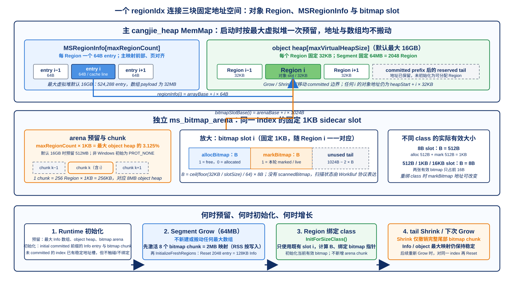
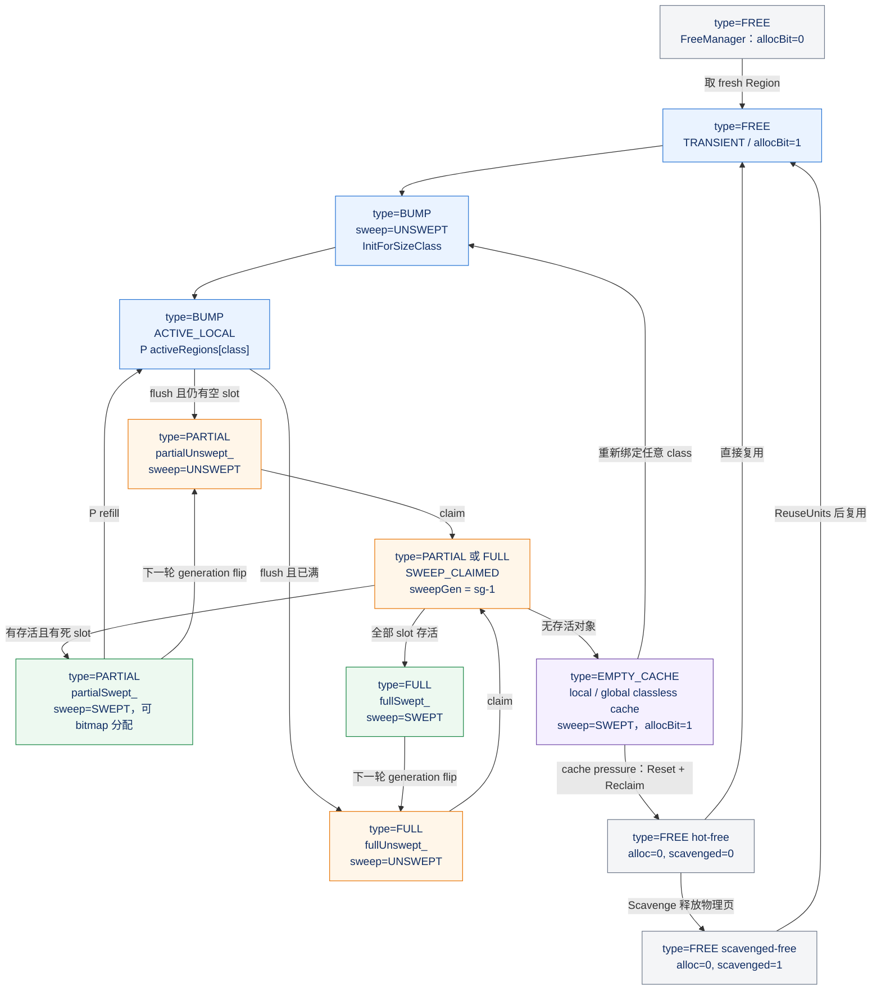

# MSGC Region 结构详解

> 本文以当前 Runtime 源码为准，集中解释 MSGC 的 32KB Region、64B `MSRegionInfo` 和独立 `MSBitmapArena`。总体流程见 [MSGC 总体架构与实现详解](01_MSGC_总体架构与实现详解.md)；三层空间单位以及 TLS、中央池、FreeManager 的静态 Region 存储见 [MSGC 堆存储结构详解](02_MSGC_堆存储结构详解.md)。

## 1. 阅读目标与结论速览

本文只围绕三个直接关联的对象展开：

- **Region** 是 managed object heap 中的 32KB 对象空间单位。
- **`MSRegionInfo`** 是与 Region index 一一对应的 64B Region 级控制面。
- **`MSBitmapArena`** 是独立于 object heap 的 slot 级 sidecar，为每个可能的 Region index 预留 1KB 位图槽。

三者不是三套无关数据，而是通过同一个 `regionIdx` 稳定关联：

```text
regionIdx
   ├──> object Region: heapStart + regionIdx × 32KB
   ├──> MSRegionInfo:  arrayBase + regionIdx × 64B
   └──> bitmap slot:   arenaBase + regionIdx × 1KB
```

先记住以下结论：

1. `MSRegionInfo[]` 在 object heap **前方正向平铺**，不是 CopyGC 式的反向镜像。
2. 主映射在 Runtime 初始化时就按最大虚拟堆预留 `[MSRegionInfo[max] | objectHeap[max]]`；后续 Grow 不会重新分配整个元数组。
3. 初始化只主动触碰初始 committed 前缀的 `MSRegionInfo`；每次 64MB Segment Grow 再对新增的 2048 个 entry 执行 `Reset()`。
4. bitmap arena 也一次按最大 Region 数预留，但以 **256 Region / 256KB sidecar** 为激活和撤销单位；`InitForSizeClass()` 只在已激活的固定 slot 中建立有效内容。
5. 当前小对象 Region 只有两张 sidecar bitmap：`allocBitmap` 和 `markBitmap`；没有第三张 `scannedBitmap`。
6. 小对象首轮用 BUMP 分配，Sweep 后才使用 `allocBitmap + reserved summary` 复用死对象 slot。
7. 当前分配入口对内部大小 `allocSize >= 16KB` 的申请直接走 large path。large span 的 primary/secondary entry 都不使用小对象 bitmap，存活位保存在 primary 的 `flags_`。
8. `regionType` 描述对象布局，`sweepState/sweepGen` 描述 Sweep 进度，`location/ownerToken` 描述所有权；它们是三个不能混为一谈的状态维度。

本文的“预留”指建立虚拟地址范围；“激活”主要指 bitmap chunk 从 `PROT_NONE`/未 commit 变为可读写；“committed heap”指 FreeManager 认可分配的 object-heap 前缀。这不等于该范围每一页都已经驻留物理内存，主映射的物理页仍可由 OS 惰性建立或回收。

## 2. 三套地址空间与统一 Region index

三套地址空间的相对位置和同一 `regionIdx` 的映射关系如下。该图强调 `MSRegionInfo` 与 bitmap 是 sidecar 控制面，不能把它们误认为 object heap 的一部分。



> 图 3-1：Region index 在对象区、64B 控制 entry 和 1KB bitmap slot 之间的固定映射。

`RegionSpaceMS::Init()` 先计算最大虚拟堆 `maxVirtualHeapSize`，然后一次建立主 `cangjie_heap` 映射：

```text
mmapBase                                                          maxHeapEnd
   │                                                                  │
   ▼                                                                  ▼
┌───────────────────────────┬────────────────────────────────────────┐
│ MSRegionInfo[maxRegionCount] │ object heap for maxVirtualHeapSize     │
│ page-rounded metadata area │                                       │
│                               ├─ committed prefix ─┬─ reserved tail ───┤
│                               │                  │                   │
│                               │                  ▼ committedEnd      │
│                               ▼ heapStart                            │
└───────────────────────────┴────────────────────────────────────────┘
```

其中：

```text
maxRegionCount = roundUp(maxVirtualHeapSize, 32KB) / 32KB
metadataBytes  = roundUp(maxRegionCount × 64B, systemPageSize)
heapStart      = mmapBase + metadataBytes
```

要点是 `metadataBytes` 按**最大虚拟堆**计算，而不是按初始 committed heap 计算。因此 Grow 只会向右移动 `committedEnd`，不会搬动 `heapStart`、`arrayBase` 或已有 Region，从而保证 `regionIdx` 终生稳定。

bitmap 不在这块主映射中。`MSRegionManager::Initialize()` 另外调用 `MSBitmapArena::Init(maxRegionCount, committedRegionCount)` 建立名为 `ms_bitmap_arena` 的映射：

```text
bitmapArenaBase
   │
   ▼
┌─ slot[0]: 1KB ─┬─ slot[1]: 1KB ─┬─ ... ─┬─ slot[maxRegionCount-1] ─┐
│                  │                  │       │                          │
└─ chunk 0: 256 slots / 256KB ─────┘       └─ chunk N ───────────┘
```

两块映射的创建顺序是：

1. `RegionSpaceMS::Init()` 为 `[metadata|max object heap]` 建立主 `MemMap`。
2. `MSRegionManager::Initialize()` 确定 `array_`、`heapStart_`、初始 `committedEnd` 和 `maxHeapEnd`。
3. 只对初始 committed Region 对应的 `MSRegionInfo` 执行清零和 FREE/链表索引初始化。
4. `FreeManager::Initialize()` 建立 committed Segment 与 shard 归属。
5. `MSBitmapArena::Init()` 预留全部 arena，并只激活覆盖当前 committed Region 的 chunk 前缀。
6. `SizeClassInfo::Init()` 建立 size-class 查询表。
7. `MSRegionInfoArray::Init()` 发布 `heapStart/array/maxRegionCount`，并创建 location/owner 辅助表。
8. `CentralRegionPool` 创建后，Region 才能被实际取出并绑定 size class。

因此“Region 的空间已可分配”、“`MSRegionInfo` entry 已 Reset”、“bitmap chunk 已可读写”和“某个 Region 已经绑定了 size class”是四个不同时机，不应用一个“初始化”概念笼统表示。

## 3. Region：32KB 对象空间单位

本节说明 Region 的固定粒度、小对象 size class、large span、Segment 关系和逻辑/物理状态边界。

### 3.1 固定大小与平台页关系

`MS_REGION_SIZE` 固定为 32KB，不使用通用 CopyGC 的 `cjRegionSize` 配置。其与平台页的关系为：

| 平台示例 | 常见系统页 | 一个 MSGC Region |
| --- | ---: | ---: |
| macOS arm64 | 16KB | 2 pages |
| Linux x86_64 | 4KB | 8 pages |

`MSRegionManager` 会记录 `unitSize_ = MRT_PAGE_SIZE` 和 `unitsPerMSRegion_ = 32KB / unitSize_`，但 FreeManager 对上层的 take/reclaim 已经使用 Region index/count。unit 主要用于底层页地址换算、`ReuseUnits()` 与 `ReleaseUnits()`，不表示小对象可以跨 32KB Region 分配。

Region 上一层是 64MB Segment：

```text
1 Segment = 64MB = 2048 × 32KB Region
```

Segment 是 Grow/Shrink 和 FreeManager shard ownership 的主要单位；Region 是小对象布局、中央池链表、Sweep 认领与 Scavenge 统计的基本单位。

### 3.2 小对象 Region 的 slot 布局

一个小对象 Region 在同一次绑定期间只服务一个 size class。若 slot size 为 `S`，则：

```text
totalSlotCount = floor(32768 / S)
slot(i)        = regionStart + i × S
tailWaste      = 32768 - totalSlotCount × S
```

size class 共 36 档，表中定义从 8B 到 16384B。几个典型布局如下：

| size class | slot 数 | 对象区利用情况 |
| ---: | ---: | --- |
| 8B | 4096 | 恰好用完 32KB |
| 24B | 1365 | 使用 32760B，尾部 8B 不成槽 |
| 512B | 64 | 恰好用完 32KB |
| 4KB | 8 | 恰好用完 32KB |
| 16KB | 2 | 表中最大 class |

普通分配入口的实际分流条件是 `allocSize >= 16384`即走 large path，因此 16KB 虽仍在 size-class 表和 bitmap 容量设计中，但标准 `RegionSpaceMS::Allocate()` 不会把达到该边界的申请交给小对象路径。

刚绑定的 Region 是 `BUMP` Region：

```text
allocPtr  --> 下一个尚未分配的 slot
regionEnd --> regionStart + 32KB
freeSlotCount 每成功 BUMP 一次减 1
```

BUMP 分配不逐对象修改 `allocBitmap`，所以首轮的“已分配边界”以 `allocPtr` 为准。Region 经过 Sweep 且仍有存活对象后，死 slot 被写成 `allocBitmap` 的 1 bit，之后才进入 bitmap 复用模式。

### 3.3 大对象连续 Region span

大对象不会被切成小对象 slot。`TryAllocateLargeObjectOnce()` 先按系统页向上取整，再按 32KB 向上取整：

```text
unitCount   = ceil(allocSize / systemPageSize)
regionBytes = ceil(unitCount × systemPageSize / 32KB) × 32KB
spanCount   = regionBytes / 32KB
```

分配流程是：先尝试精确 `spanCount` 命中 large hot cache，否则通过 FreeManager 取一段连续 Region；随后清零整个 span，最后由 `RegisterLargeObjectMS()` 发布元数据。

primary entry 的核心内容是：

```text
allocPtr       = object/span start
regionEnd      = object/span end
regionType     = LARGE
totalSlotCount = 1
freeSlotCount  = 0
allocBitmap    = nullptr
markBitmap     = nullptr
reserved       = baseIdx
flags_.MARKED  = 1       // 注册时初始发布为已标记
```

对于后续 secondary entry，当前注册代码使用：

```text
regionType     = LARGE
allocPtr       = 0
regionEnd      = 0
totalSlotCount = 0
freeSlotCount  = 0
allocBitmap    = nullptr
markBitmap     = nullptr
reserved       = baseIdx
```

也就是说，当前实现并不使用 `MS_REGION_SPAN` 区分 secondary，而是通过 `LARGE + regionEnd == 0 + reserved == baseIdx` 识别从属 entry。Sweep large 对象时，会先 Reset 所有 secondary，再 Reset primary，防止从属 entry 留下 stale `baseIdx`。

`MSRegionInfo::RegionStart()` 的实现固定是 `regionEnd - 32KB`，因此它适合固定大小的小对象 Region；对多 Region large primary，真正的 span 起点必须使用 `allocPtr`，span 大小必须使用 `regionEnd - allocPtr`。

### 3.4 Region type、sweep state 与 location

`MSRegionInfo` 中的 `regionType` 是布局/用途分类：

| `MSRegionType` | 当前语义 |
| --- | --- |
| `FREE` | 未绑定对象布局；通常对应 FreeManager 供给，但已 Reset 而仍由 large hot cache 持有的 span 是例外 |
| `BUMP` | 已绑定 size class，当前可用 `allocPtr` 线性分配 |
| `PARTIAL` | 该 class Region 还有空间；具体用 BUMP 还是 bitmap 必须再看 `sweepState` |
| `FULL` | 当前没有可分配 slot，等待后续 Sweep 找出死 slot |
| `LARGE` | large primary，以及当前实现中的 large secondary |
| `SPAN` | 枚举中保留的 span 类型；当前 `RegisterLargeObjectMS()` 不会写入该值 |
| `EMPTY_CACHE` | 已与 size class 解绑的空 Region 壳，可在本地/中央 empty cache 中重绑 |

`sweepState` 另外决定小对象的分配视图：

| `MSSweepState` | 含义 |
| --- | --- |
| `UNSWEPT` | 尚未用当前 mark 结果重建空闲 slot；`Alloc()` 走 BUMP |
| `SWEEPING` | 保留枚举值；当前 claim 路径不写入它，正在 Sweep 由 `sweepGen==sg-1` 和 `SWEEP_CLAIMED` 表达 |
| `SWEPT` | `allocBitmap/freeSlotCount/reserved` 已反映 Sweep 结果；`Alloc()` 走 bitmap |

需要特别注意，`PARTIAL` 不是“已 Sweep”的同义词。active BUMP Region 在未填满时归还中央池，`PrepareForCentralReturn()` 也可把它分类成 `PARTIAL`；该 Region 仍可保持 `UNSWEPT` 并继续 BUMP。分配模式必须以 `sweepState` 为准。

location 是独立 side table 中的所有权状态，当前包括：

```text
FREE / TRANSIENT / ACTIVE_LOCAL / LOCAL_EMPTY_CACHE /
GLOBAL_EMPTY_CACHE / CENTRAL_PARTIAL / CENTRAL_FULL /
SWEEP_CLAIMED / LARGE_ACTIVE
```

例如两个 `regionType == PARTIAL` 的 Region，一个可能正在 `ACTIVE_LOCAL`，另一个可能已经在 `CENTRAL_PARTIAL`；只看 `regionType` 无法判断它当前由谁拥有。

## 4. MSRegionInfo：每 Region 64B 的控制面

本节说明正向数组布局、固定 ABI 字段、字段复用规则和辅助 side table。

### 4.1 预留、初始化、构建、复用与销毁

`MSRegionInfo` 的生命周期需要区分整个数组和单个 entry：

| 阶段 | 整个 `MSRegionInfo[]` | 单个 entry |
| --- | --- | --- |
| 虚拟预留 | `RegionSpaceMS::Init()` 在主映射前部一次预留 `RoundUp(maxRegions × 64B, pageSize)` | 每个最大虚拟 Region index 都稳定占有一个 64B 地址槽 |
| 初始 committed | `MSRegionManager::Initialize()` 只 `memset` 初始 committed Region 对应的前缀 | 设为 `FREE`，`next/prev = INVALID_IDX` |
| Segment Grow | 数组不扩容、不搬家 | `InitializeFreshRegions()` 对新增范围逐项 `Reset()` |
| 对象布局构建 | 不变 | 小对象调 `InitForSizeClass()`；large 调 `InitForLargeObject()` 并注册 secondary |
| 空 Region 缓存 | 不变 | `ResetToEmptyCache()` 解绑 class 和 bitmap 指针，entry 仍保留 |
| 归还 FreeManager | 不变 | `Reset()` 清空布局字段并将 location 发布为 FREE |
| tail Shrink | 主数组虚拟地址仍保留 | 被缩减的尾部在下次 Grow 重用时再 `Reset()` |
| Runtime 销毁 | 随主 `cangjie_heap` `MemMap` 统一销毁 | 无逐 entry `delete` |

这里的“只初始化 committed entry”是为了不主动触碰最大数组的尾部页。例如一个完整 64MB Segment 含 2048 个 Region，对应 `2048 × 64B = 128KB` RegionInfo；每次 Grow 只需新建这一段 entry 的有效状态。

### 4.2 64B 字段布局

`MSRegionInfo` 被 `static_assert(sizeof(MSRegionInfo) == 64)` 限定为一个 cache line，并且 `allocPtr` 必须在 offset 0。当前 64 位布局如下：

| offset | 大小 | 字段 | 含义 |
| ---: | ---: | --- | --- |
| 0 | 8B | `allocPtr` | 小对象 BUMP 指针；large primary 中是 span/object 起点 |
| 8 | 8B | `regionEnd` | 小对象 Region 尾；large primary 中是整个 span 尾 |
| 16 | 4B | `nextRegionIdx` | 侵入式 Region 链表/栈的 next index |
| 20 | 4B | `prevRegionIdx` | 双向 Region list 的 prev index |
| 24 | 8B | `allocBitmap` | 小对象空闲槽位图，`1=free` |
| 32 | 8B | `markBitmap` | 小对象存活位图，`1=marked/live` |
| 40 | 2B | `totalSlotCount` | 当前 size class 在 32KB 中的有效 slot 数 |
| 42 | 2B | `freeSlotCount` | 当前空闲 slot 数 |
| 44 | 4B | `divMagic` | `ceil(2^32 / slotSize)`，用倒数乘法求 slot index |
| 48 | 1B | `sizeClass` | 0..35；classless empty cache 使用 `0xFF` |
| 49 | 1B | `sweepState` | `UNSWEPT/SWEEPING/SWEPT` |
| 50 | 1B | `regionType` | `FREE/BUMP/PARTIAL/FULL/LARGE/SPAN/EMPTY_CACHE` |
| 51 | 1B | `flags_` | bit0 marked，bit1 enqueued，bit2 resurrected；当前 large mark 使用 bit0 |
| 52 | 4B | `sweepGen` | lazy/concurrent Sweep generation 与 claim 状态 |
| 56 | 8B | `reserved` | 小对象 bitmap summary 或 large base index |

`allocPtr` 在 offset 0 是编译器/运行时快路径 ABI 的一部分，不是普通 C++ 内部布局细节。修改字段顺序、类型或结构体大小时，必须同时核对所有依赖该 ABI 的编译器常量与生成代码。

### 4.3 字段之间的不变式

对于活跃小对象 Region，需要保持：

```text
regionIdx    = info - arrayBase
regionStart  = heapStart + regionIdx × 32KB
regionEnd    = regionStart + 32KB
RegionStart() == regionStart
totalSlotCount == floor(32KB / ClassToSize(sizeClass))
0 <= freeSlotCount <= totalSlotCount
allocBitmap != nullptr && markBitmap != nullptr
```

`divMagic` 只对有效 size class 有意义。对于 Region 内小于 `2^15` 的 offset，当前倒数定点算法使：

```text
slotIdx = (offset × divMagic) >> 32
```

等价于 `offset / slotSize`，避免并发 mark 热路径上的整数除法。`TestAndSetMarkBit()` 在使用前仍会检查地址范围和 `slotIdx < totalSlotCount`。

对 large primary，不应套用上面的小对象 `RegionStart()` 公式：

```text
spanStart = allocPtr
spanEnd   = regionEnd
spanBytes = regionEnd - allocPtr
reserved  = primary's own regionIdx
```

对 large secondary，`allocPtr/regionEnd` 为 0，必须先通过 `reserved` 回到 primary，再判断 primary 是否仍然有效。一旦 large object 被回收，secondary 和 primary 必须全部 `Reset()`，不能只清 primary。

`nextRegionIdx/prevRegionIdx` 只表示中央池内部的侵入式链接，不表示 object heap 中的物理相邻关系。物理相邻只能由 Region index 的加减判断。

### 4.4 `reserved` 的多态语义

`reserved` 当前不是可以随意复用的空闲字段，它至少承担两种正式语义：

| Region 形态 | `reserved` 语义 |
| --- | --- |
| 可用 bitmap 分配的小对象 Region | 64-bit summary；bit `i=1` 表示 `allocBitmap[i] != 0` |
| large primary/secondary | primary `regionIdx` |
| `FREE` / `EMPTY_CACHE` | 0 |

`InitForSizeClass()` 会把 summary 初始化为“所有有效 alloc-bitmap word 都有空位”。BUMP 分配本身不读 summary；Sweep 产生了部分存活的 Region 后，summary 才成为 `AllocFromBitmapFast()` 的第一级索引。当某个 `allocBitmap[word]` 的最后一个空闲 bit 被消费，summary 的对应 bit 同步清零。

对于 Sweep 后完全无存活对象的 Region，`SweepRegion()` 走专门快路径：清零整个 32KB payload，设 `freeSlotCount = totalSlotCount`、`reserved = 0`，但不为它重建全 1 的 `allocBitmap`。该 Region 随后会转成 fresh BUMP 或 empty cache，因而不需要一份立即可用的 PARTIAL summary。

### 4.5 location/owner side table

`MSRegionLocation` 和 owner token 不在 64B `MSRegionInfo` 中。`MSRegionInfoArray::Init()` 按最大虚拟 Region 数在 native heap 上额外创建：

```text
locations_   : atomic<uint8_t>[maxRegionCount]
ownerTokens_ : atomic<uintptr_t>[maxRegionCount]
```

`locations_[i]` 记录 Region 当前在 TLS、中央池、Sweep claim 还是 FreeManager 交界处；`ownerTokens_[i]` 只对 `ACTIVE_LOCAL` 和 `LOCAL_EMPTY_CACHE` 这类带本地 owner 的状态有实质意义。large hot cache 是一个需要另外识别的例外：它在 native `{regionStart, regionBytes}` 容器中保留 span，而对应 entry/location 已经 Reset 为 FREE。

`SetState()` 直接发布新状态；`TransitionState()` 会检查实际 location 和可选 owner 是否等于期望值，再发布新状态。这层协议用来发现同一 Region 同时被 TLS 和中央链表持有、重复归还或 owner 不匹配等问题，不替代 `regionType`。

其虚拟/native 载荷公式为：

```text
maxRegions × (sizeof(atomic<uint8_t>) + sizeof(atomic<uintptr_t>))
```

在常见 64 位 ABI 上通常是约 9B/Region，但精确大小应以目标平台的 `sizeof(std::atomic<...>)` 为准。`MSRegionInfoArray::Init()` 在重新初始化前会删除旧 side table，`Cleanup()` 也可显式释放它们；当前 `RegionSpaceMS` 析构路径会销毁主 MemMap 和 bitmap arena，但没有显式调用 `MSRegionInfoArray::Cleanup()`。

## 5. MSBitmapArena：独立的 slot 级元数据

本节说明 1KB/Region 虚拟槽、按 size class 使用的有效区间，以及 256 Region 的提交/撤销协议。

### 5.1 Arena 的预留与 chunk 布局

`MSBitmapArena` 使用四个固定常量：

```text
kMaxBitmapWords  = 64
kBitmapSlotBytes = 64 × 8B × 2 = 1024B
kRegionsPerChunk = 256
kChunkBytes      = 256 × 1024B = 256KB
```

64 words 来自最小 8B size class：32KB Region 有 4096 个 slot，每张 bitmap 需要 `4096 / 64 = 64` 个 `uint64_t`。Arena 为任何 Region 都预留能容纳两张最大 bitmap 的 1KB 槽，因此 slot 地址不会因 size class 变化。

Arena 的总虚拟大小是：

```text
arenaReservedBytes = maxVirtualRegionCount × 1KB
                   = maxVirtualHeapBytes / 32
                   = object-heap 上限的 3.125%
```

在非 Windows 平台，初始映射使用 `PROT_NONE`，随后通过固定地址 `mmap(MAP_FIXED, PROT_READ|PROT_WRITE)` 激活必需 chunk；撤销时用同样的固定地址重映射回 `PROT_NONE`。Windows 上对应使用 `MEM_COMMIT` 和 `MEM_DECOMMIT`。所有范围变化由全局 bitmap-arena mutex 串行化。

每个 chunk 对应：

```text
256 Region × 32KB = 8MB object heap
256 slot   × 1KB  = 256KB bitmap sidecar
```

所以一个 64MB Segment 需要 8 个 bitmap chunk，激活 2MB sidecar。

### 5.2 单 Region bitmap slot 的实际排布

固定 slot 的起点只由 Region index 决定：

```text
slotBase(i) = bitmapArenaBase + i × 1024
```

但两张 bitmap 并不固定各占 512B。`InitForSizeClass()` 先计算当前 class 需要的有效字节数 `B`，然后紧凑排布：

```text
bitmapWords = ceil(totalSlotCount / 64)
B           = bitmapWords × 8B

allocBitmap = slotBase
markBitmap  = slotBase + B

┌────────────────┬────────────────┬─────────────────────────┐
│ allocBitmap: B  │ markBitmap: B   │ unused: 1024B - 2 × B  │
└────────────────┴────────────────┴─────────────────────────┘
^ slotBase                                              slotBase + 1024
```

例如 512B class 只需要 64 个 slot，所以 `B=8B`，`markBitmap=slotBase+8`，两张有效 bitmap 总共只占前 16B；只有 8B class 的 `B=512B`，恰好用满整个 1KB slot。

这种布局意味着 Region 从一个 class 重绑到另一个 class 时，`markBitmap` 指针可能改变；不能在外部假设它永远等于 `slotBase + 512B`。

### 5.3 bitmap 大小计算与典型 size class

对 slot size `S`，每张 bitmap 的有效大小为：

```text
N     = floor(32768 / S)
words = ceil(N / 64)
B     = words × 8B
```

| slot size | `N` | 每张 words | 每张 `B` | 两张有效大小 | 1KB slot 未使用 |
| ---: | ---: | ---: | ---: | ---: | ---: |
| 8B | 4096 | 64 | 512B | 1024B | 0B |
| 16B | 2048 | 32 | 256B | 512B | 512B |
| 24B | 1365 | 22 | 176B | 352B | 672B |
| 64B | 512 | 8 | 64B | 128B | 896B |
| 128B | 256 | 4 | 32B | 64B | 960B |
| 256B | 128 | 2 | 16B | 32B | 992B |
| 512B | 64 | 1 | 8B | 16B | 1008B |
| 1KB | 32 | 1 | 8B | 16B | 1008B |
| 4KB | 8 | 1 | 8B | 16B | 1008B |
| 16KB | 2 | 1 | 8B | 16B | 1008B |

当 `N` 不是 64 的整数倍时，最后一个 word 中只有低 `N % 64` 位有效。`InitForSizeClass()` 会清掉 `allocBitmap` 最后 word 的无效高位；Sweep 取反 `markBitmap` 后也会再做一次同样的 mask，不会把 Region 尾部不存在的 slot 当成空闲对象。

### 5.4 `allocBitmap`、`markBitmap` 与 summary

三者分别表达空闲槽、本轮存活性和空闲 word 索引；只有前两者位于 bitmap arena。

#### `allocBitmap`

`allocBitmap` 的稳定语义是 `1=free, 0=allocated/live`。绑定 class 时它先被初始化为全 1 并 mask tail bits，但首轮 BUMP 分配不会随每个对象清它。因此：

- `sweepState != SWEPT` 时，已分配范围看 `allocPtr/freeSlotCount`，不能通过 `allocBitmap` 反推。
- `sweepState == SWEPT` 时，`allocBitmap` 才是 PARTIAL 槽复用的真值。

`AllocFromBitmapFast()` 先对 `reserved` summary 执行 CTZ 找到非空 word，再对 `allocBitmap[word]` 执行 CTZ 找到空闲 slot，清掉该 bit 并减少 `freeSlotCount`。

#### `markBitmap`

`markBitmap` 的语义是 `1=the object was marked in the current mark view`。`SetMarkBit()` 和 `TestAndSetMarkBit()` 使用 relaxed atomic OR；后者返回该 bit 之前是否已经置位，从而让并发 mark 只有 winner 发布灰工作。Mark 期新分配对象也会走 mark-at-alloc，使它在当前轮中直接可见。

当前没有 `scannedBitmap`。“已发现但尚未扫描”与“已扫描”的差别由 grey work 队列的发布/消费协议表达，不在 bitmap slot 中增加第三张位图。

#### Sweep 与 summary

对仍有存活对象的小对象 Region，`SweepRegion()` 执行：

```text
snapshot mark words
allocBitmap = ~markBitmap
mask invalid tail bits
zero every dead/free slot in object heap
freeSlotCount = totalSlotCount - liveCount
reserved = summary(allocBitmap[word] != 0)
sweepState = SWEPT
```

Sweep 不会清空 `markBitmap`。清 mark 被推迟到下一轮 MarkSetup 的 `ClearAllMarkBitmaps()`，前提是旧 Sweep 已经停止并且所有 in-flight `SweepRegion()` 退出。这避免在每个 Region Sweep 中再多做一次 mark bitmap memset。

Mark 结束、Sweep 尚未开始的稳定窗口中，`ComputeMarkedStats()` 也直接 popcount `markBitmap`，同时计算小对象数和存活字节。

### 5.5 初始化、Grow、Shrink 与 Cleanup

bitmap arena 的时序可概括为：

| 时机 | 建立多少 | 是否由 `MSRegionInfo` 驱动 |
| --- | --- | --- |
| Runtime 启动 | 一次预留 `maxRegions × 1KB`，激活 `ceil(initialCommittedRegions / 256)` 个 chunk | 否；由 `MSRegionManager::Initialize()` 按 heap 容量驱动 |
| Segment Grow | 使激活前缀增长到 `ceil((start+count)/256)`，一个完整 64MB Segment 通常新增 8 chunk | 否；`InitializeFreshRegions()` 先 Ensure arena，再 Reset entry |
| Region 绑定 class | 不新增 chunk；只在既有 1KB slot 中 memset 当前两张有效 bitmap | 是；`InitForSizeClass()` 绑定指针和内容 |
| empty-cache/reset | 不撤销 slot；只清 `MSRegionInfo` 中的 bitmap 指针 | 是，但只解绑 |
| tail Shrink | 撤销所需 committed 前缀之后的完整 chunk | 否；由 committed Region count 下降驱动 |
| Runtime 析构 | 销毁整个 `ms_bitmap_arena` MemMap | 否 |

`EnsureRegionRangeCommitted(start, count)` 不是为任意中间范围维护稀疏 chunk set，而是维护从 chunk 0 开始的连续已激活前缀。若新 Region 仍落在已激活 chunk 内，它不会做新的 OS 映射操作。

“激活 2MB sidecar”不能直接读作“RSS 立即增加 2MB”。非 Windows 路径把这段匿名映射改为 `PROT_READ|PROT_WRITE`；物理页通常仍在后续 `InitForSizeClass()` 写入实际有效的 `allocBitmap`/`markBitmap` 时按页建立。Windows 路径使用 `MEM_COMMIT`，会产生对应 commit charge。相对地，完整 64MB Segment Grow 中的 `InitializeFreshRegions()` 会立即对 2048 个 64B `MSRegionInfo` 执行 `Reset()`，即实际写入 128KB 元数据；Grow 本身不 memset 64MB object payload。

`ShrinkToCommittedRegionCount(n)` 同样使用 `ceil(n/256)`。如果 Shrink 后还需要 chunk 中的任意一个 Region，整个 chunk 都保持激活；只有完全位于 committed 尾部之后的 chunk 才会撤销。

## 6. 地址映射公式与查找路径

本节把 object address、Region index、`MSRegionInfo*` 和 bitmap slot 的双向换算写成可核对公式。

### 6.1 四个核心公式

设：

```text
H = heapStart
A = MSRegionInfo array base
B = bitmap arena base
R = 32768
M = 64
S = 1024
```

则四个核心换算是：

```text
regionIdx(addr)     = floor((addr - H) / R)
regionAddr(i)       = H + i × R
regionInfo(i)       = &A[i] = A + i × M
bitmapSlotBase(i)   = B + i × S
```

反向从 `MSRegionInfo* info` 求 index 时：

```text
i = info - A
```

这些公式成立的前提是整个最大虚拟堆期间 `H/A/B` 不搬动。Grow 和 Shrink 只改变“哪些 index 当前属于 committed 范围”，不改变换算关系。

`MSRegionInfo` 数组在 heap 前面经过了 page rounding，所以不应通过“从对象地址向前减固定 64B”寻找元数据。正确路径始终是先相对 `heapStart` 求 index，再正向索引 `array_[i]`。

### 6.2 普通对象查找

`MSRegionInfoArray::GetRegionInfo(addr)` 是无分支原始换算，只做 `array_[(addr-heapStart)/32KB]`，不检查：

- `addr` 是否为对象起点；
- entry 是否已初始化；
- `addr` 是否落在 entry 发布的有效范围；
- 该 Region 是否仍在 committed 前缀。

需要对象有效性的路径使用 `GetRegionInfoValidated(addr)`。对普通小对象，它要求：

```text
info->regionEnd != 0
info->regionType != LARGE
info->RegionStart() <= addr < info->regionEnd
```

源码中还保留了向前/向后相邻一个 entry 的防御性校正，用于处理历史上 UNIT_SIZE 对齐与 32KB Region 对齐不一致的情况。当前 FreeManager 的 take/reclaim 主体使用 Region index 并在 unit 换算时检查 Region 对齐，因此正常新分配对象应直接命中第一个 entry；相邻查找不应成为常态依赖。

`IsHeapAddress(addr)` 的上界是最大虚拟 heap end，而不是当前 committed end。所以“落在保留虚拟堆范围”只是第一层粗过滤，不等于“这是一个当前有效的 managed object”。

### 6.3 大对象 primary/secondary 查找

large object 的唯一 mark 位在 primary `flags_`。primary 和 secondary 都把 `reserved` 写成 `baseIdx`，所以标记路径统一为：

```text
candidate info
    └─ regionType == LARGE
         └─ base = array_[info->reserved]
              ├─ base metadata still live?
              └─ base->AtomicTestAndSetMarked()
```

primary 由 `regionEnd != 0` 且 `addr == allocPtr` 确认。secondary 由 `regionEnd == 0` 和 `reserved=baseIdx` 找回 primary，并检查 primary 仍是有效 LARGE。当前 Runtime 的 managed reference 指向对象基址，large interior address 不会因为落在 span 内就被当成另一个对象。

secondary entry 的主要价值是完整覆盖 span 的 Region ownership 和在回收时清除 stale metadata；对象身份、mark flag、span start/end 都以 primary 为准。

## 7. 从分配到下一轮 GC 的完整生命周期

下面的生命周期图把 small Region 的 `regionType`、Sweep 状态、Central 位置以及 FreeManager bit 一起标在节点上。`LARGE/SPAN` 是独立的 large span 路径，不进入逐 slot 的 BUMP/PARTIAL/FULL 流程。



> 图 3-2：Region 生命周期。图中 `SWEEP_CLAIMED` 由 `sweepGen=sg-1` 和 location 共同表达，当前源码不依赖 `regionType=SWEEPING` 作为 claim 真值。

本节按时间顺序描述 fresh、BUMP、mark、sweep、partial/full、empty cache、FreeManager 和重新绑定。

### 7.1 Runtime 初始化

Runtime 启动时并不把每个最大虚拟 Region 都构建成可分配 BUMP Region。启动只建立容量和索引基础：

1. 预留最大 `MSRegionInfo[] + object heap`。
2. 确定初始 `P × 64MB` committed 前缀。
3. 将前缀 entry 初始化为 FREE。
4. 建立 FreeManager Segment/shard 可用位图。
5. 预留 bitmap arena 并激活 committed 前缀对应的 chunk。
6. 发布 `MSRegionInfoArray` 索引参数和 location/owner side table。

此时 Region 只是 FreeManager 中的空闲供给，还没有 size class、slot count 和 bitmap 指针。

### 7.2 小对象 fresh Region

某个 size class 没有可用的本地 active/empty 和中央 partial/unswept 供给时，`CentralRegionPool::GetFreshRegion(cls)` 才构建 fresh Region：

```text
MSRegionManager::TakeRegion()
    -> FreeManager::TryTakeRegions(1)
    -> return &array_[regionIdx]

ClearSmallRegionPayload(regionStart)
MSRegionInfo::InitForSizeClass(cls)
SetSweepGen(currentGlobalSweepGen)
location: FREE -> TRANSIENT
```

`InitForSizeClass()` 会设置 `allocPtr/regionEnd/sizeClass/slotCount/divMagic`，把类型设为 BUMP、分配状态设为 UNSWEPT，并在该 `regionIdx` 的固定 1KB slot 中初始化两张有效 bitmap。Region 发布为 `activeRegions_[cls]` 后，location 再进入 `ACTIVE_LOCAL`。

如果供给来自 local/global empty cache，则不需要 FreeManager take；`GetCacheRegion()` 直接对 classless shell 重新调用 `InitForSizeClass(cls)`，同一 Region index 可以绑到与上次不同的 class。

### 7.3 BUMP 与 bitmap 分配

对 `sweepState != SWEPT` 的 Region，`MSRegionInfo::Alloc()` 调用 `AllocBump()`：比较 `allocPtr + slotSize <= regionEnd`，成功则返回旧 `allocPtr`、向前推进并减少 `freeSlotCount`。这是刚从 FreeManager/empty cache 取出的 Region 的主路径。

对 `sweepState == SWEPT` 的 PARTIAL Region，`Alloc()` 调用 `AllocFromBitmapFast()`，从死对象槽中取一个空闲 slot。当 `freeSlotCount` 变为 0，Region 归还中央 FULL 链；当 active Region 尚有空间但 owner 需要 flush，它可以以 PARTIAL 身份回到中央池。

Sweep 发现完全空且希望立即交给当前 mutator 时，`ResetToBump()` 可以保留 bitmap 指针、把 `allocPtr` 放回 Region 起点，并转回 BUMP/UNSWEPT。若 `SweepRegion()` 已经清零整个 payload，该快路径无需重建全 1 alloc bitmap，因为后续 BUMP 不会读它。

### 7.4 MarkSetup、Concurrent Mark 与 mark-at-alloc

下一轮 GC 的 `PreEnumRoots()` 会先封闭上一轮 Sweep：GC 线程先参与认领旧 unswept Region，然后关闭 Background/Lazy/Assist/Helper 入口，等待所有 in-flight Sweep 退出，再做最终串行收口。

随后在短 STW 内执行：

```text
ClearAllMarkBitmaps()
ReclassifyUnsweptToSwept()
PrepareForSweep()
```

`ClearAllMarkBitmaps()` 对 committed 范围内的活跃小对象 Region 清空有效 `markBitmap`，对 LARGE entry 清 `FLAG_MARKED`。`PrepareForSweep()` 把当前中央 swept 链翻入新的 unswept snapshot，然后使 `globalSweepGen += 2`。

EnumRoots/Concurrent Mark 期间，小对象的 `TestAndSetMarkBit()` 用原子 OR 争夺置位权；large 对象用 primary `AtomicTestAndSetMarked()`。Mark 期新创建对象由 `MarkNewObject()` 立即置 mark bit，含引用字段的对象还会被发布到 deferred grey work。

新 Region 在分配时使用已翻转的当前 `globalSweepGen`，因此它不会被当作本轮旧 unswept snapshot 重复清扫。

### 7.5 Sweep 重建空闲状态

MarkTermination 完成灰对象闭包后，mark bitmap 在该 generation 上稳定。Background、Lazy、P Assist、gc-helper 和下一轮 PreEnum Force-Finish 都通过同一 `ClaimUnsweptHeadForSweep()` 协议取 Region，然后调用 `SweepRegion()`。

Sweep 结果分为三类：

| 结果 | `MSRegionInfo` 变化 | 后续去向 |
| --- | --- | --- |
| 无存活对象 | payload 整段清零，`free=total`，`sweepState=SWEPT`，`reserved=0` | 本地/全局 `EMPTY_CACHE`，或 lazy 立即 `ResetToBump()` |
| 有存活且有死 slot | 重建 alloc bitmap/summary，清零死 slot | `PARTIAL` swept 供给 |
| 全部 slot 存活 | `freeSlotCount=0`，summary 无空位 | `FULL` swept 链 |

对象数据的清零在 Sweep 完成、Region 重新发布给 mutator 之前发生，因此 bitmap 分配快路径不需要在每次取死 slot 时再 memset 对象。

### 7.6 empty cache、hot-free、Scavenge 与 Shrink

完全空的小对象 Region 通过 `ResetToEmptyCache()` 变成 classless shell：

```text
allocPtr/regionEnd = 0
bitmap pointers    = nullptr
slot counters      = 0
sizeClass          = 0xFF
sweepState         = SWEPT
regionType         = EMPTY_CACHE
```

这一步只解绑 `MSRegionInfo` 指针，不撤销 bitmap arena 中的 1KB 固定槽。empty shell 可先保留在 `AllocBufferMS` 本地 cache 或中央 `emptySweptCache_`，之后任意 class 都可重新绑定。

当缓存需要向底层归还时，`ReclaimEmptyRegionToHotFree()` 先对 entry `Reset()`，再把 Region 还给 FreeManager hot-free 供给。后台 Scavenge 可将空闲页归还 OS，但 Region index 和 `MSRegionInfo` 地址仍保留。

Shrink 只处理连续的空闲尾部 Segment：FreeManager 先降低 committed Region count，`MSRegionManager::ShrinkHeap()` 观察到计数下降后，再让 bitmap arena 撤销不再需要的尾部 chunk。主 `MSRegionInfo[]` 不缩容，因为它仍要保持最大虚拟索引稳定。

### 7.7 大对象注册、标记与回收

large span 注册时会建立 primary/secondary 关系，把 primary 加入 `largeRegionList_`，并初始置 marked flag。下一轮 MarkSetup 会清该 flag；后续 mark 只在 primary 上原子置位，不使用 arena bitmap。

PostMarkTermination 对未标记 primary 执行 eager large sweep：

1. 用 `allocPtr` 保存 span 真实起点，用 `regionEnd - allocPtr` 保存字节数。
2. 按 `spanCount` 从后向前清除所有 secondary entry。
3. Reset primary entry。
4. 优先把整个 span 放入按 Region 数精确匹配的 large hot cache；重用时重新清零并注册元数据。
5. hot cache 未接收或后续被清理时，再把 span 还给 FreeManager，由 Scavenge 决定物理页归还。

large hot cache 中保存的是 `{regionStart, regionBytes}` native entry；对应 `MSRegionInfo` 已经 Reset 为 FREE 形态，但这段 Region 在 hot-cache entry 被消费或清理之前并未重新进入 FreeManager 的普通空闲供给。

## 8. 并发协议与正确性边界

Region 级元数据同时被 mutator、GC 线程和多类 Sweep 执行方使用，但不是所有字段都做成原子。正确性依赖“字段操作 + Region 所有权 + GC 阶段”三者组合。

### 8.1 Mark bitmap 的原子性

小对象 mark 使用 `__atomic_fetch_or(..., __ATOMIC_RELAXED)`：

```text
old = fetch_or(markBitmap[word], bit)
winner = (old & bit) == 0
```

这里需要的是同一对象 mark winner 唯一性，对象引用的发布和扫描顺序由 GC 队列/屏障协议保证，不通过把每个 mark bit 提升为 seq_cst 完成。large primary 的 `FLAG_MARKED` 使用同类 relaxed atomic fetch-or。

`markBitmap` 不可以与 Sweep 并发改写。某一 generation 的 `SweepRegion()` 开始前，该轮 mark 必须已经完成；下一轮要清空/重新写 mark bitmap 时，又必须先封闭上一轮所有 Sweep。

### 8.2 Sweep 的 generation claim

`globalSweepGen_` 每轮增加 2。对当前 generation `sg`，Region 的 `sweepGen` 语义是：

```text
sg - 2 : 本轮 unswept
sg - 1 : 已被某个执行方 claim，正在 Sweep
sg     : 本轮已 Sweep，或新 Region 不属于本轮旧 snapshot
```

`ClaimUnsweptHeadForSweep()` 在 size-class bucket 锁内检查链头，然后执行：

```text
CAS(sweepGen, sg - 2, sg - 1)
remove from unswept list
location: CENTRAL_* -> SWEEP_CLAIMED
```

Sweep 完成后才 `SetSweepGen(sg)`，并按 empty/partial/full 结果发布到新所有者。Background、Lazy、P Assist、parallel helper 和 GC Force-Finish 都经过这一个 claim 入口，所以同一 Region 不会被两个执行方同时 Sweep。

`MSSweepState::SWEEPING` 虽然存在枚举中，但当前 claim 路径没有把 `sweepState` 写成该值；真正的并发认领真值是 `sweepGen == sg-1` 加 `location == SWEEP_CLAIMED`。`sweepState` 当前主要用于 `Alloc()` 区分 BUMP 与 bitmap 模式，以及 Sweep 完成后发布 `SWEPT`。

### 8.3 为什么 alloc bitmap 不需要逐位原子

`allocBitmap` 的写入发生在两种互斥所有权下：

- `SweepRegion()` 重建 alloc bitmap 时，Region 在 `SWEEP_CLAIMED`，尚未交给 mutator。
- `AllocFromBitmapFast()` 消费空闲 bit 时，Region 是某个 `AllocBufferMS` 的 active Region，不在 unswept 链上。

因此 `allocBitmap[word]` 和 `reserved` summary 可以由当前单 owner 使用普通读写。如果绕过 location/list 协议让同一 PARTIAL Region 同时交给多个 mutator，即使 mark bitmap 仍为原子，分配正确性也会被破坏。

### 8.4 清 bitmap 之前的全局静默点

`StopAndWaitForAllSweep()` 用 stop/skip gate 阻止新的 Background、Lazy、Assist 和 Helper Sweep，并等待：

```text
bgSweepRunning == false
activeLazySweepCount == 0
activeAssistSweepCount == 0
activeHelperSweepCount == 0
unswept lists finally drained
```

Lazy/Assist/Helper 进入计数与 stop 方的 gate-store/count-load 之间使用 seq_cst fence 形成 StoreLoad 配对。这是 `ClearAllMarkBitmaps()` 安全的关键：不能出现清 mark bitmap 的同时，另一线程还在用旧 bitmap 执行 `allocBitmap = ~markBitmap`。

### 8.5 链表、location 和 arena 的辅助保护

- `partialSwept_` 使用带 32-bit tag 的 64-bit 原子栈头，Region index 重用时通过 tag 避免 ABA。
- `partialUnswept_`、`fullSwept_` 和 `fullUnswept_` 的关键修改由 bucket mutex 保护。
- `TransitionState()` 使用 acquire/release 发布 location，并核对期望 location/owner。
- bitmap arena 的 commit/decommit 由全局 mutex 保护；Grow 在 Reset 新 entry 前先 Ensure 对应 arena 前缀可读写。
- `MSRegionInfo` 中的链表索引、bitmap 指针和状态字段不是一组通用 lock-free 对象；它们只能在对应 owner/list/phase 协议内使用。

## 9. 容量与开销实例

下面的数字要区分三类：

- **虚拟预留**：占用地址空间，不代表全部 RSS。
- **逻辑 committed/已激活**：Runtime 允许使用的 object-heap 前缀，或 bitmap 可读写前缀。
- **实际触碰**：真正被 memset、分配、mark 或 Sweep 读写的页/字节，更接近实际物理开销。

### 9.1 一个 64MB Segment

| 项目 | 计算 | 数值 |
| --- | ---: | ---: |
| object Region 数 | `64MB / 32KB` | 2048 |
| 对应 `MSRegionInfo` | `2048 × 64B` | 128KB |
| bitmap slot 范围 | `2048 × 1KB` | 2MB |
| bitmap chunk 数 | `2048 / 256` | 8 |
| location + owner 常见 ABI 估算 | `2048 × (1B+8B)` | 18KB |

2MB bitmap 是该 Segment 对应的固定 arena 范围；每个已绑定 Region 实际 memset/访问多少 bitmap 仍取决于 size class。例如全部为 512B class 时，每个 Region 的有效两张 bitmap 只有 16B，而不是 1KB。

### 9.2 默认 16GB 最大虚拟堆

`cjMSMaxVirtualHeapSize` 默认为 16GB。若恰好使用该上限：

| 项目 | 计算 | 数值 |
| --- | ---: | ---: |
| `maxVirtualRegionCount` | `16GB / 32KB` | 524,288 |
| `MSRegionInfo[]` raw | `524,288 × 64B` | 32MB |
| bitmap arena reserve | `524,288 × 1KB` | 512MB |
| bitmap chunk 数 | `524,288 / 256` | 2048 |
| `locations_` 常见 ABI | `524,288 × 1B` | 512KB |
| `ownerTokens_` 常见 64-bit ABI | `524,288 × 8B` | 4MB |

因此主 `cangjie_heap` 映射大约预留 `16GB + 32MB`，另有 512MB bitmap arena 虚拟预留和约 4.5MB native side table。初始只有 `P × 64MB` object-heap 前缀被 FreeManager 认为 committed，且只触碰该前缀对应的 RegionInfo，bitmap arena 也只激活相应 chunk。

单位 object heap 的固定虚拟比率为：

```text
MSRegionInfo: 64B / 32KB = 0.1953125%
bitmap slot : 1KB / 32KB = 3.125%
side tables : 常见 9B / 32KB ≈ 0.0275%
```

其中 bitmap 的 3.125% 是为了让最小 size class 也有稳定固定 slot 而做的最大容量预留，不是每个 Region 在所有 class 下都会读写 1KB。

## 10. 常见误解与当前源码注意项

本节先给出直接纠错，再列出当前分支中仍需要与实际执行路径区分的旧注释和辅助接口。

### 10.1 常见误解

| 误解 | 当前实现 |
| --- | --- |
| `MSRegionInfo` 与 object Region 反向镜像增长 | 错。整个最大 `MSRegionInfo[]` 在 heap 前方正向预留，`array_[i]` 对应 `heapStart+i×32KB` |
| 每次 `MSRegionInfo::InitForSizeClass()` 才创建 bitmap 内存 | 错。Arena 启动时按最大 Region 数预留，按 committed heap 以 256 Region 为单位激活；该函数只绑定固定 slot 并初始化有效字节 |
| 一个 Region 初始化会 commit 256 个 Region 的 bitmap | 通常不会。chunk 在 heap Init/Grow 时按容量激活；Region 绑定时对应 chunk 应已可读写 |
| `allocBitmap` 和 `markBitmap` 固定各占 512B | 错。两者都只占当前 class 所需 `B`，`markBitmap=slotBase+B`；只有 8B class 各需 512B |
| 当前还有 `scannedBitmap` | 错。当前 sidecar 只有 alloc/mark 两张位图，grey/black 进度由队列协议表达 |
| BUMP 期间可以用 alloc bitmap 精确判断每个已分配槽 | 错。BUMP 不逐对象清 alloc bit，已分配边界以 `allocPtr` 为准 |
| `SweepRegion()` 结束后会顺便清 mark bitmap | 错。mark 留到下一轮 MarkSetup，在所有旧 Sweep 静默后统一清理 |
| large secondary 的 `regionType` 是 `SPAN` | 与当前代码不符。当前它也是 `LARGE`，用 `regionEnd==0` 和 `reserved=baseIdx` 区分 |
| `RegionStart()` 总是对象/span 起点 | 错。该 helper 固定返回 `regionEnd-32KB`；多 Region large 起点是 `allocPtr` |
| `IsHeapAddress(addr)` 成功就证明是活对象 | 错。它只检查最大虚拟 heap 范围，还需要 entry/range/object-header 等验证 |
| `FREE` 和 `EMPTY_CACHE` 都能由 FreeManager 立即分配 | 错。`EMPTY_CACHE` 仍由 TLS/中央 cache 持有；`FREE` 是未绑定元数据形态，通常在 FreeManager，但 large hot cache 会在 entry Reset 为 FREE 后继续单独持有 span，因此仍不能只看 `regionType` 判断 |

### 10.2 当前源码中需要区分“模型语义”的地方

以下是阅读当前分支时容易引发误解的注释/辅助接口，本文已按实际执行路径统一口径：

1. `MSRegionInfo.h` 中仍有“heap-front mirror”以及 `heapStart-(i+1)×64B` 的旧注释；当前 `MSRegionManager` 和 `MSRegionInfoArray` 实现是正向 `array_[i]`。
2. `MSRegionType` 附近的“简化为 5 states”旧注释已与 7 个枚举值不一致。
3. `MS_REGION_SPAN` 仍在枚举和部分 skip 分支中，但当前 large 注册对 secondary 写入 `MS_REGION_LARGE`。
4. `MSRegionManager::GetLargeObjectThreshold()` 当前返回 32KB，而真正的分配入口 `RegionSpaceMS::Allocate()` 使用 `allocSize >= kLargeObjectThreshold`，其常量为 16KB。判断实际路由时应以后者为准。
5. `RegionStart()` 对多 Region large 不是 span start。当前 `AddLargeLiveRegion()`、`CollectDeadLargeRegions()` 和 `ComputeMarkedStats()` 中仍可看到 `regionEnd - RegionStart()`；按 helper 的定义，多 Region large 下该表达式只得到 32KB。需要 span count/live bytes 的语义时，正确基础是 `regionEnd - allocPtr`。
6. `GetRegionInfoValidated()` 上的 UNIT_SIZE 非 32KB 对齐注释反映了防御性/历史背景；当前 FreeManager 核心 API 使用 Region index/count，并在 unit/Region 转换时检查对齐。
7. `MSSweepState::SWEEPING` 是保留枚举值；当前并发 Sweep 的真正 claim 状态是 `sweepGen == sg-1` 和 `SWEEP_CLAIMED`。
8. `MSRegionInfoArray::Cleanup()` 可释放 native location/owner side table，但当前 `RegionSpaceMS` 析构未显式调用它；主 `MSRegionInfo[]` 本身则依然随 `cangjie_heap` MemMap 正常销毁。

## 11. 源码索引与相关阅读

以下入口可以按“布局定义 → 初始化 → 分配/Mark/Sweep → Grow/Shrink”顺序与本文交叉阅读。

### 11.1 核心源码

| 主题 | 文件 | 关键入口 |
| --- | --- | --- |
| Region 大小、36 个 class、slot 计算 | [`MSSizeClass.h`](../../src/Heap/MAllocator/MSSizeClass.h) | `MS_REGION_SIZE`、`kSizeClasses`、`SizeToClass()`、`OffsetToSlotIndex()` |
| 64B 元数据与地址索引 | [`MSRegionInfo.h`](../../src/Heap/MAllocator/MSRegionInfo.h) | `MSRegionInfo`、`MSRegionInfoArray`、`GetRegionInfoValidated()` |
| 小对象元数据初始化/Bitmap/Sweep | [`MSRegionInfo.cpp`](../../src/Heap/MAllocator/MSRegionInfo.cpp) | `InitForSizeClass()`、`Reset*()`、`SweepRegion()`、`TestAndSetMarkBit()` |
| bitmap arena 容量与 chunk 协议 | [`MSBitmapArena.h`](../../src/Heap/MAllocator/MSBitmapArena.h) / [`MSBitmapArena.cpp`](../../src/Heap/MAllocator/MSBitmapArena.cpp) | `Init()`、`EnsureRegionRangeCommitted()`、`ShrinkToCommittedRegionCount()`、`GetSlotBase()` |
| 主映射布局、fresh Region、Grow/Shrink | [`MSRegionManager.h`](../../src/Heap/MAllocator/MSRegionManager.h) / [`MSRegionManager.cpp`](../../src/Heap/MAllocator/MSRegionManager.cpp) | `GetMetadataSize()`、`Initialize()`、`InitializeFreshRegions()`、`TakeRegion*()`、`ShrinkHeap()` |
| Runtime 分流与 large 注册 | [`MSRegionSpace.cpp`](../../src/Heap/MAllocator/MSRegionSpace.cpp) | `Init()`、`Allocate()`、`TryAllocateLargeObjectOnce()`、`RegisterLargeObjectMS()` |
| 四链、Sweep claim、clear/flip、large reclaim | [`MSCentralRegionPool.h`](../../src/Heap/MAllocator/MSCentralRegionPool.h) / [`MSCentralRegionPool.cpp`](../../src/Heap/MAllocator/MSCentralRegionPool.cpp) | `ClaimUnsweptHeadForSweep()`、`PrepareForSweep()`、`StopAndWaitForAllSweep()`、`ClearAllMarkBitmaps()`、`SweepLargeRegions()` |
| Segment/shard 下的 Region 容量 | [`MSFreeManager.cpp`](../../src/Heap/MAllocator/MSFreeManager.cpp) | `TryTakeRegions()`、`GrowOneSegmentLocked()`、`ShrinkHeap()`、`ReclaimRegionsReleased()` |
| GC 阶段与 bitmap 稳定窗口 | [`MarkSweepCollector.cpp`](../../src/Heap/MCollector/MarkSweepCollector.cpp) | `PreEnumRoots()`、`MarkTermination()`、`PostMarkTermination()`、`MarkNewObject()` |

### 11.2 相关文档

- [MSGC 总体架构与实现详解](01_MSGC_总体架构与实现详解.md)：完整 GC 阶段、线程角色、TLS/中央池/FreeManager 概览。
- [MSGC 对象分配架构与实现详解](04_MSGC_对象分配架构与实现详解.md)：从完整分配主链理解 Region 获取、缓存和 large path。
- [Step1 分配器实现详解](../Implementation/Step1_分配器实现详解.md)：历史设计演进和 allocator 实现背景；其中个别 scanned/SPAN 描述是演进留痕，当前口径以本文与源码为准。
- [Step2 Mark 实现详解](../Implementation/Step2_Mark实现详解.md)：`markBitmap`、large flag 与 grey queue 协议。
- [Step4 后台 Sweep 与 Reclaim 实现详解](../Implementation/Step4_后台Sweep与Reclaim实现详解.md)：Region Sweep 后在 central/empty/hot-free 间的流转。
- [Step41 bitmap 统计替代热原子](../Implementation/Step41_MSGC_bitmap统计替代markedObjectCount热原子.md)：mark bitmap 作为存活真值和周期末统计来源的实现背景。
