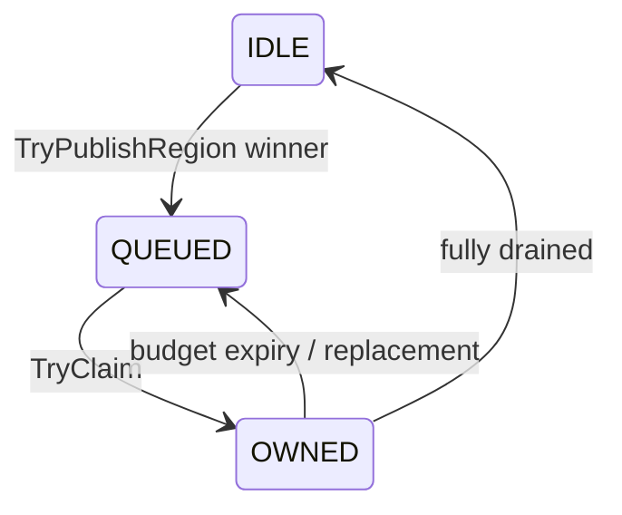

# MSGC Region 结构详解

> 当前代码基线：`MSGC-bugfix-regionScan` / `24ca097ace`。

## 1. 三个关联对象

- managed object Region：固定 32KB；
- `MSRegionInfo`：每 Region 64B metadata；
- `MSBitmapArena`：ALLOC、MARK、SCAN 三个独立 plane。

统一坐标是 `regionIdx`：

```text
Region address = heapStart + regionIdx * 32768
RegionInfo     = arrayBase + regionIdx * 64
Plane word     = planeBase + regionIdx * 512 + wordIdx * 8
```

## 2. Region 分类

### 2.1 Kind

`MSRegionKind`：

- FREE
- SMALL
- LARGE
- SPAN

### 2.2 Allocation mode

`MSAllocMode`：

- NONE
- BUMP
- BITMAP

### 2.3 Scan class

`MSScanClass`：

- `NO_REF`
- `HAS_REF`

scan class 在 Region 绑定时确定。它影响：

- active/central bucket；
- 是否提交与访问 SCAN plane；
- marked winner 是否需要产生扫描 task。

### 2.4 Scan task state

`MSScanState` 位于 `control` 低两位：

- IDLE
- QUEUED
- OWNED

只用于 `HAS_REF` small Region 的 Mark task 所有权。

## 3. 64 字节字段布局

当前 `MSRegionInfo` 的 offset 有完整 `static_assert`：

| Offset | 字段 | 当前用途 |
|---:|---|---|
| 0 | `allocPtr` | BUMP fast path |
| 8 | `regionEnd` | Region/large span 末端 |
| 16 | `centralNextRegionIdx` | central intrusive chain |
| 20 | `markTaskNextRegionIdx` | Mark ready stack intrusive link |
| 24 | `allocBitmap` / `largeObjectBytes` | small ALLOC plane 指针或 large object bytes |
| 32 | `collectEpoch` | 本轮 collect-set 身份 |
| 36 | `control` | scan state + large marked flag |
| 40 | `allocSummary` | 有可分配 bit 的 word 摘要 |
| 48 | `pendingWordSummary` | 有待扫描 mark work 的 word 摘要 |
| 56 | `reserved32` | 旧 `freeSlotCount` 写入位置的 ABI 墓碑，不参与语义 |
| 60 | `allocMode` | NONE/BUMP/BITMAP |
| 61 | `reserved8` | 保留 |
| 62 | `sizeClass` | 0..35或 invalid |
| 63 | `layout` | Region kind + scan class |

`alignas(64)` 与 `sizeof == 64` 保持一条 cache line。

## 4. Bitmap plane

每个 plane 对每个 Region 固定 stride 512B，即最多 64 words/4096 slots。

| Plane | small Region 语义 |
|---|---|
| ALLOC | `1=free slot`；Mark 时过滤 collect-set 中的空闲 slot |
| MARK | 本轮已发现/存活 |
| SCAN | 本轮已完成引用字段扫描 |

`InitForSizeClass()`：

1. 确保 ALLOC/MARK plane 对应 chunk 已提交；
2. `HAS_REF` 时确保 SCAN plane；
3. ALLOC 初始化为有效 slot 全可用；
4. MARK 清零；
5. `allocSummary` 标记含可用 bit 的 words。

SCAN plane 由 MarkSetup/Region work state reset 清理，不是旧实现中“不存在”的位图。

## 5. 小对象 Mark 状态

```text
white: mark=0
grey:  mark=1, scan=0
black: mark=1, scan=1
```

owner 处理某个 word：

```text
candidates = markWord & ~scanWord
if collectEpoch == currentMarkEpoch:
    candidates &= ~allocWord & validTailMask
```

扫描完成后只有 owner 写 `scanBitmap[wordIdx]`。

## 6. `pendingWordSummary`

producer 顺序：

```text
atomic OR mark word
release OR pendingWordSummary[wordIdx]
TryPublishRegion
```

owner：

```text
summary = acquire exchange(pendingWordSummary, 0)
```

这保证 owner 看到 summary bit 时，也能看到此前 mark plane 更新。

若 producer 在 Region 已 OWNED 时发布，它不创建第二个 task，只留下 summary bit。owner
释放到 IDLE 后重新检查并 republish residual work。

## 7. Scan state 与 ready link



`markTaskNextRegionIdx` 同时服务 REGION/OBJECT ready stack；一个 Region 同时只能处于一个
对应任务链状态。ready head 使用 index + tag，降低 ABA 风险。

## 8. Large/span

Large primary：

- `largeObjectBytes` 保存 object bytes；
- `regionEnd` 覆盖 span；
- `control` 的 `CONTROL_LARGE_MARKED` 表达存活；
- `HAS_REF` marked winner 发布 OBJECT task。

SPAN secondary 解析到 primary；不能按 small slot/bitmap 处理。

## 9. Allocation lifecycle

### 9.1 Fresh small Region

```text
InitForSizeClass
→ kind SMALL
→ mode BUMP
→ class + scanClass 固定
→ allocPtr 从 RegionStart 前进
```

分配热路径只推进 `allocPtr`，不维护剩余 slot 计数。精确空闲数在 Active Region
归还 Central 的冷边界由 `(regionEnd - allocPtr) / slotSize` 推导。

### 9.2 BUMP 转 BITMAP

`PrepareForCentralReturn()` 先从 `allocPtr` 推导空闲数。非空 BUMP Region 再由
`MaterializeBumpAllocationBitmap()` 根据已使用 bump 前缀构造 ALLOC plane，更新
`allocSummary`，随后 mode 变为 BITMAP；全空 Region 直接进入 empty cache，不需要物化。

Active BITMAP Region 归还时会扫描有效 ALLOC words，屏蔽 tail 无效位、popcount 得到精确
空闲数，并从 bitmap 重建 `allocSummary`。因此 summary 的 stale-positive 和
stale-negative 都会在 Central 发布前被修复。

### 9.3 Sweep

Sweep：

- popcount MARK 计算 live；
- 清零 dead object payload；
- 重建 ALLOC plane/summary；
- 直接用 `totalSlots - liveCount` 形成 Central 归还判定；
- MARK 生命周期由周期准备协议管理；
- SCAN 不参与对象判活。

当 `liveCount == 0` 时，Sweep 为避免无意义写入而不物化 ALLOC plane；EMPTY 判定必须直接
使用 `liveCount` 结果，不能再从该 bitmap 反推。

### 9.4 Empty cache

完全空 Region 可 `ResetToEmptyCache()`，解除 class/scan binding，进入 central classless
empty cache；它仍占有底层 Region，直到 reclaim 给 FreeManager。

## 10. Reset 协议

`ResetSmallMarkWorkState()` 对当前 Mark cycle 的关键清理：

- 清 MARK plane；
- `HAS_REF` 时清 SCAN plane；
- `pendingWordSummary = 0`；
- scan state = IDLE；
- mark task next = invalid。

Reset 必须发生在旧 Sweep 与旧 Mark task 均已静默之后。

## 11. 编译器 ABI

当前已断言：

- `MSRegionInfo` 总大小；
- 所有字段 offset；
- Region 大小 32768；
- fast-path 所需字段。

修改字段或 plane base 时必须同步 compiler emitter 与 runtime tests。特别是：

- compiler 可以读取公开分配字段；
- compiler 不维护空闲 slot 计数；
- compiler 不应写 SCAN plane；
- compiler 不应操作 pending summary/task state/ledger；
- barrier 应通过 runtime publication API 保持 small/large 分类。

`+56..+59` 必须继续保留：旧 LLVM 产物可能仍对 `+56` 做 halfword 递减，新 Runtime
忽略这四个字节即可兼容。发布顺序应为先部署忽略该字段的新 Runtime，再部署不再写
`+56` 的新 LLVM/SDK；在没有 ABI versioning 前不得复用这四个字节。

## 12. 正确性不变式

1. size class 决定 slot size、word count、tail mask。
2. `NO_REF` Region 不访问 SCAN plane。
3. `HAS_REF` Region 的 SCAN plane只有 owner 写。
4. pending summary release 在 mark word 更新之后。
5. collect-set 在 Mark 前已 sealed；ALLOC plane 的 free bits 不得进入 candidate。
6. Region task state 与 ready/ledger admission 一致。
7. LARGE/SPAN 不走 small slot bitmap。
8. reset 前必须达到旧周期静默点。

## 13. 源码索引

- [`MSRegionInfo.h`](../../src/Heap/MAllocator/MSRegionInfo.h)
- [`MSRegionInfo.cpp`](../../src/Heap/MAllocator/MSRegionInfo.cpp)
- [`MSBitmapArena.h`](../../src/Heap/MAllocator/MSBitmapArena.h)
- [`MSBitmapArena.cpp`](../../src/Heap/MAllocator/MSBitmapArena.cpp)
- [`MSSizeClass.h`](../../src/Heap/MAllocator/MSSizeClass.h)
- [`MSScanClass.h`](../../src/Heap/MAllocator/MSScanClass.h)
- [`MSMarkScheduler.cpp`](../../src/Heap/MCollector/MSMarkScheduler.cpp)
- [`MarkSweepCollector.cpp`](../../src/Heap/MCollector/MarkSweepCollector.cpp)

## 14. 与旧文档的关键差异

当前不是“每 Region 两张变长 bitmap”。ALLOC/MARK/SCAN 都使用固定 512B stride；
small Region 在 `+24` 固定保存其 ALLOC plane 指针，MARK/SCAN 仍通过全局 plane base
定位。`MSRegionInfo` 不再保存持续更新的 free-slot count、双向链字段和旧 flags 布局，
而是加入 `markTaskNextRegionIdx`、`collectEpoch`、`control` 与
`pendingWordSummary`。
