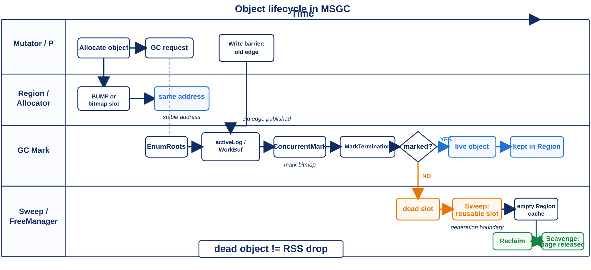
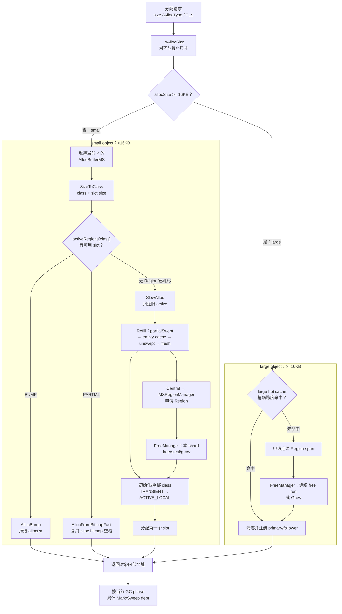

# MSGC 对象分配架构与实现详解

> 更新时间：2026-07-17  
> 适用范围：当前 `MRT_USE_MARK_SWEEP` 分支  
> 文档口径：以当前源码为准，Plan 与旧 Implementation 仅用于说明设计演进。

---

## 目录

1. 文档目标与核心结论
2. 分配器整体架构
3. 初始化与内存布局
4. 对象分类与 Size Class
5. MSRegionInfo 与两级 Bitmap
6. 小对象分配完整路径
7. CentralRegionPool 与 Region 生命周期
8. 大对象分配、缓存与回收
9. FreeManager 分片页堆
10. 堆增长、Scavenge 与 Shrink
11. 分配器与 GC 周期的协作
12. 并发模型与关键不变量
13. 分配失败与 OOM 语义
14. 配置、统计与排查入口
15. Plan、旧文档与当前代码差异
16. 源码阅读索引

---

## 1. 文档目标与核心结论

一个对象从请求、取得 slot、写入对象头，到在 Mark/Sweep 后回收或复用 Region 的完整时序见下图。泳道图强调对象生命周期，后文流程图强调资源供给。



> 图 4-1：单对象从分配到回收/复用的生命周期。

本文回答的不是“Step1 当初准备怎么改”，而是“当前代码中的 MSGC 分配器到底怎么工作”。分析依据包括：

- `MSGC_RESULT/Plan/Step1_分配器改造详细设计.md`
- `MSGC_RESULT/Plan/Step1.1_MS_RegionInfo元数据改造设计.md`
- `MSGC_RESULT/Plan/Step1.2_SizeClass与线程本地分配设计.md`
- `MSGC_RESULT/Plan/Step1.3_大对象分配与堆增长设计.md`
- `MSGC_RESULT/Implementation/Step1_分配器实现详解.md`
- `MSGC_RESULT/Implementation/Step22_超64P并发Region获取与中央池回收路径并发化设计.md`
- `MSGC_RESULT/Implementation/Step23_按P分流的FreeManager_Shard化整体设计.md`
- `MSGC_RESULT/Implementation/Step30_LLVM_MSGC优化实现盘点.md`
- `MSGC_RESULT/Implementation/Step31_MSGC_Go风格SweepAssist设计.md` 与 `Step34_MSGC_SweepAssist配速化_proportional_credit落地方案.md`
- `MSGC_RESULT/Implementation/Step39_MSGCString_RawArray静态区栈堆分配与屏障影响分析.md`
- `src/Heap/MAllocator/` 当前源码
- LLVM AArch64 MSGC 分配 fastpath 当前源码

设计文档记录了实现演进，出现冲突时以源码为准。当前实现可以概括为：

> 固定 32KB Region、36 级 Size Class、线程本地活动 Region、中央池多执行者并发 Sweep、分片页位图 FreeManager，以及独立的连续 Region 大对象路径。

最重要的实现结论如下：

1. MSGC 是非移动 GC，`AllocType` 在 `RegionSpaceMS::Allocate()` 中被统一忽略；普通、pinned、raw-pointer 对象不再因为移动语义走不同分配器。
2. `allocSize < 16KB` 走小对象路径；`allocSize >= 16KB` 直接走大对象路径。Size Class 表虽包含 16KB 档，但精确 16KB 已被上层分流为 large object。
3. 小对象热路径是“每线程、每 Size Class 一个 Active Region”。Fresh Region 用 bump pointer；Sweep 后的 Partial Region 用 bitmap summary + CTZ 找空槽。
4. 对象级 bitmap 只有两张：`allocBitmap` 和 `markBitmap`。早期文档中的 `scannedBitmap` 已删除。
5. 底层 FreeManager 已不是 CartesianTree，也没有 dirty/released 两棵树；当前是每 shard 的 Segment 位图、chunk summary、跨 shard steal。
6. Segment 当前固定为 64MB，不是早期方案中的 256MB；初始化时为每个 runtime Processor/shard 准备一个 64MB Segment。
7. 普通小对象当前没有统一 mark-at-alloc。GC 期间新分配或归还的 Region 通过 sweep generation 跳过本轮 Sweep；大对象注册时直接设置 marked flag；finalizer 对象额外调用 `MarkNewObject()`。
8. 小对象和大对象的同步分配都只尝试一次。底层会复用、steal、grow，但最终失败后不会进入 CopyGC 的“请求 GC、等待、重试”循环，而是直接 OOM。
9. 大对象死亡后先进入 exact-size large hot cache；上一轮未复用的缓存会在下一次 large sweep 或 Scavenge 过程中下沉到 FreeManager。
10. 物理页归还和地址空间收缩是两件事：Scavenge 只释放空闲页；Shrink 只对满足条件的尾部完整 Segment 缩小 committed 窗口。
11. LLVM fast path 只负责“当前活动 Region 上的一次 slot 分配”；Region 耗尽、safepoint 请求、动态大小不适合查表、未知 RegionType 等情况都回到原始 `CJ_MCC_*` slow callee。
12. `PINNED_OBJECT` 与 `RAW_POINTER_OBJECT` 在 MSGC 中仍保留 API 语义，但 `RegionSpaceMS::Allocate()` 不按 `AllocType` 分流；`MCC_AcquireRawData()` 的 pin 只是通过 collector 登记 raw root，MS collector 的实现为空操作，因为对象不会移动。

本文重点描述 allocator 本身，只在影响分配正确性时展开 GC、写屏障和编译器协作。

## 2. 分配器整体架构

当前分配器由五层组成：

```text
Compiler / CompilerCalls
        │
        ▼
RegionSpaceMS
  ├─ < 16KB  ──> AllocBufferMS
  │                 ├─ activeRegions_[36]
  │                 ├─ local empty-region cache
  │                 └─ mark/sweep pacing debt
  │                         │
  │                         ▼
  │                 CentralRegionPool
  │                   ├─ 36 × swept/unswept bucket
  │                   ├─ global empty cache
  │                   ├─ background/lazy/assist sweep
  │                   └─ large list / large hot cache
  │                         │
  └─ >= 16KB ───────────────┤
                            ▼
                    MSRegionManager
                      ├─ MSRegionInfo[]
                      ├─ MSBitmapArena
                      ├─ HEU/Scavenge 通知
                      └─ 地址与 Region 换算
                            │
                            ▼
                       FreeManager
                         ├─ per-shard Segment bitmap
                         ├─ 连续 Region 查找
                         ├─ 跨 shard steal
                         ├─ grow/scavenge
                         └─ tail shrink
```

### 2.1 各层职责

| 层 | 核心职责 | 不负责的事情 |
|---|---|---|
| `RegionSpaceMS` | 对齐大小、small/large 分流、OOM、TSAN hook、large 注册 | 不管理 Size Class 列表 |
| `AllocBufferMS` | 线程本地热路径、Active Region、local empty cache、pacing debt | 不直接增长堆 |
| `CentralRegionPool` | 按 class 组织 Region、Sweep、empty cache、large 生命周期 | 不决定虚拟堆上限 |
| `MSRegionManager` | 元数据布局、统一申请 Region/span、通知 GC/Scavenge | 不保存每个 class 的供给列表 |
| `FreeManager` | 分片页堆、Segment 所有权、free/scavenged 位图、grow/shrink | 不理解对象或 Size Class |

### 2.2 两种不同粒度的资源管理

必须把以下两层区分开：

1. 对象层：一个 32KB Region 内按 slot 分配，由 `MSRegionInfo::allocBitmap` 管理。
2. Region 层：整个堆按 32KB Region 分配，由 `FreeManager::OwnedSegmentView::allocBits_` 管理。

这两张“alloc bitmap”名字相近，但语义相反：

| Bitmap | 粒度 | bit=1 | bit=0 |
|---|---:|---|---|
| `MSRegionInfo::allocBitmap` | 对象 slot | 空闲 | 已分配 |
| `OwnedSegmentView::allocBits_` | 32KB Region | 已占用 | 空闲 |

标记器只操作对象层 `markBitmap`，FreeManager 不理解对象存活性；Sweeper 先把对象死亡转换成 empty Region，再由中央池决定何时把整个 Region 交给 FreeManager。

## 3. 初始化与内存布局

初始化入口是 `RegionSpaceMS::Init()`，主要顺序如下：

```text
读取初始 heapSize 和 cjMSMaxVirtualHeapSize
  → 计算最大虚拟 Region 数
  → 一次映射 [MSRegionInfo[] | heap reserve]
  → MSRegionManager::Initialize()
  → FreeManager::Initialize()
  → MSBitmapArena::Init()
  → SizeClassInfo::Init()
  → MSRegionInfoArray::Init()
  → 创建 CentralRegionPool
```

### 3.1 主保留区

主映射布局是正向数组，不是 CopyGC 的反向 UnitInfo mirror：

```text
低地址                                                       高地址
┌────────────────────────────┬────────────────────────────────────┐
│ MSRegionInfo[maxRegionCount]│ Heap[maxVirtualHeapSize]           │
│ 每项 64B，按 Region 索引正排 │ 每个逻辑 Region 固定 32KB          │
└────────────────────────────┴────────────────────────────────────┘
^ mmapBase                    ^ heapStart                         ^ maxHeapEnd
                              ^ committedEnd（逻辑可用窗口末端）
```

地址换算为：

```text
regionIdx   = (addr - heapStart) / 32KB
regionAddr  = heapStart + regionIdx * 32KB
regionInfo  = &MSRegionInfoArray[regionIdx]
```

`MSRegionInfoArray::GetRegionInfoValidated()` 还会校验实际地址范围，并尝试相邻 entry。这是为了兜住历史上 Region 地址对齐和 large span 路由造成的边界情况，不能简单用未校验的索引结果判断对象有效性。

### 3.2 最大虚拟堆与初始逻辑容量

- `cjMSMaxVirtualHeapSize` 默认 16GB。
- 最大虚拟堆不会小于初始化所需空间。
- shard 数来自 Runtime Processor 数量，至少为 1。
- 每个 shard 初始拥有一个 64MB Segment。
- 初始逻辑容量为 `shardCount × 64MB`。

这里的 `committedEnd` 主要表示“FreeManager 当前允许分配到哪里”的逻辑窗口。主 heap mapping 初始化时已经整体建立，物理页仍由操作系统按访问惰性供给；当前 grow 不会重新 mmap 一块独立堆。

### 3.3 Bitmap sidecar

对象 bitmap 使用独立的 `MSBitmapArena`：

```text
MSBitmapArena:
┌──────────── region 0 slot ────────────┐
│ 最大 allocBitmap 512B + markBitmap 512B│ = 1024B
├──────────── region 1 slot ────────────┤
│ 1024B                                  │
└────────────────────────────────────────┘
```

关键规则：

1. 每个虚拟 Region 固定预留一个 1024B sidecar slot。
2. 每 256 个 Region 为一个 bitmap chunk，即 256KB。
3. arena 初始为不可访问映射，只激活当前逻辑 committed Region 覆盖到的 chunk。
4. Grow 时调用 `EnsureRegionRangeCommitted()` 激活新 chunk。
5. Shrink 时调用 `ShrinkToCommittedRegionCount()` 关闭尾部 chunk。
6. 每种 Size Class 实际只使用自己需要的 bitmap words，其余 slot 空间保留不用。

因此 bitmap 最大虚拟开销固定约为 heap reserve 的 `1KB / 32KB = 3.125%`，实际驻留量跟已激活 chunk 有关。

### 3.4 Region 所有权 side table

除 `MSRegionInfo[]` 和 bitmap arena 外，`MSRegionInfoArray::Init()` 还为每个虚拟 Region 建立：

- `locations_`：记录 `FREE/ACTIVE_LOCAL/CACHED_LOCAL/CENTRAL_*/LARGE_ACTIVE` 等位置。
- `ownerTokens_`：记录本地持有者，用于检查 Region 是否被重复交给两个 owner。

`TransitionState()` 是 allocator 的一致性检查层。它不参与对象布局，但对定位重复入队、重复分配和错误归还非常重要。

## 4. 对象分类与 Size Class

### 4.1 大小标准化

`RegionSpaceMS::ToAllocSize()` 执行：

```text
allocSize = RoundUp(objSize + HEADER_SIZE, 8)
```

当前 `HEADER_SIZE = 0`，因此对象没有由 allocator 额外添加的头部；只做 8 字节对齐。

顶层分流是：

```text
allocSize <= 16384  → 小对象 Size Class 路径
allocSize >  16384  → Large Region 路径
```

精确 16KB 保留在 Size Class 35；只有超过 16KB 才进入 Large Region 路径。

### 4.2 36 级 Size Class

当前 class 表为：

```text
class  0.. 9: 8, 16, 24, 32, 48, 64, 80, 96, 112, 128
class 10..17: 160, 192, 224, 256, 320, 384, 448, 512
class 18..25: 640, 768, 896, 1024, 1280, 1536, 1792, 2048
class 26..32: 2560, 3072, 3584, 4096, 5120, 6144, 8192
class 33..35: 10240, 12288, 16384
```

一个 Region 只绑定一个 Size Class，因此：

```text
slotsPerRegion = floor(32KB / slotSize)
```

典型值如下：

| slot 大小 | slots/Region | 单张 bitmap words |
|---:|---:|---:|
| 8B | 4096 | 64 |
| 64B | 512 | 8 |
| 512B | 64 | 1 |
| 1KB | 32 | 1 |
| 4KB | 8 | 1 |
| 8KB | 4 | 1 |
| 12KB | 2 | 1 |

### 4.3 O(1) 查表与除法消除

`SizeToClass()` 分两段查表：

- `size <= 1024`：按 `ceil(size / 8)` 索引 `smallLookup_`。
- `1024 < size <= 16384`：按 256B 粒度索引 `largeLookup_`。

初始化阶段还为每个 class 计算：

```text
divMagic = ceil(2^32 / slotSize)
slotIdx  = ((offset * divMagic) >> 32)
```

这用于标记和写屏障热路径从对象偏移计算 slot index，避免硬件除法。

### 4.4 AllocType 在 MSGC 下的语义

`RegionSpaceMS::Allocate(size, allocType, local)` 当前直接 `(void)allocType`。因此：

- `MOVEABLE_OBJECT`：实际不移动。
- `PINNED_OBJECT`：天然满足不移动，不需要专用 pinned allocator。
- `RAW_POINTER_OBJECT`：不再维护独立 thread-local raw-pointer Region。

这不是说调用方可以随意丢弃参数，而是说参数在“分配供给层”被统一处理：`MObject::NewPinnedObject()`、`MArray::NewKnownWidthArray()` 和反射/运行时辅助代码仍然把意图传到 `HeapManager::Allocate()`，但 `RegionSpaceMS::Allocate(size, allocType, local)` 首先执行 `(void)allocType`，随后只按标准化后的 `allocSize` 在 small/large 两条路径之间分流。因而 pinned/raw 与普通对象共享同一套 Size Class、中央池、large span 和 pacing 记账。

### 4.5 Pinned 对象的分配入口

`MCC_NewPinnedObject(klass, size, isFinalizer)` 的调用链为：

```text
MCC_NewPinnedObject
  → ObjectManager::NewPinnedObject
  → MObject::NewPinnedObject
  → HeapManager::Allocate(size, local, PINNED_OBJECT)
  → RegionSpaceMS::Allocate()
```

分配成功后再写入 TypeInfo；`isFinalizer` 为真时由 `ObjectManager::NewPinnedObject()` 调用 `OnFinalizerCreated()`。因此“pinned”在 MSGC 下表达的是对象模型/调用方不允许移动的约束，而不是一个额外的 Region 链表。`PinnedSpaceSize()` 也固定返回 0，说明 MSGC 没有独立 pinned space 统计。

LLVM 对 `Future`、`Mutex`、`Monitor`、`WaitQueue` 等固定类型会把 `cj_malloc_object` 改到 `CJ_MCC_NewPinnedObject`。当前 `isCangjieNewObjFunction()` 只包含 `CJ_MCC_NewObject`/`CJ_MCC_NewFinalizer`，因此这类 pinned 调用不会被 `doNewFastPath()` 生成普通 object fast wrapper；它们仍通过 pinned runtime slow callee 进入同一套 MSGC `RegionSpaceMS` 分配器。

### 4.6 Raw pointer 对象、RawArray 与裸数据访问

`RAW_POINTER_OBJECT` 有两种容易混淆的使用方式：

1. 运行时反射、栈回溯、字段快照等内部对象/数组创建时，把 `AllocType::RAW_POINTER_OBJECT` 传给 `NewObject`/`NewArray`。在 MSGC 下它仍然是托管堆对象，照常进入 Size Class 或 large span；`AllocBufferMS::CommitRawPointerRegions()` 是空操作，表明没有 CopyGC 式的独立 raw Region 缓冲。
2. `MCC_AcquireRawData(array, isCopy)` 面向 primitive array 的 C 指针借用。若参数是堆数组，Runtime 先关闭协程抢占，再调用 `Collector::AddRawPointerObject(array)`，最后返回 `ConvertToCArray()`；`MCC_ReleaseRawData` 对称调用 `RemoveRawPointerObject()` 并恢复抢占。若输入本来就是堆外数组，则直接返回其 C 指针，不登记 GC。

MS collector 的 `AddRawPointerObject()`/`RemoveRawPointerObject()` 明确为空操作：MSGC 不移动对象，不需要像 CopyGC 那样把所在 Region 从 from-list 转为 raw-pointer-pinned-list。这个登记接口仍必须保留，因为同一套 CompilerCalls 也服务 CopyGC，且可以作为 sanitizer/调试层的生命周期边界。

`RawArray` 本身仍是托管数组类型，不等于 native `malloc` 缓冲：字面量 backing 可以位于静态区；动态构造默认走 `MCC_NewArray*` 和 MSGC 普通数组路径；只有逃逸分析证明不逃逸时才可能被栈化。数组的 `arraySize = sizeof(MArray) + nElems * elemBytes`（8 字节对齐并做 `MAX_ARRAY_SIZE`/堆容量检查），随后由 `MArray::NewKnownWidthArray()` 写入 TypeInfo 和 length。

API 层仍保留 `AllocType` 以兼容公共接口和 CopyGC，但 MSGC 分配路径不按它分流。

## 5. MSRegionInfo 与两级 Bitmap

### 5.1 64 字节 Region 元数据

`MSRegionInfo` 固定为一个 64B cache line：

| 偏移 | 字段 | 作用 |
|---:|---|---|
| 0 | `allocPtr` | Fresh/BUMP Region 的下一分配地址 |
| 8 | `regionEnd` | Region 尾地址；也参与 `RegionStart()` 计算 |
| 16/20 | `nextRegionIdx/prevRegionIdx` | 中央池 intrusive list 链接 |
| 24 | `allocBitmap` | Sweep 后对象 slot 的空闲状态 |
| 32 | `markBitmap` | 当前 GC 周期的存活标记 |
| 40/42 | `totalSlotCount/freeSlotCount` | slot 总数和当前空闲数 |
| 44 | `divMagic` | 地址偏移到 slot index 的倒数乘法常量 |
| 48 | `sizeClass` | 当前 Region 绑定的 class |
| 49 | `sweepState` | `UNSWEPT/SWEEPING/SWEPT` |
| 50 | `regionType` | Region 生命周期类型 |
| 51 | `flags_` | large mark、enqueue、resurrection 标志 |
| 52 | `sweepGen` | Lazy Sweep 代际和所有权协议 |
| 56 | `reserved` | Partial summary 或 large base index |

硬性 ABI 约束：

```cpp
static_assert(sizeof(MSRegionInfo) == 64);
static_assert(offsetof(MSRegionInfo, allocPtr) == 0);
```

`reserved` 当前不是普通预留字段：

- 小对象 Partial Region：bit `i` 为 1，表示 `allocBitmap[i]` 仍有空槽。
- Large base/secondary entry：保存 large span 的 base Region index。

### 5.2 RegionType 与 Location 是两套状态

`MSRegionType` 描述对象布局：

| 类型 | 含义 |
|---|---|
| `FREE` | entry 未绑定对象布局 |
| `BUMP` | Fresh Region，线性首次填充 |
| `PARTIAL` | Sweep 后有空槽，使用 bitmap |
| `FULL` | 当前无空槽 |
| `LARGE` | Large base 或当前实现中的 secondary span entry |
| `SPAN` | 枚举保留，但当前 large 注册仍把 secondary entry 标成 `LARGE` |
| `EMPTY_CACHE` | 已完全空、解绑 class 的缓存壳 |

`MSRegionLocation` 描述 Region 现在被谁持有，例如：

```text
FREE → TRANSIENT → ACTIVE_LOCAL
                 → CACHED_LOCAL
                 → LOCAL_EMPTY_CACHE
                 → GLOBAL_EMPTY_CACHE
                 → CENTRAL_PARTIAL / CENTRAL_FULL
                 → SWEEP_CLAIMED
                 → LARGE_ACTIVE
```

两者不能混用。例如一个 `PARTIAL` Region 可以处于中央池，也可以已经被线程取走进入 `ACTIVE_LOCAL`。

### 5.3 BUMP 阶段的真实 bitmap 语义

`InitForSizeClass(cls)` 会：

1. 设置 `[regionStart, regionEnd)`。
2. 初始化 slot 数量和 `divMagic`。
3. 从固定 sidecar slot 绑定两张 bitmap。
4. 把 `allocBitmap` 初始化为全 1，并屏蔽最后一个 word 的无效尾 bit。
5. 把 `markBitmap` 清零。
6. 设置 `regionType=BUMP`、`sweepState=UNSWEPT`。

但当前 `AllocBump()` 只更新：

```text
addr = allocPtr
allocPtr += slotSize
freeSlotCount--
```

它不会同步清 `allocBitmap`。所以在 BUMP 阶段：

- `allocPtr` 和 `freeSlotCount` 是分配真值。
- `allocBitmap` 尚不是已分配 slot 的准确镜像。
- Region 被 Sweep 后，`allocBitmap` 会按 mark 结果重建；部分使用的 BUMP Region
  在归还中央池并转成 PARTIAL 前，也会根据 `allocPtr/freeSlotCount` 物化已分配前缀，
  同时重建 `reserved` summary。只有完成这两种转换之一后，`allocBitmap` 才能作为分配真值。

这与 Step1.1 中“每次 bump 同步清 allocBitmap”的设计不同。

### 5.4 PARTIAL 阶段的 bitmap fastpath

Sweep 后分配走 `AllocFromBitmapFast()`：

```text
summary = reserved
wordIdx = ctz(summary)
word    = allocBitmap[wordIdx]
bit     = ctz(word)
allocBitmap[wordIdx] &= ~(1 << bit)
freeSlotCount--
若 word 变 0，则清 summary 对应 bit
addr = RegionStart + (wordIdx * 64 + bit) * slotSize
```

因为一个 32KB Region 最多需要 64 个 bitmap word，所以一个 64 位 `reserved` 正好能总结整个 Region，无需维护额外多级索引。

### 5.5 Mark 与 Sweep

并发 Mark 使用原子 OR：

- `TestAndSetMarkBit(addr)`：返回此前是否已标记。
- `MarkBitmapWord(wordIdx, mask)`：批量设置一组 bit，并返回本次新设置的 bit。
- Large Object 不使用 `markBitmap`，而是原子操作 base entry 的 `FLAG_MARKED`。

`SweepRegion()` 的核心流程是：

```text
快照读取 markBitmap
  → liveCount = popcount(mark words)
  → allocBitmap = ~markBitmap
  → 屏蔽无效尾 bit
  → 重建 reserved summary
  → 逐个清零 dead slot 内容
  → freeSlotCount = totalSlotCount - liveCount
  → sweepState = SWEPT
```

如果 `liveCount == 0`，实现会直接清零整个 32KB Region，并把它视为完全空闲。

`markBitmap` 不在 `SweepRegion()` 中清零，而是在下一轮 `PreEnumRoots()`、确认所有 Sweep 均已停止后，由 `ClearAllMarkBitmaps()` 统一清理。这样避免每次 Region Sweep 再做一次 mark bitmap memset。

### 5.6 Region 内存清零保证

当前代码通过三个位置保证新对象看到零初始化内存：

1. Fresh small Region：`GetFreshRegion()` 调用 `ClearSmallRegionPayload()` 清整块 32KB。
2. Swept Partial Region：`SweepRegion()` 在重新发布 Region 前逐个清零 dead slot。
3. Large Object：无论来自 hot cache 还是 FreeManager，都在注册前 `memset(regionBytes)`。

因此 hot path 分配成功后不需要再逐对象清零，这是 Sweep 和 refill 阶段的重要性能职责。

## 6. 小对象分配完整路径

### 6.1 顶层调用链

当前小对象路径为：

```text
new object / new array
  → Compiler fastpath，失败时调用 MCC slowpath
  → RegionSpaceMS::Allocate(size, allocType, local)
  → ToAllocSize(size)
  → AllocateRegularObject()
  → TryAllocateRegularObjectOnce()
  → AllocBufferMS::Allocate(allocSize)
  → SizeClassInfo::SizeToClass()
  → FastAlloc(cls)
  → SlowAlloc(cls)                    // Active Region 耗尽时
```

下图按 Runtime 分配入口展开 small/large 分流、P 本地缓存、中央池和 FreeManager。`RegionSpaceMS::Allocate()` 对齐后使用 `>=16KB` 进入 large path；LLVM fast wrapper 的边界另见 6.2.1。



> 图 4-2：对象分配主流程。SlowAlloc 负责补货和 OOM，快路径只负责当前 active Region 上的一次 slot 分配。

### 6.2 AArch64 编译器内联 fastpath

早期 Plan 认为 MSGC 第一阶段会关闭编译器分配 fastpath，但当前 `CJBarrierLowering.cpp` 的 `EnableGCFastPath` 和 `CJRuntimeLowering.cpp` 的 `EnableCJNewArrayFast` 默认都为真。两者分工不同：前者在 statepoint 之后把普通对象调用改成 fast wrapper，后者在 runtime lowering 阶段把数组调用补成带“总对象大小”参数的 fast wrapper。

#### 6.2.1 普通对象：statepoint 后替换 wrapper

`CJBarrierLowering::doNewFastPath()` 只处理已经识别出的新对象 statepoint：

| 输入 | 小对象（`size <= 16KB`） | 动态 size | 常量大对象（`size > 16KB`） |
|---|---|---|---|
| `CJ_MCC_NewObject` | `CJ_MCC_NewObjectFast_MSGC_clsN_szS` | `CJ_MCC_NewObjectFast_MSGC_dynamic` | 保留 `CJ_MCC_NewObject` |
| `CJ_MCC_NewFinalizer` | `CJ_MCC_NewFinalizerFast_MSGC_clsN_szS` | 当前不生成 finalizer dynamic wrapper | 保留原 slow callee |

wrapper 是内部链接、`noinline` 的薄函数，函数体仍调用原始 slow callee；`cj-msgc-sizeclass`/`cj-msgc-slotsize` 或 `cj-msgc-dynamic` 只作为后端发码属性。这样既保持异常、TypeInfo 和最终器语义，又让 AArch64 AsmPrinter 能在 callsite 展开机器码。

边界需要单独记住：Runtime 顶层使用 `allocSize >= 16384` 进入 large path，而 LLVM 的 `CJBarrierLowering`、`CJRuntimeLowering` 和 AArch64 AsmPrinter 使用 `size > 16384` 才回 slow，精确 16KB 仍可能生成 small wrapper。size-class 表保留 16KB 档正是这一 lowering 语义的依据；因此 16KB 是当前 Runtime/LLVM 的跨层边界，必须在 wrapper miss、Runtime slow path 和回归测试中重点验证，不能把两侧条件写成同一个不带说明的比较符。

`CJRuntimeLowering::loweringMallocObject()` 先根据 `MallocType` 选择实际 runtime callee：普通对象走 `CJ_MCC_NewObject`，`Future/Mutex/Monitor/WaitQueue` 走固定尺寸的 `CJ_MCC_NewPinnedObject`，带终结器走 `CJ_MCC_NewFinalizer`，WeakRef 走 `CJ_MCC_NewWeakRefObject`。因此“LLVM object fastpath”只针对最终被识别为可快速分配的普通/终结器 wrapper；Pinned/WeakRef 的特殊语义在 slow callee 中保留。

#### 6.2.2 普通对象：AArch64 实际发码

固定 class 的 `emitMccNewObjectForMSGC()` 顺序为：

```text
CJTLS safepointCheckAddr 非 0？       → slow
CJTLS msAllocBuffer 为空？            → slow
activeRegions_[class] 为空？          → slow
RegionType == BUMP？                  → bump 分配
RegionType == PARTIAL？               → allocBitmap/summary + CTZ
其他 RegionType                       → slow
```

BUMP 分支读取 `allocPtr`/`regionEnd`，计算 `newPtr = allocPtr + slotSize`，越界则 slow；成功时先把传入的 TypeInfo 写入对象头，再更新 `allocPtr` 和 `freeSlotCount`。PARTIAL 分支先读 `reserved` summary，`RBIT + CLZ` 找到非空 bitmap word，再对 slot word 做一次 CTZ；清 bit、递减 `freeSlotCount`，若该 word 变空则同步清 summary bit。若 summary 与实际 word 不一致，后端会修复 summary 后重试。

对象返回值是对象头地址（即带 TypeInfo 的内部地址），最终器 wrapper 的 fast 分支还会调用 `CJ_MCC_OnFinalizerCreated`；任何 slow 分支都跳转到原始 wrapper/callee，并由 runtime 完成 OOM、类型初始化等剩余语义。

#### 6.2.3 动态对象：在 16KB 上限内查表

`emitMccNewObjectForMSGCDynamic()` 在只读段生成两张表：

- `SizeClassTable[ceil(size/8)]`：2049 个字节（索引 0 到 2048），值为 class 或 `0xFF`，后面补 1 字节对齐；
- `SlotSizeTable[class]`：36 个 `uint16_t` slot size。

发码先做 safepoint、size 非 0、`size <= 16KB` 检查，再按 `(size + 7) >> 3` 查 class 和 slot size，随后复用固定 object 的 BUMP/PARTIAL 逻辑。查表返回 `0xFF`、active Region 不存在或 Region 状态未知时都回 slow。动态路径把“尺寸归类”延后到运行时，但不改变 Region 供给模型；精确 16KB 的 Runtime 分流差异见 6.2.1。

#### 6.2.4 数组：Runtime lowering 先决定能否 fast

数组 fastpath 不是简单地把 `CJ_MCC_NewArray` 改名。`CJRuntimeLowering::replaceNewArray()` 会计算完整对象大小：

```text
arraySize = AlignUp(sizeof(MArray) + length * elemBytes, 8)
```

定长 length 和定长 elemBytes 都是常量时，大小写入第三个参数并附加 `fast_new_array` metadata；若大小 `<=16KB`，再生成带 `cj-msgc-sizeclass`/`cj-msgc-slotsize` 的内部 wrapper。动态 length、但 elemBytes 已知时，生成 `*_MSGC_dynamic` wrapper，运行时计算大小；若乘法溢出、超过 16KB，或无法判断元素大小，则第三参数为 0/poison，必须回原始 slow callee。

具体元素种类由 `getArrayAllocRuntimeInfo()` 分流：引用数组→`CJ_MCC_NewObjArray`，struct/array 元素→`CJ_MCC_NewArray`，宽度 1/2/4/8 字节的 primitive→`CJ_MCC_NewArray8/16/32/64`。这一步决定数组初始化和引用扫描语义，不能只按总字节数合并。

固定大小数组由 `emitCJNewArrayForMSGC()` 发码，读取 `msAllocBuffer`、`activeRegions_[class]`，然后走与对象相同的 BUMP/PARTIAL slot 逻辑，并在对象头写 TypeInfo、在偏移 8 写 length。当前实现与 object/dynamic-array 不同：该静态数组 fastpath 没有单独读取 CJTLS safepoint 请求位；safepoint/调度语义仍由外围 statepoint 和 slowpath 保证，修改后端时不能把它误写成“静态数组也有和对象完全相同的 safepoint gate”。动态数组路径则显式检查 safepoint、总大小非 0 和 16KB 上限。

上述 inline 展开是当前 AArch64 后端能力；未接入 MSGC 专用发射的目标架构仍执行 wrapper/`CJ_MCC_*` 调用，由 Runtime 的 `FastAlloc()`/`SlowAlloc()` 提供相同语义但不会把 bitmap CTZ 直接展开在调用点。

数组 slow path 的入口按元素语义分为 `MCC_NewArray`、`MCC_NewObjArray`、`MCC_NewArray8/16/32/64` 和泛型 `MCC_NewArrayGenericFast3_MSGC`。它们最终都进入 `ObjectManager::NewArray*()` → `MArray::NewKnownWidthArray()`：先计算并校验完整 array size，再调用 `HeapManager::Allocate(arraySize, local, allocType)`，成功后写 TypeInfo 和 length。也就是说，LLVM fastpath 只提前完成“大小计算、class 选择和当前 Region slot 消费”，不会绕过数组对象头初始化或元素类别语义。

#### 6.2.5 Generic array：静态 wrapper 与动态 dispatch

静态泛型数组若编译器能从 TypeInfo 得到元素类别/大小，按 concrete array 的规则生成固定 class wrapper。动态泛型数组则生成一个内部 `CJ_MCC_NewArrayGenericFast3_MSGC_dispatch`，运行时读取数组 TypeInfo 的 `super`（元素 TypeInfo）、kind 和 component size，再分到：

| 元素 kind | dispatch wrapper | 最终 slow callee |
|---|---|---|
| Class/Interface/RawArray/Func/TempEnum/WeakRef/ForeignProxy/ExportedRef | `dyn_ref` | `CJ_MCC_NewObjArray` |
| Struct/Enum/VArray/Tuple | `dyn_struct` | `CJ_MCC_NewArray` |
| primitive width 1/2/4/8 | `dyn_w1/w2/w4/w8` | `CJ_MCC_NewArray8/16/32/64` |
| 不支持或尺寸超过阈值 | dispatch fallback | `CJ_MCC_NewArrayGenericFast3_MSGC` |

dispatch 只负责把动态类型归类并计算 fast size；真正 slot 分配仍由后端发出的 MSGC array fastpath 或对应 Runtime helper 完成。

### 6.3 Runtime 本地 fastpath

未命中编译器 fastpath或其他目标进入 `AllocBufferMS::FastAlloc(cls)`：

```text
region = activeRegions_[cls]
if region == nullptr:
    SlowAlloc(cls)
else if regionType == BUMP:
    AllocBump()
else:
    AllocFromBitmapFast()
```

`activeRegions_` 是线程本地数组，共 36 项；正常分配不获取中央池锁。当前 `AllocBufferMS` 实际是 per-OS-thread，并缓存一个 home shard id。文档中称“Per-P”是设计类比，不应理解为 Region 会随协程自由迁移。

Runtime fastpath 与 LLVM fastpath 的边界是：LLVM 直接读 `activeRegions_[cls]` 和 `MSRegionInfo` 字段；Runtime 仍需先由 `SizeClassInfo::SizeToClass(size)` 完成 class 查找。两条路径最终都只在当前活动 Region 上消耗一个 slot，均不会在成功热路径上访问 `CentralRegionPool` 或 `FreeManager`。

### 6.4 SlowAlloc

`SlowAlloc(cls)` 的真实流程是：

```text
归还耗尽的 activeRegions_[cls]
  → RefillFromCentral(cls)
  → 在拿到的 Region 上先完成一次真实分配
  → Region location: TRANSIENT → ACTIVE_LOCAL
  → activeRegions_[cls] = newRegion
  → 按 32KB Region 粒度累计 mark pacing debt
```

如果拿到的 Region 连一个对象都分不出来，代码会：

1. 输出详细 Region 状态日志。
2. 将异常 Region 按 FULL 归还。
3. 再直接请求一次 Fresh Region。
4. Fresh Region 仍无法分配则返回失败。

### 6.5 前台 refill 顺序

当前 `AllocBufferMS::RefillFromCentral()` 的实际顺序是：

```text
P1 partialSwept
  → P2 local empty cache；必要时从 global empty cache 批量补本地
  → P3 central global empty cache
  → P4 partialUnswept，现场 Lazy Sweep
  → P5 fullUnswept，现场 Lazy Sweep
  → P6 fresh Region
```

`TakeUnsweptRegion()` 只有在真正进入 unswept 分支时才通知后台 Sweep，并用 `activeLazySweepCount_` 与停止协议协调并发安全；它不是每次 central miss 的预检查。当前代码也没有 `AssistSweepCredit(1)` 这一前置调用。

因此，refill 首先消费已经完成 sweep 的 partial Region 和 classless empty Region，只有这些来源都没有可用 Region 时才让 mutator 现场清扫 unswept Region，最后才请求全新 Region。

### 6.6 Empty Region 的两级缓存

完全空的 Region 可以成为不绑定 class 的 shell：

1. 每个 `AllocBufferMS` 有一个 `localEmptyRegionCache_`，容量上限为 36 个。
2. `CentralRegionPool` 有一个 `emptySweptCache_` 全局链表。
3. `GetCacheRegion(cls)` 先取本地；必要时从全局批量补到本地；仍没有则直接取一个全局 shell。
4. 取到后执行 `InitForSizeClass(cls)`，重新绑定固定 sidecar slot，并打上当前 sweep generation。

注意：`ResetToEmptyCache()` 只解绑 bitmap 指针和对象布局，不会释放 sidecar arena 对应的物理 chunk。

### 6.7 后台预取与当前结构

当前 `AllocBufferMS` 已删除按 class 保存的 `cachedRegion_` 和 `BackgroundFillCache()` typed spare。后台线程可以做 Sweep、把空 Region 放入中央/本地 empty cache，但不会为某个 class 预先占住一个待消费槽位。

因此前台 refill 的“缓存命中”只指 `localEmptyRegionCache_`/global empty cache；不能把旧 Implementation 中的 `cachedRegion_`、`cjMSBackgroundFeed` 或“后台填充后前台 exchange 消费”写成现行能力。`MSAllocBuffer` 中保留的 `wbBufAbiReserved_` 只是为了维持 AArch64 写屏障 ABI 偏移，不是分配 Region 缓存。

### 6.8 分配与 Mark pacing

普通小对象不再按每个对象累计 pacing debt，而是在每次 SlowAlloc 成功获得一个 Region 后统一累计 32KB：

```text
deltaDebt = 32KB × assistWorkPerByte
debtObjects >= WorkBuf::kCapacity(1024)
    → MarkSweepCollector::MSMarkAssist()
```

这同时覆盖：

- Runtime fastpath 分配。
- 编译器内联 fastpath 分配，因为内联分配不会逐对象回到 Runtime。

Large Object 绕过 `AllocBufferMS::Allocate()`，因此按本次 `allocSize` 单独累计 pacing debt；hot-cache 命中和 FreeManager fresh span 两条 large 分支都必须记账。

Sweep debt 不是同一个字段：它按 Region 数量计费，使用独立的 fixed-point `sweepAssistDebtScaled_` 和 generation。small SlowAlloc 成功接管一个 Region 后调用 `AccumulateSweepDebt(1, cls)`；large 分配按 `regionBytes / MS_REGION_SIZE` 调用。后台 fill、纯 credit 生产和失败回滚不记入某个 P 的分配债务。

清扫债务的还债顺序为：

```text
本地 debtScaled += allocatedRegions × currentSweepAssistRatio
  → 先从中央 sweepCredit_ CAS 领取可用 credit
  → 剩余 debt 达到 batch（默认 4 Region）时
       调用 CentralRegionPool::AssistSweep(<=4, preferredCls, owner)
  → 按实际 creditPaid + assistPaid 扣减本地 debt
```

credit 只由 background/lazy/helper sweep 发布，`AssistSweep()` 自己完成的 Region 不再发布，避免同一 Region 被重复计算。清扫代切换时若本地 generation 落后，旧 fractional debt 和统计会被丢弃；sweep 已完成或 ratio 为 0 时也清零。因而“分配一块对象立刻扫一块 Region”不是当前实现，真正的还债是按比例积累、按批次偿还。

### 6.9 新对象标记语义

当前普通小对象分配路径不会调用 `MarkNewObject()`，编译器内联 fastpath也没有统一设置 mark bit。正确性依靠 GC 边界后的 Region sweep generation 保护，详见第 11 节。

例外有两类：

1. Large Object注册时无条件设置 base entry 的 marked flag。
2. finalizer 对象在 `BaseObject::OnFinalizerCreated()` 中调用 `MarkNewObject()`；若处于 Mark 阶段且对象含引用，还会进入 deferred scan。

## 7. CentralRegionPool 与 Region 生命周期

`CentralRegionPool` 是线程本地分配器、并发清扫和底层 `FreeManager` 之间的中间层。它主要管理已经绑定 SizeClass 的小对象 Region，同时保存 classless empty cache、large list 和 large hot cache；它不直接维护底层 Segment 空闲页位图。

### 7.1 每个 SizeClass 的四类链表

每个 SizeClass 都维护四类 Region：

| 链表 | 是否已完成当前代清扫 | 是否还有空槽 | 并发实现 |
| --- | --- | --- | --- |
| `partialSwept` | 是 | 是 | 带 tag 的无锁栈 |
| `fullSwept` | 是 | 否 | bucket 锁保护 |
| `partialUnswept` | 否 | 上一代判断为是 | bucket 锁保护 |
| `fullUnswept` | 否 | 上一代判断为否 | bucket 锁保护 |

`partialSwept` 是分配热路径最常访问的链表，因此采用“Region 索引 + 递增 tag”的 64 位头节点做 CAS。tag 用于降低 Region 被弹出、重新压入后引发 ABA 的风险。其余三类链表与清扫代切换关系更紧密，由每个 SizeClass 自己的互斥锁保护。

除上述四类链表外，中央池还维护：

- 全局空 Region 缓存；
- 大对象基址 Region 链表；
- 按跨度大小索引的大对象热缓存；
- 清扫代、未清扫数量、清扫进度和分配辅助清扫额度等全局状态。

### 7.2 前台补充 Region 的实际顺序

普通 mutator 在本地 active Region 耗尽后，当前实现按以下顺序补充：

1. 从 `partialSwept` 取一个已清扫且有空槽的 Region；
2. 从线程本地空 Region 缓存或全局空 Region 缓存取 Region，并绑定当前 SizeClass；
3. 从 `partialUnswept`、`fullUnswept` 中认领 Region，在当前线程执行惰性清扫；
4. 向 `FreeManager` 申请全新 Region。

因此，refill 首先消费已经完成 sweep 的 partial Region 和 classless empty Region，只有这些来源都没有可用 Region 时才让 mutator 现场清扫 unswept Region，最后才请求全新 Region。当前后台任务也没有为某个 class 填充 `cachedRegion_` typed spare；后台清扫产生的空 Region 进入 global empty cache，分配线程再按需绑定 class。

### 7.3 Region 返回中央池

active Region 被替换、线程退出或缓冲区排空时，通过 `ReturnRegionToCentral()` 返回。返回前会先把 Region 的 `sweepGen` 写成中央池当前的全局清扫代，然后根据实际状态分类：

- `freeSlotCount == totalSlotCount`、当前完全空闲：转成 classless empty-cache Region；
- 有空槽：若原类型为 BUMP，先把 bump 已分配前缀写成 alloc bit 0、剩余有效
  slot 写成 alloc bit 1，并重建 `reserved` summary，再进入当前代的 `partialSwept`；
- 没有空槽：进入当前代的 `fullSwept`。

“先盖当前代戳，再分类”非常关键。若一个 active Region 跨过 GC 的 `PrepareForSweep()` 才返回，它会被视为当前代已处理，不会错误地进入本轮未清扫集合。这也是普通小对象无需在分配时逐个置 mark bit 的保护机制之一。

### 7.4 清扫代切换

GC 在根枚举前先确保上一轮并发清扫完全结束，随后 `PrepareForSweep()` 执行以下操作：

1. 将 `partialSwept` 整体翻转为 `partialUnswept`；
2. 交换 `fullSwept` 与 `fullUnswept`；
3. 统计本轮未清扫 Region 总数并计算分配辅助清扫步长；
4. 全局 `sweepGen` 增加 2；
5. 清除本轮 `sweepDone` 状态，允许后台、惰性和辅助清扫开始工作。

Region 的清扫代使用三个相邻状态：

- `region.sweepGen == globalSweepGen`：本轮已清扫或被显式保护；
- `region.sweepGen == globalSweepGen - 2`：等待本轮清扫；
- `region.sweepGen == globalSweepGen - 1`：已经被某个线程认领，正在清扫。

认领未清扫 Region 时，线程在 bucket 锁内把代数从 `global-2` CAS 为 `global-1`，随后释放锁，在锁外执行耗时清扫，最后写成 `global`。这样可以避免长时间持有中央池链表锁。

### 7.5 四种清扫执行者

同一批未清扫 Region 可由四种路径共同消费：

- **惰性清扫**：mutator 分配失败时从未清扫链表认领并现场清扫；
- **后台清扫**：后台线程按时间片和压力等级持续清扫；
- **分配辅助清扫**：分配新 Region 会积累信用，后续分配按额度执行有限数量清扫；
- **强制收尾**：下一轮 GC 开始前停止后台清扫、关闭惰性/辅助入口，等待在途任务退出，再同步清完所有剩余 Region。

分配辅助清扫每次调用有数量上限（默认最多 4 个 Region），中央池还会依据未清扫积压进入 LOW/MEDIUM/HIGH 压力模式，提高后台/Helper 时间片和债务比例；一次直接 P-assist 仍按配置批次执行，不会因为压力等级把单次 batch 无限放大。

不同执行者对“清扫后为空”的 Region 处理略有差异：

- mutator 惰性清扫得到空 Region 时，直接 `ResetToBump()` 并交给当前分配请求使用；
- 分配辅助清扫得到空 Region 时，若调用方提供 `preferredOwner`，先尝试放入该 owner 的线程本地空缓存，否则进入全局空缓存；
- 后台清扫和强制收尾得到空 Region 时进入全局空缓存。

### 7.6 典型状态流转

```text
底层空闲页
    │ TakeRegion
    ▼
FREE/TRANSIENT ──绑定 SizeClass──> BUMP + ACTIVE_LOCAL
                                      │ 分配
                                      ├──仍有空槽──> PARTIAL
                                      └──耗尽──────> FULL
                                             │ 返回中央池并盖当前代戳
                         ┌───────────────────┴───────────────────┐
                         ▼                                       ▼
                  partialSwept                             fullSwept
                         │ PrepareForSweep                       │
                         ▼                                       ▼
                partialUnswept                           fullUnswept
                         └──────────────认领并清扫────────────────┘
                                      │
                    ┌─────────────────┼──────────────────┐
                    ▼                 ▼                  ▼
                 BUMP/空           PARTIAL             FULL
```

该状态机中，`location`/owner 旁表用于验证 Region 当前归属，`regionType` 描述其分配形态，`sweepGen` 描述清扫代。三者职责不同，排查重复入链、跨线程归还和清扫竞态时必须联合查看。

## 8. 大对象分配、缓存与回收

### 8.1 大对象判定与跨度

`RegionSpaceMS::Allocate()` 将对齐后的大小按 `allocSize > 16KB` 分流到大对象路径。申请大小随后向上对齐到 32KB Region 边界：

```text
regionCount = ceil(allocSize / 32KB)
spanBytes   = regionCount * 32KB
```

这意味着边界附近的对象也可能占用完整 Region：例如略大于 16KB 的对象实际占用 1 个 32KB Region。当前实现没有独立 LOS，也没有“超过 4MB 转入 Tier-2/系统 mmap”的路径；所有大对象都从 MS-GC 的主堆连续 Region 中获得。

### 8.2 分配顺序

大对象分配流程如下：

1. 按 `regionCount` 查询 exact-size 大对象热缓存；
2. 命中时清零整段内存，重新注册大对象元数据；
3. 未命中时确定当前线程的 home shard；
4. 调用 `TakeRegionForLarge()`/`TakeRegions()` 从 `FreeManager` 申请连续 Region；
5. 清零整段内存并注册 base/secondary Region 元数据；
6. 对大对象基址执行 `AtomicSetMarked()`，把新对象显式保护到当前 GC 周期之后；
7. 通过当前线程的 `AllocBufferMS` 按实际 `allocSize` 累计 mark debt，并按 span 的 Region 数累计 sweep debt；必要时在该调用内领取 credit/执行一批 assist。

这里有两套不同的 pacing：对象字节数驱动 concurrent-mark assist，Region 数驱动 sweep assist。hot-cache 命中和 FreeManager fresh span 都必须执行这两套记账，不能只在“从 FreeManager 取新 Region”时记账。

大对象热缓存按完全相同的 Region 数量匹配，不做拆分或合并。缓存命中可避开底层连续区间搜索，但仍必须清零旧对象内容，防止残留引用进入新对象。

### 8.3 Span 元数据编码

连续 span 的第一个 Region 是 base Region：

- `regionType = LARGE`；
- `allocPtr` 保存真正的对象首地址；
- `regionEnd` 指向整个 span 的结束地址；
- `totalSlotCount/freeSlotCount/divMagic` 在 Large base 上不表示 slot，而是共同保存精确的逻辑对象字节数；
- `reserved` 保存 base Region 索引；
- location 旁表标记为 `LARGE_ACTIVE`；
- 大对象链表只登记这个 base Region。

因此 Large 必须区分三套口径：`LargeObjectStart() = allocPtr`、`LargeSpanBytes() = regionEnd - allocPtr`、`LargeObjectSize()` 为调用方请求的逻辑对象大小。普通小 Region 的 `RegionStart() = regionEnd - 32KB` 对跨 Region span 只会得到最后一个 Region 的起点，不能用于 Large 的计数、回收或对象遍历。

后续 secondary Region 当前同样使用 `regionType = LARGE`，但 `regionEnd = 0`、不拥有 alloc/mark bitmap，并在 `reserved` 中保存 base Region 索引。因此判断 span 基址不能只检查 `regionType`，还要结合 `regionEnd` 或 base 索引。虽然枚举中保留了 `SPAN` 类型，当前注册路径并未用它标记 secondary Region。

### 8.4 为什么大对象分配时必须置 mark bit

普通小对象通常位于 mutator 私有 active Region 中，通过中央池清扫代协议避免被本轮 sweep 回收；大对象注册后立即进入全局大对象链表，可能参与当前轮 `SweepLargeRegions()`。因此大对象在发布前必须调用 `AtomicSetMarked()`，否则并发分配与大对象清扫交错时，新 span 可能被误判为死亡。

`MarkNewObject()` 还会用于带终结器等必须显式保护的对象。若标记阶段发现对象包含引用且需要延迟扫描，会进一步把对象提交给相应标记工作队列。不能把这一特殊路径泛化成“所有小对象分配都设置 mark bit”。

### 8.5 大对象回收与热缓存

标记结束后会触发 eager large sweep。`SweepLargeRegions()` 遍历大对象基址链表：

- mark bit 存在：对象存活，保留 span；
- mark bit 不存在：注销 base/secondary 元数据，并把整个 span 放入 exact-size 大对象热缓存。

当前热缓存没有固定条目上限，内存压力控制由后续 scavenger 策略完成。每次开始新的 large sweep 前，会先把上一轮仍未复用的缓存 span 刷入 `FreeManager` 的 hot-free 状态；需要释放时优先处理较大的 span，以更快降低保留内存。

完整的大对象内存流转为：

```text
FreeManager 连续空闲 Region
          │ allocate
          ▼
      LARGE_ACTIVE
          │ unmarked + eager sweep
          ▼
 exact-size large hot cache
          │ 下一轮未复用/内存压力
          ▼
   FreeManager hot-free
          │ scavenge
          ▼
 OS released/scavenged
```

大对象热缓存与小对象 empty cache 是不同层次：前者保留完整 span 大小信息，服务 exact-size 重用；后者保存单个、尚未绑定 SizeClass 的 32KB Region。

## 9. FreeManager 分片页堆

`FreeManager` 管理尚未绑定对象语义的空闲 Region，是小对象 fresh Region 和大对象连续 span 的共同来源。当前实现不是早期文档描述的 Cartesian Tree，也不存在独立的 dirty/released 两棵树；核心数据结构是每个 shard 自己维护的 Segment 页位图。

### 9.1 Segment 与 OwnedSegmentView

一个 Segment 固定为 64MB，即 2048 个 32KB Region。Segment 被分配给某个 shard 后，由该 shard 的 `OwnedSegmentView` 记录：

- Segment 索引、起止 Region；
- `allocBits_`：1 表示已分配，0 表示空闲；
- `scavengedBits_`：1 表示对应物理页已归还 OS；
- `scavengingBits_`：1 表示该 Region 已被 Scavenge claim，OS release 正在锁外执行；
- 每个 bitmap chunk 的起始连续空闲长度、最大连续空闲长度、结尾连续空闲长度；
- 整个 Segment 的 `maxFreeRun`。

三套 bitmap 共同描述“是否可分配”和“物理页发布状态”，不能互相替代。稳定态下一个 Region 可以同时是逻辑空闲且已经 scavenged；后续重用时必须先重新映射/提交物理页。`scavengingBits_` 只在 OS 调用窗口中短暂存在，此时实现同时置 `allocBits_`，让普通分配、steal、Shrink 和第二个 Scavenge 都把它视为不可用。

chunk 摘要让连续 span 搜索无需逐位扫描整个 Segment：若 chunk 的最大连续空闲长度小于请求，可直接跳过；跨 chunk 的连续区间则通过前一块尾长和后一块头长拼接判断。

### 9.2 Shard 路由

运行时 shard 数量等于 Processor 数量。每个 `AllocBufferMS` 会缓存 home shard：

- 当前线程绑定 Processor 时，使用 Processor ID；
- 没有绑定 Processor 时，按线程 ID 对 shard 数取模。

正常分配优先访问 home shard，减少所有线程争抢同一把全局页堆锁。每个 shard 有自己的互斥锁；Segment 拓扑变化和堆增长另外使用 page-heap/grow 级别锁。

### 9.3 单 Region 与连续 Region 申请

`TryTakeRegions()` 的实际策略是：

1. 单 Region 请求先消费本 shard 的 borrowed span 队列；
2. 在本 shard 的 Segment 位图中查找；
3. 单 Region 本地失败时，从其他 shard 批量窃取，最多取 4 个：第一个立即返回，其余放入接收方 borrowed 队列；
4. 多 Region 请求本地失败时，从能提供足够连续区间的 donor shard 窃取整个 span；
5. 所有 shard 都失败后，请求 `MSRegionManager` 增长足够数量的 Segment，并归属给 home shard，再重新搜索。

单 Region 的批量窃取用一次 donor 加锁换取后续多次无跨 shard 访问。多 Region 请求则不能拆散，因为大对象要求虚拟地址连续。

当前 `TryIncreaseInactiveZone()` 返回失败，不存在旧实现中“先扩展 inactive bump 区”的第二套路径；实际增长统一经 `GrowForRegions()` 增加 Segment。

### 9.4 回收与 owner 归属

上层归还 Region/span 时，FreeManager 会按 Segment owner 分组，然后在 owner shard 的锁下清除 `allocBits_`。这意味着 Region 被别的 shard 窃取使用后，释放仍回到 Segment 的原始 owner，而不是归入当前线程的 home shard。

FreeManager 通过三套位图区分 allocated、resident free（统计中称 hot-free）、scavenging 和 scavenged free：

- 上层缓存刚刷回的 Region 先作为 hot-free，短期内仍保留物理页；
- scavenger 在 shard 锁内把 hot-free 转成 `alloc=1, scavenging=1`，锁外释放物理页，再加锁提交为 scavenged-free；失败则回滚为 hot-free；
- 再次分配到 scavenged Region 时，`ReuseUnits()` 重新建立可读写映射，然后才交给上层清零和初始化。

旧接口名或统计名中仍可能出现 `ReleasedTree`、`GetReleasedTree...`，这些是兼容命名，不代表当前内部仍有 released Cartesian Tree。

### 9.5 并发边界

FreeManager 的并发设计遵循以下原则：

- 某个 Segment 的位图和摘要只在 owner shard 锁下修改；
- 跨 shard 窃取需要锁 donor，但不会把 Region 的 Segment 所有权迁移给 receiver；
- Segment 添加、移除和 committed-end 更新需要更高层的拓扑锁；
- `ReleaseUnits()` 必须在 shard 锁外执行，并且只有成功后才能发布 `scavengedBits_`；失败必须清除中间态、恢复 hot-free；
- 大对象连续搜索、标记占用和上层元数据注册是分层操作，失败时必须在原层级回滚已取得的 span。

这些约束解释了为什么不能只依据 `MSRegionInfo::regionType` 判断底层页是否可用：Region 元数据描述对象层状态，FreeManager 位图描述页堆层所有权，两层必须通过规定接口迁移。

## 10. 堆增长、Scavenge 与 Shrink

### 10.1 初始布局与按 Segment 增长

初始化时，每个 shard 获得一个 64MB Segment，因此初始逻辑提交窗口约为：

```text
initialCommitted = shardCount × 64MB
```

主堆在初始化时已经保留最大虚拟地址范围，`committedEnd` 表示当前允许 FreeManager 管理的逻辑窗口，并不等价于所有页面都已经产生物理驻留。普通增长每次把完整 64MB Segment 挂到请求方 home shard；大对象需要的 Region 数超过单 Segment 剩余空间时，`GrowForRegions()` 会在 grow 锁下按 `ceil(regionCount / 2048)` 增加相邻 Segment，保证后续能形成连续 span。

新增 Segment 时还必须同步完成：

1. 扩展 Region 元数据的可用范围；
2. 激活对应 bitmap arena chunk；
3. 初始化 Segment 位图和 chunk 摘要；
4. 建立 Segment owner；
5. 更新堆的 `committedEnd` 和统计。

因此堆增长不是单纯移动一个末尾指针。

### 10.2 Scavenge：归还物理页，不移除地址空间

后台 scavenger 默认开启，按轮次对 shard 做 round-robin `try_lock`。一次 slice 分为三个阶段：锁内 claim hot-free run 并从可分配 summary 中摘除，锁外调用 OS 页释放接口，重新加锁后按返回值提交 scavenged-free 或回滚 hot-free。macOS 使用固定地址的匿名读写映射替换原映射，Linux/Unix 使用 `madvise(MADV_DONTNEED)`，Windows 使用 `VirtualFree(MEM_DECOMMIT)`。

Scavenge 后：

- Region 仍属于原 Segment；
- 虚拟地址和 Segment 拓扑不变；
- Region 仍是逻辑空闲；
- `scavengedBits_` 记录物理页已经释放；
- OS release 失败时 Region 仍保持 hot-free，不计入返回的 released bytes；
- 再次分配前必须先 reuse。

这与“从堆尾移除 Segment”是两种不同操作。`ReleaseCompletelyFreeSegment()` 复用同一套 claim/release/complete 协议，只释放该 Segment 中 claim 到的 hot-free run，仍保留其拓扑和逻辑提交窗口。

### 10.3 Shrink：只收缩连续空闲堆尾

`FreeManager::ShrinkHeap()` 执行真正的逻辑堆缩小，但限制严格：

- 只检查 `committedEnd` 之前连续、完整空闲的 64MB 尾部 Segment；
- Segment 中不能有已分配、borrowed 或缓存未下沉的 Region；
- 对仍拥有 Segment 的 shard，至少保留一个 owned Segment；
- 收缩时从 owner shard 移除 `OwnedSegmentView`，降低 `committedEnd`，随后由 `MSRegionManager::ShrinkHeap()` 缩小 bitmap arena 的活跃 chunk。按最大虚拟 Region 分配的 location/owner 原子旁表本身不会随 shrink 释放。
- 尾部 OS release 失败时立即返回，不移除 view，也不修改 `committedEnd`。

中间出现一个完全空闲 Segment 也不能直接缩小地址区间，因为其后仍有在用地址。它最多先被完全 scavenge，等后续所有尾部 Segment 都空闲后再一起移除。

### 10.4 三层缓存与物理内存回落

小对象和大对象死亡后都不会立即把页面交还 OS：

```text
小对象死亡
  → 线程本地/全局 empty cache
  → FreeManager hot-free
  → scavenge
  → OS released

大对象死亡
  → exact-size large hot cache
  → FreeManager hot-free
  → scavenge
  → OS released
```

缓存提高短期重用效率，但会让“堆占用”“运行时保留”“物理驻留”三个数字不同。当前统计中应分别观察：

- 对象/Region 的实际在用量；
- small empty cache 与 large hot cache；
- FreeManager hot-free；
- 已 scavenged Region；
- `committedEnd` 覆盖的逻辑堆大小。

只看进程 RSS 或只看逻辑 committed size 都无法完整解释分配器状态。

### 10.5 默认后台策略

当前配置中后台 scavenge 默认开启，后台 shrink 默认关闭。也就是说，正常运行更倾向于归还空闲 Region 的物理页、保留已建立的 Segment 拓扑；只有显式启用/触发 shrink 时才尝试缩短逻辑堆尾。这种策略减少频繁扩缩容造成的映射与元数据抖动。

## 11. 分配器与 GC 周期的协作

MS-GC 采用并发标记和并发清扫。分配器正确性不只依赖 mark bitmap，还依赖 active Region 隔离、清扫代和屏障阶段共同建立的周期边界。

### 11.1 `PreEnumRoots()`：结束上一轮清扫并冻结本轮快照

GC 开始时的实际顺序是：

1. 发布当前 active collector，允许后续标记辅助路径找到本轮 collector；
2. 在 STW 之外调用 `StopAndWaitForAllSweep()`：停止后台清扫，关闭新的惰性/辅助清扫入口，等待在途清扫退出，并同步清完上一轮所有未清扫 Region；
3. 进入短 STW；
4. `ClearAllMarkBitmaps()` 清除小对象和大对象 mark bitmap；
5. `ReclassifyUnsweptToSwept()` 做防御性状态归类；
6. `PrepareForSweep()` 翻转中央池链表并把全局清扫代加 2；
7. 退出 STW，随后枚举根并开始并发标记。

清扫代在并发标记**之前**翻转，而不是等标记终止后翻转。这样标记期间新取得或返回中央池的 Region 都带新一代戳，本轮 sweep 会跳过它们。

当前 `PreEnumRoots()` 没有调用 `FlushAllAllocBuffers()`。mutator 的 `activeRegions[]` 不会因为 GC 开始而整体归还中央池，GC 本轮清扫快照只包含当时位于中央 swept 链表中的 Region。中央池源码中仍有“FlushAllAllocBuffers returns TL regions”之类历史注释，但不对应当前 collector 调用序列。

### 11.2 小对象的新对象保护

普通小对象分配不逐对象设置 mark bit。其安全性来自 Region 生命周期：

- mutator 私有 active Region 不在中央池本轮 unswept 快照内；
- 标记期间取得的 fresh/empty Region 会写入当前 `globalSweepGen`；
- active Region 在代切换后返回中央池时，`ReturnRegionToCentral()` 会先盖当前代戳，再放入 swept 链表；
- 因而这些 Region 不会在同一轮并发 sweep 中按未标记对象回收。

代价是 Region 粒度的保守保留：active Region 中本轮未标记的垃圾也可能多存活一个 GC 周期。下一轮开始时，Region 若已经回到中央池，就会进入正常 mark/sweep 判定。

带终结器等特殊小对象可通过 `MarkNewObject()` 显式标记；大对象由于发布到全局大对象链表，分配时始终显式置 mark bit。

### 11.3 标记终止与清扫开放

`MarkTermination()` 在 STW 内完成：

- 冻结所有 mutator；
- 清空写屏障日志、全局/线程标记工作和延迟队列；
- 反复执行 fixed-point drain，直到没有新灰对象；
- 可选执行 mark 完整性验证；
- 把 GC phase 恢复为 `IDLE`；
- 重新开放惰性清扫。

阶段切换在 STW 内完成，避免 mutator 恢复后仍向已经完成最终 drain 的标记日志写入。`PostMarkTermination()` 随后在非 STW 环境处理弱引用、终结器，并调用 `SweepLargeRegions()` 立即回收未标记大对象。小对象 Region 则由后台、惰性、辅助和下一轮强制收尾并发完成。

### 11.4 Bitmap 在周期中的职责

两个 bitmap 的周期关系如下：

```text
PreEnumRoots: clear mark bitmap
        ↓
concurrent mark / termination: mark live slot
        ↓
small sweep: allocBitmap = ~markBitmap（并处理尾部无效位）
        ↓
下一轮 PreEnumRoots: clear mark bitmap
```

小对象 sweep 不在原地清除 mark bitmap；它使用 mark 快照重建 alloc bitmap、freeSlotCount 和非空 word 摘要，mark bitmap统一在下一轮 `ClearAllMarkBitmaps()` 清除。清除操作会扫描当前 committed 范围内包括 active Region 在内的元数据，因此只能在 `StopAndWaitForAllSweep()` 已证明没有清扫线程访问 mark bitmap 后执行。

### 11.5 清扫后的对象状态

对一个被纳入本轮 sweep 的小对象 Region：

- 整个 Region 无存活对象时清零 32KB；mutator 惰性清扫可立即 `ResetToBump()` 使用，后台/辅助/强制路径通常转入 empty cache；
- 有存活对象时，把未标记 slot 写成空闲位，并清零死亡 slot；
- 尾部不对应实际 slot 的 bitmap 位必须屏蔽，不能被后续分配；
- 根据剩余空槽重新分类为 `PARTIAL` 或 `FULL`。

清零死亡 slot 不只是安全性要求，也避免旧引用在调试、保守检查或错误扫描路径中表现为看似有效的对象边。GC 存活量统计应以 mark bitmap 为准，不能把因 active Region 代际保护而延迟回收的未标记 slot 当成本轮真实 live bytes。

## 12. 并发模型与关键不变量

### 12.1 分层同步模型

分配器没有用一把全局锁串行化所有操作，而是按访问频率分层：

| 层次 | 主要同步方式 | 保护内容 |
| --- | --- | --- |
| 线程本地快速分配 | 单 owner，无锁 | `activeRegions[]`、BUMP 指针、PARTIAL bitmap 消费 |
| `partialSwept` | 带 tag 的原子 CAS | 分配热链表头和无锁弹入/弹出 |
| SizeClass bucket | 每类互斥锁 | full/unswept 链表和清扫认领 |
| location/owner 旁表 | 原子读写/CAS | Region 所处层级与逻辑 owner |
| empty/large cache | 各自互斥锁 | 全局空 Region、大对象链表和 exact-size cache |
| FreeManager shard | 每 shard 互斥锁 | owned Segment 位图、摘要和 borrowed 队列 |
| 堆拓扑/增长 | page-heap/grow 锁 | Segment 添加移除、连续增长、`committedEnd` |
| 清扫停机协议 | 原子标志、在途计数、顺序一致 fence | 阻止新清扫进入并等待旧任务退出 |

快速路径成立的前提是一个 `AllocBufferMS` 只由其 owner OS 线程直接分配。其他线程若要回收或观察其中的 Region，必须经过缓冲区访问协议和 central/location 状态迁移，不能直接并发修改 active 元数据。

### 12.2 发布与回收顺序

一个 Region 从底层空闲页变成可见对象区时，应遵循：

1. 确认页面已经 reuse 且可读写；
2. 激活/确认 sidecar bitmap 地址可访问；
3. 清零对象区和需要使用的 bitmap；
4. 初始化 `MSRegionInfo` 的大小类、边界、计数、代数和 owner；
5. 最后发布 location 或写入线程 `activeRegions[]`。

回收方向相反：先从 active/central/large 可见结构摘除并改变 location，确认没有分配或清扫线程仍持有，再清理元数据并把 Region/span 交回 FreeManager。若先清元数据、后摘链，另一个线程可能从仍可见的链表取得半初始化 Region。

### 12.3 必须保持的对象层不变量

1. **地址与元数据一一对应**：`regionIndex = (addr - heapStart) / 32KB`，然后正向索引 `MSRegionInfo[]`；越过 `committedEnd` 的索引不能当作有效堆对象。
2. **BUMP 与 PARTIAL 语义不可混用**：BUMP 阶段由 `allocPtr/freeSlotCount` 表示已分配范围，不逐 slot 更新 alloc bitmap；转成 PARTIAL 前必须由 sweep 按 mark 结果重建，或在 BUMP 归还时按已分配前缀物化 alloc bitmap 和 summary，发布后的 PARTIAL 才能把 alloc bitmap 当作空闲槽真值。
3. **alloc bitmap 位义固定**：1 是空闲，0 是已占用；mark bitmap 位义相反，1 是存活。修改扫描公式时必须明确转换。
4. **每个 active Region 只有一个 owner**：location 必须是 `ACTIVE_LOCAL` 且 owner token 匹配，才能走线程本地快速分配。
5. **中央链表与清扫代一致**：新代 `partialSwept/fullSwept` 中的 Region 必须带当前 `globalSweepGen`；`global-2` 的 Region 只能位于未清扫集合或已被认领路径。
6. **清扫认领唯一**：只有一个线程能把 `sweepGen` 从 `global-2` 改为 `global-1`，其他线程不得同时 sweep 同一 Region。
7. **Bitmap 尾位永不分配**：超过 `totalSlotCount` 的位必须保持不可用，否则可能返回越过 Region 尾部的地址。
8. **对象发布前已清零**：fresh、swept-empty、大对象缓存命中的内存都必须在交给对象初始化前清除旧内容。

### 12.4 必须保持的页堆层不变量

1. Segment 位图只能在 owner shard 锁下修改；borrowed span 不改变 Segment owner。
2. 连续大对象 span 的所有 Region 必须同时从空闲变成 allocated，失败不能留下部分占用。
3. `scavengedBits_ == 1` 的页在上层访问前必须 `ReuseUnits()`；释放 OS 页后必须同步设置该位。
4. shrink 只能移除完整、连续的堆尾 Segment，且必须同步移除 shard view、bitmap 活跃范围和元数据可用范围。
5. `MSRegionInfo` 的对象状态和 FreeManager 的页占用状态不能同时宣称拥有同一 Region；跨层迁移必须走 central/region manager 的接口。

### 12.5 清扫停机不变量

`StopAndWaitForAllSweep()` 必须同时处理三类竞态：后台任务、mutator 惰性清扫、mutator 分配辅助清扫。当前实现先发布 stop/disable 标志，再通过顺序一致 fence 与各入口的在途计数配对，等待计数归零，最后无条件 `ForceFinishAllUnswept()`。

只有这个协议结束后，GC 才能安全执行 `ClearAllMarkBitmaps()`。若某个清扫入口在检查 stop 标志和增加在途计数之间缺少配对同步，就可能出现 GC 观察到计数为 0 后开始清 bitmap，而该线程仍进入 `SweepRegion()` 的竞态。

### 12.6 结构偏移是编译器 ABI

AArch64 内联分配直接使用 `AllocBufferMS` 和 `MSRegionInfo` 固定偏移。运行时已有若干 `static_assert` 检查 `tlRegion_`、active mark log/WorkBuf 和元数据字段偏移，但编译器硬编码的 `activeRegions_` 偏移 8 当前没有对应 Runtime assert。任何字段重排都不是普通 C++ 内部重构：必须同步检查编译器 AsmPrinter/fast-path lowering，并在所有支持架构上重新验证。只保证 `sizeof` 不变不足以保证 ABI 兼容。

## 13. 分配失败与 OOM 语义

### 13.1 顶层只执行一次分配尝试

`RegionSpaceMS::AllocateRegularObject()` 和 `AllocateLargeObject()` 都只调用一次对应的 `TryAllocate...Once()`：

```text
TryAllocate...Once()
    ├── 成功：返回对象地址
    ├── 失败且当前是 GC 线程：返回 0
    └── 失败且是普通线程：ExceptionManager::OutOfMemory()
```

这里的“一次”指 RegionSpace 顶层没有“触发同步 GC → 等待 GC → 再试若干次”的循环。小对象 slow path 内部仍会尝试多个 Region 来源，并在极端情况下把异常的不可分配 Region退回后再取一次 fresh Region；大对象 FreeManager 也会尝试现有连续区间和堆增长。但这些都是单次顶层调用内部的供给搜索，不是 OOM GC 重试协议。

因此旧文档中“只有大对象失败才直接 OOM，小对象沿用 CopyGC 五次重试”的说法不适用于当前 MS-GC 代码。small 和 large 最终失败都直接进入相同的 OOM 语义。

### 13.2 FreeManager 失败链

底层 `MSRegionManager::TakeRegions()` 的流程是：

1. 调用 `MaybeNotifyMark()` 检查是否需要异步请求 HEU GC；
2. 从 FreeManager 当前 Segment 中搜索；
3. 搜索失败则调用 `GrowForRegions()` 扩堆；
4. 增长成功后循环重试页堆搜索；
5. 增长失败才向上返回 false。

所以真正的分配失败通常意味着：现有页堆没有满足请求的空闲区间，并且最大虚拟堆限制或地址映射使增长无法继续。连续大对象还可能受到“总空闲足够但最大连续区间不足”的影响。

### 13.3 HEU 通知不是当前请求的兜底重试

`MaybeNotifyMark()` 用已完成清扫的保留量 `sweptBytes` 与 GC threshold 比较，达到阈值时异步请求 `GC_REASON_HEU`。若上一轮未清扫积压仍高，中央池可把压力提升到 backlog/emergency，通知后台清扫并暂缓本次 HEU 请求，避免下一轮 `PreEnumRoots()` 被迫串行收掉大量尾债。

这个通知与当前分配请求解耦：请求仍继续尝试页堆和堆增长，不会等待异步 GC 释放内存。只有后续分配才可能受益于该 GC。因此不能把日志中的 `HEU trigger` 理解为“本次 OOM 前已经同步 GC”。

### 13.4 排查 OOM 的判断顺序

遇到 MS-GC OOM 时建议依次确认：

1. 请求是 small 还是 large，large 的 `regionCount` 是多少；
2. `cjMSMaxVirtualHeapSize` 与当前 `committedEnd`；
3. 各 shard 的 total free 和 `maxFreeRun`，区分容量不足与连续区间不足；
4. small empty cache、large hot cache、FreeManager hot-free 中是否仍压着可下沉内存；
5. unswept backlog、sweep pressure mode 和 HEU 是否被延期；
6. scavenge/shrink 只影响驻留和逻辑尾部，是否真正能提供新 Region；
7. 最终失败日志前是否出现 grow/mmap 错误。

若调用来自 GC 线程，返回 0 是为了避免在 GC 内部递归抛 OOM；上层必须显式处理这个失败值，不能继续按有效对象地址使用。

## 14. 配置、统计与排查入口

### 14.1 主要环境参数

以下默认值来自当前 `CjScheduler.cpp`：

| 参数 | 默认值 | 作用 |
| --- | ---: | --- |
| `cjMSMaxVirtualHeapSize` | 16GB | MS 主堆最大虚拟保留范围；下限不小于初始 `P × 64MB` |
| `cjGCBGSweepMaxTime` | 2ms | 单个后台清扫时间片上限 |
| `cjMSAssistSweepMaxRegionsPerCall` | 4 | 一次分配辅助调用最多清扫的 Region 数 |
| `cjMSAssistBaseRatioPercent` | 50 | 标记辅助的基础工作/分配比例 |
| `cjMSAssistBacklogStepBuffers` | 16 | 按积压提高标记辅助强度的步长 |
| `cjMSAssistMaxMultiplier` | 4 | 标记辅助倍率上限 |
| `cjMSAssistCreditDecayRounds` | 100 | 辅助信用衰减轮次 |
| `cjMSEnumAssistBatchSize` | 10 | mutator 根枚举辅助批量 |
| `cjMSScavengeRounds` | 8 | 一次后台通知执行的 scavenge 轮次 |
| `cjMSBackgroundSweep` | true | 启用后台小对象清扫 |
| `cjMSBackgroundScavenge` | true | 启用后台物理页释放 |
| `cjMSBackgroundShrink` | false | 启用后台逻辑堆尾收缩 |
| `cjMSVerifyMark` | false | 标记终止时检查已标记对象的引用闭包 |
| `cjMSVerifyMarkDetail` | false | 输出更详细的标记验证信息 |

`GCParam::msReleasedBusyRetryLimit` 仅保留为结构体 ABI 预留槽，Runtime 初始化时固定写 0；当前没有 `cjMSReleasedBusyRetryLimit` 环境变量解析，也没有行为调用点。

当前 `GCParam` 中 `reservedMSBackgroundFeed` 固定为 0，源码没有有效的 `cjMSBackgroundFeed` 配置入口，也没有 `cachedRegion_` typed spare。若运行环境仍带有该旧变量，它不会改变当前 `AllocBufferMS::RefillFromCentral()` 的来源顺序。

### 14.2 开启运行时报告

可通过 `MRT_REPORT` 把 REPORT 级日志写入文件，例如：

```bash
MRT_REPORT=/tmp/msgc-runtime.log cjHeapSize=256mb ./program
```

排查分配器时优先搜索：

- `MSRegionManager initialized (virtual reserve)`：虚拟保留、初始 committed 和 Region 参数；
- `MS subsystem initialized`：committed/max virtual Region 和堆地址范围；
- `MSBitmapArena initialized`：sidecar 最大 Region、chunk 粒度和初始激活 chunk；
- `GC START`、`PreEnumRoots`、`MarkTermination`：周期边界；
- `StopAndWaitForAllSweep`：上一轮剩余未清扫量与强制收尾量；
- `CentralPool small`：四类小对象链表和 empty cache；
- `largeHotCache`、`CollectLargeGarbage`：大对象回收与缓存；
- `HEU deferred by sweep backlog`、`HEU trigger`：GC 触发是否因清扫债务延期；
- `Regular allocation cannot...`、`Large allocation cannot...`：最终 OOM 路径。

### 14.3 关键统计口径

| 指标 | 含义 | 常见误区 |
| --- | --- | --- |
| `active-region bytes` | mutator active Region 覆盖量 | 不等于逐对象 live bytes |
| `true live` | mark bitmap 统计的存活对象字节 | 不含代际保护但未标记的延迟垃圾 |
| `large object bytes` | 存活 Large 对象的精确逻辑对象字节之和 | 不含 8 字节分配对齐和 32KB span roundup |
| `large live span` | 存活 Large 对象实际占用的 32KB Region 数/字节 | 与逻辑对象字节不同，参与 active/retained 和 marked-live footprint |
| `partial/full swept` | 当前可分配/不可分配且已清扫的中央 Region | 不含线程本地 active Region |
| `partial/full unswept` | 上一代状态、等待或正在清扫的 Region | partial 只是上一轮分类，清扫后可能变空/满 |
| `emptyCache` | 中央全局加各线程本地空 Region | 仍未下沉到 FreeManager |
| `largeCache` | exact-size 大对象热缓存跨度 | 不是存活大对象 |
| `hotFree` | 已回到底层但尚未释放物理页的 Region | 逻辑可用，RSS 可能仍高 |
| `coldFree/scavenged` | 空闲且物理页已释放的 Region | 重用前需要 remap/reuse |
| shard `maxFreeRun` | 单 shard 可提供的最大连续 Region 数 | total free 足够仍可能无法分配更大 span |
| `sweep-counts` | bg/lazy/assist 各自清扫 Region 数 | 不包含下一轮强制收尾时需结合 stop 日志看 |

### 14.4 常用关联判断

- **RSS 高但 true live 低**：检查 empty/large cache 和 hot-free；若 scavenged 也低，说明物理页尚未归还。
- **小对象 refill 频繁**：检查对应 SizeClass 的 partialSwept、线程 empty cache 和 unswept 供给，不要只看总 free。
- **大对象 OOM 但仍有很多 free Region**：比较请求 `regionCount` 与各 shard `maxFreeRun`，并检查尾部能否增长。
- **GC 前停顿增大**：查看 `StopAndWaitForAllSweep` 的 force-swept 数，判断并发/辅助清扫是否没能及时偿还尾债。
- **旧 background feed 参数无效果**：确认运行时实际读取的 `GCParam`；当前源码不再维护 `cachedRegion_` typed spare，旧变量不会改变 refill 顺序。
- **逻辑堆大但 RSS 已下降**：说明 scavenge 生效而 shrink 未启用或堆尾不满足整 Segment 收缩条件，属于预期差异。

## 15. Plan、旧文档与当前代码差异

五份输入文档记录了 Step1 从方案到早期实现的演进，适合解释设计动机，但不能直接当作当前行为说明。以下差异均以本次阅读到的源码为准。

| 主题 | Plan/旧 Implementation 描述 | 当前源码 | 使用时的结论 |
| --- | --- | --- | --- |
| Bitmap 数量 | alloc/mark/aux 三套 bitmap | 只有 alloc 和 mark 两套 | 不再为第三套 bitmap 预留语义 |
| Bitmap 映射 | 每个 Region 或独立映射 bitmap | 最大堆旁固定 sidecar arena，按 256 Region/256KB chunk 激活 | 计算虚拟开销和 grow/shrink 时按 arena chunk |
| Region 元数据定位 | 堆尾反向镜像/反向索引 | 堆前独立 `MSRegionInfo[]` 正向索引 | `regionIndex` 直接索引数组；部分头文件注释已过时 |
| BUMP bitmap | bump 分配同步清 alloc bit | BUMP 热路径只推进 `allocPtr/freeSlotCount`；部分 BUMP 归还时才物化 bitmap/summary | BUMP 活跃期不能用 alloc bitmap 枚举；发布为 PARTIAL 前必须完成物化 |
| mark 清除时机 | sweep 时清除 mark bitmap | sweep 保留 mark 结果，下一轮 `PreEnumRoots()` 统一清除 | mark/live 统计和 bitmap 并发边界不同 |
| GC 开始处理 TLS | flush 所有线程 active/cached Region | `PreEnumRoots()` 没有 flush alloc buffer | active Region 通过隔离和代戳跨周期保护 |
| 前台 refill 顺序 | 常见描述为 partial → unswept → empty → fresh | partialSwept → empty → unswept → fresh | empty cache 的延迟优先于现场惰性清扫 |
| `cachedRegion_` | 后台填充后供前台直接消费 | 当前结构已删除 typed spare；只保留 local/global empty cache | 不能把旧 background feed 描述成可用 fastpath |
| 新小对象保护 | 所有新对象 mark-at-allocation | 普通 small 不置 mark；active/当前 sweepGen 保护 | 不要在 fast path 强行加入逐对象 mark 假设 |
| 新大对象保护 | 文档表述不一致或依赖阶段 | base Region 发布时始终 `AtomicSetMarked()` | large 进入全局链表前必须显式保护 |
| 中央池清扫 | 主要强调 lazy sweep | background + lazy + proportional assist + force-finish | 性能和尾停顿需同时观察四类执行者 |
| 页堆结构 | dirty/released Cartesian Tree | per-shard Segment page bitmap + chunk summary | `ReleasedTree` 只剩兼容命名/旧注释 |
| Segment 大小 | 方案中出现 256MB Segment | 当前固定 64MB，即 2048 Region | 初始堆为 `P × 64MB` |
| 大对象 Tier | 设想大于约 4MB 进入独立 LOS/Tier-2 | 没有独立 LOS，全部使用主堆连续 Region | 大对象受主堆最大虚拟范围和连续区间限制 |
| 大对象回收 | 直接回 released tree 或 OS | 先进入 exact-size large hot cache，再下沉 hot-free/scavenge | 回收后 RSS 不一定立即下降 |
| OOM 重试 | 旧 Implementation 只把 large 改成直接 OOM | small/large 顶层都只试一次，普通线程失败即抛 OOM | 不存在 CopyGC 式同步 GC 多次重试 |
| 堆增长 | inactive bump 区 + 256MB 分段等多路线 | 统一 `GrowForRegions()`，按完整 64MB Segment 增长 | `TryIncreaseInactiveZone()` 当前不提供备用路径 |
| shrink | 释放空闲大段的宽泛描述 | 只移除连续、完整空闲的尾部 Segment | 中间空洞只能 scavenge，不能降低 `committedEnd` |

### 15.1 当前源码中的历史注释

以下源码注释/接口名也保留了旧架构词汇，阅读时应结合实现判断：

- `MSRegionManager.h` 仍称底层为 CartesianTree；
- `GetReleasedTreeBytes()`、`GetReleasedTreeNodeCount()` 等统计接口实际转接到 FreeManager 页位图统计；
- `MSCentralRegionPool.cpp::PrepareForSweep()` 注释提到 `FlushAllAllocBuffers`，collector 当前没有这一步；
- central/space/background 的部分注释把 hot-free 继续称为 `releasedTree`；
- `MSRegionInfo` 的部分说明仍使用“reverse mirror”，实际初始化为正向数组。

这些名称可以暂时为了接口兼容保留，但新代码和新文档不应继续据此推导不存在的数据结构。

### 15.2 `CJ_MS_STW_SWEEP` 诊断开关缺失

项目规范要求保留 `CJ_MS_STW_SWEEP`，用于把并发 sweep 切换为“下一轮 `PreEnumRoots()` 单线程强制清完积压”的诊断模式，以判断并发 sweep 是否造成 stale edge、invalid stateWord 或 invalid typeInfo。

本次在 `src/` 中未找到 `CJ_MS_STW_SWEEP` 或等价环境变量 gate。当前行为是：

- 正常周期仍启用后台、惰性和辅助并发清扫；
- 下一轮 `StopAndWaitForAllSweep()` 无条件执行 `ForceFinishAllUnswept()` 收尾；
- 无法通过规定环境变量做“全程不并发清扫、仅下一轮单线程收尾”的 A/B 诊断。

这是当前代码与项目保留规则之间的明确缺口。本文只记录现状，没有擅自修改清扫策略；后续若排查并发 sweep 正确性，应先恢复该 gate 或确认已经用正式等价机制替代。

## 16. 源码阅读索引

### 16.1 建议阅读顺序

1. 先读常量和数据布局：`MSSizeClass.h`、`MSRegionInfo.h`、`MSBitmapArena.h`；
2. 再读顶层分流和线程本地路径：`MSRegionSpace.cpp`、`MSAllocBuffer.cpp`；
3. 沿 refill 进入中央池：`MSCentralRegionPool.cpp`；
4. 沿 fresh/large 进入页堆：`MSRegionManager.cpp`、`MSFreeManager.cpp`；
5. 沿 sweep generation 进入 collector：`MarkSweepCollector.cpp`、`BackgroundProcessor.cpp`；
6. 最后核对编译器内联路径和 ABI 偏移：`AArch64AsmPrinter.cpp`。

### 16.2 Runtime 分配器文件

| 文件 | 关键内容/入口 |
| --- | --- |
| `src/Heap/MAllocator/MSSizeClass.h/.cpp` | 36 档表、`SizeToClass()` 两级查表、slot 数和 `divMagic` 初始化 |
| `src/Heap/MAllocator/MSRegionInfo.h/.cpp` | 64B 元数据布局、Region 类型、BUMP/PARTIAL 分配、`SweepRegion()`、`PrepareForCentralReturn()` |
| `src/Heap/MAllocator/MSBitmapArena.h/.cpp` | alloc/mark sidecar 虚拟布局、256-Region chunk 的激活与收缩 |
| `src/Heap/MAllocator/MSShardRouting.h` | 64MB Segment 常量、Processor 数到 shard/初始堆的映射 |
| `src/Heap/MAllocator/MSRegionSpace.h/.cpp` | `Init()`、`Allocate()`、16KB 分流、`TryAllocateLargeObjectOnce()`、`RegisterLargeObjectMS()`、统计与缓存下沉 |
| `src/Heap/MAllocator/MSAllocBuffer.h/.cpp` | `activeRegions[]`、local empty cache、`FastAlloc()`、`SlowAlloc()`、`RefillFromCentral()`、`ReturnRegionToCentral()`、Mark/Sweep pacing；当前无 `cachedRegion_`/`BackgroundFillCache()` |
| `src/Heap/MAllocator/MSCentralRegionPool.h/.cpp` | 四类 Region 链表、empty/large cache、惰性/后台/辅助/强制清扫、代切换和停机协议 |
| `src/Heap/MAllocator/MSSweepDebtPolicy.h` | 清扫积压压力模式、HEU 是否因 sweep debt 延期的判定 |
| `src/Heap/MAllocator/MSRegionManager.h/.cpp` | 最大虚拟区、Region/bitmap 元数据管理、`TakeRegions()`、`GrowForRegions()`、HEU/scavenge/shrink 通知 |
| `src/Heap/MAllocator/MSFreeManager.h/.cpp` | per-shard Segment 页位图、chunk 摘要、跨 shard steal、scavenge、tail shrink |
| `src/Heap/MAllocator/MSMarkedStats.h` | 基于 mark bitmap 的真实存活量统计 |

### 16.3 Collector 与后台任务

| 文件 | 关键内容/入口 |
| --- | --- |
| `src/Heap/MCollector/MarkSweepCollector.cpp` | `PreEnumRoots()`、`MarkTermination()`、`PostMarkTermination()`、large eager sweep、GC/Region 统计 |
| `src/Heap/MCollector/BackgroundProcessor.cpp` | 后台 sweep/scavenge/shrink 调度与开关读取；MSGC 不再走 CopyGC allocation-feed |
| `src/Heap/MCollector/MSAssistPacing.h` | 标记辅助基础比例和 pacing 常量 |
| `src/CjScheduler.cpp` | MS-GC 环境参数解析及默认值 |
| `src/CangjieRuntimeApi.cpp` | Runtime API 初始化参数与 `cjMSMaxVirtualHeapSize` 获取 |
| `src/Base/LogFile.cpp` | `MRT_REPORT` 环境变量和 REPORT 日志文件 |

### 16.4 编译器内联分配

当前 AArch64 编译器实现位于相邻 `cangjie_compiler` 仓库：

```text
cangjie_compiler/third_party/llvm-project/llvm/lib/Target/AArch64/
    AArch64AsmPrinter.cpp
```

lowering 和 wrapper 生成还要同时看：

```text
cangjie_compiler/third_party/llvm-project/llvm/lib/Transforms/Scalar/CJRuntimeLowering.cpp
cangjie_compiler/third_party/llvm-project/llvm/lib/CodeGen/CJBarrierLowering.cpp
```

重点检查：

- `getMSGCFastAllocConfig()`：读取固定 SizeClass/slot size 配置；
- `emitMccNewObjectForMSGC()`：固定 SizeClass 的 safepoint 检查、TLS buffer 读取、BUMP/PARTIAL 快速分配和 slow fallback；
- `emitMccNewObjectForMSGCDynamic()`：动态大小的查表和分配路径；
- `emitCJNewArrayForMSGC()`：固定数组大小的 BUMP/PARTIAL 分配；当前静态数组发码不额外检查 safepoint 请求；
- `emitCJNewArrayForMSGCDynamic()`：动态总大小查表、safepoint/16KB 检查和数组 header（TypeInfo+length）写入；
- `MSGCActiveRegionsOffsetInAllocBuffer` 及其他偏移常量：必须与 runtime 结构布局一致。

编译器快速路径可能直接绕过 `AllocBufferMS::Allocate()`，因此分配统计、pacing 和 GC 正确性不能只挂在该 C++ 入口上。当前实现把 small-object pacing 统一放在 `SlowAlloc()` 成功取得新 Region 时累计 32KB；large-object 路径则在 `TryAllocateLargeObjectOnce()` 的 hot-cache/fresh 两个分支显式按对象字节数和 Region 数记账，从而同时覆盖编译器内联和 runtime fast path。

### 16.5 本文采用的判定原则

当设计文档、历史 Implementation、源码注释和实际执行代码冲突时，优先级为：

```text
当前调用路径和字段读写
    > 当前数据结构定义/static_assert
    > 当前源码注释
    > Implementation 文档
    > Plan 文档
```

后续修改分配器时，至少应同步复核：SizeClass 边界、`MSRegionInfo` ABI、编译器内联偏移、清扫代切换、新对象保护、FreeManager 页状态以及 small/large OOM 语义。只改其中一层通常会形成跨层不一致。
