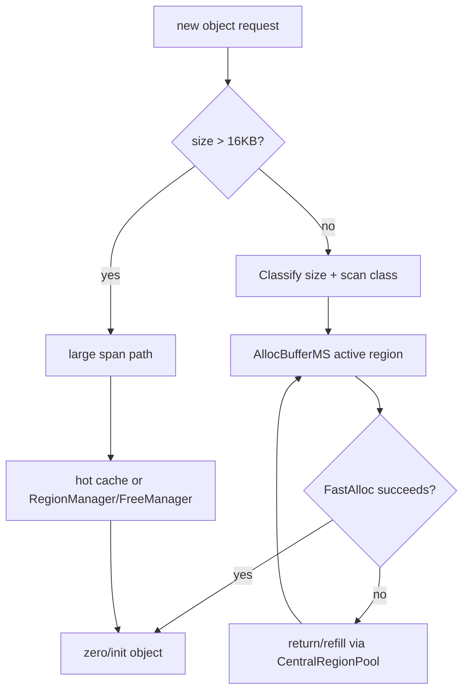

# MSGC 对象分配架构与实现详解

> 当前代码基线：`MSGC-bugfix-regionScan` / `24ca097ace`。

## 1. 核心结论

- Region 固定 32KB。
- 共有 36 个 size class，8B 到 16KB。
- `size > 16KB` 才走 large path；正好 16KB 是 class 35。
- 小对象按 `[sizeClass][NO_REF/HAS_REF]` 分开 active Region。
- Fresh Region 使用 BUMP，Sweep 后的 Region 使用 BITMAP。
- Large object 使用连续 Region span。
- Mark 期间分配按 WU/byte 记 Assist debt；阈值 512 WU。
- collect-set 在 Mark 前封存；其中 ALLOC plane 的 free slots 从 Region scan candidates 中排除。

## 2. 总体路径



## 3. Size class 与 scan class

`SizeClassInfo`：

- `<=1024B`：8B 粒度 lookup；
- `1024B..16KB`：256B 粒度 lookup；
- descriptor 保存 slot size、slot count、bitmap words、tail mask、division magic。

`ClassifyMSScanClass(TypeInfo)` 将对象分为：

- `NO_REF`
- `HAS_REF`

同 size class 两类对象不混放。这样 `NO_REF` Region 不需要 SCAN plane，也不会产生 REGION
Mark task。

## 4. `AllocBufferMS`

当前 compiler-visible prefix：

```cpp
MSRegionInfo* activeRegions_[36][2];
```

Fast allocation：

- BUMP：比较 `allocPtr + slotSize <= regionEnd`；
- BITMAP：使用 `allocSummary` 找有空位的 word，再 `ctz` 取 slot。

active Region 耗尽后：

1. 归还 central；
2. 按同一 size/scan class refill；
3. 优先使用已 swept 的 partial Region；
4. 再使用 classless empty cache；
5. 最后取 fresh Region。

当前分配 refill 不会直接从 unswept 队列领取 Region，也不存在 allocation-miss Lazy Sweep。
Mutator Sweep Assist 是在成功取得新 Region/span 后按分配债务触发，用于长期 Sweep pacing，
不参与当前这次 refill。

具体供给顺序以
[`MSCentralRegionPool.cpp`](../../src/Heap/MAllocator/MSCentralRegionPool.cpp)
当前实现为准。

## 5. Fresh Region

`InitForSizeClass(cls, scanClass)`：

- 初始化 64B Region metadata；
- 确保 ALLOC 与 MARK plane；
- `HAS_REF` 时确保 SCAN plane；
- 初始化 ALLOC valid bits 与 summary；
- 清 MARK；
- mode 设为 BUMP。

对象 payload 必须在对程序可见前完成清零与对象头初始化。

## 6. BITMAP Region

Sweep 或 BUMP materialization 后：

```text
allocSummary -> word with free bits
allocBitmap[word] -> free slot bit
```

尾 word 必须应用 `validTailMask`，不能分配 Region 末端之外的伪 slot。

一个 active Region 只有当前 `AllocBufferMS` owner 修改其分配状态；进入 central/Sweep 前
通过 ownership 与 generation 协议移交。

## 7. Large object

`size > 16KB`：

- round up 到 Region span；
- 先尝试 exact-size large hot cache；
- 否则向 RegionManager/FreeManager 请求连续 Regions；
- primary entry 保存对象字节与 span；
- secondary entries 标记 SPAN；
- primary 使用 large marked flag；
- `HAS_REF` large 在 Mark 中由 OBJECT task 扫描。

Large path 绕过 small `AllocBufferMS::Allocate()` 时，仍必须按实际 bytes调用
`AccumulatePacingDebt(size)`。

## 8. Mark 期间的新分配

当前普通 small object 不采用统一 mark-at-alloc。`BuildCollectSet()` 先把本轮 Region 从
allocation supply 封存，Region-scan owner 再计算：

```text
candidates = mark & ~scan & ~alloc
```

ALLOC bit 为 1 表示 free，因此 `~alloc` 只让 sealed snapshot 中当时已占用的 slot进入
candidate。Mark 期间仍可分配的 active/new Region 位于 collect-set 外；它们由新的 Sweep
generation 与 `collectEpoch` 隔离，Mark 解析时也不会读取 mutator 可能仍在修改的 ALLOC。

Large object 注册使用其独立 marked 语义；finalizer 相关对象还可能通过
`MarkNewObject()` 进入当前闭包。

## 9. Mark Assist debt

`AllocBufferMS::AccumulatePacingDebt(size)`：

```text
if active collector is null:
    clear stale debt
else:
    account allocation bytes
    debtScaled += size * assistWorkPerByteScaled
    debtWU = debtScaled / ratioScale
    if debtWU >= 512:
        paidWU = MSMarkAssist(debtWU)
        subtract actually paid WU
```

small path 在 Region acquisition 时按约 32KB 统一记账，从而覆盖 compiler inline fast
allocations；large path按实际 size记账。

当前债务不是对象数，也没有 1024-entry buffer 阈值。

## 10. Sweep Assist debt

Sweep debt 与 Mark WU debt分开：

- 单位是成功消费的 Region 数；
- 使用自己的 fixed-point ratio 与 generation；
- 先消费 central/background credit；
- credit 不足时直接 Assist Sweep；
- generation 切换时丢弃旧 fractional debt。

## 11. Central 与 FreeManager

Central：

- buckets 为 `[36][2]`；
- 维护 collect-set、swept/unswept chains；
- 保存 classless empty cache与 large hot cache；
- 调度 background/lazy/Assist/parallel Sweep。

FreeManager：

- 按 Segment/shard 管 Region allocated/free/scavenged；
- 支持连续 span 与跨 shard 搜索；
- Grow committed heap；
- Scavenge OS pages；
- Shrink 连续堆尾 Segment。

## 12. OOM 与回退

分配失败必须区分：

- active Region耗尽但 central仍可 refill；
- lazy/Assist Sweep可产生 supply；
- FreeManager可复用/scavenge reuse；
- heap可 Grow；
- large连续 span碎片不足；
- 真正达到阈值/虚拟上限。

不要把一次 fast-path miss 当作 OOM。最终语义以 `MSRegionSpace` 与 RegionManager 当前
`TryAllocate...`/grow 路径为准。

## 13. Compiler fast path ABI

当前重要合同：

- `activeRegions_[sizeClass][scanClass]` 的 fixed prefix；
- `MSRegionInfo::allocPtr` offset 0；
- RegionInfo 全字段 offset static assertions；
- Region 大小 32768；
- size-class table/runtime 同步；
- fast path miss 回 runtime slow path。

编译器内联分配还必须保证 runtime 的 Region acquisition 记账足以覆盖内联 slot 分配。
删除或重排 fixed prefix 需要 compiler/runtime 同步构建验证。

## 14. 正确性不变式

1. size/scan class 与 active/central bucket 一致。
2. 同一 active Region 只有一个 allocator owner。
3. BUMP 转 BITMAP 前正确 materialize allocation state。
4. tail invalid bits 永不返回。
5. `NO_REF` Region 不访问 SCAN plane。
6. collect-set 在 Mark 前 sealed，且 free ALLOC bits 不得进入扫描。
7. large secondary 始终能解析 primary。
8. scavenged Region访问前完成 reuse。
9. Mark debt和 Sweep debt不混用。
10. fast path与 slow path保持对象清零、记账和 ABI 等价。

## 15. 诊断

| 现象 | 首查 |
|---|---|
| small fast path频繁 miss | active `[cls][scan]`、allocSummary、refill |
| 地址越过 Region | size class、tail mask、division magic |
| `HAS_REF` 对象漏扫 | scan class、collect epoch、sealed-set ALLOC validity filter |
| Assist 不触发 | active collector、work-per-byte、512 WU threshold |
| large假 OOM | hot cache、连续 span、shard steal、Grow |
| Sweep 后对象破坏 | mark bitmap、sweep generation、ownership |

## 16. 源码索引

- [`MSAllocBuffer.cpp`](../../src/Heap/MAllocator/MSAllocBuffer.cpp)
- [`MSCentralRegionPool.cpp`](../../src/Heap/MAllocator/MSCentralRegionPool.cpp)
- [`MSRegionSpace.cpp`](../../src/Heap/MAllocator/MSRegionSpace.cpp)
- [`MSRegionManager.cpp`](../../src/Heap/MAllocator/MSRegionManager.cpp)
- [`MSFreeManager.cpp`](../../src/Heap/MAllocator/MSFreeManager.cpp)
- [`MSRegionInfo.cpp`](../../src/Heap/MAllocator/MSRegionInfo.cpp)
- [`MSSizeClass.h`](../../src/Heap/MAllocator/MSSizeClass.h)
- [`MSScanClass.h`](../../src/Heap/MAllocator/MSScanClass.h)
