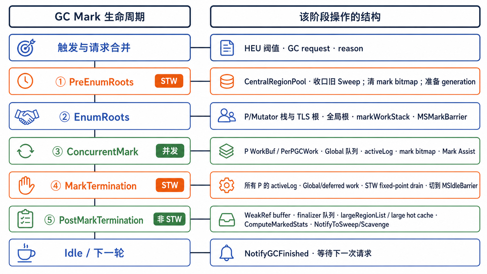
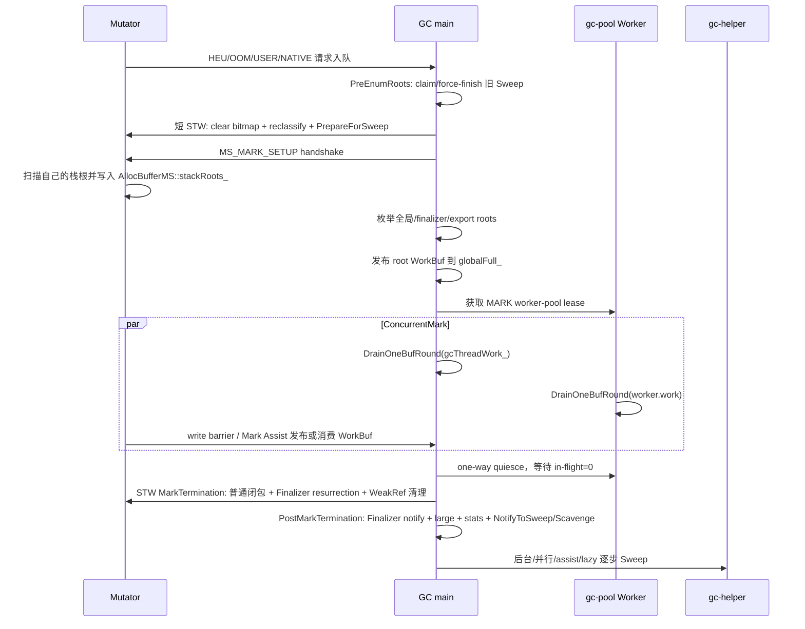
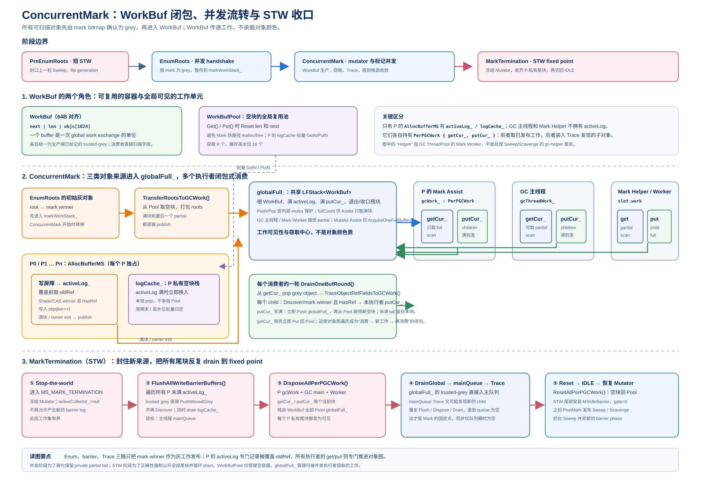
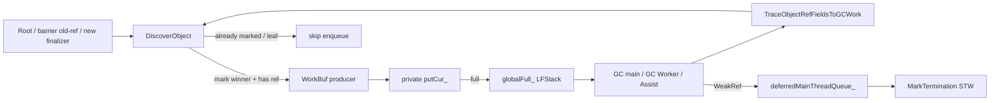

# MSGC GC Mark 架构与实现详解

> 本文以当前 `MRT_USE_MARK_SWEEP` 实现为准，重点解释一次 MSGC 从触发到 Sweep 启动的完整因果链。源码优先级高于历史设计文档；文中所说的“当前实现”均指本仓库 `src/` 在本文撰写时的行为。

## 目录

1. [阅读口径与核心结论](#1-阅读口径与核心结论)
2. [GC 如何被触发](#2-gc-如何被触发)
3. [一轮 GC 的阶段状态机](#3-一轮-gc-的阶段状态机)
4. [PreEnumRoots：前置清扫与本轮快照](#4-preenumroots前置清扫与本轮快照)
5. [EnumRoots：根扫描与 Enum Assist](#5-enumroots根扫描与-enum-assist)
6. [ConcurrentMark：并发标记、wbuf 与全图闭包](#6-concurrentmark并发标记wbuf-与全图闭包)
7. [MarkTermination：STW 最终收敛](#7-markterminationstw-最终收敛)
8. [PostMarkTermination：标记后的语义处理](#8-postmarktermination标记后的语义处理)
9. [Post-Mark：统计、唤醒与实际清扫](#9-post-mark统计唤醒与实际清扫)
10. [不变量、并发边界与常见误读](#10-不变量并发边界与常见误读)
11. [关键源码索引](#11-关键源码索引)

## 1. 阅读口径与核心结论

### 1.1 一句话概括

当前 MSGC 是“对象原地不移动、根枚举采用 mutator handshake、对象图采用并发 mark、结束时用 STW fixed point 收口、small Region 分层并发 Sweep”的 Mark-Sweep GC。Collector 主流程只负责把 mark 结果稳定下来并通知后台工作；小对象的大量槽位清扫发生在 `gc-helper`、分配慢路径、Mutator Sweep Assist、动态并行 Sweep 或下一轮 `PreEnumRoots()` 的 force-finish 中。

### 1.2 一次 GC 的主链

```text
触发请求
  -> GC 主线程取任务并进入 MarkSweepCollector::RunGarbageCollection
  -> PreEnumRoots
  -> EnumRoots
  -> ConcurrentMark
  -> MarkTermination
  -> PostMarkTermination
  -> UpdateGCStats / 回到 IDLE
```

其中只有 `PreEnumRoots` 的 bitmap 清理/列表重分类短窗口和 `MarkTermination` 是 STW；`EnumRoots` 依靠 mutator 到达安全点完成非 STW 的协作式握手，`ConcurrentMark` 与恢复运行的 mutator 并发。Finalizer 可达性判定、resurrection closure 和 WeakRef 置空都在 `MarkTermination` 的最终 mark bitmap 上完成；`PostMarkTermination` 是非 STW 的 Finalizer worker 通知、统计和后台发布阶段。

### 1.3 本文特别强调的三个边界

1. **Post-Mark 的 Sweep 发布不是一次调用内遍历整个 small heap。** `PostMarkTermination()` 在稳定 mark bitmap 上计算统计并唤醒后台 Sweep；真正的 small Region `SweepRegion()` 由多个执行方分摊。
2. **“队列为空”不是并发标记完成的充分条件。** 还必须考虑 GC main 当前输入、GC Worker/assist 在途计数、mutator `activeLog_`、各 `PerPGCWork` 私有 partial 和 deferred 队列。
3. **清 bitmap 前必须先封闭旧 Sweep。** `SweepRegion()` 正在根据 mark bitmap 判定死活；如果清零与 Sweep 并发，活对象会被重建成 free slot，后续形成 UAF。

## 2. GC 如何被触发

### 2.1 触发入口与请求类型

GC 请求最终进入 `CollectorResources::RequestGC()`，同步请求排入 sync queue 并等待完成，异步请求进入 async queue，由 GC 主线程事件循环执行。当前请求类型定义在 `src/Heap/Collector/GcRequest.h`：

| Reason | 常见来源 | 同步语义 |
| --- | --- | --- |
| `GC_REASON_USER` | `MCC_InvokeGCImpl(sync)` 或显式 Runtime API | 可同步/异步，取决于调用参数 |
| `GC_REASON_OOM` | 分配失败/运行时 OOM 路径 | 同步 |
| `GC_REASON_BACKUP` | 长时间没有其他 GC 请求时的兜底任务 | 异步 |
| `GC_REASON_HEU` | 堆阈值启发式触发 | 异步，受 cooldown 和队列合并约束 |
| `GC_REASON_NATIVE` | native allocation registry 判断需要回收 | 异步 |
| `GC_REASON_HEU_SYNC` | 需要等待一轮 heuristic GC 的同步请求 | 同步 |
| `GC_REASON_NATIVE_SYNC` | 需要等待 native 回收的同步请求 | 同步 |
| `GC_REASON_FORCE` | Runtime 主动强制触发 | 同步 |

同一 reason 的异步任务由 `AsyncTaskState`/`TaskQueue` 维护 pending/running 状态：已经排队或正在执行时，新的同优先级请求只返回 duplicate，不重复运行。`CollectorProxy::RunGarbageCollection()` 在 MSGC 构建下固定选择 `MarkSweepCollector`，设置 `isGcStarted` 后进入主链。

### 2.2 常规 HEU：在 Region 获取路径触发

自动启发式请求由 `MSRegionManager::MaybeNotifyMark()` 发出。它位于 `TakeRegions()` 的 checkpoint，因此发生在分配线程准备从 `FreeManager` 获取新 Region 时，而不是每次对象分配都发请求。顺序是：

1. 若 GC 已在运行，返回；避免在同一周期重复排队。
2. 检查 `lastHeuRequestNs_` 与 `gcInterval` cooldown。
3. 读取 `sweptBytes = partialSwept + fullSwept + large active span footprint`。
4. 读取当前 `heapThreshold`；只有 `sweptBytes >= threshold` 才继续。
5. 若中央池已发布的 Sweep pressure 不是 `LOW`，调用 `NotifyToParallelSweep()` 将旧 Sweep epoch 强制拉到 HIGH 并唤醒 helper；这不会取消或延迟本次 HEU。
6. 用 CAS 更新 `lastHeuRequestNs_`，只有一个竞争者提交 `GC_REASON_HEU` 异步请求。

这里故意使用“已完成 Sweep 且仍保留的 footprint”，而不是 committed heap 或 transient active Region 总量。这样触发点代表上一轮回收后的稳定 live/retained 规模，避免未清扫垃圾和物理页缓存把阈值判断提前或推迟。

### 2.3 阈值在上一轮结束后如何更新

`PostMarkTermination()` 在 mark bitmap 尚未被下一轮清理的稳定窗口调用 `ComputeMarkedStats()`，得到 `trueLiveBytes`。随后 `UpdateGCStats()` 依据：

```text
rawTarget = trueLiveBytes * (1 + cjHeapGrowth)
floor     = min(gcThresholdCap, 20 MiB)
```

当前 MSGC 的策略是下降立即跟随、上升按单轮约 12.5% 限速，同时保证约 `trueLiveBytes * 1.25` 的安全 headroom，并受上限 cap 限制。新阈值决定后续 Region 获取何时再次进入 `MaybeNotifyMark()`。

### 2.4 分配失败、显式请求和 HEU 的关系

显式 `MCC_InvokeGCImpl()` 直接走 `HeapManager::RequestGC()`；OOM reason 由分配失败路径进入同步请求。HEU 是“值得做一轮回收”的异步提示，不等同于当前分配的同步救援：分配路径仍需要 FreeManager grow、Lazy/Sweep Assist 和合理阈值共同维持供给；若这些路径仍不能满足分配，最终才会进入 OOM。

## 3. 一轮 GC 的阶段状态机

下图把左侧的 Mark 阶段和右侧实际操作的数据结构并列展示：根扫描建立初始 WorkBuf，ConcurrentMark 处理对象闭包和 barrier log，MarkTermination 在 STW 中收敛，PostMarkTermination 再发布 Sweep/Scavenge 工作。



> 图 5-1：Mark 五阶段与中央池、WorkBuf、bitmap、Sweep 发布之间的对应关系。

### 3.1 五阶段职责表

| 阶段 | 全局/线程状态 | 输入 | 主要输出 |
| --- | --- | --- | --- |
| `PreEnumRoots` | 先协作封闭旧 Sweep，再短 STW | 上一轮 swept/unswept lists、上一轮 bitmap | 干净 mark bitmap、新 Sweep generation、本轮 unswept snapshot |
| `EnumRoots` | mutator handshake + GC 线程根扫描 | 栈/TLS/全局/finalizer/export roots | 初始 grey root 集合 |
| `ConcurrentMark` | GC main、GC Worker、mutator barrier/assist 并发 | root WorkBuf、写屏障日志 | 尽量闭合对象图，留下有界 residual work |
| `MarkTermination` | STW | 所有残余工作源、registered finalizers、WeakRef buffer | 普通闭包、Finalizer resurrection 闭包、WeakRef 清理，随后恢复 `IDLE` 并重新开放 Sweep epoch |
| `PostMarkTermination` | 非 STW | 稳定 mark 结果 | 通知 Finalizer worker、large reclaim、live stats、后台 small Sweep/Scavenge 通知 |

### 3.2 时间关系



### 3.3 阶段转换与 Barrier

`MutatorManager::TransitionAllMutatorsToGCPhase()` 在切换全局 phase 时同时调用 `Heap::InstallBarrier()`。MSGC 的关键 phase 是 `MS_MARK_SETUP`、`MS_CONCURRENT_MARK` 和 `MS_MARK_TERMINATION`；MarkTermination 在 STW 内直接恢复 `IDLE`，让 mutator 恢复时已经使用 Idle barrier，避免“最后一次 mark flush 与恢复执行之间还有一段旧 barrier 窗口”。并发 Sweep 的生命周期由 CentralRegionPool 的 generation、队列和 active counter 独立跟踪，不再占用一个 `gcPhase`。

## 4. PreEnumRoots：前置清扫与本轮快照

### 4.1 为什么一开始要先清扫

上一轮 `MarkTermination` 结束后，small Region 的 mark bitmap 仍保存上一轮生死信息；而上一轮 `PrepareForSweep()` 已把待扫 Region 放进 `partialUnswept/fullUnswept`。后台 Sweep 可能只完成了一部分，另外一些 Region 可能正在被 lazy/assist/helper claim。新一轮若直接清零 bitmap 并开始 mark，会混淆两个周期的数据：旧 Sweep 还要用旧 bitmap 判死，新 Mark 又需要从全零 bitmap 开始。

因此 `PreEnumRoots()` 的职责不是“顺便做一些清理”，而是建立三个严格前置条件：

```text
旧 Sweep epoch 已停止接收新任务
旧 Sweep 的所有在途执行者已退出
旧 unswept backlog 已被最终 drain
        ↓
才允许清 bitmap、重分类、翻转 generation、建立本轮 unswept snapshot
```

此外，generation 必须在本轮 mark **之前**翻转。Mark 期间新绑定的 Region 使用新 generation；本轮 Sweep 只处理旧 generation 的快照。这样一个仅由栈/TLS 持有、没有经过写屏障的新对象不会被本轮 Sweep 误当成旧对象回收。

### 4.2 `StopAndWaitForAllSweep()` 的清扫封口

`MarkSweepCollector::PreEnumRoots()` 首先调用 `CentralRegionPool::StopAndWaitForAllSweep()`。这个函数按以下顺序工作：

1. **GC 主线程先加入旧 Sweep。** 在 admission 仍开放时调用 `ForceFinishAllUnswept()`，按 size class 的 partial/full unswept 链表逐 Region claim，并执行与后台路径相同的 `SweepRegion()`。所有执行方通过 `ClaimUnsweptHeadForSweep()` 获取所有权，不能重复清扫同一 Region。
2. **关闭所有入口。** 设置 `stopSweepRequested_`、`skipLazySweep_`、`skipAssistSweep_`、`skipHelperSweep_`。这些 gate 一直保持到 `MarkTermination()` 内调用 `ReenableLazySweep()`，所以 mark 期间不会有旧或新 unswept 被消费。
3. **建立 StoreLoad 闭包。** `StopAndWaitForAllSweep()` 做 seq_cst fence；lazy/assist/helper 入口都采用“先增加 active counter，再 fence，再检查 skip/stop”的配对协议，确保 GC 线程看到已经进入的 Sweep。
4. **等待在途执行者退出。** 依次等待 `bgSweepRunning_`、`activeLazySweepCount_`、`activeAssistSweepCount_`、`activeHelperSweepCount_` 归零。unswept 链暂时为空并不充分：某线程可能已经摘下 Region、仍在读取 bitmap。
5. **最终串行 drain。** admission 已关闭且所有 active counter 为零后，再调用 `ForceFinishAllUnswept()` 处理关闭期间的最后残余；`TryPublishSweepDone()` 只有在 unswept 为零且各计数器均为零时才发布完成。

每个 `SweepRegion()` 的结果是确定的：

| mark 结果 | 槽位动作 | Region 归宿 |
| --- | --- | --- |
| 全部白 | 整个 payload 清零，`freeSlotCount=totalSlotCount` | empty swept/local empty cache |
| 部分存活 | `allocBitmap = ~markBitmap`，清零死槽并重建 summary | `partialSwept` |
| 无空槽 | 仍保留全部存活对象 | `fullSwept` |

### 4.3 短 STW 中的前置清理

Sweep 完全静默后，`PreEnumRoots()` 进入 `ScopedStopTheWorld("MS PreEnumRoots clear/reclassify/prepare STW")`，依次执行：

1. `ClearAllMarkBitmaps()`：小对象 Region 清零 mark bitmap；large Region 清除 primary 的 marked flag。跳过 FREE、EMPTY_CACHE、SPAN 和未初始化条目。
2. `ReclassifyUnsweptToSwept()`：把仍残留在 unswept 视图中的 Region 规范化到 swept 分类，保证后续 flip 的输入只有一种语义。
3. `PrepareForSweep()`：对每个 size class 做 O(1) 列表翻转：`partialSwept → partialUnswept`，`fullSwept ↔ fullUnswept`；统计本轮 total unswept，重置 Sweep credit/pressure，计算固定的按分配 Sweep ratio，然后 `globalSweepGen_.fetch_add(2)` 并把 `sweepDone_` 置 false。

这里的“前置清理”有两个目的：

- **数据隔离：** mark bitmap 从上一轮状态归零；本轮 mark 只表达本轮可达性。
- **生产者隔离：** `PrepareForSweep()` 形成固定的旧 Region 快照；在本轮 mark 期间新分配/新绑定的 Region stamp 到新 generation，不进入本轮 Sweep。

清 bitmap 必须放在这个 STW 中，虽然 `ClearAllMarkBitmaps()` 本身只是内存写操作，但它依赖前面已经证明没有任何 `SweepRegion()` 在读这些 bitmap。STW 同时保证 active Region、中央链表和 generation flip 不被 mutator 交错修改。

### 4.4 PreEnumRoots 的最终状态

阶段结束后：

```text
mark bitmap = 全零（当前活跃 small Region）
large marked flag = 清零
partialUnswept/fullUnswept = 本轮待 Sweep 的旧 generation 快照
globalSweepGen = 新 generation
Sweep admission = 仍关闭
activeCollector_ = 当前 MarkSweepCollector
```

最后一项 admission 仍关闭是有意的：Mark 期间必须保证新一轮 Sweep 不会读取正在增长的 mark bitmap；等 `MarkTermination` 在 STW 内完成闭包并恢复 `IDLE` 后，才重新打开 lazy/assist/helper Sweep。

## 5. EnumRoots：根扫描与 Enum Assist

### 5.1 `MS_MARK_SETUP` handshake

`MarkSweepCollector::EnumRoots()` 调用 `TransitionToGCPhase(GC_PHASE_MS_MARK_SETUP, true)`。`MutatorManager::TransitionAllMutatorsToGCPhase()` 在持有 mutator 管理锁时：

1. 安装 `MS_MARK_SETUP` barrier 并更新全局 phase。
2. 给每个 Mutator 设置 `SUSPENSION_FOR_GC_PHASE` 和 safepoint active。
3. 把所有 Mutator 放入 `enumAssistContext_.candidates`，初始化 `claimCursor/remaining/inFlight`。
4. 通过 `EnsurePhaseTransition()` 等待每个 Mutator 完成 transition；已在 saferegion 的 Mutator 可由 GC 线程直接 transition，正在运行的则在自己的 safepoint 处理。
5. 所有候选完成后关闭 assist gate，等待已 claim 的 assist batch 的 `inFlight` 归零，再清理上下文。

这不是传统“整个进程停住、GC 线程扫描所有栈”的长 STW。每个 Mutator 在自己的执行上下文里负责栈根扫描，扫描完成才宣布已到 `MS_MARK_SETUP`。

### 5.2 Mutator 如何扫描自己的根

`Mutator::GcPhaseEnum()` 创建一个临时 `rootSet/rootStack`：

- `VisitMutatorRoots()` 访问寄存器、栈 map、TLS 等根。
- 指向 managed heap 的 root 先调用 `Allocator::PushRootToBuffer()`，写入当前 `AllocBufferMS::stackRoots_`；这是 staging，不是立即的 mark enqueue。
- 指向 managed stack object 的 root 放入 `rootStack`，在当前 Mutator 内沿其 ref field 递归，直到发现 heap 引用，再写入 root buffer。
- `AllocBufferMS::MergeRoots()` 只负责把 `stackRoots_` 搬到 collector 的临时 root stack；对象的 white→grey 由 collector 后续统一完成。

这样设计是因为 `AllocBufferMS` 属于 Mutator 所在线程/P，GC 线程不应在 Mutator 仍可能写入时直接消费其私有 vector；先在 phase handshake 中完成每个 owner 的扫描，再由 GC 线程集中合并。

### 5.3 GC 线程扫描的全局根

所有 Mutator 完成 handshake 后，GC 线程执行 `EnumAndMarkRoots()`：

```text
EnumAllCommonRootsSerial(markWorkStack_)
  ├─ runtime/static/global roots
  ├─ concurrency model / scheduler roots
  ├─ finalizer roots（CopyGC；MSGC 在 termination resurrection 阶段处理）
  └─ AllocBufferMS::stackRoots_ 合并结果
EnumAllExportRoots(markWorkStack_)
```

MSGC 的 `EnumFinalizerProcessorRoots()` 在普通根枚举阶段是 no-op。这不是漏根：MSGC 必须先得到不含 finalizable/working 对象子图的普通 mark fixed point，才能据此判断 registered finalizer 是否不可达；这些 roots 随后由 `MarkTermination()` 的 `CollectResurrectionCandidatesToMain()` 统一加入。若提前加入，pending Finalizer 的子图会污染普通可达性，使其中的 registered finalizer 延迟至少一轮入队。

每个 root 经过 `DiscoverObject()`/`TryEnqueueGreyObject()`：先检查地址和 `TypeInfo` 有效性，再原子设置 mark bit；第一次设置成功且对象有引用字段时才进入 `markWorkStack_`。对象没有引用字段时已经是可达叶子，不需要占用 work buffer。

### 5.4 Enum Assist：谁帮助谁、帮助什么

Enum Assist 的工作不是替 GC 扫描另一个线程的栈，而是帮助推进**phase transition**。当一个 Mutator 在 safepoint 发现 `SUSPENSION_FOR_GC_ENUM_ASSIST`：

1. 调用 `MutatorManager::ClaimEnumAssistBatch(phase, batchSize, claimed)`，从候选 vector 的 `claimCursor` 批量领取若干处于 saferegion 的 Mutator。
2. 对每个候选调用 `candidate->TransitionGCPhase(false)`；目标 Mutator 自己的 `TransitionToGCPhaseExclusive()` 执行 `GcPhaseEnum()`，所以栈扫描仍发生在目标线程/安全上下文中。
3. 调用 `FinishEnumAssistBatch()` 递减 `inFlight`。
4. 如果 `remaining==0`，清除当前 assistant 的 enum-assist suspension；没有其他 suspension 时关闭 safepoint active。

`FinalizeEnumAssistContext()` 先把 `active=false`，阻止新的 batch claim，再等待已有 `inFlight` 全部完成，最后清空候选列表。这个顺序保证 GC 线程不会在一个 assistant 仍可能驱动目标 Mutator transition 时推进到下一个全局 phase。

### 5.5 EnumRoots 的输出

`EnumRoots()` 返回时，`markWorkStack_` 只包含已经完成“首次 mark”的 root 对象；它们还没有被完整扫描。`ConcurrentMark()` 的第一步 `TransferRootsToGCWork()` 把这些对象打包成 `WorkBuf`，发布到 `globalFull_`，从而把根枚举和对象图扫描解耦：Enum 阶段只建立根集合，Mark 阶段负责闭包。

## 6. ConcurrentMark：并发标记、wbuf 与全图闭包

### 6.1 三色在当前实现中的实际表示

MSGC 没有在对象头中存储一个独立的 `white/grey/black` 枚举。三色是由 **mark bit + work queue membership** 组合表达的：

| 抽象颜色 | 当前实现的表示 | 含义 |
| --- | --- | --- |
| white | small 对象的 `markBitmap` bit 为 0；large primary 的 `FLAG_MARKED` 为 0 | 本轮尚未发现 |
| grey | mark bit 已由当前线程的原子操作置 1，且对象进入某个待扫描 WorkBuf/队列 | 已发现但 ref field 尚未完成扫描 |
| black | mark bit 为 1，且对象已从 WorkBuf 取出并扫描完所有强 ref field | 已完成扫描；代码不额外写 black bit |

因此 mark bit 的语义不是“已经 black”，而是“已经赢得发现竞争”。对象只有在第一次置位成功且 `HasRefField()` 时才需要入队；无引用字段的对象可直接从 grey 逻辑上变成 black。

### 6.2 统一发现路径与“先标记再入队”

普通根和对象字段都归一到 `DiscoverObject()` → `MarkObjectInHeapKnown()`：

1. 解析 Region 并检查地址落在可跟踪 small/large 对象槽。
2. 检查 `obj->IsValidObject()`，过滤已经被 Sweep 清零的 stale slot。
3. small 对象对 `markBitmap[word]` 做原子 `fetch_or`；large 对象对 primary 的 `FLAG_MARKED` 做原子 `fetch_or`。
4. 根据旧 bit 判断本线程是否是 mark winner。
5. 只有 winner 且对象有引用字段时，才把对象写入当前 `WorkBuf`。

“先标记再入队”不是实现顺序上的偏好，而是队列正确性不变量：

```text
mark CAS winner  <=>  唯一拥有该对象扫描责任的生产者
mark CAS loser   <=>  对象已由别人入队/扫描，不重复入队
```

如果先入队、后 CAS，多线程会为同一个对象产生重复工作；更危险的是，失败者无法可靠判断 winner 是否已经把对象放入队列，可能出现漏入队或重复扫描。当前顺序把“去重”和“责任转移”合并为一个原子 bit 操作。Mark bit 不会在本轮 mark 期间清零，所以一个对象最多被 winner 加入一次。

### 6.3 当前写屏障是怎样补上并发删除边

`MSMarkBarrier::WriteReference()` 采用 deletion barrier：读取 old reference，先处理 old edge，再写入 new reference。当前生产代码在 `EnqueueRefInto()` 中对 old ref 调 `ShadeRefForBarrier()`，只有 mark winner 且 old object 有 ref field 时才追加到当前 `AllocBufferMS::activeLog_`；正常路径不会再单独 enqueue new ref。

这保证 mutator 在 mark 期间执行：

```text
old = slot
shade(old)        // 先保护将被删除的边
slot = new        // 再覆盖字段
```

若 old ref 已被其他根/trace worker 标记，当前写屏障直接丢弃它，因为其扫描责任已经被某个 winner 获得。bulk struct/array 路径会先按 Region/bitmap word 聚合，再用 `MarkBitmapWord()` 原子 OR，并只把新置位的对象追加到 `activeLog_`。

当前头文件与实现统一为 old-only deletion barrier：屏障生产端完成 mark-CAS，只有 winner 且对象包含引用字段时才把 trusted-grey 对象放入 WorkBuf。

### 6.4 `WorkBuf` 的物理结构

`src/Common/LFStack.h` 中的 `WorkBuf` 是所有并发标记执行方交换工作的最小单元：

```text
alignas(64) WorkBuf
┌───────────────┬────────────┬───────────────────────────────┐
│ next (8B)     │ len (8B)   │ objs[1024]                    │
│ 链接指针       │ 当前长度    │ BaseObject*，从 offset 16 开始 │
└───────────────┴────────────┴───────────────────────────────┘
```

- `kCapacity=1024`，一个 WorkBuf 最多存放 1024 个对象指针。
- `next` 被 LFStack/WorkBufPool 复用作链表链接。
- WorkBuf 条目统一是 trusted-grey：对象已在生产端完成 mark-CAS，消费者直接扫描，不再存在 raw/provenance 分支。
- Debug 构建的 `kRevalidateTrustedGrey=true` 会额外校验地址和 TypeInfo；Release 构建跳过重复验证。

`globalFull_` 名称中的 LFStack 当前使用一把小 mutex，而不是无 ABA 保护的 Treiber CAS stack。WorkBuf 会被快速回收到 `WorkBufPool` 并复用，保留 mutex 可规避 ABA。锁内有 `fullTop_`、`partialTop_` 两个逻辑 lane：`Push()` 按 `len == kCapacity` 自动分类，GC main/GC Worker 的 `Pop()` 优先 full 后取 partial，Mutator Assist 的 `PopFull()` 直接摘 full head，不再遍历 partial 链。`total/full` 仍在同一把锁下形成一致快照。

### 6.5 当前存在的 WorkBuf 容器与链表

WorkBuf、WorkBufPool、P 的 `activeLog_`/`logCache_`、`globalFull_` 以及 GC main/Worker 的两个 `PerPGCWork` buffer 的实际流转见下图。图中“满 buffer 发布”和“私有 partial 延迟发布”是两个不同事件。



> 图 5-2：Enum、barrier、对象图遍历产生的工作如何汇入全局 WorkBuf，再由 GC main/Worker/Assist 消费。

容易误读的是把所有容器都叫成“full list”。当前代码实际有以下几层：

| 容器 | 所属 | 作用 | 是否参与并发收敛 |
| --- | --- | --- | --- |
| `globalFull_` (`LFStack`) | Collector | 全局已发布 WorkBuf；包含 full 和 partial | 是，GC main/Worker/assist 读取 |
| `WorkBufPool::freeList_` | Collector | 空闲 WorkBuf 回收池 | 否，是资源池 |
| `PerPGCWork::getCur_` | 每个 GC main/Worker/Mutator P | 当前正在消费的 buffer | 通过 owner 的 in-flight/Dispose 间接参与 |
| `PerPGCWork::putCur_` | 每个 GC main/Worker/Mutator P | 当前正在产生子对象的 partial buffer | 不在并发候选中，MarkTermination 统一 dispose |
| `AllocBufferMS::activeLog_` | 每个 Mutator/P | 写屏障日志的当前 WorkBuf | buffer 满/owner 退出时发布；partial STW flush |
| `AllocBufferMS::logCache_` | 每个 Mutator/P | 本地空 WorkBuf freelist | 否，周期结束 drain 回 pool |
| `markWorkStack_` | Collector | EnumRoots 产生的初始 root stack | TransferRoots 后转入 globalFull_ |
| `deferredMainThreadQueue_` | Collector | WeakRef、new finalizer 等需主线程处理的灰对象 | 是，MarkTermination 固定点会 drain |

当前没有一个独立命名为 `globalEmpty_` 的生产队列；空 buffer 统一进入 `WorkBufPool::freeList_`。Pool 的 `GetN()` 通过一次 `PopN()` 批量补充 P 的 `logCache_`，周期结束或 P 退出时 `PutChain()` 一次归还整条 cache。`globalFull_` 里的“full”仍是历史名称：容器同时保存 full/partial，只是内部用两个 head 分开管理。

### 6.6 `PerPGCWork` 的 get/put 分离与流转

每个标记执行方都有独立 `PerPGCWork`，但都指向同一个 `globalFull_` 和 `WorkBufPool`：

```text
扫描对象
  └─ TraceObjectRefFieldsToGCWork()
       └─ DiscoverObject(child)
            └─ winner + HasRefField
                 └─ putCur_->Push(child)
                      ├─ 未满：留在 owner 私有 partial
                      └─ 满：globalFull_.Push(putCur_)，换新 putCur_

消费对象
  └─ getCur_ 非空则继续 Pop
       └─ 空时从 globalFull_ 取一个 WorkBuf
            ├─ GC main/Worker: Pop()，full/partial 都可
            └─ Mutator Assist: PopFull()，只取满 buffer
```

一个 published buffer 被当作一次完整 slice：`DrainOneBufRound()` 只消费该 buffer，不会在同一 slice 级联扫描刚生成的 private `putCur_`。扫描结束后 get buffer 归还 pool；put buffer 只有满、owner 退出或 STW dispose 才会发布/转移。

### 6.7 根 WorkBuf 的首次发布

`ConcurrentMark()` 首先初始化所有现有 `AllocBufferMS` 的 `PerPGCWork`，然后 `RunConcurrentMarkLoop()` 初始化 GC main 的 `gcThreadWork_`。`TransferRootsToGCWork()` 从 `markWorkStack_` 取 root，按 1024 项打包：

```text
markWorkStack_
    -> WorkBuf(objs[0..n])
    -> globalFull_.Push(buf)
    -> GC main / GC Worker / Assist 竞争消费
```

根在 `EnumRoots` 中已经经过 discover/mark-CAS，根 buffer 因而直接保存 trusted-grey。消费者必须直接扫描这些 root，不能再次 discover，否则会把已经标记的 root 当成 loser 而跳过其子字段。

### 6.8 GC main、GC Worker、Mutator Assist 如何配合

#### GC main

GC 主线程持有 `gcThreadWork_`，在 `RunConcurrentMarkLoop()` 中循环：

1. 从自己的 `getCur_` 或 `globalFull_` 取一个任意 WorkBuf。
2. 扫描 buffer 中每个对象的强 ref field。
3. 对每个 child 执行 discover；winner child 写入自己的 `putCur_`，满后发布到 `globalFull_`。
4. 每轮依据 `globalFull_` backlog 动态更新 helper target 和 assist ratio。

GC main 是 MARK epoch 的主 lane；`gcThreads` 表示包括这个 lane 在内的总宽度，所以最多借用 `gcThreads-1` 个 GC Worker。

#### GC Worker

`StartMarkWorkers()` 为每个候选 worker 创建一个 `MSMarkWorkerSlot` 和独立 `PerPGCWork`。`MSMarkWorkerPolicy` 根据 `globalFull_.GetCounts().total` 只向上扩容：

- backlog 很小则保持 0 个 helper；
- backlog 超过每线程额度或连续增长时逐个增加；
- backlog 达 emergency 阈值时直接拉满；
- 一旦进入 tail drain，目标固定为上限，不在本周期缩容。

Worker 通过 `MSMarkWorkerControl::TryEnterWorker()` 原子增加 `workersInFlight_`并重查 phase/target，执行一个 `DrainOneBufRound()` 后原子递减。已 eligible Worker 的正常轮次不进入控制 mutex；无工作时最多 backoff 50 微秒。MARK 与 SWEEP 共用一个 `GCThreadPool`，由 `MSGCWorkerPoolController` 的 lease 保证两个 epoch 不重叠。MARK 取得 lease 后会在提交长 task 前恢复 `maxActiveThreadNum=maxHelpers`，避免上一轮小规模 Sweep 限制本轮 Mark 并行度。

#### Mutator Mark Assist

Mutator 的分配路径在 `AllocBufferMS::AccumulatePacingDebt()` 中按分配字节累积 mark debt：

```text
gcAssistDebtScaled += allocationBytes * assistWorkPerByteScaled
if debtObjects >= WorkBuf::kCapacity:
    MSMarkAssist(allocBuffer, debtObjects)
```

一次 assist 调用：

1. 先 `TryEnterAssist()`，把 `assistsInFlight_` 纳入收敛协议。
2. 尝试从 `bgScanCredit_` 领取 GC main/Worker 已完成标记产生的 credit；credit 足够时，mutator 不必实际扫描。
3. 剩余 debt 至少一个完整 buffer 时，用 `PopFull()` 从 `globalFull_` 消费一个 WorkBuf。
4. 由该 Mutator 的 `putCur_` 暂存新 child；只在 buffer 满或 termination 时交给全局/主线程。
5. `ExitAssist()`，由分配器扣除实际 paid 数量。

Assist 既是标记执行者，也是 pacing 控制器：分配越快，debt 越快达到阈值，mutator 越需要分担扫描，从而避免“分配速率永久超过后台标记速率”导致 global work 无法收敛。

### 6.9 如何完成全图扫描

从 root 出发，完整闭包依赖以下循环不变量：

```text
任何已标记且有引用字段的对象，最终必须出现在某个可见 work source 中；
任何 work source 中的 trusted-grey 对象，最终必须被某个 owner 扫描；
扫描产生的每个 managed child 都要经过同一个 discover/CAS 入口。
```

具体链路是：



一个对象从 root/屏障进入 discover 时先变为 mark bit=1（抽象 grey），然后通过 WorkBuf 传播；扫描完成后它在逻辑上变 black。引用环不会造成无限循环，因为环上的第二次 discover 看到已经置位的 bit，返回 loser，不再产生新 work。

### 6.10 WeakRef 与新 finalizer 的特殊路径

- Worker/Assist 扫到 `IsWeakRef()` 对象时不直接把 referent 当强边扫描，而是 `PushSingleToDeferredMainThread()`。
- mark phase 创建的 finalizer 对象由 `MarkNewObject()` 先标记自身；若有 ref field，同样进入 deferred queue，避免并发线程读取半初始化字段。
- 所有 WorkBuf 都是 trusted-grey，不能在消费者侧重新 discover；重复 CAS 会返回“已标记”并错误跳过字段扫描。
- deferred queue 不在 STW 前做 WeakRef 分类；WeakRef 和构造中的普通对象都保留到 `MarkTermination`，在 mutator 完全停止后由 GC 主线程处理，避免提前读取仍可能变化的 referent，也避免复制队列造成重复项。

### 6.11 并发收敛条件为什么要同时检查四项

`RunConcurrentMarkLoop()` 的 convergence candidate 是：

```text
gcThreadWork_.ConcurrentInputEmpty()
&& globalFull_.Empty()
&& workersInFlight == 0
&& assistsInFlight == 0
```

四项分别排除：

1. GC main 自己仍有 get buffer 未消费。
2. 全局已有发布但尚未被任何 owner claim 的 buffer。
3. GC Worker 已 claim 一个 buffer、仍在扫描或向 `putCur_` 产生 child。
4. Mutator Assist 已 claim 一个 full buffer、仍在扫描或产生 child。

只看 `globalFull_` 会把“已被取走但尚未完成”的对象误认为没有工作；只看队列为空也无法覆盖并发 owner 在边界上刚生成的 child。`workersInFlight/assistsInFlight` 是同步控制状态，不能用周期末统计代替。

### 6.12 tail drain、one-way quiesce 与时间预算

首次满足完整 convergence candidate 时，代码不会继续反复等待稳定轮次，而是：

1. `MSMarkWorkerPolicy::EnterTail()`：把 helper 目标拉到上限。
2. 将 assist ratio 提到 `base * msAssistMaxMultiplier`，让尾部新工作尽快被消费。
3. `MSMarkWorkerControl::BeginQuiesce()`：关闭新的 worker/assist claim。
4. `WaitForNoInFlight()`：等待已进入的 worker/assist 全部退出。
5. `Stop()` 并等待 thread pool 完成。

这是 one-way quiesce：进入 `QUIESCING` 后不再因为 late `globalFull_` work 重新点燃并发 helper。Worker private partial、Mutator `activeLog_` 和 late published work 统一交给紧随其后的 MarkTermination STW fixed point。这样牺牲一小段有界 STW residual work，换取持续写屏障负载下确定的 ConcurrentMark 尾部收敛；否则“发布 partial → 扫描 → 产生新 partial”可能形成正反馈。

`cjMSMarkTimeBudget` 是另一条保险路径。超过预算时同样 quiesce 并保留 residual work，不丢弃；由于下一阶段冻结所有 Mutator，MarkTermination 可以在不再增长的工作集上完整 drain。预算是把并发时间转换成停顿时间，不是降低标记正确性的提前退出。

## 7. MarkTermination：STW 最终收敛

### 7.1 为什么必须 STW

ConcurrentMark 的目标是把大部分工作移出停顿，而不是在 mutator 仍运行时把所有私有尾巴都永久清空。进入 termination 前，合法的灰工作可能位于：

```text
Mutator/P 的 activeLog_（未满的 trusted-grey barrier buffer）
Mutator/P 的 PerPGCWork::putCur_ / getCur_
GC main/Worker 的 putCur_ / getCur_
已发布但尚未 claim 的 globalFull_
deferredMainThreadQueue_（WeakRef、new finalizer 等）
退出线程刚发布的 owner log
finalizer/resurrection candidates
```

如果只判断 `globalFull_.Empty()`，上面任一位置仍可能包含“已被标记、但其引用字段尚未扫描”的 grey object。STW 的作用是冻结所有 Mutator，使：

- 不再有新的对象分配和初始化 store；
- 不再有新的写屏障 old-ref；
- 不再有新的 Assist claim；
- activeLog、stack 和 finalizer root 的所有权可以被 GC 主线程一次性接管。

于是 fixed point 具备单调性：主队列只会因已存在的残余来源和扫描 child 增长，不能被一个继续运行的 mutator 无限补货。

### 7.2 STW 入口与工作源收集顺序

`MarkSweepCollector::MarkTermination()`：

1. 建立 `ScopedStopTheWorld("MS MarkTermination", true, GC_PHASE_MS_MARK_TERMINATION)`。
2. 将 `activeCollector_` 置空，停止新的 Mark Assist 和正常写屏障生产。
3. `SnapshotAssistStats()`，把退出 owner 和现存 AllocBuffer 的本地统计汇总。
4. 建立 STW 专属 `GreyWorkQueue mainQueue`。

`DrainMarkTerminationToFixedPoint()` 每轮按以下顺序收集工作源：

```text
FlushAllWriteBarrierBuffers(mainQueue)
  -> DisposeAllPerPGCWork()
  -> DrainGlobalLFStackToMainQueue(mainQueue)
  -> DrainDeferredMainThreadQueueToMainQueue(mainQueue)
```

第一次调用只闭合普通 mark 工作，不提前加入本轮尚未判定的 registered finalizer。普通闭包稳定后，`PrepareFinalizersForResurrection()` 先通过 `VisitFinalizers()` 固定本轮 registered finalizer 数量，再以当时的 `!IsMarkedObject(obj)` 为判据把不可达对象移入 finalizables。随后 `CollectResurrectionCandidatesToMain()` 标记这些对象，第二次调用 `DrainMarkTerminationToFixedPoint()` 闭合它们的强引用子图。

### 7.3 `activeLog_` 为什么不能再次 discover

当前 Route-A 的 `activeLog_` 记录的是 barrier 写入时已经赢得 mark-CAS 的对象，即 trusted-grey。STW flush 时若再次调用 `DiscoverObject()`，CAS 会返回“already marked”，消费端可能把它当 loser 而不扫描字段，恰好丢失这个对象尚未完成的子图。

因此 `FlushAllWriteBarrierBuffers()` 的动作是：

1. 读取 owner 的 partial `activeLog_`。
2. 检查地址可跟踪且 `TypeInfo` 有效。
3. 直接以 moved-grey 语义 `mainQueue.PushMovedGrey(obj)`。
4. 将 WorkBuf 归还 `WorkBufPool`，清空 `activeLog_`。
5. 将 owner 的 `logCache_` 中空 buffer 一并归还 pool。

已发布的完整 log 由 `DrainGlobalLFStackToMainQueue()` 按 trusted-grey 语义直接处理。

### 7.4 `DisposeAllPerPGCWork()` 收哪些位置

`DisposeAllPerPGCWork()` 遍历所有 `AllocBufferMS`，然后处理 GC main 和每个 GC Worker 的 `PerPGCWork`：

- 非空 `getCur_`：把尚未消费的对象转移到可控队列/主线程闭包。
- 非空 `putCur_`：把私有 partial 视为 residual grey，转移或发布。
- `gcWork_` 的工作状态：保留对象，不保留旧 owner 的生命周期。

这样即使并发阶段为防止尾部反复补货而没有发布 private partial，STW 仍能看到它们。dispose 后 `ResetAllPerPGCWork()` 把这些 Per-P 工作结构置回未初始化，并回收 WorkBuf。

### 7.5 fixed-point drain 的循环

主线程执行 `ExecuteLikeDrainMainQueue()`：

1. pop 一个 grey object。
2. 验证 object 仍有效；无 ref field 则结束该对象。
3. 普通对象扫描所有强 ref field，child 经过同一个 `TryEnqueueGreyObject()`。
4. WeakRef 只登记到 `WeakRefBuffer`，不读取并追踪 referent，不把 weak edge 当普通强边。

每一轮对象扫描后再次收集各 work source，直到 `mainQueue.empty()`。普通闭包和 Finalizer resurrection 闭包各执行一次这个 fixed-point 过程；这不是单次 snapshot，而是：

```text
collect all sources
  -> scan mainQueue
  -> collect newly visible sources
  -> scan again
  -> ...
  -> mainQueue empty 且所有来源无新项
```

代码中的 `sourceEntries`/`drainRounds` 日志用于识别 termination 边界上是否有 residual/late publish。第二个 fixed point 完成后，`ClearWeakRefsAfterMark()` 在 STW 内 drain WeakRef buffer：最终 marked 的 referent 保留，未标记或已无效的 managed referent 直接置空。之后 `cjMSVerifyMark` 才扫描所有 marked object 的 ref edge，报告指向旧 generation 未标记对象的 missed-mark。

### 7.6 STW 内的 phase 切换与 Sweep 重新开放

普通闭包、Finalizer resurrection 闭包和 WeakRef 清理都完成后：

1. `ResetAllPerPGCWork()` 回收所有 Per-P WorkBuf。
2. 在仍然 STW 时执行 `TransitionToGCPhase(GC_PHASE_IDLE, false)`。
3. 调用 `CentralRegionPool::ReenableLazySweep()`，解除 lazy/assist/helper 的 skip gate。
4. 退出 STW，mutator 恢复执行。

把 `IDLE` 恢复放在 STW 内的意义是让“mark 生产结束”和“mutator 恢复”之间没有 phase gap。Mark bit 已稳定、下一轮 Sweep snapshot 已经在 PreEnum 建立；此时才允许分配路径按债务协助消费 unswept Region。Sweep epoch 是否结束仍由 CentralRegionPool 的 `IsSweepDone()` 判定，不由 `gcPhase` 表达。

## 8. PostMarkTermination：非 STW 发布处理

### 8.1 这一阶段为什么不再 STW

MarkTermination 已经完成普通可达性、Finalizer resurrection 和 WeakRef 清理，并在 STW 内把全局 phase 恢复到 `IDLE`。PostMark 不再修改对象图可达性，只通知 Finalizer worker、回收 large span、计算统计并发布后台 Sweep/Scavenge，因此可以在 mutator 恢复后执行。

### 8.2 WeakRef 清理

WeakRef 清理实际发生在 `MarkTermination()` 的 `ClearWeakRefsAfterMark()`，不是 PostMark。`WeakRefBuffer::DrainWeakRefs()` 先在锁内把当前集合 `swap` 到局部集合，再逐项判断：

- referent 最终 marked：保留 weak slot；
- referent 未 marked：将 weak slot 置空。

WeakRef 的关键是“对象本身可以被扫描，但 referent 不是强边”。如果在 Mark 中沿 weak edge 入队，所有弱引用都会把其 referent 变成强可达；如果恢复 mutator 后再置空，又会与 mutator 读写弱引用并发。因此 WeakRef 只登记，等普通闭包和 Finalizer resurrection 都完成后，在 STW 结束前按最终 mark bit 判定并置空。

### 8.3 Finalizer 处理

Finalizer 的可达性判定也发生在 `MarkTermination()`。普通 mark fixed point 完成后，代码先 snapshot registered finalizer 数量，再以尚未被 resurrection mark 污染的 `!IsMarkedObject(obj)` 结果把不可达对象移入 finalizables；接着把 finalizables/working finalizables 作为 resurrection roots 标记，并再次闭合其强引用子图。这样 Finalizer 对象及其析构期间可能访问的孩子不会先被 Sweep 回收。

注册、根访问、可达性筛选和 worker 执行必须指向同一个 `FinalizerWorkList`。`BaseObject::OnFinalizerCreated()` 通过 `CollectorResources::RegisterFinalizer()` 统一路由：MSGC 使用已启动的 `BackgroundProcessor`，CopyGC 使用 `FinalizerProcessor`；访问 roots 同样通过 `VisitFinalizerGCRoots()` 选择对应列表，不能直接访问 MSGC 下未启动的 `FinalizerProcessor`。两种 GC 的访问时机不同：CopyGC 保留普通根枚举，MSGC 延迟到 termination resurrection 阶段。

`PostMarkTermination()` 中的 `ProcessFinalizers()` 只调用 `NotifyFinalizerWork()` 唤醒 `gc-helper`，不再按最终 mark bit 二次筛选；因为 resurrection closure 已将这些对象标记，若此时再使用 `!IsMarkedObject`，会把真正需要执行的 Finalizer 全部漏掉。

`BackgroundProcessor` 在 `CollectorResources::IsGcStarted()` 为 true 时不领取新的 Finalizer batch，逐对象 continuation 也使用同一个 gate；pending Finalizer 不会让后台循环空转。若某个 Finalizer 在 GC 启动前已经进入用户代码、并在 ConcurrentMark 期间返回，`FinalizerWorkList` 会在删除其 `workingFinalizables` root 前调用 MSGC 的 phase-gated `MarkNewObject()`：先标记当前对象，再把其引用字段延迟到 termination fixed point 扫描。这关闭了“初始 root snapshot 之后完成并自复活、但在 termination 前已从 working list 删除”的漏标窗口。`NotifyGCFinished()` 以 release store 清除 `isGcStarted` 后再次唤醒 BackgroundProcessor，避免 PostMark 的提前 notify 被 gate 吃掉而等待周期轮询。

如果 GC gate 在一个 batch 中途关闭，`ProcessFinalizables()` 保留尚未处理的 `workingFinalizables`，GC 结束后优先续跑该 working batch，不与新 `finalizables` 交换。`hasFinalizableJob` 在 `listLock` 内按 `finalizables || workingFinalizables` 共同计算，既不会把中断任务误判为空，也不会与并发 enqueue 形成丢唤醒。

新建 finalizer 对象在 mark phase 通过 `MarkNewObject()` 先标记自身，并将含 ref field 的对象放入 deferred queue；PostMark 只处理已完成 fixed point 的最终状态。

### 8.4 大对象为何在这里 eager sweep

small Region 每个包含大量 size-class 槽位，适合按 unswept list 后台分片；large primary 通常对应一个连续 span 和一个对象，判死后直接回收元数据更简单。`CollectLargeGarbage()` 调 `CentralRegionPool::SweepLargeRegions()`：

1. 遍历 large active list，检查 primary 的 marked flag。
2. 未标记的 span 从 active 集合移除，清理 secondary/span metadata。
3. 释放或放入按 Region 数精确匹配的 large hot cache。
4. 已标记 large span 保留，供 `ComputeMarkedStats()` 计入 live bytes。

large hot cache 暂时保留物理页，减少同尺寸大对象反复申请/缺页；它仍计入 retained footprint，后续 Scavenge 依据阈值渐进归还。

## 9. Post-Mark：统计、唤醒与实际清扫

### 9.1 `PostMarkTermination()` 的 Sweep 发布部分做什么

`MarkSweepCollector::PostMarkTermination()` 在通知已发布的 Finalizer 工作并完成 large eager reclaim 后，完成以下三件事：

1. 调 `CentralRegionPool::ComputeMarkedStats()`，在 mark bitmap/large flags 已稳定、下一轮尚未清 bitmap 的窗口统计 `markedObjects` 和 `trueLiveBytes`。
2. 把 `markedObjects` 保存为下一轮 assist pacing 输入，把 `trueLiveBytes` 交给 `UpdateGCStats()` 的 heap threshold 策略。
3. `backgroundProcessor.NotifyToSweep(kNoPreferredSweepClass)` 和 `NotifyToScavenge()`，将 small Sweep 与物理页回收交给后台。

后续 Sweep 与 mutator 并发进行，并不表示 `PostMarkTermination()` 会同步遍历全堆并完成 Sweep。

### 9.2 small Sweep 的固定输入快照

`PreEnumRoots::PrepareForSweep()` 已把上一轮 swept 链翻成当前 `partialUnswept/fullUnswept`。每个执行方必须调用 `ClaimUnsweptHeadForSweep(listKind, sweepGen)` 独占 Region，再执行 `SweepRegion()`。Sweep 期间通过 `CasSweepGen` 防止一个 Region 被两个执行方重复认领。

`SweepRegion()` 依据稳定的 mark bitmap：

```text
allocBitmap = ~markBitmap
dead slots -> memset(0)
markBitmap 保留到下一轮 PreEnum 再统一清零
```

全死 Region 进入 empty swept/local empty cache；部分存活进入 partial swept；无空槽进入 full swept。这个结果是“恢复可分配槽”的 Sweep，不等同于 Scavenge。

### 9.3 五类 small Sweep 执行方

| 执行方 | 入口 | 何时工作 | 特点 |
| --- | --- | --- | --- |
| Background Sweep | `CentralRegionPool::BackgroundSweep()` | `gc-helper` 被 `NotifyToSweep()` 唤醒 | 按 pressure deadline 分 slice，遍历多个 class |
| Lazy Sweep | `LazySweepOne()` 等分配慢路径 | 目标 class 缺货/需要 refill | 分配线程顺手 claim 一个 Region，降低前台等待 |
| Mutator Sweep Assist | `AllocBufferMS::AccumulateSweepDebt()` → `MSSweepAssist()` | 分配成功消费 Region 后累积 Sweep debt | 先领 central credit，再按批次直接 Sweep |
| Dynamic Parallel Sweep | `NotifyToParallelSweep()` → helper + GC Worker | HEU 达 threshold 且旧 Sweep pressure 非 LOW | `gc-helper` 做 coordinator lane，借用 MARK 空闲的 Worker Pool |
| PreEnum Force-Finish | `StopAndWaitForAllSweep()` → `ForceFinishAllUnswept()` | 下一轮 GC 开始前 | 正确性兜底，确保清 bitmap 前无残余 unswept |

五类执行方共享同一 claim/stop 协议，所以“谁先拿到 Region 谁负责完成它”，不会因后台、前台和 GC 主线程并发而重复清扫。

### 9.4 Sweep pressure 与动态 helper

中央池按 `U/S/T` 刷新压力：

```text
U = unswept small Region bytes
S = swept small Region bytes + live large span bytes
T = heap threshold
U > T        -> HIGH
S + U > T    -> MEDIUM
otherwise    -> LOW
```

HEU 在 `MaybeNotifyMark()` 看到非 LOW pressure 时先 `ForceHighSweepPressure()`，再唤醒并行 Sweep，但仍提交 HEU；如果 GC 先开始，PreEnum 会加入同一旧 epoch 并封口。dynamic helper 数最多为 `min(gcThreads-1, cjMSParallelSweepMaxHelpers)`，MARK 和 SWEEP lease 互斥。

### 9.5 Scavenge 与 Sweep 的区别

Sweep 只把对象槽恢复为可分配状态：`allocBitmap` 重建、死槽清零、Region 重新进入 partial/full/empty swept 列表。Scavenge 才把完全空闲的物理页通过 `madvise`、匿名页重置或平台等价接口归还/重置给 OS。`PostMarkTermination()` 同时唤醒两者，但二者的正确性和节奏独立：关闭 Scavenge 不会使 mark/sweep 失效，延迟 Sweep 也不代表物理页已经归还。

### 9.6 GC 主流程完成不等于 Sweep 全部完成

`MarkTermination()` 已在 STW 尾部把 phase 切回 `IDLE`；五阶段主链结束后，`PostGarbageCollection()` 只发布 GC finished。此时 `gc-helper` 可能仍在清扫上一轮 unswept。下一轮 `PreEnumRoots()` 发现旧 Sweep 未完成时，会先协作 drain、关闭 admission、等待 active counter，再清 bitmap。也就是说：

```text
collector 主流程完成 = mark/weak/finalizer/统计已完成
Sweep epoch 完成     = unswept=0 且所有 Sweep 执行方 in-flight=0
```

两者分离是 MSGC 将长 Sweep 工作摊平到 mutator 分配和后台线程的根本原因。

## 10. 不变量、并发边界与常见误读

### 10.1 必须始终成立的正确性不变量

1. **mark winner 必须可见。** 对象首次置 mark bit 后，如果有 ref field，必须进入某个 WorkBuf 或 deferred/main queue；不能只标记不入队。
2. **trusted-grey 不能二次 discover。** Route-A barrier log、根 WorkBuf 和 tracing 产生的对象已经赢得 mark-CAS；再次 discover 会跳过扫描。
3. **Sweep 不得和 bitmap 清零并发。** `StopAndWaitForAllSweep()` 的 stop/skip gate、seq_cst fence、active counter 和最终 force-finish 是一个整体，不能只保留其中一步。
4. **generation 隔离必须早于 mark。** 新 Region 绑定到当前 generation，旧 generation 才是本轮 Sweep 候选；不能把 flip 推迟到 mark 完成后。
5. **收敛必须覆盖私有工作。** `globalFull_`、GC main input、worker/assist in-flight、private partial、activeLog 和 deferred queue 共同决定是否可以进入 termination。
6. **phase 切换与 barrier 安装必须原子地跨过 STW 边界。** MarkTermination 在恢复 mutator 前切到 `IDLE`，避免使用错误 barrier 语义；并发 Sweep 的完成状态由独立计数维护。

### 10.2 常见但错误的理解

| 误读 | 当前实现 |
| --- | --- |
| Post-Mark 发布会同步扫完整个 small heap | 它只统计并通知；small Sweep 由五类执行方逐步完成 |
| `globalFull_` 只包含 full buffer | GC main/Worker 用 `Pop()` 接受 partial；Assist 才用 `PopFull()` |
| 三色由对象头的三个 bit 表示 | small 用 mark bitmap，large 用 primary marked flag，grey/black 由队列归属补足 |
| 先把 old ref 入队，再设置 mark bit 更安全 | 当前实现先 mark-CAS，再只由 winner 入队，避免重复与漏扫 |
| `globalFull_.Empty()` 就代表 mark 完成 | 还要检查 main input、worker/assist in-flight 和 termination 来源 |
| Enum Assist 是一个线程替另一个线程扫描其栈 | Assist 只驱动目标 Mutator 的 phase transition；目标仍在自己的上下文扫描栈 |
| STW 只为停止写屏障 | 更关键的是接管所有私有 partial、activeLog、deferred 和 finalizer root，形成 fixed point |
| Sweep 完成就等于物理页归还 OS | Sweep 恢复槽位；Scavenge 才处理物理页 |

### 10.3 诊断日志如何对应阶段

设置 `MRT_REPORT=./gc.log` 后，可用以下日志定位阶段边界：

```text
[MS-GC] --- PreEnumRoots ---
[MS-GC] StopAndWaitForAllSweep: ...
[MS-GC] ClearAllMarkBitmaps: ...
[MS-GC] --- EnumRoots ---
[MS-GC] TransferRootsToGCWork: ...
[MS-GC] --- ConcurrentMark ... ---
[MS-GC] [mark-tail] entered=... quiesceResidualBuffers=...
[MS-GC] --- MarkTermination (STW) ---
[MS-GC] MarkTermination fixed-point drain: ...
[MS-GC] --- PostMarkTermination ---
[MS-GC] Mark bitmap: objects=... liveBytes=...B
[MS-GC] BackgroundSweep / ParallelSweep / ForceFinishAllUnswept
```

重点观测：

- PreEnum 的 `unsweptBefore/After` 和各执行方 Sweep 计数，确认清 bitmap 前已静默；
- mark tail 的 residual buffers、workers/assists in-flight，确认 one-way quiesce 是否频繁留下大量 STW 工作；
- MarkTermination 的 `sourceEntries` 和 `drainRounds`，确认边界上的 residual/late publish；
- `ComputeMarkedStats()` 的 object/live bytes 与下一轮 threshold；
- `sweepDone_`、background/lazy/assist/helper active 状态，区分 collector 完成和 Sweep epoch 完成。

## 11. 关键源码索引

### 11.1 GC 触发与调度

- `src/Heap/MAllocator/MSRegionManager.cpp`
  - `MaybeNotifyMark()`：HEU threshold/cooldown/pressure gate。
  - `TakeRegions()`：分配路径触发 checkpoint。
- `src/Heap/Collector/CollectorResources.cpp`
  - `RequestGC()`、`TryRequestAsyncGC()`：同步/异步请求与队列合并。
- `src/Heap/Collector/GcRequest.cpp` / `GcRequest.h`
  - `GCReason`、cooldown、duplicate/ignored policy。
- `src/Heap/Collector/CollectorProxy.cpp`
  - MSGC 构建下固定选择 `MarkSweepCollector`。

### 11.2 五阶段 Mark 主线

- `src/Heap/MCollector/MarkSweepCollector.cpp`
  - `RunGarbageCollection()`：一轮 GC 的入口/统计包装。
  - `DoGarbageCollection()`：五阶段固定顺序。
  - `PreEnumRoots()`、`EnumRoots()`、`ConcurrentMark()`、`MarkTermination()`、`PostMarkTermination()`：各阶段主体；最后一项包含统计和后台 Sweep/Scavenge 发布。
- `src/Heap/MCollector/MarkSweepCollector.h`
  - 阶段计时、work source、deferred queue 和 collector 状态字段。

### 11.3 Enum、Assist 与 Mutator 协作

- `src/Mutator/Mutator.cpp`
  - `GcPhaseEnum()`：当前 Mutator 的栈/stack-object 根扫描。
  - `HandleEnumAssist()`：批量领取 candidate 并驱动目标 transition。
  - `TransitionToGCPhaseExclusive()`：phase transition 与 enum-assist reentry。
- `src/Mutator/MutatorManager.cpp` / `.h`
  - `TransitionAllMutatorsToGCPhase()`、`EnsurePhaseTransition()`。
  - `ClaimEnumAssistBatch()`、`FinishEnumAssistBatch()`、`FinalizeEnumAssistContext()`。
- `src/Heap/MAllocator/MSAllocBuffer.h`
  - `stackRoots_` staging、`gcWork_`、`activeLog_`、`logCache_`。

### 11.4 Mark、wbuf 与 Barrier

- `src/Common/LFStack.h`
  - `WorkBuf`、`LFStack`、`WorkBufPool`、`PerPGCWork`。
- `src/Heap/MBarrier/MSMarkBarrier.cpp`
  - `EnqueueRefInto()`：当前 Route-A mark-before-log。
  - `AppendMarkedRefInto()`：activeLog 写入与满 buffer 发布。
  - `BulkRefMarker`：批量 bitmap word 标记。
- `src/Heap/MCollector/MarkSweepCollector.cpp`
  - `DiscoverObject()`、`TryEnqueueGreyObject()`。
  - `TransferRootsToGCWork()`、`DrainOneBufRound()`、`MSMarkAssist()`。
  - `RunConcurrentMarkLoop()`、`QuiesceMarkWorkers()`。
- `src/Heap/MCollector/MSMarkWorkerPolicy.h` / `MSMarkWorkerControl.h`
  - helper 动态扩容、in-flight、tail quiesce。
- `src/Heap/MAllocator/MSRegionInfo.h/.cpp`
  - small mark bitmap、large `FLAG_MARKED`、`TestAndSetMarkBit()`、`SweepRegion()`。

### 11.5 Sweep、large object 与物理页

- `src/Heap/MAllocator/MSCentralRegionPool.cpp/.h`
  - `StopAndWaitForAllSweep()`、`ForceFinishAllUnswept()`。
  - `ClearAllMarkBitmaps()`、`ReclassifyUnsweptToSwept()`、`PrepareForSweep()`。
  - `BackgroundSweep()`、`ParallelSweep()`、`AssistSweep()`、`SweepLargeRegions()`。
  - `ComputeMarkedStats()`、`TryPublishSweepDone()`。
- `src/Heap/MCollector/BackgroundProcessor.cpp/.h`
  - `NotifyToSweep()`、`NotifyToParallelSweep()`、`NotifyToScavenge()`。
- `src/Heap/MAllocator/MSParallelSweepPolicy.h` / `MSSweepDebtPolicy.h`
  - `U/S/T` pressure、dynamic helper 数和 P-local Sweep debt。

### 11.6 相关已有文档

- [MSGC 总体架构与实现详解](01_MSGC_总体架构与实现详解.md)：堆、分配、Barrier、LLVM 和总体性能背景。
- `MSGC_RESULT/Implementation/Step2_Mark实现详解.md`：标记路径的历史实现记录。
- `MSGC_RESULT/Implementation/Step5_Per-P_Assist与Go风格工作队列改造.md`：Assist pacing 与工作队列设计。
- `MSGC_RESULT/Implementation/Step9_PreEnum冻结Sweep快照复盘.md`：PreEnum generation/snapshot 设计动机。
- `MSGC_RESULT/Implementation/Step12_后台通知链与GC_Helper执行路径详解.md`：后台 Sweep 通知链。
- `MSGC_RESULT/Implementation/Step20_STW代际翻转与GC期新Region纳入本轮回收设计.md`：generation flip 的正确性边界。
- `MSGC_RESULT/Implementation/Step32_MSGC_EnumRoots高并发协程优化分析.md`、`Step33_MSGC_Mutator_Safepoint_Reentry_EnumAssist设计.md`：Enum Assist。
- `MSGC_RESULT/Implementation/Step40_MSGC_GlobalFull统一满块流转与单块Assist实验.md`、`Step42_MSGC_Global任意WorkBuf并发消费与收敛.md`：WorkBuf/globalFull 流转和收敛。
- `MSGC_RESULT/Implementation/Step44_MSGC_NotifyMark动态SweepHelper设计.md`：HEU 与动态 Sweep helper 联动。
