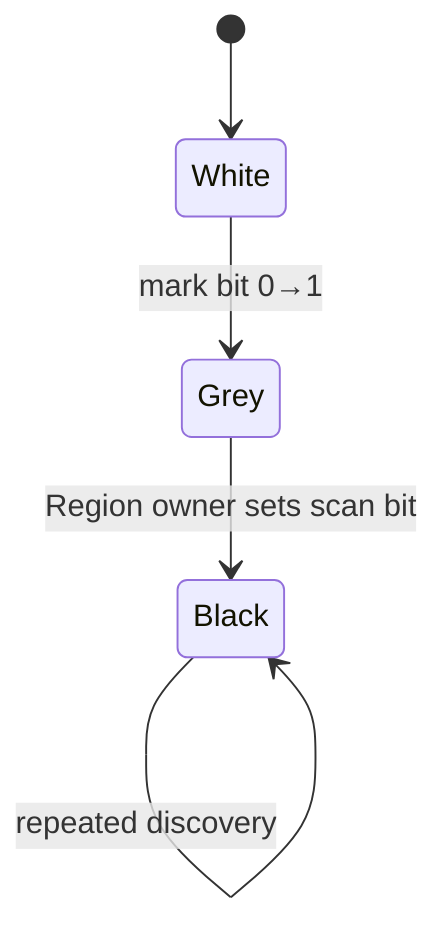

# Cangjie MSGC GC Mark 架构与实现详解

> 当前代码基线：`MSGC-bugfix-regionScan` / `24ca097ace`。本文描述当前 Region-scan Mark；对象 WorkBuf 模型已经移除。

## 1. Mark 的数据模型

当前实现不再把“灰对象”主要表示成对象地址队列。小对象的三色状态直接落在两套位图中：

| Mark bit | Scan bit | 语义 |
|---:|---:|---|
| 0 | 0 | 未发现 |
| 1 | 0 | 已发现、待扫描 |
| 1 | 1 | 已扫描 |

对 `HAS_REF` 小对象 Region，待扫描集合是 `mark & ~scan`。`pendingWordSummary` 再把
“哪些 bitmap word 可能出现新差集”压缩成至多 64 bit 的 Region 级摘要。



Large object 不走这套对象位图状态，而由 Region `control` 中的 large-marked flag 与
单独 `OBJECT` task 表达。

## 2. 核心结构

### 2.1 `MSMarkWordBatch`

`MSMarkWordBatch` 是栈上、无分配的 mark-word 合并缓存：

- 8 set × 2 way，共 16 entries；
- entry 为 `(regionIdx, wordIdx, mask)`，大小 16 字节；
- 相同 bitmap word 的多个 bit 先 OR 到同一 entry；
- 冲突淘汰或显式 `FlushAll()` 时执行真正 atomic OR；
- batch 固定一个 mark epoch 和 ALLOC/MARK plane base，禁止跨周期使用。

它只保存稳定坐标，不缓存 Region 的 scan class、collect-set 状态或 plane 指针；这些语义在
flush 时重新读取，避免 Region 状态变化后使用陈旧派生信息。

### 2.2 `MSRegionInfo` 的 Mark 字段

| 字段 | 用途 |
|---|---|
| `markTaskNextRegionIdx` | REGION/OBJECT ready stack 的 intrusive next |
| `collectEpoch` | 判断 Region 是否属于本轮 collect set |
| `control` | 小对象 scan state；大对象 marked flag |
| `pendingWordSummary` | 待 owner 处理的 mark-word 摘要 |
| `layout` | Region kind 与 `HAS_REF/NO_REF` scan class |

小对象 scan state：

```text
IDLE --publish--> QUEUED --claim--> OWNED --drain--> IDLE
                              \--budget expires--> QUEUED (replacement)
```

### 2.3 `MSMarkScheduler`

Scheduler 有两条 lock-free tagged ready stack：

- REGION lane：指向 `HAS_REF` 小对象 Region；
- OBJECT lane：指向首次标记的 `HAS_REF` large primary。

`MSTaskLedger` 在 task admission 前 provisional +1，取消 admission 或 task 完成时 -1。
它统计 queued + leased，避免 worker 取走最后一个 ready item 后被错误判断为“无工作”。

`MSTaskLease` 是强约束：

- active lease 析构会触发检查；
- `Complete()` 要求 local mark batch 已空；
- replacement task 必须先发布，旧 lease 才能完成。

## 3. 发现对象

### 3.1 引用解析

`AddRefToMarkBatch()` 对输入执行：

1. null/heap-range 检查；
2. 找到 canonical Region；SPAN 解析到 LARGE primary；
3. 对小对象计算 slot 与 bitmap word/bit；
4. 计入 resolved-reference WU。

### 3.2 小对象

小对象坐标加入 `MSMarkWordBatch`。flush entry 时：

```text
old = atomic_fetch_or(markWord, mask)
newBits = mask & ~old
```

只有 `newBits != 0` 才产生新发现。若 Region 为 `HAS_REF`：

1. `PublishPendingMarkWord(wordIdx)`，release 发布 summary；
2. `TryPublishRegion(info)`；
3. lane 从空变非空时通知 `markWorkEpoch_`。

对当前 collect-set Region，batch flush 会用 `~allocBitmap` 排除 free slots。collect-set
在 Mark 前已从 allocation supply 封存；本轮继续分配的 Region 位于 set 外。

### 3.3 大对象

Large primary 竞争 `AtomicTestAndSetMarked()`：

- 已经 marked：结束；
- 新 winner 且 `NO_REF`：只有存活标记；
- 新 winner 且 `HAS_REF`：`PublishObject()`。

## 4. 根枚举

`EnumRoots()` 先切换 `GC_PHASE_MS_MARK_SETUP`，然后：

```text
rootStaging_.clear()
EnumAndMarkRoots(rootStaging_.UnsafeRaw())
PublishRootStaging()
```

`rootStaging_` 是兼容 tracing/root 枚举接口的临时容器。根在此阶段被转换到 bitmap 与
scheduler；ConcurrentMark 不以它作为普通工作源。

## 5. REGION task

`RunRegionTask()` 的执行条件：

- Region kind 为 SMALL；
- scan class 为 HAS_REF；
- state 已由 scheduler claim 成 OWNED。

核心循环：

```text
summary = exchange(pendingWordSummary, 0)
for each wordIdx in summary:
    markWord = load(markBitmap[wordIdx])
    scanWord = scanBitmap[wordIdx]
    candidates = markWord & ~scanWord
    if inCollectSet:
        candidates &= ~allocBitmap[wordIdx] & validMask
    scan every candidate object's references
    scanBitmap[wordIdx] |= scanned bits
flush local MarkWordBatch
flush local WeakRef batch
```

只有 Region owner 写 scan plane。其他线程可以并发：

- 对 mark word OR 新 bit；
- 对 pending summary OR word bit；
- 在 Region 为 IDLE 时尝试发布 task。

### 5.1 owner-release race

producer 可能在 Region `OWNED` 时留下 pending bit；它不能创建第二个 owner。当前 owner
drain 后先把 state 改回 IDLE，再 acquire 检查 residual summary，并重新调用
`TryPublishRegion()`。MarkTermination 的 STW reconciliation 是最终兜底。

### 5.2 预算耗尽

若 task 已达到 slice 的 WU 预算且本次 summary 仍有残余：

1. 把 residual summary OR 回 Region；
2. `RequeueOwnedRegion()` 先发布 replacement；
3. 完成当前 lease。

因此 bounded slice 不会制造 ledger 的瞬时假零。

## 6. OBJECT task

`RunObjectTask()`：

1. 核对 LARGE/HAS_REF/marked；
2. 取 large object 与 retained `TypeInfo`；
3. 枚举字段，将 children 加入本地 mark batch；
4. 处理 WeakRef；
5. flush batch；
6. 完成 lease。

OBJECT task 不切片给 mutator Assist，避免把可能较大的单对象扫描延迟加到分配线程。

## 7. 并发参与者

| 执行者 | REGION | OBJECT | 墙钟 slice |
|---|---:|---:|---:|
| GC main | 是 | 是 | 1000 μs |
| GC helper | 是 | 是 | 500 μs |
| Mutator Assist | 是 | 否 | 50 μs |
| STW termination | 是 | 是 | 不限 |

GC main/helper 在 task kind 之间交替 preference，以免一条 lane 长期饥饿。helper target
由 outstanding task 数与 heap runway 的 pressure 计算。

## 8. Work Unit 与 pacing

当前 WU 成本常量：

```text
resolved reference = 1
mark word RMW      = 8
scan word          = 1
```

初始密度是 `1/64 WU/byte`，初始吞吐为 `32 WU/μs`，周期结束后通过 EWMA 更新。
分配线程按 `workPerByte` 累积债务，达到 512 WU 触发 Assist。

Pressure：

| heap runway | 级别 |
|---:|---|
| 无分配或 >100 ms | NORMAL |
| 20–100 ms | HIGH |
| <20 ms | CRITICAL |

pressure 会影响 helper 目标和 Assist 偿还比例，但不会改变 task/bitmap 的正确性协议。

## 9. 并发终点与 STW 闭包

ConcurrentMark 使用 policy 判断自然收敛、压力或时间预算。无论为什么结束，都必须
`QuiesceMarkWorkers()`，阻止新的 helper claim 并等待在途 worker 退出。

`MarkTermination()` 在 STW 中：

1. 收口 mutator Assist 统计；
2. 发布 finalizer/resurrection 与 deferred root；
3. reconcile 所有 `HAS_REF` 小对象 Region 的 pending 状态；
4. `DrainSchedulerUnderSTW()`，直到 ledger 为 0；
5. 断言两条 ready lane 为空；
6. 可选执行 scheduler quiescence 和 mark completeness verifier；
7. 清理 weak refs 并切到后续阶段。

核心不变量：

```text
ledger == 0
AND regionReady empty
AND objectReady empty
AND every HAS_REF Region is IDLE
AND pendingWordSummary == 0
AND markBitmap & ~scanBitmap contains no required old object
```

## 10. SATB 与 Mark 的汇合

标量 barrier：

```text
load old
AddManagedRefToMarkBatch(old)
FlushBarrierMarkBatch()
store new
```

Bulk barrier 在一个栈上 batch 中合并多个 old refs，但同样在覆盖前 flush。
Barrier、root 和 tracing child 最终都进入 `AddRefToMarkBatch()`，因此不存在三套不同的
灰对象条目语义。

## 11. 与 Sweep 的交接

Mark 完成后：

- `ComputeMarkedStats()` 从 mark bitmap 计算 true live；
- Sweep 只按 mark bitmap 判活；
- scan bitmap 不作为存活依据；
- 大对象按 large marked flag 判活；
- 更新阈值、pacer、floating-live 与下一轮调度状态。

## 12. 验证与诊断

建议检查：

| 现象 | 首查 |
|---|---|
| marked 对象未被扫描 | `pendingWordSummary`、scan state、scan plane |
| ledger 不归零 | queued/leased 是否平衡、lease 是否完成 |
| ledger 非零但 ready 为空 | owner replacement/admission 顺序 |
| reachable target 未标记 | barrier flush 顺序、child batch flush |
| collect-set 中 free slot 被标记/扫描 | sealed set、alloc plane 与 `collectEpoch` |
| large object 漏扫 | large mark winner 与 OBJECT publication |

开启 `cjMSVerifyMark` 后，runtime 会在关键 closure 点检查 stranded pending、
non-IDLE Region、未扫描对象，以及 Post-Mark 的可达边完整性。

## 13. 当前源码索引

- [`MarkSweepCollector.cpp`](../../src/Heap/MCollector/MarkSweepCollector.cpp)：
  `EnumRoots`、`AddRefToMarkBatch`、`FlushMarkWordEntry`、`RunRegionTask`、
  `RunObjectTask`、`DrainSchedulerUnderSTW`
- [`MSMarkScheduler.cpp`](../../src/Heap/MCollector/MSMarkScheduler.cpp)：
  admission、ready stack、claim/requeue
- [`MSRegionInfo.h`](../../src/Heap/MAllocator/MSRegionInfo.h)：
  scan state、pending summary、三套 bitmap plane
- [`MSMarkBatch.h`](../../src/Heap/MCollector/MSMarkBatch.h)：mark-word coalescing
- [`MSWorkUnit.h`](../../src/Heap/MCollector/MSWorkUnit.h)：WU、pressure 与 slice
- [`MSMarkBarrier.cpp`](../../src/Heap/MBarrier/MSMarkBarrier.cpp)：SATB producer

## 14. 已移除历史

旧版以 fixed-capacity WorkBuf 存对象地址，包含 mutator 私有日志、全局满块、worker
局部 partial、并发 tail drain 等生命周期。它曾引入 partial work 可见性、重复发布和
closure feedback 等复杂度。当前版本的普通小对象 work 已统一到 Region bitmap 状态，
这些旧结构不得再出现在“当前终止条件”或“当前 ABI”描述中。
