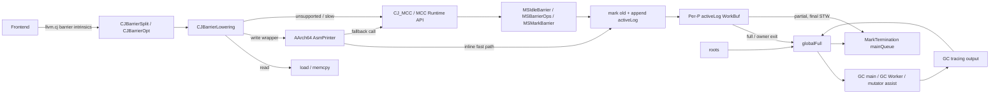
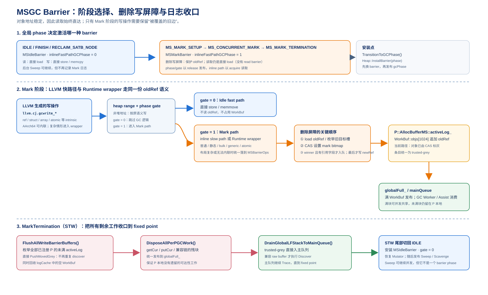
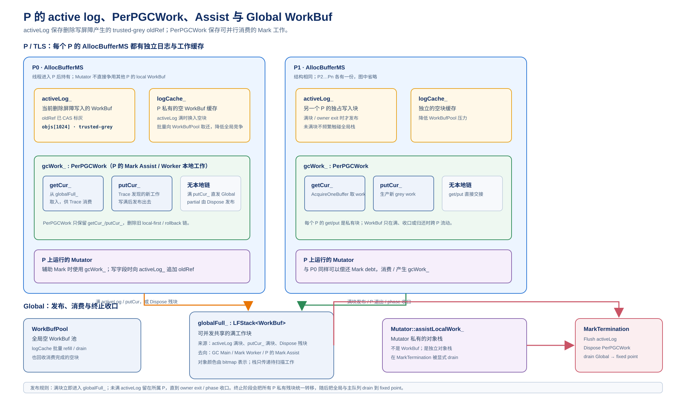

# Cangjie MSGC Barrier 架构与实现详解

> 本文以当前 Runtime 与 Cangjie LLVM 源码为最终事实来源，结合 `01_MSGC_总体架构与实现详解.md` 和 `MSGC_RESULT/Implementation` 中的设计演进，集中说明 MSGC 屏障的语义、安装、Per-P WorkBuf、全局联动、编译器优化、ABI 约束，以及与 CopyGC 的差异。

## 目录

1. 文档口径与核心结论
2. Barrier 要解决的问题与总体数据流
3. MSGC 有哪些屏障
4. 为什么 MSGC 没有读屏障
5. 屏障如何安装与切换
6. Runtime API 与 LLVM intrinsic 对应关系
7. `MSIdleBarrier` 的具体行为
8. `MSMarkBarrier` 的具体行为
9. P 的 `activeLog_` / WorkBuf 如何填充
10. publish、flush 与 `globalFull_` 联动
11. LLVM Barrier 优化管线
12. MSGC lowering 与 AArch64 内联写屏障
13. Runtime/LLVM ABI 约束
14. MSGC 与 CopyGC 对比
15. 正确性不变式、并发边界与维护规则
16. 源码索引与历史方案辨析

## 1. 文档口径与核心结论

### 1.1 分析口径

本文使用三套材料，但优先级不同：

1. **当前源码是事实基线**：Runtime 以本仓 `src/Heap/MBarrier`、`src/Heap/MCollector`、`src/Heap/MAllocator`、`src/CompilerCalls.cpp` 为准；LLVM 以 `cangjie_compiler/third_party/llvm-project` 当前代码为准。
2. **CopyGC 用独立基线对照**：Runtime 对照 `../runtime_copygc_0507`，避免把 MSGC 条件编译分支误当成 CopyGC 当前行为。
3. **文档用于解释设计演进**：`01_MSGC_总体架构与实现详解.md` 提供全局上下文，`MSGC_RESULT/Implementation` 记录每一步方案、实验和回退原因。历史文档与当前函数体不一致时，以函数体为准。

本文中的“P”沿用项目现有叫法，表示拥有 `AllocBufferMS` 的执行上下文/OS 线程本地所有者；它不是一个独立的 C++ 类型。本文中的 “wbuf” 泛指 P 的写屏障工作缓冲，当前具体实现是 `AllocBufferMS::activeLog_` 指向的 `WorkBuf`，**不是**早期的内嵌 `WriteBarrierBuffer`。

### 1.2 当前实现的十二条结论

1. MSGC Runtime 实质上只有两套常规 phase barrier：`MSIdleBarrier` 与 `MSMarkBarrier`；未知 phase 回退到保守 `stwBarrier`。
2. MSGC 是 non-moving mark-sweep，对象地址在生命周期内稳定，没有 from-space/to-space、forwarding pointer、tag 修正和读时 self-healing，因此没有 CopyGC 意义上的读屏障。
3. “没有读屏障”在编译器层表现为 `gcread_ref/weak/static` 直接 lower 成 load，struct read 直接 lower 成 `memcpy`；但 generic read 的目标若是堆 box，仍要按写屏障保护目标旧边。
4. Mark 期写屏障是 **old-only deletion/SATB barrier**：先处理将被覆盖的旧引用，再写新引用；当前实现不是早期文档中的 `shade(old) + shade(new)` hybrid barrier。
5. 当前主路线是 **Route-A**：写时先竞争 mark bit，只有 mark winner 且对象含引用字段时才把对象放入 `activeLog_`。buffer 中保存的是已置灰、待扫描的对象，而不是 raw old-ref。
6. 无引用字段的 old object 赢得 mark 后只需留下 mark bit，不进入 WorkBuf；已经 marked 的对象也不会重复入队，去重发生在生产源头。
7. `WorkBuf` 容量为 1024，`activeLog_` 是每 P 独占的当前写入 buffer；满块 O(1) 发布到 `globalFull_`，然后从 P 本地空 buffer cache/全局池换入新块。
8. `globalFull_` 是 barrier、roots、GC tracing、GC Worker 和 mutator assist 共用的 WorkBuf 交换点。类名虽为 `LFStack`，当前实现为了规避 ABA 使用 mutex 保护，并非 lock-free Treiber stack。
9. 最终 flush 在 MarkTermination 的 STW 内把每个 P 尚未发布的 partial `activeLog_` 直接送入主队列，不能重新 discover；否则对象已 marked，会被错误地当成重复项跳过扫描。
10. LLVM 在 IR 层先拆分/删除可证明冗余的 barrier，再在 CodeGen 层做 MSGC 专用 lowering；AArch64 Mach-O 最后把写 wrapper 调用展开为手写机器码快路径。
11. LLVM inline barrier 与 Runtime 强 ABI 耦合：TLS offset、`activeLog_` offset、WorkBuf 布局、Region/TypeInfo 字段、全局符号、phase 编码和引用表示必须同时更新。
12. CopyGC 与 MSGC 的差异不只是“屏障数量不同”：CopyGC barrier 还承担 tag、版本选择、forwarding 和字段修复；MSGC barrier 只围绕 non-moving concurrent mark 的旧边保存建立闭包。

### 1.3 一句话架构

```text
Frontend 生成 llvm.cj.* barrier intrinsic
  -> LLVM 证明能否删除/拆分
  -> MSGC 读变普通 load/memcpy，写变 wrapper 或 Runtime 调用
  -> AArch64 Mach-O 可在 callsite 展开 old-edge mark + activeLog append
  -> 满 WorkBuf 发布 globalFull_
  -> GC main / GC Worker / mutator assist 扫描
  -> MarkTermination STW 将所有 partial/private/global source drain 到固定点
```

## 2. Barrier 要解决的问题与总体数据流

### 2.1 它不是 CPU 内存屏障

本文的 barrier 是由编译器插入、Runtime 执行的 GC 读写辅助逻辑。它决定“字段被读写时，GC 还需要做什么”，不是 `dmb`、`atomic_thread_fence` 这类 CPU memory fence。实现内部会用 acquire/release、原子 bitmap OR 等内存序，但那是实现 GC barrier 协议的手段。

### 2.2 Mark 期间为什么必须保护旧边

并发标记时，collector 与 mutator 同时修改/观察对象图。假设根快照中有：

```text
root -> A -> B
```

GC 已看到 `A`，但还没扫描 `A.field`；此时 mutator 执行 `A.field = C`。如果直接覆盖，快照中的 `A -> B` 消失，`B` 可能既不再能从当前图到达，也没被 GC 发现，最终会被错误回收。

MSGC 用 deletion/SATB barrier 保存被删除的旧边：

```text
old = A.field
shade(old)          // old 即 B
A.field = C
```

它维护的是 snapshot-at-the-beginning 的可达性，而不是保证新图立即完全闭包。新值 `C` 不在普通写屏障中主动 shade；初始 root handshake、后续 tracing、GC 期新 Region 的 sweep-generation 隔离以及特殊对象保护共同构成当前正确性边界。

### 2.3 当前 Route-A 的颜色协议

在当前源码中：

- white：mark bit 为 0。
- grey：mark bit 已被某个线程原子置 1，且若对象含引用字段，它已经或必将进入一个待扫描 WorkBuf/队列。
- black：对象引用字段已扫描完成；源码没有为 black 单设对象头颜色位，状态由 mark bit 与工作队列位置共同表达。

写屏障不是简单“记录地址”，而是先把 old 从 white 变 grey：

```text
old
  -> address / object validity check
  -> atomic mark winner?
       no  -> 已由其他发现者负责，结束
       yes -> old 无 ref：结束
              old 有 ref：append activeLog_->objs[len++]
  -> overwrite field
```

### 2.4 端到端组件关系



### 2.5 三个容易混淆的“缓冲”

| 结构 | 所有者 | 放什么 | 何时对外可见 |
| --- | --- | --- | --- |
| `activeLog_` | 单个 P | barrier 已经置灰的 old objects | 满块、owner 退出或 final STW |
| `PerPGCWork::putCur_` | GC main/worker/assist 的一个工作上下文 | 扫描 grey object 后新发现的 grey children | 满块或 termination `Dispose()` |
| `globalFull_` | collector 全局 | roots、barrier 日志、mark 输出等已发布 WorkBuf | push 后可由多类消费者 claim |

`activeLog_` 是生产日志，`PerPGCWork` 是扫描过程的 get/put 工作区，`globalFull_` 是共享交换点；三者不能因为都存 `WorkBuf*` 就视为同一种生命周期。

## 3. MSGC 有哪些屏障

“有哪些屏障”有两种回答口径：Runtime 按 GC phase 安装的屏障对象，以及 LLVM IR 中按操作种类表达的 barrier intrinsic。两者不能混为一个枚举。

### 3.1 Runtime phase barrier

| 屏障 | 安装阶段 | 读语义 | 写语义 | 主要目的 |
| --- | --- | --- | --- | --- |
| `MSIdleBarrier` | `IDLE`、`FINISH`、`RECLAIM_SATB_NODE` | direct load / memcpy | direct store / memcpy / memmove | 非 Mark 阶段不付 GC 可达性维护成本 |
| `MSMarkBarrier` | `MS_MARK_SETUP`、`MS_CONCURRENT_MARK`、`MS_MARK_TERMINATION` | 仍是 direct load / memcpy | old-only deletion barrier | 并发标记期保存被覆盖旧边 |
| `stwBarrier` | 未审计/未知 phase 的保守 fallback | 基类语义 | 基类语义 | 防止未知 phase 静默当成 Idle；不是 MSGC 主流程常规第三套屏障 |

`MSMarkBarrier` 继承 `Barrier`，但普通引用/struct/static/array 写入口在 `MRT_USE_MARK_SWEEP` 下已经直接调用共享的 `MSBarrierOps`，避免慢路径虚分派；`MSMarkBarrier` 对应虚方法也转调同一实现。原子操作、读操作及部分 generic 路径仍会经过 `Heap::GetBarrier()`，所以 `currentBarrier` 仍有实际作用。

### 3.2 LLVM IR 中的操作类型

IR 不是只区分“读/写”两个调用，而是保留足以表达对象布局和覆盖范围的操作：

| 类别 | 代表 intrinsic | 语义重点 |
| --- | --- | --- |
| 普通引用写 | `cj_gcwrite_ref` | `value, baseObj, fieldPtr` |
| struct 写 | `cj_gcwrite_struct` | 目标对象、目标地址、源地址、字节数 |
| static 写 | `cj_gcwrite_static_ref/struct` | static slot 是 root，没有 heap container |
| 引用/struct 读 | `cj_gcread_ref/weakref/struct/static_*` | CopyGC 可能修正版本；MSGC 可消除 |
| 数组拷贝 | `cj_array_copy_ref/struct/generic` | 目标范围可能覆盖多个引用且允许重叠 |
| 原子引用 | `cj_atomic_store/load/swap/compare_swap` | 必须保留调用者要求的 atomic memory order |
| 泛型 | `cj_gcwrite_generic`、`cj_gcread_generic`、`cj_assign_generic` | 引用布局和 box payload 可能到运行时才确定 |

这些 intrinsic 先经过 `CJBarrierSplit`/`CJBarrierOpt`，最后才由 `CJBarrierLowering` 映射为直接内存操作、MSGC wrapper 或 Runtime API。

### 3.3 按“作用”重新分类

如果按功能而不是类名分类，当前屏障可以归纳成四组：

1. **删除屏障**：Mark 期对普通/static/struct/array/generic/atomic 写保存 old edge。
2. **空操作式读屏障**：IR/API 形态仍可能存在，但 MSGC Runtime 仅 direct load/memcpy，LLVM 尽量完全消除调用。
3. **phase gate**：`inlineFastPathGCPhase` 决定应用 image 中的内联写操作走 StoreOnly 还是 Mark 路径。
4. **root/safepoint 协议**：它不属于字段读写 barrier，但与 barrier 一起建立快照闭包；缺少 root handshake，仅有 old-edge barrier 仍不完整。

## 4. 为什么 MSGC 没有读屏障

### 4.1 CopyGC 为什么必须有读屏障

CopyGC 会把对象从 from-space 搬到 to-space，并用 tagged/current/old pointer 表示引用所处版本。字段读取可能读到：

- 未带 tag、可直接使用的引用；
- 指向旧版本的 tagged 引用，需要查找 to-version；
- 指向当前待搬对象的引用，需要协助 forwarding；
- 可以原地去 tag 或更新字段的引用，需要 self-healing。

因此 CopyGC 的 `IdleBarrier` 也不能简单假设所有字段都已规范化；`EnumBarrier`、`TraceBarrier`、`PostTraceBarrier`、`PreforwardBarrier`、`ForwardBarrier` 又按阶段决定能否更新、去 tag、查找或触发转发。

### 4.2 MSGC 缺少这些前提

MSGC 不搬对象。一个对象从分配到回收期间地址不变，mark/sweep 只修改 bitmap、Region 元数据和空闲槽状态，不创建对象的第二个版本。因此：

- 没有 from/to version 选择；
- 没有 forwarding pointer；
- 没有因 GC 搬迁产生的 tagged ref；
- 没有读时修复 container field 的必要；
- 不需要读操作协助搬迁。

这一点也体现在 `MarkSweepCollector` 接口实现上：`ForwardObject()` 返回空，`TryUpdateRefField()`、`TryForwardRefField()`、`TryUntagRefField()` 返回 false，`IsOldPointer()` 恒 false，`IsCurrentPointer()` 恒 true。MSGC 自己的 barrier 不调用这些 CopyGC 协议。

### 4.3 Runtime 和 LLVM 分别如何“没有读屏障”

Runtime 两套 MS barrier 的读行为一致：

| 读操作 | MSGC Runtime 行为 |
| --- | --- |
| 普通/static/weak ref | `MSLoadRawReference(field)`，保留完整 64 位 |
| struct/static struct | `memcpy_s(dst, src, size)` |
| atomic read | 按请求 memory order 读取完整 field value，再转为目标对象 |

LLVM 默认开启 `EnableMSGCReadBarrierLowering`：

| intrinsic | lowering 结果 |
| --- | --- |
| `gcread_ref` / `gcread_weakref` / `gcread_static_ref` | 普通 IR `load` |
| `gcread_struct` / `gcread_static_struct` | `llvm.memcpy` |
| `gcread_generic` | 读取源无需 barrier，但结果写入目标 box payload；若目标是堆对象，转成 struct-write 路径保护目标旧边 |

所以常见 MSGC 程序的字段读取不仅 Runtime 语义是“直接读”，编译后的热路径中也没有 Runtime read-barrier call。

### 4.4 WeakRef 为什么也能直接读

weak reference 的“弱”不靠读时搬迁修正实现。MSGC 在 mark 流程中识别 WeakRef，并把需要主线程处理的对象放入 deferred 队列；MarkTermination/弱引用处理阶段在稳定的标记结果上决定 referent 是否清理。读操作本身无需改变对象版本，因此 `ReadWeakRef` 也可以直接返回字段值。

这里应区分语义层次：直接读取不承诺 referent 永远存活，它只表示 GC 不需要在这次 load 上做 forwarding/self-healing；弱引用的生命周期规则仍由 collector 的 weak processing 保证。

### 4.5 无读屏障不等于无 safepoint

MSGC 仍必须精确找到线程栈和寄存器中的根，并在 EnumRoots、MarkTermination 等阶段让 mutator 协作停顿。因此下列机制仍然保留：

- `PlaceSafepoints` 插入或整理 safepoint poll；
- `CJRewriteStatepoint` 显式化 safepoint 处活跃 GC 引用；
- CodeGen/AsmPrinter 输出 Cangjie stack map；
- mutator phase transition 使用 stack map 枚举根。

读屏障解决“读到被移动/编码的引用怎么办”；safepoint/statepoint 解决“GC 在什么位置、以什么元数据安全观察线程”。两者职责独立。

## 5. 屏障如何安装与切换

### 5.1 phase 到屏障的映射

不同 GC phase 只切换写屏障语义，读取仍保持普通 load/解码。下图把 phase、写入路径、P 的 `activeLog_` 和最终 flush 的关系放在一起。



> 图 6-1：Idle/Mark/Termination 等阶段对应的 barrier 行为与 WorkBuf 发布窗口。

`HeapImpl` 初始化时持有 `msIdleBarrier`、`msMarkBarrier` 和共享的 `stwBarrier`，`currentBarrier` 初始指向 `msIdleBarrier`。每次 phase transition 调用 `HeapImpl::InstallBarrier(phase)`：

```text
IDLE / FINISH / RECLAIM_SATB_NODE
    currentBarrier = &msIdleBarrier
    release_store(inlineFastPathGCPhase, 0)

MS_MARK_SETUP / MS_CONCURRENT_MARK / MS_MARK_TERMINATION
    currentBarrier = &msMarkBarrier
    release_store(inlineFastPathGCPhase, 1)

other
    currentBarrier = &stwBarrier
    release_store(inlineFastPathGCPhase, 1)
```

`Heap::GetBarrier()` 通过 `Heap::currentBarrierPtr` 取得当前虚屏障。进程内已经编译进应用代码的 AArch64 inline barrier 无法读取这个 C++ 指针，因此另有稳定的 1 字节全局 gate `Heap::inlineFastPathGCPhase`。

### 5.2 phase transition 的实际顺序

普通 transition 和 light/STW transition 都遵循同一核心顺序：

1. 在 mutator management 同步范围内调用 `InstallBarrier(phase)`。
2. 调用 `SetGCPhase(phase)` 发布 collector 全局 phase。
3. 给所有 mutator 设置 phase suspension/safepoint 标志。
4. mutator 自己或 GC/Enum Assist 在 safepoint 完成 `TransitionGCPhase()`。
5. `EnsurePhaseTransition()` 等待所有目标 mutator 完成。

即先让新 barrier 可用，再让线程观察并进入新 phase，避免出现“线程已按新 phase 运行，但相应 barrier 尚未安装”的窗口。

### 5.3 release/acquire 为什么存在

Runtime 在设置 `currentBarrier` 后，用 release store 发布 gate；AArch64 AsmPrinter 展开的代码用 `LDARB` acquire load 读取 gate：

```text
Runtime: currentBarrier = mark
         release_store(gate, 1)

Application inline code:
         phase = acquire_load(gate)
         phase == 0 ? store-only : mark-barrier
```

这保证观察到 `gate == 1` 的 inline path 不会越过 Runtime 对 barrier-installed state 的发布。`currentBarrier` 本身不是让应用 image 直接解引用的 ABI；全局 gate 才是跨 image 的快速路径契约。

### 5.4 三层状态不能互相替代

| 状态 | 消费者 | 作用 |
| --- | --- | --- |
| `currentBarrier` | Runtime 虚调用 | 选择 Idle/Mark 的 read、atomic、generic 等行为 |
| `inlineFastPathGCPhase` | AArch64 Mach-O 内联写屏障 | 选择 StoreOnly 或 Route-A Mark 快路径 |
| mutator phase/TLS | safepoint、root enum、线程重入等 | 协调线程何时完成 GC phase handshake |
| `MarkSweepCollector::activeCollector_` | `MSBarrierOps`、mark assist | 判断当前是否存在可接收 mark/barrier work 的 collector |

`activeCollector_` 不是 phase gate。当前源码在 `PreEnumRoots()` 开始发布它，在 MarkTermination 已经冻结所有 mutator 后清空；它允许 Runtime slow path 和 assist 定位 collector。普通编译器 inline path 仍以 `inlineFastPathGCPhase` 为准。

### 5.5 MarkTermination 如何关闭窗口

MarkTermination 创建带 `MS_MARK_TERMINATION` phase 的 `ScopedStopTheWorld`，所有 mutator 停止后清空 `activeCollector_`，再收集所有 barrier/private/global work。固定点完成后，它在**仍处于 STW**时恢复 `IDLE`：

```text
freeze mutators
  -> activeCollector = null
  -> flush/drain to fixed point
  -> InstallBarrier(IDLE): Idle + gate 0
  -> resume mutators
```

因此 mutator 不会在“最后一次 drain 已完成”之后又以 Mark barrier 发布一批无人处理的 work；恢复执行时已统一观察 Idle 语义。并发 Sweep 是否仍在执行由 CentralRegionPool 的独立 Sweep epoch 跟踪。

## 6. Runtime API 与 LLVM intrinsic 对应关系

### 6.1 主要映射表

`CJBarrierLowering.cpp::IntrinsicMap` 给出最终 Runtime 名称；部分 `CJ_MCC_*` 在 `CommonAlias.h` 中直接 alias 到 `MCC_*` 实现体。

| LLVM intrinsic | Runtime API | 参数要点 | MSGC 常见结果 |
| --- | --- | --- | --- |
| `cj_gcwrite_ref` | `CJ_MCC_WriteRefField` | `(newRef, baseObj, field)` | AArch64 wrapper/inline，否则 `MSBarrierOps::WriteReference` |
| `cj_gcwrite_struct` | `CJ_MCC_WriteStructField` | `(obj, dst, dstLen, src, srcLen)` | struct wrapper/Runtime bulk barrier |
| `cj_gcwrite_static_ref` | `CJ_MCC_WriteStaticRef` | `(newRef, field)` | static ref wrapper/Runtime |
| `cj_gcwrite_static_struct` | `CJ_MCC_WriteStaticStruct` | `(dst, dstLen, src, srcLen, gctib)` | static struct wrapper/Runtime |
| `cj_gcread_ref` | `CJ_MCC_ReadRefField` | `(obj, field)` | direct load |
| `cj_gcread_weakref` | `CJ_MCC_ReadWeakRef` | `(obj, field)` | direct load |
| `cj_gcread_struct` | `CJ_MCC_ReadStructField` | `(dst, obj, src, size)` | `memcpy` |
| `cj_gcread_static_ref/struct` | `CJ_MCC_ReadStaticRef/Struct` | static slot/GCTib | direct load/`memcpy` |
| `cj_array_copy_ref` | `CJ_MCC_ArrayCopyRef` | `(dstObj,dst,size,srcObj,src,size)` | Idle inline `memmove`，Mark Runtime bulk |
| `cj_array_copy_struct` | `CJ_MCC_ArrayCopyStruct` | 同上 | Idle inline `memmove`，Mark Runtime bulk |
| `cj_atomic_store/load/swap/compare_swap` | `CJ_MCC_Atomic*Reference` | 显式 memory order | Runtime 当前虚屏障 |
| `cj_gcwrite_generic` | `CJ_MCC_WriteGeneric` | `(obj, field, srcBox, size)` | AArch64 改写成 struct-write wrapper |
| `cj_gcread_generic` | `CJ_MCC_ReadGeneric` | `(dstBox,obj,field,size)` | 目标为堆 box 时按 struct write |
| `cj_assign_generic` | `CJ_MCC_AssignGeneric` | `(dst,src,typeInfo)` | 按 `HasRefField` 分流 |

### 6.2 普通写为什么不完全依赖虚屏障

当前 `CompilerCalls.cpp` 的 MSGC 条件编译分支为：

```text
MCC_WriteRefField       -> MSBarrierOps::WriteReference
MCC_WriteStructField    -> MSBarrierOps::WriteStruct
MCC_WriteStaticRef      -> MSBarrierOps::WriteStaticRef
MCC_WriteStaticStruct   -> MSBarrierOps::WriteStaticStruct
CJ_MCC_ArrayCopyRef     -> MSBarrierOps::CopyRefArray
CJ_MCC_ArrayCopyStruct  -> MSBarrierOps::CopyStructArray
```

`MSBarrierOps` 内部读取 `activeCollector_`：不在 Mark 时 enqueue 是 no-op，最终效果等价于 `MSIdleBarrier`；Mark 激活时执行 Route-A。这一实现缩短了 wrapper slow path，但也意味着分析屏障安装不能只盯着 `currentBarrier` 的虚分派。

### 6.3 入口级 heap precheck

普通对象字段写在 API 层先检查 container `obj`：不在 heap 中时直接 store/memcpy，因为这个 container 不属于 GC 扫描对象，不存在需要 SATB 保存的 heap edge。static slot 没有 container，但它是全局 root，所以 static API 不能用同一 precheck 跳过屏障。

### 6.4 参数顺序是 ABI 的一部分

AArch64 inline emitter 直接按 AAPCS64 参数寄存器解释 wrapper：例如普通 ref 写中 `X0=newRef`、`X1=obj`、`X2=field`；static ref 中 `X0=newRef`、`X1=field`。struct/static/arraycopy 也按固定参数位置重排给 `memcpy/memmove`。

wrapper 必须复制 Runtime callee 的 `FunctionType` 和 calling convention；若调整 Runtime API 的参数顺序、宽度或地址空间而未同步 LLVM，代码可能仍能生成和链接，却在运行时读错寄存器。

## 7. `MSIdleBarrier` 的具体行为

`MSIdleBarrier` 用于 GC idle、mark 后的 sweep 以及兼容 finish/reclaim phase。它的设计目标是：没有并发标记快照需要维护时，字段访问不产生 mark/log 工作。

### 7.1 读操作

- `ReadReference`、`ReadStaticRef`、`ReadWeakRef`：通过 `MSLoadRawReference` 直接读取完整 64 位引用。
- `ReadStruct`、`ReadStaticStruct`：直接 `memcpy_s`；GCTib 参数不参与 ref 修正。
- `AtomicReadReference`：按传入 memory order 读取原子 field，再解码为目标对象。

这里没有 tag 检查、to-version 查找或 CAS self-healing。若代码仍走 Runtime API，只付一次普通函数/虚调用开销；LLVM lowering 后通常连调用也不存在。

### 7.2 写操作

- `WriteReference`、`WriteStaticRef`：通过 `MSStoreRawReference` 直接写完整 64 位引用。
- `WriteStruct`、`WriteStaticStruct`：直接 `memcpy_s`。
- `CopyRefArray`、`CopyStructArray`：直接 `memmove_s`，允许源/目标范围重叠。

TSAN 构建还会报告对应读写内存范围，但这不改变 GC 语义。

### 7.3 原子操作

- atomic store：按请求 order 写入。
- atomic swap：执行 exchange，直接返回交换出的引用。
- CAS：按 success/failure order 直接 compare-exchange。

Idle 原子操作不额外读取或保存 old edge，因为此时没有正在建立的 SATB snapshot。

### 7.4 为什么 Sweep 阶段仍能使用 Idle barrier

Sweep 与 mutator 并发不意味着还要保存引用图。MarkTermination 已经得到稳定 mark bitmap，Sweep 只回收当前 sweep generation 中未标记的旧槽；下一轮 mark 前会停止并封闭旧 Sweep，再清 bitmap/翻 generation。GC 周期中获得的新 Region/新槽由 generation 隔离，不会靠 Sweep 期写屏障重新标记。

因此 Sweep 的并发安全依赖 Region/generation/claim 协议，而不是继续维持 Mark barrier。

## 8. `MSMarkBarrier` 的具体行为

### 8.1 普通引用与 static 引用

普通字段写和 static 字段写遵循同一顺序：

```cpp
oldRef = MSLoadRawReference(field);
if (oldRef != newRef) {
    EnqueueRefFast(oldRef);   // 内部执行 shade-at-write
}
MSStoreRawReference(field, newRef);
```

`old == new` 时没有删除边，直接 store-only；`old == null` 会在 `EnqueueRefFast` 入口被过滤。普通字段的 `obj` 主要用于 API heap precheck，当前 `MSBarrierOps::WriteReference` 本体不扫描 container，也不 shade new value。

static slot 是 root，没有 heap container；它仍必须保存被覆盖的旧 root edge。

### 8.2 `EnqueueRefFast` 到 Route-A mark winner

slow path 的层次为：

```text
EnqueueRefFast(old)
  -> old == null / non-heap：return
  -> acquire_load(activeCollector_) == null：return
  -> 取 TLS AllocBufferMS；缺失时冷创建
  -> EnqueueRefInto(collector, allocBuf, old)
       -> ShadeRefForBarrier(old)
       -> already marked / invalid：return
       -> newly marked + no ref fields：return
       -> newly marked + HasRefField：AppendMarkedRefInto(activeLog_)
```

`ShadeRefForBarrier` 对 small object 竞争 `MSRegionInfo::markBitmap`，对 large object 使用对应 large mark flag。`ShouldEnqueueMSMarkedObject` 把“是否新标记”和“是否需要扫描 children”合成入队决策。

这就是当前 Route-A 与历史 Route-B 的根本区别：**mark 发生在写线程，WorkBuf 只承载已经 grey 的、确实需要扫描的对象**。

### 8.3 struct 写

`WriteStruct(obj, dst, dstLen, src, srcLen)` 必须先枚举目标 `dst` 范围内将被覆盖的旧 ref，再执行 `memcpy_s`：

```text
obj.ForEachRefInStruct(dst .. dst+dstLen)
  -> shade each old ref
memcpy(dst, src)
```

重点是扫描 destination old contents，不是 source new contents。若先 memcpy 再扫描，得到的已是新引用，原快照旧边已经丢失。

### 8.4 static struct 写

static struct 没有对象 TypeInfo 可从 container 取得，因此调用者提供 GCTib。Runtime 用 `gctib.ForEachBitmapWord(dst, ...)` 找到目标 static 区的旧 ref，全部处理后再 `memcpy_s`。

### 8.5 ref array 与 struct array copy

- `CopyRefArray`：按 `dstSize / sizeof(MAddress)` 解释目标引用槽，先处理所有旧 ref，再 `memmove_s`。
- `CopyStructArray`：只对 `min(dstSize, srcSize)` 的完整覆盖区枚举目标数组旧 ref；raw array 通过 component TypeInfo 判断 struct/ref 布局，再 `memmove_s`。

这里使用 `memmove` 是因为数组 copy 允许重叠。Mark phase 的 AArch64 arraycopy wrapper会回退到这条 Runtime bulk 路径，避免在 emitter 中维护复杂的重叠、元素边界和 mark-winner 协议。

### 8.6 `BulkRefMarker` 如何减少开销

bulk 操作不是为每个 ref 都重新取 TLS/collector：`ResolveBulkLogOwner()` 每次调用只解析一次 owner。`BulkRefMarker` 再用两个固定 entry 按 `(MSRegionInfo*, bitmapWordIndex)` 聚合 candidate：

1. 同一 bitmap word 的多个 ref 合成一个 bit mask。
2. `MarkBitmapWord(wordIdx, mask)` 一次 atomic OR。
3. 返回值 `newBits` 只保留本次从 0 变 1 的 bit。
4. 只把 `newBits` 对应且 `HasRefField()` 的对象追加到 `activeLog_`。
5. large、无法解析的小对象描述符等情况回退到逐对象 `ShadeRefForBarrier()`。

优化减少的是 TLS/Region 解析和 atomic RMW 次数，不改变“mark winner 才入队”的语义。

### 8.7 Generic 读写

Runtime `Barrier::WriteGeneric` 先看 source/destination 是否是 heap object：

- 目标对象无有效 TypeInfo或无引用字段，或两边均非 heap：直接复制 box payload。
- dst 非 heap、src 在 heap：走 `ReadStruct`；MSGC 中仍等价于复制。
- dst 在 heap：走 `WriteStruct`，先保护目标旧 ref，再复制 `src + 8` payload。

`ReadGeneric` 的源读取不需要 MSGC 读屏障，但目标 box 若在 heap 中，写入 box payload 会覆盖旧引用，所以必须转入 `WriteStruct`。LLVM 也采用同样原则，不能把所有 generic read/write 无条件变成裸 `memcpy`。

### 8.8 原子 barrier

| 操作 | Mark 期行为 |
| --- | --- |
| atomic load | 按传入 order 读取，直接返回 |
| atomic store | relaxed load old → shade old → 按传入 order store new |
| atomic swap | exchange 得到实际 old → shade old → 返回 old |
| CAS | 先执行 CAS；只有成功才 shade expected old |

swap 能得到真正被交换出的引用，CAS 只在成功删除边时记录。atomic store 是“load + store”而不是一个 RMW；多个 writer 并发写同一字段时，预读 old 未必就是本次 store 最终覆盖的值，这是当前实现需要并发线性化测试持续验证的边界。

### 8.9 各类写操作的统一原则

无论 ref、static、struct、array、generic 还是 atomic，正确顺序都应能还原成：

```text
identify the exact old edge(s)
  -> shade/mark old before loss
  -> enqueue only mark winners that need scanning
  -> commit store/copy
```

任何优化如果变成“先覆盖，再尝试从目标读取旧值”，或“mark 成功后可能因 buffer 满而放弃 enqueue”，都会破坏核心协议。

## 9. P 的 `activeLog_` / WorkBuf 如何填充

下图集中表示 P 的 `activeLog_`、本地 `logCache_`、WorkBufPool、`globalFull_` 和 Mark/Assist 消费者之间的关系。它对应本章 9、10 节的 Runtime slow path 与最终 STW flush。



> 图 6-2：写屏障产生的 old-ref work 如何从 P-local buffer 进入全局队列并被 GC/Assist 消费。

### 9.1 当前 wbuf 到底是什么

当前每个 P 的 barrier log 不再是内嵌数组，而是：

```cpp
AllocBufferMS::activeLog_  // WorkBuf*，固定在 AllocBufferMS + 896
```

`WorkBuf` 的关键布局为：

| 字段 | offset | 当前值/含义 |
| --- | ---: | --- |
| `next` | 0 | 进入 stack/list/cache 后的链指针 |
| `len` | 8 | 当前有效对象数 |
| `objs` | 16 | `BaseObject* objs[1024]` |
| alignment | 64 B | 避免节点头部跨常见 cache line |

`activeLog_` 的 offset、`len/objs` 的 offset 和容量都被 AArch64 inline emitter 硬编码，Runtime 在 `MSAllocBuffer.cpp` 用 `static_assert` 钉住其中四项。

### 9.2 为什么放在 `AllocBufferMS` 上

`AllocBufferMS` 已经是分配和 assist 的 P-local owner，把 barrier log 放在这里有三个直接效果：

1. 正常 append 是单写者访问，`len` 和 `objs[len]` 不需要共享原子递增。
2. AArch64 可从 `X28` 指向的 CJTLS 取 `msAllocBuffer`，再以固定 offset 取 `activeLog_`。
3. collector 能通过 `CentralRegionPool` 注册表在 MarkTermination 遍历全部仍存活的 `AllocBufferMS`，统一收口 partial log。

这个所有权假设很重要：不能让两个正在运行的 P 同时 append 同一个 `activeLog_`。全局共享发生在 buffer publish 之后，而不是逐条 append 时。

### 9.3 首次使用与空 buffer cache

`activeLog_` 按需创建。Runtime `EnsureActiveLog(ab)` 在指针为空时调用 `ab.AcquireWorkBuf(workBufPool_)`：

1. 先从 P 自己的 `logCache_` 单链表取空 WorkBuf，不加全局锁。
2. 本地 miss 时从 `WorkBufPool` 批量取得 8 个。
3. 第一个成为 active，其余放入 `logCache_`。
4. 本地 cache high-water 为 16；周期结束或 owner 退出时全部归还全局池。

批量 refill 的目的不是改变 barrier 语义，而是让连续满块换新大多只操作 P-local 指针，减少访问 `WorkBufPool` 的 mutex。

### 9.4 Runtime slow path 如何填充

单个 old ref 的填充顺序是：

```text
shade(old)
  -> winner && HasRefField
       -> EnsureActiveLog
       -> activeLog full ? PublishAndSwapLog : keep
       -> activeLog->objs[activeLog->len++] = old
```

bulk path 会先批量得到 bitmap `newBits`，再对每个 winner 调用同一个 `AppendMarkedRefInto()`。所以 `len` 统计的是“需要扫描的 mark winner 数”，不是写操作次数，也不是被覆盖引用总数。

下列 old ref 不会占用槽：

- null；
- 非 heap；
- 地址/对象状态无法安全 trace；
- mark bit 已经为 1；
- 本次赢得 mark 但对象没有引用字段。

### 9.5 AArch64 inline path 如何填充

ref/static-ref inline path 在 mark CAS **之前**完成以下检查：

1. `activeLog_` 指针存在；否则 slow。
2. `len < 1024`；否则 slow。
3. old ref 的 heap/Region/object 描述符有效。

随后才原子设置 small mark bit或 large marked flag。winner 且 `HasRefField` 时直接：

```text
objs[len] = old
len = len + 1
store new
```

这里“先确认槽位，再竞争 mark”是硬正确性要求。若先赢得 mark，之后才发现 buffer 已满并跳 slow，slow path会看到对象已 marked 而不再 enqueue，唯一 grey work 就会丢失。

Runtime C++ 路径则在 winner 后同步 `EnsureActiveLog/PublishAndSwapLog`，负责保证有可写新块；inline 遇到任何需要分配、换块或复杂验证的情形都回 wrapper。

### 9.6 WorkBuf 中为什么只放 `HasRefField` 对象

mark bit 决定对象本身能否被 sweep 回收；WorkBuf 的职责是安排后续扫描 children。leaf object 没有 children，mark 成功后已经完成全部可达性工作，入队只会增加 buffer、全局同步和 consumer 分支成本。

因此：

```text
newly marked leaf     -> mark bit only
newly marked ref obj  -> mark bit + WorkBuf
already marked object -> neither
```

## 10. publish、flush 与 `globalFull_` 联动

### 10.1 满块 publish：`PublishAndSwapLog`

`activeLog_` 满时，当前实现不在线性扫描 buffer，也不再次 discover：

```text
full = activeLog_
globalFull_.Push(full)
record OVERFLOW_FLUSH stats
activeLog_ = AcquireWorkBuf(pool)
```

这是 O(1) 的 swap-and-publish。统计枚举仍叫 `OVERFLOW_FLUSH`，但它已不是早期 `FlushWriteBarrierOverflow()` 那种“遍历 raw log、逐项 discover、重新打包”的重 flush。

### 10.2 owner 退出：`PublishExitedLog`

`AllocBufferMS::Fini()` 若发现 active collector：

- 非空 partial `activeLog_` 直接以 trusted-grey 语义 push `globalFull_`；
- 空 active log 直接还池；
- owner 的 `PerPGCWork` 执行 `Dispose()`，把残余 get/put work 发布全局；
- P 本地空 WorkBuf cache 全部还池；
- 最后从 `CentralRegionPool` 的 AllocBuffer 注册表移除。

退出路径不能把 partial 留在 owner 内部，因为 owner 消失后不会再有人填满或在 final STW 访问它。

### 10.3 最终 STW flush：`FlushAllWriteBarrierBuffers`

MarkTermination 已冻结 mutator并清空 `activeCollector_` 后，遍历所有注册 `AllocBufferMS`：

1. 取尚未发布的 partial `activeLog_`。
2. 对条目做 null/traceable/valid 防御检查。
3. 直接 `mainQueue.PushMovedGrey(obj)`。
4. WorkBuf 归还 pool，`activeLog_ = nullptr`。
5. 清空 owner 的本地 log cache。

关键点是第 3 步不能改成 `DiscoverObject(obj)`。这些条目在 barrier 写时已赢得 mark CAS；重新 discover 会得到“already marked”，如果据此不入队，它们的 children 将永远不被扫描。

### 10.4 `globalFull_` 为什么是全局联动中心

下列生产者都向同一个 `globalFull_` 发布 WorkBuf：

- 根集合打包；
- 满 `activeLog_` 和退出 owner 的 partial log；
- GC main/GC Worker/mutator assist 扫描对象后产生的 full `putCur_`；
- MarkTermination `DisposeAllPerPGCWork()` 产生的 residual buffers。

消费者包括：

- GC main lane；
- MARK epoch 的 GC Worker；
- mutator Mark Assist；
- MarkTermination 主线程 drain。

这使 barrier work 不绑定原生产 P：一个 P 发布的 old object 可以由任意 GC worker 扫描，其 children 又由该 worker 的 `PerPGCWork::putCur_` 批量发布回来。

### 10.5 为什么叫 `globalFull_` 却可能有 partial

并发正常热路径主要发布 full buffer，但 owner exit、termination `Dispose()` 等路径会发布 partial。因此：

- `PopFull()` 跳过 partial，找到第一个 full buffer；用于 mutator assist“一次债务对应一个完整块”。
- `Pop()` 取得任意 buffer；用于 GC main/helper 和 termination，避免 partial 永久滞留。
- stack 同时维护 `total` 与 `fullCount`，供 backlog/worker policy 判断。

当前 `LFStack` 以 mutex 保护 top/count。WorkBuf 会激进回收复用，项目没有使用无版本号的 Treiber stack，以避免 ABA。

### 10.6 `PerPGCWork` 如何与 barrier work 汇流

消费者从 `globalFull_` 获得一个 buffer 作为 `getCur_`，逐个扫描对象。发现的新 grey child 写入自己的 `putCur_`：

```text
getCur_: consume grey objects
  -> trace ref fields
  -> mark winner child
  -> putCur_.Push(child)
  -> putCur_ full: globalFull_.Push(putCur_)
```

`PerPGCWork` 只保留 `getCur_`/`putCur_`，full `putCur_` 直接 global sharing。未满 `putCur_` 在并发尾部可暂留私有，MarkTermination 通过 `Dispose()` 统一发布，避免持续写负载下反复发布 partial、重新点燃并发闭包。

### 10.7 WorkBuf 的统一条目语义

WorkBuf 只允许保存生产端已经完成 mark-CAS 的 trusted-grey。Runtime barrier、AArch64 inline barrier、root 枚举与对象图遍历都遵守这一约束；消费者直接扫描字段，不再维护 raw old-ref 的延迟 discover 分支。

### 10.8 MarkTermination 固定点

一次收口不是只 drain 一次 global stack，而是反复执行：

```text
FlushAllWriteBarrierBuffers(mainQueue)
DisposeAllPerPGCWork()
DrainGlobalLFStackToMainQueue(mainQueue)
DrainDeferredMainThreadQueueToMainQueue(mainQueue)
  -> ExecuteLikeDrainMainQueue(mainQueue)
  -> 再检查全部外部 source
  -> 直到 mainQueue 及迟到 source 都为空
```

finalizer/resurrection candidate 也会在这个稳定窗口并入。固定点完成后才验证 mark completeness、重置所有 P 的 GC work，并在 STW 内恢复 `IDLE`/Idle barrier。

### 10.9 flush 日志如何读

`WriteBarrierFlush: forwarded=... (overflow=..., exit=..., final=...), raw=...` 中，当前 Route-A 的 overflow/exit publish 已是 trusted-grey 直接转发，`raw` 更接近各来源看到的输入条目数，不再意味着“有多少 raw ref 等待 discover”。`MarkTermination total: flushed=...` 还包含 barrier、per-P、global、deferred 等所有 pending source，不应当作纯写屏障条目数。

## 11. LLVM Barrier 优化管线

### 11.1 当前主要 Pass 顺序

新 Pass Manager 的 Cangjie pipeline 主要顺序为：

```text
CJFillMetadata
  -> CJRuntimeLowering
  -> CJBarrierSplit                # enable-cj-barrier-split，默认 true
  -> 常规 LLVM 优化 / CJSpecificOpt
  -> PlaceSafepoints
  -> CJBarrierOpt
  -> CJRewriteStatepoint
  -> CodeGen: CJBarrierLowering
  -> ISel / AArch64 AsmPrinter
```

LTO backend 也显式加入 `CJRuntimeLowering -> CJBarrierSplit -> ... -> PlaceSafepoints -> CJBarrierOpt -> CJRewriteStatepoint`。旧 legacy PM 的常规 pipeline 没有在相同位置显式加入 `CJBarrierOpt`，因此分析某个 SDK 的命中情况时还应确认实际使用的 PM/LTO 路径，不能只看 pass 源文件存在。

### 11.2 `CJBarrierSplit`：缩小 barrier 覆盖面

对 constant-size 的 struct/static struct 读写，`CJBarrierSplit` 根据静态类型布局找到引用字段位置：

- write 从 source 类型布局找 ref 位置；
- read 从 destination 类型布局找 ref 位置；
- ref slot 生成细粒度 `gcread_ref/gcwrite_ref`；
- ref 之间的非引用连续字节生成 `memcpy`；
- 当前只拆 1、2、3 个引用的形态，超过 3 个保留原 bulk barrier；
- 实现按 8 字节指针槽推进，这是 64 位数据布局假设。

拆分的收益是让后续优化能单独证明某个 ref 写不需要 barrier，并让 `{ref, scalar...}` 小 struct 不必总走通用 GCTib bulk 路径。

### 11.3 `CJBarrierOpt`：删除与校验

`CJBarrierOpt` 兼具 optimizer 和 verifier 角色，当前主要做：

1. **栈 barrier 消除**：目标可证明是 `alloca` 时，用普通 store/load/memcpy/memmove 替代；栈内存不属于 GC heap。
2. **无引用区间消除**：静态 struct/array 布局证明 copy 范围不含 GC ref 时，直接复制。
3. **裸写 verifier**：若普通 store/memcpy/memmove 可能向 heap/global 中写入 GC ref，且无法证明来自 stack 或无 safepoint的新对象初始化，则报 fatal “Need write barrier”。

2026-07-20 已移除后加的 one-ref struct 标量化与 fresh-init barrier 消除：
`cj_gcwrite_struct` 不再因仅含一个直接 ref field 被拆成 `gcwrite_ref + memcpy`，
fresh 新对象的首次 `gcwrite_ref/struct` 也不再因 fresh provenance 直接降为
plain store/memcpy。原有 stack/no-ref 消除和 verifier 仍保留。

### 11.4 `CJBarrierLowering`：按 GC 模型做最终分流

`CJBarrierLowering` 在 CodeGen/ISel 前执行。当前相关开关默认值均为 true：

- `EnableTaggedPointer`
- `EnableGCPhase`
- `EnableGCFastPath`
- `EnableMSGCReadBarrierLowering`
- `EnableMSGCWriteBarrierLowering`

MSGC read lowering 直接删除读调用；MSGC write lowering 只在 AArch64 创建专用 wrapper。atomic、assign generic、generic arraycopy 等未进入专用 write allowlist 的形态仍按 `IntrinsicMap` 调 Runtime。

当 AArch64 MSGC write lowering 开启时，代码显式跳过旧 `GetGCPhase/TLS` write fastpath，防止 legacy phase check提前把 wrapper 绕掉。MSGC read lowering 开启时，也不再使用 CopyGC 的 tagged-pointer read fastpath。

### 11.5 statepoint 是优化证明边界

`PlaceSafepoints` 在 `CJBarrierOpt` 之前，使 barrier optimizer 能识别对象从新分配到写入之间是否可能被 GC 观察；`CJRewriteStatepoint` 在优化后运行，把仍存活的 GC 引用和 safepoint 关系固化。最后 `CJBarrierLowering` 才消去 barrier intrinsic。

顺序的目的不是形式美观：若在尚未看见 safepoint 的阶段过度删除初始化 barrier，或在 statepoint rewrite 后随意改写 GC pointer dataflow，都可能破坏 stack map/根活跃性。

## 12. MSGC lowering 与 AArch64 内联写屏障

### 12.1 读侧：IR 直接变成内存操作

MSGC read lowering 不创建 wrapper，也不依赖目标后端：ref/weak/static ref 直接 `CreateLoad`，struct/static struct 直接 `CreateMemCpy`。这项优化在非 AArch64 平台同样成立，因为它来自 GC 的 non-moving 语义，而不是某条架构指令。

`gcread_generic` 是例外中的例外：它把源字段复制到 destination box 的 `payload + 8`。目标 box 若是 heap object，这个动作是一次 heap write，所以 lowering 构造 `CJ_MCC_WriteStructField`，AArch64 下还可套用 struct wrapper。

### 12.2 写侧：wrapper 是快慢路径锚点

AArch64 MSGC write allowlist包含：

- `gcwrite_ref/static_ref`
- `gcwrite_struct/static_struct`
- `gcwrite_generic`（转换为 write-struct）
- `array_copy_ref/struct`

lowering 为六类实际调用创建模块内 `internal + noinline + unnamed_addr` wrapper；wrapper 复制 Runtime 函数类型和 calling convention，函数体对真实 Runtime API 做 tail call。它同时承担：

- AsmPrinter 可稳定识别的符号锚点；
- inline flag 关闭、非 Mach-O、验证失败时的正确 slow path；
- 避免把 collector 内部 C++ 结构直接暴露成普通 IR 控制流。

### 12.3 为什么只有 AArch64 Mach-O 最终全内联

`EnableMSGCInlineWriteBarrier` 当前默认 true，但 emitter 还要求目标是 Mach-O。内联序列直接引用带 leading underscore 的 Runtime C++ mangled symbols，并使用 Mach-O GOT `@PAGE/@PAGEOFF` relocation。AArch64 ELF 或其他架构保留 wrapper call，语义正确但没有这套机器码收益。

### 12.4 ref/static-ref 快路径

Mark 路径大致为：

1. `LDARB` 读取全局 gate；0 直接 StoreOnly。
2. load old；`old == null` 或 `old == new` 直接 StoreOnly。
3. 非 static 写验证 container 位于 `[heapReservedStart, heapReservedEnd)`；static 无 container。
4. 从 `X28 + 88` 取 `AllocBufferMS*`，再从 `+896` 取 `activeLog_`；空或满则 slow。
5. 校验 old 的堆范围、Region entry、slot/alloc 状态和 TypeInfo。
6. small object 对 mark bitmap 做原子 bit set；large object对 marked flag 做原子 set。
7. 已 marked 直接 StoreOnly；winner 但无 ref fields 也只留下 mark。
8. winner 且有 ref fields，写 `objs[len]`、递增 `len`。
9. store new，结束。

slow label 发射原 wrapper call，由 C++ `MSBarrierOps` 完成换 buffer、复杂验证和同等语义。

### 12.5 struct/static-struct 快路径

普通 struct 从 container TypeInfo 读取 GCTib，static struct 直接使用调用参数 GCTib。短格式 GCTib 最多表达 63 个 ref slot，inline 路径：

- 先按最大可能 ref 数检查 activeLog 剩余容量；
- 根据目标字节范围移动 GCTib bitmap；
- 枚举目标 old ref；
- 尝试把相邻两个、落在同一 mark bitmap word 的 candidate 合并成一次 atomic OR；
- 只提交实际 `newBits` 对应的 ref-bearing winner；
- 最后调用/展开 `memcpy`。

长格式/非 8 字节对齐/无法验证的布局回 slow。raw array 元素写若 component TypeInfo 明确 `HasRefField == false` 可直接 StoreOnly copy；component 含引用则回 Runtime。

### 12.6 arraycopy 快路径的当前边界

六个 wrapper 名称中包括 ref/struct arraycopy，但当前行为是：

- gate == 0：直接内联 `memmove`；
- gate == 1：无条件 slow 到 Runtime bulk barrier。

早期 emitter 曾在 Mark phase inline 遍历并 append raw old refs，这违反当前 Route-A “buffer 只含 mark winner/trusted-grey” 协议，已被移除。wrapper 被启用不等于 Mark 相 arraycopy 已全内联。

### 12.7 机器码尺寸估算也是正确性协议

AsmPrinter 在最终发射阶段把一个表面 4B 的 `BL wrapper` 扩成很长序列。jump-table compression 和 branch relaxation 更早执行，必须提前知道保守上界。`AArch64InstrInfo::getCangjieSpecificCallInstSizeInBytes()` 当前按同一个 inline flag 返回：

| wrapper | 估算上界 |
| --- | ---: |
| ref/static ref | 512 B |
| struct/static struct | 1536 B |
| arraycopy ref/struct | 64 B |

若 emitter 扩展而 estimator仍把调用算成 4B，可能生成过窄跳表，最终间接跳进 barrier 序列中间。这个问题会表现为控制流损坏，而不是一个普通“性能估算不准”。

### 12.8 优化的层级关系

```text
CJBarrierOpt 证明整条 barrier 不需要
  -> plain operation
否则 read + MSGC
  -> load/memcpy
否则 write + AArch64
  -> wrapper
     -> Mach-O + inline flag + ABI 条件满足：callsite fast path
     -> 其他：tail call Runtime slow path
```

每一层都只在能够保持 Runtime 语义等价时缩短路径；wrapper fallback 是整个后端优化可安全回退的基础。

## 13. Runtime/LLVM ABI 约束

MSGC AArch64 inline barrier 不是只调用稳定 C API，而是直接读取 Runtime 内部布局并修改 mark bitmap。因此这里的 ABI 包括函数 ABI、数据布局 ABI、符号 ABI、条目语义 ABI 和内存序 ABI。

### 13.1 wrapper 与调用约定

- 六个 wrapper 名称必须与 AsmPrinter 的字符串完全一致。
- wrapper 的 `FunctionType`、calling convention、返回类型和参数顺序来自真实 Runtime callee。
- wrapper 必须保留真实函数体作为非 inline/非 Mach-O fallback。
- AArch64 emitter 直接把 `X0...X5` 解释为 ref/obj/field/dst/src/size/GCTib，任何参数调整都要同步。

wrapper 是模块内符号，不要求 Runtime 导出同名实现；它 tail-call 的 `CJ_MCC_*` 才是 Runtime ABI。

### 13.2 TLS 与 P-local 布局

| 项 | 当前 ABI |
| --- | ---: |
| CJTLS 基址 | AArch64 `X28` |
| `ThreadLocalData::msAllocBuffer` | `CJTLS + 88` |
| `AllocBufferMS::activeLog_` | `AllocBufferMS + 896` |
| `WorkBuf::len` | `WorkBuf + 8` |
| `WorkBuf::objs` | `WorkBuf + 16` |
| WorkBuf capacity | 1024 |

`ThreadLocal.cpp` 和 `MSAllocBuffer.cpp` 有对应 `static_assert`。改变 `ThreadLocalData` 前部字段、`AllocBufferMS` padding/member 顺序或 WorkBuf header 都可能改变生成代码含义。

### 13.3 Region 与 mark bitmap 布局

inline mark 依赖 32 KB Region、64 B `MSRegionInfo` mirror entry 和以下字段：

| `MSRegionInfo` 字段 | offset | 用途 |
| --- | ---: | --- |
| `regionEnd` | 8 | 校验 Region 与计算 start |
| `allocBitmap` | 24 | 校验 small slot 已分配 |
| `markBitmap` | 32 | small object mark CAS |
| `totalSlotCount` | 40 | slot 边界 |
| `freeSlotCount` | 42 | 状态/分配校验 |
| `divMagic` | 44 | 无除法计算 slot index |
| `regionType` | 50 | BUMP/PARTIAL/FULL/LARGE 分流 |
| `flags_` | 51 | large marked flag |
| `reserved` | 56 | partial summary或 large primary 索引 |

emitter 还直接读取 `MSRegionInfoArray::array_` 全局指针，并按 `(addr - heapStart) >> 15` 定位 mirror entry。Region size、entry size、数组映射或 large primary 表示变化都必须同步后端。

### 13.4 对象与 TypeInfo 布局

| 项 | 当前后端假设 |
| --- | ---: |
| object header / TypeInfo pointer | object + 0 |
| object payload 起点 | object + 8 |
| `TypeInfo::type` | +8 |
| `TypeInfo::flag` | +9，bit0=`HasRefField` |
| `TypeInfo::gctib` | +16 |
| `TypeInfo::componentTypeInfo` | +64 |
| raw array kind byte | 130（`int8_t(-126)` 的无符号表示） |

短 GCTib 最高位为 tag，低 63 位编码 ref slots；inline struct 路径据此把最大 ref slots 固定为 63。对象模型改布局、扩大 GCTib 或改变 array kind 编码时，不能只重编 Runtime。

### 13.5 全局符号与 object format

inline barrier直接访问：

- `Heap::inlineFastPathGCPhase`
- `Heap::heapReservedStartAddr`
- `Heap::heapReservedEndAddr`
- `MSRegionInfoArray::array_`

后端保存的是 Itanium C++ mangled symbol 的 Mach-O 形式。改 namespace/class/member 名、visibility、链接方式或 object format 都会影响 relocation，所以当前完整展开被限制在 Mach-O。

heap range 使用 reserved start/end，而非当前 committed end：它提供稳定边界，具体 old ref 是否是可 trace 对象仍由 Region entry、alloc bitmap和 TypeInfo 校验决定。

### 13.6 phase 与 WorkBuf 条目语义

数据 offset 一致仍不够，语义也必须一致：

- gate 0 必须表示 StoreOnly/Idle，gate 1 表示 Mark 或保守 fallback；
- Runtime release-store，inline acquire-load；
- `activeLog_` 条目必须是已经 marked、需要扫描的 grey object；
- inline mark winner 必须保证有 enqueue slot；
- trusted-grey 消费者不得再次竞争 mark bit；
- WorkBuf 容量变化必须同步 capacity check 和 struct 最大预留。

把 `objs` 布局保持不变、却把条目从 grey 改成 raw ref，同样是 ABI 破坏。

### 13.7 引用表示与原始 store

公共 Runtime `RefField` 仍保留 CopyGC 的 48-bit tagged-pointer 布局，但 MSGC 不使用引用字段中的 forwarding tag。MSGC Runtime 的 barrier、collector、finalizer、栈根枚举、heap snapshot 和其他公共入口通过 GC-mode helper 转到 `MSLoadRawReference/MSStoreRawReference`，与 AArch64 `STR X0`、X86 `MOV64mr` 一致地保留完整 raw 64-bit 指针。对象头 `StateWord` 中 TypeInfo 的低 48 位解包是另一套 ABI，不属于 RefField 语义。

### 13.8 编译器与 Runtime 必须成套

当前 compiler 默认执行 MSGC read elimination 和 AArch64 write wrapper lowering，应用 binary 会固化上述符号、offset 和条目协议。替换 CopyGC/MSGC Runtime 后必须用对应 SDK 重新编译 `.cj` 文件；不能只换 dylib 后复用旧 binary。验证还应分别强制 inline on/off，比较 wrapper 与 fast path 的对象图、GC 日志和压力测试结果。

## 14. MSGC 与 CopyGC 对比

### 14.1 Runtime phase barrier 对比

| CopyGC phase | barrier | 核心职责 |
| --- | --- | --- |
| `IDLE` | `IdleBarrier` | 即使 idle 也要识别 tagged ref，尝试 update/untag/self-heal |
| `ENUM` | `EnumBarrier` | 读版本选择；写 old+new 进入 SATB，并 tag 新引用 |
| `TRACE/CLEAR_SATB_BUFFER` | `TraceBarrier` | 读 old/current 版本；写 old-only SATB，并 tag 新引用 |
| `POST_TRACE` | `PostTraceBarrier` | 清理/维持 current tag，不再做普通 SATB remember |
| `PREFORWARD` | `PreforwardBarrier` | 读时可协助 forward 或对不可移动对象去 tag |
| `FORWARD` | `ForwardBarrier` | 读时完成/协助 forwarding 并更新字段 |

MSGC 只有 Idle/Mark 两大类：读始终 direct，Mark 写始终 old-only，Sweep 回 Idle。CopyGC phase 多，是因为对象版本和搬迁状态确实随阶段变化，不是简单的实现冗余。

### 14.2 Runtime 屏障语义对比

| 维度 | CopyGC | MSGC |
| --- | --- | --- |
| 对象是否移动 | 是 | 否 |
| 读屏障 | tag/version/forward/self-heal | 无；direct load/memcpy |
| Enum 写 | old+new SATB | `MS_MARK_SETUP` 仍 old-only |
| Trace/Mark 写 | old SATB + tag new | mark old，直接 store new |
| static 写 | phase-specific tag/SATB | old-only root edge |
| struct/array | 读修正、tag、SATB 随 phase 组合 | 先 mark destination old refs，再 copy |
| weak read | Trace 下可把 referent remember 到 SATB | direct read；弱语义在 collector 后处理 |
| forwarding API | 实际工作路径 | no-op/false 占位 |
| 原子操作 | 必须兼顾版本/tag/forward | 仅保 old edge + 原子内存序 |

### 14.3 缓冲与全局联动对比

CopyGC 的 mutator 持有 `SatbBuffer::Node`。AArch64 节点容量为 64，push 由 node mutex 保护；full node 退休到全局列表，collector 的 `MarkSatbBuffer()` 反复收集 live mutator node 与 retired nodes、过滤已 marked 对象并 tracing，必要时切 `CLEAR_SATB_BUFFER` 收口。

MSGC 当前使用 P-local `activeLog_`（1024 项 WorkBuf）：

- 写时已经 mark/dedup；
- append 单 owner，无逐条 mutex；
- full WorkBuf 直接进入与 roots/mark output 共用的 `globalFull_`；
- GC Worker 和 mutator assist 可直接消费；
- final STW 将 partial/private/global work统一 drain 到固定点。

因此 CopyGC buffer 更接近“待 remark 的 SATB 引用日志”，MSGC buffer 已是“可直接 scan 的 grey work”。

### 14.4 LLVM 共享优化

两种 GC 共用前端 intrinsic 形态和大部分 IR 证明基础：

- `CJBarrierSplit` 把少量 ref 的 struct 拆成 ref barrier + 非 ref memcpy；
- `CJBarrierOpt` 消除 stack/no-ref barrier；fresh-init 专项消除已移除；
- verifier 阻止对可能含 GC ref 的 heap 目标做无保护裸写；
- safepoint/statepoint/stack map 在两种 GC 下都需要。

这些优化回答“这个内存操作是否需要 GC 语义”，不直接等价于某一种 collector 的 Runtime barrier。

### 14.5 LLVM lowering 差异

| 项 | CopyGC lowering | MSGC lowering |
| --- | --- | --- |
| ref read | tagged-pointer fast check；无 tag 直接返回，有 tag 调 Runtime | 无条件普通 load |
| struct read | 保留 Runtime/version 修正需要 | 普通 memcpy |
| write phase fastpath | legacy GC phase check可在 barrier inactive 时走 plain store/copy；可选 loop duplication | 跳过 legacy phase shortcut，使用 wrapper + 全局 gate |
| mark/write fastpath | 主要留在 phase-specific Runtime barrier | AArch64 Mach-O 可 inline mark bitmap + activeLog |
| arraycopy | Runtime 虚屏障可逐元素动态分派 | Idle memmove inline，Mark bulk Runtime |
| ABI 重点 | tagged pointer、phase、Runtime API和 forwarding 模型 | 额外固化 MSRegionInfo/TypeInfo/WorkBuf/TLS 内部布局 |

CopyGC 的 read fastpath仍有 tag test 和 slow branch；MSGC 是真正把 read barrier intrinsic 删除。反过来，MSGC write inline 更深入 Runtime 内部，获得低调用成本的同时承担更高的跨仓 ABI 维护成本。

### 14.6 性能与工程取舍

- MSGC 的稳定地址使所有普通读变得便宜，也让调试地址/原生互操作更直接。
- MSGC Mark 写需要原子 mark、Region 验证和 WorkBuf append；当 Mark phase占比高时，这会成为 mutator 热点。
- CopyGC 每次读可能付 tag/version 成本，forward phase还会让 mutator协助搬迁；但写日志与搬迁回收是另一套吞吐/碎片权衡。
- MSGC 不复制 live object，避免搬迁带宽，却需要管理 mark bitmap、并发 Sweep、碎片和 generation closure。
- CopyGC barrier实现复杂度集中在 phase/tag/forwarding；MSGC 当前复杂度集中在 old-edge Route-A、WorkBuf 收敛和 compiler/runtime direct ABI。

不能只比较“屏障函数调用次数”判断优劣：应同时看 read/write 比例、Mark 常驻时间、活对象规模、SATB/WorkBuf flush、forward/sweep 成本和平台是否命中 inline emitter。

## 15. 正确性不变式、并发边界与维护规则

### 15.1 old-before-store

所有会覆盖 heap/static 旧引用的操作必须先识别并 shade old，再提交 store/copy。对 bulk 操作，“old”来自 destination 原内容，而不是 source。允许重叠的 array copy 必须使用 memmove 语义。

### 15.2 mark-winner-before-enqueue

当前 Route-A 规定：

```text
mark bit 0 -> 1 的唯一 winner
  -> leaf：结束
  -> ref object：恰有一个生产者负责把它放进 grey work
```

非 winner 不得重复入队，winner 也不得把 raw/unmarked object 放进 WorkBuf。

### 15.3 winner-slot 不变式

任何 inline path 在竞争 mark 前必须确保 active log 有容量；任何 Runtime path 在 winner 后必须可靠取得/换入 WorkBuf。不能出现“mark 已成功，但 enqueue 因 buffer full/null 失败”的出口。

### 15.4 grey buffer 的消费规则

WorkBuf 条目已经 grey，consumer 必须扫描其字段而不是重新 discover。若未来要重新引入 raw work，必须设计新的显式队列/类型，并同步所有 drain 入口、debug revalidation 和 termination flush，不能复用当前 WorkBuf 协议。

### 15.5 P-local 所有权与 STW 访问

mutator 运行时只有 owner P 写 `activeLog_->len/objs`；collector 只消费已经 publish 的 WorkBuf。MarkTermination 要读取每个 active partial 前必须先冻结 mutator。owner 退出则先 publish partial，再从注册表移除。

### 15.6 phase 发布闭环

安装顺序必须保持“Runtime barrier 可用 -> release 发布 gate/phase -> mutator transition”。结束 Mark 时必须在恢复 mutator 之前清 active collector、drain 固定点并切 gate 0。新增 phase 时，不能让 `InstallBarrier` 默认分支长期代替正式审计。

### 15.7 终止条件必须覆盖所有 source

全局 stack 暂时为空不等于 marking 完成。终止固定点至少要覆盖：

- 所有 P 的 partial `activeLog_`；
- 所有 `PerPGCWork` 的 `getCur_/putCur_/legacy lists`；
- `globalFull_`；
- deferred weak/finalizer/new-object work；
- 扫描这些 work 时新产生的 children。

任何新 grey-work source 都必须同时接入 concurrent drain 和/或 MarkTermination，不能只让某个后台 worker知道它。

### 15.8 generic 与静态布局边界

generic read 的源侧可无读屏障，不代表目标堆 box 可裸写。struct/static/array 快路径只有在 GCTib、对齐、size和 component TypeInfo 足以证明引用范围时才能内联；不确定就回 Runtime，不应猜布局。

### 15.9 atomic 边界

atomic swap/CAS 能精确得到实际删除边；atomic store 当前的 relaxed preload + ordered store 在多 writer 下存在“预读值是否等于实际覆盖值”的审计风险。修改时不能只把 store 机械替换为 exchange，因为返回值、可观察行为和 memory-order 合法组合也可能改变。

### 15.10 ABI 双边维护清单

修改以下任一项时，应把 Runtime、LLVM、测试和 SDK 重编译看作一个变更单元：

- `ThreadLocalData` / `AllocBufferMS` / `WorkBuf` 布局；
- `MSRegionInfo`、Region size、large metadata；
- object header、TypeInfo、GCTib、array kind；
- wrapper/API 参数、calling convention、符号名；
- phase gate 编码、内存序；
- mark winner与 WorkBuf entry semantics；
- emitter 序列长度和 `AArch64InstrInfo` size estimator。

### 15.11 建议验证矩阵

| 维度 | 至少覆盖 |
| --- | --- |
| phase | Idle、MarkSetup、ConcurrentMark、MarkTermination、Sweep |
| 操作 | ref/static/struct/static struct/array/generic/atomic |
| 路径 | inline on、inline off、强制 Runtime slow |
| 对象 | null、same-value、leaf、ref-bearing、small、large、invalid/non-heap |
| buffer | null activeLog、临界 1023/1024、owner exit、partial final flush |
| 并发 | 多 writer atomic、mutator exit、assist/worker 与 termination 交错 |
| 编译 | 普通 pipeline、LTO、不同优化级别、非 Mach-O fallback |
| ABI | 反汇编 offset、symbol relocation、wrapper tail call、size accounting |

正确性验证应配合 mark-completeness检查、长时间 GC 压力和 CopyGC/MSGC 隔离 SDK。替换 Runtime 后必须用该 SDK 重编测试程序。

## 16. 源码索引与历史方案辨析

### 16.1 Runtime 关键入口

| 主题 | 文件/函数 |
| --- | --- |
| phase 安装 | `src/Heap/Heap.cpp::HeapImpl::InstallBarrier` |
| mutator transition | `src/Mutator/MutatorManager.cpp::TransitionAllMutatorsToGCPhase` |
| Idle barrier | `src/Heap/MBarrier/MSIdleBarrier.h` |
| Mark/Route-A barrier | `src/Heap/MBarrier/MSMarkBarrier.cpp` |
| Compiler API | `src/CompilerCalls.cpp`、`src/CommonAlias.h` |
| WorkBuf/LFStack/PerPGCWork | `src/Common/LFStack.h` |
| P-local log/cache ABI | `src/Heap/MAllocator/MSAllocBuffer.h/.cpp` |
| Region mark ABI | `src/Heap/MAllocator/MSRegionInfo.h/.cpp` |
| full/exit publish | `MarkSweepCollector::PublishAndSwapLog/PublishExitedLog` |
| global drain | `MarkSweepCollector::DrainGCWork/DrainOneBufRound/DrainGlobalLFStackToMainQueue` |
| final flush/fixed point | `MarkSweepCollector::MarkTermination/FlushAllWriteBarrierBuffers` |
| CopyGC barriers | `../runtime_copygc_0507/src/Heap/WCollector/*Barrier.cpp` |
| CopyGC SATB | `../runtime_copygc_0507/src/Mutator/SatbBuffer.h`、`TracingCollector::MarkSatbBuffer` |

### 16.2 LLVM 关键入口

| 主题 | 文件 |
| --- | --- |
| intrinsic 参数定义 | `llvm/include/llvm/IR/Intrinsics.td`、`CJIntrinsics.h` |
| struct 拆分 | `llvm/lib/Transforms/Scalar/CJBarrierSplit.cpp` |
| barrier 删除/verifier | `llvm/lib/Transforms/Scalar/CJBarrierOpt.cpp` |
| Runtime/wrapper lowering | `llvm/lib/CodeGen/CJBarrierLowering.cpp` |
| 新 PM pipeline | `llvm/lib/Passes/PassBuilder.cpp` |
| LTO pipeline | `llvm/lib/LTO/LTOBackend.cpp` |
| CodeGen 插入点 | `llvm/lib/CodeGen/TargetPassConfig.cpp` |
| wrapper dispatch/gate | `llvm/lib/CodeGen/AsmPrinter/AsmPrinter.cpp` |
| AArch64 barrier emission | `llvm/lib/Target/AArch64/AArch64AsmPrinter.cpp` |
| 展开尺寸估算 | `llvm/lib/Target/AArch64/AArch64InstrInfo.cpp` |

### 16.3 历史方案与当前实现

| 历史材料/术语 | 当时方案 | 当前事实 |
| --- | --- | --- |
| `Step3_混合写屏障` | old+new/hybrid | old-only deletion barrier |
| `Step17` / 早期架构讲解 | 每 P 256 项内嵌 `WriteBarrierBuffer`，满时同步 discover/打包 | `activeLog_ -> WorkBuf[1024]`，写时 mark，满块 O(1) publish |
| `Step25/26` 早期 direct ABI | emitter append 到 `wbBuf_`，flush 再发现 | ABI 已迁移到 `activeLog_`、`len/objs` 和 Route-A mark winner |
| `Step35` 部分段落 | TLS phase、MS ENUM old+new、array wrapper未启用 | 当前用全局 gate，MS MarkSetup old-only，array wrapper已启用但 Mark相回 Runtime |
| `Step36/37` Route-B | raw old-ref，consumer deferred discover | 已删除；当前只有 Route-A trusted-grey |
| 源码中的 “LFStack” | 名字暗示 lock-free | 当前 mutex-protected，规避 WorkBuf复用 ABA |
| 源码中的 Route-B 注释 | 早期描述 raw log | 当前执行语义看 `ShadeRefForBarrier` 和 direct grey drain |

历史文档仍适合理解“为什么试过该方案、为什么回退、性能瓶颈如何暴露”，但不应直接作为当前调用链说明。

### 16.4 判断当前路线的三个代码锚点

遇到注释或旧文档冲突时，检查：

1. `EnqueueRefInto()` 是否先调用 `ShadeRefForBarrier()`；
2. `PublishAndSwapLog()` 是否直接 push `globalFull_`；
3. `FlushAllWriteBarrierBuffers()` 是否把 activeLog 条目直接 `PushMovedGrey` 而不重新 discover。

三者同时成立，就表示当前是 Route-A：**mark at write，buffer holds grey，consumer scans only**。

### 16.5 推荐阅读顺序

想快速理解当前屏障，建议按以下顺序看源码：

```text
HeapImpl::InstallBarrier
  -> CompilerCalls.cpp 普通写/读/atomic/generic 入口
  -> MSIdleBarrier
  -> MSMarkBarrier: EnqueueRefFast / BulkRefMarker / MSBarrierOps
  -> MSAllocBuffer activeLog/cache
  -> LFStack WorkBuf/PerPGCWork
  -> MarkSweepCollector publish/drain/MarkTermination
  -> CJBarrierSplit / CJBarrierOpt / CJBarrierLowering
  -> AArch64AsmPrinter + AArch64InstrInfo size estimator
```

这条顺序先建立 Runtime 语义下界，再看编译器如何证明删除和内联，能避免用 emitter 的某个快路径反推完整 GC 语义。
