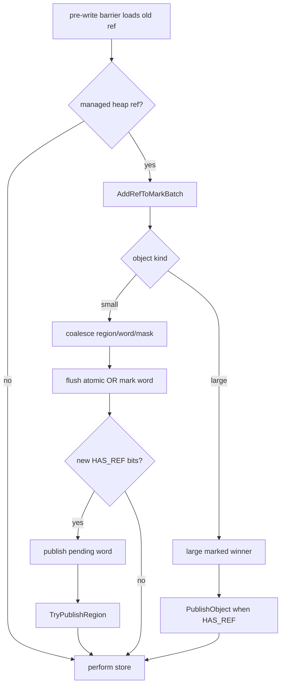

# Cangjie MSGC Barrier 架构与实现详解

> 当前代码基线：`MSGC-bugfix-regionScan` / `24ca097ace`。Barrier 已直接发布 bitmap/Region work，不再写 mutator WorkBuf。

## 1. 核心结论

MSGC 的对象不移动，所以普通读取不需要 forwarding read barrier。并发 Mark 期间需要的是
deletion-style SATB pre-write barrier：

```text
old = load(destination)
discover_and_publish(old)
store(destination, new)
```

“publish”在当前实现中的含义是：

- 小对象：加入 `MSMarkWordBatch`，flush mark word，发布 pending word/REGION task；
- 大对象：竞争 large marked flag，必要时发布 OBJECT task；
- `NO_REF` 对象：只标记，不产生扫描 task。

## 2. Phase gate

`ResolveMarkOwner()` 先 acquire 读取
`CJ_MRT_MSGCFastPathState.barrierPhase`：

- `barrierPhase == 0`：当前没有 SATB snapshot 要维护，直接返回；
- 非 0：再读取 `MarkSweepCollector::GetActiveCollector()`。

phase 与 active collector 必须由 collector 的阶段切换共同维护。编译器 fast path 可以复用
这个 gate，但不能自行推导 scheduler 是否存在工作。

## 3. 标量引用写

Runtime 路径位于
[`MSMarkBarrier.cpp`](../../src/Heap/MBarrier/MSMarkBarrier.cpp)：

```text
WriteRefField(field, newRef):
    oldRef = MSLoadRawReference(field)
    if oldRef != newRef:
        EnqueueRefFast(oldRef)
    MSStoreRawReference(field, newRef)
```

`EnqueueRefFast()` 的名字是历史沿用；当前内部调用
`PublishManagedRefForBarrier()`。该函数创建一个栈上 `MSMarkWordBatch`，加入 old ref，
并立即 `FlushBarrierMarkBatch()`。所以标量路径的关键顺序是：

```text
load old → bitmap publication visible → store new
```

不能把 flush 移到 store 之后，也不能让 batch 跨 barrier 调用或 mark epoch 存活。

## 4. Bulk barrier

struct、static struct、ref array 和 struct array copy 可能一次覆盖多个旧引用。当前实现使用
`BulkRefMarker`：

- 持有一个栈上 `MSMarkWordBatch` 与 `MSWorkUnitCounter`；
- 对覆盖范围中的每个旧引用调用 `AddManagedRefToMarkBatch()`；
- 析构时调用 `FlushBarrierMarkBatch()`；
- marker 的生命周期结束后才执行 memcpy/memmove。

这既合并同一 bitmap word 的多个置位，也保持 SATB 的 old-before-overwrite。

| 操作 | 旧引用枚举方式 |
|---|---|
| `WriteStruct` | 目标对象 TypeInfo + struct 范围 |
| `WriteStaticStruct` | GCTib bitmap |
| `CopyRefArray` | 目标 ref slots |
| `CopyStructArray` | component TypeInfo + 目标范围 |

## 5. 原子操作

原子写、exchange、CAS 必须保持与非原子写相同的 SATB 语义，同时遵循操作的 memory
order。CAS 只有在真正替换旧值的路径上保护相应旧边；failure order 不能非法携带 release
语义。具体入口仍以 `MSMarkBarrier.cpp` 的当前实现为准。

## 6. Barrier 到 scheduler 的路径



小对象 publication 采用 summary-first：

1. mark word RMW；
2. pending summary release；
3. `TryPublishRegion()`。

Region 已经 `QUEUED/OWNED` 时不需要第二个 token；owner 会消费或在释放后重新发布
residual summary。

## 7. 当前没有 TLS grey-log ABI

旧版本的 AArch64 barrier 曾直接依赖 `AllocBufferMS::activeLog_`、对象数组、长度和容量
偏移。当前 runtime 的 `AllocBufferMS` 不再承载这套标记日志，编译器也不应把对象地址写入
旧布局。

当前 compiler/runtime 契约应限定为：

- barrier intrinsic/wrapper 的函数签名与调用约定；
- `barrierPhase` 等公开 fast-path gate；
- heap/Region/bitmap 基础布局中确实由 `MSGCFastPathState` 暴露的字段；
- fast path 失败时回退到 runtime wrapper。

Compiler 的 `llvm/CodeGen/CJMSGCABI.h` 镜像了完整 `MSGCFastPathState` 和 64B
`MSRegionInfo` offset，其中包括 scan-plane base、
`markTaskNextRegionIdx` 与 `pendingWordSummary`。这些 offset 已是 compiler/runtime 布局
合同；但当前 AArch64/X86 **写屏障** emitter 只读取 `barrierPhase`：IDLE 内联 raw
store/copy，MARK 回退 runtime wrapper。它们当前不直接修改 Region task state或 pending
summary。

## 8. 无读屏障

MSGC 不搬移对象：

- 引用地址不会因 GC 变成 forwarding pointer；
- load 不需要查询 from-space/to-space；
- weak ref 读取也不需要对象转发。

因此 lowering 可把 MSGC 普通读 intrinsic 降成原始 load/等价内存操作。但 safepoint、
statepoint、并发内存顺序和引用表示规则仍然存在；“无读屏障”不等于“无 GC 协议”。

## 9. LLVM lowering 边界

总体顺序仍是：

```text
Cangjie GC intrinsic
  → CJBarrierSplit / generic optimization
  → statepoint/safepoint handling
  → CJBarrierLowering by GCMode
  → target code generation or runtime wrapper call
```

MSGC 写侧优化必须满足：

1. Mark phase 能正确走 SATB old-value publication；
2. 非 Mark phase 可安全走 store-only；
3. bulk 操作不能在覆盖后才枚举旧值；
4. 不直接写已经移除的 TLS 日志布局；
5. 不绕过 runtime 的 Region/OBJECT 分类和 mark epoch 检查；
6. 不支持的 target/calling convention 保留 wrapper slow path。

## 10. 与 CopyGC 的差异

| 维度 | MSGC | CopyGC |
|---|---|---|
| 对象移动 | 否 | 是 |
| 普通读 barrier | 可消除 | 需处理转发/空间 |
| Mark 写 barrier | SATB old-before-store | 由 CopyGC phase/转发协议决定 |
| 工作发布 | bitmap + REGION/OBJECT scheduler | CopyGC 自身 tracing/evacuation 结构 |
| Mark Assist | Region task | 不共享 MSGC scheduler |

## 11. 正确性不变式

1. heap old ref 必须在目标位置被覆盖前进入 Mark 发现路径。
2. 标量 barrier 返回 publication 前必须清空栈上 batch。
3. bulk batch 必须在 memcpy/memmove 前 flush。
4. batch 不得跨 mark epoch。
5. phase gate 和 active collector 的发布/撤销必须形成闭环。
6. 编译器不能假定所有 old ref 都是 small object。
7. large/span 必须解析到 primary，并遵循 OBJECT task publication。
8. `NO_REF` 可省扫描 task，但不能漏掉存活标记。
9. compiler fast path 必须有等价的 runtime slow path。

## 12. 建议验证

- 标量 ref/static-ref 在 Mark phase 与 Idle phase 的 IR/机器码。
- struct/static-struct 的 zero-destination、重叠和不同长度。
- ref array/struct array 的 range、重叠 memmove 和空范围。
- atomic store/exchange/CAS 的成功与失败分支。
- old ref 分别指向 small、large、SPAN、非 heap 和 null。
- phase 切换时的并发写压力。
- `cjMSVerifyMark` 下检查 barrier 是否造成 reachable-unmarked edge。

## 13. 源码索引

- [`MSMarkBarrier.cpp`](../../src/Heap/MBarrier/MSMarkBarrier.cpp)：runtime barrier 行为
- [`MarkSweepCollector.cpp`](../../src/Heap/MCollector/MarkSweepCollector.cpp)：
  `PublishManagedRefForBarrier`、`AddManagedRefToMarkBatch`、`FlushBarrierMarkBatch`
- [`MSMarkBatch.h`](../../src/Heap/MCollector/MSMarkBatch.h)：bulk coalescing
- [`MSMarkScheduler.h`](../../src/Heap/MCollector/MSMarkScheduler.h)：publication 后的 task 语义
- [`MSGCFastPath.h`](../../src/Heap/MSGCFastPath.h)：runtime 暴露的 fast-path state

## 14. 历史口径

旧文档中的 Route-A mark-before-log、active log、global-full buffer 和 partial-buffer flush
描述的是已移除实现。其 bug 根因仍可作为历史参考，但当前正确性检查应落在
mark-word flush、pending publication、task ledger 与 STW reconciliation 上。
