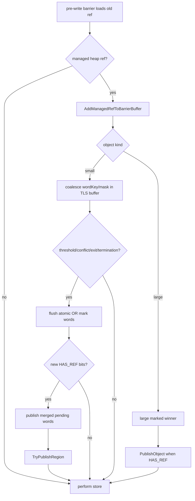

# Cangjie MSGC Barrier 架构与实现详解

> 当前代码基线：`MSGC-bugfix-regionScan` 的 2026-07-31 工作树。Barrier 使用
> `AllocBufferMS` 内嵌的固定布局 `MSBarrierMarkBuffer`，不再写 mutator WorkBuf。

## 1. 核心结论

MSGC 的对象不移动，所以普通读取不需要 forwarding read barrier。并发 Mark 期间需要的是
deletion-style SATB pre-write barrier：

```text
old = load(destination)
discover_and_publish(old)
store(destination, new)
```

“discover”在当前实现中的含义是：

- 小对象：先加入 owner-private `MSBarrierMarkBuffer`；达到 128 个 unique bit、
  发生 4-way set 冲突、owner 退出或 MarkTermination STW 时统一 flush；
- buffer flush：按 mark word 原子 OR，并按 Region 合并
  `pendingWordSummary`/REGION task publication；
- 大对象：竞争 large marked flag，必要时发布 OBJECT task；
- `NO_REF` 对象：只标记，不产生扫描 task。

## 2. Phase gate

`ResolveMarkOwner()` 读取当前线程的 `ThreadLocalData::encodedGCPhase`。只有连续的
`MS_MARK_SETUP..MS_MARK_TERMINATION` 区间才解析 active collector；其他 GCPhase
不产生 old-edge publication。

LLVM 也只读取同一个 `encodedGCPhase`：先用一次 unsigned 范围判断识别
`IDLE..RECLAIM_SATB_NODE`，再用一次范围判断识别三个 Mark phase。前者直接
store/copy，后者进入 Mark fast path，未知值保守回 Runtime wrapper。phase 与 active
collector 仍由 collector 的阶段切换共同维护。

## 3. 标量引用写

Runtime 路径位于
[`MSMarkBarrier.cpp`](../../src/Heap/MBarrier/MSMarkBarrier.cpp)：

```text
WriteRefField(field, newRef):
    context = BarrierMarkContext(encodedGCPhase)
    if context is active:
        oldRef = MSLoadRawReference(field)
        if oldRef != newRef:
            context.AddOldRefActive(oldRef)
    MSStoreRawReference(field, newRef)
```

`BarrierMarkContext` 是 non-owning handle。它在构造时用 TLS `encodedGCPhase`
判断 Mark，只读取一次 `currentMarkEpoch`；遇到第一个合法 managed old-ref 时才解析
当前线程的 `AllocBufferMS`。存在 owner buffer 时，将 small old ref 转为
`(wordKey, bitMask)` 并合并；没有 `AllocBufferMS` 时走立即提交 fallback。内部只保留
已经通过 phase gate 的 `AddOldRefActive()`，不再保留重复判断 phase 的
`AddOldRef()`。它没有
栈内 batch、析构 flush 或显式 `Flush()`。

标量路径的关键顺序是：

```text
load old → old edge captured in owner-private buffer or immediate fallback → store new
```

buffer 可以跨 barrier 调用保留，但不能跨 mark epoch；普通 safepoint/saferegion 不刷新
buffer，上一轮 MarkTermination 和下一轮 PreEnum 的检查共同保证 epoch 边界。

## 4. Bulk barrier

struct、static struct、ref array 和 struct array copy 可能一次覆盖多个旧引用。当前实现
与标量共用 `BarrierMarkContext`：

- 构造 `BarrierMarkContext` 时只读取一次 TLS `encodedGCPhase`；bulk 循环中的每个
  旧引用调用 `AddOldRefActive()`，不重复 phase gate；
- collector/owner buffer 延迟到第一个合法堆 old-ref 才解析，只有 buffer 存在时
  才读取 `currentMarkEpoch`；相邻重复 old-ref 由 bulk visitor 局部跳过，scalar
  context 不承担该状态；
- 普通对象和 RawArray 都只解析一次 TypeInfo/component/GCTib；Runtime RawArray
  直接使用模板化 fast iterator，避免 `RefFieldVisitor` 类型擦除；
- 先校验 source 不超过 destination，再只枚举实际覆盖长度；
- 每个 old ref 必须在对应 memcpy/memmove 之前完成 capture；
- wrapper 返回时不做特殊 flush，bulk tail 可与后续 scalar/bulk 合并；
- threshold/set 冲突由 `AddManagedRefToBarrierBuffer()` 内部 flush 后重试。

Runtime 每次加入的是单个 slot bit。调用方完成 threshold 与 exact-pending 检查后，
使用 one-bit insert helper；MRU 命中只比较 `lastEntry` 的 key，MRU miss 才读取
occupancy 并扫描目标 set 的 4 个 way。LLVM 采用相同顺序，但允许重复 bit 的幂等 OR
消耗 conservative `pendingBitCount` budget。

这既合并同一 bitmap word 的多个置位，也保持 SATB 的 old-before-overwrite。当前 LLVM
已 inline short-GCTib Struct/StaticStruct 的 Mark 枚举，并复用函数内 leaf thunk 完成
TLS fast-add；StdGCTib、含引用 RawArray 与 ArrayCopy Mark 仍回 wrapper。所有入口最终
使用同一持久 buffer。

| 操作 | 旧引用枚举方式 |
|---|---|
| `WriteStruct` | 目标对象 TypeInfo + struct 范围 |
| `WriteStaticStruct` | GCTib bitmap |
| `CopyRefArray` | 目标 ref slots |
| `CopyStructArray` | component TypeInfo + 目标范围 |

## 5. 原子操作

原子写、exchange、CAS 必须保持与非原子写相同的 SATB 语义，同时遵循操作的 memory
order。MSGC compiler-call 入口直接进入 `MSBarrierOps`，同样用 TLS
`encodedGCPhase` 判断：非 Mark 直接执行原子 store/exchange/CAS；Mark 下
AtomicWrite/Swap 使用 CAS retry loop，并避免 unchanged expected 的重复 shading。
failure order 不能非法携带 release 语义。

## 6. Barrier 到 scheduler 的路径



小对象 publication 采用 summary-first：

1. mark word RMW；
2. pending summary release；
3. `TryPublishRegion()`。

Region 已经 `QUEUED/OWNED` 时不需要第二个 token；owner 会消费或在释放后重新发布
residual summary。

## 7. 固定 TLS bitmap-batch ABI

旧版本的 AArch64 barrier 曾直接依赖 `AllocBufferMS::activeLog_` 与 WorkBuf 对象地址
布局。当前版本改为固定 bitmap-batch ABI：

- `ThreadLocalData::msAllocBuffer == 88`；
- `AllocBufferMS::barrierMarkBuffer_ == 576`，`AllocBufferMS` 为 64B 对齐；
- 32 个 16B entry，8 set × 4 way；
- header offset 为 512/516/520，总大小 528B；
- `wordKey = (regionIdx << 6) | wordIdx`，hash multiplier 为 5；
- unique-bit flush threshold 为 128；

Compiler 的 `llvm/CodeGen/CJMSGCABI.h` 镜像上述布局以及 heap、RegionInfo、bitmap
plane 和 36 档 size-class descriptor。AArch64/X86 在 Mark phase 的 collect-set Small
Ref/StaticRef 和 short-GCTib Struct/StaticStruct 常见路径直接更新 owner-private
entry；LLVM 不直接修改全局 mark plane、`pendingWordSummary`、scan state 或 scheduler，
统一由 Runtime flush 完成。

## 8. 无读屏障

MSGC 不搬移对象：

- 引用地址不会因 GC 变成 forwarding pointer；
- load 不需要查询 from-space/to-space；
- weak ref 读取也不需要对象转发。

因此 lowering 可把 MSGC 普通读 intrinsic 降成原始 load/等价内存操作。但 safepoint、
statepoint、并发内存顺序和引用表示规则仍然存在；“无读屏障”不等于“无 GC 协议”。

## 9. LLVM lowering 边界

总体顺序仍是：

```text
Cangjie GC intrinsic
  → CJBarrierSplit / generic optimization
  → statepoint/safepoint handling
  → CJBarrierLowering by GCMode
  → target code generation or runtime wrapper call
```

MSGC 写侧优化必须满足：

1. Mark phase 能正确走 SATB old-value publication；
2. 非 Mark phase 可安全走 store-only；
3. bulk 操作不能在覆盖后才枚举旧值；
4. LLVM direct 只接受经过精确 slot 校验的 collect-set Small；OUTSIDE_SET、LARGE、
   非法 Region、threshold/set 冲突均在覆盖前回 wrapper；
5. Struct leaf thunk 只复用本次调用预先解析的 fast-path state 和 TLS buffer，不重复
   读取 GCPhase；
6. 不支持的 target/calling convention 保留 wrapper slow path。

## 10. 与 CopyGC 的差异

| 维度 | MSGC | CopyGC |
|---|---|---|
| 对象移动 | 否 | 是 |
| 普通读 barrier | 可消除 | 需处理转发/空间 |
| Mark 写 barrier | SATB old-before-store | 由 CopyGC phase/转发协议决定 |
| 工作发布 | bitmap + REGION/OBJECT scheduler | CopyGC 自身 tracing/evacuation 结构 |
| Mark Assist | Region task | 不共享 MSGC scheduler |

## 11. 正确性不变式

1. heap old ref 必须在目标位置被覆盖前进入 Mark 发现路径。
2. 标量和 bulk 必须在覆盖前把 old edge 加入 owner-private buffer 或完成立即 fallback。
3. bulk wrapper 返回不构成 flush 边界。
4. 非空 buffer 不得跨 mark epoch。
5. phase gate 和 active collector 的发布/撤销必须形成闭环。
6. 编译器不能假定所有 old ref 都是 small object。
7. large/span 必须解析到 primary，并遵循 OBJECT task publication。
8. `NO_REF` 可省扫描 task，但不能漏掉存活标记。
9. compiler fast path 必须有等价的 runtime slow path。
10. 普通 safepoint/saferegion 不访问 buffer；owner 退出和 MarkTermination STW 必须 drain。
11. barrier Add/flush 不计算或累计 `cycleCompletedMarkWU_`。

## 12. 建议验证

- 标量 ref/static-ref 在 Mark phase 与 Idle phase 的 IR/机器码。
- struct/static-struct 的 zero-destination、重叠和不同长度。
- ref array/struct array 的 range、重叠 memmove 和空范围。
- atomic store/exchange/CAS 的成功与失败分支。
- old ref 分别指向 small、large、SPAN、非 heap 和 null。
- phase 切换时的并发写压力。
- `cjMSVerifyMark` 下检查 barrier 是否造成 reachable-unmarked edge。

## 13. 源码索引

- [`MSMarkBarrier.cpp`](../../src/Heap/MBarrier/MSMarkBarrier.cpp)：runtime barrier 行为
- [`MarkSweepCollector.cpp`](../../src/Heap/MCollector/MarkSweepCollector.cpp)：
  `AddManagedRefToBarrierBuffer`、`FlushBarrierMarkBuffer`、termination drain
- [`MSBarrierMarkBuffer.h`](../../src/Heap/MBarrier/MSBarrierMarkBuffer.h)：固定 TLS ABI 与本地合并
- [`MSMarkBatch.h`](../../src/Heap/MCollector/MSMarkBatch.h)：worker/root 等非 barrier mark batch
- [`MSMarkScheduler.h`](../../src/Heap/MCollector/MSMarkScheduler.h)：publication 后的 task 语义
- [`MSGCFastPath.h`](../../src/Heap/MSGCFastPath.h)：runtime 暴露的 fast-path state

## 14. 历史口径

旧文档中的 Route-A mark-before-log、active log、global-full buffer 和 partial-buffer flush
以及“barrier 返回前必须 flush 栈内 batch”的描述都属于已移除实现。当前正确性检查应落在
old-before-overwrite capture、TLS lifecycle drain、mark-word flush、pending publication、
task ledger 与 STW reconciliation 上。
