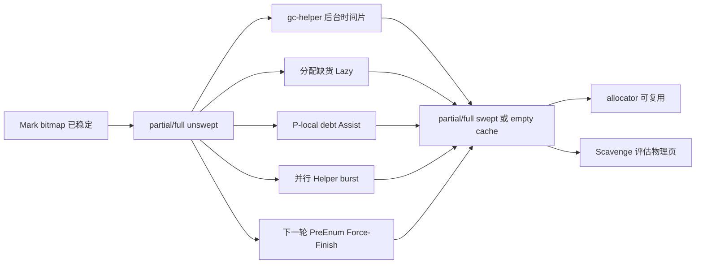
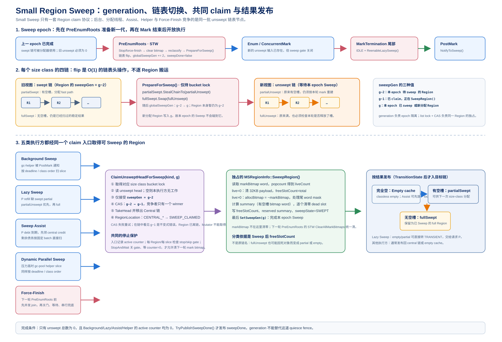
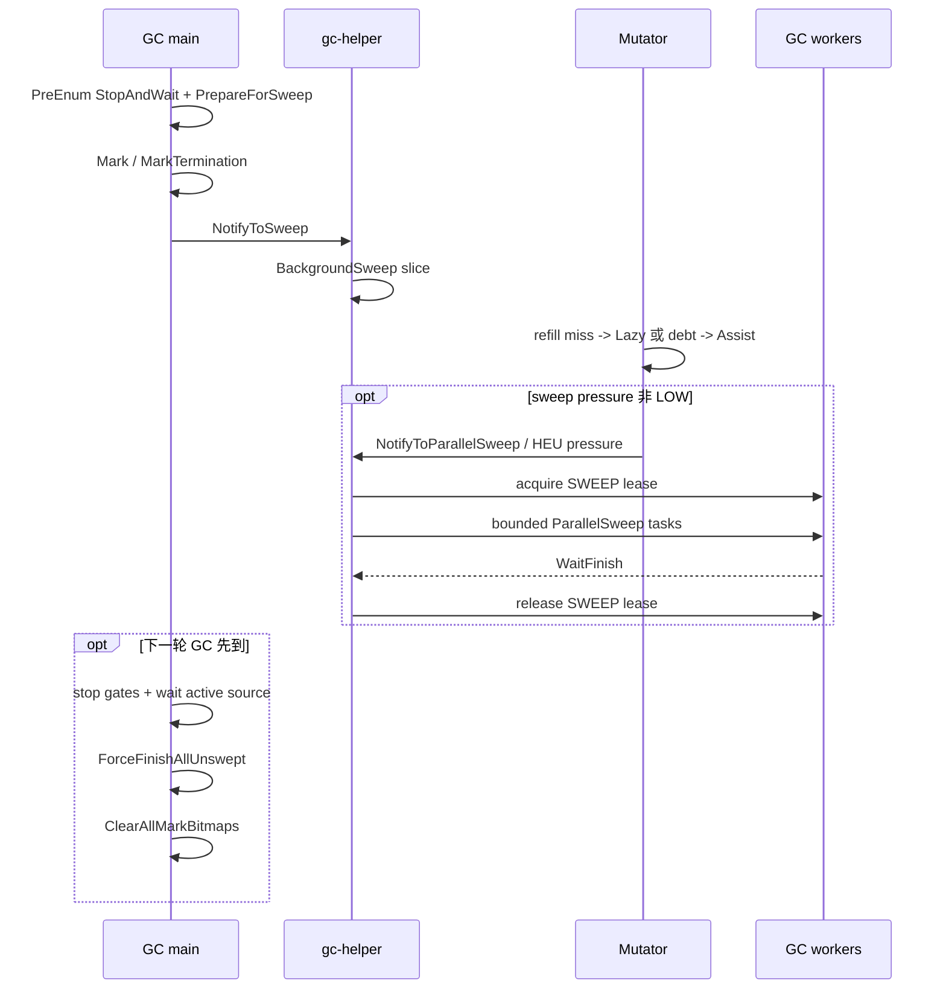

# MSGC Sweep 架构与实现详解

> 本文以当前 Runtime 源码为事实来源，解释 MSGC Sweep 的数据模型、五类执行方式及并发协议。重点覆盖后台 Sweep、Mutator Assist Sweep 与多线程 Sweep；历史设计只用于说明演进，不替代当前实现。

## 目录

1. 文档范围与核心结论
2. Sweep 在 MSGC 中解决什么问题
3. Sweep 的数据模型与生命周期
4. 五类 Sweep 执行方式总览
5. 后台 Sweep 实现
6. Mutator Assist Sweep 实现
7. 多线程 Sweep 实现
8. Lazy Sweep 与 Force-Finish
9. 停止、完成发布与并发正确性
10. 配置、日志与诊断
11. 源码索引与阅读路线

---

## 1. 文档范围与核心结论

本文只讨论当前 `MRT_USE_MARK_SWEEP` 路径中的 small Region Sweep；large object 的死亡处理会在需要时说明，但不把它与 small Region 的 bitmap Sweep 混为一谈。源码、当前实现记录、历史设计的优先级为：当前 `src/` 源码 > 当前实现记录 > 早期 Plan/设计文档。

最重要的结论如下：

1. Sweep 的输入不是“所有 committed Region”，而是当前 `sweepGen` 代中挂在 `partialUnswept`/`fullUnswept` 的 small Region。
2. Sweep 的核心动作是读取 `markBitmap`，重建 `allocBitmap`，清零死亡 slot，并把 Region 重新归类为 empty、partial swept 或 full swept。
3. 一轮 Sweep 有五个执行方：后台时间片、分配缺货触发的 Lazy、按 P-local debt 触发的 Mutator Assist、借用 GC Worker 的多线程 Helper，以及下一轮 GC 前的 Force-Finish。
4. 五类执行方都通过 `SizeClassBucket::ClaimUnsweptHeadForSweep()` 获得 Region 的唯一所有权；真正的 `SweepRegion()` 在 bucket lock 外执行。
5. `BackgroundSweep()` 是 `gc-helper` 的协调入口，但在并行模式下它也是 coordinator lane；同一轮可以有多个 `ParallelSweep()` task 与它同时 claim 不同 Region。
6. `MSSweepAssist()` 不是“把 Lazy Sweep 再调用一次”。它先消费全局一次性 credit，再在 debt 达到批量阈值时由当前 mutator 直接清扫有限数量 Region。
7. `sweepDone_` 只有在 unswept 链为空、后台调用者和所有 Lazy/Assist/Helper 调用者都退出后才发布；Force-Finish 仍是清 mark bitmap 前的最终安全线。
8. 当前 `cjMSParallelSweep` 默认值以 [CjScheduler.cpp](../../src/CjScheduler.cpp) 为准，是 `true`；`cjMSParallelSweepMaxHelpers=0` 表示使用 `gcThreads - 1` 的自动上限。历史实现文档中的默认关闭描述不适用于当前代码。

本文不讨论 CopyGC 的 forwarding、from-space 或读屏障语义。为了便于定位源码，文中会直接给出关键函数和相对路径。

### 1.1 相关实现记录

以下记录用于补充设计演进和验证背景；其中与当前源码冲突的内容不作为当前实现依据：

- [Step4：后台 Sweep 与 Reclaim 实现详解](../Implementation/Step4_后台Sweep与Reclaim实现详解.md)
- [Step31：Go 风格 Sweep Assist 设计](../Implementation/Step31_MSGC_Go风格SweepAssist设计.md)
- [Step34：Sweep Assist 配速化与 proportional credit](../Implementation/Step34_MSGC_SweepAssist配速化_proportional_credit落地方案.md)
- [Step44：NotifyMark 动态 Sweep Helper](../Implementation/Step44_MSGC_NotifyMark动态SweepHelper设计.md)
- [Step9：PreEnum 冻结 Sweep 快照复盘](../Implementation/Step9_PreEnum冻结Sweep快照复盘.md)
- [Mutator Assist 实现详解](../Implementation/mutator_assist.md)

## 2. Sweep 在 MSGC 中解决什么问题

### 2.1 Mark 和 Sweep 的分工

MSGC 是对象不移动的 Mark-Sweep。并发 Mark 阶段只回答“哪些 slot 仍然可达”，把结果写进 Region 的 `markBitmap`；它不会修改分配器正在使用的 `allocBitmap`。Sweep 阶段再把可达性结果转换成可分配状态：

```text
markBitmap（1=live）
        │
        ├─ live slot 保留对象内容
        ├─ dead slot 写入 allocBitmap 的 free bit
        └─ dead slot 内容清零
                │
                ▼
allocBitmap（1=free） + reserved summary + freeSlotCount
```

`MSRegionInfo::SweepRegion()` 只对一个已经被 claim 的 small Region 做上述转换。它不会把 Region 交给分配器，也不会决定 OS 物理页是否归还；后两件事分别由 `CentralRegionPool` 的分类逻辑和 Scavenge 管线完成。

### 2.2 为什么 Sweep 必须延迟且可被抢占

如果 Mark 结束后立即在 GC 主线程遍历整个堆，暂停时间会与 Region 数量和死亡 slot 数线性增长。当前实现把 Sweep 从 Mark 的收尾阶段拆出，允许 mutator 继续运行，并由不同执行方按供给压力逐步消费 unswept backlog：



这种设计有两个边界：

- **可用性边界**：分配路径可以通过 Lazy/Assist 现场制造可用 Region；后台路径负责尽量提前准备 supply。
- **正确性边界**：下一轮 `ClearAllMarkBitmaps()` 之前，上一轮所有 Sweep 必须停止，未完成的 Region 必须由 Force-Finish 补完。

### 2.3 Post-Mark 的统计与 Sweep 发布

`MarkSweepCollector::DoGarbageCollection()` 的最后一个 Mark 阶段是 `PostMarkTermination()`；该函数在完成 large eager reclaim 后做三件事：

1. 通过 `CentralRegionPool::ComputeMarkedStats()` 在稳定 bitmap 上统计对象数和真实 live bytes。
2. 调用 `BackgroundProcessor::NotifyToSweep()` 启动后台 Sweep。
3. 调用 `NotifyToScavenge()` 启动后续物理页回收。

它**不会**直接遍历所有 small Region 并执行 `SweepRegion()`。这些动作计入 `PostMark total`，但仍只是统计与通知，不能直接当成全堆 Sweep 时间。

## 3. Sweep 的数据模型与生命周期

### 3.1 Region 的两套状态

一个 Region 同时有三类互相独立的状态：

| 维度 | 代表字段/表 | 作用 |
| --- | --- | --- |
| 对象布局 | `regionType`、`sizeClass`、`allocPtr`、`freeSlotCount` | 说明是 BUMP、PARTIAL、FULL、EMPTY_CACHE 或 LARGE |
| Sweep 代际 | `sweepGen`、`sweepState` | 说明本 Region 是否属于当前 Sweep 快照、是否已把 bitmap 转成空闲位 |
| 所有权位置 | `MSRegionInfoArray::locations_`、`ownerTokens_` | 说明 Region 在 central list、TLS active、Sweep claim 或 empty cache 中由谁持有 |

不能用 `regionType == PARTIAL` 推断 Region 已经 Sweep；`partialUnswept` 同样可能是 PARTIAL。并发调试时要同时看 location、generation 和 list membership。

### 3.2 四条 size-class 链

每个 size class 在 `CentralRegionPool::SizeClassBucket` 中维护四条链：

| 链 | 含义 | 主要消费者 |
| --- | --- | --- |
| `partialSwept_` | 已完成当前 generation Sweep 且仍有空槽 | `TakePartialSweptRegion()`，分配最快路径 |
| `fullSwept_` | 已完成 Sweep 但无空槽 | 等下一轮 generation 翻转 |
| `partialUnswept_` | 进入当前快照前有空槽，但尚未 Sweep | Lazy、Assist、Background、Parallel、Force-Finish |
| `fullUnswept_` | 进入当前快照前无空槽，尚未 Sweep | 同上，通常在 partial unswept 之后消费 |

`partialSwept_` 是带 ABA tag 的无锁栈；另外三条链由 bucket mutex 保护。Sweep claimant 从 unswept 链摘下 Region 后，Region 不再属于任何 unswept list，直到 Sweep 完成并重新入 swept/empty 结构。

### 3.3 `sweepGen` 的快照协议

全局 `CentralRegionPool::globalSweepGen_` 从 2 开始，每轮加 2。当前 generation 为 `sg` 时，本轮输入 Region 的 generation 是 `sg - 2`；正在被 claim 的短暂中间状态是 `sg - 1`。

`PrepareForSweep()` 在 `PreEnumRoots()` 的 STW 内执行：

```text
partialSwept  --StealChainTo--> partialUnswept
fullSwept     ------Swap------> fullUnswept
globalSweepGen += 2
sweepDone_ = false
```

新建或重新绑定的 Region 直接 stamped 为当前 `sg`，因此不会被本轮旧 bitmap 误扫。这个 generation 隔离是防止“Mark 期间新分配对象只被栈/local root 持有，却在本轮 Sweep 中被当成死亡对象”的关键。

### 3.4 单个 Region 的 Sweep 算法

单个 Region 的 claim、bitmap 重建、dead slot 清零和重新挂链顺序见下图。`sweepGen`/`SWEEP_CLAIMED` 保证多个执行方不会同时处理同一 Region。



> 图 7-1：从 unswept 链 claim，到 swept partial/full 或 empty cache 的 Region 流程。

`MSRegionInfo::SweepRegion()` 的实现可概括为：

1. 计算 bitmap word 数，复制 `markBitmap` word 到栈上临时数组，并统计 live slot。
2. 若 live 数为 0：清零整个 32KB Region，设置 `freeSlotCount=totalSlotCount`、`sweepState=SWEPT`、`reserved=0`。
3. 否则对每个 word 写 `allocBitmap[i] = ~markWords[i]`，并为有空槽的 word 设置 `reserved` summary bit。
4. 处理最后一个 word 的 trailing bits，避免把不存在的 slot 当成可分配位置。
5. 遍历 `allocBitmap` 的 free bits，逐 slot 清零死亡对象内容。
6. 设置 `freeSlotCount` 和 `sweepState=SWEPT`。`markBitmap` 不在这里清空，而是在下一轮 MarkSetup 的 `ClearAllMarkBitmaps()` 中统一清空。

```text
liveCount == 0
    -> memset(region, 0, 32KB)
    -> empty candidate

liveCount > 0
    -> allocBitmap = ~markBitmap（限制 trailing bits）
    -> zero each dead slot
    -> freeSlotCount / reserved / SWEPT
    -> partialSwept 或 fullSwept
```

Sweep ownership 由 claim 协议串行化，因此 `allocBitmap` 在 `SweepRegion()` 完成前不会被分配 fast path 读取。

### 3.5 Large object Sweep 是独立路径

large object 不挂在 36 个 size-class 的四条 small 链上，也不走 `SweepRegion()` 的 slot bitmap 转换。`MarkSweepCollector::PostMarkTermination()` 通过 `CollectLargeGarbage()` 调用 `CentralRegionPool::SweepLargeRegions()`，该函数：

1. 先把上一轮未复用的 large hot-cache span 批量转入 FreeManager hot-free；
2. 在 `largeLock_` 下从 live large list 收集未标记的 primary span；
3. 释放 follower/base 的 `MSRegionInfo` 元数据；
4. 优先按 `regionCount` 精确尺寸放入 `largeHotCache_`，失败时走普通 large reclaim；
5. 记录 `objectCount/regionCount/freedBytes/cachedBytes`，供 GC 统计和 Scavenge 使用。

因此本文所说的五类执行方主要针对 small Region backlog；large span 的死亡判定由 GC 主线程在 `PostMarkTermination()` 收尾阶段完成，后续物理页释放仍由 hot-cache/Scavenge 管线处理。

## 4. 五类 Sweep 执行方式总览

### 4.1 五类执行方的定位

| 执行方式 | 执行线程 | 触发条件 | 每次工作上限 | 空 Region 去向 | 主要目的 |
| --- | --- | --- | --- | --- | --- |
| 后台 Sweep | `gc-helper` | GC 完成通知、Lazy 通知、周期兜底 | pressure 放大的时间 deadline | global empty cache | 提前准备可用 supply |
| Lazy Sweep | 当前 Mutator | `RefillFromCentral()` 找不到 swept/empty Region | 直到拿到可用 Region或列表耗尽 | 直接交给当前 refill；full 可能回 central | 分配缺货即时解围 |
| Mutator Assist | 当前 Mutator/P | `AllocBufferMS` 的 Sweep debt 达到整数批次 | `msAssistSweepMaxRegionsPerCall`（默认 4） | 优先当前 P 的 local empty cache | 按分配速率偿还 Sweep 债务 |
| 多线程 Sweep | `gc-helper` + `gc-pool-tN` | HEU/pressure 进入非 LOW，或显式通知 | 共享 deadline + task quantum | central/global empty cache | 在 Mark 被 backlog 阻塞前并行追赶 |
| Force-Finish | GC 主线程 | 下一轮 `PreEnumRoots()` | 无时间片，直到 unswept 清空 | central/global empty cache | 清 bitmap 前的最终正确性闭合 |

这五类方式不是五套不同的 Region 算法：它们最终都调用同一个 `SweepRegion()`，区别在于“谁来 claim、为什么开始、是否绑定某个 allocator owner、如何限制工作量”。

### 4.2 统一执行模板

除了 Lazy 的“扫到可用即返回”语义外，其他执行方都可抽象成下面的模板：

```text
读取当前 sweepGen = sg
进入 active/source counter（如需要）
    ↓
检查 stop/skip gate
    ↓
按 class 顺序从 partialUnswept、fullUnswept claim Region
    ↓
在 bucket lock 外执行 Region::SweepRegion()
    ↓
SetSweepGen(sg)
    ↓
empty      -> empty cache
partial    -> partialSwept
full       -> fullSwept
    ↓
更新 source 统计 / central credit / sweepDone 判定
```

`ClaimUnsweptHeadForSweep()` 在 bucket lock 内验证 Region 的 `sweepGen == sg - 2`，将 location 从 `CENTRAL_PARTIAL/CENTRAL_FULL` 改为 `SWEEP_CLAIMED`，然后摘链。由于所有执行方共用该入口，两个线程不可能同时对同一个 Region 执行 Sweep。

### 4.3 五类方式如何协作

典型的一轮生命周期是：



后台、Lazy、Assist、Helper 的工作可以相互抵扣，但必须遵守两个规则：

- 同一 Region 只能被一个 source claim；
- Background/Lazy/Helper 的工作向 central `sweepCredit_` 发布一次性 credit，某个 P 通过 CAS 消费后，其他 P 不能再次用同一个 Region 抵债；Force-Finish 不发布 credit，因为它属于旧 epoch 的正确性收口。

### 4.4 `swept`、`unswept` 与完成的区别

- `GetTotalUnsweptCount() == 0` 只表示 unswept list 没有待 claim Region，不代表当前 `SweepRegion()` 已经全部退出。
- `sweepDone_ == true` 只有 `TryPublishSweepDone()` 在 unswept 为空且 `bgSweepRunning_`、`activeLazySweepCount_`、`activeAssistSweepCount_`、`activeHelperSweepCount_` 全部为 0 时才发布。
- `IsSweepDone()` 还会把 `sweepDone_` 与上述运行中计数一起检查，避免“最后一个 Region 已摘链、但还在清 slot”的提前完成。

## 5. 后台 Sweep 实现

### 5.1 通知链与后台线程

后台 Sweep 的调用链是：

```text
MarkSweepCollector::PostMarkTermination()
  -> BackgroundProcessor::NotifyToSweep()
  -> shouldBackgroundSweep_ = true
  -> condition_variable.notify_one()
  -> BackgroundProcessor::Run()
  -> BackgroundSweepLoop()
  -> CentralRegionPool::BackgroundSweep(preferredCls, deadlineUs)
```

分配路径也会触发同一条链：`TakeUnsweptRegion()` 真正进入 unswept list 前调用 `MSRegionManager::MaybeNotifySweep()`，后者无条件调用 `NotifyToSweep(cls)`（仅在 GC 已开始时直接返回）。因此后台通知不是只由 GC 线程发出，也不是只在 Region 断供后才发出。

`BackgroundProcessor::Init()` 会创建一个 `MSGC_BACKGROUND_THREAD` mutator，并让它进入 saferegion；线程名为 `gc-helper`。它不是 GC Worker，不持有 Mark work queue，也不会参与对象图扫描。

### 5.2 `gc-helper` 主循环

`BackgroundProcessor::Run()` 的工作优先级是 finalizer、parallel sweep、普通 background sweep、scavenge、shrink。Sweep 相关伪代码如下：

```text
while running:
    if periodic interval 到期:
        MaybeSchedulePeriodicWork()

    先处理 finalizer

    if shouldParallelSweep_:
        ParallelSweepLoop()
        handledParallelSweep = true

    if !handledParallelSweep && shouldBackgroundSweep_:
        BackgroundSweepLoop()

    处理 Scavenge/Shrink

    若仍有工作：最多连续 4 轮或约 12ms，之后 yield/backoff 1ms
    若无工作：在 condvar 上等待，周期兜底约 2000ms
```

`RequestWork()` 使用 `flag.exchange(true)` 去重唤醒：只有第一次从 false 变 true 才执行 `notify_one()`。flag 会在具体 Loop 开始或发现无工作时清除，因而多个 mutator 的通知不会为同一个 Sweep epoch 创建无限唤醒。

### 5.3 普通后台一轮的准备

`BackgroundSweepLoop()` 先拿到 `RegionSpaceMS` 和 `CentralRegionPool`，调用 `RefreshSweepHelperControl()` 刷新 pressure 与动态 helper 数。如果当前需要 helper 且并行开关开启，直接转入 `ParallelSweepLoop(helperCount)`；否则执行单线程后台 slice。

单线程 slice 的计算：

```text
baseBudgetUs = cjGCBGSweepMaxTime / 1000
budgetUs     = baseBudgetUs × SweepTierMultiplier(mode)
deadlineUs   = now + budgetUs
preferredCls = exchange(preferredSweepCls_, kNoPreferredSweepClass)
BackgroundSweep(preferredCls, deadlineUs)
```

pressure multiplier 在 [MSSweepDebtPolicy.h](../../src/Heap/MAllocator/MSSweepDebtPolicy.h) 中定义：LOW=1、MEDIUM=4、HIGH=10。它只放大后台时间片，不改变一个 Region 的 Sweep 语义。

### 5.4 size class 调度顺序

`BuildBackgroundSweepClassOrder(preferredCls)` 先把 preferred class 放到最前，然后按以下压力排序：

1. 有 unswept 的 class 优先于没有 unswept 的 class。
2. ready count 较少的 class 优先，优先补最可能断供的 size class。
3. unswept count 较多的 class 优先。
4. 最后按 class 编号稳定排序。

preferred class 主要来自 Mutator refill 路径：`TakeUnsweptRegion(cls)` 进入 Lazy 时会把该 class 传给 `NotifyToSweep(cls)`，让下一个后台 slice 优先补这一档供给。Assist 虽然也接收 `preferredCls` 并用于自身的 class-order，但 `AccumulateSweepDebt()` 不会再次调用 `NotifyToSweep()`，不能把 Assist 的参数误解为后台通知。

### 5.5 `CentralRegionPool::BackgroundSweep()` 主体

后台函数先设置 `bgSweepRunning_=true`，用 seq_cst fence 与 `StopAndWaitForAllSweep()` 的 stop-store/运行状态读取形成 StoreLoad 配对；如果已经收到 `stopSweepRequested_`，立即退出。

主体流程：

```text
sg = globalSweepGen_
remainingUnswept = GetTotalUnsweptCount()
若为 0：finish + TryPublishSweepDone，返回

for cls in BuildBackgroundSweepClassOrder(preferredCls):
    if stop requested: break
    SweepUnsweptList(PARTIAL, sg, deadline)
    SweepUnsweptList(FULL, sg, deadline)
    若达到 deadline 或 stop：break

RecordBackgroundSweep(sweptInSlice)
bgSweepRunning_ = false
若本 slice 非 stop 且没有剩余：TryPublishSweepDone()
```

`SweepUnsweptList()` 每个 Region 都做 stop 检查和 deadline 检查；claim 成功后在 bucket lock 外执行 `SweepRegion()`，然后将 Region 归类：

- 完全空闲：`PushEmptySweptRegion()`，重置为 `EMPTY_CACHE` 并进入 global empty cache；
- 仍有空槽：设 `MS_REGION_PARTIAL`，转入 `partialSwept_`；
- 无空槽：设 `MS_REGION_FULL`，转入 `fullSwept_`。

每处理 8 个 Region 调用一次 `std::this_thread::yield()`，避免单个后台 slice 长时间占满 CPU。后台函数返回 `BackgroundSweepStats{1, swept, empty, elapsed}`，由 `BackgroundProcessor` 合并日志。

### 5.6 后台 Sweep 与 allocator supply

后台 Sweep 只把 Region 放回 central/empty 结构，不直接写入某个 mutator 的 `activeRegions_`。`BackgroundProcessor::BackgroundSweepLoop()` 在 slice 后调用 `FlushCentralCacheToThreshold(thresholdBytes)`，把超过阈值的 central cache 逐步送入更低层，避免 Sweep 完成但供给仍停留在不易被复用的位置。

需要强调：

- 后台 Sweep 产生的是**逻辑可复用 Region**；
- Scavenge 再根据 retained bytes、empty cache 和阈值决定是否把物理页交给 `FreeManager`/OS；
- Sweep 不等价于 Scavenge，也不负责释放 large hot cache。

### 5.7 后台停止与重启

下一轮 GC 到来时，`PreEnumRoots()` 先调用 `StopAndWaitForAllSweep()`。它会设置 `stopSweepRequested_`，后台每个 Region 边界都会看到该标志并提前返回。后台函数退出时清 `bgSweepRunning_`，GC 线程随后才能完成最终 Force-Finish 和 bitmap 清理。

`MarkTermination()` 在最后一次 STW 标记收尾、mutator 即将恢复前调用 `ReenableLazySweep()`，一次性清除 `skipLazySweep_`、`skipAssistSweep_`、`skipHelperSweep_` 和 `stopSweepRequested_`；随后 `PostMarkTermination()` 在 large eager reclaim 和统计完成后通知后台。

## 6. Mutator Assist Sweep 实现

### 6.1 Assist 不是 Lazy 的别名

Lazy 的目标是“当前 refill 必须拿到一块可用 Region”；Assist 的目标是“当前 P 已经消费了新的 Region，按本轮配速主动偿还 Sweep 债务”。两者可能在同一次分配中相邻发生，但触发条件和计账对象不同：

```text
RefillFromCentral(cls)
  ├─ TakePartialSweptRegion(cls)     // 已扫，直接拿
  ├─ GetCacheRegion(cls)              // empty cache，直接重绑
  ├─ TakeUnsweptRegion(cls)           // 供给缺货，Lazy 现场扫
  └─ GetFreshRegion(cls)              // fresh Region

SlowAlloc 成功发布 active Region
  └─ AccumulateSweepDebt(1, cls)      // 记录一次 P-local Sweep 债
       └─ debt 达到整数批次 -> MSSweepAssist()
```

因此 Assist 不应被理解为“每次对象分配都扫一个 Region”。当前 fast path 在 active Region 内连续 bump/bitmap 分配，不进入 Assist；计账挂在 Region/span 消费边界，避免对象级原子操作。

### 6.2 P-local debt 的口径

`AllocBufferMS` 为每个 P/线程持有：

- `sweepAssistDebtScaled_`：16 位 fixed-point 的 Sweep debt；
- `sweepDebtGen_`：该 debt 对应的 generation；
- `MSSweepAssistAtomicStats`：closing-cycle 报告使用的原子统计。

小对象路径在 `AllocBufferMS::SlowAlloc()` 成功取得并发布新 Region 后调用：

```cpp
AccumulatePacingDebt(MS_REGION_SIZE);
AccumulateSweepDebt(1, cls);
```

这一次记账覆盖编译器 inline fast path：inline 路径耗尽 active Region 后进入 `SlowAlloc()`，因此不需要对每个对象单独计债。large object 不经过 `SlowAlloc()`，而是在 `RegionSpaceMS::TryAllocateLargeObjectOnce()` 的 hot-cache 命中和 fresh-span 成功路径显式按 `regionBytes / MS_REGION_SIZE` 计债；两类路径都把 `kNumSizeClasses` 作为无偏好的 class 参数传入。也就是说，当前计账点是“小对象 Region 发布边界 + 大对象 span 注册边界”，不是每个对象分配点。

### 6.3 本轮比例和 pressure 放大

`PrepareForSweep()` 完成四链翻转后统计 `totalUnswept`，再以当前 HEU 使用的轴计算 runway：

```text
runwayRegions = ceil(max(thresholdBytes - sweptBytes, 0) / MS_REGION_SIZE)
baseRatio     = totalUnswept / max(runwayRegions, 1)
```

代码使用 `kMSSweepAssistRatioScale = 1 << 16` 保存 fixed-point 比例，避免每次分配做浮点计算。`GetSweepAssistRatioScaled()` 读取这个基准比例，再按共享 pressure mode 放大：

| mode | ratio multiplier | 后台 slice multiplier |
| --- | ---: | ---: |
| LOW | 1× | 1× |
| MEDIUM | 4× | 4× |
| HIGH | 10× | 10× |

pressure 的输入是 `U/S/T`：`U=unsweptBytes`，`S=sweptBytes`，`T=heapThreshold`。`U > T` 或 `ForceHighSweepPressure()` 置位时为 HIGH；`S+U > T` 时为 MEDIUM；否则为 LOW。这里的 pressure 只影响 debt 增加速率和后台时间片，不改变一次直接 Assist 的最大批量。

### 6.4 `AccumulateSweepDebt()` 的执行步骤

当前实现按以下顺序处理一次成功的 Region 消费：

```text
if central == null 或 allocatedRegions == 0: return

currentGen = CentralRegionPool::GetGlobalSweepGen()
若 local sweepDebtGen != currentGen:
    清零本 P 的 debt 和统计
    发布新的 local generation

若 central.IsSweepDone(): 清 debt，return

ratioScaled = central.GetSweepAssistRatioScaled()
若 ratioScaled == 0: 清 debt，return

debt += allocatedRegions × ratioScaled
debtRegions = debt / kMSSweepAssistRatioScale
若 debtRegions == 0: 保留小数，return

result = central.MSSweepAssist(*this, debtRegions, preferredCls)
按 result.TotalPaidRegions() 扣除 debt
```

generation mismatch 时直接丢弃旧 fractional debt，原因是旧 debt 绑定的 unswept 快照已经在下一轮 `PrepareForSweep()` 中失效；保留旧债会把上一轮的 Region 工作错误计入新一轮。

### 6.5 Central credit 与直接 Assist

`MSSweepAssist()` 先从 `sweepCredit_` CAS 领取 credit：

```text
requested = debtRegions
creditPaid = sweepCredit_.Take(requested)
remaining  = requested - creditPaid
```

Background、Lazy、Helper 每扫完一个 Region 都调用相应的 `Record*Sweep()`，把 Region 数加入一次性 central credit；Assist source 自己不把工作再次放入 credit，避免同一 Region 被重复抵债。

如果剩余 debt 达不到 `msAssistSweepMaxRegionsPerCall`，本次只保留 debt，不直接扫；达到阈值后调用：

```text
toSweep = ComputeMSSweepAssistDirectRegions(
              remainingDebt,
              cjMSAssistSweepMaxRegionsPerCall)
AssistSweep(toSweep, preferredCls, &owner)
```

当前默认 `cjMSAssistSweepMaxRegionsPerCall=4`，函数采用“达到阈值才执行一个完整 batch”的策略，而不是每次按小数比例执行 0 或 1 个 Region。

### 6.6 `AssistSweep()` 的 Region 路径

Assist 进入 `CentralRegionPool::AssistSweep()` 后：

1. `targetRegions==0` 直接返回。
2. `activeAssistSweepCount_++`，并执行 seq_cst fence。
3. 检查 `skipAssistSweep_` 或 `stopSweepRequested_`；若置位，递减计数并返回。
4. 读取当前 `sg`，按 preferred class 加 pressure 排序遍历 bucket。
5. 先扫 `partialUnswept`，再扫 `fullUnswept`，直到达到 target 或列表耗尽。
6. 每个 Region 由 `SweepOneUnsweptRegionForAssist()` claim、Sweep、设置 generation 并归类。
7. 完成后递减 `activeAssistSweepCount_`，调用 `TryPublishSweepDone()`。

与后台不同，Assist 可以传入 `preferredOwner`：若 Region 完全空闲，优先调用 `owner->TryPushLocalEmptyRegion(region)`；本地 cache 满或 owner 为空时才进入 global empty cache。partial/full 结果仍回 central size-class 链。

### 6.7 Assist 与 Lazy 的交互顺序

一次 refill 可能出现以下组合：

```text
P1 partialSwept 命中
    -> 不触发 Lazy，不触发 Assist

P1/P2 miss，TakeUnsweptRegion 成功
    -> 当前调用直接 Lazy sweep 一个 Region
    -> SlowAlloc 发布 active Region
    -> AccumulateSweepDebt 可能再偿还一批 debt

所有 ready/empty/unswept 都不满足，GetFreshRegion 成功
    -> SlowAlloc 发布 active Region
    -> AccumulateSweepDebt 记录本 P 的新债
```

所以“Lazy 扫出的 Region”和“Assist 扫出的 Region”都可能服务同一分配线程，但统计来源不同：`lazySweptRegions_` 与 `assistSweptRegions_` 分开记录；只有非 Assist 工作进入 `sweepCredit_`。

### 6.8 Assist 的边界与风险

- Assist 只在慢路径边界发生，不污染对象级分配 fast path。
- debt 是单 owner 的普通字段，closing-cycle 统计使用原子镜像；不能让另一个线程直接修改该 P 的 debt。
- `preferredOwner` 只能接收自己 claim 并清扫出的 empty Region，不能跨 P 写入另一个 `AllocBufferMS` 的 local cache。
- Stop/skip gate 与 `StopAndWaitForAllSweep()` 的 seq_cst fence 必须成对存在；否则 GC 线程可能看到 active count 为 0，却有 Mutator 正在读取 mark bitmap。

## 7. 多线程 Sweep 实现

### 7.1 何时进入多线程路径

`BackgroundProcessor::RefreshSweepHelperControl()` 每轮读取：

```text
unsweptBytes = centralPool.GetTotalUnsweptBytes()
sweptBytes   = space.GetSweptHeapBytes()
threshold    = space.GetHeapThresholdBytes()
pressure     = RefreshSweepDebtSnapshot(threshold, sweptBytes)
```

然后计算：

```text
maxHelpers    = ComputeMSMaxSweepHelpers(gcThreads, configuredCap)
targetHelpers = ComputeMSSweepTargetHelpers(mode, swept, unswept, threshold, maxHelpers)
activeHelpers = ComputeMSActiveSweepHelpers(current, target, mode, forcedHigh)
```

规则是：

- LOW：目标 helper 为 0；
- MEDIUM：按 unswept/swept 超额相对 threshold 的比例，目标在 1～maxHelpers 之间；
- HIGH 或 `ForceHighSweepPressure()`：直接拉到 maxHelpers；
- 非 HIGH 时 active helper 每轮只增减 1，形成平滑调节；forced HIGH 可以立即拉满。

`maxHelpers` 的自动上限是 `gcThreads - 1`，因为 `gc-helper` coordinator lane 不属于 `gcThreads` 的 GC main/worker 宽度；显式 `cjMSParallelSweepMaxHelpers` 只会进一步取小。

### 7.2 coordinator lane 与 Worker lane

多线程 Sweep 不是让每个 helper 都独立创建 native thread，而是：

```text
gc-helper（coordinator）
    ├─ 自己执行一个 CentralRegionPool::BackgroundSweep slice
    └─ 借用 GCThreadPool 中 helperCount 个 worker
           └─ 每个 worker 执行一个 CentralRegionPool::ParallelSweep slice
```

`BackgroundProcessor::ParallelSweepLoop(helperCount)` 先检查：

1. `centralPool != nullptr`；
2. `Heap::GetHeap().IsGcStarted() == false`；
3. `GetTotalUnsweptCount() != 0`。

任一条件不满足就清理控制状态并返回。然后以 `parallelSweepRoundRobin_` 取得 class cursor，给 coordinator 和 worker 使用不同起点，减少所有 task 同时争抢同一个 bucket。

### 7.3 SWEEP lease：与 Mark 的完整互斥

`CollectorResources` 中的 `MSGCWorkerPoolController` 维护四态：

```text
IDLE -> SWEEP -> IDLE
IDLE -> MARK  -> IDLE
任意运行态 -> STOPPING
```

- Sweep 使用 `TryAcquireMSGCWorkerPoolForSweep()`，非阻塞；拿不到 lease 时 coordinator 降级为普通单线程 `BackgroundSweep()`。
- Mark 使用 `AcquireMSGCWorkerPoolForMark()`，可以等待 Sweep 完整释放；Mark 从启动 worker 到 `WaitFinish()` 后才释放 MARK lease。
- `Release(expectedOwner)` 校验 owner，错误 owner 不能释放另一种 epoch。

因此不存在“同一批 GC Worker 一半扫描 Mark WorkBuf、一半扫描 Sweep Region”的混合 epoch。GC 到来时，Sweep 先通过 stop/active 协议退出，再释放 SWEEP lease，Mark 才可能取得 MARK lease。

### 7.4 one-shot task 的创建与执行

并行一轮的执行顺序是：

```text
startUs / deadlineUs = now + baseBudget × pressureMultiplier
startClassCursor = fetch_add(parallelSweepRoundRobin_, helperCount + 1)

TryAcquireMSGCWorkerPoolForSweep()
    ├─ 失败 -> coordinator BackgroundSweep(backgroundCls, deadline)
    └─ 成功
         ├─ 为 helperCount 个 task 预先分配 LambdaWork
         ├─ 分配失败 -> 清空 stagedTasks，coordinator 降级
         ├─ SetMaxActiveThreadNum(helperCount)
         ├─ AddWork(task_i)
         ├─ Start()
         ├─ coordinator BackgroundSweep(backgroundCls, deadline)
         ├─ WaitFinish()
         ├─ 合并 context.Snapshot()
         └─ Release(SWEEP)
```

所有 task 共享同一个绝对 `deadlineUs`，不是每个 task 单独获得完整时间片。每个 task 通过 `ParallelSweepTaskContext::Run(taskIndex)` 计算：

```text
preferredCls = (startClassCursor + taskIndex) % kNumSizeClasses
centralPool.ParallelSweep(preferredCls, deadlineUs)
```

context 用原子计数合并 `slices/sweptRegions/emptyRegions/elapsedUs`；coordinator 的 stats 再与 worker snapshot 合并，统一输出一轮日志。

### 7.5 `ParallelSweep()` 的 source 语义

Helper task 进入 `CentralRegionPool::ParallelSweep()` 后：

1. `activeHelperSweepCount_++`，seq_cst fence 与 stop gate 配对。
2. 检查 `skipHelperSweep_` 或 `stopSweepRequested_`；若置位则递减并退出。
3. snapshot `sg`，从自己的 class 起点轮转扫描。
4. 对 partial/full unswept 反复调用 `SweepUnsweptList()`，直到 deadline/stop/list empty。
5. 每扫一个 Region 记录 `RecordHelperSweep(1)`，因此进入 central `sweepCredit_`。
6. 递减 `activeHelperSweepCount_` 并尝试 `TryPublishSweepDone()`。

Helper 不绑定 `AllocBufferMS`，所以 empty Region 总是进入 central/global empty cache，不会写入某个 mutator 的 local empty cache。

### 7.6 并行任务的 Region 唯一性

多线程安全不依赖新的 freelist 或 bitmap 锁，而依赖原有 bucket claim：

```text
bucket mutex 内：
    PeekHead()
    校验 head.sweepGen == sg - 2
    list.TakeHead()
    Transition CENTRAL_* -> SWEEP_CLAIMED

bucket mutex 外：
    region->SweepRegion()
    region->SetSweepGen(sg)
    Transition SWEEP_CLAIMED -> CENTRAL_*/GLOBAL_EMPTY_CACHE
```

这样锁只保护“谁拿到 Region”，不把 32KB payload 清理放在锁内。多个 task 可以并行清扫不同 Region；同一个 Region 不会被两个 task 看到。

### 7.7 并行 Sweep 的降级路径

以下情况都不影响正确性，只降低并行度：

- `gcThreads == 1` 或显式 helper cap 为 0；
- SWEEP lease 被 Mark 或停止流程占用；
- task `new (nothrow)` 分配失败；
- GC 在 lease 获取前或 task 提交前已经开始；
- thread pool 为空或处于停止阶段。

降级后 coordinator 仍按同一个 deadline 执行一个 bounded `BackgroundSweep()` slice；如果连后台开关都关闭，下一轮 `ForceFinishAllUnswept()` 仍保证正确性。

### 7.8 HEU pressure 与并行触发

`MSRegionManager::MaybeNotifyMark()` 在 `sweptBytes >= threshold` 后读取已发布的 `GetSweepPressureMode()`。如果 mode 非 LOW，先调用 `NotifyToParallelSweep()`：

```text
ForceHighSweepPressure()
shouldParallelSweep_ = true
condition_variable.notify_one()
```

然后仍然提交 HEU 请求；当前实现不是“看到 pressure 就永远阻止 GC”，而是让 Sweep 与 HEU 竞争一个安全交接点。若 GC 先获胜，`PreEnumRoots()` 的 StopAndWait 会接管剩余 Region；若 helper 先获胜，则提前减少 Force-Finish 的 backlog。

## 8. Lazy Sweep 与 Force-Finish

### 8.1 Lazy Sweep 的分配路径

`AllocBufferMS::RefillFromCentral()` 的当前顺序是：

```text
TakePartialSweptRegion(cls)
    -> GetCacheRegion(cls)
    -> TakeUnsweptRegion(cls)       // 只有这里进入 Lazy
    -> GetFreshRegion(cls)
```

`CentralRegionPool::TakeUnsweptRegion(cls)` 先读取当前 `sg`，然后对该 class 的 `partialUnswept`、`fullUnswept` 依次执行：

1. `ClaimUnsweptHeadForSweep(kind, sg)`；
2. `region->SweepRegion()`；
3. `region->SetSweepGen(sg)`；
4. 记录 `lazySweptRegions_`；
5. 如果 empty，调用 `ResetToBump()` 并以 transient 形式直接交给 refill；
6. 如果 partial，设 `MS_REGION_PARTIAL` 并以 transient 形式交给 refill；
7. 如果 full unswept 扫完仍 full，放入 `fullSwept_`，继续尝试下一块。

与后台/Helper 不同，Lazy 的 empty/partial 结果不必先入 central 再取出，而是直接作为当前 refill 的 transient Region，减少一次 central list 往返。Lazy 只在真的探测到 unswept 供应时通知后台，不在每次 central acquisition 入口做 speculative notify。

### 8.2 Lazy 的并发入口保护

进入 unswept 路径前，`TakeUnsweptRegion()` 会：

```text
if skipLazySweep: return nullptr
MaybeNotifySweep(cls)
activeLazySweepCount_++
seq_cst fence
二次检查 skipLazySweep_
```

二次检查很关键：GC 线程可能在第一次检查之后设置 skip。只有“先增加 active 计数，再通过 fence 重新检查禁止位”的线程才会被 `StopAndWaitForAllSweep()` 的等待看到；若第二次检查发现 skip，则递减计数并退出，不执行 `SweepRegion()`。

### 8.3 Force-Finish 的位置

下一轮 `MarkSweepCollector::PreEnumRoots()` 的顺序是：

```cpp
centralPool->StopAndWaitForAllSweep();
ScopedStopTheWorld stw(...);
centralPool->ClearAllMarkBitmaps();
centralPool->ReclassifyUnsweptToSwept();
centralPool->PrepareForSweep();
```

`StopAndWaitForAllSweep()` 本身先调用 `ForceFinishAllUnswept()`，再关闭所有 Sweep admission gate，等待 in-flight 调用者退出，最后再调用一次 `ForceFinishAllUnswept()` 处理关闭窗口中留下的 Region：

```text
ForceFinishAllUnswept()          // 先加入 claim 竞争，减少 backlog
stopSweepRequested = true
skipLazy/Assist/Helper = true
seq_cst fence
wait bgSweepRunning == false
wait activeLazy/Assist/Helper == 0
ForceFinishAllUnswept()          // 最终串行闭合
TryPublishSweepDone()
```

Force-Finish 不受后台时间片限制，会遍历 36 个 size class 的 partial/full unswept，直到全部 claim 完成。它不是性能路径，而是 bitmap 生命周期的硬安全边界：未完成 Sweep 时不能清空 `markBitmap`。

### 8.4 为什么 Force-Finish 仍然必须保留

即使后台和并行 Sweep 已经开启，以下情况仍可能留下 backlog：

- mutator 分配速度短时超过后台速度；
- pressure 尚未升到多线程阈值；
- SWEEP lease 获取失败或 task 分配失败；
- `gc-helper` 正在一个 bounded slice 中，GC 已经先到；
- `cjMSBackgroundSweep`/`cjMSParallelSweep` 被关闭。

因此 Helper 是“提前减少 Force-Finish 输入”，不是替代 Force-Finish。关闭后台或并行功能不会改变下一轮 GC 的正确性保证。

## 9. 停止、完成发布与并发正确性

### 9.1 停止协议的四个 gate

Central pool 用四类 gate 分别阻止新进入者：

| gate | 阻止的执行方 | 读取点 |
| --- | --- | --- |
| `stopSweepRequested_` | 所有 Sweep source 的继续执行 | Background、Assist、Helper 及每个 Region 循环 |
| `skipLazySweep_` | 分配路径 Lazy | `TakeUnsweptRegion()` |
| `skipAssistSweep_` | Mutator Assist | `AssistSweep()` |
| `skipHelperSweep_` | GC Worker Helper | `ParallelSweep()` |

顺序不能反过来：先发布禁止位，再用 seq_cst fence，再读取 active counter。只用 acquire/release 不能建立两个不同 atomic 之间需要的 StoreLoad 顺序，可能出现“GC 看到 active=0，但另一个线程随后才进入 SweepRegion”的竞态。

### 9.2 四个 active counter 的含义

```text
bgSweepRunning_          // gc-helper 当前是否在 coordinator BackgroundSweep 调用内
activeLazySweepCount_    // 进入 Lazy 的 mutator 数
activeAssistSweepCount_  // 进入 AssistSweep 的 mutator 数
activeHelperSweepCount_  // 进入 ParallelSweep 的 worker 数
```

`bgSweepRunning_` 是单个后台 coordinator 的布尔状态；并行 worker 不复用它，而使用 `activeHelperSweepCount_`。这点很重要：如果多个 worker 共享一个布尔位，一个 worker 先结束就会使 GC 错误地判断全部 Helper 已退出。

### 9.3 `TryPublishSweepDone()` 的线性化条件

任何 source 结束后都可以调用 `TryPublishSweepDone()`，但只有满足全部条件才会成功：

```text
GetTotalUnsweptCount() == 0
&& bgSweepRunning_ == false
&& activeLazySweepCount_ == 0
&& activeAssistSweepCount_ == 0
&& activeHelperSweepCount_ == 0
```

函数先发布 `sweepDone_=true`，再清 `forceHighSweepPressure_` 和 pressure mode。这个顺序用于关闭另一个竞态：如果先清 forced-high、后发布 done，恰好并发的 `ForceHighSweepPressure()` 可能在已完成 epoch 上留下 stale HIGH。

`IsSweepDone()` 使用同一组条件，因此“unswept list 已空”与“所有正在清扫的 Region 已完成归类”是两个必须同时成立的事实。

### 9.4 Region claim 与 ABA

`partialSwept_` 使用带 32 位 tag 的 `{tag, regionIndex}` 无锁栈；每次 Push/Pop 都递增 tag，防止 Region 被快速弹出、复用、再压回后出现 ABA。unswept 链本身由 bucket mutex 保护，claim 的线性化点是 `TakeHead()` 加 location transition。

这两层保护分别解决不同问题：

- 无锁栈 tag 解决分配热路径上 partial swept 栈的 ABA；
- bucket claim 解决五类 Sweep source 对同一个 unswept Region 的唯一所有权。

### 9.5 Mark/Sweep 与 bitmap 生命周期

`PreEnumRoots()` 必须在 `ClearAllMarkBitmaps()` 前完成：

```text
旧一轮 Sweep 全部 quiesce
    ↓
Force-Finish 残余 unswept
    ↓
ClearAllMarkBitmaps（新一轮 mark 的起点）
    ↓
Reclassify + PrepareForSweep（建立新快照）
    ↓
Mark / MarkTermination
    ↓
PostMarkTermination 通知后台
```

Mark 期间新绑定的 Region stamped 为当前 generation，本轮 Sweep 不会把它当旧快照处理；`MarkTermination()` 的 STW 收尾中调用 `ReenableLazySweep()`，mutator 恢复后才重新允许 Lazy/Assist/Helper admission。这是 Sweep 与 generation flip、栈根正确性的共同边界。

### 9.6 Sweep 与 Scavenge 的安全边界

Sweep 清理的是对象 slot 和 allocator bitmap；Scavenge 处理的是 empty cache、large hot cache、FreeManager hot-free 以及 committed page。后台 Scavenge 如果发现没有 empty source 但仍有 unswept backlog，会反向 `NotifyToSweep()`，而不是在 Scavenge 中直接读取 mark bitmap。

## 10. 配置、日志与诊断

### 10.1 主要配置项

| 参数 | 当前默认值 | 影响 |
| --- | ---: | --- |
| `cjGCBGSweepMaxTime` | 2ms | LOW pressure 下后台基础 slice；MEDIUM/HIGH 再乘 4/10 |
| `cjMSAssistSweepMaxRegionsPerCall` | 4 | debt 达到整数阈值后一次直接 Assist 的 Region batch |
| `cjMSBackgroundSweep` | true | 是否启用 `gc-helper` 后台 Sweep；关闭后仍保留 Lazy/Assist/Force-Finish |
| `cjMSParallelSweep` | true（当前源码） | 是否允许借用 GC Worker 做 Parallel Sweep |
| `cjMSParallelSweepMaxHelpers` | 0 | 0 表示自动使用 `gcThreads - 1`，非 0 时再取显式上限 |
| `cjGCThreads` | 由 processor 数解析 | Mark/Sweep Worker Pool 的总宽度口径，包含 GC main lane |
| `cjMSBackgroundScavenge` | true | Sweep 后 empty/large cache 的后台物理页处理 |

配置解析位置是 [CjScheduler.cpp](../../src/CjScheduler.cpp)；公共参数布局见 [Cangjie.h](../../src/Cangjie.h)。

### 10.2 关键日志

建议设置 `MRT_REPORT` 导出报告日志，重点查找：

| 日志 | 含义 |
| --- | --- |
| `PostMark total` | weak/finalizer/large reclaim、bitmap 统计与后台通知总耗时，不是全堆 Sweep 耗时 |
| `sweep done: slices=... swept=... empty=... unswept=...` | 后台/并行累计到本 epoch 结束的统计 |
| `parallel-sweep start: mode=... U=... S=... T=... targetHelpers=... activeHelpers=...` | 并行轮 pressure、U/S/T、helper 目标与 deadline |
| `parallel-sweep done: swept=... remaining=... leaseMiss=... gcStarted=...` | 一轮并行结果、是否 lease miss、GC 是否抢占 |
| `HEU waking parallel Sweep` | HEU 达到 swept threshold 且 pressure 非 LOW，触发额外 parallel Sweep |
| `StopAndWaitForAllSweep: forceSwept=... sources(bg=... lazy=... assist=... helper=...)` | 下一轮 GC 接管前的残余量与各 source 贡献 |
| `ForceFinishAllUnswept: swept=... emptied=... retained=...` | Force-Finish 造成的同步 Sweep 尾部 |
| `PreEnumRoots: stage-times stopSweep=... clearBitmaps=... stw=...` | Sweep 停止、bitmap 清理和短 STW 的分段耗时 |

### 10.3 诊断判读

- `helper=0` 不一定表示并行代码失效：可能 pressure 是 LOW、没有 backlog、lease miss 后降级，或本轮普通后台已经清空。
- `parallel-sweep start` 与 `done` 必须成对；若只有 start，优先检查 GC 抢占、线程池停止或进程异常。
- `ForceFinishAllUnswept.swept` 很大，说明前面的 Background/Lazy/Assist/Parallel 没有及时消化 backlog；它是延迟尾部指标，不是独立错误。
- `unswept=0` 但 `sweepDone` 未发布，说明仍有 source 在 `SweepRegion()` 或归类阶段，不能据此判定卡死。
- `PostMark total` 很小而 `StopAndWaitForAllSweep` 很大，通常意味着工作被推迟到下一轮 Force-Finish，而不是 Mark 阶段漏扫。

项目规范要求保留 `CJ_MS_STW_SWEEP` 作为诊断开关；但当前 `src/` 搜索不到该环境变量的实际判断分支，因此当前源码树的有效 Sweep 分支应以 `StopAndWaitForAllSweep() + ForceFinishAllUnswept()` 为准。排查时不要仅凭环境变量名推断实际执行路径，应以源码和上述日志确认。

## 11. 源码索引与阅读路线

### 11.1 推荐阅读顺序

1. [MarkSweepCollector.cpp](../../src/Heap/MCollector/MarkSweepCollector.cpp)：从 `DoGarbageCollection()`、`PreEnumRoots()`、`PostMarkTermination()` 看一轮 GC 与 Sweep 的边界。
2. [MSCentralRegionPool.cpp](../../src/Heap/MAllocator/MSCentralRegionPool.cpp)：按 `PrepareForSweep()` → `BackgroundSweep()` → `MSSweepAssist()` → `ParallelSweep()` → `StopAndWaitForAllSweep()` 阅读。
3. [MSCentralRegionPool.h](../../src/Heap/MAllocator/MSCentralRegionPool.h)：看四链、claim、`sweepDone_`、active counter 与 bucket 锁。
4. [MSRegionInfo.cpp](../../src/Heap/MAllocator/MSRegionInfo.cpp)：看 `SweepRegion()` 的 bitmap 转换和死亡 slot 清理。
5. [MSAllocBuffer.cpp](../../src/Heap/MAllocator/MSAllocBuffer.cpp)：看 `SlowAlloc()`、`TakeUnsweptRegion()` 和 `AccumulateSweepDebt()` 的分配侧挂点。
6. [MSRegionSpace.cpp](../../src/Heap/MAllocator/MSRegionSpace.cpp)：看 large hot-cache/fresh-span 注册以及大对象边界上的 Sweep debt 记账。
7. [BackgroundProcessor.cpp](../../src/Heap/MCollector/BackgroundProcessor.cpp)：看 `gc-helper` 唤醒、pressure、并行 coordinator 与任务提交。
8. [MSParallelSweepPolicy.h](../../src/Heap/MAllocator/MSParallelSweepPolicy.h) 与 [MSSweepDebtPolicy.h](../../src/Heap/MAllocator/MSSweepDebtPolicy.h)：看 helper 数、pressure multiplier 和 debt/credit 纯策略。
9. [MSGCWorkerPoolController.h](../../src/Heap/Collector/MSGCWorkerPoolController.h)：看 MARK/SWEEP lease 的互斥状态机。
10. [MSRegionManager.cpp](../../src/Heap/MAllocator/MSRegionManager.cpp)：看 `MaybeNotifySweep()`、`MaybeNotifyMark()` 如何把供给压力接到后台 Sweep/HEU。

### 11.2 函数到语义的快速映射

| 语义 | 函数 |
| --- | --- |
| 建立本轮 Sweep 快照 | `CentralRegionPool::PrepareForSweep` |
| 抢占单个 unswept Region | `SizeClassBucket::ClaimUnsweptHeadForSweep` |
| 物理清理一个 Region | `MSRegionInfo::SweepRegion` |
| gc-helper 单线程 slice | `CentralRegionPool::BackgroundSweep` |
| 分配缺货 Lazy | `CentralRegionPool::TakeUnsweptRegion` |
| P-local debt Assist | `AllocBufferMS::AccumulateSweepDebt` → `CentralRegionPool::MSSweepAssist` |
| 并行 worker slice | `CentralRegionPool::ParallelSweep` |
| 动态 helper 调度 | `BackgroundProcessor::RefreshSweepHelperControl` |
| MARK/SWEEP 互斥 | `MSGCWorkerPoolController::TryAcquireSweep/AcquireMark` |
| 下一轮前安全收口 | `CentralRegionPool::StopAndWaitForAllSweep` → `ForceFinishAllUnswept` |
| 完成发布 | `CentralRegionPool::TryPublishSweepDone` |

### 11.3 一句话总结

MSGC 的 Sweep 是“同一套 Region claim + `SweepRegion()` 原语，被五类执行方按不同压力和时机消费”的分层管线：后台负责提前追赶，Lazy 负责断供解围，Mutator Assist 负责按 P-local 分配债务配速，多线程 Helper 负责在 backlog 高压时借用空闲 Worker 并行追赶，Force-Finish 则保证下一轮清 bitmap 前绝不留下未完成的物理 Sweep。
