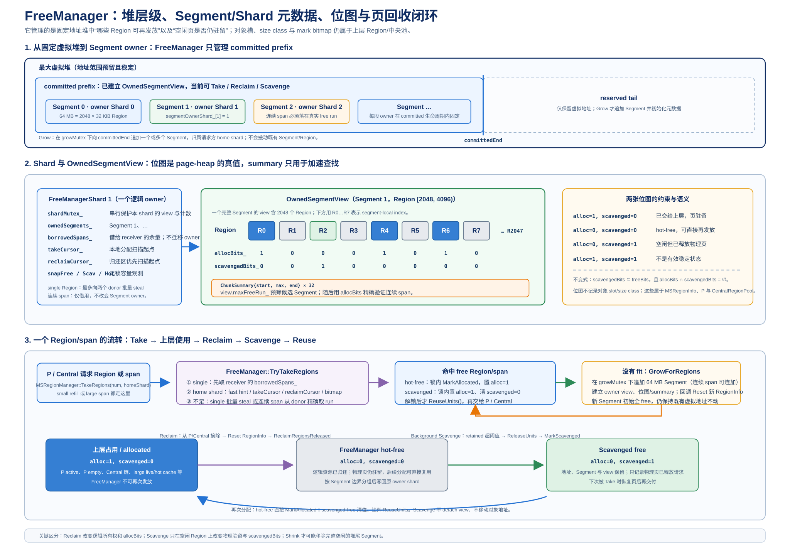
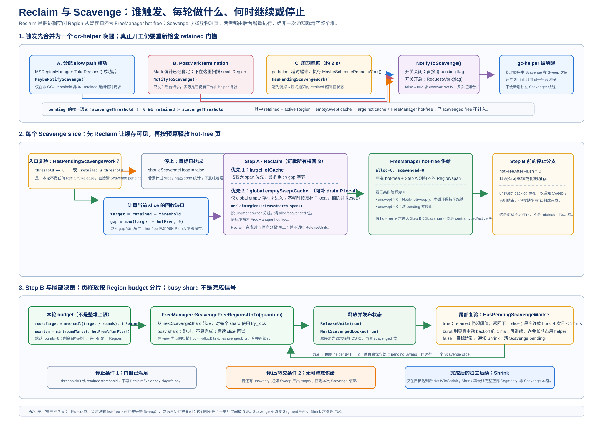

# MSGC Scavenge 架构与实现详解

> 本文以 2026-07-17 当前工作树中的 MSGC Runtime 源码为准，专门解释 `FreeManager` 的页堆模型、Scavenge 的触发与后台执行、物理页归还以及与 Reclaim/Sweep/Shrink 的边界。历史 Implementation 文档只用于说明演进动机；当其与函数体冲突时，本文按当前源码描述。

## 目录

1. [文档范围与核心结论](#1-文档范围与核心结论)
2. [先分清 Sweep、Reclaim、Scavenge 和 Shrink](#2-先分清-sweepreclaimscavenge-和-shrink)
3. [组件边界与完整数据流](#3-组件边界与完整数据流)
4. [FreeManager 的数据模型](#4-freemanager-的数据模型)
5. [Region 在 FreeManager 中的状态机](#5-region-在-freemanager-中的状态机)
6. [Scavenge 使用的内存口径与阈值](#6-scavenge-使用的内存口径与阈值)
7. [什么时候通知 Scavenge](#7-什么时候通知-scavenge)
8. [`gc-helper` 如何等待、唤醒和调度](#8-gc-helper-如何等待唤醒和调度)
9. [BackgroundScavengeLoop 的逐步执行](#9-backgroundscavengeloop-的逐步执行)
10. [FreeManager 内部的扫描与物理页释放](#10-freemanager-内部的扫描与物理页释放)
11. [Scavenged Region 如何再次分配](#11-scavenged-region-如何再次分配)
12. [并发、锁与正确性不变式](#12-并发锁与正确性不变式)
13. [Linux、macOS 和 Windows 的平台语义](#13-linuxmacos-和-windows-的平台语义)
14. [Scavenge 与两种 Shrink 的关系](#14-scavenge-与两种-shrink-的关系)
15. [参数、日志与问题定位](#15-参数日志与问题定位)
16. [一个完整数值示例](#16-一个完整数值示例)
17. [历史文档与当前源码对照](#17-历史文档与当前源码对照)
18. [实现边界、风险与源码索引](#18-实现边界风险与源码索引)

## 1. 文档范围与核心结论

本文只讨论 MSGC（Mark-Sweep GC）中的空闲页回收路径，尤其是 `MSRegionManager` 内嵌的 `FreeManager`、后台 `Scavenge`，以及 Scavenge 之后可选的 Segment 级 `Shrink`。对象标记、指针修正、写屏障和普通 Sweep 的完整说明仍以总体架构文档及 GC collector 文档为准。

先给出实现结论：

1. `Sweep`、`Reclaim`、`Scavenge` 不是同一个动作。Sweep 根据 mark bitmap 清理对象槽位并生成可分配 Region；Reclaim 把这些 Region 交给 `FreeManager`；Scavenge 只处理已经空闲但仍保留在运行时逻辑堆中的 Region，向操作系统请求丢弃/撤销物理页；Shrink 则是更高层的容量收缩策略。
2. 当前 `FreeManager` 不是历史版本中的全局有序树，而是“按 owner shard 管理 Segment、每个 Segment 使用分层位图和 64-Region 摘要”的页堆。每个 Segment 只有一个固定 owner，其他 shard 可以借用，但不会改变 owner。
3. FreeManager 中的 Region 有两个独立 bit：`allocBits` 表示逻辑上是否已分配，`scavengedBits` 表示该空闲页是否已经执行过 Scavenge。合法状态只有 `10`（已分配）、`00`（hot-free）和 `01`（scavenged/cold-free）；`11` 是禁止发布的中间/错误状态。
4. Scavenge 的策略口径是 `retained > scavengeThreshold`。`retained` 由中央缓存、空闲 swept 缓存、大对象 hot cache 和 FreeManager 的 hot-free 近似组成；已经标记为 scavenged 的 cold-free 不计入 retained。
5. 通知是“置位 + 条件变量唤醒”的合并事件，不是一个任务队列。分配成功后的 `TakeRegions`、`PostMarkTermination` 的 Sweep 发布，以及 `gc-helper` 的 2 秒周期检查都可能置位 Scavenge；真正执行前后台循环会再次检查阈值。
6. Scavenge 没有独立线程。`gc-helper` 按“终结器 → 并行/普通 Sweep → Scavenge → 可选 Shrink”的顺序执行。单次只处理一个受预算限制的切片；有后续工作时立即继续，但经过约 4 轮或 12 ms 会让出 CPU。
7. 当前 Scavenge 只改变页的物理驻留状态和 FreeManager 位图，不改变逻辑 committed heap 的尾端。`FreeManager::ShrinkHeap()` 虽然保留了真正缩短 committed tail 的接口，但当前主线没有调用它；后台 Shrink 走的是“释放一个完整空闲 Segment 的物理页”路径，也不拆除视图。

阅读下文时，`free` 指逻辑空闲 Region 总数，`hot-free` 指 `free - scavenged`，`cold-free` 指已经设置 `scavengedBits` 的空闲 Region。它们是页堆策略状态，不等价于某一时刻操作系统报告的 RSS。

## 2. 先分清 Sweep、Reclaim、Scavenge 和 Shrink

一块 Region 从“对象正在使用”到“操作系统物理页被释放”，通常经过以下链路：

```text
对象标记完成
    │
    ▼
Sweep：检查 mark bitmap，清理对象槽位/生成 partial、full、empty cache
    │
    ▼
Reclaim：把可复用 Region 交给 FreeManager，清 alloc bit，形成 hot-free
    │
    ▼
Scavenge：扫描 hot-free，调用 ReleaseUnits，设置 scavenged bit，形成 cold-free
    │
    ▼
再次分配：TakeRegions 选中 cold-free，清 scavenged bit，必要时 ReuseUnits
    │
    ▼
可选 Shrink：在整个 Segment 全空闲时做更大粒度的释放；或由独立 tail-shrink 接口缩短 committed 尾端
```

### 2.1 Sweep：产生可复用空间

`MarkSweepCollector` 的 Sweep 阶段读取标记结果，按对象布局清理 dead object，并将 Region 放入中央 partial/full/empty cache 或大对象缓存。Sweep 关注的是“哪些对象槽位可以再次分配”，不负责直接把页还给操作系统。并发 Sweep 的每个切片完成后，后台还会调用 `FlushCentralCacheToThreshold(heapThreshold)`，优先排空大对象缓存，再排空 empty cache；这一步可能把缓存中的空闲空间物化为 FreeManager 的 hot-free。

### 2.2 Reclaim：转移页的所有权

`MSRegionManager::ReclaimRegionsReleased` 接收一批已释放的 Region，先在 `pageHeapMutex_` 下按 Segment 和 owner shard 分组，随后分别锁定 owner shard，调用 `FreeManager::MarkFreeLocked` 清除 `allocBits`。旧的 `scavengedBits` 会一并清除，因此重新回到 `00` hot-free 状态。Reclaim 的结果是“运行时可以重新拿来分配”，但尚未请求 OS 丢弃物理页。

### 2.3 Scavenge：降低物理驻留

Scavenge 只从 `00` 状态中选择 Region。它不会重新扫描对象，也不会改变 Region 的 owner；它在 owner shard 锁内调用平台 `ReleaseUnits`，成功完成位图发布后把 Region 标记成 `01`。这样后续分配仍可使用该 Region，但必须先经过 cold-page 的复用处理。

### 2.4 Shrink：容量策略，而不是 Scavenge 的别名

当前代码有两种容易混淆的 Shrink：

- `BackgroundShrinkLoop` 使用 `BackgroundShrinkOneSegment`，寻找完全空闲的 Segment，释放其中 hot-free 的物理页并将其标记为 scavenged；Segment 视图和 committed 逻辑边界保留。
- `FreeManager::ShrinkHeap()` 是尾端拓扑收缩接口，要求 committed 尾部存在完整空闲 Segment，并且 owner 仍保留至少一个 Segment，然后移动 committed end、释放尾部视图和位图 arena。当前源码没有找到主线调用者，不能把它描述成普通后台 Scavenge 的必经步骤。

## 3. 组件边界与完整数据流

Scavenge 的对象关系可以按“统计口径、调度入口、页堆执行、平台释放”四层理解：

| 层次 | 主要对象/函数 | 责任 |
| --- | --- | --- |
| 统计与阈值 | `RegionSpaceMS::GetHeapRetainedBytes`、`MarkSweepCollector::GetHeapThreshold`、`GetScavengeThreshold` | 判断是否存在待处理的保留空间 |
| 事件与调度 | `MSRegionManager::MaybeNotifyScavenge`、`BackgroundProcessor::NotifyToScavenge` | 合并通知并唤醒 `gc-helper` |
| 页堆执行 | `RegionSpaceMS::BackgroundScavenge`、`MSRegionManager::ScavengeFreeRegionsUpTo`、`FreeManager::ScavengeFreeRegionsUpTo` | 将预算转换成 Region，按 shard 扫描 hot-free |
| OS 语义 | `FreeManager::ReleaseUnits`、`ReuseUnits` | 释放或重新提交/映射页 |

一个典型分配到后台回收的时序如下：

1. Mutator 或 GC 线程从中央缓存拿不到合适 Region，进入 `MSRegionManager::TakeRegions`。
2. `FreeManager::TryTakeRegions` 在本地 owner shard、借用队列或其他 donor shard 中找空闲 Region；如果命中 `scavengedBits`，先清 bit，必要时调用 `ReuseUnits`。
3. `TakeRegions` 成功后调用 `MaybeNotifyScavenge`。通知函数只在 GC 尚未开始、开关开启、阈值非零且 retained 超阈值时置位事件。
4. `gc-helper` 被唤醒后先完成本轮更高优先级的 Sweep，再进入 `BackgroundScavengeLoop`。Scavenge 重新读取 retained 和阈值，避免使用过期通知数据。
5. Scavenge 先将仍在 central/empty/large cache 中的空间转移成 FreeManager hot-free，再按照本轮预算调用 FreeManager 扫描并执行 `ReleaseUnits`。
6. FreeManager 发布 `scavengedBits` 后，`GetHeapRetainedBytes` 中的 hot-free 减少，cold-free 增加但不计入 retained。若仍超阈值，helper 立即进行下一切片；若已达目标，再按配置通知 Shrink。

`MarkSweepCollector::PostMarkTermination` 会在 large eager reclaim 和 mark 统计完成后直接调用 `NotifyToSweep` 和 `NotifyToScavenge`。因此 Scavenge 不只依赖某一次分配触发：GC 周期和 2 秒周期检查都能修复“此前没有分配事件”的场景。通知不是把具体 Region 放入队列，所有候选页都在后台执行时根据当前位图重新计算。

### 3.1 两种“缓存中的空闲”

中央缓存里的 empty Region 尚未属于 FreeManager；大对象 hot cache 也仍由 `MSRegionManager` 持有。`BackgroundScavengeLoop` 的 Step A 调用 `FlushCentralCacheToThreshold` 相关逻辑，将这些缓存项 materialize 到 FreeManager，再让 Step B 执行真正的页释放。因此“`retained` 高但 FreeManager 的 hot-free 为零”并不矛盾，后台循环需要先完成这一层转移。

### 3.2 逻辑堆、页表和操作系统页

MSGC 预留的对象堆通常远大于当前 committed 前缀。FreeManager 维护的是 committed 前缀内的 Region 元数据，位图中的 free/cold 状态表示运行时分配策略；`madvise`、`mmap` 或 `VirtualFree` 的实际结果由平台决定。因而 Scavenge 完成后，逻辑地址仍在、Segment 视图仍在，但对应页可能已不再占用物理内存。

## 4. FreeManager 的数据模型

下图从堆、Segment、shard、OwnedSegmentView 到位图与 summary 展开 FreeManager 的层次，并标出 Reclaim、Scavenge 和再分配的入口。



> 图 8-1：FreeManager 的分片页堆、元数据和主要操作路径。

### 4.1 Region、Segment 与 owner shard

当前实现的基本粒度是：

- 一个 Region 为 `32 KiB`（`MS_REGION_SIZE`）。
- 一个完整 Segment 为 `64 MiB`（`kMSShardSegmentBytes`），包含 `2048` 个 Region。
- `shardCount` 通常与处理器/分配器数量对应，最小归一化为 1。初始化时每个 shard 获得一个 Segment，后续增长的 Segment 以请求者为 owner 分配。
- 对象堆的最大虚拟预留通常为 `16 GiB`；初始化和增长只为已 committed 的前缀建立可用视图，预留空间本身不表示 RSS。

`segmentOwnerShard_[segmentIdx]` 在一个 Segment 的 committed 生命周期内固定不变。某个 shard 没有本地空闲页时可以从其他 owner shard 借用 Region，但这只是借用分配权，不会改变 Segment 的 owner。这样释放时能够根据 Segment 索引回到唯一 owner，避免跨 shard 同时修改同一份位图。

```text
MSRegionManager
├── FreeManager
│   ├── FreeManagerShard[0]
│   │   ├── owned Segment view[]
│   │   ├── borrowedSpans[]
│   │   └── take/reclaim/scavenge cursor
│   ├── FreeManagerShard[1]
│   └── ...
└── page heap / committed-end metadata
```

### 4.2 OwnedSegmentView 的四类元数据

每个 owner shard 对自己的 Segment 建立 `OwnedSegmentView`。一个完整 Segment 的动态元数据大致由以下部分组成：

| 元数据 | 含义 | 完整 Segment 规模 |
| --- | --- | --- |
| `allocBits_` | 1 表示 Region 当前被分配/占用，0 表示逻辑空闲 | 2048 bit = 256 B |
| `scavengedBits_` | 1 表示该空闲 Region 已请求物理页释放 | 2048 bit = 256 B |
| `chunkSummaries_` | 每 64 个 Region 的 `{start,max,end}` 空闲连续段摘要 | 32 个摘要，约 192 B |
| `maxFreeRun_` | 当前 view 中最大连续空闲长度 | 一个整数 |

摘要是分配快速路径和 span steal 的索引，不是第三份真相。真正的页状态由两个位图决定；每次 `MarkFreeLocked`、`MarkAllocatedLocked`、`MarkScavengedLocked` 都会更新受影响 chunk 的摘要及 shard 快照。

### 4.3 FreeManagerShard 的运行状态

`FreeManagerShard` 包含一把 `shardMutex_`，以及以下状态：

- owned Segment/view 列表；
- `freeRegionCount`，包含 hot-free 和 cold-free；
- `scavengedRegionCount`，是 cold-free 子集；
- `takeCursor`、`reclaimCursor` 和 Scavenge 相关扫描游标，用于避免每次从同一位置开始；
- `borrowedSpans` 队列及其 Region 计数，保存从其他 owner shard 借来的连续段；
- donor 选择用的原子 `nextStealDonorShard`；
- 最近一次最大连续空闲段等快速路径 hint；
- free/scavenged/hot/max-run 的 relaxed atomic snapshot，供阈值统计和诊断读取。

因此 `hotFreeBytes` 的计算是：

```text
hotFreeRegions = freeRegionCount - scavengedRegionCount
hotFreeBytes   = hotFreeRegions * MS_REGION_SIZE
```

这组 snapshot 是并发下的近似观察值，不保证与某个时刻的所有 shard 位图构成单一一致快照；它适合做后台策略触发，不适合作为精确内存审计。

### 4.4 FreeManager 的三条主路径

1. `TryTakeRegions`：按“本地 borrowed queue → 本地 owned view → donor steal”的顺序寻找单 Region 或连续 span。拿到 cold-free 时清除 `scavengedBits`，再返回给上层。
2. `ReclaimRegionsReleased`：由 RegionSpace 按 Segment/owner 分组后，调用 `MarkFreeLocked` 清 alloc bit 并更新摘要，将页重新变成 hot-free。
3. `ScavengeFreeRegionsUpTo`：从指定的 shard 起轮转尝试锁，跳过忙 shard，扫描各 owned view 的 hot-free 位，按预算调用平台释放并设置 scavenged bit。

所有改变两个位图的操作都必须经过 owner shard 的锁。跨 shard 的调用只负责分组、借用或选 donor，不能直接写另一个 shard 的 bitmap。

## 5. Region 在 FreeManager 中的状态机

两个 bit 的组合直接决定 Region 能否被分配和能否被 Scavenge：

| `allocBits` | `scavengedBits` | 语义 | 分配器行为 | Scavenge 行为 |
| ---: | ---: | --- | --- | --- |
| 1 | 0 | 已分配 | 不可选 | 不可扫描 |
| 0 | 0 | hot-free | 可直接复用 | 可选，属于释放候选 |
| 0 | 1 | cold-free / scavenged | 可复用，但需先恢复页语义 | 不再重复释放 |
| 1 | 1 | 非法发布状态 | 禁止出现 | 说明状态更新顺序被破坏 |

初始化时新 view 的两个位图都为 0，所以整个初始 committed 区间在逻辑上是 hot-free。这里的 hot 只表示“尚未由 FreeManager 标记为 scavenged”，不代表每一页都已被访问或当前一定驻留在物理内存中。

### 5.1 Reclaim：`10 → 00`

Region 被 Sweep/缓存逻辑确认为空闲后，`MarkFreeLocked` 清除 `allocBits`；如果旧状态是 `01`，还要清除 `scavengedBits`，因为重新归还给 FreeManager 的页需要重新计入 hot-free。随后更新 free/scavenged 计数、chunk summary、最大连续空闲段和原子快照。

### 5.2 Scavenge：`00 → 01`

`ScavengeOwnedFreeRegionsLocked` 只对 `~alloc & ~scavenged` 的 mask 扫描。它先在 owner shard 锁内计算一段 hot-free 地址，然后调用 `ReleaseUnits`。物理页释放请求返回后才发布 `scavengedBits`。这个顺序和锁范围很关键：如果先发布 bit 再释放页，分配器可能同时选中该 Region；如果释放页后立即解锁但尚未发布 bit，另一个线程也可能将其当成 hot-free 重复选取。

### 5.3 再分配：`01 → 10/0`

`TryTakeRegions` 选择 Region 后，在 owner shard 锁内设置 `allocBits`，同时清除 `scavengedBits` 并减少 cold-free 计数。批量路径会收集本次命中的 cold-free 单元，解锁后调用 `ReuseUnits`：

- Windows 需要重新 `VirtualAlloc(..., MEM_COMMIT, ...)`；
- POSIX/macOS 依赖地址仍有效，Linux/OHOS 的 reuse 通常是 no-op，下一次访问重新触页；
- macOS 在 `mmap(MAP_FIXED)` 之前会做清零/内存设置。

分配器先完成位图状态发布，再执行恢复页动作，避免恢复页期间阻塞 owner shard 锁。对跨 shard steal 的连续段，冷页会在借用队列被消费前按批次处理。

### 5.4 不变量

对每一个合法 view 始终应满足：

```text
scavengedBits ⊆ freeBits
freeRegionCount = hotFreeCount + scavengedRegionCount
allocBits & scavengedBits = 0
```

摘要中的最大连续空闲长度必须能由 `~allocBits` 重建；Scavenge 只把 `00` 改为 `01`，不会改变 free 总数；重新分配只会把 free 减少并清理对应 scavenged bit。出现 `alloc=1 && scavenged=1`、free 计数为负或摘要大于真实 run 时，都应优先检查 owner 锁覆盖范围和状态发布顺序。

## 6. Scavenge 使用的内存口径与阈值

### 6.1 retained 的组成

`RegionSpaceMS::GetHeapRetainedBytes()` 当前按以下近似公式统计：

```text
retained = activeCentralRegions * 32 KiB
         + emptySweptCount * 32 KiB
         + largeHotCacheBytes
         + FreeManager.hotFreeBytes
```

其中：

- `activeCentralRegions` 来自 central pool 的 partial/full swept、unswept bucket 以及仍存活的大对象 span；
- `emptySweptCount` 包含 global/local empty cache；
- `largeHotCacheBytes` 是尚未 materialize 到 FreeManager 的大对象空闲缓存；
- `FreeManager.hotFreeBytes` 是 `free - scavenged`，已经 cold-free 的 Region 不再计入 retained。

该口径没有把 runtime 元数据、bitmap、线程本地分配缓冲区的全部细节、栈和其他 native 内存纳入；active Region 的计数与多个 relaxed atomic 快照也不是一个严格线性化时刻。因此 retained 是 GC 策略水位，而不是 RSS 的替代品。

### 6.2 heapThreshold 与 scavengeThreshold

MSGC 先根据真实存活量和 `cjHeapGrowth` 计算 `heapThreshold`，同时施加最小值、上限、增长速率和安全边界。默认 `cjHeapGrowth=1.0`，所以在没有 floor/cap 影响时 heap threshold 大致是 live 的两倍。

Scavenge 使用独立的增长系数：

```text
scavengeThreshold = SaturatingMul(heapThreshold, cjScavengeGrowth)
```

默认 `cjScavengeGrowth` 取 `cjHeapGrowth`，因此默认情况下两者乘数为 1，Scavenge 目标通常等于 heap threshold。配置值为 0 或整数溢出时，代码会走禁用/饱和保护路径，不能通过普通乘法推断结果。

`HasPendingScavengeWork()` 的核心判断是：开关允许、阈值非零，并且

```text
GetHeapRetainedBytes() > scavengeThreshold
```

后台每次执行前都会重新取这两个值。通知时看到的 retained 只负责唤醒 helper，不能保证执行时仍有同样数量的可释放页。

### 6.3 retained 与 cold-free 的关系

Scavenge 将 `00` 转成 `01` 后，逻辑 free 总量不变，hot-free 下降，cold-free 上升，retained 下降。若下一次分配重新使用该页，则 `01` 转成已分配状态，retained 不会因为“重新提交”而恢复原来的 hot-free；如果该 Region 后续再次 Reclaim，则回到 `00` 并重新计入 retained。

这解释了一个常见现象：日志中的 committed heap 大小长期不变，但 retained 下降、scavenged 数量上升，RSS 可能下降；反之，如果所有空闲页都已是 cold-free，retained 可能接近阈值而继续 Scavenge 没有工作。

## 7. 什么时候通知 Scavenge

Scavenge 的触发、阈值判断、后台 burst 和停止条件见下图；它只释放 hot-free 的物理页，不改变 Region index 或最大虚拟堆映射。



> 图 8-2：Reclaim/Scavenge 的通知合并、执行、重取快照与停止条件。

当前源码有三个主要通知入口，另有一个配置关闭路径。

### 7.1 分配成功后的 `MaybeNotifyScavenge`

`MSRegionManager::TakeRegions` 在 `FreeManager::TryTakeRegions` 成功拿到 Region 后调用 `MaybeNotifyScavenge()`。它按以下顺序做保护和判断：

1. 如果 GC 已经开始，直接返回，避免在 GC 关键阶段额外驱动后台工作。
2. 如果 `scavengeThreshold` 为 0，返回。
3. 如果没有 `RegionSpaceMS`/pool，返回。
4. 重新读取 retained；只有 `retained > scavengeThreshold` 才调用 `BackgroundProcessor::NotifyToScavenge()`。

这个入口的意义是：分配路径刚刚消费或观察到页堆状态变化时，及时把超过水位的 retained 交给 helper。它不是“每次分配通知”，因为通知本身是合并的，而且阈值检查会过滤绝大多数调用。

### 7.2 Post-Mark 的 Sweep 发布

`MarkSweepCollector::PostMarkTermination()` 在 large eager reclaim 和 mark 统计后无条件调用 `NotifyToSweep()` 和 `NotifyToScavenge()`。`NotifyToScavenge` 只负责置位并唤醒，后台真正执行时仍会调用 `HasPendingScavengeWork`。这样即使随后 Sweep 把大量 empty/large cache 变成可回收空间，也不会要求 GC 主线程同步执行 OS 页释放。

当前主线的 GC 周期通知点就在 `PostMarkTermination`；此外仍有 `TakeRegions` 和 helper 周期检查两个独立入口。历史 Implementation 文档中的更早触发点不能直接套用。

### 7.3 2 秒周期兜底

`gc-helper` 的外层循环在无工作或超时唤醒后进入 `MaybeSchedulePeriodicWork`。约每 `2000 ms` 检查一次：如果后台 Scavenge 开关开启、当前 scavenge flag 尚未置位且 `HasPendingScavengeWork()` 为真，就把 flag 置为 true。它用于覆盖以下情况：

- 大对象 cache 的变化没有经过当前 `TakeRegions` 入口；
- 通知和状态更新之间发生了竞态；
- 应用长期没有新的 Region 分配，但 retained 仍停在阈值以上。

因此周期检查是 level-triggered 的修复机制，不是固定周期强制释放所有页。

### 7.4 `NotifyToScavenge` 的合并语义

`BackgroundProcessor::NotifyToScavenge()` 首先检查 `cjMSBackgroundScavenge`。开关关闭时清除 flag 并返回，不会启动隐藏的同步回收。开关开启时使用类似以下逻辑：

```text
if (!scavengeRequested.exchange(true, acq_rel)) {
    conditionVariable.notify_one()
}
```

多个线程同时通知只产生一次唤醒，flag 在工作期间保持为 true。helper 完成一个 slice 后根据 `hasMore` 决定继续保留 flag，或者在达标/无供给时清零。

这个设计不是带计数的可靠消息队列：通知者可能在 helper 清零前看到 flag 已经为 true，于是不会再次 notify。当前实现依靠“后台循环立即重算、分配入口再次检查、2 秒周期兜底”恢复 level 条件，而不是保证每个通知边沿都单独被消费。

### 7.5 哪些情况不会立即通知

`retained <= threshold`、GC 已开始、阈值为 0、Scavenge 开关关闭或没有 pool 时，`MaybeNotifyScavenge` 都不会发送事件。Scavenge 也不是因为 committed heap 变大就必然触发；只有 retained 口径超过阈值才是策略条件。一次通知到达时如果 hot-free 为零，后台还会先检查 empty/large cache 和 unswept backlog，而不是盲目扫描位图。

## 8. `gc-helper` 如何等待、唤醒和调度

### 8.1 线程模型

`BackgroundProcessor::Start` 创建一个 joinable 的 native `pthread`，线程名为 `gc-helper`，并注册为运行时的 `MSGC_BACKGROUND_THREAD`。线程进入 runtime safe region 后，循环处理终结器、Sweep、Scavenge 和 Shrink。Scavenge 没有单独的 Scavenger 类或专用线程，它与后台 Sweep 共享同一条 worker loop。

停止时由 `Stop` 将 running 标志清零、唤醒条件变量并 join helper。单个 Scavenge slice 内部没有可被外层强制打断的 running 检查，所以 slice 必须保持有界；当前预算和轮次限制就是这个边界的重要组成部分。

### 8.2 每轮处理顺序

helper 每轮大致按以下顺序执行：

```text
finalizer
  → parallel sweep（若有可处理任务）
  → ordinary/background sweep（并行路径没有处理时）
  → BackgroundScavengeLoop
  → BackgroundShrinkLoop（由配置和通知决定）
```

该顺序意味着 Scavenge 看到的缓存可能刚刚由 Sweep 产生；反过来，如果 Scavenge 没有供给但发现 unswept backlog，它会重新通知 Sweep，并把自己视为仍有工作，以便下一轮尽快重试。

### 8.3 有工作时的 burst 与让出 CPU

如果 Sweep、Scavenge 或 Shrink 任一函数返回“仍有后续工作”，helper 不进入长时间等待，而是立刻继续下一轮并调用 `yield`。为了避免 GC helper 在 mutator 持续分配时独占 CPU，外层设置了两层限制：

- 连续 burst 最多约 4 轮；
- 或累计工作时间达到约 `12000 µs` 后结束 burst。

达到限制后调用 `WaitForActiveBackoff(1 ms)`。这个等待仍可被条件变量通知提前打断；它不是固定 sleep。下一轮若仍有工作，会重新开始一个 burst。

### 8.4 无工作时的条件变量等待

当没有待处理的 Sweep/Scavenge/Shrink/finalizer 工作时，helper 在条件变量上等待，最长约 `2000 ms`。等待谓词检查 running 状态和各工作 flag；任何 `NotifyToSweep`、`NotifyToScavenge`、`NotifyToShrink` 都会唤醒它。超时返回后，helper 运行周期性兜底检查，而不是把超时误认为一次 Scavenge 任务。

### 8.5 竞态下的行为

flag 是原子变量，通知只做从 false 到 true 的边沿唤醒；worker 负责在完成或无供给时清零。若通知发生在清零临界窗口，可能不会产生额外 notify，但下一轮的 level 检查会重新判断 retained 和 backlog。诊断时应看“flag 是否最终清零、retained 是否下降、周期检查是否置位”，不能只按 notify 次数统计工作量。

## 9. `BackgroundScavengeLoop` 的逐步执行

`BackgroundScavengeLoop` 是 Scavenge 的策略编排层。它不直接操作位图，而是反复计算“距离阈值还差多少”，先把缓存转成 hot-free，再将预算传给 RegionManager/FreeManager。

### 9.1 Step 0：读取状态并确认是否需要工作

入口先取得当前 `RegionSpaceMS`、FreeManager snapshot、retained 和 `scavengeThreshold`。如果 `HasPendingScavengeWork()` 为假，就记录 pending 统计、清理 Scavenge flag、重置 slice 统计并返回 `false`。这一步使过期通知变成无操作唤醒。

随后重新计算：

```text
targetBytes = max(retained - scavengeThreshold, 0)
sliceTargetBytes = targetBytes
```

保存 slice 目标后再取一次 hot-free、empty cache 和 large hot cache 快照。目标是“当前这一刻至少降低 targetBytes 的 retained”，不是固定释放某个 Segment 数量。

### 9.2 Step A：把缓存 materialize 成 hot-free

如果 `hotFree + emptySwept + largeHotCache` 都为零，说明当前没有可向 FreeManager 转移的供给：

- 仍有 unswept backlog 时，调用 `NotifyToSweep` 并返回 `true`，保持 Scavenge flag，让下一轮在 Sweep 产出后重试；
- 没有 unswept 时，清 Scavenge flag 并返回 `false`。

否则先计算：

```text
gap = max(targetBytes - hotFreeBytes, 0)
```

然后按“large cache 优先、empty cache 次之”的顺序物化：

1. large hot cache：如果总字节数不超过 gap，则全部 flush；否则按 gap 限额从最大 bucket 开始排空。大对象缓存按完整 entry 粒度移动，实际结果可能略大于 gap。
2. empty swept cache：如果剩余 gap 足够容纳全部 empty Region，则全部 flush；否则按 `ceil(gap / RegionSize)` 计算 Region 数再转移。

这一阶段把仍由中央缓存持有的 resident free 空间交给 FreeManager。它通常不会改变 retained 的总口径，只改变 retained 各组成项的分布：cache 下降，hot-free 上升。当前实现会努力填满本次计算的 gap，并非历史设计中的“一次只 flush 一半”。

### 9.3 Step A 后重新取快照

缓存 flush 可能与其他分配/回收线程并发，且 entry 粒度会导致 overshoot，因此必须重新读取 retained 和各类供给。如果 retained 已经不超过阈值，直接结束；如果三类供给都为零，则重复 9.2 的 unswept/stop 分支。不能使用 Step 0 的旧 `hotFreeBytes` 直接计算下一步预算。

需要注意当前函数体的一个边界：Step A 后即使 large/empty cache 仍有 residual，只要 `hotFreeAfterFlush` 为 0，Step B 的 `availableToRelease` 就是 0，函数会直接清 Scavenge flag 并返回 `false`。这不是“已经释放了 residual cache”，而是当前实现只把 hot-free 作为 Step B 的 OS 释放供给；后续 Sweep/分配事件或 2 秒周期检查会再次触发 materialize。

### 9.4 Step B：按轮次计算本次 OS 释放预算

默认 `cjMSScavengeRounds=8`。本次目标先按轮次切分，再保证至少推进一个 Region：

```text
roundTarget = max(ceil(sliceTargetBytes / cjMSScavengeRounds), RegionSize)
available   = hotFreeBytesAfterFlush
quantum     = min(roundTarget, available)
```

随后调用 `RegionSpaceMS::BackgroundScavenge(quantum)`，再由 `MSRegionManager` 转发到 `FreeManager::ScavengeFreeRegionsUpTo(quantum)`。这里的 rounds 是“每次目标 gap 的分母”，不是保证恰好执行 8 次；每次结束后 retained 会重新计算，gap 可能变小或被新的分配改变。最小一个 Region 用来保证小于一个 Region 的尾差最终也能收敛。

### 9.5 Step C：处理结果和下一轮

FreeManager 返回实际释放的字节数。只有 `released > 0` 才累计本轮的 Scavenge 统计；try-lock 失败、没有 hot-free 或平台释放没有可计量结果时，单次结果可以是 0。

然后重新调用 `HasPendingScavengeWork()`：

- `false`：通知 Shrink（若开启），记录 `scavenge done (goal met)`，清 flag，返回 `false`；
- `true`：保留 flag，返回 `true`，由 helper burst 逻辑立即调度下一 slice。

如果所有 shard 都忙，FreeManager 可能返回 0，但 retained 仍高于阈值，于是 `hasMore=true`。这会在下一轮重试，而不是把“本次没拿到锁”误判成已经达标。

完整控制流可简化为：

```text
while (retained > threshold):
    flush large/empty cache until hot-free covers current gap
    if no supply:
        if unswept backlog: notify sweep; retry
        else: stop
    quantum = max(ceil(initial_gap / rounds), one_region)
    released = FreeManager.Scavenge(quantum)
    if goal met: notify shrink; stop
    else: retry under helper burst/backoff policy
```

## 10. FreeManager 内部的扫描与物理页释放

### 10.1 按 shard 轮转并 try-lock

`ScavengeFreeRegionsUpTo(maxBytes)` 先把预算向上取整到 Region 数。它从 `nextScavengeShard_` 开始轮转，每次对 shard 使用 `try_lock`：

- 成功拿锁的 shard 执行 `ScavengeOwnedFreeRegionsLocked`；
- 忙 shard 被跳过，不等待 allocator 或 reclaim；
- 本次调用结束后起点推进，避免长期只扫描低编号 shard；
- 如果所有 shard 都忙，返回 0，但不修改 retained 目标或清除后台 flag。

try-lock 是后台友好性设计：Scavenge 不能因为一个 mutator 正在拿 Region 而阻塞整个 helper。代价是单个 slice 可能没有释放任何页，靠下一轮 burst 或周期检查重试。

### 10.2 在一个 OwnedSegmentView 中找 hot-free run

持有 owner shard 锁后，扫描自己的 view，通常从较新的/高地址 Segment 反向开始，以便优先处理高地址空闲页。对每个 bitmap word 构造：

```text
hotMask = validMask & ~allocWord & ~scavengedWord
```

然后按高位到低位提取连续 run。扫描需要处理三个细节：

1. **word 边界合并**：前一个 word 的低端 run 与当前 word 的高端 run 相邻时合并，不能把一个跨 64-bit word 的连续页拆成两个不必要的释放调用。
2. **Segment/chunk 边界**：每 64 Region 的 chunk summary 只用于快速定位，最终 run 仍由位图校验；跨 chunk 的连续段也要正确合并。
3. **预算截断**：如果剩余预算不足以覆盖整个 run，只释放其中满足预算的高地址子段，保留剩余 hot-free；预算按 Region 计，不会释放半个 Region。

如果一个 view 的 free count 小于等于 scavenged count，说明没有 hot-free，直接跳过。扫描顺序不改变状态语义，只影响释放地址和后续分配局部性。

### 10.3 释放与发布位图的顺序

对找到的 run，FreeManager 在 shard 锁内调用 `ReleaseUnits(addr, bytes)`。平台调用完成后，调用 `MarkScavengedLocked`：设置 `scavengedBits`、增加 scavenged 计数、更新 snapshot 和必要的摘要。free 总数不变。

保持锁覆盖“OS 请求 + 位图发布”是当前实现的核心并发不变量：

```text
锁内：选 hot-free → ReleaseUnits → 发布 scavenged bit
解锁：返回实际字节统计
```

如果平台调用失败，平台层可能只打日志或返回被忽略（见第 13 节），但 FreeManager 仍按当前代码发布 scavenged bit；因此 `scavenged` 应理解为“运行时已经请求/记录过释放”，不是跨平台统一的“OS 已确认回收”。

### 10.4 Reclaim、Take 和 Scavenge 的互斥关系

- Reclaim 清 alloc bit 必须持有对应 owner shard 锁；它不能与 Scavenge 同时把同一个 `00` 页重新解释成其他状态。
- Take 在同一把 owner 锁内设置 alloc bit，因此不会选到正在被 Scavenge 发布的页。
- `ReclaimRegionsReleased` 先在 `pageHeapMutex_` 下分组，再释放 page-heap 锁，按 owner shard 分别修改位图，避免长时间持有全局页堆锁。
- Scavenge 本身只需要 shard 锁，不持有 page-heap 全局锁；增长/拓扑变更通过 `growMutex_` 和 page-heap 协作，保证 view 生命周期稳定。

### 10.5 释放量和快照

一个 slice 的返回值是实际标记为 scavenged 的 Region 数乘 Region 大小，而不是根据 retained 差值猜出的目标值。`ScavengeFreeRegionsUpTo` 的预算可能因 run 边界、空闲供给和 try-lock 结果而少于目标；大对象缓存的 flush 也可能使 retained 在 Step A 中已经下降。

FreeManager 的 shard snapshot 使用 relaxed atomic 更新，诊断日志中看到的 free/scavenged/hot/max-run 可能来自不同微时刻。判断是否“确实没有 Scavenge 进展”时，应该结合 `released bytes`、各 shard cold 数变化和 helper 日志，而不是只看一次快照。

## 11. Scavenged Region 如何再次分配

Scavenge 不会把 Region 从地址空间删除，因此 cold-free 仍是可复用供给。复用路径分成“位图状态恢复”和“平台页语义恢复”两个阶段。

### 11.1 选择 cold-free

`TryTakeRegions` 先尝试请求 shard 的 borrowed queue，再扫描 owner shard 的 view；如果本地没有足够连续空间，会从 donor shard steal。无论 Region 来自本地还是借用，最终都必须通过固定 owner shard 锁更新状态。

当选中的 Region 的 `scavengedBits` 为 1 时，FreeManager 在锁内执行：

```text
allocBits      : 0 → 1
scavengedBits  : 1 → 0
freeCount      : -1
scavengedCount : -1
```

如果选中的是 hot-free，则只设置 alloc bit 并减少 free count。两种来源最后都成为已分配 `10`。

### 11.2 `ReuseUnits` 的批处理

为了不在 owner shard 锁内做可能较慢的系统调用，FreeManager 先收集本次命中的 cold 单元，解锁后按批次调用 `ReuseUnits`。跨 shard steal 得到的多个连续 Region 也会在 borrowed queue 消费前统一处理。

当前平台差异为：

- Windows：用 `VirtualAlloc` 重新 `MEM_COMMIT`；
- Linux/OHOS 等 POSIX：通常不需要显式重新提交，下一次访问会触发页重新建立，因此 `ReuseUnits` 可为 no-op；
- macOS：地址通过 `mmap(MAP_FIXED)` 重新映射，具体动作见第 13 节。

这种“先发布逻辑分配、后恢复物理页”的顺序让分配器不会在系统调用期间阻塞同一 shard；代价是平台恢复失败需要由底层错误处理或后续访问暴露，不能仅凭 alloc bit 判定页已经物理可访问。

### 11.3 与中央缓存的关系

Scavenged Region 被重新拿走后，可以进入某个对象大小的分配缓冲区或 central bucket。后续对象释放、Sweep 或 Reclaim 可能再次把它变成 `00` hot-free，之后仍可被下一次 Scavenge 选中。Scavenge 不是一次性生命周期状态，而是 `00 ↔ 01` 在空闲阶段之间的循环。

## 12. 并发、锁与正确性不变式

Scavenge 的并发设计可以概括为“全局拓扑锁短持有、状态修改归 owner shard、后台扫描 try-lock”。

### 12.1 主要锁的职责

| 锁 | 保护内容 | Scavenge 是否长时间持有 |
| --- | --- | --- |
| `growMutex_` | Segment 增长、committed end 和拓扑变化 | 不参与普通 slice |
| `pageHeapMutex_` | Region 归还时的分组、页堆全局结构 | Scavenge 通常不持有 |
| `FreeManagerShard::shardMutex_` | owner view 位图、计数、summary、borrowed 状态 | 每个 shard slice 持有，包含 OS release |
| helper 条件变量/flag | 后台任务调度 | 不保护页位图 |

`ReclaimRegionsReleased` 在 page-heap 锁下只做按 owner 分组，然后释放该锁再逐 shard 更新；这避免 reclaim 和 Scavenge 形成长链锁嵌套。Segment 增长要和 view 生命周期协调，不能在 Scavenge 遍历时释放 view。

### 12.2 关键顺序

需要保持的顺序包括：

1. 释放页前仍持有 owner shard 锁；
2. `ReleaseUnits` 返回后再设置 `scavengedBits`；
3. 设置 alloc bit 时同时清除 scavenged bit；
4. 位图、计数、chunk summary 和 snapshot 在同一 owner 锁内更新；
5. helper 只有在重新读取 retained 后才能清除或保留 Scavenge flag。

这些顺序保证 allocator 不会把正在释放的 `00` 页再次拿走，也保证统计不会短暂出现 `scavenged > free`。

### 12.3 允许的非一致观察

为了降低后台开销，阈值计算读取多个 relaxed snapshot，不对所有 shard 停顿建立全局一致点。下面的短暂现象是允许的：

- retained 读到较旧值，导致一次多余唤醒或多处理一个 slice；
- 一个 shard 已更新位图，其他 shard snapshot 尚未刷新；
- 大对象/empty cache flush 与 retained 采样不在同一锁保护下；
- 所有 donor shard 暂时忙，slice 返回 0 但下一轮继续。

不允许的现象是：同一个 Region 同时被分配和标记 cold、`allocBits & scavengedBits != 0` 被发布、owner 释放后仍被旧 view 写入，或 Segment view 已销毁而扫描器仍持有指针。

### 12.4 “无进展”与“已完成”的判别

`released == 0` 不等于目标已完成。可能原因有：所有 shard try-lock 失败、hot-free 供给不足但 unswept 尚未完成、预算被 run 边界截断或平台调用没有可计量返回。只有重新计算 `retained <= scavengeThreshold`，或者明确没有任何 cache/hot-free 且没有 unswept backlog，才可以清除 flag。

## 13. Linux、macOS 和 Windows 的平台语义

FreeManager 的位图语义跨平台一致，但 `ReleaseUnits`/`ReuseUnits` 对操作系统的承诺不同。

### 13.1 Windows：显式 decommit/commit

Windows 释放路径调用：

```text
VirtualFree(address, bytes, MEM_DECOMMIT)
```

失败通常按 fatal 处理。Region 复用时调用：

```text
VirtualAlloc(address, bytes, MEM_COMMIT, PAGE_READWRITE)
```

因此 Windows 的 `scavengedBits=1` 与“该范围已被 decommit”语义最接近；但仍应以系统调用结果和日志为准。

### 13.2 Linux/OHOS 等 POSIX：`madvise(MADV_DONTNEED)`

POSIX 路径对地址范围调用 `madvise(..., MADV_DONTNEED)`，当前实现对返回值的处理较宽松/可能忽略。该操作通常使内核在需要时丢弃物理页，但虚拟地址映射仍然存在；下一次访问会触发重新分配或零页建立。`ReuseUnits` 因而通常是 no-op。

这里的 cold bit 表示 runtime 已请求并记录过 discard，不是“内核已经在此纳秒完成 RSS 下降”的确认。不同内核、容器和内存压力下，RSS 变化可能延迟或不明显。

### 13.3 macOS：清零后固定地址重映射

macOS 路径会先对目标范围执行 `MemorySet(addr, size, 0, size)`，随后用：

```text
mmap(addr, size, PROT_READ | PROT_WRITE,
     MAP_PRIVATE | MAP_ANONYMOUS | MAP_FIXED, -1, 0)
```

失败会记录错误；调用者仍按当前实现将范围标记为 scavenged，因此诊断时要同时查看 `mmap` 错误日志。复用时再次执行相应映射动作。清零和固定映射都可能带来可见成本，macOS 上 Scavenge 吞吐不能简单按 `MADV_DONTNEED` 的代价估计。

### 13.4 统一抽象的限制

FreeManager 不在位图中保存“系统调用成功/失败”的第二个状态，只保存是否已经走过 Scavenge。因而：

- `cold-free` 是 GC 的策略状态，不是平台内存管理的审计凭证；
- 分配器必须仍能在 cold Region 上安全复用，不能假定之前的页内容保留；
- 比较不同平台 RSS 时，需同时记录释放 API、内核行为和采样时点；
- 若发现页访问异常，优先核对 `ReleaseUnits`/`ReuseUnits` 的平台实现和错误处理，而不只检查两个 bitmap。

## 14. Scavenge 与两种 Shrink 的关系

### 14.1 Scavenge 达标后通知后台 Shrink

当 `BackgroundScavengeLoop` 重新计算得到 retained 已不超过 threshold，并且配置允许 Shrink 时，它调用 `NotifyToShrink`。默认 `cjMSBackgroundShrink=false`，关闭时通知函数会清除 Shrink flag，不创建额外工作。

开启后，helper 的后续阶段进入 `BackgroundShrinkLoop`，调用 `RegionSpaceMS::BackgroundShrinkOneSegment()`，再由 `MSRegionManager::ShrinkOneIdleSegment()` 寻找完全空闲的 Segment：

1. 扫描 committed Segment，跳过仍有 partial/full、TLS active、borrowed 或其他 in-use Region 的 Segment；
2. 将目标 Segment 相关的 empty/local/large cache 排空到 FreeManager；
3. 在 owner shard 锁内确认整个 Segment 的 Region 都为空闲；
4. 调用 `FreeManager::ReleaseCompletelyFreeSegment`，释放 hot 部分并把其标成 scavenged；
5. 保留 Segment view、owner 关系和 committed 逻辑边界。

所以这个后台 Shrink 的主要收益是整 Segment 级别地处理空闲页，便于后续回收策略和地址局部性；它仍不是把对象堆 committed 尾端向下移动。

### 14.2 `FreeManager::ShrinkHeap`：独立的 tail topology shrink

`ShrinkHeap()` 需要同时协调增长锁和 page-heap 元数据，只有当 committed 尾部存在完整空闲 Segment，且释放后每个 owner 仍至少保留一个 Segment 时，才会：

- 收缩 committed end/count；
- 删除尾部 owned view；
- 释放对应 bitmap/summary arena；
- 通过 RegionManager wrapper 更新页堆边界。

它是容量拓扑变化，不是普通 Scavenge 的最后一步。当前工作树没有找到其主线调用者；`ScavengeFreeRegions(bool releaseAll)` 等兼容接口也没有参与 `BackgroundScavengeLoop` 的默认路径。

### 14.3 为什么不把两个 Shrink 混写

排查时至少区分三种现象：

| 现象 | 可能路径 | committed logical heap 是否改变 |
| --- | --- | --- |
| hot-free 下降、cold-free 上升 | 普通 Scavenge | 否 |
| 某完整 Segment 的页全部变 cold | Background Shrink | 否 |
| committed end/count 下降、view 被移除 | `ShrinkHeap` tail shrink | 是 |

如果日志只有 `scavenge done` 而 committed bytes 不变，这是当前设计的正常结果；不能据此判断 Scavenge 失败。

## 15. 参数、日志与问题定位

### 15.1 主要运行参数

| 参数 | 当前作用 | 默认/约束 |
| --- | --- | --- |
| `cjMSBackgroundScavenge` | 是否允许 helper 执行后台 Scavenge | 默认开启；关闭时通知会被清除 |
| `cjMSScavengeRounds` | 单次目标 gap 的分片因子 | 默认 8，必须大于 0 |
| `cjScavengeGrowth` | `heapThreshold` 到 `scavengeThreshold` 的乘数 | 默认跟随 `cjHeapGrowth`，要求为正 |
| `cjHeapGrowth` | 计算 heap threshold 的增长系数 | MSGC 默认约 1.0 |
| `cjMSBackgroundShrink` | Scavenge 达标后是否进行 Segment 级后台 Shrink | 默认关闭 |
| helper poll/backoff | 周期检查约 2000 ms，主动退避约 1 ms，burst 约 4 轮/12 ms | 代码常量 |

当前源码中没有把历史文档里的 `CJ_MS_BG_SCAVENGE`、`CJ_MS_PIN_HOT_FREE` 当作主线控制项；调试时应以 `RuntimeConfig`/环境变量实际解析出的 `cjMS...` 名称为准。

### 15.2 推荐观察的日志

开启 `MRT_REPORT` 或对应 GC 报告后，建议按以下顺序观察：

1. `[MS-GC] heapThreshold ... scavengeThreshold`：确认阈值是否非零、是否被 floor/cap 影响；
2. `region-accounting`：看 active、empty、hotFree、largeCache 的构成；
3. 每 shard 的 `seg,total,used,free(hot,cold)`：确认 hot/cold 是否在变化；
4. `scavenge done` 或 `scavenge done (goal met)`：确认 helper 是否完成 slice/目标；
5. `shrink segment` / `shrink done`：确认是否真的走了可选 Segment Shrink；
6. macOS `mmap`、Windows `VirtualFree/VirtualAlloc` 错误：确认平台页动作是否成功。

### 15.3 典型症状与定位

**retained 超阈值但没有通知**

检查 `cjMSBackgroundScavenge` 是否关闭、GC 是否正处于 started 状态、阈值是否为 0；然后等待 2 秒周期检查。若周期检查也不置位，再检查 `HasPendingScavengeWork` 使用的 RegionSpace 是否正确。

**empty/large cache 很大，hot-free 很小**

这是 Step A 尚未 materialize 或 flush 被并发分配/锁竞争延后的表现。重点看 background loop 的 cache flush 日志，而不是直接判断 FreeManager 没有页。

**hot-free 很大，cold-free 长期不增长**

检查 Scavenge 开关、helper flag、所有 shard 是否持续 try-lock 失败，以及平台 `ReleaseUnits` 是否报错。若 helper 反复 `released=0` 但 retained 超阈值，属于“无进展重试”，不是已达标。

**cold-free 增长但 committed heap 不变**

这是普通 Scavenge 的预期。只有 tail `ShrinkHeap` 会改变 committed end；默认后台 Shrink 也只释放整 Segment 的物理页。

**RSS 与 retained 不一致**

先确认是否存在 TLS active Region、runtime 元数据或 native 分配未纳入 retained；再确认平台释放语义。`hot-free` 也不保证页一定驻留，初始未触页的空闲区域可能本来就没有 RSS。

**Scavenge 长时间没有进展且 CPU 很低**

检查是否所有 shard 忙、是否 unswept backlog 尚未被 Sweep 消化，或目标 gap 小于一个 Region。后一种情况仍应在最小 Region 预算下最终推进；若长期不变，应检查位图计数和 helper flag 是否卡死。

## 16. 一个完整数值示例

假设 Region 为 32 KiB，当前统计如下：

```text
active central regions  = 160 MiB
empty swept cache       = 64 MiB
large hot cache         = 48 MiB
FreeManager hot-free    = 64 MiB
FreeManager cold-free   = 128 MiB
```

则：

```text
retained = 160 + 64 + 48 + 64 = 336 MiB
```

设 `scavengeThreshold = 256 MiB`，本次目标为 `80 MiB`；cold-free 不计入 retained。

### 16.1 Step A：缓存物化

Step A 先看 hot-free 已有 64 MiB，距离目标还差 16 MiB。large cache 优先，所以从 48 MiB large cache 中 flush 16 MiB 左右的完整 entry；如果 entry 粒度导致实际 flush 20 MiB，hot-free 变为约 84 MiB，cache 组成同步下降，retained 仍约为 336 MiB。

如果 large cache 的最小 entry 已超过剩余 gap，代码可能继续 flush 一个完整 entry；这就是“物化预算可能 overshoot”，并不表示 Scavenge 已释放同样多的 OS 页。

### 16.2 Step B：按 rounds 释放

以 Step 0 保存的 80 MiB gap、默认 `cjMSScavengeRounds=8` 计算：

```text
roundTarget = ceil(80 / 8) = 10 MiB
```

10 MiB / 32 KiB = 320 个 Region，FreeManager 会从 hot-free 位图中最多选择 320 个 Region，按地址连续段调用 `ReleaseUnits`。如果由于 run 边界或 busy shard 只释放 256 个 Region，则实际释放 8 MiB，cold-free 增加 8 MiB，hot-free 减少 8 MiB。

本次结束后 retained 约为 328 MiB，仍高于 256 MiB，所以 helper 保留 Scavenge flag。下一轮会重新计算 gap（约 72 MiB），而不是继续使用旧的 80 MiB；直到 retained 达标、供给耗尽或受到 burst/backoff 限制。

### 16.3 分配复用

若 mutator 随后从这批 cold-free 中拿走 64 个 Region：

```text
free 总量       -64 Region
scavenged 总量  -64 Region
allocBits       0 → 1
scavengedBits   1 → 0
```

如果这些页在下一次 Sweep 后再次被 Reclaim，则重新进入 `00` hot-free，并可以参与下一轮 Scavenge。这个例子也说明 retained、free 总量和 cold-free 是三条不同的统计轴。

## 17. 历史文档与当前源码对照

`MSGC_RESULT/Docs/01_MSGC_总体架构与实现详解.md` 和 `MSGC_RESULT/Implementation` 中的早期设计记录对理解动机有帮助，但部分名称和流程已经变化。以下差异以当前工作树源码为准：

| 历史描述 | 当前实现 | 阅读时的影响 |
| --- | --- | --- |
| `CartesianTree`、`releasedTree` 管理全局空闲区间 | owner shard + Segment 位图 + chunk summary | 不能按树节点或全局有序区间解释当前扫描；应看 `OwnedSegmentView` |
| `MaybeNotifyReclaim`、`BackgroundReclaimLoop`、同步 InlineReclaim | 主线是 `MaybeNotifyScavenge`、`BackgroundScavengeLoop`；Reclaim 由 RegionManager 分组后直接更新 FreeManager | “Reclaim 通知”不是当前 Scavenge 事件名 |
| watermark/half flush/hysteresis/wake guard | 当前以 `retained > scavengeThreshold` 为 level 条件；Step A 尽量填满 gap；未见独立 hysteresis guard | 不要假设达到阈值后保留一半缓存或有唤醒最小间隔 |
| PostMarkTermination 直接通知 Scavenge | 当前 Post-Mark 尾部通知，另有 TakeRegions 和 2 秒周期兜底 | 按实际调用链定位通知入口 |
| 32 MB 大对象 cache 上限、固定 region 数限制 | 当前 large hot cache 为按大小的 map，`TryPut` 主要拒绝非法输入；下次大对象 Sweep 会 flush 旧 cache | large cache 的精确容量不要从旧常量推导 |
| `CJ_MS_BG_SCAVENGE`、`CJ_MS_PIN_HOT_FREE` | 当前主线配置名是 `cjMSBackgroundScavenge` 等；未发现 pin gate 主线 | 调试环境变量必须对照 `RuntimeConfig` 和解析代码 |
| Scavenge 后必然 tail shrink | 当前默认只做 Scavenge；Background Shrink 可选且保留 Segment view；`ShrinkHeap` 无主线调用 | committed bytes 不变不代表 Scavenge 未工作 |

历史模型仍可保留的部分是：Scavenge 应该与对象 Sweep 解耦、后台工作应分片、释放后的页需要安全复用、以及页堆操作应避免阻塞 mutator。具体数据结构、阈值名称、通知位置和平台调用必须以 `src/Heap/MAllocator`、`src/Heap/MCollector` 当前函数体为准。

## 18. 实现边界、风险与源码索引

### 18.1 当前实现的边界

- Scavenge 只负责空闲 Region 的物理页释放，不负责标记、Sweep、对象遍历或指针更新。
- `FreeManager` 的 free/cold 统计是逻辑页堆模型；初始未触页区域、TLS active Region、native 元数据和 OS 自主回收都会让它与 RSS 不同。
- Scavenge 的通知是合并事件，依赖后台重新计算和周期兜底；不能用通知次数推导释放次数。
- 平台 `ReleaseUnits` 的错误处理并不统一；`scavengedBits` 应解释为运行时记录状态，排查平台问题时必须读取对应系统调用日志。
- 当前并发 Scavenge 通过 try-lock 跳过忙 shard；短时间无进展是设计允许的，长期无进展才需要检查锁竞争、位图和 flag。
- `FreeManager::ShrinkHeap`、`ScavengeFreeRegions(bool releaseAll)` 等接口仍存在，但不属于默认 `BackgroundScavengeLoop` 主线；不要从接口存在推断其已被周期调用。

### 18.2 建议的源码回查顺序

1. `src/Heap/MAllocator/MSFreeManager.h`、`MSFreeManager.cpp`：查看 shard/view、两个位图、take/reclaim/scavenge、平台 `ReleaseUnits`/`ReuseUnits`。
2. `src/Heap/MAllocator/MSRegionManager.h`、`MSRegionManager.cpp`：查看 Region/Segment owner、`TakeRegions`、`MaybeNotifyScavenge`、`ScavengeFreeRegionsUpTo`、`ShrinkOneIdleSegment`。
3. `src/Heap/MAllocator/MSRegionSpace.cpp`：查看 retained 统计、cache flush、`BackgroundScavenge`/`BackgroundShrinkOneSegment` 包装。
4. `src/Heap/MAllocator/MSCentralRegionPool.*`：查看 empty/partial/full bucket 和 active Region 计数。
5. `src/Heap/MCollector/BackgroundProcessor.cpp`、`.h`：查看 helper 线程、条件变量、flag、burst/backoff、`BackgroundScavengeLoop`。
6. `src/Heap/MCollector/MarkSweepCollector.cpp`：查看 Sweep 收尾通知、threshold 计算和中央缓存 flush。
7. `src/Heap/Collector/GcStats.*`、`src/CangjieRuntimeApi.cpp`：查看配置入口、GC 报告和诊断字段。

### 18.3 维护时的检查清单

修改 FreeManager 或 Scavenge 后，至少确认：

- 是否仍满足 `scavengedBits ⊆ freeBits` 和 `allocBits & scavengedBits == 0`；
- OS release 前后 owner shard 锁是否覆盖完整；
- cold Region 复用是否清 bit、更新计数并调用正确平台的 `ReuseUnits`；
- retained 组成和阈值变化是否与新 cache/active Region 口径一致；
- 通知关闭、阈值为 0、所有 shard 忙、没有供给和 unswept backlog 五种分支是否仍能退出或重试；
- 是否把逻辑 committed、物理页释放和 tail topology shrink 混为一谈；
- macOS、Linux/OHOS、Windows 的释放/复用错误路径是否有可观察日志。

本文与总体架构文档配套使用：总体文档回答 MSGC 的全局阶段和对象模型，本文回答“空闲页如何进入 FreeManager、何时通知、后台如何切片释放、如何再次复用”。源码变更后应优先更新本文中对应函数和状态机，再同步 GC 知识库中的 Scavenge 入口说明。
