# Cangjie MSGC Assist 协助架构与实现详解

> 本文以当前工作树源码为最终事实来源，集中解释 MSGC 中 Mutator、共享 GC Worker（Helper）和 `gc-helper` Background 线程分别承担什么工作、为什么需要这些协助，以及它们如何在 Mark/Sweep 周期中交接和轮转。

## 目录

1. 文档范围与核心结论
2. 线程角色、Assist 术语与问题模型
3. Mutator Assist 总览
4. Mutator Enum Assist
5. Mutator Mark Assist
6. Mutator Sweep Assist
7. GC Helper 的 Mark 协助
8. GC Helper 的 Sweep 协助
9. Background `gc-helper` 的职责与轮转
10. 三类执行者的完整周期协作
11. 正确性不变式与停止协议
12. 配置、日志与问题定位
13. 历史设计与当前实现差异
14. 关键源码索引与术语速查

---

## 1. 文档范围与核心结论

本文回答的不是笼统的“谁在做 GC”，而是三个更具体的问题：

1. Mutator 在业务执行和分配路径上被要求偿还哪些 GC 进度，为什么这些工作必须摊回 Mutator。
2. `gc-pool-tN` 这组共享 GC Worker 在 Mark 和 Sweep 中各自协助什么，如何动态启停，又如何避免两类任务混入同一个线程池周期。
3. 独立的 `gc-helper` Background 线程做哪些常驻维护工作，收到多个通知后按什么顺序轮转，如何限制连续占用 CPU。

事实优先级如下：

1. 当前工作树中的 `src/Mutator`、`src/Heap/MCollector`、`src/Heap/MAllocator`、`src/Common/LFStack.h` 和 `src/Heap/GcThreadPool.*`。
2. [MSGC 总体架构与实现详解](01_MSGC_总体架构与实现详解.md)。
3. `MSGC_RESULT/Implementation` 中的落地记录和设计复盘。
4. 较早的 Step 设计只用于解释动机；与当前函数体冲突时，以当前函数体为准。

最重要的边界结论是：

- **Mutator 有三类真正的 Assist**：Enum Assist、Mark Assist、Sweep Assist。三者分别偿还 phase handshake、对象扫描和 Region Sweep 进度，字段、触发点、工作单位完全不同。
- **GC Helper 没有 P-local Assist debt**。它们是共享 `GCThreadPool` 的物理 Worker，在 MARK epoch 消费 `WorkBuf`，在 SWEEP epoch 消费 unswept Region；“Mark Helper/Sweep Helper”是阶段角色，不是两组线程。
- **Background `gc-helper` 不是 Mark Helper**。它不遍历当前对象图，主要执行 Finalizer、普通 Background Sweep、并行 Sweep 协调、Scavenge 和可选 Shrink。
- **Mark 与 Sweep 使用同一个 Worker Pool，但不能共存于同一个 task epoch**。`MSGCWorkerPoolController` 用 `MARK/SWEEP` lease 覆盖完整的 `AddWork → Start → WaitFinish` 周期。
- **Mark credit 与 Sweep credit 不是一种积分**。`bgScanCredit_` 以对象为单位、带并发 Mark 轮次衰减；`MSSweepCreditPool` 以 Region 为单位，每份由一个 P 通过 CAS 一次性领取。
- **Mutator Assist 和 Helper 都只减轻并发阶段的积压，不能删除最终 closure**。Mark 仍由 `MarkTermination()` 在 STW 固定点闭合，Sweep 仍由下一轮 `StopAndWaitForAllSweep()` 在清 bitmap 前闭合。
- **`gc-helper` 的“轮转”有两层**：外层按 Finalizer → Parallel Sweep → Background Sweep → Scavenge → Shrink 固定顺序检查；Sweep 内层再按压力档位、helper 数和 size class 起点逐轮调整。
- **当前 HEU 不会为等待 Sweep 而 deferred**。旧 Sweep 压力非 LOW 时会额外唤醒 Parallel Sweep，但 HEU 仍直接提交；如果 GC 先开始，`PreEnumRoots()` 接管旧 Sweep epoch 的收口。

## 2. 线程角色、Assist 术语与问题模型

MSGC 同时存在“线程身份”“阶段角色”和“Assist 名称”三套概念。先把它们拆开，后续调用链才不会把 `gc-helper`、GC Helper 和 Mutator Assist 混为一谈。

### 2.1 四类物理执行者

| 物理执行者 | 创建/身份 | 常态职责 | MSGC 中承担的工作 | 明确不承担的工作 |
| --- | --- | --- | --- | --- |
| Mutator | 应用线程/CJThread 落到的 OS 执行线程；关联当前 P 的 `AllocBufferMS` | 执行业务、分配、读写对象 | 自己的根枚举、Enum Assist、写屏障、Mark Assist、Sweep Assist、缺货时 Lazy Sweep | 不扫描另一个正在运行线程的栈；不管理共享 Worker Pool |
| GC main | `CollectorResources::GCMainThreadEntry()` 创建的 `gc-main-thread` | 消费 GC 请求并驱动 collector | `PreEnumRoots`、全局根、Concurrent Mark 主 lane、MarkTermination、large eager sweep、Force-Finish Sweep | 不执行普通后台 Scavenge/Shrink；不与 SWEEP epoch 同时使用 Worker Pool |
| GC Worker | `GCThreadPool("gc", helperThreads, ...)` 创建的 `gc-pool-t1...N` | 无任务时休眠 | MARK lease 下执行 `RunMarkWorker()`；SWEEP lease 下执行一次 `ParallelSweep()` task | 不处理 root handshake、Finalizer 或后台任务排序 |
| Background | `BackgroundProcessor::Start()` 创建的 `gc-helper`；注册为 `MSGC_BACKGROUND_THREAD` mutator | 常驻后台维护 | Finalizer、普通 Background Sweep、Parallel Sweep coordinator、Scavenge、可选 Shrink | 不参与对象图 Mark；不持有 MARK lease |

`gcThreads` 表示包含主 lane 的总 GC 并行宽度。Mark 的主 lane 是 GC main；Parallel Sweep 的主 lane 是 `gc-helper`。两者最多分别借用 `gcThreads - 1` 个物理 GC Worker。`CollectorResources::StartGCThreads()` 即使在 `gcThreads == 1` 时也会创建至少一个 pool 线程，但 Mark/Sweep 策略计算出的可借用 helper 数为 0，因此该线程不会进入这两条 MSGC 并行路径。

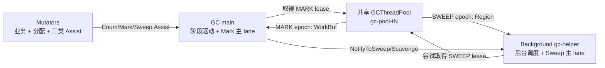

### 2.2 “Assist”在本文中的两层含义

本文保留项目中的常用叫法，但把含义分成两层：

1. **Mutator Assist**：Mutator/P 因分配或 phase transition 被要求亲自推进一小段 GC 工作。其中 Mark/Sweep 具有显式 P-local debt；Enum Assist 没有数值债务，但有 pending candidate 和 `inFlight`。
2. **Helper 协助**：共享 GC Worker 接受 GC main 或 `gc-helper` 发布的 task，平行消费全局 backlog。它没有自己的分配债务，只受 worker policy、pool lease、deadline 和停止协议控制。

| 名称 | 发起者/执行者 | 工作单位 | 进度状态 | 完成后的直接收益 |
| --- | --- | --- | --- | --- |
| Enum Assist | 已完成自身 MarkSetup 的 Mutator | 一批 candidate，默认 10 | `EnumAssistContext.remaining/inFlight` | 缩短所有 Mutator 完成根枚举 handshake 的等待 |
| Mutator Mark Assist | 当前 P/`AllocBufferMS` | 对象；真实工作最多一个 full `WorkBuf` | `gcAssistDebtScaled_` | 抑制 grey backlog，帮助并发 Mark 跟上分配 |
| Mutator Sweep Assist | 当前 P/`AllocBufferMS` | Region；默认一个 4-Region batch | `sweepAssistDebtScaled_` | 把旧 mark bitmap 转换为可分配 slot/Region |
| Mark Helper | `gc-pool-tN` | 一个任意 published `WorkBuf`/round | `targetHelpers_`、`workersInFlight_` | 提高对象图扫描吞吐，并产生 background Mark credit |
| Sweep Helper | `gc-pool-tN` | deadline 内若干 claimed Region | `activeHelperSweepCount_` | 降低旧 Sweep backlog，并产生一次性 Sweep credit |
| Background 主 lane | `gc-helper` | 一个有时间预算的 Background slice | work flags、pressure、burst 状态 | 稳定推进 Sweep/退页并协调 Helper |

因此，“Mark Assist”如果没有限定主体，可能指 Mutator 的 `MSMarkAssist()`，也可能泛指 GC Worker 对并发 Mark 的协助。本文统一写成“Mutator Mark Assist”和“Mark Helper”，避免歧义。

### 2.3 Assist 要解决的四类问题

#### 问题一：根枚举 handshake 的长尾

`MS_MARK_SETUP` 要求每个 Mutator 执行 `GcPhaseEnum()`。正在运行的 Mutator可以在自己的 safepoint 完成；已处于 saferegion 的 Mutator 可以由其他执行者推动 phase transition。如果只让 GC main 串行处理全部 saferegion candidate，Mutator 数量大时根枚举会形成单线程长尾。Enum Assist 把 candidate 按批分给已经完成自身 transition 的 Mutator。

#### 问题二：分配/写屏障产生 grey work 的速度可能超过 GC main

根和写屏障不断向 `globalFull_` 发布 `WorkBuf`。GC main 单线程扫描不一定追得上高并发分配与引用改写，因此需要两种补充：Mark Helper 并行消费 backlog；Mutator 按分配债务偿还一小段扫描工作。二者共同降低进入 MarkTermination 的残余工作。

#### 问题三：上一轮 Sweep 可能落后于新一轮空间消耗

Mark 完成只得到 mark bitmap，dead slot 还不能直接复用。Background Sweep 是主吞吐路径，Lazy Sweep 解决特定 size class 缺货，Sweep Helper 在压力升高时扩展并行度；如果这些仍落后，当前 P 按 Region 消耗速度执行 Sweep Assist。下一轮 GC 前再由 Force-Finish 保证正确性闭合。

#### 问题四：后台维护任务共享一个线程，必须兼顾进度和公平

Finalizer、Sweep、Scavenge、Shrink 都收口到 `gc-helper`。如果某类工作一次跑到彻底结束，其他任务可能长期饥饿；如果每次只做极小 slice，又会导致 backlog 长期不降。因此 BackgroundProcessor 同时使用固定任务顺序、单 slice 时间预算、最多 4 轮/12ms 的 wake burst、yield 和 1ms backoff。

## 3. Mutator Assist 总览

三类 Mutator Assist 都把系统级进度的一小部分交给 Mutator，但它们不共享一个通用框架：

| 维度 | Enum Assist | Mark Assist | Sweep Assist |
| --- | --- | --- | --- |
| 发生阶段 | `GC_PHASE_MS_MARK_SETUP` | `GC_PHASE_MS_CONCURRENT_MARK` | 上一轮 Mark 后到下一轮 `PreEnumRoots` 前 |
| 触发边界 | Mutator 完成自身 MarkSetup transition 后的后续 safepoint | 成功消费新的 active Region/large span并累计到 1024 对象债 | 成功消费新的 active Region/large span并出现整数 Region 债 |
| 所有权 | 全局候选上下文，按 batch claim | 当前 `AllocBufferMS::gcAssistDebtScaled_` | 当前 `AllocBufferMS::sweepAssistDebtScaled_` |
| 工作单位 | Mutator candidate | 对象/`WorkBuf` | Region |
| 是否先用 credit | 否 | 是，`bgScanCredit_` | 是，`MSSweepCreditPool` |
| 单次真实工作上限 | 默认 10 个 candidate | 最多一个 full `WorkBuf`，容量 1024 | 达到阈值后只做一个固定 batch，默认 4 Region |
| 最终兜底 | GC main 的 `EnsurePhaseTransition()` | STW `MarkTermination()` 固定点 | 下一轮 `StopAndWaitForAllSweep()` + Force-Finish |

Mark/Sweep 记债都放在 `AllocBufferMS`，这是“按 P/当前分配执行上下文偿还”的核心。它避免每次对象分配争用全局进度原子：小对象只在一个新 32KB Region 成功发布为 active 后记一次；编译器 inline fast path 在 Region 内分配再多对象也不会逐对象更新债务。大对象绕过小对象 Region refill，因此在 span 注册成功后按实际对象字节或 Region 数单独记债。

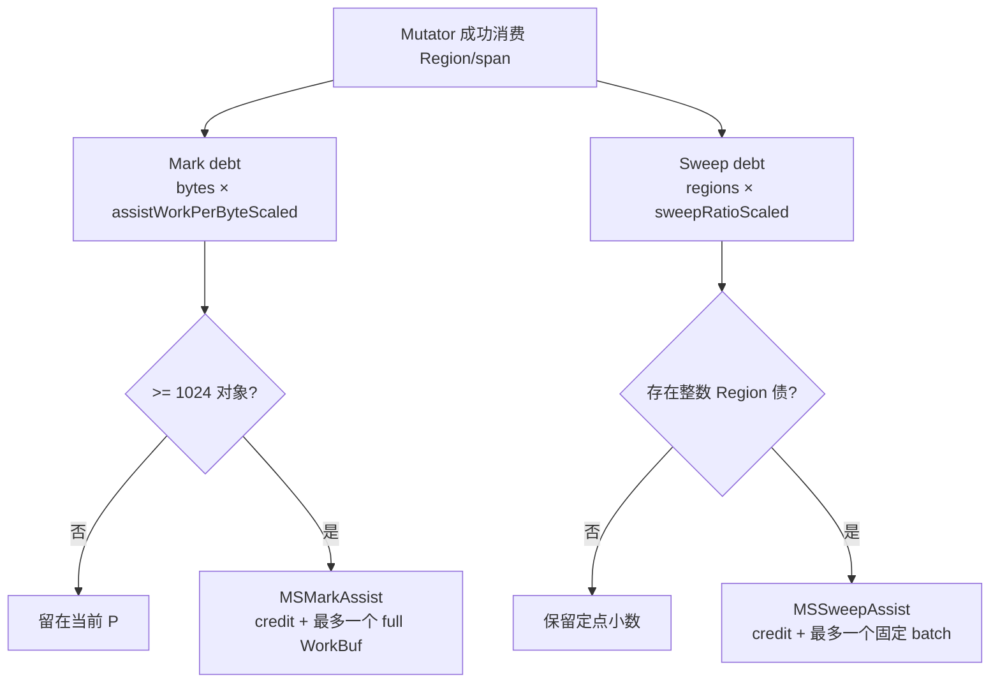

## 4. Mutator Enum Assist

Enum Assist 的候选快照、Mutator 自扫、协助其他 Mutator 以及与 GC 线程的 handshake 如下图所示。

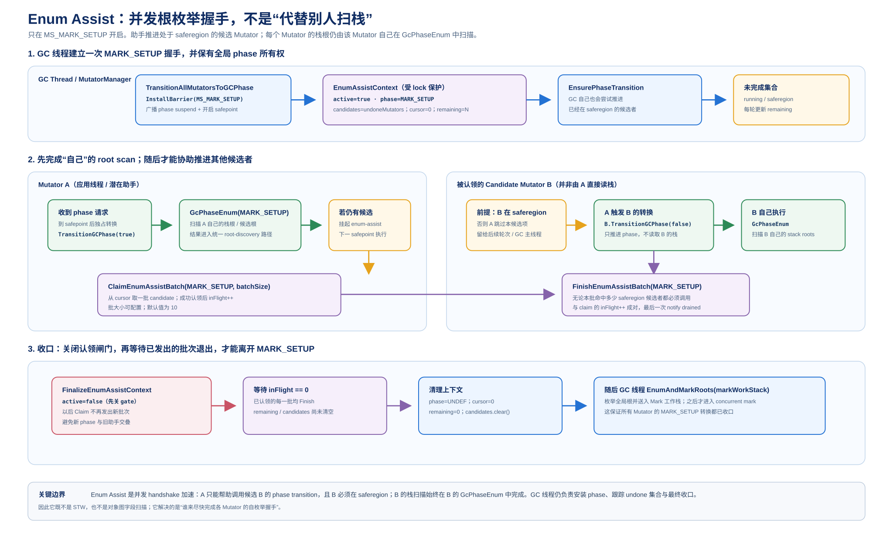

> 图 9-1：Enum Assist 的批量领取、执行和 `inFlight` 收口。

Enum Assist 不是标记算法的一部分，而是 `MS_MARK_SETUP` 根枚举 handshake 的并行推进机制。它利用“candidate 已在 saferegion，可以由其他线程代为调用 phase transition”的既有语义，把 GC main 的串行候选处理分摊给已完成自身根枚举的 Mutator。

### 4.1 解决的问题与触发条件

`MutatorManager::TransitionAllMutatorsToGCPhase(GC_PHASE_MS_MARK_SETUP)` 会：

1. 在 mutator-list 管理锁范围内安装新 Barrier、发布全局 phase。
2. 遍历全部 Mutator，设置 `SUSPENSION_FOR_GC_PHASE` 和 safepoint active，并加入 `undoneMutators`。
3. 把初始 `undoneMutators` 快照复制到 `enumAssistContext_.candidates`，初始化：

```text
phase       = MS_MARK_SETUP
active      = true
claimCursor = 0
remaining   = candidates.size()
inFlight    = 0
```

4. GC main 进入 `EnsurePhaseTransition()`，反复删除已完成 transition 的 Mutator，或直接推动当前仍在 saferegion 的 Mutator。

某个 Mutator 通过自己的 safepoint完成 `TransitionGCPhase(true)` 后，`TransitionToGCPhaseExclusive()` 检查同一 phase 是否仍有 pending candidate。若有，它设置 `SUSPENSION_FOR_GC_ENUM_ASSIST`、保持 safepoint active，并用 `deferEnumAssistUntilNextSafepoint_` 把协助推迟到后续 safepoint，而不是在刚完成自身 transition 的栈内递归扩展工作。

### 4.2 候选快照、批量领取与执行

后续 safepoint 进入 `Mutator::HandleSuspensionRequest()` 时，Enum Assist 请求的优先级位于普通 GC phase transition 之后、CPU profile 等请求之前。`HandleEnumAssist()` 的主线是：

```text
确认全局 phase 仍是 MS_MARK_SETUP
  -> 读取 cjMSEnumAssistBatchSize（默认 10）
  -> ClaimEnumAssistBatch(phase, batchSize, claimed)
  -> 对 claimed 中每个 candidate：
       candidate != nullptr
       candidate != this
       candidate->InSaferegion()
       => candidate->TransitionGCPhase(false)
  -> FinishEnumAssistBatch(phase)
```

`ClaimEnumAssistBatch()` 在 `enumAssistContext_.lock` 下从 `claimCursor` 连续取最多一个 batch。claim cursor 单调前进，因此一个快照 entry 最多被分发给一个 assistant；领取非空 batch 时 `inFlight++`。

candidate 仍需二次检查 `InSaferegion()`。从快照建立到 assistant 执行之间，它可能已经自行完成、被 GC main 推动，或离开 saferegion；这种 candidate 会被跳过，GC main 的 `EnsurePhaseTransition()` 仍是最终进度责任人。`remaining` 也不是在 claim 时直接扣减，而是由 GC main 根据 `undoneMutators.size()` 持续刷新，避免“已领取但没成功 transition”被误计为完成。

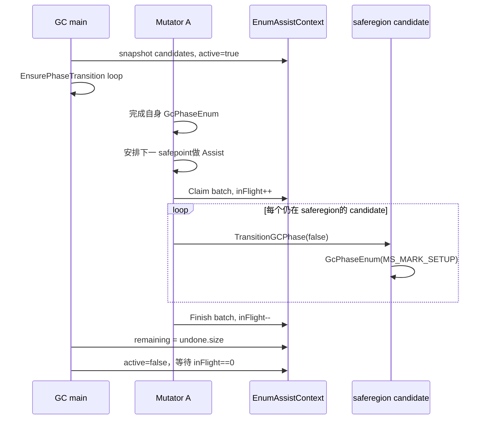

### 4.3 `inFlight` 收口与阶段安全

`FinalizeEnumAssistContext()` 先在 context lock 下把 `active=false`，关闭新的 batch claim，再等待 `inFlight==0`。顺序不能反过来：如果先观察 `inFlight==0` 再关 gate，新的 assistant 可能在 phase 即将推进时领取 batch。

只有所有已领取 batch 都执行 `FinishEnumAssistBatch()` 后，GC main 才清理 phase、cursor、remaining 和 candidate vector，随后统一清除所有 Mutator 的 `SUSPENSION_FOR_GC_ENUM_ASSIST`。因此已领取 batch 的 `candidate->TransitionGCPhase(false)` 不会与一个更新的全局 GC phase 交叉。

这里有两个层次的完成条件：

- `undoneMutators.empty()`：所有目标 Mutator 的 phase transition 已完成。
- `inFlight==0`：已经领取旧 candidate 快照的 assistant 全部退出。

二者同时满足，EnumRoots 才能安全继续枚举全局根并建立初始灰集合。

### 4.4 Enum Assist 不做什么

Enum Assist 容易被误解成“一个 Mutator 扫另一个 Mutator 的运行栈”，实际并不是：

- 它只处理调用时仍处于 saferegion 的 candidate。
- 它调用 candidate 自己的 `TransitionGCPhase(false)`/`GcPhaseEnum()` 语义入口，不把任意正在运行线程的栈地址当作普通对象内存遍历。
- 它不发现 heap child、不消费 `WorkBuf`，也不产生 Mark credit。
- 它不替代 GC main 的 `EnsurePhaseTransition()`；跳过或失败的 candidate 仍由主循环收口。
- 当前生效调节项只有 `cjMSEnumAssistBatchSize`；旧 `MSAssistConfig.h` 与无调用点的 `msEnumAssist` 三态 helper 已删除。

## 5. Mutator Mark Assist

Mark Assist 的债务记录、按 ratio 计算本次还债量、扫描 WorkBuf 以及扣除 background credit 的路径见下图。

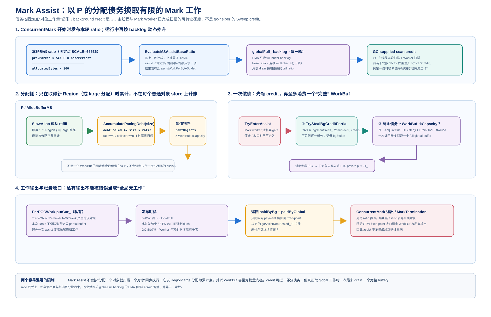

> 图 9-2：Mark Assist 的记账、还债和背景信用反馈。

Mutator Mark Assist 的目标不是让每个业务线程都成为完整 collector，而是建立分配与标记之间的负反馈：本轮继续消耗越多空间，就累计越多对象扫描债务；GC main/Helper 已经取得足够进度时用 credit 抵债，进度不足且存在完整工作块时才让当前 Mutator 扫一个 bounded slice。

### 5.1 解决的问题与记债位置

并发 Mark 中，灰对象来自三类入口：根枚举、对象字段扫描和写屏障。Mutator 继续分配、改写引用时，灰队列可能比 GC main 消费得更快。如果只依赖固定数量的 GC 线程，极端情况下 Concurrent Mark 长期不收敛，或把大量工作推入 STW MarkTermination。

当前 debt 存在 `AllocBufferMS::gcAssistDebtScaled_`，比例尺为：

```text
kMSAssistRatioScale = 65536
deltaDebtScaled = chargedBytes × assistWorkPerByteScaled
debtObjects = gcAssistDebtScaled / 65536
```

记账只发生在成功的空间消费边界：

- 小对象：`AllocBufferMS::SlowAlloc()` 成功取得新 Region、分配第一个 slot、发布到 `activeRegions_[cls]` 后，调用 `AccumulatePacingDebt(MS_REGION_SIZE)`，一次记 32KB。
- 大对象：hot-cache span 或 fresh span 清零并完成 `RegisterLargeObjectMS()` 后，按实际 `allocSize` 调用 `AccumulatePacingDebt()`。
- Region/span 获取失败不记债；一个 active Region 内的 inline/runtime 对象分配不逐对象记债。

`PreEnumRoots()` 较早发布 `activeCollector_=this`，但真正允许记债还要求 `assistWorkPerByteScaled_ != 0`。Concurrent Mark 结束后 ratio 先清零，MarkTermination STW 再清 `activeCollector_`。任一条件不成立，`AccumulatePacingDebt()` 都会清掉旧债，防止跨周期携带。

### 5.2 Assist ratio 的周期初始化与动态调节

每轮 `ConcurrentMark()` 初始化 P 的 GC work 和 assist 统计，然后根据上轮标记密度计算 raw base：

```text
rawBase = previousMarkedObjects × 65536 × basePercent
          / (currentAllocatedBytes × 100)
```

`basePercent` 来自 `cjMSAssistBaseRatioPercent`，默认 50。当前公式使用 GC 开始时的 allocated bytes，不是早期设计文档中的“threshold - live allocation runway”。

raw base 还经过跨周期反馈：

1. 第一个有效周期直接采用 raw base。
2. 之后如果 raw base 上涨，单周期最多在 previous base 上增加 25%；下降立即跟随。
3. 上一轮按真实处理对象数计算：

```text
assistShare = assistProcessed
              / (assistProcessed + gcMainProcessed + helperProcessed)
```

4. share **严格大于 90%** 时，用 `previousBase × 80% / actualShare` 限制下一轮 base；恰好 90% 不回压。目标是避免 Mutator 长期承担几乎全部标记，同时允许当前实验配置把 Assist 维持在较高占比。

Concurrent Mark 期间还按 full `WorkBuf` backlog 动态放大 ratio：

```text
ema = previous × 0.875 + currentFullBacklog × 0.125
multiplier = min(1 + ema / cjMSAssistBacklogStepBuffers,
                 cjMSAssistMaxMultiplier)
ratio = base × multiplier
```

默认每 16 个 full buffer 增加约 1 倍，最高 4 倍。进入 tail drain 后不再看 EMA，直接使用 `base × maxMultiplier`，要求 Mutator 在并发阶段关门前更积极偿还。

### 5.3 `MSMarkAssist()` 的两步还债

当 `debtObjects >= WorkBuf::kCapacity`，即达到 1024 对象时，分配慢路径调用：

```text
MSMarkAssist(current AllocBufferMS, debtObjects)
```

函数先通过 `markWorkerControl_.TryEnterAssist()` 加入 `assistsInFlight_`。如果 Mark 已进入 `QUIESCING/STOPPED`，不再接受新 Assist，本次返回 0，剩余工作交给 STW closure。

成功进入后按两步偿还：

1. **领取 background credit**：`TryStealBgCreditPartial()` 用 CAS 从 `bgScanCredit_` 取 `min(debt, credit)` 个对象信用。领取只转移进度所有权，不重复扫描对象。
2. **消费一个 full global buffer**：credit 后的剩余债仍至少 1024 时，调用 `DrainOneBufRound(gcw, requireFull=true)`。`LFStack::PopFull()` 会越过栈顶 partial buffer寻找第一块 full buffer，最多只取一块。

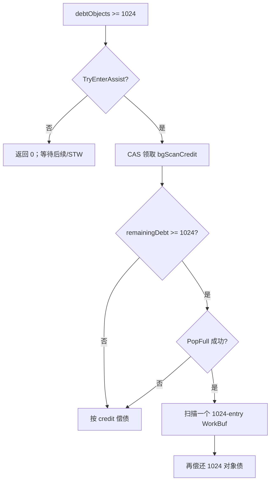

调用方只按返回的 `paidObjects` 从 `gcAssistDebtScaled_` 扣债。没有 credit、没有 full buffer或进入 quiesce 都不会虚假扣减。即使当前债大于一块，本次也不循环扫第二块；余债留到下一次成功 Region/span 消费后再触发。

### 5.4 扫描对象、产生新灰对象与 WeakRef 转交

`DrainOneBufRound()` 固定当前 `getCur_`，逐个弹出对象：

- 当前 Route-A 正常路径中的 buffer 是 trusted-grey：对象已经由 root discover、字段 discover 或写屏障 mark-CAS winner 置灰，consumer 直接扫描 fields；Debug 构建可重新校验地址和 `stateWord`。
- WorkBuf 统一保存生产端已经 mark-CAS 的 trusted-grey，consumer 直接扫描 children，不再处理 raw Route-B buffer。
- 普通含引用对象通过 `TraceObjectRefFieldsToGCWork()` 发现 child；新 grey child 进入当前 P 的 private `putCur_`，填满 1024 后才发布到 `globalFull_`。
- WeakRef 不由 Mutator 执行完整弱引用语义，而是调用 `PushSingleToDeferredMainThread()` 转交 GC main 的 deferred queue。

当前类名 `LFStack` 容易造成误读：`globalFull_` 的现实现使用一个小 mutex 保护 push/pop/pop-full和计数，不是无锁 Treiber stack。Assist 的并发收益来自完整 `WorkBuf` 交换和 P-local producer buffer，而不是声称所有全局交互都 lock-free。

写屏障和 Mark Assist 也不是同一动作：Route-A 写屏障在 old edge 被覆盖前竞争 mark bit，并把 mark winner 放入 `activeLog_`；log 满后 `PublishAndSwapLog()` 才把完整 buffer 发布到 `globalFull_`。Assist 不会主动偷走另一个 Mutator 尚未满的 `activeLog_`。

### 5.5 单次延迟上限、尾段策略与 STW 兜底

Mutator Mark Assist 通过三个边界限制业务尾延迟：

1. 债务不足 1024 对象时不进入 collector。
2. 一次最多消费一个 full buffer。
3. 只消费已经全局发布的 full buffer，不为追求并发阶段“绝对清空”而反复发布 private partial tail。

GC main/Helper 每轮扫描形成 background supply。GC main 每轮把自己扫描数和各 Helper 批量发布的扫描数相加，在 `cjMSAssistCreditDecayRounds` 窗口内按线性权重注入 `bgScanCredit_`：越早的轮次权重越高，越靠近尾段越要求 Mutator 做真实工作。这不是累计总扫描量的永久退款；过早 credit 会随 round index 衰减为 0。

Concurrent Mark 首次观察到全局输入为空、`workersInFlight==0`、`assistsInFlight==0` 后进入 one-way quiesce：关闭新的 Helper/Assist claim，等待在途工作退出，不因 late work 重新点燃并发阶段。以下残余统一留给 `MarkTermination()`：

- Mutator 未满 `activeLog_`；
- Mutator/GC main/Helper 的 private partial `putCur_`；
- quiesce 后发布的 global buffer；
- deferred WeakRef/finalizer 相关 work。

STW 中 `FlushAllWriteBarrierBuffers()`、`DisposeAllPerPGCWork()`、`DrainGlobalLFStackToMainQueue()` 和 deferred queue drain 反复执行到固定点。因此 Assist 的目标是降低 Concurrent Mark 与 STW 残余，而不是替代最终正确性闭包。

## 6. Mutator Sweep Assist

Sweep Assist 使用独立的 generation 债务和 Sweep credit；它从 Region claim 到实际 Sweep、再到 credit 扣除的流程如下图。

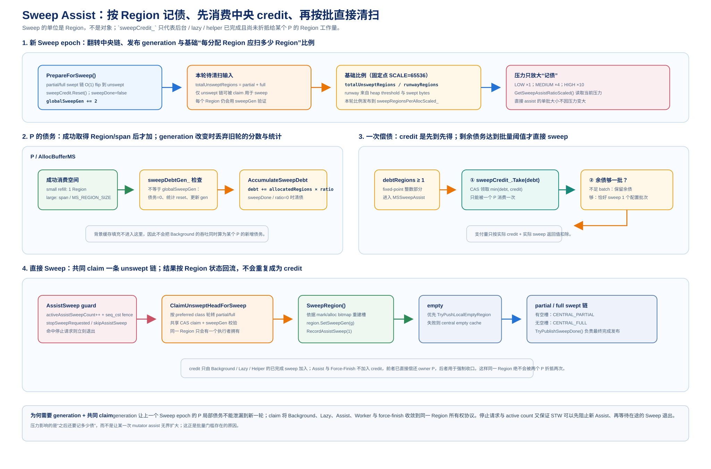

> 图 9-3：Sweep Assist 的比例化还债与后台信用联动。

Mutator Sweep Assist 建立的是“继续消费 Region 空间”与“把旧 mark bitmap 转换成可分配空间”之间的比例约束。它不扫描当前对象图，而是 claim 上一轮 generation 的 small Region，调用 `SweepRegion()` 重建 slot 可用性。

### 6.1 解决的问题与 Region 级记债

Concurrent Mark 完成后，mark bitmap 只说明哪些 slot 存活。Region 必须经过 Sweep 才能：

- 清零 dead slot，避免 stale pointer 指向旧 `TypeInfo/stateWord`；
- 根据 mark bitmap 重建 alloc bitmap/summary；
- 重新分类为 empty、partial swept 或 full swept；
- 被后续分配安全复用。

Background Sweep 可能因 CPU 调度、热点 size class 不匹配或 backlog 太大而落后。若 Mutator 继续取得新 Region/span而完全不承担 Sweep，旧 unswept 集合可能一直堆到下一轮 `PreEnumRoots()`，放大 Force-Finish 停顿。

当前 debt 位于：

```text
AllocBufferMS::sweepAssistDebtScaled_
比例尺 kMSSweepAssistRatioScale = 2^16
```

记账边界与 Mark debt 相同，但单位不同：

- 小对象新 active Region 成功发布后：`AccumulateSweepDebt(1, cls)`。
- large span 成功注册后：`AccumulateSweepDebt(regionBytes / 32KB, noPreferredClass)`。
- Region/span 失败、后台缓存行为不记债。

large allocation 产生的 Region debt 最终仍用于推动 **small unswept Region**；large object 的生死判定在 `PostMarkTermination()` eager 完成，不进入这套 36 个 size-class Sweep 队列。

### 6.2 generation lazy reset 与定点比例

`CentralRegionPool::PrepareForSweep()` 在新一轮 `PreEnumRoots()` 的短 STW 中建立即将由本轮 mark 结果清扫的 Region 快照：

```text
partialSwept -> partialUnswept
fullSwept    -> fullUnswept
```

随后统计 `totalUnswept`，按下一次 HEU threshold 的 Region runway 发布本 generation 的 base ratio：

```text
runwayBytes   = max(thresholdBytes - sweptBytes, 0)
runwayRegions = ceil(runwayBytes / MS_REGION_SIZE)
baseRatio     = totalUnsweptRegions / max(runwayRegions, 1)
```

实现用 `2^16` 定点数和防溢出运算保存小数。每次 P 记债时，再读取共享 `SweepPressureMode` 将新增债斜率缩放为 LOW/MEDIUM/HIGH 的 1×/4×/10×。压力只放大**新债务产生速度**，不改变一次直接 Assist 的 batch 大小。

`PrepareForSweep()` 最后把 `globalSweepGen_ += 2` 并以 release 发布。活动 P 不会被中央线程逐个改写；下一次调用 `AccumulateSweepDebt()` 时比较 `sweepDebtGen_`：

- generation 相同：继续累计本 P 债务。
- generation 不同：懒清旧 `sweepAssistDebtScaled_` 和本地统计，再绑定新 generation。
- `sweepDone_==true` 或 ratio 为 0：清空本地债务。

P 退出时本地未偿债可以丢弃，因为它只是 pacing 状态，不是正确性状态；真正的未完成工作仍由中央 unswept list、active counters 和 Force-Finish 表达。

### 6.3 `MSSweepAssist()` 的 credit-first 流程

记入新债后，先换算整数 Region 债：

```text
debtRegions = sweepAssistDebtScaled / 2^16
```

小于 1 Region 时只保留定点余数。出现整数债后调用 `CentralRegionPool::MSSweepAssist()`：

1. 若本轮已 `sweepDone`，返回完成并让 P 清债。
2. 从 `MSSweepCreditPool` 领取最多 `debtRegions` 份一次性 credit。
3. credit 后没有余债，直接返回。
4. 余债小于配置 batch，保留在 P，不做直接 Sweep。
5. 余债达到 batch，本次只执行**恰好一个 batch**的 `AssistSweep()`。

默认 `cjMSAssistSweepMaxRegionsPerCall=4`，该参数同时是直接 Assist 的触发阈值和单批大小。即使当前 P 欠 100 Region，一次分配慢路径也最多直接扫 4 个，避免一次 `SlowAlloc` 出现无界延迟。

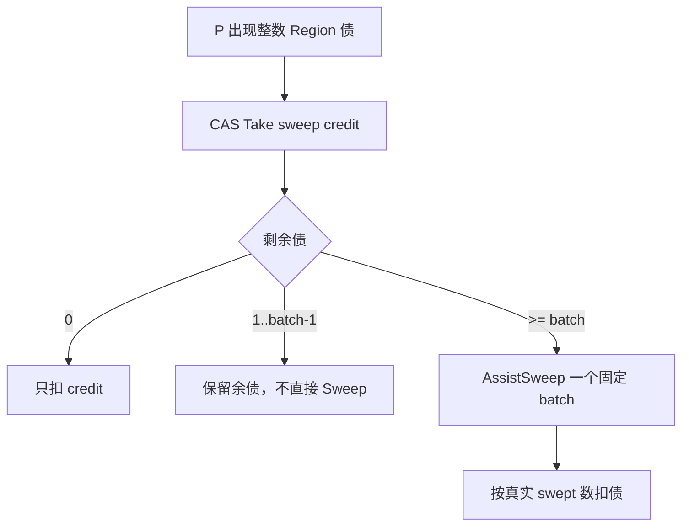

credit 的来源和所有权是核心：

| Sweep 来源 | 是否向 `MSSweepCreditPool` 发布 | 原因 |
| --- | --- | --- |
| Background | 是 | 后台替所有 P 提前完成的中央工作 |
| Lazy | 是 | 某个缺货线程现场完成，但不是按其 proportional debt 执行 |
| Helper | 是 | 共享 Worker 完成的中央工作 |
| Mutator Assist | 否 | 已直接偿还发起 P，再发布会双重计数 |
| Force-Finish | 否 | closing generation 的正确性收口，不对应仍运行 P 的 pacing 退款 |

`MSSweepCreditPool::Take()` 用 CAS 递减共享计数，一份 swept Region 只能被一个 P 领取一次。它不同于“读取累计 backgroundSweptRegions”：累计统计可被重复观察，不能作为偿债所有权。

### 6.4 直接 Assist Sweep 与 Region 归类

`AssistSweep()` 先 `activeAssistSweepCount_++`，执行 seq_cst fence，再二次检查 `skipAssistSweep_` 和 `stopSweepRequested_`。这与下一轮 GC 的停止协议配对，保证正在读 mark bitmap 的 Assist 一定被 `StopAndWaitForAllSweep()` 看见。

真正清扫时：

1. `BuildBackgroundSweepClassOrder(preferredCls)` 生成 class 顺序：preferred class优先，其次优先有 unswept、ready supply 少、unswept 多的 class。
2. 每个 class 先消费 `partialUnswept`，再消费 `fullUnswept`。
3. `ClaimUnsweptHeadForSweep(listKind, sweepGen)` 独占 Region。
4. `SweepRegion()` 读取稳定 mark bitmap，清 dead slot、重建 alloc bitmap。
5. 设置当前 sweep generation 并按结果归类。

结果流向如下：

| Sweep 结果 | 归宿 |
| --- | --- |
| 完全空 | 优先 `preferredOwner->TryPushLocalEmptyRegion()`，失败后进中央 empty swept cache |
| 仍有空 slot | `partialSwept_` |
| 没有空 slot | `fullSwept_` |

完成后 `activeAssistSweepCount_--` 并调用 `TryPublishSweepDone()`。返回值只包含真实完成的 Region 数；目标 4 个但只找到 2 个时，只偿还 2 个，不虚增进度。

### 6.5 与 Lazy、Background、Helper 和 Force-Finish 的关系

五类 small Sweep 执行方共享同一个 Region claim 和归类协议，但解决的问题不同：

| 路径 | 触发依据 | 主要目标 | 对 Mutator 延迟的影响 |
| --- | --- | --- | --- |
| Background Sweep | GC 后通知、2s poll、仍有 pending | 独立于分配持续清 backlog | 不阻塞业务线程 |
| Lazy Sweep | 目标 class ready/empty supply miss | 立刻生产当前分配所需 Region | 当前 refill 现场承担一个或多个 Sweep |
| Mutator Sweep Assist | 当前 P proportional debt | 让空间消费与清扫进度保持比例 | 达到 batch 后固定一次 4-Region 工作 |
| Sweep Helper | U/S/T 为 MEDIUM/HIGH 或 forced HIGH | 并行降低中央 backlog | 占用共享 GC Worker CPU，不直接阻塞发起 Mutator |
| Force-Finish | 下一轮清 mark bitmap 前 | 正确性 closure | backlog 越大，PreEnum 停顿越长 |

Background/Lazy/Helper 产生 credit，使某个 P 即使没有亲自 Sweep 也能承认“系统已替它推进”。Mutator Assist 负责 background 跟不上时的比例约束；Lazy 负责单 class 供货；Helper 负责全局压力扩容。它们互补，不应把其中一个写成另一个的替代。

Sweep Assist 不提供以下能力：

- 不执行对象图 Mark；
- 不回收 large object 的对象存亡；
- 不直接 `madvise/VirtualFree` 归还 OS 物理页；
- 不保证本次债全部还清；
- 不替代下一轮清 bitmap 前的 Force-Finish。

## 7. GC Helper 的 Mark 协助

Mark Helper 是共享 `GCThreadPool` 中的物理线程在 Concurrent Mark 期间承担的角色。它与 GC main、Mutator Mark Assist 竞争消费同一个 `globalFull_`，但拥有独立 `PerPGCWork` 和 worker-local 统计。

### 7.1 MARK lease 与 Worker 建立

`ConcurrentMark()` 先切到 `GC_PHASE_MS_CONCURRENT_MARK`，重置全局 credit/统计，初始化所有现存 `AllocBufferMS::gcWork_`，并令 `markWorkerControl_` 进入 `RUNNING`。随后 `RunConcurrentMarkLoop()`：

1. 初始化 GC main 自己的 `gcThreadWork_`。
2. `TransferRootsToGCWork()` 把 root stack打包为 `WorkBuf`，最后一块即使 partial 也发布到 `globalFull_`。
3. 计算：

```text
configuredThreads = max(1, cjGCThreads)
maxHelpers = min(configuredThreads - 1, pool.maxThreadNum)
```

4. `maxHelpers > 0` 时通过 `AcquireMSGCWorkerPoolForMark()` 等待取得 MARK lease。
5. MARK 已持有独占 lease 后，先用 `SetMaxActiveThreadNum(maxHelpers)` 恢复可能被上一轮 Sweep 压低的物理池宽度。
6. 为每个潜在 helper 创建一个 `MSMarkWorkerSlot{PerPGCWork, localStats}`，向 pool 加入一个长生命周期 `RunMarkWorker(i)` task，然后 `Start()`。

MARK lease 是等待式 acquire。如果先前 `gc-helper` 已取得 SWEEP lease，GC main 等它完成 bounded Sweep round、`WaitFinish()` 并释放；Mark 不会把 task 插入仍属于 Sweep 的 queue。如果 Runtime 正在 STOPPING，acquire 失败，当前 GC 退化为 GC main 串行完成 mark。

pool width 使用 `maxHelpers` 而不是 `initialHelpers`：前者决定有多少个长 task 能够真正被物理线程取出，后者仅由 `MSMarkWorkerControl::targetHelpers_` 决定当前哪些 slot 可以扫描。当前仍是“全部 slot/task 预建 + 动态 eligibility”，不按需提交 task。

### 7.2 动态扩容策略

所有潜在 Worker task都已经入池，但 `MSMarkWorkerControl::WaitUntilEligible(workerId)` 只放行 `workerId < targetHelpers_` 的 slot。GC main 每处理一个 published buffer 后采样 `globalFull_.GetCounts()`，用 `MSMarkWorkerPolicy` 调整目标数。

当前扩容规则：

- `fullBacklog >= 64`：紧急拉满到 `maxHelpers`。
- `fullBacklog > 8 × (activeHelpers + 1)`：增加 1 个 Helper。
- backlog 连续 2 次采样增长：增加 1 个 Helper。
- 其他情况保持当前数量。
- 一个 Mark 周期内只增不减；进入 tail 时直接拉满。

这里用于扩容的 `publishedBacklog` 是 `globalFull_` 的**全部 buffer 数**，而 Assist ratio 的 EMA 只看 full buffer 数。前者允许 root/退出/STW 边界发布的 partial work触发 Worker；后者保持 Mutator 以完整 1024 对象块偿债的粒度。

只增不减是有意的：GC main 的采样间隔很短，backlog 会因 push/pop 抖动。如果同一周期频繁 park/unpark，条件变量和调度成本可能大于节省的 CPU。下一轮 Mark 从 0 active helper 重新估算，不把上轮峰值固化。

### 7.3 Helper 的单轮扫描与本地统计

`RunMarkWorker(workerId)` 的循环是：

```text
WaitUntilEligible(workerId)
  -> TryEnterWorker()，atomic workersInFlight++ 并重查 phase/target
  -> DrainOneBufRound(slot.work, requireFull=false)
  -> 记录 scanned 数
  -> ExitWorker()，atomic workersInFlight--
  -> 若没拿到 work，发布 pending credit并 backoff 50us
```

`phase_`、`targetHelpers_`、`workersInFlight_`、`assistsInFlight_` 都是 atomic。已 eligible 的 Worker 继续处理 WorkBuf 时不进入控制 mutex；mutex/CV 只用于 slot 尚未 eligible 时的休眠、target/phase 变化和 quiesce 最后归零等待。Worker 先增加 in-flight 再重查 phase/target，如果与 `BeginQuiesce()` 竞争失败，会回滚 counter 且不触碰 WorkBuf。

Helper 与 GC main 都使用 `AcquireOneBuffer()/Pop()`，一次接受一个任意 published buffer，不要求 full。扫描 children 时，新 grey 对象先进入 slot 自己的 `putCur_`，填满后全局发布。每个 Helper 的 `MSMarkWorkerLocalStats` 只做线程本地累加：

- `totalProcessed_`：本周期真实扫描对象数；
- `pendingCredit_`：尚未向 GC main 发布的 credit；
- 每累计 4 个 buffer，批量 `fetch_add` 到该 slot 的 `publishedCredit_`；
- 没 work、quiesce 时强制发布余量。

周期末 GC main 汇总所有 slot 的 `TotalProcessed()` 到 `helperProcessedObjects`。这样热路径不争用一个全局 processed counter；只有 credit 交接使用每 slot 独立原子。

### 7.4 background credit 如何反馈给 Mutator

GC main 在自己本轮处理了对象、Global backlog 变化或每 8 轮之一时，取走各 slot 已发布的 worker credit，并和自己本轮 `scannedCount` 合并：

```text
backgroundScanned = gcMainScanned + helperPublishedScanned
```

在 `roundIdx < cjMSAssistCreditDecayRounds` 时按线性权重注入：

```text
weight = (decayRounds - roundIdx) / decayRounds
injected = backgroundScanned × weight
bgScanCredit += injected
```

Mutator 之后通过 `TryStealBgCreditPartial()` 一次性领取。这形成一条反馈链：

```text
Mark Helper 扫描对象
  -> worker-local 批量发布 scanned credit
  -> GC main 按轮次衰减注入 bgScanCredit_
  -> Mutator Mark Assist CAS 领取
  -> 当前 P 的 gcAssistDebtScaled_ 下降
```

credit 代表“后台已经替系统取得的 Mark 进度”，不是把某个具体 `WorkBuf` 转让给 Mutator。早期扫描更能抵债，尾段扫描 credit 权重逐渐归零，防止 Mutator 永久依赖历史进度而不处理新产生的 grey work。

### 7.5 Tail Drain 与 one-way quiesce

Concurrent Mark 的收敛候选要求同时满足：

```text
gcThreadWork_ 当前输入为空
globalFull_ 为空
workersInFlight == 0
assistsInFlight == 0
```

private partial `putCur_` 和 Mutator partial `activeLog_` 不在并发收敛条件中。持续把这些尾块发布再扫描，会在写屏障流量下反复重新点燃并发 Mark，难以得到稳定终点。

GC main 使用一次 `GetSnapshot()` 同时读取 Worker/Assist in-flight。当 Global 和自己的输入都为空、但仍有 claimant 在途时，先做 8 轮 `yield`，再在共享 `WorkEpoch` 上最多等待 50us。Global WorkBuf publish、最后一个 claimant 退出和 phase/target 变化都会唤醒，因此这是有界事件等待，不是固定 sleep。

第一次满足候选后：

1. 进入 tail drain，Helper target 拉满，assist ratio 提到上限倍率。
2. `QuiesceMarkWorkers()` 把 control phase 切为 `QUIESCING`，从此拒绝新的 Worker/Mutator Assist claim。
3. 等待 `workersInFlight==0 && assistsInFlight==0`。
4. 发布各 Helper 剩余 credit，但不发布它们的 private partial output。
5. `Stop()` 唤醒并结束所有 Worker task，`GCThreadPool::WaitFinish()` 等待 pool 完整停止。
6. 释放 MARK lease。

如果 `cjMSMarkTimeBudget`（默认 20s）先到，也走同一 quiesce 路径，把剩余 bounded grey work交给 STW。one-way 的含义是：关门后即使看到 late global work也不恢复 Helper，而是进入 MarkTermination 固定点。这用可控的 STW residual 换取 Concurrent Mark 尾部确定性。

## 8. GC Helper 的 Sweep 协助

Sweep Helper 是同一批 `gc-pool-tN` 在 SWEEP lease 下的阶段角色。与 Mark Worker 的常驻 gate loop 不同，它们每轮接受 one-shot task，共享一个绝对 deadline，完成后立即归还线程池所有权并重新评估压力。

### 8.1 Sweep Helper 的触发与规模

Parallel Sweep 有两类入口：

1. **自然压力扩容**：普通 `BackgroundSweepLoop()` 每个 slice 前后调用 `RefreshSweepHelperControl()`；只要 U/S/T 压力为 MEDIUM/HIGH，就可能把下一轮升级为 Parallel Sweep。
2. **forced-HIGH 唤醒**：Mutator 的 `MaybeNotifyMark()` 达到 HEU threshold 且读到旧 Sweep pressure 非 LOW 时，先 `NotifyToParallelSweep()`，把本 Sweep epoch 锁定 HIGH并唤醒 `gc-helper`；HEU 仍继续提交。

压力量定义为：

```text
U = partial/full unswept small Region bytes
S = partial/full swept small Region bytes + live large span bytes
T = current heap threshold
```

判定规则：

| 条件 | mode | 意义 |
| --- | --- | --- |
| forced HIGH 或 `U > T` | HIGH | 仅旧 backlog 已超过下一轮阈值，立即最大并行 |
| `U <= T` 且 `S + U > T` | MEDIUM | 稳定供给与未分类 backlog 合计越线，按超额比例扩容 |
| `S + U <= T` | LOW | 不借 Helper，普通 Background lane仍继续推进 |

最大可借用数：

```text
maxHelpers = min(cjGCThreads - 1,
                 cjMSParallelSweepMaxHelpers if non-zero)
```

LOW target 为 0；HIGH target 为 `maxHelpers`；MEDIUM 使用防溢出整数算法计算：

```text
excess = S + U - T
target = ceil(excess / T × maxHelpers)
target = clamp(target, 1, maxHelpers)
```

自然 MEDIUM/LOW 下，`activeSweepHelperCount_` 每轮只向 target 加或减 1；自然 HIGH 或 forced HIGH 立即到 target。sweep generation 变化或 `sweepDone` 时 target/active 重置为 0。

### 8.2 SWEEP lease 与 one-shot task

`BackgroundProcessor::ParallelSweepLoop(helperCount)` 先检查 GC 是否已经开始和 unswept 是否为空，再计算本轮共同 deadline。随后：

```text
helperCount == 0
  -> gc-helper 单 lane BackgroundSweep

helperCount > 0
  -> TryAcquireMSGCWorkerPoolForSweep()
       失败：若 GC 尚未开始，退化为单 lane BackgroundSweep
       成功：再次检查 GC/pool
             -> 为每个 helper 创建一个 LambdaWork
             -> SetMaxActiveThreadNum(helperCount)
             -> AddWork × helperCount
             -> Start()
             -> gc-helper 自己执行 BackgroundSweep coordinator lane
             -> WaitFinish()
             -> 合并 task stats
             -> Release(SWEEP)
```

Sweep 使用非阻塞 try-acquire，不能让 `gc-helper` 等待一个正在执行的 Mark epoch而阻塞 Finalizer/Scavenge。Mark 则使用等待式 acquire：一旦 Sweep 已取得 lease并开始 bounded round，GC main 等这一完整 round结束；之后 MARK 获得优先进展。

task 分配失败时不会把半组 task发布到 pool：先在 `stagedTasks` 中完整构造，失败则清空并由 `gc-helper` 单 lane执行本轮，再释放 SWEEP lease。

### 8.3 deadline、size-class 轮转与 Region claim

本轮 deadline 为：

```text
start + cjGCBGSweepMaxTime × pressureMultiplier
```

默认 base 为 2ms，LOW/MEDIUM/HIGH 分别约 2ms/8ms/20ms。所有 lane 共用同一个绝对 deadline，而不是各自从启动时重新获得一份预算；启动较晚的 task 自然只拿到剩余时间，限制 GC 抢占延迟。

`parallelSweepRoundRobin_` 每轮原子增加 `helperCount + 1`：

- `gc-helper` coordinator lane 从 `startClassCursor % 36` 开始。
- 第 i 个 Helper 从 `(startClassCursor + 1 + i) % 36` 开始。

每个 lane再由 `BuildBackgroundSweepClassOrder(preferredCls)` 综合 preferred、ready supply 和 unswept 数排序，避免所有线程总在 class 0 或同一热点 bucket 起步。

Helper lane 调用 `CentralRegionPool::ParallelSweep()`：

1. `activeHelperSweepCount_++`，seq_cst fence，二次检查 `skipHelperSweep_`/`stopSweepRequested_`。
2. 读取当前 `globalSweepGen_`。
3. 按 class 顺序先扫 partial unswept，再扫 full unswept。
4. 每块 Region 必须通过统一 `ClaimUnsweptHeadForSweep()` 独占。
5. deadline、stop 或 backlog 清空时结束。
6. 把真实完成数记入 `helperSweptRegions_` 并发布一次性 Sweep credit。
7. `activeHelperSweepCount_--`，尝试发布 `sweepDone`。

coordinator lane 物理上也是 `gc-helper`，但当前代码调用的是 `BackgroundSweep()`：它计入 `backgroundSweptRegions_`、使用 `bgSweepRunning_`；借用的 pool task才计入 `helperSweptRegions_`/`activeHelperSweepCount_`。这与 Step44 曾建议“并行 burst 的 coordinator 也计 Helper”不同，分析当前 REPORT 时必须按源码口径。

`GCThreadPool::WaitFinish()` 的调用线程也会从 pool queue 取尚未被 Worker 领取的 task并以 caller lane 执行。因此 `gc-helper` 完成显式 Background lane后，理论上还可能帮助 drain 遗留 one-shot task；共同 deadline 仍约束这些 task不会获得额外完整时间窗。

### 8.4 lease miss、GC 抢占与停止边界

Parallel Sweep 的主要竞态结果：

| 时序 | 行为 |
| --- | --- |
| GC 尚未开始，SWEEP lease 成功 | coordinator + Helper 完成 bounded round，释放后再 recheck |
| pool 非 IDLE，SWEEP lease miss | `gc-helper` 若仍看不到 GC started，则退化为单 lane Background Sweep |
| 取得 SWEEP lease 后发现 GC started | 不发布 task，立即释放 lease并清 Helper 控制 |
| task 已启动后 GC 到达 | GC main 的 MARK acquire等待 `WaitFinish + Release(SWEEP)` |
| GC 设置 Sweep stop gate | 各 lane完成已经 claim 的 Region，停止领取下一块；PreEnum 等 active counter 归零 |

已经从 unswept list 摘除的 Region 不能半途丢下。即使 stop/deadline 到达，当前 `SweepRegion()` 仍必须完成 metadata 更新和 empty/partial/full 归类，退出延迟的基本上限因而包含“当前一个 Region 的 Sweep 时间”。

每轮结束后 `HasPendingSweepWork()` 重新计算压力、target 和 active helper。若还有 backlog，设置普通 Background flag，并在 helperCount 非零时设置 Parallel flag；外层 burst/yield/backoff 决定何时执行下一轮。它不会在持有 SWEEP lease时无限循环清空整个 heap。

### 8.5 MARK/SWEEP Worker Pool 状态机

`MSGCWorkerPoolController` 管理的是完整 task epoch，而不是单个 task：

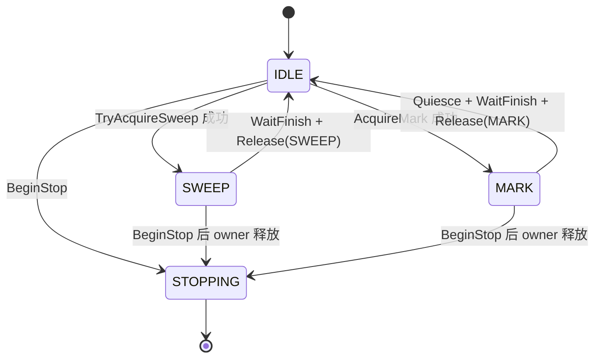

关键不变式：

- owner 从 `AddWork/Start` 前一直保持到 `WaitFinish` 后；
- SWEEP 只从 IDLE 非阻塞取得；
- MARK 等待 IDLE，因此不会和一个已经开始的 Sweep epoch混跑；
- `Release()` 校验 expected owner，错误交接直接触发 CHECK；
- Runtime 停止时 `BeginStop()` 阻止新 lease，现有 owner 完整退出后转为 STOPPING。

Region claim 协议和 Worker Pool lease 解决不同问题：前者防止两个 Sweep lane清同一 Region，后者防止 Mark task与 Sweep task进入同一 `GCThreadPool` queue/cycle。两者缺一不可。

## 9. Background `gc-helper` 的职责与轮转

Background 与 Worker 的职责边界、MARK/SWEEP lease 和 Scavenge/Shrink 的调度关系见下图。

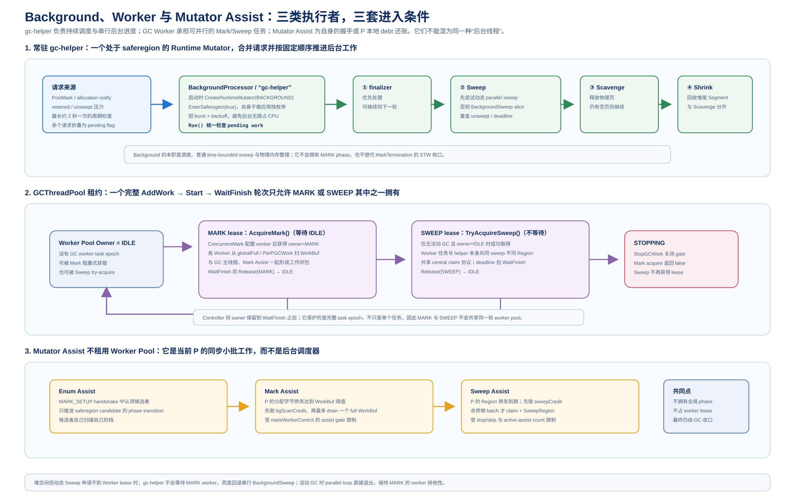

> 图 9-4：Background 负责持续兜底，Worker 负责按 lease 扩展并发协助。

本章解释独立后台线程的生命周期、固定任务顺序、事件合并、周期兜底和公平性控制。

### 9.1 生命周期与 saferegion 身份

`BackgroundProcessor::Start()` 创建一个名为 `gc-helper` 的 pthread。线程入口 `Run()` 首先调用 `Init()`：创建一个 `ThreadType::MSGC_BACKGROUND_THREAD` 的 runtime Mutator，立即 `EnterSaferegion(true)`，记录 tid 并把 `bgMutator` 注册到 `MutatorManager`。因此它可以安全调用需要 Mutator 上下文的分配器/回收器接口，但不会被当成普通业务 Mutator 参与根枚举。

线程停止时，`Stop()` 先把 `running=false`、唤醒条件变量，再 `pthread_join`。`Run()` 退出循环后调用 `Fini()`，从 MutatorManager 摘除并销毁 runtime Mutator。这个身份还会影响 `Mutator::IsReadyForGC()` 等判断：Background 线程在 saferegion 中执行后台 Sweep/Scavenge，不应因普通业务线程的 phase handshake 规则被阻塞。

### 9.2 固定职责顺序

每次从等待状态醒来，`Run()` 都按以下顺序检查工作；顺序是源码中的稳定优先级，而不是按通知到达时间排序：

```text
周期检查（可能设置 Sweep/Scavenge/Shrink flag）
  -> Finalizer
  -> Parallel Sweep
  -> 普通 Background Sweep（仅当本轮没有处理 Parallel Sweep）
  -> Scavenge
  -> Shrink
```

Finalizer 最高优先级，因为 finalizable object 的用户回调可能释放资源并产生后续 GC 工作。若 `shouldParallelSweep_` 为真，本轮调用 `ParallelSweepLoop()`，并把 `handledParallelSweep=true`；即使该函数因 lease miss 或 GC 抢占没有实际扫到 Region，也不会在同一轮再调用普通 `BackgroundSweepLoop()`。这保证一次通知不会在两个 Sweep 调度入口重复消费同一预算。Scavenge 和 Shrink 不受 `handledParallelSweep` 抑制，仍在同一轮继续执行。

每个子循环返回 `hasMore`，统一 OR 到 `shouldContinueImmediate`。因此“还有 Sweep backlog”“Finalizer list 仍有 job”“Scavenge 尚未达到 retained threshold”都会请求下一轮；某一类完成只清自己的 flag，不会丢掉其他类别的 pending 状态。

Finalizer 的一次处理也分为“交换”和“执行”两步：`FinalizerWorkList::ProcessFinalizables()` 在锁内把待处理 `finalizables` swap 到 `workingFinalizables`，马上释放列表锁，然后逐个读取对象的 `TypeInfo`/finalizer method，在 `MSGC_BACKGROUND_THREAD` 的 ManagedContext 中通过 `ExecuteCangjieStub` 执行用户 finalizer。执行期间仍以 `shouldKeepRunning()` 检查停止请求；每个对象完成后再从 working list 删除。这样生产者可以继续把新的 finalizable 对象放入另一张列表，不会与用户 finalizer 长时间持锁。`Run()` 每次返回后再次检查队列，剩余 job 会参与 burst；finalizer 回调中的分配/异常由统一的 Mutator/ExceptionManager 语义处理。

### 9.3 通知合并与 2 秒周期兜底

五类工作状态由原子 flag/队列表示：

| 状态 | 发布接口 | 消费接口 | 语义 |
| --- | --- | --- | --- |
| Finalizer job | `FinalizerProcessor` 入队并通知 | `ProcessFinalizables()` | 工作列表非空即 pending |
| `shouldParallelSweep_` | `NotifyToParallelSweep()` | `ParallelSweepLoop()` | 强制/动态高压力的并行 Sweep 请求 |
| `shouldBackgroundSweep_` | `NotifyToSweep(cls)` 或 `HasPendingSweepWork()` | `BackgroundSweepLoop()` | 普通 Sweep 请求及 preferred class |
| `shouldScavengeHeap_` | `NotifyToScavenge()` | `BackgroundScavengeLoop()` | 释放 retained heap 超额 |
| `shouldShrinkHeap_` | `NotifyToShrink()` 或 Scavenge 完成 | `BackgroundShrinkLoop()` | 可选退页/收缩 |

`RequestWork(flag)` 使用 `flag.exchange(true)`：只有从 false 到 true 的发布者调用 `Notify()`。多个 Mutator、GC main 或周期检查并发通知时，状态被合并成一个待处理事件，不会为每个 Region/对象创建 wakeup 风暴。`HasPendingWakeWork()` 同时检查 finalizer 队列和全部四个 flag，条件等待不会漏掉已经发布但 notify 竞态丢失的工作。

`lastPeriodicCheckUs` 由 `Run()` 维护。每隔 `iterationWaitTime`（当前默认约 2000ms）调用 `MaybeSchedulePeriodicWork()`：若对应 flag 尚未置位且 `ShouldStartPeriodicSweep/Scavenge/Shrink()` 判断中央池仍有工作，就补置 flag。周期检查本身不强制 notify；线程通常会因带超时的 `Wait(2000ms)` 返回，然后进入外层统一调度。这是事件通知之外的最终兜底，避免一次发布遗漏或长期低流量时 backlog 永远无人处理。

周期条件受三个独立开关控制：Background Sweep 默认开启，Background Scavenge 默认开启，Background Shrink 当前默认关闭。关闭某项时，相应 `NotifyTo*()` 会清除 flag 并直接返回，不会留下无法消费的 pending 状态。

### 9.4 burst、yield 与 backoff

后台任务有工作可继续时，`Run()` 不立即进入 2 秒休眠，而是进入短 burst：

1. 第一个连续 slice 记录 `backgroundBurstStartUs`。
2. 每次 `shouldContinueImmediate` 递增 `backgroundBurstRounds`。
3. 若轮数小于 4 且累计耗时小于 12ms，调用 `std::this_thread::yield()`，让出调度机会后立即回到外层检查所有任务。
4. 达到任一上限后清零 burst 计数，调用 `WaitForActiveBackoff(1ms)`，再继续处理 pending work。

这套“最多 4 轮/12ms + 1ms backoff”不是单个 Sweep 的硬 deadline；Sweep 自己还有 2/8/20ms 的绝对 slice deadline。它控制的是多种后台任务连续占用 CPU 的时间，防止 Finalizer/Sweep/Scavenge 形成无休止的 busy loop，同时又避免每个小 slice 都经历完整条件变量睡眠。

如果本轮没有任何任务返回 `hasMore`，线程清零 burst 状态，在 `Wait(iterationWaitTime)` 上等待显式通知或超时。超时且仍无 pending 时，跳回外层以便周期检查；`running=false` 则立即结束。

### 9.5 普通 Background Sweep

`BackgroundSweepLoop()` 首先刷新当前 generation 的 Sweep Helper 控制。如果压力策略算出 `helperCount != 0` 且并行开关打开，它直接转入 `ParallelSweepLoop(helperCount)`；否则才执行单 lane `CentralRegionPool::BackgroundSweep()`：

```text
preferredCls = preferredSweepCls_.exchange(NO_PREFERRED)
mode = pool.GetSweepPressureMode()
deadline = now + ComputeMSSweepSliceBudgetUs(baseBudget, mode)
stats = pool.BackgroundSweep(preferredCls, deadline)
FlushCentralCacheToThreshold(threshold)
pendingSweepStats.Merge(stats)
hasMore = HasPendingSweepWork()
```

`preferredCls` 来自 HEU/分配缺货通知，帮助后台优先生产当前 P 最需要的 size class；消费时 exchange 清除，避免旧热点永久压制其他 class。后台 lane 通过同一 `ClaimUnsweptHeadForSweep()` 完成 Region 所有权转移，并在 `BackgroundSweepStats` 中累计 swept/empty/elapsed，只有整个 pending backlog 清空时才输出一条 `sweep done` 汇总日志。

### 9.6 动态 Parallel Sweep 的 coordinator lane

`ParallelSweepLoop(helperCount)` 仍由 `gc-helper` 自己执行 coordinator lane。它先清 `shouldParallelSweep_`，再次检查 GC 是否已开始、central pool 是否存在、unswept 是否非空，再基于当前 pressure 计算本轮**绝对** deadline。若 `helperCount==0` 或无法取得 SWEEP lease，就在相同 deadline 下退化为 `BackgroundSweep(backgroundCls, deadline)`；lease miss 不会把 GC main 阻塞在后台线程上。

取得 lease 后，函数先把 Helper task 放入 `stagedTasks`，所有 Lambda 分配成功才 `AddWork`。每个 task 使用 `ParallelSweepTaskContext::Run(taskIndex)`，然后：

```text
SetMaxActiveThreadNum(helperCount)
AddWork(helperCount)
Start()
gc-helper 执行 BackgroundSweep(backgroundCls, deadline)
WaitFinish()                 // 调用线程也可帮助 drain 未领取 task
Merge(helper context stats)
Release(SWEEP)
```

coordinator 的统计仍记作 Background，不记入 `helperSweptRegions_`；只有 pool task 是 Sweep Helper。这个区分让 REPORT 能回答“后台 lane 自己扫了多少”和“额外借来的 Worker 扫了多少”。无论并行或退化路径，最后都会 `FlushCentralCacheToThreshold()`、更新 pending stats、调用 `HasPendingSweepWork()`，按结果决定下一轮 flag。

### 9.7 U/S/T 压力与 Helper 数轮转

每个 Sweep slice 前后的 `RefreshSweepHelperControl()` 都读取：unswept small Region 字节 U、已 swept small Region 与 live large span 字节 S、heap threshold T。它把压力模式和目标 helper 数写入 `targetSweepHelperCount_`：LOW 为 0，MEDIUM 按超额比例至少给 1 个，HIGH/forced HIGH 直接给最大数。自然模式每轮最多增减一个 active helper，forced HIGH 或显式 advance 时立即追到 target；generation 变更或 Sweep done 则清零控制状态。

获得 helper 数后，`parallelSweepRoundRobin_` 按 `helperCount + 1` 原子推进起始 cursor。coordinator 使用 `startClassCursor`，第 i 个 task 从其后的 class 开始。`BuildBackgroundSweepClassOrder()` 再把 preferred class、可供给程度和 unswept 数纳入排序。这样“轮转”同时覆盖：

- **并行度轮转**：LOW 不借、MEDIUM 渐进、HIGH 拉满；
- **size class 轮转**：每轮改变起点，避免固定 class 饥饿；
- **任务入口轮转**：每轮重新判断普通或 Parallel flag，不在一次调用里霸占整个 backlog。

### 9.8 Scavenge、Shrink 与反向唤醒 Sweep

`BackgroundScavengeLoop()` 的目标是把 retained bytes 降到 `scavengeThreshold`，但不直接扫描 unswept Region。每轮先检查 hot-free、empty-swept cache 和 large hot cache：

1. 优先把 large hot cache 刷到 released tree；仍不足时再把 empty-swept cache 刷到 hot-free。
2. 如果三类可释放来源都为空但 central pool 还有 unswept，则调用 `NotifyToSweep()`，让 Sweep 先生产可释放 Region，并返回 `true` 保持后台 burst。
3. 可释放来源存在时，把目标按 `cjMSBackgroundScavengeRounds`（默认 8）分成一轮，至少一个 Region；调用 `BackgroundScavenge(quantum)`。
4. 达到目标后清 Scavenge flag 并 `NotifyToShrink()`；Shrink 开关关闭时该通知会被丢弃。

`BackgroundShrinkLoop()` 每次只调用 `BackgroundShrinkOneSegment()`，记录释放的 Region/字节并重新检查 `HasPendingShrinkWork()`。因此 Shrink 不是一次性遍历整个地址空间，而是和 burst/backoff 一样切成小段；当前默认关闭，开启后也不会改变 Sweep 的 Region claim 协议。

## 10. 三类执行者的完整周期协作

本章用阶段表和时序图串联上一轮 Sweep、下一轮 Mark 与新一轮后台回收。

### 10.1 跨周期总时序

MSGC 的一个周期不是“Mark 完立刻由同一线程 Sweep 完”，而是把正确性边界和吞吐工作拆开：

| 时点 | GC main | Mutator | GC Worker | `gc-helper` |
| --- | --- | --- | --- | --- |
| `PreEnumRoots` | 停止并 Force-Finish 上一 generation Sweep；STW 清 bitmap、重分类 Region、`PrepareForSweep` | 完成 phase handshake；需要时 Enum Assist | 不接旧 task | 作为 runtime Mutator 进入 saferegion，旧 Background task被停止/收口 |
| Enum/Setup | 建立 `EnumAssistContext`，驱动 `EnsurePhaseTransition` | 自己做 `GcPhaseEnum`；已完成者在后续 safepoint 批量推动 candidate | 不参与 root handshake | 不做 Enum Assist |
| `ConcurrentMark` | 转移 roots，扫描主 lane，维护 credit/ratio，决定 tail | 写屏障记录新灰；债达到阈值做 Mark Assist | MARK lease 下消费 published `WorkBuf`，产生 helper credit | 只等待/处理其他后台工作，不是 Mark Worker |
| `MarkTermination` | STW 关闭 worker/assist，flush logs、private partial、deferred queue，反复 drain 到 fixed point | 暂停；其局部缓冲被统一收口 | 退出 MARK lease | Background Sweep/Scavenge 通常会被 stop gate 影响，不与清 bitmap并行 |
| `PostMark` | 处理弱引用、finalizer、large object eager sweep；发布 Sweep/Scavenge 通知 | 恢复分配，继续产生 Sweep debt | 不接 MARK task | 消费通知，开始 Background/Parallel Sweep |
| Post-Mark 发布之后 | 仅在下一次 GC 前负责 Force-Finish closure | Lazy/Sweep Assist 现场供货并偿债 | SWEEP lease 下 bounded Parallel Sweep | coordinator lane + Helper lane 轮转扫 Region、Scavenge/Shrink |

关键交接是：Mark 的 `globalFull_` 只在 Mark epoch消费；Sweep 的 unswept list 只在当前 `globalSweepGen_` 下claim。两种工作的“完成”时间不同：Mark 必须在当前周期的 STW termination 前闭合，Sweep 可以并发延迟到下一个周期，但不能越过下一次 `PreEnumRoots()` 的 Force-Finish。

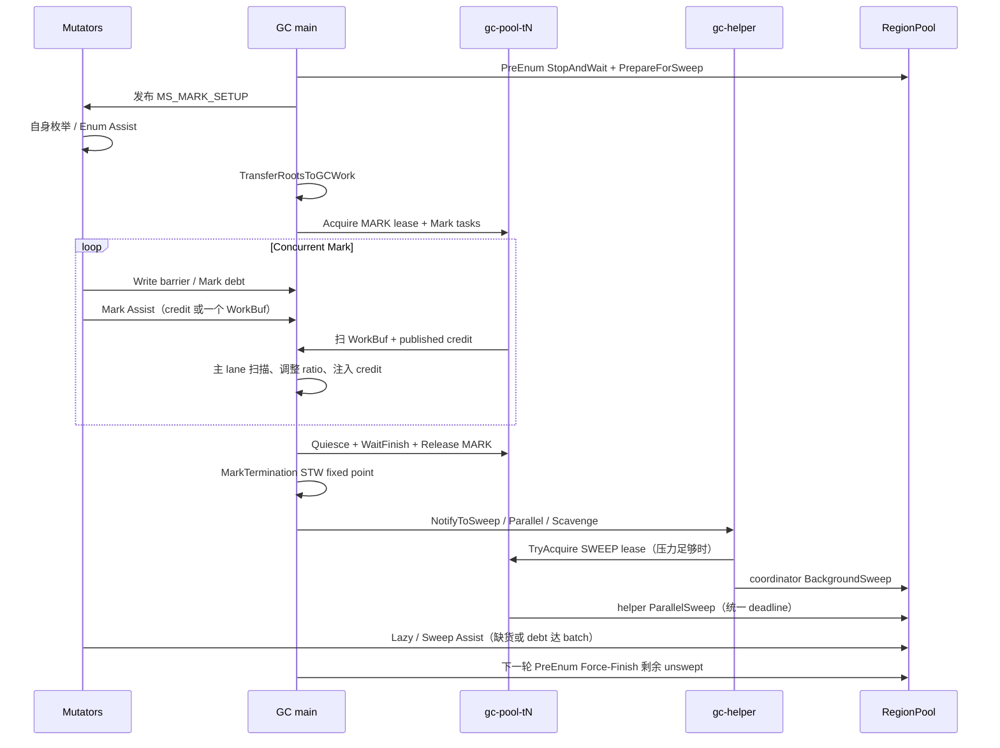

### 10.2 工作与 credit 的流转

Mark 与 Sweep 的工作流分别如下。

```text
Mark:
root / write barrier / field discover
  -> trusted-grey WorkBuf
  -> globalFull_（完整块）或 published partial
  -> GC main / Mark Helper / Mutator Mark Assist 消费
  -> 新 child 进入各自 private putCur_
  -> 满块重新发布；扫描统计转成 bgScanCredit_
  -> Mutator 以 credit-first 偿还 Mark debt

Sweep:
PrepareForSweep 建立 generation unswept lists
  -> Background / Sweep Helper / Lazy / Mutator Assist claim Region
  -> SweepRegion 重建 bitmap/slot
  -> empty/partial/full swept 归类
  -> Background/Lazy/Helper 发布 MSSweepCredit
  -> Mutator Sweep Assist CAS 领取 credit 或直接扫固定 batch
  -> 下一轮 PreEnum 对剩余 unswept Force-Finish
```

这两个 credit 的“退款对象”不同：`bgScanCredit_` 退款的是已经处理的 Mark 对象数，并在 Mark round 间衰减；`MSSweepCreditPool` 退款的是已经完成的 Sweep Region 数，并由 generation/计数 CAS 保证每份只被领取一次。Assist 只能扣掉自己实际获得的 credit 或实际完成的工作，不能根据“系统曾经扫过”这一累计统计重复还债。

### 10.3 GC 先到与 Sweep 先完成两种竞态

**GC 先到。** `ParallelSweepLoop()` 在入口和取得 SWEEP lease 后都检查 `Heap::IsGcStarted()`。若 GC main 先把 phase 切到新一轮，Background 不再发布新的 task，清 helper 控制并释放 lease。若 task 已经启动，GC main 的 MARK acquire 等待该 bounded round 的 `WaitFinish()`；每个已 claim Region 完成 metadata 归类后才能退出。`PreEnumRoots()` 随后再次 `StopAndWaitForAllSweep()`，把 active Background/Lazy/Assist/Helper 计数全部收口。

**Sweep 先完成。** `HasPendingSweepWork()` 发现 unswept 为 0 或 allocator 不再报告 pending 时，清 Parallel/Background flag、重置 generation 的 helper 控制，并输出聚合的 `sweep done`。此前未被 Mutator 领取的 sweep credit 不会凭空变成业务债务；P 在下一次累计新债或发现 `sweepDone_` 时懒清本地 pacing 状态。

**lease miss。** `gc-helper` 不等待 MARK owner释放 pool。如果 SWEEP TryAcquire 失败但 GC 尚未开始，它按相同 deadline退化为 Background lane；如果同时观察到 GC 已开始，则直接放弃本轮。这样后台线程不会因 Worker Pool 争用而阻塞 Finalizer 或延迟新的 GC phase。

## 11. 正确性不变式与停止协议

本章总结 WorkBuf、Region、active counter、phase 和 Worker Pool epoch 的关键安全条件。

### 11.1 Mark work 的发现与扫描不变式

Mark 的安全性依赖“发现”和“消费”两个动作之间的单向约束：

- Route-A 中只有 mark-CAS winner 才把对象放入 trusted-grey buffer；consumer 可以直接扫描 fields，不会因为重复发现而重复入队。
- WorkBuf 不承载 raw object；root、barrier 和 trace producer 都必须在生产端完成 mark-CAS 后再发布。
- 每个 producer 只写自己的 private `putCur_`/`activeLog_`；只有 full 后发布到全局队列。consumer 取走后不会再被另一个 producer 修改。
- 子对象写入 owner 的 private buffer，满块发布；partial tail 在 `MarkTermination` 统一 flush，不以“全局队列空”作为其已处理证明。
- WeakRef 不在 Mutator/普通 Worker 中完成最终判定，而是转交 GC main deferred queue，避免并发阶段提前清除仍可能被重新发现的弱边。

因此，Mark Helper 的并行化只改变消费者数量，不改变 mark winner、buffer 发布和 weak-reference 处理的语义。

### 11.2 Sweep Region 唯一所有权

所有 Sweep 执行方——Background、Helper、Lazy、Mutator Assist、Force-Finish——都必须先从 `partialUnswept` 或 `fullUnswept` list claim Region，并携带当前 `sweepGen`。claim 成功后该 Region 从 unswept 可见集合移除；其他线程即使按旧 class 顺序扫描也不能再次得到它。`SweepRegion()` 完成后一次性更新 state、bitmap、summary 和目标 swept list。

Force-Finish 是停止协议，不是第二种 claim 规则：它只在普通并发路径关闭后继续消费仍可见的 unswept backlog。一个已被 Helper/Assist 摘走的 Region 即使 stop 请求到达，也必须完成当前 sweep，再由 active counter 让停止方观察到退出。

### 11.3 stop/skip 与 active counter 的 StoreLoad 配对

Sweep 的停止有两套 gate：`stopSweepRequested_` 阻止新 claim，`skipHelperSweep_`/`skipAssistSweep_` 使已经进入函数的 worker 在开始下一块前退出。进入 Background、Helper、Assist 路径后分别递增 active counter，执行 seq_cst fence，再二次读取 gate；停止方先发 gate/store，再 fence，最后等待 counters 归零。

典型顺序是：

```text
StopAndWaitForAllSweep:
  ForceFinish（在 gate 仍打开时先尽量收口）
  -> stopSweepRequested = true
  -> skipLazySweep / skipHelperSweep / skipAssistSweep = true
  -> seq_cst fence
  -> 等待 bgSweepRunning、lazySweepRunning、activeAssistSweepCount、activeHelperSweepCount
  -> 最后一轮 ForceFinish
  -> TryPublishSweepDone
```

如果先置 gate 再做第一次 Force-Finish，已存在的 unswept backlog可能失去正常并发供给；如果不等待 active counter，清 bitmap时就可能与一个仍在读取旧 mark bitmap 的 Sweep 交叉。当前顺序同时覆盖了“新工作不可进入”和“在途工作必然可见”两个条件。

### 11.4 MarkTermination 与 Force-Finish 的双重 closure

Mark 的并发候选终点并不是最终正确性终点。`MarkTermination()` 在 STW 中执行一组可重复的固定点操作：关闭 Mark Worker/Assist、刷新所有 Mutator write-barrier buffer、处理各 `PerPGCWork` private partial、把 global stack 和 deferred queue drain 到主线程工作队列，再扫描新产生的 grey 对象，直到输入为空。只有这个 fixed point 后才清除 active collector、切到 Sweep 并允许正常分配。

Sweep 的对应 closure 是下一次 `PreEnumRoots()` 的 `StopAndWaitForAllSweep()`：即便 Background slice、Helper deadline 或 Sweep Assist 都故意只做 bounded 工作，仍由 Force-Finish 在清 bitmap/reclassify 前完成剩余 Region。两套 closure 把“并发路径的吞吐优化”与“阶段边界的正确性”分离开。

### 11.5 Worker Pool epoch 互斥

`GCThreadPool` 的 queue 本身不理解 Mark 与 Sweep。`MSGCWorkerPoolController` 的 owner lease 因此必须覆盖整个 epoch：

```text
Acquire(owner)
  -> AddWork/SetMaxActiveThreadNum
  -> Start
  -> WaitFinish（含调用者 drain queued task）
  -> Release(owner)
```

MARK 是等待式 acquire，确保 GC main 的 Mark 进度最终能取得 pool；SWEEP 是 try-acquire，避免 `gc-helper` 被 Mark 长时间卡住。任何 owner 在 `WaitFinish` 前释放都会让另一个阶段把不同语义的 task 插入同一队列，属于协议错误而不是性能降级。

## 12. 配置、日志与问题定位

本章列出影响三类协助的 Runtime 参数、REPORT 日志和典型诊断方法。

### 12.1 主要配置参数

以下是当前源码中的主要默认值/含义（具体版本仍以 `CjScheduler` 和各 pacing/policy 头文件为准）：

| 参数 | 当前默认/范围 | 影响 |
| --- | --- | --- |
| `cjGCThreads` | `min(4, max(1, P/2))`，再受硬件线程数约束 | GC main + 可借用 pool helper 的总宽度 |
| `cjMSEnumAssistBatchSize` | 10 | 一个 Mutator 每次 Enum Assist 推动的 candidate 数 |
| `cjMSAssistBaseRatioPercent` | 50% | Mark debt 的跨周期基础比例 |
| `cjMSAssistBacklogStepBuffers` | 16 个 buffer | Mark backlog 每增加一档时放大 ratio |
| `cjMSAssistMaxMultiplier` | 4 | Mark ratio 的最高倍率，tail 直接使用 |
| `cjMSAssistCreditDecayRounds` | 100 轮 | background Mark credit 的线性衰减窗口 |
| `cjMSAssistSweepMaxRegionsPerCall` | 4 | Sweep Assist 的触发阈值和单次 batch 上限 |
| `cjGCBGSweepMaxTime` | 2ms base | Background/Parallel Sweep LOW 基准 slice |
| `cjMSParallelSweepMaxHelpers` | 0（不额外限制） | Sweep helper 上限；仍受 `gcThreads-1` 限制 |
| `cjMSParallelSweep` | true | 是否允许 SWEEP lease/并行 task |
| `cjMSBackgroundSweep` | true | 是否周期/通知驱动普通 Background Sweep |
| `cjMSBackgroundScavenge` | true | 是否后台释放 retained heap |
| `cjMSBackgroundShrink` | false | 是否后台逐段 shrink |
| `cjMSBackgroundScavengeRounds` | 8 | 一次 Scavenge 目标分成多少 slice |
| `cjMSMarkTimeBudget` | 20s | Concurrent Mark 超时后进入 quiesce/closure |

三个容易混淆的量要分开调：`cjGCThreads` 决定物理并行上限；`cjMSParallelSweepMaxHelpers` 只限制 Sweep helper，不影响 Mark helper；`cjMSAssist*` 只改变 Mutator pacing/credit，不会直接增加 GC Worker 数。

### 12.2 关键 REPORT 日志

建议按以下顺序关联日志中的“请求—执行—收口”：

- `[assist-pacing]`：Mark base/raw/EMA、backlog、share feedback、multiplier；用于判断 debt 是否被过度交给 Mutator。
- `[assist]`：Mutator Mark/Sweep Assist 的触发、credit、实际扫描/清扫数量和 skip/quiesce；用于定位慢分配路径是否承担过多工作。
- `[mark-workers]`、Mark tail/quiesce：`targetHelpers`、`workersInFlight`、published credit、tail 进入和 lease 释放；用于确认 Helper 是否真正启动/退出。
- `parallel-sweep start/done`：mode、forced、U/S/T、target/active helpers、budget、remaining、leaseMiss、gcStarted；用于判断并行 Sweep 是压力扩容还是被 GC 抢占。
- `sweep done`：聚合 slices、swept/empty、remaining unswept 和 elapsed；用于确认 Background flag 已经清空。
- `scavenge done`、`shrink done`：释放 Region/字节和累计耗时；用于区分“没有可释放 supply”与“Shrink 未开启”。
- `StopAndWaitForAllSweep` summary、Force-Finish 日志：用于判断下一轮 STW 是否在收口上一代 backlog。

REPORT 不能只看“helperCount”。例如 `parallel-sweep done` 中 `activeHelpers=2` 不代表 coordinator 也计入 Helper；要同时读取 `swept`、taskElapsed 和 pending stats，按当前实现区分 Background lane 与 pool task。

### 12.3 典型现象与定位顺序

**现象：Mutator 分配耗时升高。** 先看 `[assist]` 的 debt、credit 命中率和每次扫/清的 batch；再看 `[assist-pacing]` 的 share 是否长期超过 90%、ratio 是否被 backlog multiplier 拉到 4 倍；最后看 GC main/Helper 是否没有及时发布 Mark/Sweep credit。不要先把 `cjMSAssistSweepMaxRegionsPerCall` 调大，因为它会直接放大单次分配尾延迟。

**现象：Sweep backlog 很大但没有 Helper。** 检查 U/S/T 与 pressure mode，再检查 `cjMSParallelSweep`、`gcThreads-1`、`msParallelSweepMaxHelpers` 和 SWEEP lease 是否频繁 miss。若日志显示 `leaseMiss=1` 且 GC 同时开始，这是设计上的退化，不是 Helper 创建失败。

**现象：下一次 GC 的 PreEnum 停顿变长。** 将 `sweep done`/`parallel-sweep done` 的 remaining 与 Force-Finish summary 对齐；若 remaining 大，检查 `gc-helper` 是否被 Finalizer/Scavenge burst 长时间占用，以及 Background Sweep 是否被 preferred class 饥饿。若 remaining 小但仍停顿，检查 active counters 是否迟迟不归零。

**现象：Scavenge 一直重复唤醒。** 看 `BackgroundScavengeLoop` 是否因为 hot-free/empty-swept/large cache 全空而反向 `NotifyToSweep()`；这说明不是 Scavenge 逻辑卡住，而是需要先完成 Sweep 生产供给。若 `cjMSBackgroundShrink=false`，Scavenge 达标后的 Shrink 通知会正常被关闭。

**现象：Mark 仍在 STW 做大量工作。** 检查 `globalFull_` 是否在并发阶段真正被 GC main/Helper 消费、`workersInFlight/assistsInFlight` 是否进入 quiesce、Mutator 的 partial logs 是否只在 termination 才第一次发布，以及 Mark time budget 是否过短。Mark Assist 的设计目标是降低而不是消除 termination residual。

## 13. 历史设计与当前实现差异

本章标明 Step5/12/31/33/34/44 等历史文档中已被当前源码替代的口径。

| 历史记录/旧口径 | 当前源码口径 | 阅读旧文档时的影响 |
| --- | --- | --- |
| Step5 使用 1024 比例尺、64 触发、最多 512 对象，并以 `scanRemaining` 循环 | `gcAssistDebtScaled_` 使用 65536 定点；达到 `WorkBuf::kCapacity=1024` 才触发；一次最多消费一个 full buffer；credit-first + EMA/倍率 | 不要把旧常数写成当前 Mark Assist 单次预算 |
| Step12/Step4 通过 `BackgroundFillAllocCaches`、`NotifyToReclaimGarbage` 驱动后台供给 | 当前 Background flags 是 Finalizer、Background/Parallel Sweep、Scavenge、Shrink；供给由 RegionPool 和 hot cache 接口完成 | 旧的“后台补 allocation cache”不是当前 `gc-helper` 主循环 |
| Step31 以“fresh Region 前先偿债/threshold-runway”描述 Mark 初始比例 | 当前 raw base 按上轮 marked objects / 本轮 allocated bytes × base percent 计算；债在成功 active Region/span 边界累计 | 需以 `ConcurrentMark()` 和 `AccumulatePacingDebt()` 的调用点为准 |
| Step33 允许在多个 safepoint 立即递归派 Enum Assist | 当前通过 `deferEnumAssistUntilNextSafepoint_` 延后；batch claim 有 `inFlight`，GC main 仍负责最终 `EnsurePhaseTransition` | Enum Assist 是有 gate 的候选批处理，不是递归遍历 Mutator 列表 |
| Step34 旧版分配路径会在 `MaybeNotifyMark()` 中刷新 Sweep pressure | 当前 `MSRegionManager.cpp` 的分配热路径消费已发布的 pressure snapshot；pressure 刷新发生在 Sweep/后台边界 | 分析分配开销时不能假定每次 HEU 都读取完整中央统计 |
| Step34 旧 feedback 以 25% target / 30% max 描述 | 当前 `MSAssistPacing.h` 是严格 `share > 90%` 才回压，目标 share 80%；恰好 90% 不回压；上升周期另有 25% rise cap | 配置/日志说明必须使用当前 80/90 口径 |
| Step44 设计过 `DEFER_FOR_SWEEP`、HEU deferred/retry | 当前 HEU 在压力非 LOW 时 `NotifyToParallelSweep()`，但 HEU 仍直接提交；没有旧的 deferred 状态机 | 不能把当前分配路径描述成“等后台 Sweep 后再分配” |
| Step44 曾建议 Parallel burst coordinator 也计入 Helper | 当前 coordinator 调 `BackgroundSweep()`，计入 `backgroundSweptRegions_`；只有 pool task 计入 Helper active/stats | 解释 REPORT 时必须区分 Background lane 与额外 Helper lane |
| 旧 Parallel Sweep 只在 emergency backlog 拉满 | 当前 LOW/MEDIUM/HIGH 都有 pressure policy；MEDIUM 按超额比例逐轮增减，HIGH/forced HIGH 才立即拉满 | “有 Parallel Sweep 就一定是紧急模式”已经不成立 |
| 旧 `LFStack` 文档按无锁 Treiber stack解释 | 当前实现用 mutex 保护 global full/partial 交换和计数，性能重点在 P-local buffer 与 full-buffer批处理 | 不应依据类名推导无锁内存序语义 |

这些差异不是文档风格变化，而是影响问题定位的实际契约：旧记录可以解释为什么有这些字段/开关，但只有当前函数体决定 trigger、batch、lease、credit 和 stop 顺序。发现其它文档仍沿用旧常数时，应按“代码为准、最小修正”的规则更新其对应 references，而不是在本文继续并列两套默认行为。

## 14. 关键源码索引与术语速查

本章提供函数级源码入口、关键字段和术语定义，便于从文档回到实现核验。

### 14.1 Mutator Assist 源码

| 主题 | 入口 |
| --- | --- |
| Enum candidate 建立/推进 | `src/Mutator/MutatorManager.cpp`：`TransitionAllMutatorsToGCPhase`、`EnsurePhaseTransition`、`ClaimEnumAssistBatch`、`FinalizeEnumAssistContext` |
| Enum Assist 请求处理 | `src/Mutator/Mutator.cpp`：`TransitionToGCPhaseExclusive`、`HandleSuspensionRequest`、`HandleEnumAssist` |
| Mark debt 记账 | `src/Heap/MAllocator/MSAllocBuffer.cpp`：`AccumulatePacingDebt`、小对象 Region refill 和 large span 注册调用点 |
| Mark ratio/feedback | `src/Heap/MCollector/MSAssistPacing.h` 与 `src/Heap/MCollector/MarkSweepCollector.cpp`：raw base、rise cap、share feedback、backlog EMA、credit decay |
| Mark Assist | `src/Heap/MCollector/MarkSweepCollector.cpp`：`MSMarkAssist`、`TryStealBgCreditPartial`、`DrainOneBufRound` |
| Sweep debt/credit | `src/Heap/MAllocator/MSAllocBuffer.cpp`、`src/Heap/MAllocator/MSCentralRegionPool.cpp`：`AccumulateSweepDebt`、`MSSweepAssist`、`MSSweepCreditPool::Take` |
| 分配热路径触发 | `src/Heap/MAllocator/MSRegionManager.cpp`：`MaybeNotifyMark`、HEU 与旧 Sweep pressure snapshot 交互 |

### 14.2 Mark/Sweep Helper 源码

| 主题 | 入口 |
| --- | --- |
| Worker pool 建立 | `src/Heap/Collector/CollectorResources.cpp`：`StartGCThreads`、`GCMainThreadEntry`；`src/Heap/GcThreadPool.*` |
| MARK lease/Worker control | `src/Heap/Collector/MSGCWorkerPoolController.h`、`src/Heap/MCollector/MSMarkWorkerControl.h` |
| Mark main/Helper | `src/Heap/MCollector/MarkSweepCollector.cpp`：`ConcurrentMark`、`RunConcurrentMarkLoop`、`RunMarkWorker`、tail/quiesce/credit 汇总 |
| Region generation/Sweep debt | `src/Heap/MAllocator/MSCentralRegionPool.cpp`：`PrepareForSweep`、`RefreshSweepDebtSnapshot`、`SetSweepPressureMode` |
| Sweep claim/Force-Finish | `src/Heap/MAllocator/MSCentralRegionPool.cpp`：`ClaimUnsweptHeadForSweep`、`SweepRegion`、`ForceFinishAllUnswept`、`StopAndWaitForAllSweep` |
| SWEEP lease/Parallel task | `src/Heap/MCollector/BackgroundProcessor.cpp`：`RefreshSweepHelperControl`、`ParallelSweepLoop`；`ParallelSweepTaskContext` |

### 14.3 Background 线程源码

| 主题 | 入口 |
| --- | --- |
| 生命周期与轮转 | `src/Heap/MCollector/BackgroundProcessor.cpp`：`Start`、`Run`、`Init`、`Fini`、`Wait`、`WaitForActiveBackoff` |
| 通知/周期 | `RequestWork`、`HasPendingWakeWork`、`MaybeSchedulePeriodicWork`、`NotifyToSweep`、`NotifyToParallelSweep`、`NotifyToScavenge`、`NotifyToShrink` |
| Sweep | `BackgroundSweepLoop`、`ParallelSweepLoop`、`HasPendingSweepWork` |
| Helper 压力策略 | `ResetSweepHelperControl`、`RefreshSweepHelperControl`、`parallelSweepRoundRobin_` |
| Scavenge/Shrink | `BackgroundScavengeLoop`、`BackgroundShrinkLoop` |
| Finalizer | `src/Heap/Collector/FinalizerProcessor.cpp`：`ProcessFinalizables` 及其 work list/通知接口 |

### 14.4 术语速查

- **P-local debt**：保存在一个 `AllocBufferMS` 中的 pacing 状态，不代表全局未完成工作的唯一事实。
- **WorkBuf**：Mark 扫描对象的固定容量缓冲；full buffer 可发布到全局，partial tail 由 owner/termination 收口。
- **credit**：后台已替系统完成的工作量，可被对应 Assist 通过原子操作领取；不是对象或 Region 的第二所有权。
- **MARK/SWEEP lease**：共享 GC Worker Pool 的阶段所有权，覆盖完整 task epoch。
- **U/S/T**：Sweep pressure 中的 unswept bytes、swept/live bytes 与 heap threshold。
- **coordinator lane**：`gc-helper` 自己执行的主 Sweep lane；当前统计属于 Background，不等于一个额外 Helper。
- **one-way quiesce**：Mark 关闭新 Worker/Assist claim 后不重新开放，余量交给 STW closure。
- **Force-Finish**：阶段边界为正确性清空剩余 Sweep/Mark 工作的兜底路径，不是普通吞吐 Assist。
