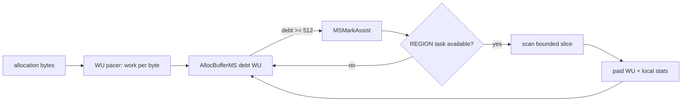

# Cangjie MSGC Assist 协助架构与实现详解

> 当前代码基线：`MSGC-bugfix-regionScan` / `24ca097ace`。当前 Mark Assist 以 Work Unit 为债务，只消费 REGION task。

## 1. Assist 的三类含义

MSGC 中应区分：

| 类型 | 执行者 | 工作单位 | 目的 |
|---|---|---|---|
| Enum Assist | Mutator | root candidate | 缩短根枚举 handshake 长尾 |
| Mark Assist | Mutator | REGION task / WU | 让分配速度与并发 Mark 进度匹配 |
| Sweep Assist | Mutator | Region / sweep credit | 在分配压力下推进上一轮 Sweep |

GC helper 不是 mutator Assist。它是共享 `GCThreadPool` 中的 worker，在 MARK epoch 使用完整
Mark capability，在 SWEEP epoch 使用 Sweep task。

## 2. 当前 Mark Assist 数据流



分配路径通过 `AccountMarkAllocationBytes(size)` 记录本轮分配量，并按
`assistWorkPerByteScaled_` 累积债务。达到 `MS_WU_ASSIST_THRESHOLD=512` 时调用
`MSMarkAssist()`。

## 3. 为什么使用 Work Unit

旧的“分配若干对象后扫描一个固定对象 buffer”无法反映对象密度、bitmap RMW 和 Region
扫描差异。当前 WU 将三类成本统一：

| 操作 | WU |
|---|---:|
| resolve reference | 1 |
| mark word RMW | 8 |
| scan bitmap word | 1 |

Pacer 根据前一轮的：

- 完成 WU；
- Mark 期间分配字节；
- concurrent mark 时间；

更新 work density 和 throughput。因而 Assist debt 直接表达“这批分配理论上带来的 Mark
工作”，不再依赖固定对象个数。

## 4. `MSMarkAssist()` 的边界

入口位于
[`MarkSweepCollector.cpp`](../../src/Heap/MCollector/MarkSweepCollector.cpp)。
Assist 使用 `MSMarkWorkerCaps::Assist()`：

```text
region = true
object = false
```

这意味着：

- 可 claim 小对象 REGION task；
- 不扫描 large OBJECT task；
- 单 slice 墙钟预算默认 50 μs；
- 使用 WU budget 控制 Region owner 的单次工作；
- task 产生的 child 仍通过本地 `MSMarkWordBatch` 回到统一 scheduler；
- lease 完成前必须 flush 本地 batch。

若 Region task 在预算内未完成，owner 把 residual summary 写回，并在完成当前 lease 前
发布 replacement。Assist 离开不会遗失 Region 的未扫描位。

## 5. Pressure 与偿债比例

`MSWorkUnit.h` 按 heap runway 分类：

| 条件 | Pressure |
|---|---|
| 当前没有分配，或 runway > 100 ms | NORMAL |
| 20 ms ≤ runway ≤ 100 ms | HIGH |
| runway < 20 ms | CRITICAL |

偿债比例随压力提高：

- NORMAL：偿还约需求的 1/4；
- HIGH：约 1/2；
- CRITICAL：全额目标；
- 实际工作仍受单 slice WU/50 μs 墙钟预算限制。

这是一种 pacing 决策，不改变 GC 正确性。即便 Mutator 未偿完债，MarkTermination 仍会在
STW 中 drain scheduler。

## 6. Mark helper

GC helper 与 GC main 都使用 `MSMarkWorkerCaps::GCWorker()`，可以在 REGION 与 OBJECT
lane 间领取任务。helper target 由：

```text
base = ceil(outstanding tasks / 8)
```

并受最大 helper 数、outstanding 上限与 pressure 提升约束：

- HIGH 至少提升到约一半 helper；
- CRITICAL 可提升到全部 helper；
- outstanding 为 0 时 target 为 0。

这里的 outstanding 来自 task ledger，已经包含 queued 与 leased；不能再把 ready stack
长度相加，否则会重复计算 backlog。

## 7. GC main、Helper、Assist 的协作

| 属性 | GC main | GC helper | Mutator Assist |
|---|---|---|---|
| REGION | 是 | 是 | 是 |
| OBJECT | 是 | 是 | 否 |
| 默认墙钟 slice | 1000 μs | 500 μs | 50 μs |
| 统计 | cycle main stats | worker-local stats | AllocBufferMS-local stats |
| 停止方式 | phase loop | worker control quiesce | active collector/phase gate |

三者消费同一个 scheduler，但不需要共享对象缓冲。task lease 和 ledger 提供可见性：

- claim 后即使 ready lane 暂时为空，leased task 仍计入 outstanding；
- child publication 先于 lease completion；
- helper/Assist 停止后，剩余 task 仍可由 GC main 或 STW 接管。

## 8. Worker 控制与事件唤醒

`MSMarkWorkerControl` 管理：

- 当前 helper target；
- worker in-flight/phase；
- quiesce；
- 与 `markWorkEpoch_` 的事件通知。

以下事件会推动等待者重新检查：

- ready lane 从空变非空；
- Region owner 重新发布 residual task；
- OBJECT task 发布；
- worker target/phase 变化。

它用于降低空转，不是终止判定本身；终止仍以 scheduler ledger 为权威。

## 9. Enum Assist

Enum Assist 与 Region scan 不共用 task：

- 它处理根枚举候选；
- 不遍历 heap child；
- 不更新 scan plane；
- 不产生 Mark WU credit；
- 必须在 EnumRoots 阶段的 in-flight 协议下收口。

根最终由 collector 标记并通过 `PublishRootStaging()` 转成 scheduler work。

## 10. Sweep Assist

Sweep Assist 仍是 Region 级协议：

1. 分配形成 sweep debt；
2. 优先使用 central/background 已完成的 credit；
3. credit 不足时尝试 claim unswept Region；
4. 与 lazy/background/parallel Sweep 使用共同的 Region ownership；
5. GC 到来时通过 stop/active 与 worker-pool lease 收口。

它与 Mark Assist 的共同点只是“让 mutator 在分配路径偿还系统工作”。两者的债务单位、
task 来源和完成条件不同。

## 11. MarkTermination 的 Assist 收口

进入 termination 前：

1. 关闭新 helper claim；
2. 等待 helper in-flight 归零；
3. active mutator 的 Assist 统计在 STW 下聚合；
4. Mark 期间退出的 mutator 已把统计合并到 `exitedAssistStats_`；
5. STW 使用完整 GCWorker capability drain remaining REGION/OBJECT tasks。

不存在需要从 mutator TLS 回收的灰对象 partial buffer。需要核对的是：

- 是否仍有 active lease；
- Region 是否有 residual pending summary；
- worker/Assist 是否在 batch flush 前完成 lease；
- ledger 和 ready lanes 是否一致。

## 12. 正确性不变式

1. Assist 只处理 REGION task。
2. active task lease 必须显式完成。
3. local `MSMarkWordBatch` 为空后才能完成 lease。
4. 预算退出必须先 requeue replacement。
5. task ledger 包含 queued + leased。
6. worker quiesce 不等于 scheduler closure。
7. Assist 统计退出合并不能丢失或跨周期重复。
8. Sweep Assist 不得持有 MARK worker-pool epoch，反之亦然。

## 13. 诊断

| 现象 | 检查 |
|---|---|
| 分配线程 Assist 延迟过高 | 50 μs wall budget、task 内大对象误入、WU throughput |
| 债务持续增长 | work-per-byte、pressure、REGION backlog |
| helper 空转 | target、outstanding、markWorkEpoch 通知 |
| outstanding 不归零 | lease completion、replacement 顺序 |
| Assist 完成但 Mark 漏对象 | batch flush、pending summary、sealed-set ALLOC validity filter |
| GC/Sweep worker 冲突 | MARK/SWEEP lease 与 stop/active counter |

## 14. 源码索引

- [`MSAllocBuffer.cpp`](../../src/Heap/MAllocator/MSAllocBuffer.cpp)：分配记债与触发
- [`MarkSweepCollector.cpp`](../../src/Heap/MCollector/MarkSweepCollector.cpp)：
  `MSMarkAssist`、`RunMarkWorker`、`QuiesceMarkWorkers`
- [`MSWorkUnit.h`](../../src/Heap/MCollector/MSWorkUnit.h)：WU、pressure、helper target
- [`MSMarkScheduler.h`](../../src/Heap/MCollector/MSMarkScheduler.h)：capability 与 lease
- [`MSMarkWorkerControl.h`](../../src/Heap/MCollector/MSMarkWorkerControl.h)：helper 控制
- [`MSMarkLocalStats.h`](../../src/Heap/MCollector/MSMarkLocalStats.h)：local/exit stats

## 15. 历史口径

旧版 Mark Assist 曾以对象 WorkBuf 容量、全局满块数量、private partial 和 tail drain
描述工作量与收口。当前实现已经用 Region task、WU、ledger 和 bounded slice 替代这些
机制；旧常数和日志不能作为当前调优依据。
