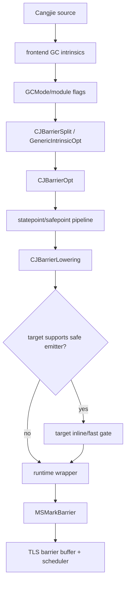

# LLVM MSGC 优化流程与文件结构详解

> 当前代码基线：compiler/runtime 的 `MSGC-bugfix-regionScan` 工作树与 runtime 提交 `24ca097ace`。当前 LLVM 侧不应再发射旧 TLS grey-log 写入。

## 1. 分层原则

MSGC 优化横跨三层：

| 层次 | 职责 |
|---|---|
| Cangjie 前端/IR | 产生公共 GC intrinsic，携带类型与操作语义 |
| LLVM middle/back end | 按 GCMode 做 split、opt、lowering 与 target emission |
| Runtime | 执行 SATB publication、bitmap 更新、Region/OBJECT 调度与 closure |

Region scan 是 runtime 的 Mark 表示变化，不要求新增一套前端 GC intrinsic。编译器仍应
通过 GCMode 把公共 intrinsic 分流到 MSGC 语义。

## 2. 总体流程



目标 emitter 的 fast path 必须与 wrapper 等价；不支持的 target、calling convention 或
IR 形态保留 call。

## 3. GCMode 与 module 隔离

CopyGC 和 MSGC 共用 intrinsic 名称时，GCMode/module flag 是语义来源。IR link/LTO 必须
防止不同 GCMode 模块静默混合。lowering 与 target emitter 应再次核对 mode，避免仅凭函数名
把 CopyGC 路径错误套到 MSGC。

应验证：

- 普通编译；
- ThinLTO/Full LTO；
- 旧 bitcode 缺少新 flag 时的保守回退；
- JIT 与 AOT 的 mode 传递；
- compiler、runtime、stdlib、stdx 使用同一套 SDK。

## 4. MSGC 读 barrier

MSGC 不移动对象，普通引用 load 不需要：

- from-space 检查；
- forwarding pointer；
- to-space 修正。

因此 MSGC read intrinsic 可在保持内存顺序、引用表示与 safepoint 约束后降低为普通 load
或等价操作。generic read 仍要根据类型布局决定是否能变成 memcpy/load，不能只凭
“MSGC 无读 barrier”删除所有语义。

## 5. MSGC 写 barrier

### 5.1 Runtime 语义

当前 barrier 是：

```text
old = load(dst)
runtime publishes old to current Mark
store(dst, new)
```

runtime publication：

- small：mark-word batch → mark plane → pending summary → REGION task；
- large：large marked winner → OBJECT task；
- non-heap/null：忽略。

### 5.2 Compiler 可做的优化

- 非 Mark phase 的 store-only gate；
- 对已知 ref/static-ref 选择专用 wrapper；
- short-GCTib struct/static-struct 可在 target 内枚举 old value，其他 bulk 保留
  Runtime enumeration；
- target 支持时 inline heap/phase precheck；
- 将无法证明安全的情况回退 wrapper。

### 5.3 Compiler 不应做的事

- 直接向已移除的 `AllocBufferMS::activeLog_` 追加对象；
- 依赖旧对象 buffer 的 len/capacity/offset；
- 直接修改 `MSScanState`、`pendingWordSummary` 或 scheduler ledger；
- 假定 old ref 一定属于 small Region；
- 在 memcpy/memmove 后才记录目标旧引用；
- 让 batch 或 bitmap 坐标跨 mark epoch。

## 6. Wrapper 与 fast emitter

Wrapper 是语义锚点，不只是“慢代码”。当 emitter 无法覆盖以下任一条件时必须保留：

- target/platform；
- object format；
- calling convention；
- statepoint call 形态；
- 参数顺序与引用编码；
- phase/heap fast-path state；
- bulk 范围和类型布局。

Emitter 可以执行 cheap gate 后 tail 到 wrapper。这样 runtime 的 Region/large 分类、
mark epoch 与 scheduler publication 仍只有一套权威实现。

## 7. 分配优化

当前分配 fast path 仍可依赖公开且有静态断言的布局：

- `MSRegionInfo::allocPtr` offset 0；
- active Region/size-class 状态；
- heap range 与 fast-path phase；
- BUMP/PARTIAL/BITMAP 的 runtime 回退。

分配期间新增的 Mark 协作是 WU debt/accounting，属于 runtime `AllocBufferMS` 行为。
compiler 不需要自行计算 Mark debt，但其 fast allocation 最终必须保持与 runtime accounting
入口等价；若某条全内联路径绕过记账，pacer 会低估分配速度。

## 8. 当前 runtime ABI

### 8.1 可以作为 compiler/runtime 合同的内容

- wrapper symbol 与函数签名；
- GCMode/module flags；
- `CJ_MRT_MSGCFastPathState` 中公开字段；
- 经 `static_assert` 固化的 Region/allocator offsets；
- `ThreadLocalData::encodedGCPhase` 的发布语义；
- heap/reference representation。

### 8.2 已镜像布局、但不由当前写屏障 emitter 修改的内容

- `markTaskNextRegionIdx` intrusive link；
- `pendingWordSummary`；
- `MSScanState/control`；
- REGION/OBJECT ready stacks；
- `MSTaskLedger`；
- WU slice 与 helper policy。

`CJMSGCABI.h` 已镜像完整 `MSGCFastPathState` 与 `MSRegionInfo` offset，包括 scan-plane
base、task-next 和 pending-summary，因此这些字段的**位置**已纳入 compiler/runtime ABI
检查。当前 AArch64/X86 emitter 会在 Mark phase 为 Ref/StaticRef 和 short-GCTib
Struct/StaticStruct 直接合并 owner-private TLS entry；ArrayCopy、StdGCTib、含引用
RawArray、LARGE/OUTSIDE_SET 和校验失败路径仍调用 Runtime wrapper。两类 inline 都不直接
执行 pending publication 或 scheduler admission，Ready stack、ledger 与 WU policy仍完全
由 Runtime 管理。

## 9. 三套 bitmap plane

Runtime 当前通过 `MSBitmapArena` 管理：

| Plane | 用途 | LLVM 是否应直接写 |
|---|---|---|
| ALLOC | `1=free slot`；collect-set 中过滤无对象 slot | 仅已有分配 fast path 的明确协议 |
| MARK | 已发现对象 | barrier 优先调用 runtime publication |
| SCAN | 已扫描对象 | 否；Region owner 专属 |

尤其不能由 barrier emitter 设置 scan bit。scan bit 的含义是“引用字段扫描已完成”，不是
“对象已被 barrier 发现”。

## 10. 文件结构与阅读入口

Compiler/LLVM 侧的具体文件名会随仓库组织调整，应优先搜索以下符号：

```text
CJBarrierSplit
CJGenericIntrinsicOpt
CJBarrierOpt
CJBarrierLowering
GCMode
MSGC
CJ_MRT_MSGCFastPathState
```

Runtime 对照入口：

- [`MSMarkBarrier.cpp`](../../src/Heap/MBarrier/MSMarkBarrier.cpp)
- [`MarkSweepCollector.cpp`](../../src/Heap/MCollector/MarkSweepCollector.cpp)
- [`MSMarkBatch.h`](../../src/Heap/MCollector/MSMarkBatch.h)
- [`MSMarkScheduler.h`](../../src/Heap/MCollector/MSMarkScheduler.h)
- [`MSRegionInfo.h`](../../src/Heap/MAllocator/MSRegionInfo.h)
- [`MSGCFastPath.h`](../../src/Heap/MSGCFastPath.h)

## 11. 支持矩阵原则

| 能力 | AArch64 | X86-64 | 其他 target |
|---|---|---|---|
| Runtime wrapper | 必须 | 必须 | 必须 |
| MSGC read lowering | 以 pass 支持为准 | 以 pass 支持为准 | 保守 |
| MSGC write inline | 仅当前代码显式支持的形态 | 仅当前代码显式支持的形态 | wrapper |
| Region scan scheduler | Runtime | Runtime | Runtime |

本文不根据旧文档推断“某 target 已完全 inline”。实际支持必须以当前 target emitter、
测试和生成机器码共同确认。

## 12. 验证矩阵

### 12.1 IR

- MSGC/CopyGC module flag 正确；
- MSGC read lowering 不破坏 volatile/atomic；
- Mark/Idle 写路径分流；
- generic/struct/array 保留必要 old-value enumeration；
- LTO 不混合 GCMode。

### 12.2 机器码

- 不出现旧 TLS grey-log offset 访问；
- 不支持形态保留 wrapper call；
- phase gate 与 heap precheck 顺序正确；
- statepoint 与普通 call 均保持 ABI；
- fast path 失败可回退。

### 12.3 Runtime 端到端

- old ref 指向 small、large、SPAN、null、非 heap；
- scalar、struct、static struct、ref array、struct array、atomic；
- 并发 phase 切换压力；
- `cjMSVerifyMark` 无 reachable-unmarked edge；
- case25–31 使用同一套 compiler/runtime/stdlib/stdx。

## 13. 维护清单

修改 barrier 或 allocation emitter 时：

1. 先核对 runtime wrapper 的当前语义。
2. 检查 GCMode 与 LTO 隔离。
3. 检查公开 fast-path state 和 static assertions。
4. 保留 unsupported fallback。
5. 更新 IR/CodeGen tests。
6. 构建完整 SDK并验证 dylib 来源。
7. 运行 Region-scan Mark verifier 和复杂 JSON 用例。

## 14. 历史方案

旧 AArch64 emitter 中关于 mark-CAS winner 后写 TLS WorkBuf、预留 buffer capacity、
active-log offset 等描述属于已移除 runtime 架构。旧问题可用于检查“先标记但未发布”
这类一般性风险，但当前等价检查点已经变为：

```text
mark word update
→ pending summary publication
→ REGION/OBJECT task admission
→ ledger/lease closure
```
