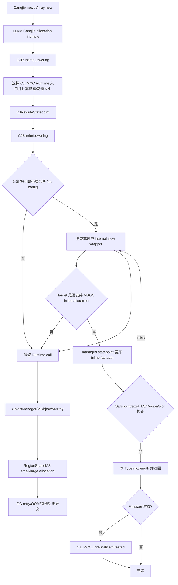

# LLVM NewObj FastPath 实现详解

> 适用范围：Region-scan MSGC 当前工作树，源码核对日期 2026-07-30。
>
> Region-scan LLVM：
> `/Users/lipeisheng/code/cangjie/cangjie/cangjie_compiler_region_mark/third_party/llvm-project`
>
> Region-scan Runtime：
> `/Users/lipeisheng/code/cangjie/cangjie/cangjie_runtime_region_mark/runtime`
>
> 本文只描述 Region-scan MSGC，不与 Wbuf/CopyGC 的目录和实现混用。

## 1. 总结

当前对象创建由 LLVM 与 Runtime 共同完成：

1. LLVM 把 Cangjie 的对象/数组分配 intrinsic 降低为稳定的 `CJ_MCC_*`
   Runtime ABI。
2. 对满足条件的小对象，LLVM 在 managed caller 的 statepoint 调用点展开
   AArch64/X86-64 MSGC fastpath。
3. fastpath 只负责当前 P 的 active Region 中的一次 slot 分配，以及最小对象头初始化。
4. fastpath 任一检查失败，均调用保留下来的 Runtime wrapper/入口。
5. Runtime 负责 Region refill、Sweep Assist、large object、GC/OOM retry、异常和
   Finalizer/WeakRef 等完整语义。

必须区分：

- **生成了 fastpath**：最终机器码包含 inline allocation 序列。
- **本次命中 fastpath**：运行时通过全部检查，未执行 Runtime slow helper。

机器码中仍然看到 `CJ_MCC_New*` 或生成 wrapper，不代表 fastpath 没有接通；这些调用是
fastpath miss 时必须保留的慢路径。

### 1.1 当前覆盖范围

| 类型 | LLVM fastpath 状态 | Runtime 特殊语义 |
|---|---|---|
| 普通对象 | 已覆盖静态大小和动态大小 | 初始化 TypeInfo |
| Pinned，`isFinalizer=false` | 已覆盖静态大小和动态大小 | MSGC 中与普通对象共用非移动 Region allocator |
| Pinned，`isFinalizer=true` | 常量 flag 时已覆盖静态大小和动态大小 | fast 成功后注册 Finalizer |
| Finalizer 对象 | 已覆盖 | fast 成功后调用 `CJ_MCC_OnFinalizerCreated` |
| WeakRef 对象 | 已覆盖 | 强制放入 `HAS_REF` Region，Mark 阶段单独处理 referent |
| 引用数组 | 已覆盖 | `HAS_REF` |
| struct/value 数组 | 已覆盖 | 按元素 TypeInfo 精确选择 `NO_REF/HAS_REF` |
| 1/2/4/8-byte primitive 数组 | 已覆盖 | `NO_REF` |
| generic array，静态 TypeInfo＋常量长度 | 已覆盖 | 按具体元素种类分派 |
| generic array，静态 TypeInfo＋动态长度 | 已覆盖动态 fastpath | 编译期确定元素语义，运行时校验总大小 |
| generic array，动态 TypeInfo | 已覆盖运行时 dispatch | 按 kind 分流；仅 struct/value 读取 size 和 `TF_HAS_REF_FIELD` |
| 总大小大于 16KB | 不展开/动态 miss | Runtime large-object path |

## 2. 总体流程



### 2.1 LLVM 各阶段的职责

| 阶段 | 对象 | 数组 |
|---|---|---|
| `CJRuntimeLowering` | 根据 `MallocType` 选择普通、Pinned、Finalizer、WeakRef 入口 | 选择 ref/value/1/2/4/8B/generic 入口，计算总大小和 scan class |
| `CJRewriteStatepoint` | 将分配调用纳入 Cangjie statepoint | `!fast_new_array` 转为 `NewArrayFast` statepoint |
| `CJBarrierLowering` | 把候选对象重定向到带 fast config 的 internal wrapper | 数组 wrapper 已由 `CJRuntimeLowering` 生成 |
| AArch64/X86 AsmPrinter | 在 managed caller 展开对象 fastpath | 在 `NewArrayFast` statepoint 展开数组 fastpath |
| wrapper body | `musttail` 到原对象 Runtime helper | `musttail` 到 Fast3 Runtime helper |

### 2.2 Runtime 各层职责

```text
CJ_MCC_New*
  -> 平台 stub/alias
  -> MCC_New*
  -> ObjectManager::New*
  -> MObject::New* / MArray::New*
  -> HeapManager::AllocateMS
  -> RegionSpaceMS::Allocate
       ├── small -> AllocBufferMS -> active Region
       └── large -> large Region span
```

`CJ_MCC_*` 是 compiler-visible 名称；Runtime 的 C++ 实现主体是 `MCC_*`。不同平台通过
alias 或 callee-saved stub 将两者连接起来。

## 3. 共同 ABI 与对象布局

LLVM fastpath 和 Runtime allocator 必须对以下布局保持一致。

### 3.1 对象大小

64 位平台当前布局：

| 类型 | 头部 | 总大小 |
|---|---:|---|
| 普通对象 | TypeInfo/StateWord 8B | `AlignUp(instanceSize, 8) + 8` |
| 数组 | TypeInfo/StateWord 8B＋length 8B | `AlignUp(16 + length * elemSize, 8)` |

Runtime `Allocator::HEADER_SIZE` 为 0，不存在额外的 allocator 私有对象头。LLVM fastpath
拿到的 slot 地址与 Runtime 返回的 managed object 地址含义一致。

数组的 16B 是**总对象大小的一部分**，不是额外于 16KB 阈值之外的开销。

### 3.2 small/large 边界

MSGC 有 36 个 size class：

```text
8, 16, 24, 32, 48, 64, 80, 96, 112,
128, 160, 192, 224, 256, 320, 384, 448, 512,
640, 768, 896, 1024, 1280, 1536, 1792, 2048,
2560, 3072, 3584, 4096, 5120, 6144, 8192,
10240, 12288, 16384
```

- `1..16384`：small object，可进入 size-class fastpath。
- 正好 `16384`：class 35，仍是 small object。
- `>16384`：large object，只由 Runtime 处理。
- 动态 fast size 为 0：表示不适合 inline allocation，转 Runtime。

### 3.3 Scan class

Region bucket 是：

```text
activeRegions_[sizeClass][scanClass]
```

scan class 只有两类：

| 值 | 名称 | 含义 |
|---:|---|---|
| 0 | `NO_REF` | 对象/元素不包含需要扫描的引用 |
| 1 | `HAS_REF` | Mark 阶段需要扫描，或对象有特殊 GC 语义 |

规则：

- 普通对象：静态 TypeInfo 可解析时按 `HasRefField() || HasFinalizer()`；无法解析时保守用
  `HAS_REF`。
- Finalizer：强制 `HAS_REF`。
- WeakRef：强制 `HAS_REF`。
- Pinned：普通 Pinned 与普通对象使用同一分类规则；Finalizer Pinned 强制
  `HAS_REF`。
- primitive array：`NO_REF`。
- reference array：`HAS_REF`。
- struct/value array：按 component TypeInfo 的 `IsRef()`/`HasRefField()`。

保守放入 `HAS_REF` 不会破坏正确性，但会增加 Region 扫描成本。错误放入 `NO_REF`
可能漏标，所以 LLVM 在无法证明时必须保守。

## 4. LLVM：对象入口选择

主要实现：

- [`CJRuntimeLowering.cpp`](../../../../cangjie_compiler_region_mark/third_party/llvm-project/llvm/lib/Transforms/Scalar/CJRuntimeLowering.cpp)
- [`CJBarrierLowering.cpp`](../../../../cangjie_compiler_region_mark/third_party/llvm-project/llvm/lib/CodeGen/CJBarrierLowering.cpp)
- [`CJMSGCABI.h`](../../../../cangjie_compiler_region_mark/third_party/llvm-project/llvm/include/llvm/CodeGen/CJMSGCABI.h)

### 4.1 GC mode 是第一层前提

MSGC IR 必须带：

```text
!"Cangjie_GCMode", i32 1
```

实际编译应使用：

```text
--gc-mode=marksweep
```

如果 module flag 缺失，LLVM 当前默认按 CopyGC 解释。将缺少 MSGC mode 的产物与 MSGC
Runtime 链接，可能看不到预期的 Region-scan fastpath，甚至生成错误的 CopyGC 分配序列。

相关开关当前默认开启：

| LLVM 选项 | 默认值 | 作用 |
|---|---:|---|
| `-enable-gc-fast-path` | true | `CJBarrierLowering` 收集并改写 GC fastpath 候选 |
| `-enable-cangjie-new-obj-fastpath` | true | 同时控制对象 wrapper 生成和 AsmPrinter 调用点展开 |
| `-enable-cangjie-new-array-fastpath` | true | 生成数组大小、metadata 和 wrapper |

JIT、ARM32 或不支持的 target 会保守关闭相应 fastpath。

对象开关在 `CJBarrierLowering` 和 target emitter 两侧使用同一份
`isCangjieNewObjectFastPathEnabled()`。关闭
`-enable-cangjie-new-obj-fastpath` 后，不仅最终调用点不会展开，lowering 也不会创建
`CJ_MCC_New*Fast_MSGC_*` wrapper，避免留下永远不会使用的 internal 函数。
该选项及查询接口定义在 `LLVMCodeGen` 的 `CJGCOptions.cpp/.h`，AsmPrinter 只作为
调用者使用，避免形成 `LLVMCodeGen -> LLVMAsmPrinter` 的反向静态组件依赖。

### 4.2 `MallocType` 到 Runtime 入口

`loweringMallocObject()` 的当前分流：

| `MallocType`/来源 | LLVM 降低结果 | 说明 |
|---|---|---|
| 普通或未标特殊类型 | `CJ_MCC_NewObject(TypeInfo*, size)` | 普通对象候选 |
| `HasFinalizer` | `CJ_MCC_NewFinalizer(TypeInfo*, size)` | Runtime 调用不可伪装成纯 heap malloc |
| `WeakRef` | `CJ_MCC_NewWeakRefObject(TypeInfo*, size)` | 保留 WeakRef 语义入口 |
| `Future/Mutex/Monitor/WaitQueue` | `CJ_MCC_NewPinnedObject(TypeInfo*, 168, false)` | 固定同步对象大小 |
| `llvm.cj.alloca.generic` 不逃逸且满足栈分配条件 | LLVM `alloca` | 不进入堆 |
| `llvm.cj.alloca.generic` 逃逸/不满足栈分配条件 | `CJ_MCC_NewObject` | 按普通堆对象处理 |

同步对象的 168B 映射到 192B size class，可以走普通 small-object 分配结构。

### 4.3 `CJBarrierLowering` 的对象候选

只识别：

```text
CJ_MCC_NewObject
CJ_MCC_NewFinalizer
CJ_MCC_NewPinnedObject
CJ_MCC_NewWeakRefObject
```

当前已经不存在单独的 generic-object 堆分配入口。`llvm.cj.alloca.generic` 不逃逸时
转为栈分配；逃逸或不满足栈分配条件时，`CJRuntimeLowering` 直接降为
`CJ_MCC_NewObject`，因此与普通对象使用同一套 Static/Dynamic fastpath。

历史遗留的 `MCC_NewGenericObject` 既没有编译器生产者、源码调用点，也没有
`CJ_MCC_*` 平台别名；它仅转发 `MCC_NewObject`，现已从 Runtime 删除。

大小分类：

| size 形态 | fast 类型 | 处理 |
|---|---|---|
| 常量 `1..16384` | Static | 编译期确定 size class、slot size |
| 非常量 | Dynamic | 运行时检查范围并查 size-class table |
| 常量 0 | Slow | 保留 Runtime |
| 常量 `>16384` | Slow | 保留 Runtime large path |

### 4.4 Pinned 对象

Pinned 进入 fastpath 还要求：

```text
参数个数 >= 3
isFinalizer 是 ConstantInt
```

下列情况始终 Runtime：

- `isFinalizer` 不是编译期常量；
- 参数缺失；
- size 为 0 或常量大于 16KB。

原因不是 Pinned 需要独立 allocator。Region-scan MSGC 是非移动收集器，内部
`AllocateMS(size, scanClass, local)` 已不再传递无效的 `AllocType`，所以 Pinned 对象
可以复用普通对象 fastpath。

常量 `false` 使用 `CJ_MCC_NewPinnedObjectFast_*` wrapper；常量 `true` 使用独立的
`CJ_MCC_NewPinnedFinalizerFast_*` wrapper，并携带 `cj-finalizer-allocation=1`。两种
调用不能共用同一个 wrapper，因为该标记是函数级属性，共用会使同一模块中后处理的调用
覆盖先前语义。

Pinned Finalizer 的 fast hit 在对象头初始化后调用 `CJ_MCC_OnFinalizerCreated(obj)`；
fast miss 仍进入 wrapper，并 `musttail` 到原始
`CJ_MCC_NewPinnedObject(ti, size, true)`。因此 fast 与 slow 两条路径各自只注册一次。
动态 flag 无法在编译期选择函数级属性，继续完整交给 Runtime。

### 4.5 Finalizer 和 WeakRef

Finalizer（包括 Pinned Finalizer）与 WeakRef 都可以复用普通 slot allocation，但不能
按普通 GC 元数据处理：

- Finalizer fast hit 后必须调用 `CJ_MCC_OnFinalizerCreated`。
- WeakRef 不调用 Finalizer hook，但必须强制 `scanClass=HAS_REF`。
- 两类对象的动态大小也可以生成 dynamic fast wrapper。

`CJBarrierLowering` 仍通过精确的 Runtime ABI 符号表识别原始调用是 ordinary、
Pinned、Finalizer 还是 WeakRef；这是入口分类，不是启发式猜测。识别后，Finalizer
注册语义通过 wrapper 上的 `cj-finalizer-allocation` 属性显式传给 target emitter。
AArch64/X86 emitter 不再根据 wrapper 名或 slow callee 名中是否包含 `Object`、
`Finalizer` 来决定是否注册。

WeakRef 强制 `HAS_REF` 是 Runtime 策略。即使 WeakRef TypeInfo 的普通字段 flag 看起来没有
强引用字段，Mark 仍需发现 WeakRef 对象并在 Mark 结束后判断/清理 referent。

## 5. LLVM：数组创建

### 5.1 Concrete array

`llvm.cj.malloc.array(TypeInfo*, length, elemSize)` 根据元素 LLVM 类型选择：

| 元素类型 | 两参数 Runtime 入口 | scan class |
|---|---|---|
| 引用/指针 | `CJ_MCC_NewObjArray` | `HAS_REF` |
| struct 或内嵌 array | `CJ_MCC_NewArray` | 按 component TypeInfo，未知时 `HAS_REF` |
| 1-byte primitive | `CJ_MCC_NewArray8` | `NO_REF` |
| 2-byte primitive | `CJ_MCC_NewArray16` | `NO_REF` |
| 4-byte primitive | `CJ_MCC_NewArray32` | `NO_REF` |
| 8-byte primitive | `CJ_MCC_NewArray64` | `NO_REF` |

静态长度和元素大小：

```text
if length * elemSize 超出 16KB fast 上限:
    不生成静态 fastpath
objectSize = AlignUp(16 + length * elemSize, 8)
if objectSize <= 16384:
    生成静态 fast wrapper
```

动态长度、已知元素大小：

```text
maxLength = (16384 - 16) / elemSize
fastSize =
    length <= maxLength
        ? AlignUp(16 + length * elemSize, 8)
        : 0
```

这类 concrete array 已接通 dynamic fastpath。`fastSize=0` 时 target emitter
直接调用 Runtime。

边界：

- 零长度数组总大小为 16B，可以 fastpath。
- 零大小元素数组总大小固定为 16B。
- 正好 16KB 可以 fastpath。
- 16KB 计算按**总对象大小**，包括数组头。
- CopyGC 仍使用原来的 4KB payload 策略，不与 MSGC 的 16KB 总大小规则混用。

### 5.2 Generic array：静态 TypeInfo

如果 LLVM 能从全局 array TypeInfo 解析元素类型：

1. 选择 `NewObjArray/NewArray/NewArray8/16/32/64` 中的具体语义；
2. 常量长度且总大小不超过 16KB 时，生成 static fast wrapper；
3. 常量长度但大于 16KB 时，调用具体两参数 Runtime 入口；
4. 长度为动态值时，生成对应具体入口的 dynamic fast wrapper；
5. 动态计算会检查长度、乘法和 16KB 总大小边界，不满足时以 `fastSize=0`
   进入 Runtime。

```text
generic array + 静态 TypeInfo + 动态 length
  -> CJ_MCC_NewArray{Obj/8/16/32/64}_MSGC_dynamic_sc{0/1}
  -> target inline allocation
  -> miss 时 CJ_MCC_NewArrayGenericFast3_MSGC
```

### 5.3 Generic array：动态 TypeInfo

LLVM 生成内部两参数 dispatcher：

```text
CJ_MCC_NewArrayGenericFast3_MSGC_dispatch(TypeInfo*, length)
```

dispatcher 在运行时：

1. 从 array TypeInfo 读取 component TypeInfo；
2. 先读取 component kind 并按 kind 分流；
3. reference kind 使用指针宽度，primitive kind 使用固定的 1/2/4/8B 宽度，直接计算
   checked `fastSize`；
4. 只有 struct/value kind 才读取 component size、执行动态除法边界检查，并读取
   `TF_HAS_REF_FIELD`；
5. 最终归并到 `dyn_sc0` 或 `dyn_sc1` 两个 wrapper；
6. wrapper 内部的 `NewArrayFast` statepoint 再由 target emitter 展开 allocation fastpath。

支持的 reference kind：

```text
Class
Interface
RawArray
Func
TempEnum
WeakRefClass
ForeignProxy
ExportedRef
```

支持的 struct/value kind：

```text
Nothing
Unit
VArray
Tuple
Struct
Enum
```

struct/value kind 读取 component TypeInfo 的 `TF_HAS_REF_FIELD`：

```text
flag & TF_HAS_REF_FIELD == 0 -> NO_REF
flag & TF_HAS_REF_FIELD != 0 -> HAS_REF
```

这与 Runtime `ClassifyMSScanClass()` 的精确策略一致。没有引用字段的动态泛型 Struct 数组
不再保守进入 `HAS_REF` Region，因此属于扫描成本优化，不改变对象语义。

TypeKind 前置分流后，常见 reference/primitive 路径不再读取动态 component size，也不再
执行 `udiv`。固定宽度路径只保留：

```text
length <= (16384 - 16) / fixedElemSize
payload = length * fixedElemSize
fastSize = AlignUp(16 + payload, 8)
```

动态 `udiv` 只存在于 struct/value 分支，因为这类元素宽度必须从 TypeInfo 读取。

primitive kind 进入 `dyn_sc0`，引用 kind 进入 `dyn_sc1`。当前 Runtime 支持的 primitive
TypeKind 已全部映射到固定的 1/2/4/8B 分支；未知 kind、Runtime
`TYPE_KIND_GENERIC_TI(-1)` / `TYPE_KIND_GENERIC_CUSTOM(-2)`（LLVM 中对应
`TK_GENERIC` / `TK_GENERIC_CUSTOM`）使用现有两参数 `CJ_MCC_NewArrayGeneric`
fallback，避免把不可靠的动态 TypeInfo 强行解释为 Fast3 分配。fallback 在 kind 分流后
直接调用 Runtime，不预先读取 component size 或计算无用的 `fastSize`。

该 dispatcher 只在 `-enable-cangjie-new-array-fastpath=true` 且非 JIT 时生成；关闭开关
后，动态泛型数组与其他数组一致，直接调用两参数 Runtime ABI。

### 5.4 两参数与三参数慢路径 ABI

当前 ABI 规则：

| LLVM 是否已有 checked `totalSize` | slow entry | 参数 |
|---|---|---|
| 否 | `CJ_MCC_NewArray*` / `CJ_MCC_NewArrayGeneric` | `(TypeInfo*, length)` |
| 是 | `CJ_MCC_NewArrayGenericFast3_MSGC` | `(TypeInfo*, length, totalSize)` |

static/dynamic fast wrapper 统一使用三参数函数类型：

```text
musttail call CJ_MCC_NewArrayGenericFast3_MSGC(
    arrayInfo, length, i32 checkedTotalSize)
```

`MCC_NewArrayGenericFast3_MSGC` 当前**不信任** LLVM 传入的 `totalSize`。如果进入它，说明
inline fastpath 已经拒绝本次分配；Runtime 会根据 TypeInfo 和 length 重新选择数组类型、
重新核算大小并执行完整慢路径。

第三个参数在 LLVM wrapper、AArch64/X86 调用约定和 Runtime `MSize` 中统一为 32 位；
进入 Fast3 的值只能是 `0..16384`。

这样同时解决：

- LLVM 两参数调用不再伪装成三参数函数类型；
- 有 totalSize 的 fast wrapper 拥有唯一、明确的三参数 ABI；
- Runtime 保留溢出、容量、GC retry、OOM 和异常语义。

## 6. Fast wrapper 与调用点展开

### 6.1 对象 wrapper

`CJBarrierLowering::replaceFastFunc()` 创建 internal wrapper，核心属性为：

```text
internal
noinline
cj-frame-transparent
cj-fast-new-obj
```

static wrapper 还携带：

```text
cj-msgc-sizeclass
cj-msgc-slotsize
cj-msgc-scanclass
```

dynamic wrapper 携带：

```text
cj-msgc-dynamic=1
cj-msgc-scanclass
```

wrapper body 只做：

```text
musttail call original_runtime_helper(args...)
ret
```

### 6.2 数组 wrapper

数组 wrapper 由 `CJRuntimeLowering` 创建，带同一组 static/dynamic MSGC config，
并在原调用上标记 `!fast_new_array`。statepoint rewrite 将其变成
`Cangjie::CJStatepointID::NewArrayFast`。

动态 TypeInfo generic array 的外层 dispatcher 本身负责分类；真正的 allocation
发生在它分支内带 `fast_new_array` 的 wrapper 调用点。

### 6.3 Fast config 的严格属性契约

`CJMSGCABI.h` 将 wrapper 属性作为 compiler/target 之间的内部 ABI，不再对缺失的
scan class 做旧式保守默认：

- 所有 MSGC allocation wrapper 都必须显式携带 `cj-msgc-scanclass=0/1`；
- static wrapper 必须同时携带 `cj-msgc-sizeclass`、`cj-msgc-slotsize` 和
  `cj-msgc-scanclass`，且 size class 与 slot size 必须匹配 36 档表；
- dynamic wrapper 必须携带 `cj-msgc-dynamic` 和 `cj-msgc-scanclass`，不得混入 static
  的 size-class/slot-size 属性；
- CopyGC 的 `cj-copygc-fast-alloc` 不得与任何 MSGC fast config 混用；
- Finalizer 属性只能附着在有效的 allocation config 上。

target 会合并 caller 与 callee 的 config。只存在一侧时使用该侧；两侧都存在但内容冲突，
或任一侧属性组合无效时直接报 fatal error。这样可以在编译阶段暴露错配，而不是静默生成
错误的 Region 索引或 scan class。

LTO/import 可能在 lowering 前保留一个同名、但只有声明或只带旧版部分属性的
compiler-owned wrapper。lowering 不能仅凭“符号已存在”就认为 wrapper 已完成，而必须：

- 校验已有函数类型与当前 wrapper ABI 完全一致，不一致时立即报 fatal error；
- 重新规范化 `internal`、`noinline`、`noalias`、frame/fast/config 等完整属性；
- 先移除与当前路径冲突的 static/dynamic/CopyGC 旧配置，再写入当前唯一合法配置；
- dynamic array 即使已有 `cj-msgc-dynamic`，也必须补齐或刷新
  `cj-msgc-scanclass`；
- 已有符号仍是 declaration 时，重新构造到真实 Runtime helper 的 `musttail` 函数体。

对象 wrapper 还有一个 CodeGen 顺序约束：`CJBarrierLowering` 是 FunctionPass，若导入的
declaration 位于 managed caller 之前，CodeGen pass manager 可能已经跳过它。因此对象
lowering 会先把该声明等价重建到 module 尾部，再补函数体和属性，保证后续仍会为 wrapper
生成 MachineFunction 和最终符号；不能只原地给早先的 declaration 填 body。

`AsmPrinter::doInitialization()` 的模块级 ABI 预检只校验已有函数定义，不提前拒绝
declaration。原因是 compiler-owned 导入声明可能仍是待 lowering 补全的旧契约；如果在
`CJBarrierLowering` 运行前就要求它具有完整 scan class，声明恢复路径将永远无法执行。
这不是放松最终约束：重建后的 wrapper 定义仍接受完整 ABI 校验，实际 allocation 调用点
也仍会在 target config 合并/分类时拒绝缺失或冲突的属性。

这样对象、具体数组和动态 generic dispatcher 都不会留下外部未定义 wrapper，也不会因
缺少 scan class 在 target 严格校验阶段失败。

### 6.4 为什么 wrapper 不能被再次展开

最终结构：

```text
managed caller/statepoint
    ├── inline MSGC allocation
    └── miss -> generated wrapper
                    └── musttail/tail-jump -> real Runtime helper
```

必须同时满足：

- managed caller 能识别生成 wrapper 并展开；
- wrapper 内部的尾调用保持纯慢路径；
- 数组 wrapper 不产生第二份重复 fastpath。

当前保护方式：

- AArch64 对 wrapper 的 `TCRETURN*` 不做 inline emission；
- X86 对象 emitter 只在正确的 direct-call 形态展开，wrapper slow edge 使用 tail jump；
- 数组只在 `NewArrayFast` statepoint 边界展开。

这解决了两类历史问题：

- 对象 wrapper 在真实 `-O0` 产物中保留为纯慢路径，调用点未展开；
- 放宽识别后，数组 wrapper 尾调用又被重复展开。

## 7. AArch64/X86-64 inline allocation

主要实现：

- [`AArch64CangjieCallSize.cpp`](../../../../cangjie_compiler_region_mark/third_party/llvm-project/llvm/lib/Target/AArch64/AArch64CangjieCallSize.cpp)
- [`AArch64CangjieAsmPrinter.cpp`](../../../../cangjie_compiler_region_mark/third_party/llvm-project/llvm/lib/Target/AArch64/AArch64CangjieAsmPrinter.cpp)
- [`AArch64MSGCEmitter.cpp`](../../../../cangjie_compiler_region_mark/third_party/llvm-project/llvm/lib/Target/AArch64/AArch64MSGCEmitter.cpp)
- [`X86MCInstLower.cpp`](../../../../cangjie_compiler_region_mark/third_party/llvm-project/llvm/lib/Target/X86/X86MCInstLower.cpp)
- [`X86MSGCEmitter.cpp`](../../../../cangjie_compiler_region_mark/third_party/llvm-project/llvm/lib/Target/X86/X86MSGCEmitter.cpp)

### 7.1 Target 支持

| Target | MSGC allocation fastpath |
|---|---|
| AArch64 macOS/iOS Mach-O | 支持 |
| AArch64 Linux ELF | 支持 |
| X86-64 Linux ELF | 支持 |
| X86-64 Windows COFF | 支持 |
| X86-64 macOS Mach-O | 当前不支持 |
| ARM32 | 不支持 |
| JIT | 不支持 |
| 其他 target/object format | 保留 Runtime |

X86 还要求 64 位 pointer 和 C calling convention。

### 7.2 Compiler/Runtime 可见布局

关键固定 ABI：

| 数据 | 当前布局 |
|---|---:|
| `ThreadLocalData::msAllocBuffer` | TLS `+88` |
| `AllocBufferMS::activeRegions_` | AllocBuffer 起始偏移 0 |
| active Region 索引 | `[sizeClass][NO_REF/HAS_REF]` |
| `MSRegionInfo::allocPtr` | `+0` |
| `MSRegionInfo::regionEnd` | `+8` |
| `MSRegionInfo::allocBitmap` | `+24` |
| `MSRegionInfo::allocSummary` | `+40` |
| `MSRegionInfo::allocMode` | `+60` |
| `MS_REGION_SIZE` | 32KB |

AArch64 常见机器码会从 `x28` 的 TLS 中读取：

```text
ldr ..., [x28, #88]    // msAllocBuffer
```

### 7.3 公共检查

按当前顺序，fastpath 检查：

| 检查 | hit 条件 | miss 后 Runtime 负责 |
|---|---|---|
| Safepoint | TLS safepoint flag 为 0 | 进入 safepoint/slow helper |
| Dynamic size | `1..16384` | 0/large/异常大小 |
| AllocBuffer | `msAllocBuffer != null` | 创建和注册 AllocBuffer |
| Active Region | `[sizeClass][scanClass] != null` | refill |
| Region mode | `BUMP` 或 `BITMAP` | 修复/重新选择 Region |
| BUMP 容量 | `allocPtr + slotSize <= regionEnd` | 归还耗尽 Region并 refill |
| BITMAP 空位 | summary 最终能找到 free bit | 归还 full Region并 refill |

Safepoint 检查放在动态 size-class 查表之前，避免有待处理 GC 时白做动态分类。

### 7.4 动态 size-class 选择

动态对象和动态数组不再使用长分支链。编译器生成只读表：

```text
SizeClassTable[ceil(size / 8)] -> sizeClass
SlotSizeTable[sizeClass]       -> slotSize
```

然后计算：

```text
activeRegion =
    activeRegions_[sizeClass][scanClass]
```

AArch64 与 X86 共用 `CJMSGCABI.h` 中的 36 个 size class、动态表布局以及
`activeRegions`、`MSRegionInfo` offset 和 32KB Region 大小常量。Runtime 侧通过
`static_assert` 固定 `AllocBufferMS::activeRegions_`、`MSRegionInfo`、TLS offset 和
Region size；任一 compiler-visible 布局变化都必须同步修改两端。

### 7.5 BUMP

```text
old = region.allocPtr
next = old + slotSize
if next > region.regionEnd:
    slow
initialize object at old
region.allocPtr = next
return old
```

BUMP 热路径只更新 `allocPtr`。它不逐对象更新 ALLOC bitmap，也不更新空闲 slot 计数。
Region 返回 Central 的冷边界根据 `(regionEnd - allocPtr) / slotSize` 推导 free slots，
并在需要发布 partial Region 时物化 ALLOC bitmap。

### 7.6 BITMAP

当前 ALLOC bitmap 位语义：

```text
1 = free
0 = allocated
```

fastpath：

```text
summary = region.allocSummary
while summary != 0:
    wordIndex = ctz(summary)
    word = region.allocBitmap[wordIndex]
    if word == 0:
        clear stale summary bit
        continue
    slotBit = ctz(word)
    clear slotBit in allocBitmap[wordIndex]
    if updated word == 0:
        clear wordIndex in allocSummary
    object = regionStart + (wordIndex * 64 + slotBit) * slotSize
    initialize and return
slow
```

当前优化点：

- `MSRegionInfo` 恢复并保留每 Region 的 `allocBitmap` 指针；
- LLVM 与 Runtime 都直接从 `region+24` 取该指针；
- 不再从全局 bitmap arena base＋Region index 计算 ALLOC bitmap；
- `allocSummary` 先定位非空 word，避免逐 word 扫描；
- stale-positive summary 会在热路径自修复；
- Region 归还 Central 时从真实 bitmap 冷态重建 summary。

active Region 由当前 `AllocBufferMS`/P 独占，因此 ALLOC bitmap 和 summary 使用普通
load/store，不需要 lock/CAS。MARK bitmap 是并发共享状态，不能照搬这一结论。

### 7.7 fast hit 后的初始化

| 类型 | fastpath 写入 |
|---|---|
| 普通/Pinned/WeakRef 对象 | TypeInfo/StateWord |
| 数组 | TypeInfo/StateWord＋length |
| Finalizer/Pinned Finalizer 对象 | TypeInfo/StateWord，随后调用 Finalizer hook |

fastpath 不逐对象清零整个 slot。Runtime 在 Region 获取和 Sweep 时保证：

- fresh/empty Region 交付前内存为零；
- dead slot 在 Sweep 发布前被清零；
- large span 在交付前整体清零。

因此 compiler 只需写对象头。

### 7.8 热路径实际写入的数据

| 路径 | 必需写入 |
|---|---|
| BUMP | `allocPtr`、对象头、数组 length |
| BITMAP | 一个 `allocBitmap` word，必要时 `allocSummary`，对象头、数组 length |
| Finalizer fast hit | 上述内容＋进入 Finalizer 注册接口 |

当前不在每对象热路径维护：

- `freeSlotCount`；
- per-object allocated-bytes 统计；
- OHOS `CjAllocData` 分配统计；
- per-object GC/Sweep pacing debt。

`MSRegionInfo+56..+59` 是旧 `freeSlotCount` 的 ABI 墓碑 `reserved32`。旧 LLVM 产物可能仍写
其低半字，因此在没有 ABI versioning 前，Runtime 不得复用这四个字节。

### 7.9 AArch64 调用点大小估算

`AArch64CangjieCallSize` 在 branch relaxation 前必须估算 MSGC allocation statepoint
最终会展开成多少机器码。旧实现对 static/dynamic 分配都返回 4096B，占位值远大于真实
序列，会让接近 `TBZ/TBNZ` 距离边界的分支被不必要地放宽为反向条件分支加无条件跳转。

当前安全上界：

| MSGC allocation config | call-size estimate | 当前实测最大序列 |
|---|---:|---:|
| static size class | 288B | 57 条 AArch64 指令，228B |
| dynamic size class | 320B | 68 条 AArch64 指令，272B |

上界覆盖 BUMP、BITMAP、stale-summary repair、对象头初始化、Finalizer hook 和 slow call，
同时保留增长余量。该数值只用于编译器布局和 branch relaxation，不会在最终产物中插入
对应大小的填充。

## 8. Runtime：不同对象类型的构造

主要实现：

- [`CompilerCalls.cpp`](../../src/CompilerCalls.cpp)
- [`CompilerCalls.h`](../../src/CompilerCalls.h)
- [`ObjectManager.inline.h`](../../src/ObjectManager.inline.h)
- [`MObject.cpp`](../../src/ObjectModel/MObject.cpp)
- [`MArray.inline.h`](../../src/ObjectModel/MArray.inline.h)
- [`BaseObject.h`](../../src/Common/BaseObject.h)
- [`MSScanClass.cpp`](../../src/Heap/MAllocator/MSScanClass.cpp)

### 8.1 CompilerCalls C ABI 公共辅助层

`CompilerCalls.cpp` 保留编译器或反射仍在使用的公开 C ABI，把重复的失败处理集中到
内部 helper：

- `AllocateObjectOrThrow()`：普通、WeakRef、Pinned、Finalizer 共用 size 断言、失败日志和
  pending exception 检查，同时保留各入口自己的诊断标签；
- `AllocateArrayOrThrow()`：统一数组分配失败处理；
- `AllocateKnownWidthArrayOrThrow()`：统一 1/2/4/8B 数组入口；
- `NewGenericArrayOrThrow()`：在解引用前检查 `arrayInfo != nullptr &&
  arrayInfo->IsArrayType()`，再进入 generic TypeKind 分派。

这些 helper 只消除桥接层重复代码，不合并仍在使用的公开 ABI，也不改变 slow path 的
异常上下文。没有编译器生产者、平台别名或源码调用点的遗留
`MCC_NewGenericObject` 已删除；泛型对象逃逸分配统一使用 `CJ_MCC_NewObject`。
`MCC_NewWeakRefObject` 仍是独立入口，但 `ObjectManager::NewWeakRefObject()` 的分配本体
直接转发到普通 `NewObject()`。

同轮创建 ABI 审计没有发现其他可安全删除的入口：对象、Pinned、Finalizer、WeakRef、
concrete/generic array 均有 LLVM 生产者；`CJ_MCC_NewAndInitEnumTupleObject` 由反射
intrinsic 使用，并在各平台保留 callee-saved stub，不能按“Runtime 内无直接调用”删除。

### 8.2 统一对象构造骨架

普通、Pinned、Finalizer 对象最终复用：

```text
MObject::NewObjectImpl(
    TypeInfo*,
    size,
    AllocType,
    registerFinalizer)
```

统一步骤：

1. `ClassifyMSScanClass(TypeInfo*)`；
2. `HeapManager::AllocateMS()`；
3. 验证 allocator 返回主堆地址；
4. `SetClassInfo()` 初始化对象头；
5. 如果需要，调用 `OnFinalizerCreated()`；
6. 返回 managed object。

`SetClassInfo()` 只是对尚未发布对象的 header 初始化，不是对象发布接口，也不再夹带
OHOS allocation profiling。

MSGC 内部的 `HeapManager::AllocateMS(size, scanClass, local)` 和
`RegionSpaceMS::Allocate(size, scanClass, local)` 已移除未使用的 `AllocType` 参数；
公开对象 API 仍保留 `AllocType`，以维持现有接口以及非 MSGC 构建语义。

### 8.3 普通对象

```text
CJ_MCC_NewObject
  -> MCC_NewObject
  -> ObjectManager::NewObject
  -> MObject::NewObject
  -> MObject::NewObjectImpl(..., MOVEABLE_OBJECT, false)
```

Runtime 检查传入 size 与 TypeInfo instance size 的 ABI 关系。分配成功后只初始化 TypeInfo；
内存清零由 allocator 保证。

泛型对象不再经过单独的 `MCC_NewGenericObject` 转发层。栈分配失败或逃逸的
`llvm.cj.alloca.generic` 在 LLVM 中直接进入上述普通对象路径。

### 8.4 Pinned 对象

```text
CJ_MCC_NewPinnedObject(ti, size, isFinalizer)
  -> MCC_NewPinnedObject
  -> ObjectManager::NewPinnedObject
  -> MObject::NewPinnedObject
  -> MObject::NewObjectImpl(..., PINNED_OBJECT, false)
```

随后：

```text
if isFinalizer:
    obj->OnFinalizerCreated()
```

Region-scan MSGC 本身不移动对象，`RegionSpaceMS::Allocate()` 当前不根据 `AllocType`
选择另一套空间。因此：

- `isFinalizer=false`：LLVM 可按普通对象分配结构 inline；
- 常量 `isFinalizer=true`：LLVM 使用独立 Pinned Finalizer wrapper，fast 成功后调用
  `CJ_MCC_OnFinalizerCreated`；
- 动态 `isFinalizer`：LLVM 无法选择 wrapper 的 Finalizer 属性，继续交给 Runtime。

### 8.5 Finalizer 对象

```text
CJ_MCC_NewFinalizer
  -> MCC_NewFinalizer
  -> ObjectManager::NewFinalizer
  -> MObject::NewFinalizer
  -> NewObjectImpl(..., MOVEABLE_OBJECT, true)
```

`OnFinalizerCreated()` 在 MSGC 中通过 `FinalizerWorkList::RegisterFinalizer()`：

1. 在 `listLock` 下把对象写入 finalizers root list；
2. 在同一把锁内调用 collector `MarkNewObject()`；
3. 与 MarkTermination 的 finalizer snapshot 建立线性化关系。

LLVM fastpath 成功时分配本体绕过 `MObject::NewFinalizer()`，所以 emitter 必须额外调用：

```text
CJ_MCC_OnFinalizerCreated(obj)
```

慢路径 `CJ_MCC_NewFinalizer` 已完成注册，不能在 slow return 后重复调用。

### 8.6 WeakRef 对象

Runtime allocation 本体当前复用普通 `MObject::NewObject()`，但保留独立的
`MCC_NewWeakRefObject` 入口用于语义和诊断。

真正差异在 GC：

- `ClassifyMSScanClass()` 对 WeakRef 强制返回 `HAS_REF`；
- Mark 扫描遇到 live WeakRef 时登记到 WeakRef buffer；
- Mark 稳定后检查 referent；
- referent 未被强标记时清空 WeakRef 字段。

因此 LLVM 侧使用 `CJ_MCC_NewWeakRefObject` 且强制 `HAS_REF` 是与 Runtime 一致的正确策略，
不能仅根据普通 `HasRefField()` 把 WeakRef 放入 `NO_REF` Region。

## 9. Runtime：数组构造

### 9.1 统一步骤

数组入口最终进入 `MArray::NewKnownWidthArray()`：

1. `TryCalculateArraySize(length, elemBytes)` 检查乘法和 `MAX_ARRAY_SIZE`；
2. 检查总大小不超过 heap max capacity；
3. 根据 array TypeInfo 精确计算 scan class；
4. `HeapManager::AllocateMS()`；
5. `SetClassInfo()`；
6. `SetLength()`；
7. 返回数组。

Runtime 的逻辑大小可以未对齐；`RegionSpaceMS::ToAllocSize()` 统一按 8B 对齐。
LLVM 在选择 size class 前直接计算已对齐总大小，两者结果必须一致。

`MArray::NewArray()` 只读取一次 component TypeInfo：reference component 转到
`NewRefArray()`，value/primitive component 读取 `GetComponentSize()` 后转到
`NewKnownWidthArray()`；旧的冗余 `GetSuperTypeInfo()` 判定已移除。

在 C ABI 层，1/2/4/8B 入口共用 `AllocateKnownWidthArrayOrThrow()`；generic 两参数入口
和 Fast3 三参数入口共用 `NewGenericArrayOrThrow()`，因此 TypeInfo 校验、Runtime
TypeKind 分派及失败语义保持一致。

### 9.2 具体入口

| Runtime 入口 | Runtime 构造函数 | 元素宽度/语义 |
|---|---|---|
| `MCC_NewObjArray` | `MArray::NewRefArray` | 引用宽度 |
| `MCC_NewArray` | `MArray::NewArray` | 根据 component TypeInfo 选择 ref/value |
| `MCC_NewArray8` | `NewKnownWidthArray` | 1B |
| `MCC_NewArray16` | `NewKnownWidthArray` | 2B |
| `MCC_NewArray32` | `NewKnownWidthArray` | 4B |
| `MCC_NewArray64` | `NewKnownWidthArray` | 8B |
| `MCC_NewArrayGeneric` | `AllocateGenericArray` | 动态 TypeKind 分派 |
| `MCC_NewArrayGenericFast3_MSGC` | `AllocateGenericArray` | 忽略外部 totalSize，重新验证 |

### 9.3 Generic Runtime 分派

Runtime 的动态 TypeKind 分流：

| 类型组 | 处理 |
|---|---|
| Class/Interface/RawArray/Func/TempEnum/WeakRefClass/ForeignProxy/ExportedRef | `NewObjArray` |
| Unit/Nothing/VArray/Tuple/Struct/Enum | `NewArray` |
| Bool/UInt8/Int8 | 1B |
| UInt16/Int16/Float16 | 2B |
| UInt32/Int32/Rune/Float32 | 4B |
| native int/uint、UInt64/Int64/Float64/CString/CPointer/CFunc | 8B |
| 未支持 TypeKind | 返回空并进入异常处理 |

LLVM 动态 generic dispatcher 的 kind 集合和宽度必须与该表同步。

### 9.4 数组 scan class

Runtime `ClassifyMSScanClass(arrayTypeInfo)`：

```text
RawArray/VArray:
    component IsRef 或 HasRefField -> HAS_REF
    否则                         -> NO_REF
```

这使以下类型使用不同 Region bucket：

- 引用数组：`HAS_REF`；
- 含引用字段的 Struct 数组：`HAS_REF`；
- 无引用字段的 Struct 数组：`NO_REF`；
- primitive 数组：`NO_REF`。

## 10. Runtime allocator 慢路径

### 10.1 Small object

```text
RegionSpaceMS::AllocateRegularObject
  -> TryAllocateRegularObjectOnce
  -> AllocBufferMS::Allocate
  -> SizeClassInfo::SizeToClass
  -> FastAlloc
       ├── active BUMP
       ├── active BITMAP
       └── SlowAlloc
```

`SlowAlloc()` 负责：

1. 归还耗尽的 active Region；
2. 按 `[sizeClass][scanClass]` 从 Central 取 partial swept Region；
3. 尝试全局 empty swept cache；
4. 必要时获取 fresh Region；
5. 在新 Region 中完成第一次分配；
6. 安装到 `activeRegions_`；
7. 按 Region 粒度记录 GC assist 和 Sweep assist debt。

LLVM fastpath 与 Runtime `FastAlloc()` 使用相同 BUMP/BITMAP 协议。compiler fastpath
只减少了正常命中时的 C ABI 调用和 C++ 分层开销，并未绕过 Runtime 的 refill 控制面。

### 10.2 Large object

`>16KB` 的对象/数组：

1. 按 page 和 32KB Region span 向上取整；
2. 优先尝试 exact-size large hot cache；
3. miss 时从 RegionManager/FreeManager 获取连续 Region；
4. 必要时 grow committed heap；
5. 清零整个 span；
6. 注册 primary/SPAN metadata 和 scan class；
7. 按实际 span 记录 pacing debt。

large object 不进入 LLVM slot allocation fastpath。

### 10.3 GC/OOM retry

regular/large 分配失败不立即等于最终 OOM。Runtime 还会：

- 执行 emergency retry；
- 非 GC 线程请求一次同步 `GC_REASON_OOM` GC；
- 再次尝试分配；
- 最终失败才设置/抛出 OutOfMemory。

因此 LLVM fastpath 的 slow edge 必须保留原 Runtime 入口及其异常属性。

### 10.4 Region 粒度计费

当前不在每个 inline object 上增加 assist 统计。small-object debt 在成功获取一个新 Region
时按 `MS_REGION_SIZE` 统一计费：

- 覆盖之后由 compiler fastpath 消耗的 slots；
- 覆盖 Runtime `FastAlloc()` 消耗的 slots；
- 避免每次 new 的原子统计或 collector 查询。

large object 绕过 `AllocBufferMS::SlowAlloc()`，所以按实际 large span 单独计费。

## 11. 完整对象支持矩阵

| 对象类型 | LLVM 入口/分类 | fast 条件 | fast hit 后 | Runtime 情况 |
|---|---|---|---|---|
| 普通，常量 `1..16KB` | Static wrapper | target/TLS/active slot 均可用 | 写 TypeInfo | 公共 miss |
| 普通，动态 size | Dynamic wrapper | size `1..16KB`＋公共检查 | 写 TypeInfo | size 0/large/公共 miss |
| 普通，常量 `>16KB` | 不生成 wrapper | 无 | 无 | large path |
| Finalizer，small | Static/Dynamic | 同普通 small | 写 TypeInfo＋注册 Finalizer | slow helper 内部注册 |
| WeakRef，small | Static/Dynamic，强制 `HAS_REF` | 同普通 small | 写 TypeInfo | slow helper，GC 后续特殊处理 |
| Pinned，`false` | Static/Dynamic | flag 必须是常量 false | 写 TypeInfo | 公共 miss |
| Pinned，`true` | 独立 Static/Dynamic Finalizer wrapper | flag 必须是常量 true | 写 TypeInfo＋注册 Finalizer | slow helper 内部注册 |
| Pinned，flag 动态 | 不生成 wrapper | 无 | 无 | Runtime 判断 |
| `alloca.generic` 不逃逸 | 栈分配 | 满足栈分配约束 | 栈上初始化 | 不进堆 |
| `alloca.generic` 逃逸 | 普通对象 | 按普通对象 | 按普通对象 | 按普通对象 |

## 12. 完整数组支持矩阵

| 数组类型 | LLVM fast 状态 | scan class | fast/slow 边界 |
|---|---|---|---|
| 引用，常量长度 | Static | `HAS_REF` | 总大小 `<=16KB` fast |
| 引用，动态长度 concrete | Dynamic | `HAS_REF` | 运行时计算总大小 |
| Struct，常量长度 | Static | 按 component flag | 总大小 `<=16KB` fast |
| Struct，动态长度 concrete | Dynamic | 按静态可解析 TypeInfo，未知保守 | 运行时计算总大小 |
| primitive 1/2/4/8B | Static/Dynamic | `NO_REF` | 同 concrete 规则 |
| generic，静态 TypeInfo＋常量长度 | Static | 精确分类 | 总大小 `<=16KB` fast |
| generic，静态 TypeInfo＋动态长度 | Dynamic | 编译期精确分类 | 运行时校验总大小，miss 走 Fast3 |
| generic，动态 TypeInfo | dispatcher＋Dynamic | 运行时精确分类 | 支持 kind/width 且 `<=16KB` fast |
| 零长度/零大小元素 | Static 可用 | 按类型 | 16B 数组头 |
| 总大小 `>16KB` | 不展开/动态 miss | Runtime 分类 | large path |
| 长度乘法溢出/超过容量 | 不命中 | Runtime 分类 | Runtime OOM/异常 |

## 13. 已实现的优化点

### 13.1 LLVM 热路径

- 静态对象在编译期确定 size class 和 slot size。
- 动态对象使用只读 lookup table，不使用 X86 长分支链。
- 对象、Pinned、Finalizer、WeakRef 共用同一套 MSGC emitter。
- concrete 动态数组已接通 checked total-size fastpath。
- 静态 TypeInfo＋动态长度 generic array 已复用 checked dynamic-size fastpath。
- 静态数组 fast 上限统一为 16KB 总对象大小。
- 动态 generic Struct 数组按 `TF_HAS_REF_FIELD` 精确选择 scan class。
- 动态 generic dispatcher 先按 TypeKind 分流；reference/primitive 固定宽度路径不再
  读取动态 size，也不执行 `udiv`。
- 动态 generic dispatcher 收缩为 `NO_REF/HAS_REF` 两个 allocation wrapper。
- 动态 generic array 与其他数组统一遵守 fastpath 开关和 JIT gate。
- 对象 fastpath 开关同时约束 lowering 和 AsmPrinter，关闭时不再生成无用 wrapper。
- 对象 fastpath 选项下沉到中性的 `LLVMCodeGen` 配置单元，静态链接
  `LLVMCodeGen` 不需要额外引入 `LLVMAsmPrinter`。
- AArch64 MSGC allocation call-size estimate 从统一 4096B 收紧为 static 288B、
  dynamic 320B，避免无谓 branch relaxation。
- WeakRef 与 Finalizer 强制 `HAS_REF`，消除错误的 `NO_REF` 分类。
- 直接读取每 Region 的 `allocBitmap` 指针。
- `allocSummary` 先定位 bitmap word，并自修复 stale-positive。
- fast hit 只写必要 header，不逐 slot 清零。
- wrapper 统一封装 slow ABI，调用点可展开而 wrapper 尾调用不重复展开。
- AArch64/X86 共用 compiler-side Region 布局常量，避免两个 target 各自维护 magic
  offset。

### 13.2 Runtime 分配路径

- `AllocBufferMS` 为每个 P 缓存 `36 × 2` 个 active Region。
- fresh Region 使用 BUMP，swept partial Region 使用 BITMAP。
- ALLOC bitmap 由 Region 保存直接指针；MARK/SCAN plane 仍按 Region index 解析。
- no-ref 与 has-ref Region 分桶，减少 Mark 扫描。
- `CompilerCalls` 公共 helper 统一对象、数组的失败处理，同时保留仍有生产者的公开 ABI
  和诊断上下文；删除无调用的 `MCC_NewGenericObject` 转发入口。
- `MObject::NewObjectImpl()` 统一普通/Pinned/Finalizer 的分配和 header 初始化。
- MSGC 内部 `AllocateMS()` 调用链移除无效 `AllocType`，公开对象 API 保持不变。
- 数组大小校验集中到 `TryCalculateArraySize()`。
- `MArray::NewArray()` 删除重复 component/super TypeInfo 查询。
- Generic array 分派与 LLVM kind/width 选择对齐。
- large object 有 exact-size hot cache。
- dead slot 和 large span 在发布前清零，compiler 无需每对象 memset。
- assist/sweep debt 按 Region/span 计费，移除每对象计数。
- `freeSlotCount` 从热路径移除，在 Central return 冷边界推导。
- 不支持的 OHOS `CjAllocData` profiling 已从对象创建热路径移除。

### 13.3 正确性与 ABI

- Pinned(false) 复用普通 fastpath，Pinned(true) 保留 Runtime。
- lowering 通过精确 Runtime ABI 符号识别入口；Finalizer fast hit 由显式属性驱动注册
  hook，target emitter 不依赖 wrapper/slow callee 名称。
- WeakRef 使用 Runtime 的 `HAS_REF` 策略。
- 数组无 totalSize 时严格使用两参数 ABI。
- 有 checked totalSize 时严格使用唯一 Fast3 三参数 ABI，第三参数统一为 32 位。
- Runtime Fast3 不信任 compiler totalSize，并重新校验。
- MSGC 与 CopyGC fast config 由 module flag/函数属性显式区分；缺失、混用或冲突的
  MSGC wrapper 属性会在 target 分类时失败。
- LTO/import 保留的 compiler-owned wrapper declaration 会被校验 ABI、恢复完整属性并
  补建函数体；不兼容的同名函数会在 lowering 阶段失败。

## 14. 仍可继续优化的点

按当前明确性排序：

1. **消除动态 TypeInfo generic dispatcher 的额外调用边界**

   常见 reference/primitive kind 已完成固定宽度分流，不再承担动态 size load/`udiv`。
   仍可优化的是先进入 internal dispatcher、再从分支内进入 allocation fastpath 的额外
   call/branch。后续可评估由前端提供更强 TypeInfo 可解析性，或把 dispatcher 逻辑安全地
   融入 managed caller；不能因此复制 allocation fastpath 或破坏 statepoint。

2. **补 X86-64 Mach-O emitter**

   当前 X86 MSGC allocation gate 只支持 ELF/COFF。扩展前必须确认 TLS 寄存器、Mach-O
   relocation 和 slow-call ABI。

3. **评估动态对象 TypeInfo 的 scan class 精确化**

   当前 TypeInfo 不是可解析 global 时保守使用 `HAS_REF`。若能低成本读取稳定 metadata，
   可减少无引用动态对象的扫描，但会增加 new 热路径指令，需以真实 workload 衡量。

4. **长期保持真实 SDK 的类型矩阵回归**

   LLVM IR 测试不能替代 `cjc -O0/-O2` 端到端验证，尤其是 wrapper/statepoint/最终汇编之间
   的衔接。

## 15. 验证与排查

### 15.1 固定 SDK 构建安装方式

完整构建并安装 Region-scan MSGC SDK 必须使用：

```text
/Users/lipeisheng/code/cangjie/cangjie/cangjie_runtime_region_mark/runtime/build/scripts/incremental_rebuild_msgc_sdk.py
```

安装目标固定为：

```text
/Users/lipeisheng/code/cangjie/cangjie/cangjie_compiler_region_mark/output/msgc
```

验证时：

```bash
cd /Users/lipeisheng/code/cangjie/cangjie/cangjie_runtime_region_mark/runtime/build/scripts
./incremental_rebuild_msgc_sdk.py
source /Users/lipeisheng/code/cangjie/cangjie/cangjie_compiler_region_mark/output/msgc/envsetup.sh
```

编译 MSGC 用例必须传：

```text
--gc-mode=marksweep
```

### 15.2 关键 LLVM 测试

- [`gc-mode-newobject-msgc.ll`](../../../../cangjie_compiler_region_mark/third_party/llvm-project/llvm/test/CodeGen/AArch64/CangjieGC/gc-mode-newobject-msgc.ll)
- [`gc-mode-newobject-variants-msgc.ll`](../../../../cangjie_compiler_region_mark/third_party/llvm-project/llvm/test/CodeGen/AArch64/CangjieGC/gc-mode-newobject-variants-msgc.ll)
- [`gc-mode-newpinnedobject-msgc.ll`](../../../../cangjie_compiler_region_mark/third_party/llvm-project/llvm/test/CodeGen/AArch64/CangjieGC/gc-mode-newpinnedobject-msgc.ll)
- [`cangjie-finalizer-allocation-attribute.ll`](../../../../cangjie_compiler_region_mark/third_party/llvm-project/llvm/test/CodeGen/AArch64/CangjieGC/cangjie-finalizer-allocation-attribute.ll)
- [`new_array_concrete_dynamic_msgc.ll`](../../../../cangjie_compiler_region_mark/third_party/llvm-project/llvm/test/Transforms/CJRuntimeLowering/new_array_concrete_dynamic_msgc.ll)
- [`new_array_generic_msgc.ll`](../../../../cangjie_compiler_region_mark/third_party/llvm-project/llvm/test/Transforms/CJRuntimeLowering/new_array_generic_msgc.ll)
- [`msgc-new-callsize-estimate.mir`](../../../../cangjie_compiler_region_mark/third_party/llvm-project/llvm/test/CodeGen/AArch64/CangjieGC/msgc-new-callsize-estimate.mir)
- [`MSGCAllocationConstructionContractTest.sh`](../../test/MSGCAllocationConstructionContractTest.sh)

覆盖：

- static/dynamic ordinary object；
- Finalizer callback；
- WeakRef `HAS_REF`；
- Pinned 常量 false 使用普通 Pinned fastpath、常量 true 使用独立 Pinned Finalizer
  fastpath、动态 flag 保留 Runtime；
- 16KB 数组边界；
- concrete dynamic array；
- generic static/dynamic dispatch；
- 动态 generic reference/primitive 分支无 `udiv`，struct 分支保留动态 size 检查；
- Struct `NO_REF/HAS_REF`；
- 关闭对象 fastpath 开关后既不改写调用，也不生成对象 wrapper；
- AArch64 收紧的 call-size estimate 不触发无谓 `TBZ/TBNZ` branch relaxation；
- AArch64/X86 调用点展开；
- wrapper 尾调用不重复展开；
- 预先存在的对象/数组 wrapper declaration 能恢复为 `internal` 定义并补齐 fast
  config；
- large constant 保留 Runtime；
- Finalizer 由显式属性而非带误导性的函数名触发；
- Runtime C ABI helper、WeakRef 入口、Fast3 ABI 和数组构造去重契约。

### 15.3 当前验证基线（2026-07-30）

本轮对象/数组 fastpath 整理完成时的验证结果：

| 层次 | 结果 |
|---|---|
| Region-scan SDK 完整构建安装 | 使用固定 `incremental_rebuild_msgc_sdk.py`，成功安装到 `output/msgc` |
| LLVM 回归 | 19 个受影响的 lit/FileCheck 用例通过 |
| Runtime 源码契约 | `test/MSGCAllocationConstructionContractTest.sh` 通过 |
| 安装后 SDK 工具 | `opt`/`llc`/`FileCheck` 校验 array switch、Fast3 `i32` 和 AArch64/X86 Finalizer 属性通过 |
| 真实 `cjc` | `-O0`、`-O2` MSGC 用例均运行成功，输出 `18` |
| 真实 `-O0` 汇编 | 可见数组调用点 fastpath wrapper，wrapper miss 保留到 Fast3 的 tail call |

这里的“19 个”是 Pinned Finalizer fastpath 接通后受影响的定向 LLVM 用例，不等于完整
LLVM test suite。随后删除 `MCC_NewGenericObject` 遗留转发入口时，按任务要求只执行了
源码引用扫描和 `git diff --check`，没有重新构建 SDK 或运行编译测试。后续代码继续变化
时，应重新执行本节验证，不能只沿用此日期的结论。

### 15.4 最终产物检查

不要只看 LLVM 中间 IR。至少检查：

1. module flag 是 MSGC；
2. statepoint callee 是带 `cj-msgc-*` config 的 wrapper；
3. managed caller 汇编中出现 safepoint、TLS `msAllocBuffer`、active Region 访问；
4. BUMP 或 BITMAP allocation 在 caller 展开；
5. wrapper body 只剩到真实 Runtime helper 的 tail call/jump；
6. Finalizer fast hit 路径包含 `CJ_MCC_OnFinalizerCreated`；
7. 数组 fast hit 同时写 TypeInfo 和 length。

吞吐量无明显变化时，优先排查：

- 是否忘记 `--gc-mode=marksweep`；
- workload 是否主要分配 large object 或未覆盖 generic array；
- active Region 是否频繁 miss/refill；
- 分配是否不是整体瓶颈；
- 是否只看到 wrapper 符号就误判为未展开；
- `-O0` 与 `-O2` 最终 statepoint 形态是否不同。

## 16. 维护不变式

修改对象创建实现时必须保持：

1. LLVM/Runtime 的 36 个 size class 完全一致。
2. 16KB 属于 small object，只有 `>16KB` 才是 large object。
3. 数组 fast size 包含 16B 数组头并按 8B 对齐。
4. `activeRegions_[sizeClass][scanClass]` 的二维顺序一致。
5. WeakRef 和 Finalizer 不得进入 `NO_REF` Region。
6. ALLOC bitmap 保持 `1=free、0=allocated`。
7. LLVM 从 `MSRegionInfo+24` 读取当前 Region 的 `allocBitmap` 指针。
8. active ALLOC bitmap 可普通读写的前提是 Region 仍由一个 P 独占。
9. wrapper 尾调用不得再次展开 fastpath。
10. managed statepoint 必须能够展开对象/数组 wrapper。
11. Finalizer fast hit 必须执行且只执行一次注册 hook。
12. Finalizer Pinned 不得误走普通 Pinned fastpath。
13. 数组 fast hit 必须同时初始化 TypeInfo 和 length。
14. 无 checked totalSize 的数组慢路径必须使用两参数 ABI。
15. 有 checked totalSize 的 wrapper 必须使用 Fast3 三参数 ABI。
16. Runtime Fast3 必须重新按 TypeInfo/length 校验。
17. fastpath miss 必须保留 Runtime 的 GC retry、OOM 和异常语义。
18. small-object pacing debt 必须覆盖 compiler inline allocation。
19. `MSRegionInfo+56..+59` 在 ABI versioning 前不得复用。
20. 不支持 target、JIT、calling convention 或 IR 形态时必须保守回退。
21. 关闭 `-enable-cangjie-new-obj-fastpath` 时，lowering 不得生成对象 fast wrapper。
22. AArch64 call-size estimate 必须不小于当前最大 MSGC allocation 展开序列；emitter
    增加指令时必须同步更新估算和 branch-relaxation 回归。
23. 每个 MSGC wrapper 必须显式携带合法的 `cj-msgc-scanclass`；static/dynamic/CopyGC
    属性不得混用。
24. ordinary/Pinned 对象静态分类必须同时考虑 `HasRefField()` 与 `HasFinalizer()`；
    无法解析 TypeInfo 时只能保守进入 `HAS_REF`。
25. compiler-visible 的 `activeRegions`、`MSRegionInfo` offset 和 32KB Region size
    变化时，必须同步 Runtime `static_assert` 与 AArch64/X86 emitter。
26. compiler-owned wrapper 即使在 lowering 前已存在，也必须校验函数类型、恢复完整
    属性，并在仍为 declaration 时补建函数体；不得只按符号是否存在跳过初始化。

## 17. 源码索引

### 17.1 Region-scan LLVM

- [`CJRuntimeLowering.cpp`](../../../../cangjie_compiler_region_mark/third_party/llvm-project/llvm/lib/Transforms/Scalar/CJRuntimeLowering.cpp)：
  intrinsic 降低、数组分派、动态大小、Fast3 wrapper。
- [`CJBarrierLowering.cpp`](../../../../cangjie_compiler_region_mark/third_party/llvm-project/llvm/lib/CodeGen/CJBarrierLowering.cpp)：
  对象分类、Pinned 限制、scan class、static/dynamic wrapper。
- [`CJGCOptions.h`](../../../../cangjie_compiler_region_mark/third_party/llvm-project/llvm/include/llvm/CodeGen/CJGCOptions.h) /
  [`CJGCOptions.cpp`](../../../../cangjie_compiler_region_mark/third_party/llvm-project/llvm/lib/CodeGen/CJGCOptions.cpp)：
  对象 fastpath 的统一开关；定义属于 `LLVMCodeGen`，供 lowering、target 和
  AsmPrinter 共同查询。
- [`CJFillMetadata.h`](../../../../cangjie_compiler_region_mark/third_party/llvm-project/llvm/include/llvm/Transforms/Scalar/CJFillMetadata.h) /
  [`CJFillMetadata.cpp`](../../../../cangjie_compiler_region_mark/third_party/llvm-project/llvm/lib/Transforms/Scalar/CJFillMetadata.cpp)：
  LLVM 侧 TypeInfo flag 解析，包括 `hasRefField()` 和 `hasFinalizer()`。
- [`CJMSGCABI.h`](../../../../cangjie_compiler_region_mark/third_party/llvm-project/llvm/include/llvm/CodeGen/CJMSGCABI.h)：
  size class、阈值、布局 offset、fast config。
- [`AsmPrinter.cpp`](../../../../cangjie_compiler_region_mark/third_party/llvm-project/llvm/lib/CodeGen/AsmPrinter/AsmPrinter.cpp)：
  通用调用点识别、TLS offset。
- [`AArch64CangjieCallSize.cpp`](../../../../cangjie_compiler_region_mark/third_party/llvm-project/llvm/lib/Target/AArch64/AArch64CangjieCallSize.cpp)：
  AArch64 allocation 分类、target gate 和展开大小估算。
- [`AArch64CangjieAsmPrinter.cpp`](../../../../cangjie_compiler_region_mark/third_party/llvm-project/llvm/lib/Target/AArch64/AArch64CangjieAsmPrinter.cpp)：
  AArch64 对象/数组调用点展开和 Finalizer 属性消费。
- [`AArch64MSGCEmitter.cpp`](../../../../cangjie_compiler_region_mark/third_party/llvm-project/llvm/lib/Target/AArch64/AArch64MSGCEmitter.cpp)：
  AArch64 BUMP/BITMAP/dynamic table。
- [`X86MSGCEmitter.cpp`](../../../../cangjie_compiler_region_mark/third_party/llvm-project/llvm/lib/Target/X86/X86MSGCEmitter.cpp)：
  X86-64 BUMP/BITMAP/dynamic table。
- [`X86MCInstLower.cpp`](../../../../cangjie_compiler_region_mark/third_party/llvm-project/llvm/lib/Target/X86/X86MCInstLower.cpp)：
  X86-64 allocation gate、属性分类和 Finalizer hook。

### 17.2 Region-scan Runtime

- [`CompilerCalls.cpp`](../../src/CompilerCalls.cpp)：compiler C ABI、公共失败处理 helper 与
  generic array Runtime dispatch。
- [`ObjectManager.inline.h`](../../src/ObjectManager.inline.h)：对象/数组构造分派。
- [`MObject.cpp`](../../src/ObjectModel/MObject.cpp)：统一对象构造和 Finalizer hook。
- [`MArray.inline.h`](../../src/ObjectModel/MArray.inline.h)：数组大小校验、分配、header 初始化。
- [`BaseObject.cpp`](../../src/Common/BaseObject.cpp)：Finalizer 注册入口。
- [`FinalizerWorkList.cpp`](../../src/Heap/Collector/FinalizerWorkList.cpp)：
  Finalizer root 发布和 Mark 边界同步。
- [`MSScanClass.cpp`](../../src/Heap/MAllocator/MSScanClass.cpp)：对象/数组 scan class 真值源。
- [`HeapManager.cpp`](../../src/HeapManager.cpp)：MSGC 分配桥接及精简后的内部参数。
- [`MSAllocBuffer.cpp`](../../src/Heap/MAllocator/MSAllocBuffer.cpp)：per-P fast/slow allocation。
- [`MSRegionInfo.h`](../../src/Heap/MAllocator/MSRegionInfo.h)：compiler-visible Region ABI。
- [`MSRegionInfo.cpp`](../../src/Heap/MAllocator/MSRegionInfo.cpp)：BUMP 物化、Sweep、summary 重建。
- [`MSRegionSpace.cpp`](../../src/Heap/MAllocator/MSRegionSpace.cpp)：regular/large、GC/OOM retry。
- [`MSGCAllocationConstructionContractTest.sh`](../../test/MSGCAllocationConstructionContractTest.sh)：
  对象/数组 Runtime 构造和 C ABI 源码契约。
