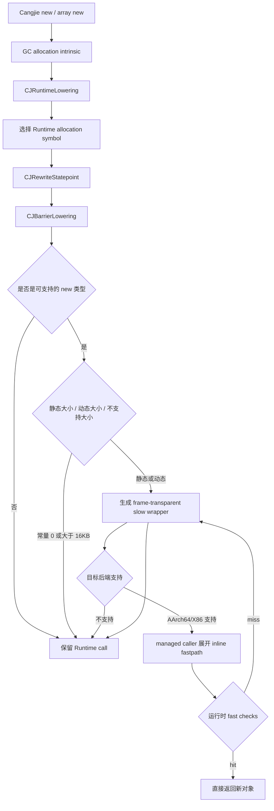

# LLVM NewObj FastPath 实现详解

> 适用范围：Region-scan MSGC 当前工作树，核对日期 2026-07-30。
>
> Region-scan LLVM：
> `/Users/lipeisheng/code/cangjie/cangjie/cangjie_compiler_region_mark/third_party/llvm-project`
>
> Region-scan Runtime：
> `/Users/lipeisheng/code/cangjie/cangjie/cangjie_runtime_region_mark/runtime`

## 1. 核心结论

当前 LLVM NewObj fastpath 已覆盖：

- 普通对象：`CJ_MCC_NewObject`
- Finalizer 对象：`CJ_MCC_NewFinalizer`
- WeakRef 对象：`CJ_MCC_NewWeakRefObject`
- 无 Finalizer 的 Pinned 对象：`CJ_MCC_NewPinnedObject(..., false)`
- 引用数组：`CJ_MCC_NewObjArray`
- struct/value 数组：`CJ_MCC_NewArray`
- 1/2/4/8-byte primitive 数组：
  `CJ_MCC_NewArray8/16/32/64`
- 静态 TypeInfo、常量长度的 generic array
- 动态 TypeInfo 的 generic array dispatch
- 已知元素类型、动态长度的 concrete array

必须区分两个概念：

1. **编译期生成 fastpath**：LLVM 在 managed caller 的 allocation statepoint 位置展开
   AArch64/X86 分配序列。
2. **运行时命中 fastpath**：本次分配通过 safepoint、size、TLS AllocBuffer、active Region
   和空闲 slot 检查，没有执行 Runtime slow wrapper。

即使已经生成 fastpath，机器码里仍保留 Runtime wrapper。它是 slow-path 语义锚点，
只有 fastpath miss 时才执行。

当前最明确的未覆盖项是：

- 静态 TypeInfo、**动态长度**的 generic array 仍直接走 Runtime；
- Finalizer Pinned，即 `CJ_MCC_NewPinnedObject(..., true)`，仍直接走 Runtime；
- 常量大对象、large array 和不支持的 target/JIT 仍直接走 Runtime。

## 2. 总体编译流程



主要文件：

- [`CJRuntimeLowering.cpp`](../../../../cangjie_compiler_region_mark/third_party/llvm-project/llvm/lib/Transforms/Scalar/CJRuntimeLowering.cpp)
- [`CJBarrierLowering.cpp`](../../../../cangjie_compiler_region_mark/third_party/llvm-project/llvm/lib/CodeGen/CJBarrierLowering.cpp)
- [`CJMSGCABI.h`](../../../../cangjie_compiler_region_mark/third_party/llvm-project/llvm/include/llvm/CodeGen/CJMSGCABI.h)
- [`AsmPrinter.cpp`](../../../../cangjie_compiler_region_mark/third_party/llvm-project/llvm/lib/CodeGen/AsmPrinter/AsmPrinter.cpp)

## 3. `CJRuntimeLowering`：从 intrinsic 选择分配入口

### 3.1 对象

`loweringMallocObject()` 根据 `MallocType` metadata 选择 Runtime symbol：

| `MallocType`/来源 | 降低后的入口 | 说明 |
|---|---|---|
| 普通对象或未知普通类型 | `CJ_MCC_NewObject` | 后续可进入普通对象 fastpath |
| `HasFinalizer` | `CJ_MCC_NewFinalizer` | fast 成功后需要注册 Finalizer |
| `WeakRef` | `CJ_MCC_NewWeakRefObject` | 使用 WeakRef 入口，但分配结构仍可内联 |
| `Future/Mutex/Monitor/WaitQueue` | `CJ_MCC_NewPinnedObject` | 固定 `size=168`、`isFinalizer=false` |
| `llvm.cj.alloca.generic` 不逃逸 | LLVM `alloca` | 栈分配，不进入堆分配 fastpath |
| `llvm.cj.alloca.generic` 逃逸 | `CJ_MCC_NewObject` | 按普通对象处理 |

同步对象通过 `replaceFixedNewObject()` 降低为：

```text
CJ_MCC_NewPinnedObject(typeInfo, 168, false)
```

168B 会映射到 MSGC 192B size class，因此属于静态 small-object fastpath。

### 3.2 Concrete array

`llvm.cj.malloc.array` 根据元素 LLVM 类型选择：

| 元素类型 | Runtime symbol | scan class |
|---|---|---|
| 引用/指针 | `CJ_MCC_NewObjArray` | `HAS_REF` |
| struct 或内嵌 array | `CJ_MCC_NewArray` | 根据元素 TypeInfo，未知时保守 `HAS_REF` |
| 1-byte primitive | `CJ_MCC_NewArray8` | `NO_REF` |
| 2-byte primitive | `CJ_MCC_NewArray16` | `NO_REF` |
| 4-byte primitive | `CJ_MCC_NewArray32` | `NO_REF` |
| 8-byte primitive | `CJ_MCC_NewArray64` | `NO_REF` |

静态长度数组的 fast size 计算为：

```text
if length * elemSize overflows:
    no static fastpath
objectSize = alignUp(16 + length * elemSize, 8)
if objectSize <= 16384:
    static fastpath
else:
    no static fastpath
```

其中：

- 数组头固定 16B；
- Region-scan MSGC 使用总对象大小上限 16KB，数组头也计入；
- 正好 16KB 使用 size class 35，只有大于 16KB 才回落；
- 零长度数组可以 fastpath；
- 零大小元素数组只分配 16B 数组头。
- CopyGC 继续保留原有 4KB payload 策略，不与 MSGC 的限制混用。

对于已知元素大小、动态长度的 concrete array，LLVM 生成动态 size：

```text
objectSize = alignUp(16 + length * elemSize, 8)
fastSize = objectSize <= 16384 ? objectSize : 0
```

`fastSize=0` 会在 target emitter 中转到 Runtime。

### 3.3 Generic array

`llvm.cj.malloc.array.generic` 分两类处理。

#### 静态 TypeInfo

如果编译期可以解析 array TypeInfo：

1. 根据元素类型选择六个具体数组入口之一；
2. 只有长度也是常量，且总对象大小不超过 16KB 时，才生成静态 fast wrapper；
3. 长度为动态值时，当前代码传递 poison fast-size，并保留普通 Runtime 调用。

因此当前存在如下不对称：

| 场景 | 当前行为 |
|---|---|
| concrete array，已知元素大小，动态长度 | 可生成动态 fastpath，运行时检查 16KB |
| generic array，静态 TypeInfo，动态长度 | 未生成动态 fastpath，直接 Runtime |

#### 动态 TypeInfo

如果编译期不能解析 array TypeInfo，LLVM 生成：

```text
CJ_MCC_NewArrayGenericFast3_MSGC_dispatch
```

dispatch wrapper 在运行时读取 element TypeInfo，并分派到：

- reference wrapper；
- struct/value 的 `NO_REF` 或 `HAS_REF` wrapper；
- 1/2/4/8-byte primitive wrapper；
- 无法识别时的 `CJ_MCC_NewArrayGenericFast3_MSGC` Runtime fallback。

支持的 reference kind：

```text
Class
Interface
RawArray
Func
TempEnum
WeakRefClass
ForeignProxy
ExportedRef
```

支持的 struct/value kind：

```text
Nothing
Unit
VArray
Tuple
Struct
Enum
```

Struct/value kind 会读取 component TypeInfo 的 `TF_HAS_REF_FIELD`：

```text
flag & TF_HAS_REF_FIELD == 0 -> scan class 0
flag & TF_HAS_REF_FIELD != 0 -> scan class 1
```

这与 Runtime `MArray::NewArray()` 的精确分类一致；没有引用字段的 Struct 不再被保守地放入
`HAS_REF` Region。其余 primitive 类型按 element size 的 1/2/4/8B 分派。动态 dispatch
同样计算 16KB 内的 fast size；超出后由具体 wrapper 回退 Runtime。

### 3.4 数组慢路径 ABI

Region-scan 保留两类 ABI，不能混用：

| LLVM 是否持有已校验 `totalSize` | Runtime slow entry | 参数 |
|---|---|---|
| 否 | 原 `CJ_MCC_NewArray*` / `CJ_MCC_NewArrayGeneric` | `(TypeInfo*, length)` |
| 是 | `CJ_MCC_NewArrayGenericFast3_MSGC` | `(TypeInfo*, length, totalSize)` |

静态和动态 fast wrapper 统一以三参数形式 `musttail` 到
`CJ_MCC_NewArrayGenericFast3_MSGC`。这避免了过去“按三参数函数类型声明两参数符号”的隐式
ABI 不一致。Fast3 慢路径仍由 Runtime 根据 TypeInfo 和 length 重新核算大小，保留 GC retry、
OOM 和异常语义。

## 4. `CJBarrierLowering`：对象 fastpath 候选与 wrapper

### 4.1 可识别的对象类型

`classifyNewObjectKind()` 只识别四类对象：

```text
CJ_MCC_NewObject
CJ_MCC_NewFinalizer
CJ_MCC_NewPinnedObject
CJ_MCC_NewWeakRefObject
```

直接调用 `CJ_MCC_NewGenericObject` 或 Runtime 内部的
`ObjectManager::New*` 不在该集合中，不会由 LLVM allocation emitter 展开。

### 4.2 静态、动态与慢路径分类

`classifyMSGCFastPath()` 根据 statepoint 的 size 参数分类：

| size 形态 | 分类 | 行为 |
|---|---|---|
| 编译期常量，`1..16384` | Static | 编译期确定 size class 和 slot size |
| 非常量 | Dynamic | target emitter 在运行时选择 size class |
| 常量 0 | Slow | 保留原 Runtime 调用 |
| 常量 `>16384` | Slow | 保留原 Runtime large path |

MSGC 共有 36 个 size class：

```text
8, 16, 24, 32, 48, 64, 80, 96, 112,
128, 160, 192, 224, 256, 320, 384, 448, 512,
640, 768, 896, 1024, 1280, 1536, 1792, 2048,
2560, 3072, 3584, 4096, 5120, 6144, 8192,
10240, 12288, 16384
```

正好 16KB 仍是 small-object class 35；只有大于 16KB 才是 large object。

### 4.3 Pinned 限制

Pinned 只有满足以下条件才进入 fastpath：

```text
actualArgCount >= 3
isFinalizer 是 ConstantInt
isFinalizer == false
```

下列情况保持 Runtime：

- `isFinalizer=true`
- `isFinalizer` 不是编译期常量
- 参数缺失

这保证 fastpath 不会遗漏 `OnFinalizerCreated()` 语义。

在当前 MSGC Runtime 中，`RegionSpaceMS::Allocate()` 不根据 `AllocType` 选择另一套
Pinned allocator，普通对象与 Pinned 对象最终使用同一套 small Region allocator。
因此无 Finalizer 的 Pinned 可以安全复用普通对象分配 fastpath。

### 4.4 Scan class

对象 fastpath 同时选择：

```text
activeRegions_[sizeClass][scanClass]
```

规则如下：

- 可解析的全局 TypeInfo：按 `hasRefField()` 选择 `NO_REF/HAS_REF`；
- 无法静态解析 TypeInfo：保守选择 `HAS_REF`；
- Finalizer：强制选择 `HAS_REF`；
- WeakRef：无论普通字段 flag 是否置位都强制选择 `HAS_REF`；
- primitive array：`NO_REF`；
- reference array：`HAS_REF`；
- struct/value array：根据元素 TypeInfo，未知时保守 `HAS_REF`。

保守选择 `HAS_REF` 只影响 Region bucket 和后续扫描成本，不影响分配正确性。

### 4.5 Slow wrapper

对静态或动态候选，`replaceFastFunc()` 创建 internal wrapper：

```text
internal
noinline
cj-frame-transparent
cj-fast-allocation
```

对象 wrapper body 只做：

```text
musttail call real_runtime_helper(args...)
ret
```

数组 fast wrapper 的三参数 body 统一调用：

```text
musttail call CJ_MCC_NewArrayGenericFast3_MSGC(typeInfo, length, totalSize)
ret
```

静态 wrapper 还携带：

```text
cj-msgc-sizeclass
cj-msgc-slotsize
cj-msgc-scanclass
```

动态 wrapper 携带：

```text
cj-msgc-dynamic=1
cj-msgc-scanclass
```

wrapper 的目的有两个：

1. 给 target emitter 提供明确且经过验证的 allocation config；
2. 在 fastpath miss 时保持与原始 Runtime 调用完全相同的 ABI 和异常语义。

## 5. 调用点展开与 wrapper 防重复展开

### 5.1 对象调用点

`AsmPrinter::tryEmitCangjieSpecificCallByMOSym()` 识别：

```text
CJ_MCC_NewObject
CJ_MCC_NewFinalizer
或带 cj-fast-allocation 属性的生成 wrapper
```

因此 managed caller 的对象 statepoint 即使已经被重定向到生成 wrapper，也能展开真正的
对象 fastpath。

这修复了“最终 SDK 的真实 `-O0` 产物中对象 wrapper 被保留为纯慢路径，调用点没有展开”
的问题。

### 5.2 wrapper 本身

wrapper 内部的 `musttail` Runtime 调用必须保持慢路径，不能再次展开：

- AArch64 的 `classifyAArch64CJEmission()` 对 `TCRETURN*` 直接返回不可内联；
- X86 对象 emitter 只接受 `CALL64pcrel32`，wrapper slow edge 使用 tail jump；
- 数组由 managed `NewArrayFast` statepoint 展开，wrapper 尾调用不会重复展开。

最终结构为：

```text
managed caller
    ├── inline fast allocation
    └── miss -> generated wrapper
                    └── musttail/tail-jump -> real Runtime helper
```

这样同时满足：

- 对象调用点可以展开；
- 数组调用点可以展开；
- 对象/数组 wrapper 不会产生重复 fastpath；
- Runtime 始终保留为唯一慢路径语义锚点。

## 6. Target emitter 支持矩阵

| Target | MSGC allocation fastpath | 条件 |
|---|---|---|
| AArch64 macOS/iOS Mach-O | 支持 | object format 为 Mach-O |
| AArch64 Linux ELF | 支持 | object format 为 ELF |
| X86-64 Linux ELF | 支持 | 64-bit target、64-bit pointer、C calling convention |
| X86-64 Windows COFF | 支持 | 64-bit target、64-bit pointer、C calling convention |
| X86-64 macOS Mach-O | 不支持 | 当前 X86 MSGC gate 只允许 ELF/COFF |
| ARM32 | 不支持 | `CJBarrierLowering` 强制关闭 GC fastpath |
| JIT | 不支持 | `doNewFastPath()` 和 array lowering 保守关闭 |
| 其他 target/object format | 不支持 | 保留 Runtime call |

相关文件：

- [`AArch64CangjieCallSize.cpp`](../../../../cangjie_compiler_region_mark/third_party/llvm-project/llvm/lib/Target/AArch64/AArch64CangjieCallSize.cpp)
- [`AArch64CangjieAsmPrinter.cpp`](../../../../cangjie_compiler_region_mark/third_party/llvm-project/llvm/lib/Target/AArch64/AArch64CangjieAsmPrinter.cpp)
- [`AArch64MSGCEmitter.cpp`](../../../../cangjie_compiler_region_mark/third_party/llvm-project/llvm/lib/Target/AArch64/AArch64MSGCEmitter.cpp)
- [`X86MCInstLower.cpp`](../../../../cangjie_compiler_region_mark/third_party/llvm-project/llvm/lib/Target/X86/X86MCInstLower.cpp)
- [`X86MSGCEmitter.cpp`](../../../../cangjie_compiler_region_mark/third_party/llvm-project/llvm/lib/Target/X86/X86MSGCEmitter.cpp)

当前相关开关均默认开启：

| 选项 | 当前默认值 | 作用 |
|---|---|---|
| `-enable-gc-fast-path` | `true` | `CJBarrierLowering` 收集和重写对象候选 |
| `-enable-cangjie-new-obj-fastpath` | `true` | AsmPrinter 对对象调用点做 target emission |
| `-enable-cangjie-new-array-fastpath` | `true` | `CJRuntimeLowering` 生成数组 fast metadata/wrapper |

## 7. AArch64/X86 内联分配逻辑

静态和动态 emitter 的主要区别是：

- 静态：size class、slot size 已编码在 wrapper attribute；
- 动态：运行时检查 size，并从编译器生成的 size-class/slot-size table 选择 class。

后续 Region 分配逻辑一致。

### 7.1 公共运行时检查

| 检查 | fastpath 条件 | miss 行为 |
|---|---|---|
| Safepoint | TLS safepoint flag 为 0 | 调用 Runtime wrapper |
| Dynamic size | `1..16384` | size 为 0 或大于 16KB 时回 Runtime |
| AllocBuffer | TLS `msAllocBuffer != null` | Runtime 创建 AllocBuffer |
| Active Region | `[sizeClass][scanClass] != null` | Runtime refill |
| Region mode | `BUMP` 或 `BITMAP` | 其他 mode 回 Runtime |
| BUMP 空间 | `allocPtr + slotSize <= regionEnd` | Region 耗尽，回 Runtime |
| BITMAP 空间 | `allocSummary` 最终能找到 free bit | 没有 free slot，回 Runtime |

### 7.2 BUMP

BUMP fastpath：

```text
oldAllocPtr = region.allocPtr
newAllocPtr = oldAllocPtr + slotSize
if newAllocPtr > regionEnd:
    slow
initialize object at oldAllocPtr
region.allocPtr = newAllocPtr
return oldAllocPtr
```

LLVM 不再维护空闲 slot 计数。Active BUMP Region 归还 Central 时，Runtime 在
`PrepareForCentralReturn()` 由 `(regionEnd - allocPtr) / slotSize` 一次性推导。

### 7.3 BITMAP

当前 ALLOC bitmap 的位语义是：

```text
1 = free
0 = allocated
```

BITMAP fastpath：

```text
summary = region.allocSummary
if summary == 0:
    slow
wordIndex = ctz(summary)
word = region.allocBitmap[wordIndex]
if word == 0:
    clear stale summary bit
    retry
slotBit = ctz(word)
clear slotBit in allocBitmap[wordIndex]
if updated word == 0:
    clear wordIndex in allocSummary
compute object address from wordIndex, slotBit and slotSize
initialize object
return object
```

active Region 由当前 `AllocBufferMS`/P 独占，因此 ALLOC bitmap 和 summary 使用普通
load/store，不需要 lock/CAS。MARK bitmap 是另一套并发共享状态，不能套用这一结论。

Active BITMAP Region 归还时，Runtime 对有效 ALLOC words 做 popcount，并据此重建
`allocSummary`；这同时修复 fastpath 遗留的 stale-positive 和 stale-negative summary。
Sweep 则直接复用已经得到的 `liveCount`，不做第二次 bitmap 统计。

### 7.4 对象初始化

fastpath 成功后：

- 对象：写入 TypeInfo；
- 数组：写入 TypeInfo 和 length；
- Finalizer 对象：额外调用 `CJ_MCC_OnFinalizerCreated`；
- 普通、WeakRef、无 Finalizer Pinned 不调用 Finalizer hook。

small Region 在交付 allocator 前已经完成清零。compiler emitter 不逐对象清零整个 slot，
而是依赖 Runtime Region acquisition/sweep 的清零与空闲 slot 协议。

## 8. Runtime slow path

fastpath miss 不是 OOM，只表示当前 TLS active Region 不能直接完成此次分配。

### 8.1 Small object

Runtime 调用链：

```text
CJ_MCC_New*
  -> ObjectManager::New*
  -> MObject/MArray::New*
  -> HeapManager::AllocateMS
  -> RegionSpaceMS::AllocateRegularObject
  -> AllocBufferMS::Allocate
  -> FastAlloc
  -> SlowAlloc
```

`SlowAlloc()` 负责：

1. 归还耗尽的 active Region；
2. 从 CentralRegionPool refill；
3. 使用已 swept partial/empty Region；
4. 必要时执行 Lazy/Assist Sweep；
5. 获取 fresh Region；
6. 安装新的 active Region；
7. 记录 Region 级 Mark/Sweep pacing debt；
8. 首次 slot 分配。

### 8.2 Large object

`size > 16KB` 进入 Runtime large path：

1. 按 page 和 32KB Region span 向上取整；
2. 优先尝试 exact-size large hot cache；
3. miss 后从 RegionManager/FreeManager 获取连续 Region；
4. 必要时 grow committed heap；
5. 清零完整 span；
6. 注册 primary/SPAN metadata；
7. 按实际 size/span 记 pacing debt。

### 8.3 GC/OOM 重试

Regular/large Runtime allocation 失败后会：

- 尝试 emergency retry；
- 请求一次同步 `GC_REASON_OOM` GC；
- 再次分配；
- 最终失败才抛 OutOfMemory。

因此 compiler fastpath 只处理“当前 active Region 中的单 slot 分配”，不处理：

- Region refill；
- lazy/assist sweep；
- large span；
- heap grow；
- GC retry；
- OOM 异常。

相关 Runtime 文件：

- [`CompilerCalls.cpp`](../../src/CompilerCalls.cpp)
- [`ObjectManager.inline.h`](../../src/ObjectManager.inline.h)
- [`MObject.cpp`](../../src/ObjectModel/MObject.cpp)
- [`MSRegionSpace.cpp`](../../src/Heap/MAllocator/MSRegionSpace.cpp)
- [`MSAllocBuffer.cpp`](../../src/Heap/MAllocator/MSAllocBuffer.cpp)
- [`MSRegionInfo.cpp`](../../src/Heap/MAllocator/MSRegionInfo.cpp)
- [`MSCentralRegionPool.cpp`](../../src/Heap/MAllocator/MSCentralRegionPool.cpp)

## 9. 当前完整支持矩阵

### 9.1 对象

| new 类型 | 编译期可生成 fastpath | 运行时可直接返回 | 直接/回退 Runtime |
|---|---|---|---|
| 普通对象，常量 `1..16KB` | 是，Static | active Region 有 slot | 公共 miss 条件 |
| 普通对象，动态大小 | 是，Dynamic | size `1..16KB` 且 active Region 有 slot | size 0、`>16KB` 或公共 miss |
| 普通对象，常量 `>16KB` | 否 | 否 | large path |
| Finalizer 对象 | 是 | 分配后执行 Finalizer hook | large 或公共 miss |
| WeakRef 对象 | 是 | 与普通 slot allocation 相同 | large 或公共 miss |
| Pinned，`isFinalizer=false` 常量 | 是 | 与普通 slot allocation 相同 | large 或公共 miss |
| Pinned，`isFinalizer=true` | 否 | 否 | 始终 Runtime |
| Pinned，finalizer flag 非常量 | 否 | 否 | 始终 Runtime |
| `alloca.generic` 不逃逸 | 不需要 | 栈分配 | 不进入 Runtime |
| `alloca.generic` 逃逸 | 按普通对象 | 按普通对象 | 按普通对象 |
| 直接 `CJ_MCC_NewGenericObject` | 否 | 否 | 始终 Runtime |

### 9.2 数组

| new 类型 | 编译期可生成 fastpath | 大小条件 | 直接/回退 Runtime |
|---|---|---|---|
| 引用数组，常量长度 | 是，Static | 总大小 `<=16KB` | 超出静态条件或公共 miss |
| 引用数组，动态长度 concrete | 是，Dynamic | 总大小 `<=16KB` | size 0、`>16KB` 或公共 miss |
| struct/value 数组，常量长度 | 是，Static | 总大小 `<=16KB` | 超出静态条件或公共 miss |
| struct/value 数组，动态长度 concrete | 是，Dynamic | 总大小 `<=16KB` | size 0、`>16KB` 或公共 miss |
| primitive 1/2/4/8B 数组 | 是 | 同 concrete array 规则 | 同上 |
| generic，静态 TypeInfo＋常量长度 | 是，Static | 总大小 `<=16KB` | 超出条件 |
| generic，静态 TypeInfo＋动态长度 | 否 | 当前未接动态 wrapper | 始终 Runtime |
| generic，动态 TypeInfo | 是，runtime dispatch | 支持 kind/width 且 `<=16KB`；Struct 按 flag 精确分 scan class | fallback 或公共 miss |
| 零大小元素数组 | 是 | 固定 16B 数组头 | 公共 miss |
| large array | 否/动态 miss | 总大小 `>16KB` | Runtime large path |

## 10. 验证

当前针对性测试：

- [`gc-mode-newobject-variants-msgc.ll`](../../../../cangjie_compiler_region_mark/third_party/llvm-project/llvm/test/CodeGen/AArch64/CangjieGC/gc-mode-newobject-variants-msgc.ll)
- [`gc-mode-newpinnedobject-msgc.ll`](../../../../cangjie_compiler_region_mark/third_party/llvm-project/llvm/test/CodeGen/AArch64/CangjieGC/gc-mode-newpinnedobject-msgc.ll)
- [`new_array_concrete_dynamic_msgc.ll`](../../../../cangjie_compiler_region_mark/third_party/llvm-project/llvm/test/Transforms/CJRuntimeLowering/new_array_concrete_dynamic_msgc.ll)
- [`new_array_generic_msgc.ll`](../../../../cangjie_compiler_region_mark/third_party/llvm-project/llvm/test/Transforms/CJRuntimeLowering/new_array_generic_msgc.ll)

已使用当前构建目录的 `llvm-lit -v` 执行上述核心测试，覆盖：

- `CJRuntimeLowering` IR；
- statepoint 重写；
- `CJBarrierLowering` 后 wrapper 与 attribute；
- AArch64 object/array emission；
- X86-64 object/array emission；
- Pinned false fastpath；
- Pinned true Runtime-only；
- Finalizer callback；
- WeakRef fastpath；
- dynamic object；
- dynamic concrete array；
- static/dynamic generic array dispatch；
- large constant object 保留 Runtime。

全部检查退出码为 0。

Runtime 侧另外完成了 Release/marksweep 干净构建，并将产物安装到：

```text
/Users/lipeisheng/code/cangjie/cangjie/cangjie_compiler_region_mark/output/msgc
```

安装后的 `libcangjie-runtime.dylib` 已确认导出
`CJ_MCC_NewArrayGenericFast3_MSGC`、`CJ_MCC_NewWeakRefObject` 和
`CJ_MCC_NewPinnedObject`。

## 11. 维护不变式

修改 NewObj fastpath 时必须保持：

1. compiler/runtime 的 36 个 size class 完全一致。
2. 16KB 属于 small object，只有 `>16KB` 才进入 large path。
3. scan class 与 Runtime `[sizeClass][scanClass]` bucket 一致。
4. ALLOC bitmap 保持 `1=free、0=allocated`。
5. BUMP/BITMAP 热路径都不得访问 `MSRegionInfo+56`；空闲数只在 Runtime 冷边界推导。
6. wrapper 尾调用不得再次展开 fastpath。
7. managed caller 必须能够识别生成 wrapper 并展开 fastpath。
8. Finalizer fast success 必须执行 `CJ_MCC_OnFinalizerCreated`。
9. Finalizer Pinned 不得误走普通 Pinned fastpath。
10. 数组 fast success必须同时初始化 TypeInfo 和 length。
11. 无 `totalSize` 的数组慢路径必须使用两参数 ABI；持有已校验 `totalSize` 的 wrapper
    必须使用唯一的 Fast3 三参数 ABI。
12. fastpath miss 必须保持原 Runtime ABI、异常和 GC retry 语义。
13. compiler inline slot allocation必须继续由 Runtime Region acquisition 的 pacing debt覆盖。
14. 不支持 target、calling convention、JIT 或 IR 形态时必须保守回退。

`MSRegionInfo+56..+59` 仍作为旧 `freeSlotCount` 的 ABI 墓碑保留。兼容发布顺序为
Runtime-first、LLVM/SDK-second：新 Runtime 忽略旧产物对 `+56` 的写入，新 LLVM 则不再
生成该写入；没有 ABI versioning 前不得复用这四个字节。

## 12. 后续优化点

按当前收益和改动风险排序：

1. **接通静态 TypeInfo＋动态长度 generic array**
   可直接复用 `getDynamicKnownElemArrayObjectSize()` 和现有 dynamic array wrapper。

2. **补齐不支持平台的 target emitter**
   当前 X86-64 Mach-O 仍保留 Runtime；扩展前必须先确认 ABI、TLS 寄存器和调用约定。

3. **增加真实 Cangjie new 类型矩阵的 SDK 回归**
   除 LLVM IR/CodeGen 测试外，应长期保留普通、Finalizer、WeakRef、Pinned、primitive array、
   ref array、struct array、generic array、large object 的 `-O0/-O2` 端到端用例。
