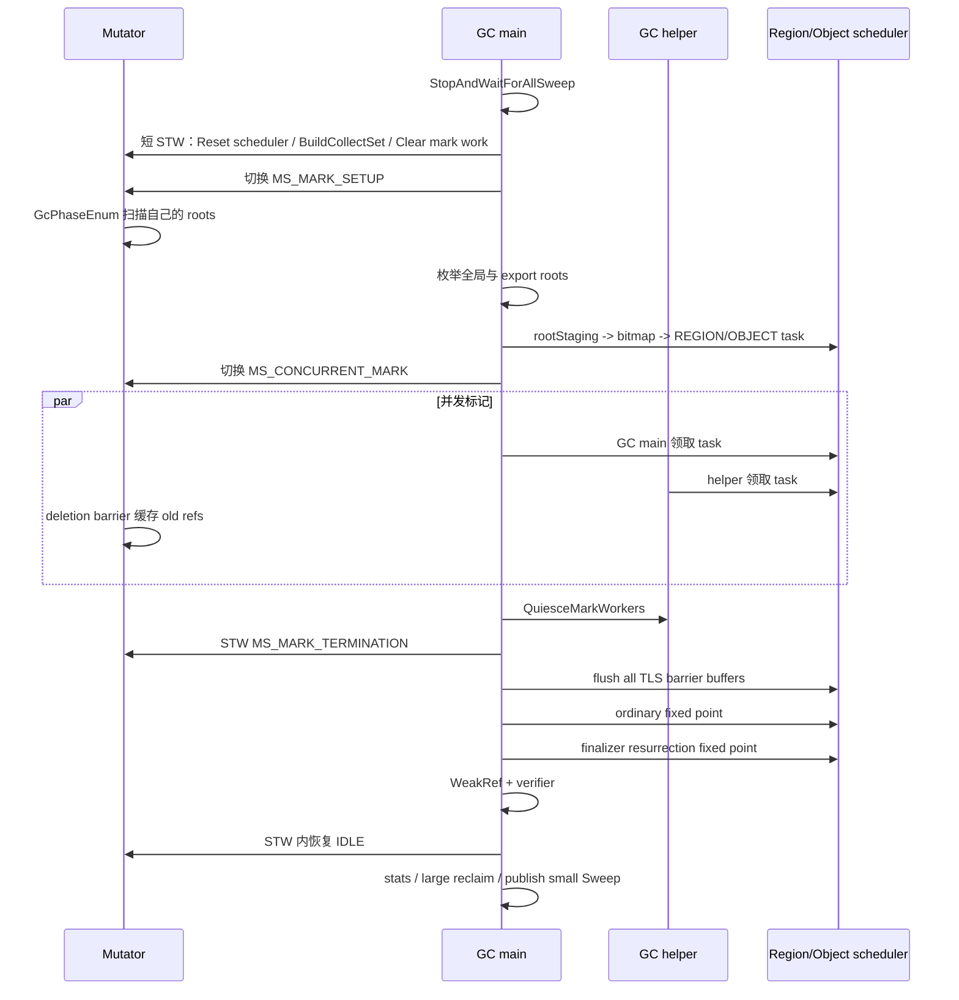
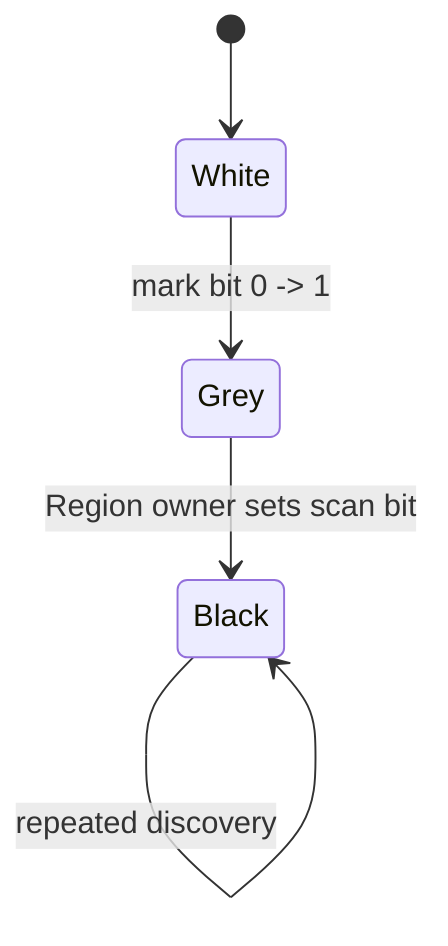

# MSGC Region-scan GC Mark 架构与实现详解

> 本文以 2026-07-31 的 Region-scan Runtime/LLVM 工作树为准。Wbuf 的
> `05_MSGC_GC_Mark架构与实现详解.md` 及其对应源码只用于建立对比基线；
> “当前实现”一律指 Region-scan。源码行为与旧文档不一致时，以当前源码为准。

## 目录

1. [阅读口径与核心结论](#1-阅读口径与核心结论)
2. [Wbuf 到 Region-scan 的架构映射](#2-wbuf-到-region-scan-的架构映射)
3. [一次 GC 的完整阶段主链](#3-一次-gc-的完整阶段主链)
4. [Region-scan 的三平面数据模型](#4-region-scan-的三平面数据模型)
5. [Mark Scheduler：REGION 与 OBJECT 双通道](#5-mark-schedulerregion-与-object-双通道)
6. [对象发现与批量标记](#6-对象发现与批量标记)
7. [PreEnumRoots：冻结回收边界并初始化 Mark](#7-preenumroots冻结回收边界并初始化-mark)
8. [EnumRoots：根握手、临时 staging 与首次发布](#8-enumroots根握手临时-staging-与首次发布)
9. [REGION task：按 pending word 扫描小对象](#9-region-task按-pending-word-扫描小对象)
10. [OBJECT task：扫描大对象](#10-object-task扫描大对象)
11. [ConcurrentMark：并发执行、Worker 与 Assist](#11-concurrentmark并发执行worker-与-assist)
12. [写屏障如何汇入 Region-scan Mark](#12-写屏障如何汇入-region-scan-mark)
13. [MarkTermination：STW fixed point](#13-markterminationstw-fixed-point)
14. [Finalizer、WeakRef 与 Post-Mark](#14-finalizerweakref-与-post-mark)
15. [LLVM 侧 Region-scan 集成](#15-llvm-侧-region-scan-集成)
16. [正确性不变量与并发竞态闭包](#16-正确性不变量与并发竞态闭包)
17. [Work Unit、调度参数与当前默认行为](#17-work-unit调度参数与当前默认行为)
18. [诊断、验证与常见误读](#18-诊断验证与常见误读)
19. [源码索引](#19-源码索引)

## 1. 阅读口径与核心结论

### 1.1 固定源码基线

本文使用四组固定目录，禁止交叉混用：

| 别名 | 实现 | 固定目录 |
| --- | --- | --- |
| `RS_RT` | Region-scan Runtime | `/Users/lipeisheng/code/cangjie/cangjie/cangjie_runtime_region_mark/runtime` |
| `RS_LLVM` | Region-scan LLVM | `/Users/lipeisheng/code/cangjie/cangjie/cangjie_compiler_region_mark/third_party/llvm-project` |
| `WB_RT` | Wbuf Runtime | `/Users/lipeisheng/code/cangjie/cangjie/cangjie_runtime_MSGC/runtime` |
| `WB_LLVM` | Wbuf LLVM | `/Users/lipeisheng/code/cangjie/cangjie/cangjie_compiler/third_party/llvm-project` |

Wbuf 的实现说明来自：

```text
WB_RT/MSGC_RESULT/Docs/05_MSGC_GC_Mark架构与实现详解.md
```

Region-scan 的屏障专项对比可结合：

```text
RS_RT/MSGC_RESULT/Docs/15_Wbuf与RegionScan读写屏障实现对比.md
```

### 1.2 一句话概括

Region-scan 仍然是并发 Mark-Sweep GC，但它不再把普通灰对象保存为对象地址
`WorkBuf`。小对象的发现状态写入 `markBitmap`，扫描完成状态写入
`scanBitmap`，待扫描 bitmap word 通过 `pendingWordSummary` 汇总；Scheduler
只调度“哪个 Region 需要扫描”。大对象保留独立的 `OBJECT` task。

### 1.3 最重要的五个结论

1. **小对象的灰色集合是 `markBitmap & ~scanBitmap`，不是对象指针队列。**
2. **`pendingWordSummary` 是增量工作提示，不是存活依据。** Sweep 只看
   `markBitmap`。
3. **同一个小 Region 同时最多有一个 owner。** `IDLE -> QUEUED -> OWNED`
   状态机把扫描权交给唯一线程。
4. **终止条件不是“ready lane 为空”。** 还必须考虑 ledger 中已领取的 lease、
   Worker/Assist in-flight、TLS barrier buffer，以及 owner-release race 留下的
   Region pending 状态。
5. **Wbuf 的 `activeLog_`、`globalFull_`、`PerPGCWork` 和对象地址 WorkBuf
   已经从当前 Region-scan Mark 协议中移除。** 它们只能作为历史对比出现。

## 2. Wbuf 到 Region-scan 的架构映射

### 2.1 核心结构对照

| 职责 | Wbuf | Region-scan |
| --- | --- | --- |
| 小对象“已发现” | 对象 mark bit | `markBitmap` bit |
| 小对象“待扫描” | 对象地址位于 WorkBuf | `markBitmap & ~scanBitmap` |
| 小对象“已扫描” | 对象从 WorkBuf 弹出并完成字段扫描 | owner 设置 `scanBitmap` bit |
| Mutator 局部写屏障工作 | `AllocBufferMS::activeLog_` | `AllocBufferMS::barrierMarkBuffer_` |
| 局部条目 | 对象指针 | `(wordKey, bitMask)` |
| 全局工作 | `globalFull_` 中的 full/partial WorkBuf | REGION/OBJECT 两条 tagged ready stack |
| Worker 私有工作 | `PerPGCWork::{getCur_,putCur_}` | 一次 `MSTaskLease` + 栈上 `MSMarkWordBatch` |
| 小对象调度粒度 | WorkBuf/对象 | Region + pending bitmap word |
| 大对象调度粒度 | 对象地址 | LARGE primary 对应的 `OBJECT` task |
| 在途计数 | Worker/Assist 状态和各种私有/全局 WorkBuf | `MSTaskLedger` + `MSMarkWorkerControl` |
| STW 收口 | flush partial WorkBuf，再 fixed-point drain | flush TLS bitmap buffer，drain scheduler，再遍历 Region pending 状态 |

### 2.2 工作流变化

Wbuf 的核心链路是：

```text
discover object
  -> mark winner
  -> append object pointer to activeLog_
  -> publish WorkBuf
  -> consumer pops object pointer
  -> scan object
```

Region-scan 的小对象链路是：

```text
discover object
  -> resolve (regionIdx, wordIdx, bitMask)
  -> atomic OR mark word
  -> newBits != 0 时发布 pending word
  -> publish one REGION task
  -> owner computes markWord & ~scanWord
  -> scan candidates and update scan word
```

因此 Region-scan 不是把 WorkBuf 改成了“另一种队列”，而是把普通对象工作变成
Region 元数据上的持久状态。Ready stack 只传递扫描所有权，不保存完整灰对象集合。

### 2.3 为什么仍保留 OBJECT task

小对象 Region 的 size class 提供了稳定的“地址 -> slot -> bitmap bit”映射；大对象
可能跨多个 Region，一个 LARGE primary 只代表一个对象，不适合复用 small plane 的
slot 语义。因此：

- SMALL：mark/scan bitmap + REGION task；
- LARGE/SPAN：primary `control` 中的 marked flag + OBJECT task。

## 3. 一次 GC 的完整阶段主链

### 3.1 Collector 主调用链

`MarkSweepCollector::DoGarbageCollection()` 固定执行：

```text
PreEnumRoots()
  -> EnumRoots()
  -> ConcurrentMark()
  -> MarkTermination()
  -> PostMarkTermination()
```

随后 `RunGarbageCollection()` 调用 `UpdateGCStats()` 和
`PostGarbageCollection()`。

### 3.2 阶段职责

| 阶段 | Mutator 状态 | 主要输入 | 主要输出 |
| --- | --- | --- | --- |
| `PreEnumRoots` | 先并发封闭旧 Sweep，后短 STW | 上轮 unswept/swept supply、旧 Mark 状态 | immutable collect set、新 mark epoch、空 scheduler/bitmap workspace |
| `EnumRoots` | `MS_MARK_SETUP` handshake | Mutator 栈/TLS、静态、并发模型、finalizer processor、export roots | 首批 mark bits 和 REGION/OBJECT task |
| `ConcurrentMark` | `MS_CONCURRENT_MARK` | Scheduler work、写屏障旧边 | 尽可能完成普通对象图闭包 |
| `MarkTermination` | `MS_MARK_TERMINATION`，STW | TLS barrier tail、scheduler residual、finalizer roots、WeakRef | 普通闭包、resurrection 闭包、稳定最终 bitmap |
| `PostMarkTermination` | 已恢复 `IDLE` | 稳定 mark 结果 | live stats、large reclaim、small Sweep 发布 |

### 3.3 时序图



## 4. Region-scan 的三平面数据模型

### 4.1 ALLOC、MARK、SCAN

每个 SMALL Region 按同一 slot 坐标使用三类 bitmap plane：

| Plane | bit=1 的语义 | 修改者 |
| --- | --- | --- |
| `allocBitmap` | slot 空闲 | 分配/Sweep；collect-set 中是封存快照 |
| `markBitmap` | 对象在本轮被发现 | Root、tracing child、barrier flush |
| `scanBitmap` | 对象引用字段已扫描 | 该 Region 的唯一 owner |

其中 `allocBitmap` 使用“1=free”，所以 collect-set 内有效候选需要过滤：

```text
allocated marked candidates
    = markBitmap[word]
    & ~scanBitmap[word]
    & ~allocBitmap[word]
    & validMask
```

对于 collect set 之外的 Region，不读取仍可能由 owner 修改的 ALLOC plane。地址和对象
发布状态由 `ResolveMarkTarget()`、StateWord/TypeInfo 等路径验证。

### 4.2 三色的实际表示

| Mark bit | Scan bit | 颜色语义 |
| ---: | ---: | --- |
| 0 | 0 | White：尚未发现 |
| 1 | 0 | Grey：已发现、待扫描 |
| 1 | 1 | Black：已扫描 |

状态转换为：



`scanBitmap` 不是 Sweep 的判活依据。一个 `NO_REF` 对象可以只有 mark bit，没有 scan
bit；它仍然是活对象。

### 4.3 `MSScanClass`

Region 在分配时被划分为：

- `MSScanClass::NO_REF`：对象不含需要追踪的引用；
- `MSScanClass::HAS_REF`：对象可能含引用，需要建立 scan plane 并参与 REGION task。

`HAS_REF` 是 Region 分配类别，不保证其中每个对象都一定有 ref。Finalizable 对象、
WeakRef 或保守分类对象仍可能在运行时发现没有普通强引用字段。

### 4.4 `MSRegionInfo` 中与 Mark 有关的字段

`MSRegionInfo` 固定为 64 字节。当前 Mark 使用：

| 字段 | offset | 用途 |
| --- | ---: | --- |
| `markTaskNextRegionIdx` | 20 | REGION/OBJECT ready stack 的 intrusive next |
| `collectEpoch` | 32 | 是否属于本轮 immutable collect set |
| `control` | 36 | SMALL scan state；LARGE marked flag |
| `pendingWordSummary` | 48 | SMALL 待处理 mark-word 摘要 |
| `sizeClass` | 62 | slot 坐标计算 |
| `layout` | 63 | Region kind 与 scan class |

`control` 的低两位保存：

```text
IDLE = 0
QUEUED = 1
OWNED = 2
```

LARGE 另用 `CONTROL_LARGE_MARKED` 表示存活发现。

### 4.5 `pendingWordSummary`

一个 SMALL Region 最多有 64 个 bitmap word，因此一个 `uint64_t` 可以表示“哪些
word 可能产生新 grey 对象”：

```text
bit i == 1  => bitmap word i 需要 owner 重新比较 MARK 和 SCAN
```

producer 先更新 MARK，再用 release OR 发布 summary；owner 用 acquire exchange
一次取走当前摘要。Summary 可以重复发布，正确性依赖 MARK/SCAN 的真实差集，不依赖
summary bit 的唯一性。

## 5. Mark Scheduler：REGION 与 OBJECT 双通道

### 5.1 两条 ready lane

`MSMarkScheduler` 内部有：

- `regionReady_`：HAS_REF SMALL Region；
- `objectReady_`：HAS_REF LARGE primary。

两条 lane 都由 `MSMarkReadyStack` 实现。栈头是 `(regionIdx, ABA tag)` 组成的 64 位
值，节点链接复用 `MSRegionInfo::markTaskNextRegionIdx`。

### 5.2 `MSTaskLedger`

Ledger 统计：

```text
outstanding = queued tasks + leased tasks
```

发布任务前先 `AddProvisional()`：

- admission 失败时 `CancelProvisional()`；
- task 进入 ready lane 后，领取不会减少 ledger；
- 只有 lease 真正完成时才 `Complete()`。

这避免 Worker 刚从 ready stack 取走最后一项、但尚未扫描时，GC main 错把
“ready 为空”解释成全局完成。

### 5.3 `MSTaskLease`

Lease 把 task 生命周期变成强约束：

- active lease 不能被覆盖；
- active lease 析构会触发检查；
- `Complete()` 要求本地 `MSMarkWordBatch` 已经为空；
- task 被预算切片时，必须先发布 replacement，再完成旧 lease。

### 5.4 REGION 状态机

```text
IDLE
  -- TryPublishRegion --> QUEUED
  -- TryClaim         --> OWNED
  -- drain complete   --> IDLE
  -- budget expired   --> QUEUED (replacement first)
```

`QUEUED` 或 `OWNED` 状态下到达的新 producer 不创建第二个 token，只把新 word 留在
`pendingWordSummary`。当前 owner 负责在释放后检查 residual pending；STW
reconciliation 再提供最终兜底。

### 5.5 Worker 能力

| 执行者 | REGION | OBJECT |
| --- | ---: | ---: |
| GC main | 是 | 是 |
| GC helper | 是 | 是 |
| Mutator Mark Assist | 是 | 否 |
| MarkTermination STW | 是 | 是 |

GC main/helper 在 REGION 与 OBJECT 之间交替 preference，避免单一 lane 长期饥饿。
OBJECT 不交给 Mutator Assist，防止一个大型对象的完整字段扫描落到分配线程延迟上。

## 6. 对象发现与批量标记

### 6.1 统一解析入口

Root、tracing child 和 Runtime barrier 最终都进入 Region-scan 的对象解析/标记逻辑。
`ResolvedMarkTarget` 保存：

- canonical `MSRegionInfo*`；
- SMALL 的 `wordIdx` 与 `bitMask`；
- LARGE/SPAN 是否需要归一到 primary；
- 当前 mark 状态。

解析过程会排除：

- null；
- heap 范围之外的值；
- 非法 Region kind；
- 非 slot 边界地址；
- 已失效/未发布对象。

### 6.2 栈上 `MSMarkWordBatch`

GC root、REGION/OBJECT task 的 child tracing 使用 `MSMarkWordBatch`：

- 8 set × 2 way；
- 共 16 个 entry；
- entry 大小 16 字节；
- entry 保存 `(regionIdx, wordIdx, mask)`；
- 同一 mark word 的 bit 先在本地 OR；
- set 冲突或 `FlushAll()` 时才执行共享 MARK word 的 atomic OR。

Batch 固定本轮 `markEpoch` 和 bitmap plane base，不能跨 epoch 使用。它只缓存稳定坐标，
scan class、collect-set 归属等语义在 flush 时重新读取。

### 6.3 SMALL flush

SMALL entry flush 的核心是：

```text
mask = filterCollectSetFreeSlots(mask)
mask &= ~load(markWord)
old = atomic_fetch_or(markWord, mask)
newBits = mask & ~old
```

仅当 `newBits != 0` 且 Region 为 `HAS_REF` 时：

1. `PublishPendingMarkWord(wordIdx)`；
2. `TryPublishRegion(info)`；
3. lane 从空变非空时通知 `markWorkEpoch_`。

`NO_REF` Region 只建立存活 mark，不发布扫描 task。

### 6.4 LARGE/SPAN

大对象不进入 small word batch：

1. SPAN 归一到 LARGE primary；
2. 读取并保留 TypeInfo；
3. `AtomicTestAndSetMarked()` 竞争唯一 winner；
4. `NO_REF` winner 到此结束；
5. `HAS_REF` winner 调用 `PublishObject()`。

### 6.5 为什么 mark 前要封存 collect set

本轮真正可能被 Sweep 的 Region 必须在 Mark 开始前从 allocation supply 中取出，并用
`collectEpoch` 标记。这样：

- collect-set 的 `allocBitmap` 是不可变分配快照；
- free slot 可从 mark/scan 候选中可靠排除；
- Mark 期间新拿到的 Region 位于 collect set 外，不会被本轮 Sweep；
- collect set 外对象仍可被扫描，因为它可能指向 collect set 内对象。

## 7. PreEnumRoots：冻结回收边界并初始化 Mark

### 7.1 为什么必须先封闭旧 Sweep

`SweepRegion()` 读取上一轮 `markBitmap` 重建 `allocBitmap`。如果下一轮在旧 Sweep
仍运行时清零 MARK，旧 Sweep 会把活对象误判为垃圾。因此
`PreEnumRoots()` 先执行：

```text
CentralRegionPool::StopAndWaitForAllSweep()
```

它关闭 background/lazy/assist/helper Sweep admission，等待在途 Sweep 退出，并强制完成
剩余 unswept 工作。

### 7.2 短 STW 内的固定顺序

旧 Sweep 封闭后，`PreEnumRoots()` 进入短 STW：

```text
markScheduler_.ResetCycle()
PrepareBarrierMarkBuffersForNewEpochUnderSTW()
BuildCollectSet()
ClearAllMarkBitmaps()
```

具体含义：

1. 检查 ledger 和两条 ready lane 已为空；
2. 重置每个 `AllocBufferMS` 的 barrier buffer，丢弃上一轮未发布的尾项，禁止把它们
   发布到即将建立的新 mark epoch；
3. 把 central swept supply 移入本轮 small collect-set；
4. 用 swap 冻结 LARGE collect-set；
5. 发布新的非零 `currentMarkEpoch`；
6. 清 collect-set、TLS active Region 的 MARK/SCAN/pending/control 工作状态；
7. 清 LARGE primary 的 marked flag。

### 7.3 TLS active Region 的边界

TLS active Region 不进入 collect set：

- 保持 mutator owner；
- `collectEpoch = NO_COLLECT_EPOCH`；
- 不读取或物化其活动 ALLOC plane；
- 只清本轮 MARK/SCAN workspace。

这些 Region 不会被本轮 Sweep，但如果它们从 root 可达或被对象图触达，仍会参与
Region-scan，从而发现指向 collect set 的边。

## 8. EnumRoots：根握手、临时 staging 与首次发布

### 8.1 `MS_MARK_SETUP` handshake

`EnumRoots()` 首先：

```text
TransitionToGCPhase(GC_PHASE_MS_MARK_SETUP, true)
```

这会安装 `MSMarkBarrier`，更新全局 phase，并要求每个 Mutator 到 safepoint 执行
`GcPhaseEnum()`。

Mutator 扫描：

- 寄存器/栈 map 中的 heap roots；
- 栈对象内部引用；
- TLS/运行时登记的 Mutator roots。

发现的 heap roots 暂存到各自 `AllocBufferMS` 的 root staging，随后由
`MergeRootsFromAllocBuffers()` 汇总。

### 8.2 Enum Assist 不是 Mark Assist

`MutatorManager` 的 Enum Assist 只在 `MS_MARK_SETUP` 生效。一个已经到达 safepoint 的
Mutator 可以 claim 一批处于 saferegion 的其他 Mutator，帮助它们完成 phase transition。

它解决的是“根握手完成速度”，不领取 REGION/OBJECT task；后文的
`MarkSweepCollector::MSMarkAssist()` 才是对象图标记 Assist。

### 8.3 GC 线程枚举的根

`EnumAllCommonRootsSerial()` 汇总：

- Mutator root staging；
- static roots；
- concurrency model roots；
- FinalizerProcessor roots；
- resurrected export roots。

随后 `EnumAllExportRoots()` 加入 export root。

### 8.4 `rootStaging_` 的边界

根先进入临时 `GreyWorkQueue rootStaging_`，然后
`PublishRootStaging()` 使用一个 GC-owned `MSMarkWordBatch` 把它们转换成：

- SMALL mark bits + REGION task；
- LARGE marked flag + OBJECT task。

`rootStaging_` 在 `EnumRoots()` 内被完全清空。它不是并发阶段的普通工作源，也不是
Wbuf WorkBuf 的保留版本。

## 9. REGION task：按 pending word 扫描小对象

### 9.1 前置条件

`RunRegionTask()` 要求：

- Region kind 为 SMALL；
- scan class 为 HAS_REF；
- lease kind 为 REGION；
- scan state 已从 `QUEUED` 转为 `OWNED`。

### 9.2 核心算法

简化伪代码：

```text
for (;;) {
    summary = exchange(pendingWordSummary, 0)

    for wordIdx in summary {
        markWord = atomic_load(markBitmap[wordIdx])
        scanWord = scanBitmap[wordIdx]
        candidates = markWord & ~scanWord

        if region in collect set:
            candidates &= ~allocBitmap[wordIdx] & validMask

        for bit in candidates {
            obj = regionStart + slotIdx * slotSize
            if WeakRef:
                append to local WeakRef batch
            else if TypeInfo has refs:
                enumerate refs into local MSMarkWordBatch
            scanWord |= bit
        }

        scanBitmap[wordIdx] = scanWord
    }

    flush child mark batch
    flush WeakRef batch
    release/requeue Region
}
```

### 9.3 为什么只有 owner 写 SCAN

其他线程可以同时：

- atomic OR MARK；
- release OR `pendingWordSummary`；
- 尝试从 `IDLE` 发布 Region。

但只有 `OWNED` task 对应线程写 `scanBitmap`。这使 SCAN word 不需要多个扫描线程之间的
原子 OR，也确保同一个 grey bit 只被一个 owner 扫描。

### 9.4 owner-release race

竞态窗口：

```text
producer: mark bit -> pending bit -> 看到 Region 仍是 OWNED，未发 token
owner:    已取完旧 summary -> OWNED 改为 IDLE
```

闭包有三层：

1. owner 释放为 IDLE 后 acquire 检查 residual pending；
2. residual 非零时再次 `TryPublishRegion()`；
3. MarkTermination STW 遍历全部可能含 pending 的 HAS_REF Region。

### 9.5 预算耗尽

如果处理当前 summary 时达到 WU 预算且仍有 residual word：

1. residual OR 回 `pendingWordSummary`；
2. `RequeueOwnedRegion()` provisional +1 并先发布 replacement；
3. 当前 lease 再 `Complete()`。

先 replacement、后完成旧 lease，保证 ledger 不出现瞬时假零。

## 10. OBJECT task：扫描大对象

`RunObjectTask()`：

1. 验证 LARGE/HAS_REF/marked；
2. 从 primary 取得对象地址与 TypeInfo；
3. WeakRef 只登记，不跟随 referent；
4. 普通对象按已知 TypeInfo 枚举引用；
5. children 进入栈上 `MSMarkWordBatch`；
6. flush mark batch 与 WeakRef batch；
7. 完成 lease。

OBJECT task 当前不做 WU budget 切片，也不交给 Mutator Assist。GC main、helper 和 STW
drain 都可以执行它。

## 11. ConcurrentMark：并发执行、Worker 与 Assist

### 11.1 阶段入口

`ConcurrentMark()`：

1. 切换到 `GC_PHASE_MS_CONCURRENT_MARK`；
2. 启动 `MSMarkWorkerControl`；
3. 计算当前 Assist ratio；
4. 进入 `RunSchedulerMarkLoop()`。

### 11.2 GC main

GC main 每个 slice：

- 能领取 REGION/OBJECT；
- WU budget 由 EWMA throughput × 1000 μs 计算；
- wall budget 为 1000 μs；
- slice 没取到 task 时等待 `markWorkEpoch_` 变化。

### 11.3 GC helper

helper：

- 使用同一个 GC thread pool；
- 每个 slice wall budget 为 500 μs；
- 目标 helper 数量按 ledger outstanding 调整；
- 普通 GC 当前使用 `NORMAL` pressure，OOM 使用 `CRITICAL` pressure。

### 11.4 Mutator Mark Assist

Mark Assist：

- 由分配 pacing debt 触发；
- 只领取 REGION；
- wall budget 为 50 μs；
- WU budget 至少为 64；
- 最多偿还调用时传入的 debt。

当前代码通过：

```text
ReadBoolParameter("CJ_MS_DISABLE_ASSIST", true)
```

使 Mark Assist 默认关闭。也就是说 Scheduler 保留完整 Assist 能力，但默认运行配置下
`assistWorkPerByteScaled_` 为 0，分配线程不会实际领取 REGION task。

### 11.5 ConcurrentMark 的自然收敛检查

并发循环判定自然收敛时同时检查：

```text
ledger outstanding == 0
workersInFlight == 0
assistsInFlight == 0
regionReady empty
objectReady empty
```

满足后仍要 `QuiesceMarkWorkers()`。如果达到 `cjMSMarkTimeBudget`，也先 quiesce，
再进入 STW。`cjMSMarkTimeBudget` 当前默认值为 100 ms。

### 11.6 为什么自然收敛还不是最终闭包

Mutator 的 `MSBarrierMarkBuffer` 可能仍有 owner-private bit mask，没有进入 MARK plane 和
Scheduler。因此 ConcurrentMark 结束只表示“当前全局可见 scheduler 工作已排空”，不是
最终 SATB fixed point。TLS tail 在 MarkTermination STW 中统一刷新。

## 12. 写屏障如何汇入 Region-scan Mark

### 12.1 phase 安装

`HeapImpl::InstallBarrier()`：

| GCPhase | Runtime barrier |
| --- | --- |
| `IDLE`、`FINISH`、`RECLAIM_SATB_NODE` | `MSIdleBarrier` |
| `MS_MARK_SETUP`、`MS_CONCURRENT_MARK`、`MS_MARK_TERMINATION` | `MSMarkBarrier` |
| 未审计 phase | 保守 `stwBarrier` |

Runtime barrier 还会读取当前线程 `encodedGCPhase`，只有连续 Mark 区间且
`activeCollector_` 非空时才接受 mark work。

### 12.2 deletion/SATB 语义

普通写遵循：

```text
old = load(field)
capture old into owner-private mark buffer
store(field, new)
```

目标是保护被删除的快照旧边。普通写不额外 shade `new`。

这里的“capture”不等于每次都已经写入全局 MARK plane。当前 Region-scan 允许旧引用先
稳定落入 owner-private `MSBarrierMarkBuffer`，随后在以下时机刷新：

- 128 pending-bit budget 到达；
- 目标 set 的 4 ways 已满；
- Runtime slow path 发现 buffer 需要腾空；
- `AllocBufferMS` owner 退出；
- MarkTermination STW 的全 owner flush。

普通 safepoint/saferegion 不强制刷新这个 buffer。

### 12.3 TLS `MSBarrierMarkBuffer`

每个 `AllocBufferMS` 内嵌：

- offset：576；
- 大小：528 字节；
- 8 set × 4 way，共 32 entries；
- entry：`(wordKey, mask)`，16 字节；
- `wordKey = (regionIdx << 6) | wordIdx`；
- `occupancy`：entry 占用位图；
- `pendingBitCount`：保守 flush budget；
- `lastEntry`：MRU fast path。

Runtime 加入同一个 bit 时可以精确去重。LLVM direct fast-add 为缩短热路径，不先检查
entry 中该 bit 是否已存在，因此幂等 OR 也会消耗保守 `pendingBitCount`；到阈值后回
Runtime 统一 flush。

### 12.4 Barrier buffer flush

`FlushBarrierMarkBuffer()`：

1. 逐 entry 解码 `regionIdx/wordIdx`；
2. collect-set Region 用 ALLOC plane 过滤 free slot；
3. atomic OR MARK plane；
4. 只收集 `newBits != 0` 且 `HAS_REF` 的 word；
5. 同一 Region 的 word mask 先合并；
6. 每 Region 一次 `PublishPendingMarkWords()`；
7. 每 Region 一次 `TryPublishRegion()`；
8. 清空 owner-private buffer。

这条路径不会逐对象创建队列节点。

### 12.5 scalar、bulk 与 atomic

| 操作 | old edge 获取 | 覆盖方式 | 当前 publication 顺序 |
| --- | --- | --- | --- |
| ref/static ref | load 一个旧引用 | raw store | capture old 后 store |
| struct/static struct | GCTib/TypeInfo 枚举被覆盖范围 | `memcpy_s` | capture old refs 后 copy |
| ref/struct array copy | 枚举 destination 覆盖范围 | `memmove_s` | capture old refs 后 move |
| atomic store/swap | 读取 expected | CAS loop | capture expected 后尝试 CAS |
| atomic CAS | expected oldRef | compare-exchange | CAS 前保守 capture |

Atomic store/swap 用 CAS loop 保证“可能删除的 exact edge 在 mutation 前已 capture”。
CAS 失败可能导致冗余标记，这是正确性优先的保守行为。

## 13. MarkTermination：STW fixed point

### 13.1 入口前置条件

ConcurrentMark 无论因自然收敛还是时间预算结束，都已经：

- 阻止新 helper claim；
- 等待 Worker/Assist in-flight 归零；
- 等待 thread-pool Mark task 退出。

随后 `ScopedStopTheWorld` 把 phase 切到 `MS_MARK_TERMINATION`。

### 13.2 第一步：刷新所有 TLS barrier tail

Mutator 冻结后：

```text
FlushAllBarrierMarkBuffersUnderSTW()
activeCollector_.store(nullptr)
```

顺序不能反转。必须先把所有已经 capture 的旧边发布到 MARK/Scheduler，再关闭
collector gate。

### 13.3 ordinary fixed point

`drainMarkClosureToFixedPoint("ordinary")` 循环：

1. `DrainSchedulerUnderSTW()`，直到 ledger 为 0；
2. 遍历 collect set、central supply 和 TLS active HAS_REF Region；
3. 对 `pendingWordSummary != 0` 且 state 为 IDLE 的 Region 重新发布；
4. 若本轮有 reconcile，则回到步骤 1；
5. 直到没有 residual Region。

`DrainSchedulerUnderSTW()` 要求 ledger 非零时必能从 ready lane 取到 task；否则说明出现
“在途计数与 ready 状态断裂”的严重错误。

### 13.4 resurrection fixed point

普通闭包稳定后：

1. snapshot registered finalizers；
2. 把 ordinary bitmap 中仍不可达的对象移入 finalizable roots；
3. 用 `MSMarkWordBatch` 发布这些对象；
4. 再执行一次 scheduler + Region reconciliation fixed point。

Finalizer 可达性必须以 ordinary closure 为边界，不能先把所有 registered finalizer
对象当强 root。

### 13.5 WeakRef、验证与恢复 IDLE

resurrection closure 完成后：

1. 清理 live WeakRef 中未标记的 referent；
2. 可选运行 `VerifyMarkCompleteness()`；
3. 在 STW 内切回 `GC_PHASE_IDLE`；
4. 按 Sweep plan 重新打开对应 Sweep admission。

必须在 Mutator 恢复前安装 Idle barrier，否则最后一次 drain 后仍可能产生新的 Mark work。

## 14. Finalizer、WeakRef 与 Post-Mark

### 14.1 WeakRef

扫描到 WeakRef 对象时：

- WeakRef 对象本身照常标记；
- referent 不作为普通强边继续 tracing；
- WeakRef 进入 `WeakRefBuffer`；
- 最终 bitmap 稳定后，未标记 referent 被置空。

### 14.2 `MarkNewObject`

普通对象分配不会调用 `MarkNewObject()`。它当前服务于 Mark 期间 FinalizerWorkList 的
root 插入/移除：在持有 list lock 的线性化点把相关对象发布到 Region-scan。

### 14.3 `PostMarkTermination()`

此时 Mutator 已恢复 IDLE，Mark bitmap 稳定。主要顺序：

1. 通知 Finalizer worker 处理已经发布的 finalizable set；
2. `ComputeMarkedStats()` 统计 immutable small/large collect-set；
3. `CollectLargeGarbage()` 把 LARGE collect-set 分为 survivor/dead；
4. `PublishCollectSetForSweep()` 把 small collect-set 发布为 unswept supply；
5. OOM 路径可执行一次并行紧急 Sweep 和 cache flush；
6. 通知 background Sweep 与 Scavenge。

`ComputeMarkedStats()` 和 Sweep 都只把 MARK 当存活依据，SCAN 只属于 Mark 调度协议。

## 15. LLVM 侧 Region-scan 集成

### 15.1 没有新增 Region-scan intrinsic

前端仍生成通用 Cangjie intrinsic，例如：

```text
llvm.cj.gcwrite.ref
llvm.cj.gcwrite.struct
llvm.cj.gcwrite.static.ref
llvm.cj.gcwrite.static.struct
llvm.cj.array.copy.ref
llvm.cj.array.copy.struct
llvm.cj.gcread.*
llvm.cj.atomic.*
```

Module flag：

```text
Cangjie_GCMode = i32 1
```

选择 MSGC lowering。缺失 flag 的旧 Module 按 CopyGC 兼容；LTO 禁止把 MSGC 与
legacy/CopyGC CJBC 混用。

### 15.2 `CJBarrierLowering`

MSGC 的六类主要写操作在 64 位 wrapper ABI 下被改写为：

```text
CJ_MCC_WriteRefFieldFast_MSGC
CJ_MCC_WriteStaticRefFast_MSGC
CJ_MCC_WriteStructFieldFast_MSGC
CJ_MCC_WriteStaticStructFast_MSGC
CJ_MCC_ArrayCopyRefFast_MSGC
CJ_MCC_ArrayCopyStructFast_MSGC
```

Wrapper 自身是可执行 slow body；目标 emitter 能力不足时仍可调用原
`CJ_MCC_Write*`/`CJ_MCC_ArrayCopy*` Runtime helper。

MSGC read lowering：

- ref/static ref/WeakRef：直接 load；
- struct/static struct：`memcpy`；
- generic read：目标 box 位于 heap 时转成目标 payload 的 struct write。

MSGC 不搬移对象，因此读侧没有 forwarding、tag 修正或 self-healing。

### 15.3 target phase gate

AArch64/X86 都读取当前线程 `encodedGCPhase`：

```text
IDLE..RECLAIM_SATB_NODE
    -> raw store / memcpy / memmove

MS_MARK_SETUP..MS_MARK_TERMINATION
    -> deletion barrier Mark path

other
    -> Runtime wrapper
```

Region-scan 不使用 Wbuf 的 `MSGCFastPathState.barrierPhase` 作为写屏障 phase。

### 15.4 Region-scan Mark inline 做什么

Ref/StaticRef 的典型 inline：

1. 读取 old，跳过 null/same-value；
2. 检查 heap range；
3. 解析 `MSRegionInfo`；
4. 只接受本轮 collect-set SMALL；
5. 用 size-class `divMagic` 计算 slot/word/bit；
6. 找到 TLS `AllocBufferMS + 576`；
7. 先查 MRU，再查 8-set × 4-way；
8. 把 bit OR 到 owner-private entry；
9. threshold/set conflict/校验失败时回 Runtime；
10. capture 成功后执行最终 store。

Struct/StaticStruct 对 short GCTib 可以在函数内枚举旧引用，并复用一个 local leaf
fast-add thunk。Std GCTib、含引用 RawArray 或校验失败时回 Runtime。

### 15.5 LLVM 明确不做什么

Region-scan target inline 不直接修改：

- 全局 MARK plane（只允许为 new key 做只读 already-marked probe）；
- SCAN plane；
- `pendingWordSummary`；
- `control` 中的 scan state；
- scheduler ledger；
- REGION/OBJECT ready lane；
- LARGE marked flag。

这些全局动作统一由 Runtime buffer flush 或 Runtime large-object 路径完成。

### 15.6 target 能力边界

| target | Idle 六类 wrapper | Mark Ref/StaticRef | Mark Struct/StaticStruct | Mark ArrayCopy |
| --- | ---: | ---: | ---: | ---: |
| AArch64 Mach-O | inline | TLS fast-add | short GCTib fast-add | Runtime |
| AArch64 ELF | inline | TLS fast-add | short GCTib fast-add | Runtime |
| X86-64 Mach-O | inline | TLS fast-add | short GCTib fast-add | Runtime |
| X86-64 ELF | inline | TLS fast-add | short GCTib fast-add | Runtime |
| X86-64 MinGW/COFF | inline | TLS fast-add | short GCTib fast-add | Runtime |
| 不支持的 ABI/opcode/32 位 | Runtime | Runtime | Runtime | Runtime |

Atomic write/swap/CAS 当前也没有 Region-scan target inline，统一走 Runtime。

### 15.7 与 Wbuf LLVM inline 的本质差异

Wbuf emitter：

```text
old ref
  -> 直接竞争全局 mark bit/large flag
  -> mark winner 检查 TypeInfo::HasRefField
  -> 直接 append activeLog_->Objects()[len++]
```

Region-scan emitter：

```text
old ref
  -> 精确解析 collect-set SMALL 坐标
  -> 只写 owner-private (wordKey, bitMask)
  -> Runtime flush 后才更新全局 MARK/pending/scheduler
```

因此两边都存在 compiler/runtime 隐藏 ABI，但字段完全不同：

| Wbuf ABI | Region-scan ABI |
| --- | --- |
| barrier phase | `encodedGCPhase` |
| `activeLog_` offset | `barrierMarkBuffer_` offset |
| WorkBuf len/capacity/objects | buffer occupancy/pendingBitCount/lastEntry |
| Region mark bitmap pointer/large flag | plane base、collectEpoch、sizeClass/layout |
| TypeInfo HasRef 直接判定 | scan class + Runtime flush/scan |

### 15.8 分配侧对 Mark 的支持

LLVM fast allocation wrapper增加：

```text
cj-msgc-scanclass = 0/1
```

Runtime 按 `NO_REF/HAS_REF` 分配到不同 Region lane。Finalizer 和 WeakRef 保守使用
HAS_REF。这个分类直接决定：

- 是否提交 SCAN plane；
- 新 mark bit 是否发布 REGION task；
- owner 是否需要枚举对象字段。

## 16. 正确性不变量与并发竞态闭包

### 16.1 publication 顺序

SMALL 全局发布必须满足：

```text
MARK bit visible
  happens-before
pending summary visible
  happens-before
REGION token consumed
```

TLS barrier buffer 的前置 capture 则满足：

```text
old coordinate/mask stored in owner-private buffer
  happens-before
destructive field update
```

最终 STW flush 把这些 owner-private capture 转换为全局 MARK/pending/task。

### 16.2 单 owner

任何 HAS_REF SMALL Region：

```text
scanState == OWNED
```

时只能有一个 active REGION lease。其他 producer 只能增加 MARK/pending，不能写 SCAN。

### 16.3 ledger 不变量

```text
outstanding = ready + leased
```

requeue 必须先创建 replacement 的 provisional outstanding，再完成旧 lease。Lease 完成时
本地 mark batch 必须为空。

### 16.4 STW 最终不变量

最终闭包要求：

```text
ledger == 0
regionReady empty
objectReady empty
all HAS_REF SMALL Regions are IDLE
all pendingWordSummary == 0
all TLS MSBarrierMarkBuffer empty
no required allocated object remains in markBitmap & ~scanBitmap
```

对 NO_REF SMALL 和 LARGE，分别以 mark bit 与 large marked flag 判活，不要求 SCAN。

### 16.5 collect-set 不变量

- collect-set ALLOC 是 sealed snapshot；
- collect-set free slot 不得成为 mark/scan candidate；
- Mark 期间新分配 Region 位于 set 外；
- set 外对象本轮不 Sweep，但仍可通过扫描把边传播到 set 内。

## 17. Work Unit、调度参数与当前默认行为

### 17.1 WU 成本

```text
resolved reference = 1 WU
mark word RMW      = 8 WU
scan word          = 1 WU
```

初始值：

```text
work density = 1/64 WU/byte
throughput   = 32 WU/μs
```

周期结束后 `MSWorkUnitPacer::UpdateFullCycle()` 用 1/8 EWMA 更新。

### 17.2 slice 参数

| 执行者 | wall budget | 最小 WU budget |
| --- | ---: | ---: |
| GC main | 1000 μs | 64 |
| GC helper | 500 μs | 64 |
| Mutator Assist | 50 μs | 64 |

分配 debt 达到 512 WU 才尝试 Assist。

### 17.3 当前代码与历史 pressure 文档的边界

`MSWorkUnit.h` 定义了 NORMAL/HIGH/CRITICAL 与 runway 辅助函数，但当前
`RunSchedulerMarkLoop()` 的实际选择是：

- 普通 GC：`NORMAL`；
- OOM GC：`CRITICAL`。

当前主循环没有按实时 heap runway 切到 `HIGH`。同时 Mark Assist 默认关闭。因此不能把
旧设计中“实时 runway 驱动 helper/assist”的描述当作当前已执行行为。

## 18. 诊断、验证与常见误读

### 18.1 `cjMSVerifyMark`

开启后关键检查包括：

- scheduler quiescence；
- stranded `pendingWordSummary`；
- non-IDLE Region；
- `markBitmap & ~scanBitmap` 中未扫描对象；
- 最终 marked object 的 ref edge 是否指向未标记目标。

`VerifyMarkCompleteness()` 在 MarkTermination STW、最终 bitmap 已稳定且 Mutator 冻结的
窗口执行，避免并发 mutation 造成假阳性。

### 18.2 常见现象与首查位置

| 现象 | 首查 |
| --- | --- |
| reachable 对象未标记 | deletion barrier capture 顺序、TLS buffer STW flush、child batch flush |
| marked 对象未扫描 | `pendingWordSummary`、scan state、SCAN plane |
| ledger 不归零 | provisional/Cancel/Complete 是否平衡、active lease |
| ledger 非零但 ready 为空 | requeue/admission 顺序、intrusive next |
| ready 为空但 STW 又发现大量工作 | TLS barrier tail、owner-release residual pending |
| collect-set free slot 被扫描 | `collectEpoch`、ALLOC filter、valid tail mask |
| LARGE 漏扫 | SPAN canonicalization、large mark winner、OBJECT publication |
| WeakRef 错误保活 | WeakRef 是否被当强边扫描、STW referent 清理 |
| Assist 没有执行 | `CJ_MS_DISABLE_ASSIST` 当前默认值 |

### 18.3 常见误读

1. **“一个 REGION task 会扫描整个 Region。”**

   错。Owner 只处理 pending summary 指定的 word，并用 MARK/SCAN 差集过滤对象。

2. **“pending summary 是灰对象集合本身。”**

   错。MARK/SCAN 是持久状态，summary 只是增量提示。

3. **“ledger 为 0 就能直接结束 GC。”**

   错。并发阶段还可能有 TLS barrier tail；STW 还要做普通与 resurrection fixed point。

4. **“每次写屏障都必须先 flush 到全局 bitmap 才能 store。”**

   错。当前实现要求先 capture 到可靠 owner-private buffer；全局 flush 可以延后到
   threshold/conflict/owner exit/STW。

5. **“Region-scan 仍有一个隐藏的对象 WorkBuf 作为兜底。”**

   错。Root staging 只是 Enum 临时容器，大对象使用 OBJECT lane；普通小对象没有第二套
   对象地址队列。

6. **“scan bit 决定 Sweep 存活。”**

   错。Sweep 只看 mark bit；scan bit 只防止重复扫描 HAS_REF 对象。

### 18.4 日志

通过：

```bash
export MRT_REPORT=./gc.log
```

收集 `VLOG(REPORT, ...)`。建议关注：

```text
PreEnumRoots
BuildCollectSet
ClearAllMarkBitmaps
EnumRoots
ConcurrentMark scheduler
MarkTermination reconciliation
scheduler-quiescence
mark-completeness
Mark bitmap
PublishCollectSetForSweep
mark pacer
```

## 19. 源码索引

### 19.1 Region-scan Runtime（`RS_RT`）

| 主题 | 文件/符号 |
| --- | --- |
| GC 主链 | `src/Heap/MCollector/MarkSweepCollector.cpp`：`DoGarbageCollection` |
| PreEnum | 同上：`PreEnumRoots` |
| Root staging | 同上：`EnumRoots`、`EnumAndMarkRoots`、`PublishRootStaging` |
| 引用解析/批量 mark | 同上：`AddRefToMarkBatchImpl`、`FlushMarkWordEntryImpl` |
| Barrier buffer flush | 同上：`AddManagedRefToBarrierBuffer`、`FlushBarrierMarkBuffer` |
| REGION/OBJECT task | 同上：`RunRegionTask`、`RunObjectTask` |
| 并发调度 | 同上：`RunSchedulerMarkLoop`、`RunMarkWorker`、`MSMarkAssist` |
| STW 闭包 | 同上：`MarkTermination`、`DrainSchedulerUnderSTW` |
| Finalizer/WeakRef | 同上：`PrepareFinalizersForResurrection`、`ClearWeakRefsAfterMark` |
| Scheduler | `src/Heap/MCollector/MSMarkScheduler.{h,cpp}` |
| 栈上 mark batch | `src/Heap/MCollector/MSMarkBatch.h` |
| Work Unit/pacer | `src/Heap/MCollector/MSWorkUnit.h` |
| Mark time budget 默认值 | `src/CjScheduler.cpp`、`src/Cangjie.h` |
| Region 元数据 | `src/Heap/MAllocator/MSRegionInfo.{h,cpp}` |
| 三平面 arena | `src/Heap/MAllocator/MSBitmapArena.{h,cpp}` |
| collect set/Sweep handoff | `src/Heap/MAllocator/MSCentralRegionPool.{h,cpp}` |
| AllocBuffer owner/隐藏 ABI offset | `src/Heap/MAllocator/MSAllocBuffer.{h,cpp}` |
| TLS barrier buffer | `src/Heap/MBarrier/MSBarrierMarkBuffer.h` |
| Runtime deletion barrier | `src/Heap/MBarrier/MSMarkBarrier.cpp` |
| phase 安装 | `src/Heap/Heap.cpp`：`HeapImpl::InstallBarrier` |
| Mutator root handshake | `src/Mutator/Mutator.cpp`：`GcPhaseEnum` |
| Enum Assist | `src/Mutator/MutatorManager.cpp` |
| compiler-visible fast state | `src/Heap/MSGCFastPath.h` |

### 19.2 Region-scan LLVM（`RS_LLVM`）

| 主题 | 文件/符号 |
| --- | --- |
| intrinsic 定义 | `llvm/include/llvm/IR/Intrinsics.td` |
| GC mode contract | `llvm/include/llvm/IR/CJGCMode.h`、`llvm/lib/IR/CJGCMode.cpp` |
| LTO mode 校验 | `llvm/lib/LTO/LTO.cpp` |
| wrapper/隐藏 ABI | `llvm/include/llvm/CodeGen/CJMSGCABI.h` |
| intrinsic lowering | `llvm/lib/CodeGen/CJBarrierLowering.cpp` |
| generic array lowering | `llvm/lib/Transforms/Scalar/CJRuntimeLowering.cpp` |
| AArch64 emitter | `llvm/lib/Target/AArch64/AArch64MSGCEmitter.cpp` |
| AArch64 emission capability/size | `llvm/lib/Target/AArch64/AArch64CangjieCallSize.cpp` |
| X86 emitter | `llvm/lib/Target/X86/X86MSGCEmitter.cpp` |
| X86 callsite bridge | `llvm/lib/Target/X86/X86MCInstLower.cpp` |

### 19.3 Wbuf 对比来源（`WB_RT` / `WB_LLVM`）

| 主题 | 文件 |
| --- | --- |
| Wbuf Mark 文档 | `WB_RT/MSGC_RESULT/Docs/05_MSGC_GC_Mark架构与实现详解.md` |
| Wbuf Collector | `WB_RT/src/Heap/MCollector/MarkSweepCollector.{h,cpp}` |
| WorkBuf/PerPGCWork | `WB_RT/src/Common/LFStack.h` |
| activeLog barrier | `WB_RT/src/Heap/MBarrier/MSMarkBarrier.cpp` |
| activeLog owner | `WB_RT/src/Heap/MAllocator/MSAllocBuffer.h` |
| Wbuf compiler ABI | `WB_LLVM/llvm/include/llvm/CodeGen/CJMSGCABI.h` |
| Wbuf AArch64 inline | `WB_LLVM/llvm/lib/Target/AArch64/AArch64MSGCEmitter.cpp` |
| Wbuf X86 inline | `WB_LLVM/llvm/lib/Target/X86/X86MSGCEmitter.cpp` |

---

Region-scan 的核心设计可以归纳为：

```text
对象可达性落在 MARK
对象扫描进度落在 SCAN
增量唤醒落在 pending summary
唯一扫描权落在 Region state
在途正确性落在 TaskLedger/Lease
Mutator 删除边先落在 owner-private bitmap buffer
最终闭包由 STW flush + scheduler drain + Region reconciliation 完成
```

这七层职责分离，是当前 Region-scan Mark 与 Wbuf 对象 WorkBuf 模型最本质的区别。
