# 仓颉 Mark-Sweep GC 架构讲解

> **受众**：有 GC / 系统编程基础，但不了解仓颉 MSGC 具体实现的工程师。
> **目标**：用图 + 核心概念讲清楚这套 GC 是怎么跑起来的。
> **口径**：以 2026-04 当前代码为准。

---

## 目录

1. [全局架构总览](#1-全局架构总览)
2. [内存布局与分配器](#2-内存布局与分配器)
3. [三色并发标记](#3-三色并发标记)
4. [混合写屏障](#4-混合写屏障)
5. [后台 Sweep 与物理回收](#5-后台-sweep-与物理回收)
6. [关键参数一览](#6-关键参数一览)

---

## 1. 全局架构总览

### 1.1 一句话概括

仓颉 MSGC 是一个**并发三色 Mark-Sweep 垃圾回收器**：
- **不移动对象**（no compaction），通过 size-class + bitmap 复用空槽来对抗碎片。
- **并发标记**（concurrent mark），只在 MarkTermination 做一次短 STW 收口。
- **后台 Sweep**（background sweep + lazy sweep），物理页回收由独立 Scavenge 层控制。

### 1.2 GC 周期全貌

一轮完整的 GC 周期由 6 个阶段串成一条流水线：

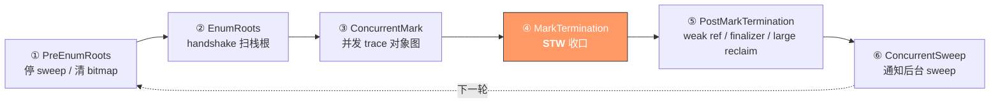

| 阶段 | 是否 STW | 做什么 |
|------|:--------:|--------|
| ① PreEnumRoots | 否 | 停掉上一轮残余的后台/lazy sweep，清 mark/scanned bitmap |
| ② EnumRoots | 否（handshake） | 每个 Mutator 自扫栈根，GC 线程 merge 并枚举全局根 |
| ③ ConcurrentMark | 否 | GC 线程 drain 工作栈，Mutator assist 协助标记 |
| ④ MarkTermination | **是** | flush 所有写屏障缓冲 + assist 残留，做最后一次 drain |
| ⑤ PostMarkTermination | 否 | 清理弱引用，提交 finalizer，eager 回收死亡大对象 |
| ⑥ ConcurrentSweep | 否 | 把 mark 结果交给后台 sweep，逐步回收小对象空槽 |

### 1.3 线程角色

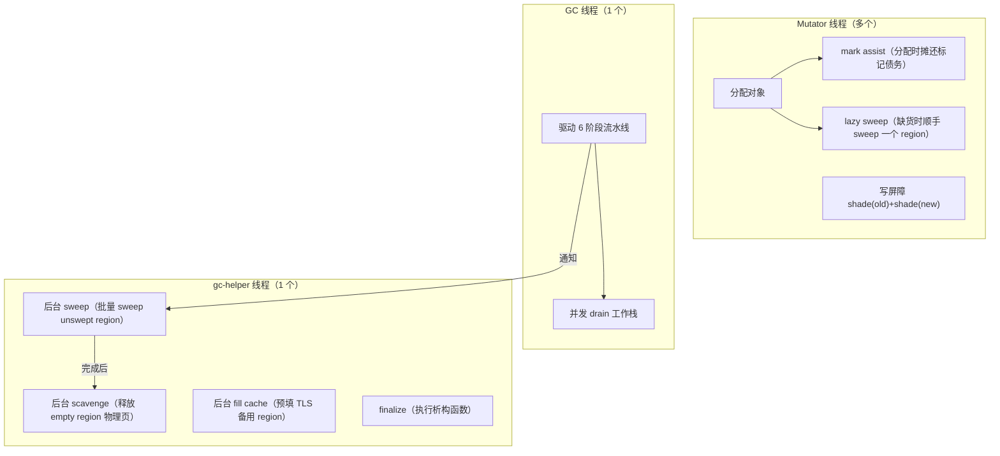

### 1.4 与 CopyGC 的核心差异

| 维度 | CopyGC | MSGC |
|------|--------|------|
| 对象是否移动 | 是（from → to space 复制） | **否**（原地 mark-sweep） |
| 读屏障 | 每次读检查 tagged pointer | **零开销**，直接 load |
| 写屏障 | SATB 记旧值 + tagged encode | shade(old) + shade(new)，无 tag |
| 屏障套数 | 6 套 | **2 套**（Idle + Mark） |
| 分配热路径 | 线性 bump allocator | size-class → bitmap 复用 |
| STW 次数 | 多个阶段都可能 STW | 仅 MarkTermination 一次短 STW |
| 碎片策略 | 复制整理天然解决 | size-class + bitmap + empty cache 复用 |

## 2. 内存布局与分配器

### 2.1 堆的整体布局

MSGC 在启动时做一次大虚拟保留（virtual reserve），然后按 segment 逐步 commit：

```
┌──────────────────────────────────────────────────────────────────┐
│          MSRegionInfo[] 数组          │       Heap 对象区         │
│  (每个 region 一个 64B entry)        │   (32KB region 为单位)    │
├──────────────────────────────────────┼───────────────────────────┤
^ mmapBase                             ^ heapStart                 ^ maxHeapEnd
                                       │← committed →│← inactive →│
```

**元数据与 bitmap 分离**：
- `MSRegionInfo[]`：正向平铺数组，region 级状态（64B/entry，一个 cache line）
- `MSBitmapArena`：独立 sidecar 映射，每个 region 绑定一个固定 bitmap slot

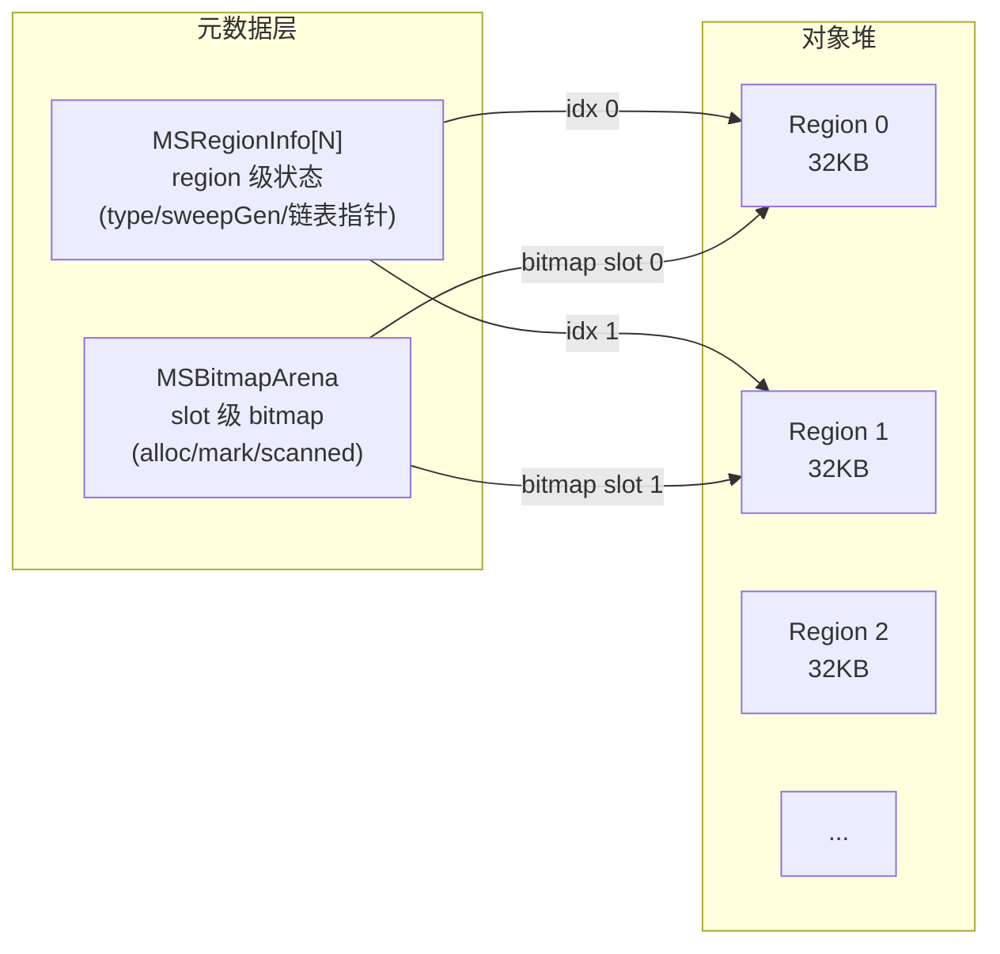

### 2.2 Region 的一生（状态机）

每个 32KB region 在生命周期中经历以下状态轮转：

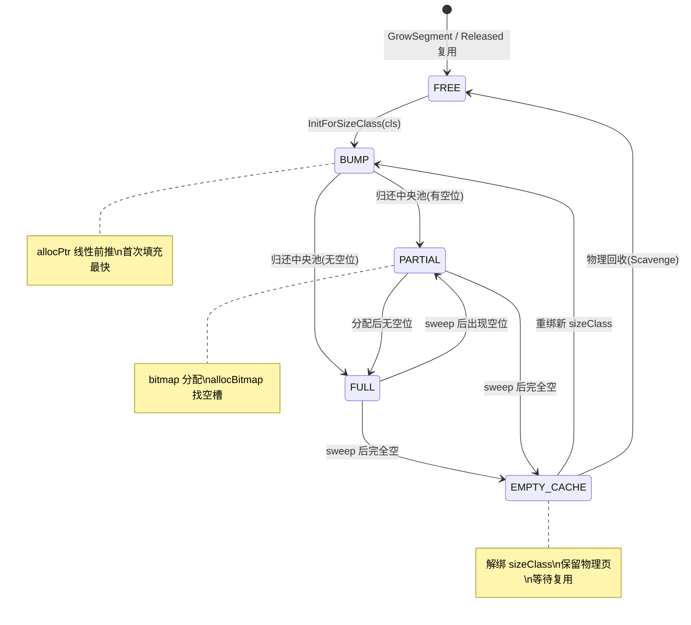

### 2.3 Size Class 与三层分配体系

小对象（< 16KB）通过 **36 级 size class**（8B → 16384B）管理，相邻 class 增长率 12.5%~25%。

分配体系分三层：

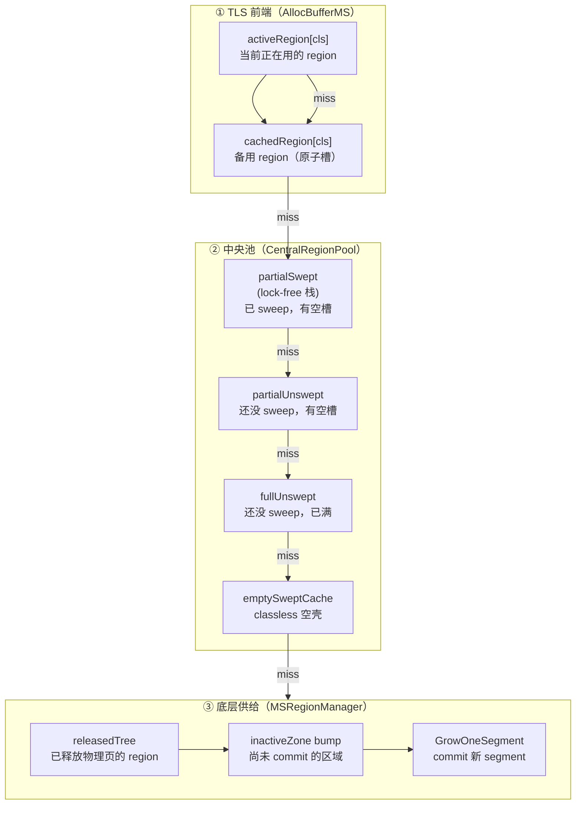

**小对象分配的完整优先级**：

| 优先级 | 来源 | 操作 | 开销 |
|:------:|------|------|------|
| 1 | TLS activeRegion | bump 或 bitmap 快速分配 | 最低，无锁 |
| 2 | TLS cachedRegion | 原子读取备用 region | 低，无锁 |
| 3 | partialSwept | lock-free Pop | 低，已 sweep |
| 4 | partialUnswept | **原地 lazy sweep** → 返回 | 中，需要 sweep |
| 5 | fullUnswept | lazy sweep → 可能出现空位 | 中-高 |
| 6 | emptySweptCache | 重新绑定 sizeClass | 中 |
| 7 | fresh region | releasedTree → bump → grow | 最高 |

### 2.4 Bitmap 的双重角色

每个小对象 region 当前只保留两张 bitmap，分别服务分配和标记/清扫：

```
一个 bitmap slot 的布局:
┌─────────────┬─────────────┐
│ allocBitmap  │ markBitmap   │
│ 1=free 0=used│ 1=alive      │
└─────────────┴─────────────┘
```

| 阶段 | 使用的 bitmap | 操作 |
|------|:-------------|------|
| **分配** | allocBitmap + reserved summary | `ctz(summary)` 快速找到有空位的 word，再 `ctz(word)` 找具体 slot |
| **标记** | markBitmap | `TestAndSetMarkBit()` 发现对象；grey/black 由 queue membership 隐式表达 |
| **Sweep** | markBitmap → allocBitmap | `allocBitmap = ~markBitmap`，一次位运算完成整 word 的空槽重建 |

### 2.5 大对象路径

`>= 16KB` 的对象不走中央池，直接申请连续 region span：

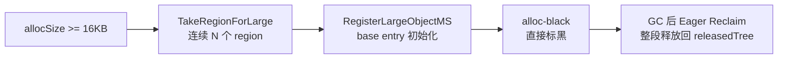

- base entry 仅持有 `isMarked` 标记位（large object 不使用 bitmap）
- span 从属 entry 通过 `reserved` 回指 base idx
- 不使用 bitmap，不进入 empty cache
- 死亡后整段 eager 释放，不走 lazy sweep

## 3. 三色并发标记

### 3.1 mark-only 三色模型

当前代码不是旧版的 `markBit + scannedBit` 双位模型，而是更简化的 `mark-only + queue protocol`：

- 小对象：只有 `markBitmap`，`1=alive(marked)`
- 大对象：只有 `FLAG_MARKED`
- `grey` / `black` 不落在对象状态位上，而是由“是否仍在灰队列中、是否已被 drain”来表达

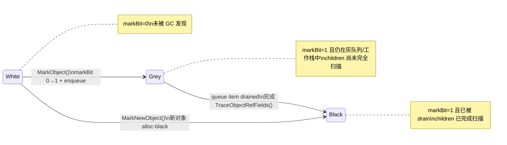

**当前为什么只保留一个 mark 位？**
- 新 grey 对象统一通过 `DiscoverObject -> TryEnqueueGreyObject` 进入工作队列
- 去重发生在 `MarkObject` / `DiscoverObject` 这一层，而不是队列层
- drain 完成即视为 black，因此不再需要额外的 `scannedBit`
- 这与 `Step2_Mark实现详解.md` 中的 `mark-only + queue protocol` 口径一致

### 3.2 标记阶段流水线

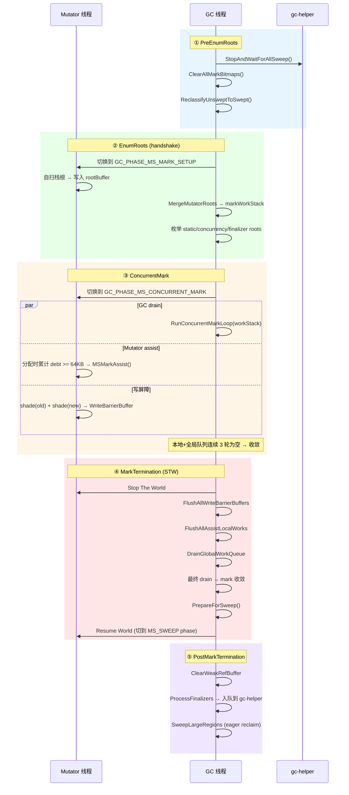

### 3.3 工作队列与协作模型

标记期间有三类工作队列，协作关系如下：

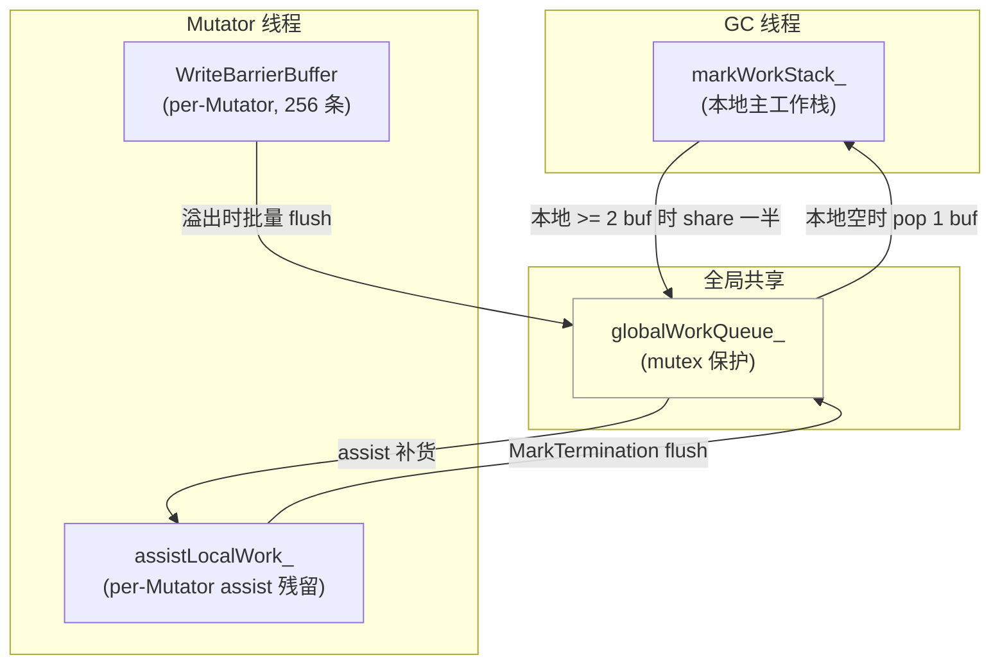

**GC 线程主循环**：
1. 本地工作栈 >= 2 buffer → `ShareWorkToGlobal()` 推一半给全局队列
2. 本地不空 → `RunCollectorDrainSlice(256 objects)` 处理一个 slice
3. 本地空 → `PopFromGlobal(1 buffer)` 从全局拉
4. 本地和全局都空 → 计数 +1；连续 3 轮都空 → 判定收敛

**Mutator assist**：
- 触发条件：分配累计债务 `gcAssistBytes_ >= 64KB`
- 每次最多处理 64 个对象
- 本地残留不清空，留到下次 assist 继续
- MarkTermination 时统一 flush

### 3.4 Trace 语义：mark-on-pop

GC 线程 drain 采用 **mark-on-pop** 模式：

```
从 workStack 弹出 obj
    → debug 校验：obj 已 mark
    → 无引用字段？直接结束（隐式 black）
    → WeakRef？记入 WeakRefBuffer，不 trace children
    → 普通对象：TraceObjectRefFields(obj) → 子对象压回 workStack
    → drain 结束，obj 脱离 grey queue（隐式 black）
```

子对象在被 `TraceRefField()` 发现时**不会立即标记**，而是只压入 workStack，标记发生在下一次 pop 时。

## 4. 混合写屏障

### 4.1 只有两套屏障

MSGC 将 CopyGC 的 6 套屏障精简为 2 套：

| GC 阶段 | 安装的屏障 | 读操作 | 写操作 |
|---------|-----------|--------|--------|
| IDLE / SWEEP | **MSIdleBarrier** | 直接 load | 直接 store |
| MARK_SETUP / CONCURRENT_MARK / MARK_TERMINATION | **MSMarkBarrier** | 直接 load | shade(old) + store + shade(new) |

切换机制：`Heap::InstallBarrier(phase)` 修改一个全局 `currentBarrier` 指针，所有 `MCC_WriteRefField()` 通过虚函数分派自动路由。

### 4.2 MSMarkBarrier：shade(old) + shade(new) 混合屏障

这是 Go 1.8 风格的混合写屏障：每次堆上引用写入，同时 shade 被覆盖的旧值和新写入的新值。

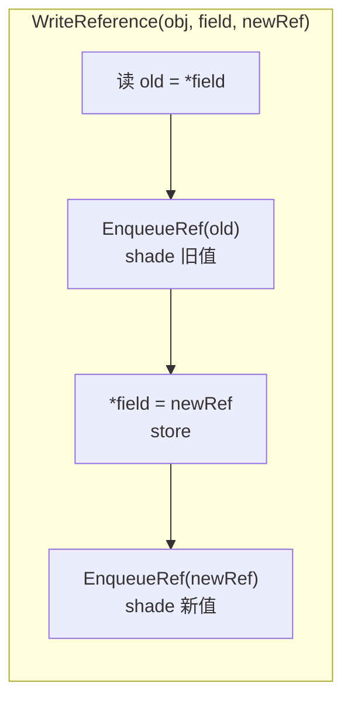

**EnqueueRef 核心路径**：

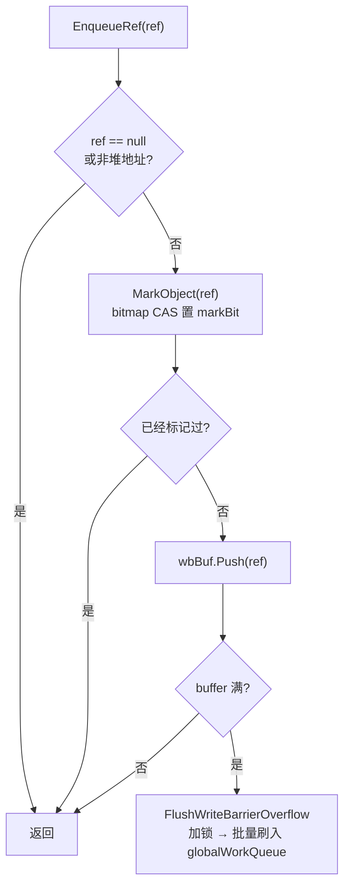

**关键设计点**：
- 标记在屏障路径上**立即发生**（bitmap CAS），不是延迟到 MarkTermination
- 只有**首次标记成功**的对象才入队（过滤已标记对象，减少队列流量）
- 读操作在标记期间也是零开销——直接 load，无任何检查

### 4.3 WriteBarrierBuffer：两层缓冲

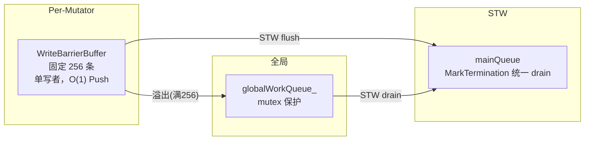

- **正常路径**：`EnqueueRef()` → `wbBuf.Push()`，O(1)，无锁
- **溢出路径**：buffer 满 → `FlushWriteBarrierOverflow()` → 加锁刷入全局队列（仅在满时触发）
- **收口路径**：MarkTermination STW 下 `FlushAllWriteBarrierBuffers()` → 统一 flush 到 mainQueue

### 4.4 为什么不需要栈写屏障？

MarkSetup handshake 会扫描所有 Mutator 的栈根。栈上新写入的指针只有两种来源：
1. **来自堆**：堆写操作有写屏障保护
2. **来自栈上已有引用**：MarkSetup 已经标灰

因此栈写操作不可能引入未被保护的白色对象，无需栈写屏障。

### 4.5 Struct/Array 的写屏障

| 操作 | shade 策略 |
|------|-----------|
| `WriteStruct` | 遍历 dst 所有引用 → shade(old)，memcpy，遍历 dst → shade(new) |
| `CopyRefArray` | 遍历 dst 范围引用 → shade(old)，memmove，遍历 dst → shade(new) |
| `AtomicSwapReference` | 原子 exchange，shade(交换出的旧值) + shade(新值) |
| `CompareAndSwapReference` | **仅 CAS 成功时** shade(old) + shade(new) |

## 5. 后台 Sweep 与物理回收

### 5.1 三层控制环

Sweep/Reclaim 体系采用三层控制环，各层职责严格分离：

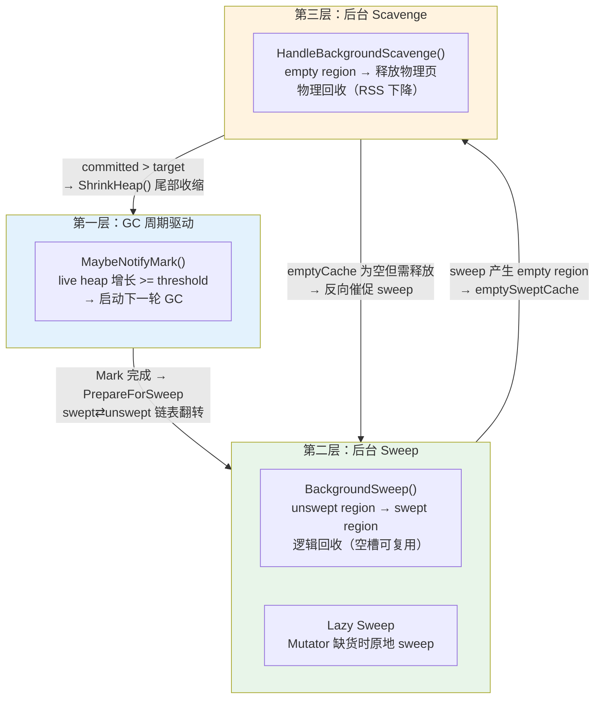

**分层的核心原则**：
1. GC 周期由 **live heap 增长**驱动，不被 allocator 局部缓存状态劫持
2. Sweep 只回收到**中央池**（逻辑复用），不直接归还 OS
3. Scavenge 只从 **emptySweptCache** 释放超额 region（物理释放），不涉及对象回收

### 5.2 sweepGen 代际机制

用一个单调递增的 `globalSweepGen_`（每轮 GC +2）实现三态区分：

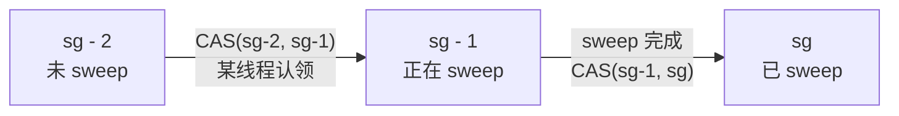

- **+2 而非 +1**：单字段表达三态（unswept/sweeping/swept），无需额外 state 字段
- **CAS 认领**：谁先把 `sg-2 → sg-1` 成功，谁负责 sweep 该 region
- **PrepareForSweep()**（MarkTermination STW 内执行）：`globalSweepGen_ += 2`，O(1) 链表头交换把 swept→unswept

```
PrepareForSweep():
    for each cls:
        partialSwept → partialUnswept   // O(1) 链表头转移
        fullSwept    ↔ fullUnswept      // O(1) 指针交换
    globalSweepGen_ += 2
    sweepDone_ = false
```

### 5.3 后台 Sweep 的执行与控制

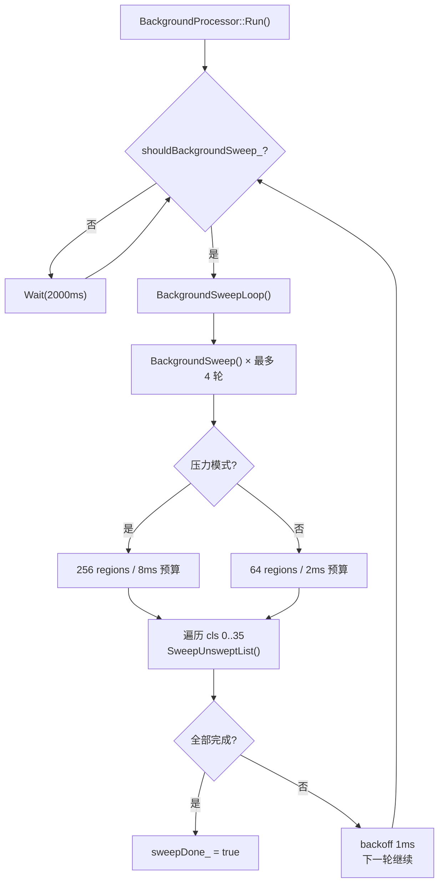

**Sweep 通知来源**：

| 来源 | 触发条件 |
|------|---------|
| GC Mark 完成 | 无条件通知（主入口） |
| 分配路径 GetRegion() | 进入 P2(unswept) 路径 且 readyCount < 4 |
| 后台 Scavenge | emptyCache 为空但需释放物理页 → 反向催促 |

**Sweep 停止方式**：

| 方式 | 触发 | 影响 |
|------|------|------|
| 正常完成 | 所有 unswept 链表清空 | sweepDone_=true |
| GC 请求停止 | PreEnumRoots() → `stopSweepRequested_` | 全部停止（后台+lazy） |
| 预算暂停 | 达到 region/time 上限 | 暂停当前 slice，下轮继续 |

### 5.4 Lazy Sweep：分配路径集成

当 Mutator 在 `CentralRegionPool::GetRegion()` 中无法从 partialSwept 获得 region 时，会**原地 lazy sweep**：

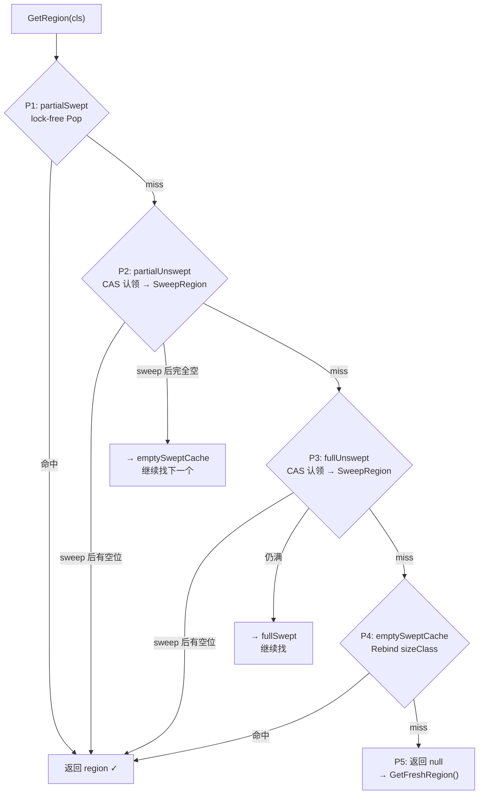

Lazy sweep 限流：每次 P2/P3 最多向 emptySweptCache 贡献 1 个 empty region，避免分配延迟过大。

### 5.5 后台 Scavenge：物理页回收

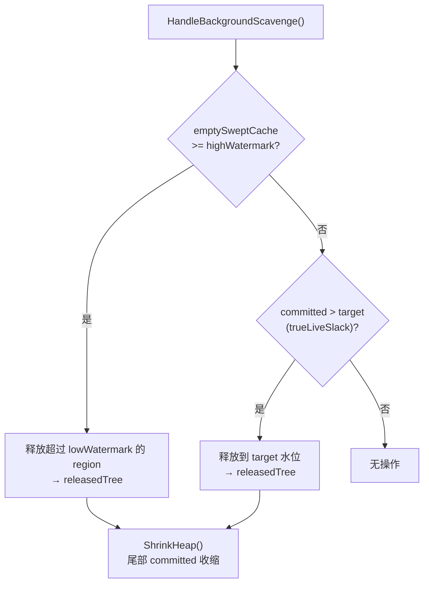

- **高水位释放**：`emptySweptCache >= highWatermark` → 削减到 lowWatermark
- **trueLiveSlack 释放**：committed 显著超过 live bytes → 按比例释放
- **物理释放路径**：empty region → `ReclaimRegionsReleased()` → releasedTree → 可能触发 `ShrinkHeap()` 尾部收缩

### 5.6 一轮完整的 Sweep 生命周期

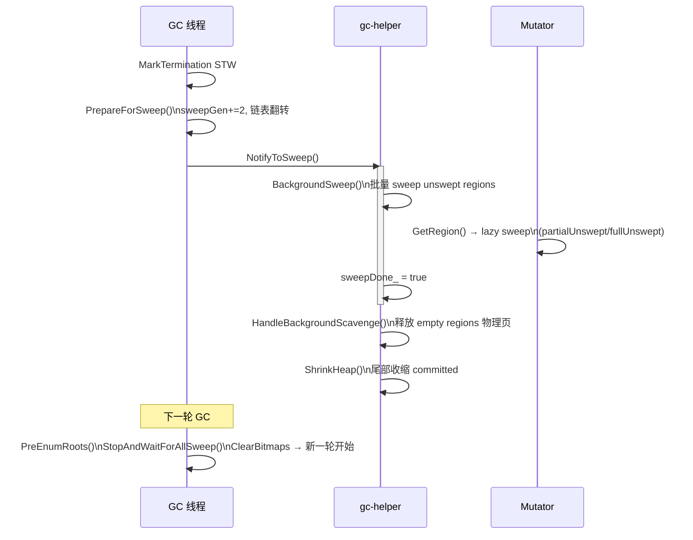

## 6. 关键参数一览

### 6.1 标记相关

| 参数 | 默认值 | 含义 |
|------|:------:|------|
| `kSliceMaxObjects` | 256 | GC 线程单次 drain slice 最多处理的对象数 |
| `kShareWorkBufs` | 2 | GC 本地 work stack 达到该 buffer 数时，向全局 share 一半 |
| `kConvergenceRequiredRounds` | 3 | 本地+全局队列连续空 N 轮才判定收敛 |
| `kAssistMaxObjectsPerCall` | 64 | Mutator 单次 assist 最多处理的对象数 |
| `kAssistLocalFlushBufs` | 2 | assist 本地工作超过 N buffer 时 share |
| `kAssistProbeIntervalCalls` | 8 | 全局队列看似空时，每 N 次 assist 做一次强制 probe |
| `kGCAssistTriggerBytes` | 64KB | 分配债务达到阈值才考虑触发 assist |
| `WriteBarrierBuffer::kCapacity` | 256 | 每 Mutator 写屏障缓冲容量 |

### 6.2 分配器相关

| 参数 | 默认值 | 含义 |
|------|:------:|------|
| `MS_REGION_SIZE` | 32KB | 一个 region 的大小 |
| `kNumSizeClasses` | 36 | size class 数量（8B → 16384B） |
| `kLargeObjectThreshold` | 16KB | 大对象分流阈值 |
| `kCacheFillThreshold` | 2 | TLS cache miss 达到 N 次后通知后台预填 |

### 6.3 Sweep / Scavenge 相关（环境变量可调）

| 环境变量 | 默认值 | 含义 |
|---------|:------:|------|
| `CJ_MS_BG_SWEEP_NORMAL_REGIONS_PER_SLICE` | 64 | 常规模式每 slice sweep 的 region 上限 |
| `CJ_MS_BG_SWEEP_PRESSURE_REGIONS_PER_SLICE` | 256 | 压力模式每 slice sweep 的 region 上限 |
| `CJ_MS_EMPTY_CACHE_LOW_FLOOR_REGIONS` | 32 | emptySweptCache 低水位 |
| `CJ_MS_EMPTY_CACHE_LOW_CAP_REGIONS` | 48 | emptySweptCache 高水位（触发 scavenge） |
| `CJ_MS_EMPTY_SCAVENGE_MAX_REGIONS_PER_SLICE` | 16 | 每次 scavenge 最多释放的 region 数 |
| `CJ_MS_INLINE_RECLAIM` | 1 | 是否启用分配路径同步 reclaim |
| `CJ_MS_HEU_READY_WATERMARK` | 4 | per-cls ready region 低于该水位时启动压力反馈 |

### 6.4 GC 触发相关

| 环境变量 | 默认值 | 含义 |
|---------|:------:|------|
| `cjGCThreshold` | 16MB | GC 阈值初始值 |
| `cjGCInterval` | 100ms | GC 触发冷却间隔 |
| `cjHeapSize` | - | 堆上限 |
