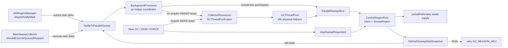
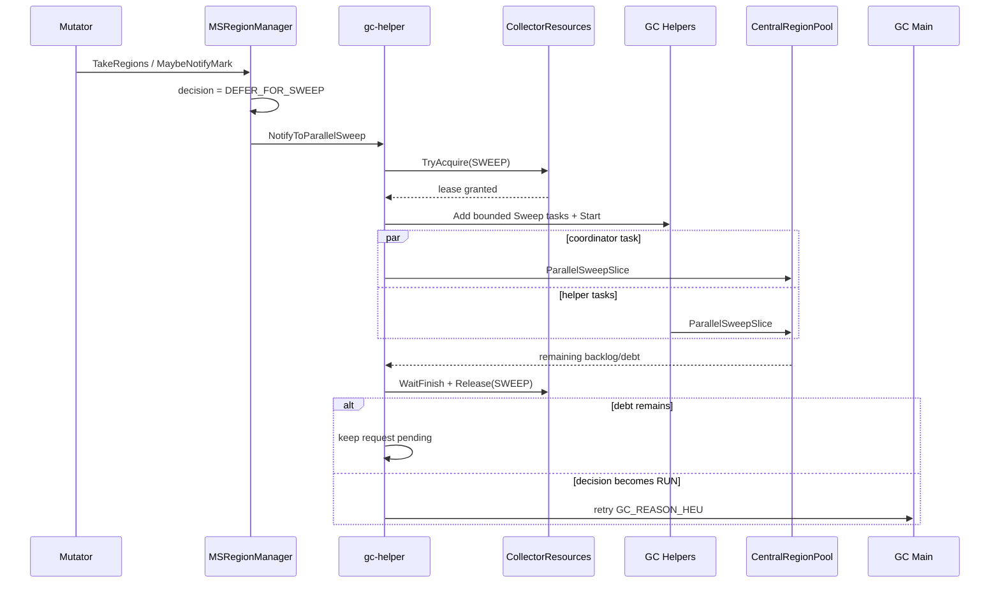

# Step44 MSGC NotifyMark 动态 Sweep Helper 设计

> 状态：已实施，默认关闭，已通过 macOS aarch64 MarkSweep 全量构建与实机并发验证。
>
> 目标：仅当 `GC_REASON_HEU` 因 `DEFER_FOR_SWEEP` 被延后时，借用空闲 GC Helper 并行偿还上一轮 Sweep backlog，降低下一轮 `PreEnumRoots()` 中 `ForceFinishAllUnswept()` 的串行尾部。

## 1. 背景与问题

MSGC 将 small Region 的回收拆成后台 Sweep、Lazy Sweep、mutator Sweep Assist 和下一轮前 Force-Finish。上一轮 mark bitmap 在对应 Region 完成 Sweep 前不能清除，因此下一轮 `PreEnumRoots()` 必须执行：

```text
StopAndWaitForAllSweep()
    -> 禁止 background/lazy/assist 新 claim
    -> 等待所有 in-flight SweepRegion 退出
    -> ForceFinishAllUnswept()
    -> ClearAllMarkBitmaps()
```

当前已经通过 Sweep debt policy 避免在 backlog 过大时直接进入下一轮 GC：当 `sweptBytes >= threshold`，但上一轮 unswept backlog 仍处于 BACKLOG/EMERGENCY 压力时，`EvaluateMSHeuExecution()` 返回 `DEFER_FOR_SWEEP`。此时 HEU Mark 被延后，系统先偿还 Sweep debt。

问题在于，defer 后只唤醒单个 `gc-helper`：

```text
DEFER_FOR_SWEEP
    -> BackgroundProcessor::NotifyToSweep()
    -> 单线程 BackgroundSweep()
```

与此同时，`CollectorResources` 创建的 GCThreadPool 仅在 `ConcurrentMark()` 中运行动态 Mark Helper；GC 处于 IDLE/SWEEP、HEU 又被 defer 时，这些物理线程全部休眠。因此存在一个明确的并行度缺口：

- 下一轮 Mark 已经因为 Sweep debt 无法开始。
- mutator 仍在继续分配，runway 已接近或达到 0。
- 单线程后台 Sweep 可能来不及清掉 backlog。
- GCThreadPool 的 Helper 线程却处于空闲状态。
- 若 OOM/FORCE/下一次 HEU 最终进入 GC，剩余 backlog 仍会落到 `ForceFinishAllUnswept()`，形成串行尾部。

Step44 的核心思路是：**只在 HEU 已经被 `DEFER_FOR_SWEEP` 阻塞的窗口内，临时借用空闲 GC Helper，与 `gc-helper` 一起并行 Sweep；backlog 降到安全水位后立即归还线程池，并重新提交 HEU。**

这不是把 Mark Helper 变成同时执行 Mark 和 Sweep 的混合 worker。复用的是已创建的物理线程和 GCThreadPool，Mark 的 WorkBuf、worker control、assist credit 等状态完全不参与 Sweep。

## 2. 当前源码行为

### 2.1 提交侧 HEU gate

`MSRegionManager::TakeRegions()` 在申请 Region 前调用 `MaybeNotifyMark()`：

```text
TakeRegions()
    -> MaybeNotifyMark()
       -> Heap::IsGcStarted() 检查
       -> HEU cooldown 检查
       -> GetSweptHeapBytes()
       -> RefreshSweepDebtSnapshot()
       -> EvaluateMSHeuExecution()
```

> **2026-07-17 现行策略更新**：上面的流程保留 Step44 设计阶段的历史入口。
> 当前 `MaybeNotifyMark()` 已删除 `RefreshSweepDebtSnapshot()`，也不存在
> `EvaluateMSHeuExecution()` gate；它先判断 `sweptBytes >= heapThreshold`，再读取中央池已经发布的
> `GetSweepPressureMode()`。`U/S/T` 压力刷新由 Background/Helper Sweep 控制面在 slice 边界完成。

当前三种结果为：

| 决策 | 当前行为 |
| --- | --- |
| `BELOW_THRESHOLD` | 直接返回 |
| `DEFER_FOR_SWEEP` | `NotifyToSweep()`，不提交 HEU |
| `RUN` | CAS 更新 `lastHeuRequestNs_`，异步提交 `GC_REASON_HEU` |

只有 `RUN` 会更新 `lastHeuRequestNs_`。提交侧直接 defer 时没有 HEU pending/running 任务，后续主要依赖新的 Region 申请再次进入 `MaybeNotifyMark()`。

### 2.2 队列执行侧二次 gate

HEU 是异步任务，从提交到 GC main dequeue 之间堆状态可能变化。`GCExecutor::Execute()` 在真正调用 `RunGarbageCollection()` 前执行：

```text
CollectorProxy::ShouldExecuteQueuedRequest(GC_REASON_HEU)
    -> MarkSweepCollector::ShouldExecuteQueuedRequest()
    -> 重新读取 sweptBytes / threshold / sweep debt
```

如果队列等待期间变成 `DEFER_FOR_SWEEP`，当前行为同样只是 `NotifyToSweep()`，然后丢弃本次 HEU。`TaskQueue::DrainTaskQueue()` 在 `Execute()` 返回后才清除 async task 的 running bit。

因此 Step44 必须覆盖两个入口：

1. `MSRegionManager::MaybeNotifyMark()` 的提交侧 defer。
2. `MarkSweepCollector::ShouldExecuteQueuedRequest()` 的执行侧 defer。

只改其中一个会导致另一条路径仍退化为单线程后台 Sweep。

### 2.3 当前后台 Sweep

`BackgroundProcessor` 是名为 `gc-helper` 的独立线程。它收到 `NotifyToSweep()` 后循环调用：

```text
BackgroundProcessor::BackgroundSweepLoop()
    -> Allocator::BackgroundSweep()
    -> CentralRegionPool::BackgroundSweep()
```

`BackgroundSweep()`：

- 通过 `ClaimUnsweptHeadForSweep()` 唯一 claim Region。
- 按 size class 顺序处理 partial/full unswept list。
- 使用时间 slice 控制单轮工作量。
- NORMAL/BACKLOG/EMERGENCY 分别放大为 1/4/10 倍预算。
- 每个 Region 检查 `stopSweepRequested_`，便于下一轮 GC 停止。

但它使用单一 `bgSweepRunning_` 布尔位表达后台线程是否正在 Sweep。这个字段只适用于单个 `BackgroundSweep()` 调用者，不能直接让多个 GC Helper 并发调用：任意一个线程先结束并写 `false`，都会使 `StopAndWaitForAllSweep()` 误判全部后台 Sweep 已结束。

### 2.4 当前并行 Sweep 基础

`CentralRegionPool::AssistSweep()` 已经具备适合多线程复用的基础：

- 入口递增 `activeAssistSweepCount_`，退出通过 RAII guard 递减。
- 入口使用 seq_cst fence，与 `StopAndWaitForAllSweep()` 的 skip-store/count-load 配对。
- 检查 `skipAssistSweep_` 和 `stopSweepRequested_`。
- Region 仍通过相同 bucket lock 和 `ClaimUnsweptHeadForSweep()` 唯一 claim。
- 每个 Region 扫完后归入 empty/partial/full swept 结构。

因此并行 Helper 应建立在这套 active-counter 协议上，或者把它抽象成通用 `ParallelSweep()`；不能直接并发复用 `BackgroundSweep()`。

### 2.5 当前 Mark Helper 生命周期

`ConcurrentMark()` 中的 Helper 使用同一个 GCThreadPool：

```text
StartMarkWorkers()
    -> 为每个 Helper 创建 MSMarkWorkerSlot
    -> 初始化 PerPGCWork(globalFull_, workBufPool_)
    -> GCThreadPool::AddWork(RunMarkWorker)
    -> GCThreadPool::Start()

QuiesceMarkWorkers()
    -> BeginQuiesce()
    -> 等待 worker/assist in-flight 归零
    -> Stop markWorkerControl
    -> GCThreadPool::WaitFinish()
```

Mark Helper 的逻辑状态绑定：

- `globalFull_` 和 `WorkBufPool`。
- `PerPGCWork` 私有 get/put buffer。
- `MSMarkWorkerControl`。
- Mark 收敛与 credit 统计。

这些状态不能用于 Sweep。Step44 只借用 `GCThreadPool` 中已经创建、当前休眠的 `GCPoolThread`。

### 2.6 当前线程池缺少跨用途所有权

`GCThreadPool` 的使用手册要求：

```text
(SetMaxActiveThreadNum -> AddWork -> Start -> WaitFinish) 重复执行
改变 maxActiveThreadNum 前必须先 WaitFinish/Stop
```

当前只有 GC main 使用这个池，因此没有 owner 仲裁。若 `gc-helper` 直接向同一 work queue 加 Sweep task，而下一轮 GC 同时添加 Mark task，会出现：

- Mark/Sweep task 混入同一队列。
- 两侧分别调用 `Start()`、`WaitFinish()`、`Stop()`。
- `maxActiveThreadNum` 被并发改写。
- Mark 的 `WaitFinish()` 等待 Sweep task，或 Sweep 的 `WaitFinish()` 等待 Mark task。

所以复用线程池的前提是新增显式 lease，保证任意时刻只能由 SWEEP 或 MARK 一方完整拥有一次运行周期。

## 3. 目标与非目标

### 3.1 目标

1. 仅在 HEU 明确返回 `DEFER_FOR_SWEEP` 时启用并行 Sweep Helper。
2. 利用空闲 GCThreadPool，减少下一轮 `PreEnumRoots()` 需要 force-finish 的 Region 数。
3. 保持 mutator 并发运行，不把 Sweep debt 直接转化为新的 STW。
4. OOM、FORCE、同步 GC 到来时可快速停止 Helper，并让下一轮 GC 安全接管。
5. 不破坏 mark bitmap 的稳定窗口、sweep generation 和 Region 唯一 claim。
6. Sweep Helper 完成后主动重新评估并提交 deferred HEU，避免任务丢失。
7. Helper Sweep 计入总 Sweep credit，但与 mutator assist、普通 background sweep 分开统计。
8. 不增加新的常驻 native 线程；物理线程仍由 `CollectorResources::GCThreadPool` 统一创建和销毁。

### 3.2 非目标

1. 不在 `BELOW_THRESHOLD` 或普通 NORMAL Sweep 状态下扩线程。
2. 不改变 `SweepDebtParams` 的 BACKLOG/EMERGENCY 水位。
3. 不让 Sweep Helper 执行对象图 Mark，也不让 Mark Helper 同时处理两类任务。
4. 不修改 `WorkBuf`、`globalFull_`、`MSMarkWorkerControl` 或 mutator mark assist 协议。
5. 不删除单线程 `BackgroundSweep()`；它仍是常态后台回收路径。
6. 不取消 Lazy Sweep、mutator Sweep Assist 或下一轮 force-finish correctness fence。
7. 不把 large object 纳入 small Region 并行 Sweep；large 仍在 `PostMarkTermination()` eager 处理。
8. 不在本 Step 调整 16KB small/large 边界、allocator refill 或 Scavenge/Shrink。
9. 不保证 deferred HEU 永不被更高优先级 OOM/FORCE 覆盖；高优先级 GC 必须优先。

### 3.3 成功判据

Step44 的直接成功指标不是“后台 Sweep 更快”这一条，而是：

- 触发过 `DEFER_FOR_SWEEP` 的周期，下一次 `StopAndWaitForAllSweep()` 中 `forceSwept` 显著下降。
- 并行 Helper 不增加 missed mark、invalid stateWord、重复 Region claim 或 bitmap/sweep 竞态。
- GCThreadPool 不出现 task 混用、`WaitFinish()` 卡死或线程池状态错乱。
- mutator p99 不因把 Sweep 工作转移回 mutator 而恶化。
- 总 CPU 增长受 `gcThreads` 上限约束，并只发生在 emergency defer 窗口。

## 4. 方案比较与最终选择

### 4.1 方案 A：复用 GCThreadPool，增加跨用途 Lease

做法：

- `gc-helper` 作为 Sweep 协调者。
- HEU defer 后尝试取得 GCThreadPool 的 `SWEEP` lease。
- 使用已有休眠 GCPoolThread 执行 bounded parallel Sweep task。
- 下一轮 Mark 使用同一线程池前取得 `MARK` lease。

优点：

- 不增加常驻线程与额外线程栈。
- 并行度天然受 `cjGCThreads` 约束。
- 复用现有线程启动、优先级和退出管理。
- IDLE/SWEEP 时使用、MARK 时归还，资源互补关系明确。

代价：

- 需要新增线程池 owner 状态和交接协议。
- `WaitFinish()` 会让调用者参与执行 task，需要把 `gc-helper` 计入总并行度。
- OOM/FORCE 抢占时必须同时停止 Region Sweep 和等待 lease 释放。

### 4.2 方案 B：新建专用 SweepThreadPool

做法：在 `BackgroundProcessor` 内创建一组常驻 Sweep worker。

优点：

- 不与 Mark work queue 共用状态。
- 不需要 GCThreadPool lease。
- Sweep worker 生命周期和统计相对独立。

代价：

- 额外常驻线程和线程栈。
- Mark 与 Sweep 可能同时占用两套线程池，必须增加全局 CPU quota。
- Runtime 初始化、结束、fork/hotupdate 路径增加新资源。
- 不符合“借用空闲 Mark Helper”的原始目标。

### 4.3 方案 C：只提高现有 background/mutator assist 强度

做法：继续单线程 background sweep，同时放大 `AssistSweepCredit()` 的 ratio/cap。

优点：

- 改动最小。
- 不涉及 GCThreadPool 生命周期。

代价：

- 单线程 background 吞吐上限不变。
- 更多 Sweep 成本落到分配线程，增加 mutator 延迟。
- 无法利用当前休眠的 GC Helper。

### 4.4 最终选择

Step44 选择方案 A：**复用 GCThreadPool 的物理 Helper，但通过 lease 将 SWEEP 和 MARK 的线程池运行周期完全隔离。**

选择理由：

1. HEU 已被 defer 时，Mark 不可能立即使用这些 Helper，资源借用具有明确空档。
2. 下一轮 GC 到来时，已有 `stopSweepRequested_ + active counter` 可以作为 Region 工作抢占协议。
3. 增加 pool lease 后，线程池本身也能实现无混用的所有权交接。
4. 不增加常驻线程，CPU 上限仍可统一绑定 `cjGCThreads`。

实现时不应把 `StartMarkWorkers()` 泛化成“既 Mark 又 Sweep”的 worker。正确抽象边界是：

```text
GCThreadPool：提供物理执行资源
MARK lease：运行 RunMarkWorker task
SWEEP lease：运行 ParallelSweepSlice task
CentralRegionPool：提供统一 Region claim/stop/generation 协议
```

## 5. 总体架构

### 5.1 组件关系



### 5.2 职责划分

| 组件 | Step44 职责 |
| --- | --- |
| `MSRegionManager` | 提交侧发现 `DEFER_FOR_SWEEP`，发出并行 Sweep 请求 |
| `MarkSweepCollector` | 队列执行侧二次 gate 发现 defer，发出相同请求 |
| `BackgroundProcessor` | 合并通知、取得 SWEEP lease、计算并行度、调度 task、完成后 recheck |
| `CollectorResources` | 管理 GCThreadPool 的 IDLE/SWEEP/MARK owner 状态 |
| `GCThreadPool` | 提供已经创建的物理 Helper，不感知 GC 算法语义 |
| `CentralRegionPool` | 唯一 claim Region、Sweep、归类、stop fence、generation 校验 |
| `TaskQueue/AsyncTaskState` | 对 retry HEU 做 pending/running 去重并反馈是否接受 |

### 5.3 一轮 deferred HEU 的时序



### 5.4 GC 抢占时序

```text
OOM/FORCE/HEU_SYNC/允许执行的 HEU 到达
    -> CollectorProxy::SetGcStarted(true)
    -> PreEnumRoots()
       -> StopAndWaitForAllSweep()
          -> stopSweepRequested = true
          -> skip lazy/assist/helper
          -> wait active counters == 0
    -> gc-helper WaitFinish() 返回并释放 SWEEP lease
    -> ConcurrentMark 取得 MARK lease
    -> StartMarkWorkers()
```

Region bitmap 安全由 `StopAndWaitForAllSweep()` 保证；work queue 不混用由 pool lease 保证。这是两个不同层次的同步，不能只实现其中一个。

## 6. 精确触发语义

### 6.1 唯一正向触发条件

并行 Sweep Helper 只由以下判断触发：

```cpp
decision == MSHeuExecutionDecision::DEFER_FOR_SWEEP
```

不能简化成：

```cpp
GetTotalUnsweptCount() > 0
```

也不能简化成：

```cpp
sweptBytes >= threshold
```

原因是普通后台 Sweep 本来就会持续消费 unswept；只有 debt policy 明确判定“上一轮 Sweep 已经阻塞下一轮 HEU”时，额外 CPU 并行才有足够收益。

### 6.2 提交侧入口

`MSRegionManager::MaybeNotifyMark()` 建议改为：

```cpp
if (decision == MSHeuExecutionDecision::DEFER_FOR_SWEEP) {
    BackgroundProcessor& bp =
        Heap::GetHeap().GetCollectorResources().GetBackgroundProcessor();
    bp.NotifyToParallelSweep(DeferredHeuOrigin::SUBMIT_SIDE);
    return;
}
```

这里不更新 `lastHeuRequestNs_`，也不直接访问 GCThreadPool。

### 6.3 队列执行侧入口

`MarkSweepCollector::ShouldExecuteQueuedRequest()` 建议改为：

```cpp
if (decision == MSHeuExecutionDecision::DEFER_FOR_SWEEP) {
    BackgroundProcessor& bp =
        Heap::GetHeap().GetCollectorResources().GetBackgroundProcessor();
    bp.NotifyToParallelSweep(DeferredHeuOrigin::EXECUTE_SIDE);
    return false;
}
```

执行侧 defer 必须记录“本次 HEU 已经从 async queue pop 且即将 complete”，供后续 retry 绕开普通提交侧 cooldown，并处理 running bit 尚未清除的短窗口。

### 6.4 通知合并

`BackgroundProcessor` 建议新增：

```cpp
std::atomic<bool> shouldParallelSweep_{false};
std::atomic<bool> deferredHeuRetryPending_{false};
std::atomic<uint8_t> deferredHeuOriginMask_{0};
```

`NotifyToParallelSweep()` 只做：

1. `deferredHeuRetryPending_ = true`。
2. OR 合并 origin bit。
3. `RequestWork(shouldParallelSweep_)` 唤醒 `gc-helper`。

多个 mutator 同时 defer、提交侧与执行侧同时 defer，都只能形成一个后台协调任务。真实 backlog 和 pressure mode 必须由协调者醒来后重新读取，通知时的数值只用于日志，不能作为执行依据。

### 6.5 不启动 Helper 的场景

满足任一条件时，parallel request 退化或取消：

- `Heap::IsGcStarted()` 已为 true。
- `CentralRegionPool == nullptr`。
- `GetTotalUnsweptCount() == 0`。
- 重新计算 decision 已不再是 `DEFER_FOR_SWEEP`。
- `cjGCThreads <= 1`，没有可借用 Helper；此时仍由 `gc-helper` 单线程 Sweep。
- GCThreadPool 正被 MARK lease 占用。
- `stopSweepRequested_`、`skipAssistSweep_` 已设置。
- Runtime 正在 Fini/StopGCWork。

其中“重新计算已经 RUN”不应简单丢弃请求，而应进入第 11 章的 HEU retry；“已经 BELOW_THRESHOLD”才可以清除 retry pending。

### 6.6 普通后台 Sweep 保持不变

`NotifyToSweep()` 和 `BackgroundSweepLoop()` 仍处理：

- 周期性后台 Sweep。
- size class supply 不足通知。
- Scavenge/Shrink 前需要的 Sweep 衔接。
- 非 emergency 的 NORMAL/BACKLOG 单线程工作。

`NotifyToParallelSweep()` 是额外的 emergency 协调请求，不替代普通 flag。并行 burst 完成后若仍有 backlog，但已经退出 `DEFER_FOR_SWEEP`，继续交给普通 `shouldBackgroundSweep_`，不保持多线程运行。

## 7. GCThreadPool 所有权与 Lease

### 7.1 Owner 状态

建议在 `CollectorResources` 中增加：

```cpp
enum class MSGCWorkerPoolOwner : uint8_t {
    IDLE,
    SWEEP,
    MARK,
    STOPPING,
};

std::mutex msgcWorkerPoolOwnerMutex_;
std::condition_variable msgcWorkerPoolOwnerCV_;
MSGCWorkerPoolOwner msgcWorkerPoolOwner_{MSGCWorkerPoolOwner::IDLE};
```

该状态不代替 `GCThreadPool::running`，而是在调用线程池 API 之前提供更高一层的算法所有权。

### 7.2 建议接口

```cpp
bool TryAcquireMSGCWorkerPoolForSweep();
void AcquireMSGCWorkerPoolForMark();
void ReleaseMSGCWorkerPool(MSGCWorkerPoolOwner owner);
MSGCWorkerPoolOwner GetMSGCWorkerPoolOwner() const;
```

语义：

- Sweep 使用非阻塞 `TryAcquire`。lease 忙时退回单线程后台路径，不能让 `gc-helper` 阻塞普通 finalizer/scavenge 工作。
- Mark 使用阻塞 `Acquire`。下一轮 GC 是 correctness/progress 路径，必须最终取得线程池。
- `Release` 校验当前 owner 与调用方一致，Debug 构建对错误释放 fatal。
- owner 变化使用 mutex + condition variable，不依赖轮询。

### 7.3 SWEEP lease 生命周期

```text
TryAcquire(SWEEP)
    -> 再检查 !IsGcStarted()
    -> GCThreadPool 必须处于 stopped/queue empty
    -> SetMaxActiveThreadNum(borrowedHelpers)
    -> AddWork(totalWorkers 个 Sweep task)
    -> Start()
    -> WaitFinish()
    -> queue empty + pool stopped
    -> Release(SWEEP)
```

第二次 `IsGcStarted()` 检查用于关闭这个竞态：

```text
第一次检查 false
    -> GC main 开始，SetGcStarted(true)
    -> gc-helper 取得 SWEEP lease
```

如果 lease 后发现 GC 已开始，必须不添加 task、立即释放。若 GC 在 Sweep task 启动后才开始，则由 `StopAndWaitForAllSweep()` 抢占。

### 7.4 MARK lease 生命周期

Mark lease 从第一次向 GCThreadPool 发布 Mark task 前持有，到所有 Mark task `WaitFinish()` 后释放：

```text
ConcurrentMark
    -> Acquire(MARK)
    -> StartMarkWorkers
    -> RunConcurrentMarkLoop
    -> QuiesceMarkWorkers
       -> WaitFinish
    -> Release(MARK)
```

不能只在 `StartMarkWorkers()` 内用局部 mutex，因为函数返回后 Mark task 仍在运行；lease 必须覆盖整个 helper 生命周期。

若 `maxHelpers == 0`，不向线程池添加任务，可以跳过 MARK lease。若已经有 SWEEP lease，`PreEnumRoots()` 仍会通过 active-counter 等待 Region Sweep 完成。

### 7.5 为什么不在 `MaybeNotifyMark()` 中取得 Lease

`MaybeNotifyMark()` 位于 Region 获取路径，可能被多个 mutator 高频调用。取得线程池 lease 涉及：

- mutex/condition variable。
- task 分配。
- `SetMaxActiveThreadNum()`。
- `Start/WaitFinish/Stop`。

这些操作不得进入 allocator 热路径。mutator 只做原子 flag 合并，所有 lease 操作由唯一 `gc-helper` 协调。

### 7.6 Fini/Stop 顺序

当前 `StopGCWork()` 先停止 `BackgroundProcessor`，再终止 GC main，最后 Exit/Delete GCThreadPool。Step44 保持该顺序，并要求：

1. `BackgroundProcessor::Stop()` 设置 parallel stop flag。
2. 等待当前 SWEEP task 和 `WaitFinish()` 返回。
3. 释放 SWEEP lease。
4. BackgroundProcessor 线程退出。
5. GCThreadPool 才允许 `Exit()`。

不得让线程池先析构、后台协调线程仍持有 lease 或等待 task。

## 8. Sweep Helper 动态并行度策略

### 8.1 一次 Burst 使用 One-Shot Task

Sweep Helper 不创建类似 `RunMarkWorker()` 的常驻 task/park loop。每次 parallel burst：

1. 重新读取 unswept Region 数。
2. 计算本轮总 worker 数与每 task quantum。
3. 向 GCThreadPool 放入固定数量 one-shot task。
4. 每个 task 完成一个 bounded slice 后退出。
5. `gc-helper` 等待本轮结束、归还 lease、重新评估。

动态缩放发生在 burst 之间，不在 task 内 park/unpark。这样 GC 抢占只需等待 bounded task 结束，不需要新增 Sweep worker control 状态机。

### 8.2 Helper 数量

定义：

```cpp
maxBorrowedHelpers = max(0, cjGCThreads - 1);
borrowedHelpers = min(maxBorrowedHelpers,
                      unsweptRegions == 0 ? 0 : (unsweptRegions - 1) / 64);
totalWorkers = 1 + borrowedHelpers; // 包含 gc-helper coordinator
```

其中 64 与当前 emergency enter waterline 同量级。前 64 个 Region 仅由
`gc-helper` coordinator 处理；从第 65 个 Region 开始，每多一个 64 Region 区间增加
一个借用 Helper，直到 `cjGCThreads` 上限。这与下表的 64/65/129/193 边界一致。

示例（`cjGCThreads=4`）：

| unswept | 借用 GC Helper | 加上 `gc-helper` 的总 Sweep worker |
| ---: | ---: | ---: |
| 1～64 | 0 | 1；理论上不会由 defer 路径进入 |
| 65～128 | 1 | 2 |
| 129～192 | 2 | 3 |
| ≥193 | 3 | 4 |

`cjGCThreads` 默认不超过 P，因此 parallel Sweep 的总工作线程数仍受 Runtime GC 并行度配置约束。

### 8.3 `gc-helper` 也参与执行

`GCThreadPool::WaitFinish()` 会让调用者线程主动 drain work queue。Step44 利用这一行为：

- 当 `totalWorkers == 1` 时，`gc-helper` 直接执行一个 slice，不启动 pool。
- 当 `totalWorkers >= 2` 时，把 pool active thread 数设为 `borrowedHelpers`。
- 向 work queue 放入 `totalWorkers` 个 one-shot task。
- `gc-helper` 在 `WaitFinish()` 中执行其中一个或多个，借用线程执行其余 task。

因此最大并发线程数约为：

```text
gc-helper 1 + borrowed GC helpers <= cjGCThreads
```

不能把 `maxActiveThreadNum` 设成 `totalWorkers`，否则调用者参与后可能达到 `cjGCThreads + 1`。

### 8.4 Region Quantum

每个 task 的 Region 上限建议为：

```cpp
emergencyCap = max<size_t>(1, msAssistSweepMaxRegionsPerCall * 10);
targetPerTask = CeilDiv(unsweptRegions, totalWorkers * 4);
regionQuantum = Clamp(targetPerTask, 1, emergencyCap);
```

目标是理想情况下约四个 burst 清完当前快照，同时保留每 task 上限。默认 `msAssistSweepMaxRegionsPerCall=10` 时，emergency cap 为 100 Region。

实际 task 还必须共享一个绝对时间 deadline：

```text
deadline = burstStart + GetBgSweepMaxTimeUs(EMERGENCY)
```

默认基础 slice 2ms、EMERGENCY 10 倍时，一次 burst 的墙钟预算约 20ms。Region quantum 和 deadline 任一先到即退出。

### 8.5 为什么同时需要 Region 和时间上限

- 只有 Region 上限：不同 size class 的 slot 数与存活密度不同，单 Region Sweep 成本差异大。
- 只有时间上限：非常快的 Region 可能在一次 burst 中清扫过多，影响 mutator CPU。
- 二者同时存在：限制工作量和墙钟占用，同时每个 Region 之间仍可响应 stop flag。

### 8.6 Burst 之间的重新评估

每轮结束后重新读取：

- `Heap::IsGcStarted()`。
- `GetTotalUnsweptCount()`。
- `GetSweptHeapBytes()` 和 threshold。
- `RefreshSweepDebtSnapshot()`。
- pool owner 和 background running 状态。

如果仍为 `DEFER_FOR_SWEEP`，保留 `shouldParallelSweep_`，由 BackgroundProcessor 现有 burst/backoff 机制在短暂 yield/backoff 后进入下一轮。不能在持有 SWEEP lease 时无限循环清完整个 backlog，否则 OOM/FORCE 只能等待一段不可控的长任务。

## 9. 并行 Sweep 执行路径

### 9.1 抽取通用 Region Sweep Slice

不建议让多个 Helper 直接调用 `BackgroundSweep()`，也不建议把 Helper 伪装成 mutator 调用现有 `AssistSweep()`。前者的 `bgSweepRunning_` 是单调用者布尔状态，后者会把 GC Helper 工作错误计入 mutator assist。

建议从 `AssistSweep()`、`SweepOneUnsweptRegionForAssist()` 中抽取不带调用者语义的内部原语：

```cpp
enum class MSSweepSource : uint8_t {
    BACKGROUND,
    LAZY,
    MUTATOR_ASSIST,
    PARALLEL_HELPER,
    FORCE_FINISH,
};

struct MSSweepSliceBudget {
    size_t maxRegions;
    uint64_t deadlineNs;
};

struct MSSweepSliceResult {
    size_t claimed;
    size_t swept;
    size_t empty;
    size_t partial;
    size_t full;
    bool stopped;
    bool deadlineReached;
};

MSSweepSliceResult ParallelSweepSlice(
    const MSSweepSliceBudget& budget,
    uint8_t startClass,
    MSSweepSource source);
```

`ParallelSweepSlice()` 只负责 Region 级 claim、Sweep 和归类。调用者的线程池、通知、HEU retry 和统计合并由 `BackgroundProcessor` 管理。

### 9.2 单个 Helper Task 的控制流

每个 one-shot task 执行以下流程：

```text
activeHelperSweepCount++
    -> seq_cst fence
    -> 检查 skipHelperSweep / stopSweepRequested / IsGcStarted
    -> snapshot globalSweepGen
    -> 从 startClass 轮转遍历 size class
       -> partial unswept
       -> full unswept
       -> bucket lock 下 ClaimUnsweptHeadForSweep
       -> bucket lock 外 SweepRegion
       -> SetSweepGen(snapshot)
       -> 按 liveBytes/slot 状态归入 empty/partial/full swept supply
       -> 记录本 task 局部统计
       -> 每个 Region 后检查 stop/deadline/regionQuantum
    -> activeHelperSweepCount--
```

入口计数必须发生在 skip/stop 检查之前，并与 `StopAndWaitForAllSweep()` 的 skip-store/count-load 通过 seq_cst fence 配对。这与现有 Lazy/Assist 的 StoreLoad 协议一致，用于关闭以下竞态：

```text
Helper 读取 skip=false          GC 线程写 skip=true
Helper 尚未进入计数             GC 线程读取 active=0
Helper 开始 SweepRegion          GC 线程开始清 bitmap
```

正确顺序是“先声明自己可能 in-flight，再二次检查禁止位”；GC 线程则“先禁止新进入，再等待 active 归零”。

### 9.3 Region 唯一所有权

并行 Helper 继续使用 `SizeClassBucket::ClaimUnsweptHeadForSweep()`，不新增无锁旁路：

- claim 在 bucket lock 内完成。
- Region 从 unswept list 摘除后才释放 bucket lock。
- `isSweeping`、list membership 和 `sweepGen` 的现有校验继续生效。
- 真正的 `SweepRegion()` 在 bucket lock 外执行，避免长时间持锁。
- 任意 Region 最多被 background、lazy、mutator assist、parallel helper、force-finish 中的一方 claim。

因此 Step44 的并行安全边界是“Region 之间并行，单个 Region 内仍串行”。不应为了降低 bucket lock 竞争而绕过现有 claim 协议。

### 9.4 Size Class 遍历与竞争分散

所有 task 都从同一个 size class 开始，会在最前几个 bucket 上形成锁竞争。建议每个 task 使用轮转起点：

```cpp
startClass = (parallelSweepRoundRobin_.fetch_add(1) + taskIndex) % kNumSizeClasses;
```

随后仍保持“partial 优先于 full”的策略，因为 partial Region 更可能快速补充 allocator 可用 supply。可将 `BuildBackgroundSweepClassOrder()` 扩展为接受 start offset，或新增通用 `BuildSweepClassOrder(preferredCls, startOffset)`：

- mutator assist 有 `preferredCls` 时，仍先处理目标 size class。
- parallel helper 没有特定 allocator owner，使用不同 start offset 分散竞争。
- class order 只影响吞吐，不改变 correctness。

### 9.5 Sweep 后归属

parallel helper 不绑定 `AllocBufferMS`，因此 `preferredOwner` 固定为 `nullptr`：

- empty Region 回到 central/global empty cache。
- partial Region 回到对应 size class 的 swept partial supply。
- full Region 回到 swept full 结构，等待后续周期处理。
- 不直接把 Region 填入某个 mutator 的 thread-local buffer。

这避免 Helper 跨线程修改 allocator-local 状态，也保证同一批并行回收结果能被所有 mutator 公平消费。

### 9.6 Sweep Generation

每个 task 启动时读取一次 `globalSweepGen_`，每次 claim 仍由 bucket 在锁内校验 Region 属于该 generation。完成 Sweep 后执行 `region->SetSweepGen(snapshotGen)`。

GC 到来后会先阻止新 Helper 进入并等待 active task 退出，才推进下一轮 Mark/Sweep 状态，因此正常情况下 task 运行期间 generation 不应改变。若 Debug 构建观察到 generation 改变，说明 stop-and-wait 协议被破坏，应立即 fatal，而不是把 Region 按新 generation 静默归类。

### 9.7 完成发布

最后一个 task 退出不等价于全局 Sweep 已完成，因为同时还可能存在 background、lazy 或 mutator assist 调用者。建议将完成判定统一为：

```cpp
GetTotalUnsweptCount() == 0 &&
!bgSweepRunning_ &&
activeLazySweepCount_ == 0 &&
activeAssistSweepCount_ == 0 &&
activeHelperSweepCount_ == 0
```

当前 `IsSweepDone()` 只检查 `bgSweepRunning_` 和 `activeLazySweepCount_`，没有纳入 `activeAssistSweepCount_`；Step44 应一并修正，并增加 Helper counter。`sweepDone_` 只能在上述完整条件成立时发布，任何新一轮 unswept 初始化都必须先清为 false。

## 10. GC 抢占与 PreEnum 正确性

### 10.1 correctness 边界不变

Step44 不改变下一轮 GC 的硬前置条件：进入 root enumeration、推进 bitmap 生命周期前，所有上一轮 Region Sweep 必须停止。`PreEnumRoots()` 仍按以下顺序执行：

```text
SetGcStarted(true)
    -> StopAndWaitForAllSweep()
       -> 请求所有 Sweep 来源停止
       -> 等待所有 in-flight 调用者退出
       -> ForceFinishAllUnswept()
    -> ClearAllMarkBitmaps()
    -> EnumRoots / ConcurrentMark
```

并行 Helper 的作用是提前减少 `ForceFinishAllUnswept()` 的输入，不是替换它。即使 Helper 被抢占、lease 获取失败或只扫完一部分，force-finish 仍提供最终正确性保证。

### 10.2 StopAndWait 扩展

`CentralRegionPool` 建议新增：

```cpp
std::atomic<bool> skipHelperSweep_{false};
std::atomic<size_t> activeHelperSweepCount_{0};
```

`StopAndWaitForAllSweep()` 的顺序扩展为：

```cpp
stopSweepRequested_.store(true, release);
skipLazySweep_.store(true, release);
skipAssistSweep_.store(true, release);
skipHelperSweep_.store(true, release);
atomic_thread_fence(seq_cst);

WaitUntil(!bgSweepRunning_);
WaitUntil(activeLazySweepCount_ == 0);
WaitUntil(activeAssistSweepCount_ == 0);
WaitUntil(activeHelperSweepCount_ == 0);

ForceFinishAllUnswept();
```

每个 Helper 至少在以下位置检查 stop：

1. active counter 增加并执行 fence 之后。
2. 每次准备 claim Region 之前。
3. 每个 `SweepRegion()` 完成之后。

已经 claim 的 Region 应完成当前 `SweepRegion()` 和归类后再退出，不能把一个从 unswept list 摘除但尚未归类的 Region 留给 force-finish。GC 抢占延迟因此以“当前一个 Region 的 Sweep 时间”为主，而不是整轮 burst 的时间。

### 10.3 GCThreadPool Lease 的交接顺序

当下一轮 GC 在 SWEEP lease 运行期间到达时：

```text
GC main: SetGcStarted(true)
GC main: StopAndWaitForAllSweep
Helper : 观察 stop，完成已 claim Region，active--，task 退出
gc-helper: WaitFinish 返回，Release(SWEEP)
GC main: 后续 ConcurrentMark 中 Acquire(MARK)
```

关键约束是：**GC main 不得在 `StopAndWaitForAllSweep()` 之前取得 MARK lease。** 否则会形成错误的等待层次：GC main 等 SWEEP owner 释放，而 Sweep task 又需要 GC 的 stop 协议来尽快退出。

推荐固定锁/等待顺序：

```text
GC lifecycle state
    -> CentralRegionPool stop-and-wait
    -> GCThreadPool owner lease
    -> GCThreadPool internal queue/running state
    -> SizeClassBucket lock
```

Helper task 不持有 owner mutex 执行 Region Sweep；owner 只是一个跨整轮 task cycle 的逻辑 lease。这样 bucket lock、pool owner mutex 与 GC main 之间不存在反向锁依赖。

### 10.4 三类到达场景

| 到达时刻 | 行为 |
| --- | --- |
| SWEEP lease 取得前 | 第二次 `IsGcStarted()` 失败，不发布 task，立即释放 lease |
| task 已发布但尚未 claim | Helper 在入口或 claim 前观察 stop，直接退出 |
| 正在 `SweepRegion()` | 完成当前 Region、设置 sweepGen、归类后退出 |

OOM、FORCE、同步 HEU 与允许执行的异步 HEU 都使用同一抢占协议，不为 Step44 增加 GC reason 特例。优先级只决定哪个 GC request 先执行，不改变 bitmap 安全要求。

### 10.5 Force-Finish 与诊断路径

`ForceFinishAllUnswept()` 必须保留，并继续记录开始/结束 unswept 数、耗时和 forceSwept 数。Step44 上线后的主要观察指标正是该尾部是否下降。

若分支中保留 `CJ_MS_STW_SWEEP` 诊断 gate，其语义也不应被 Step44 改写：该 gate 用来强制在下一轮 `PreEnumRoots()` 单线程完成 backlog，定位并发 Sweep 是否制造 stale edge、invalid stateWord 或 invalid typeInfo。启用诊断 gate 时，应禁止 parallel helper，确保实验路径纯净。

### 10.6 Reset 时机

`skipHelperSweep_` 与其他 skip 位一样，不能在 `StopAndWaitForAllSweep()` 刚观察到 active 为 0 时立即恢复。`PreEnumRoots()` 之后 ConcurrentMark 仍要使用新一轮 mark bitmap；如果此时重新启动 Sweep，会读取正在形成的 bitmap 并回收本轮活对象。

恢复时机必须与现有 `ReenableLazySweep()` 一致：MarkTermination 已完成最终 STW drain/verify，并在 STW 内把 phase 切到 `GC_PHASE_MS_SWEEP` 后，才同时清除 lazy/assist/helper skip 和 `stopSweepRequested_`。这时 mutator 恢复后看到的是 Sweep/idle barrier 状态，Helper 才能消费 `PrepareForSweep()` 已建立的新 generation backlog。

BackgroundProcessor 侧即使仍保留 `shouldParallelSweep_`，看到 `IsGcStarted()==true` 也只能合并通知、不得执行；待 GC 完成后应依据新的 debt snapshot 重新判断，而不是沿用旧 generation 的 task 参数。

## 11. Deferred HEU 重新提交

### 11.1 不能依赖下一次分配自然重触发

提交侧 defer 后，当前实现依赖未来的 `TakeRegions()` 再次调用 `MaybeNotifyMark()`；执行侧 defer 则已经消费并丢弃一个 async HEU task。两者都不能保证在 Sweep debt 降低后及时启动 Mark：

- mutator 可能暂时不再申请新 Region。
- 执行侧原请求已经从队列 pop。
- `lastHeuRequestNs_` 可能仍在 cooldown 窗口。
- async queue 的 HEU running bit 可能尚未清除。

因此 parallel sweep 请求必须同时携带一个 coalesced 的 `deferredHeuRetryPending_`，由 `gc-helper` 在每轮 burst 后主动 recheck。

### 11.2 Retry 状态机

建议状态机为：

```text
IDLE
  -> DEFER_REQUESTED        收到 submit-side / execute-side defer
  -> SWEEPING               取得 SWEEP lease，执行 bounded burst
  -> RECHECK
       BELOW_THRESHOLD      -> CLEAR
       DEFER_FOR_SWEEP      -> KEEP_PENDING + 下一轮 burst
       RUN                  -> TRY_ENQUEUE_HEU
       GC_RUNNING           -> WAIT_GC_COMPLETION + 再 recheck
  -> TRY_ENQUEUE_HEU
       ACCEPTED             -> CLEAR
       DUPLICATE            -> RETRY_AFTER_BACKOFF
       INACTIVE/STOPPING    -> CLEAR
       SUPERSEDED_BY_GC     -> WAIT_GC_COMPLETION + 再 recheck
```

这里的 CLEAR 是清除本轮 deferred HEU retry，不是清除普通 background sweep flag。若 backlog 仍存在但 threshold 已回到 BELOW，普通 `NotifyToSweep()` 继续单线程清理。

### 11.3 Cooldown 语义

retry 不应重新走 `MSRegionManager::MaybeNotifyMark()` 顶部的普通 cooldown：

- submit-side defer 本身没有更新 `lastHeuRequestNs_`，但 retry 仍无需依赖另一次 allocator probe。
- execute-side defer 前，提交侧已经更新 `lastHeuRequestNs_`；若重新走 cooldown，刚被 debt gate 丢弃的 HEU 会再被延迟一个完整窗口。

建议提供专用的 `TryRequestDeferredHeu()`：它重新读取 sweptBytes、threshold 和 debt，只有 decision 为 RUN 才提交；该路径绕过 `lastHeuRequestNs_` 的前置 cooldown，但 async queue 仍做 HEU 去重。提交成功后再把 `lastHeuRequestNs_` 更新为当前时间，保持后续普通 probe 的节流语义。

这不是取消 HEU 全局最小间隔。`CollectorResources::ShouldIgnoreRequest()` 对最近一次已完成 GC 的 interval 检查仍保留；绕过的只是“同一个已被 Sweep gate 延后的逻辑请求”的 allocator-local cooldown。

### 11.4 Async pending/running 窗口

当前 `AsyncTaskState::Push()` 在同优先级 task 已 pending 或 running 时返回 false，但返回值在以下两层被丢弃：

```text
LocklessTaskQueue::Push()      -> void
TaskQueue::EnqueueAsync()      -> void
CollectorResources::RequestAsyncGC() -> void
```

执行侧 defer 时，时序为：

```text
async HEU Pop()：HEU running bit = 1
    -> ShouldExecuteQueuedRequest() 返回 false
    -> gc-helper 完成 Sweep 并尝试 retry
    -> 原 GCExecutor::Execute() 返回
    -> DrainTaskQueue() 才调用 Complete()：running bit = 0
```

如果 retry 发生在 `Complete()` 之前，Push 会拒绝；若上层看不到返回值却清除了 `deferredHeuRetryPending_`，HEU 会永久丢失。

### 11.5 提交结果必须可观察

建议逐层保留 enqueue 结果：

```cpp
bool LocklessTaskQueue::Push(const T& task);
bool TaskQueue::EnqueueAsync(const T& task);

enum class AsyncGCEnqueueResult : uint8_t {
    ACCEPTED,
    DUPLICATE_PENDING_OR_RUNNING,
    IGNORED_BY_POLICY,
    GC_INACTIVE_OR_STOPPING,
};

AsyncGCEnqueueResult CollectorResources::TryRequestAsyncGC(GCReason reason);
```

普通现有调用点可以继续使用不关心结果的 `RequestGC()` wrapper；Step44 的 `TryRequestDeferredHeu()` 必须读取结果：

- `ACCEPTED`：原子清除 retry pending，记录 retry accepted。
- `DUPLICATE_PENDING_OR_RUNNING`：保留 pending，经过 active backoff 后再试。
- `IGNORED_BY_POLICY`：保留到最近 GC interval 结束或 GC completion 后再 recheck，不做紧循环。
- `GC_INACTIVE_OR_STOPPING`：Runtime 正在结束时清除；普通暂时 inactive 则等待恢复事件。

结果状态应区分 duplicate 与 inactive，不能只返回一个模糊 false，否则后台协调者无法决定“稍后再试”还是“永久退出”。

### 11.6 Retry 退避与唤醒

duplicate 最常见于执行侧原任务尚未 `Complete()` 的极短窗口。建议复用 `BackgroundProcessor` 的 active backoff，最小退避 1ms；不能在 `HasPendingWakeWork()` 下无间隔自旋。

另外，在真实 GC 完成的 `CollectorResources::NotifyGCFinished()` 中，如果 `deferredHeuRetryPending_` 仍为 true，应通知 `BackgroundProcessor` 立即 recheck。这样 OOM/FORCE 抢占 deferred HEU 后，不需要等待 2s periodic poll。

对“被 gate 丢弃、但还没 Complete 的同一个 HEU”，1ms backoff 已足够跨过 running-bit 窗口；无需让通用 `TaskQueue` 反向依赖 MSGC 的 BackgroundProcessor。

### 11.7 更高优先级请求

OOM、FORCE 或同步 GC 到来时，deferred HEU 不与其竞争：

1. parallel sweep 被 stop 协议抢占。
2. 高优先级 GC 正常执行。
3. GC 完成后重新读取新的 threshold、sweptBytes 与 debt。
4. 若已经 BELOW，清除旧 retry；若仍需 HEU，再按新状态提交。

不能在高优先级 GC 入队时无条件清除 retry，因为请求可能被 policy ignore；也不能无条件保留并直接提交，因为刚完成的 GC 通常已经降低 live heap。唯一可靠做法是 GC completion 后 re-evaluate。

## 12. 状态、接口与伪代码

### 12.1 `BackgroundProcessor` 状态

建议新增：

```cpp
enum class DeferredHeuOrigin : uint8_t {
    SUBMIT_SIDE = 1U << 0,
    EXECUTE_SIDE = 1U << 1,
};

std::atomic<bool> shouldParallelSweep_{false};
std::atomic<bool> deferredHeuRetryPending_{false};
std::atomic<uint8_t> deferredHeuOriginMask_{0};
std::atomic<bool> stopping_{false};
std::atomic<uint64_t> parallelSweepRoundRobin_{0};
```

其中：

- `shouldParallelSweep_` 表示需要立即执行或 recheck 一轮。
- `deferredHeuRetryPending_` 表示逻辑 HEU 尚未被成功重新提交或被新状态消解。
- origin mask 只用于 DFX，不影响策略。
- `stopping_` 使通知在 Fini 窗口只合并/丢弃，不再访问线程池。
- round-robin 用于分散 size class bucket 竞争。

### 12.2 `CollectorResources` 状态

建议新增：

```cpp
std::mutex msgcWorkerPoolOwnerMutex_;
std::condition_variable msgcWorkerPoolOwnerCV_;
MSGCWorkerPoolOwner msgcWorkerPoolOwner_{MSGCWorkerPoolOwner::IDLE};

bool TryAcquireMSGCWorkerPoolForSweep();
void AcquireMSGCWorkerPoolForMark();
void ReleaseMSGCWorkerPool(MSGCWorkerPoolOwner expectedOwner);
AsyncGCEnqueueResult TryRequestAsyncGC(GCReason reason);
```

owner 字段只在 `MRT_USE_MARK_SWEEP` 下存在。RAII 包装优于裸 acquire/release：

```cpp
class MSGCWorkerPoolLease {
public:
    ~MSGCWorkerPoolLease();
    bool IsValid() const;
    GCThreadPool* GetPool() const;
};
```

异常被关闭不影响 RAII 的价值：early return、stop 和 task 发布失败都必须可靠释放 owner。

### 12.3 `CentralRegionPool` 状态

建议新增或调整：

```cpp
std::atomic<bool> skipHelperSweep_{false};
std::atomic<size_t> activeHelperSweepCount_{0};
std::atomic<size_t> helperSweptRegions_{0};

MSSweepSliceResult ParallelSweepSlice(
    const MSSweepSliceBudget& budget,
    uint8_t startClass,
    MSSweepSource source);

bool IsSweepDone() const;       // 纳入 assist/helper active counter
bool TryPublishSweepDone();     // 使用完整 quiescence 条件
```

`helperSweptRegions_` 与 `sweptRegionsThisCycle_` 的关系是：前者用于来源拆分，后者用于 sweep credit/pacing。一次 Helper Sweep 必须两者都增加，但不能再调用 `RecordAssistSweep()`。

### 12.4 通知伪代码

```cpp
void BackgroundProcessor::NotifyToParallelSweep(DeferredHeuOrigin origin)
{
    if (stopping_.load(std::memory_order_acquire)) {
        return;
    }
    deferredHeuRetryPending_.store(true, std::memory_order_release);
    deferredHeuOriginMask_.fetch_or(static_cast<uint8_t>(origin),
                                    std::memory_order_acq_rel);
    RequestWork(shouldParallelSweep_);
}
```

通知路径只做原子操作和 `notify_one()`，不读 CentralRegionPool list、不取 pool lease，也不分配 task。

### 12.5 BackgroundProcessor 主循环伪代码

```cpp
bool BackgroundProcessor::ParallelSweepLoop()
{
    shouldParallelSweep_.store(false, std::memory_order_release);

    RecheckResult check = RecheckDeferredHeu();
    if (check == BELOW_THRESHOLD) {
        ClearDeferredHeuRetry();
        return false;
    }
    if (check == RUN) {
        return RetryDeferredHeuWithBackoff();
    }
    if (check == GC_RUNNING) {
        // GC completion 会重新 notify；保留 retry pending。
        return false;
    }

    // 只有 DEFER_FOR_SWEEP 到达这里。
    size_t unswept = check.unsweptRegions;
    Parallelism p = ComputeParallelism(unswept);
    if (p.borrowedHelpers == 0) {
        RunOneCoordinatorSlice(p.budget);
    } else {
        auto lease = collectorResources.TryAcquireSweepLease();
        if (Heap::GetHeap().IsGcStarted()) {
            return false; // GC completion 后再 recheck
        } else if (!lease.IsValid()) {
            RunOneCoordinatorSlice(p.budget); // pool 忙时走受 stop 管理的单线程退化
        } else {
            PublishSweepTasks(lease.GetPool(), p);
            lease.GetPool()->Start();
            lease.GetPool()->WaitFinish();    // gc-helper 同时 drain task
        }
    }

    shouldParallelSweep_.store(true, std::memory_order_release);
    return true; // burst/backoff 后重新评估
}
```

实际实现中 lease 必须在 `WaitFinish()` 后才析构；伪代码中的 `RunOneCoordinatorSlice()` 同样要走 `activeHelperSweepCount_` 协议，不能因为没有借用 pool 就退回不受 stop 管理的私有循环。

### 12.6 Helper task 伪代码

```cpp
void RunParallelSweepTask(ParallelSweepTaskContext* ctx)
{
    MSSweepSliceBudget budget { ctx->regionQuantum, ctx->sharedDeadlineNs };
    uint8_t startClass = ctx->NextStartClass();
    MSSweepSliceResult local = ctx->pool->ParallelSweepSlice(
        budget, startClass, MSSweepSource::PARALLEL_HELPER);
    ctx->Merge(local);
}
```

`ParallelSweepTaskContext` 的生命周期必须覆盖所有 pool task 和调用者 drain。最简单做法是 coordinator 栈上创建 context，在 `WaitFinish()` 返回后才读取/销毁；task 列表中只保存该 context 指针和 taskIndex。

局部统计可使用每 task 独立槽，避免每扫一个 Region 都竞争同一个 merge mutex。`sweptRegionsThisCycle_` 仍需原子递增，以便 mutator 实时读取 pacing credit。

### 12.7 HEU recheck 伪代码

```cpp
RetryResult BackgroundProcessor::TryRetryDeferredHeu()
{
    if (!deferredHeuRetryPending_.load(std::memory_order_acquire)) {
        return CLEARED;
    }
    if (Heap::GetHeap().IsGcStarted()) {
        return WAIT_GC_COMPLETION;
    }

    HeuSnapshot s = ReadHeuSnapshot();
    switch (EvaluateMSHeuExecution(s.sweptBytes, s.threshold, s.debt)) {
        case BELOW_THRESHOLD:
            ClearDeferredHeuRetry();
            return CLEARED;
        case DEFER_FOR_SWEEP:
            RequestWork(shouldParallelSweep_);
            return NEED_MORE_SWEEP;
        case RUN:
            AsyncGCEnqueueResult r = resources.TryRequestAsyncGC(GC_REASON_HEU);
            if (r == ACCEPTED) {
                regionManager.RecordDeferredHeuRequestTime();
                ClearDeferredHeuRetry();
                return ACCEPTED;
            }
            KeepPendingAndBackoff(r);
            return RETRY_LATER;
    }
}
```

清除 retry flag 时应使用 generation/token，或在清除后检查 origin mask 是否又有新 bit 到达，避免 coordinator 处理旧请求的同时覆盖 mutator 刚发出的新 defer。可使用单调递增 `parallelSweepRequestSeq_`：处理前 snapshot，只有 seq 未变化时才清 flag；若变化则保留下一轮工作。

### 12.8 Mark Worker 接入点

Mark 侧最小改动集中在 `ConcurrentMark()` 生命周期外层：

```cpp
auto markLease = collectorResources.AcquireMarkLease();
StartMarkWorkers();
RunConcurrentMarkLoop();
QuiesceMarkWorkers(); // 内含 GCThreadPool::WaitFinish()
// markLease 析构，owner MARK -> IDLE
```

不要在每个 `RunMarkWorker()` task 内获取 lease，也不要让 Mark worker 检查 SWEEP 状态。若执行到这里仍无法获取 MARK lease，说明前面的 `StopAndWaitForAllSweep()` 或 SWEEP coordinator 交接有 bug，应通过超时诊断日志暴露，而不是让 Mark 与 Sweep 共用队列继续运行。

## 13. 统计与日志

### 13.1 Sweep 来源统计

`MSSweepCounts` 建议从三类扩展为四类：

```cpp
struct MSSweepCounts {
    size_t backgroundSweptRegions;
    size_t lazySweptRegions;
    size_t assistSweptRegions;
    size_t helperSweptRegions;
};
```

口径必须互斥：

| 字段 | 执行线程/来源 |
| --- | --- |
| `backgroundSweptRegions` | 普通 `gc-helper::BackgroundSweep()` |
| `lazySweptRegions` | allocator 缺 supply 时的 Lazy Sweep |
| `assistSweptRegions` | mutator proportional Sweep Assist |
| `helperSweptRegions` | Step44 的 coordinator slice + 借用 GC Helper task |

coordinator 虽然物理线程也是 `gc-helper`，只要属于 parallel burst，就计入 helper，不计入普通 background。这样才能回答“动态 Helper 实际偿还了多少 debt”。

所有四类仍同时计入 `sweptRegionsThisCycle_`，因为该字段是 proportional assist 的全局已完成 credit。若 Helper Sweep 不增加该字段，mutator 会重复偿还已经被 Helper 清掉的 debt。

### 13.2 Parallel Burst 统计

`BackgroundProcessor` 建议维护独立的 `ParallelSweepStats`：

```cpp
struct ParallelSweepStats {
    size_t requests;
    size_t rounds;
    size_t tasks;
    size_t sweptRegions;
    size_t emptyRegions;
    size_t partialRegions;
    size_t fullRegions;
    size_t peakBorrowedHelpers;
    size_t leaseMisses;
    size_t preemptedTasks;
    size_t deadlineStops;
    size_t quantumStops;
    uint64_t wallTimeUs;
    uint64_t taskCpuTimeUs; // 各 task elapsed 求和，可大于 wall time
};
```

局部 task 只写自己的 stats slot；`WaitFinish()` 后由 coordinator 合并。以下少量实时计数可以原子更新：

- `activeHelperSweepCount_`：正确性所需。
- `sweptRegionsThisCycle_`：pacing 实时 credit。
- `helperSweptRegions_`：周期来源统计。

empty/partial/full、deadline stop 等 DFX 不应在每个对象/slot 上做共享原子操作。

### 13.3 HEU Retry 统计

建议增加：

```text
deferredHeuSubmitSide
deferredHeuExecuteSide
deferredHeuRetryAccepted
deferredHeuRetryDuplicate
deferredHeuRetryIgnored
deferredHeuClearedBelowThreshold
deferredHeuSupersededByGC
```

`deferredHeuSubmitSide + deferredHeuExecuteSide` 是通知次数，不等于实际 parallel rounds；多通知会被合并。`retryAccepted` 应与 async queue 真正接受的次数一致，不能只表示调用了 `RequestGC()`。

### 13.4 关键日志

建议保留每轮开始/结束的 REPORT 日志，避免逐 Region 打印：

```text
[MS-GC] parallel-sweep start:
  originMask, unswept, sweptBytes, threshold, pressureMode,
  borrowedHelpers, totalWorkers, quantum, deadlineUs

[MS-GC] parallel-sweep done:
  swept, remaining, empty, partial, full, wallUs,
  stopped, leaseMiss, nextDecision

[MS-GC] deferred-HEU retry:
  result=accepted|duplicate|ignored|below|gc-running,
  sweptBytes, threshold, unswept, originMask

[MS-GC] parallel-sweep preempted:
  activeHelpers, remaining, owner, gcStarted
```

owner lease 等待超过诊断阈值时，应打印 pool owner、GC phase、queue/running 状态和 active Helper 数。正常路径不应每次 lease acquire/release 都打 INFO。

### 13.5 周期边界

Sweep 来源统计所属周期是：

```text
PrepareForSweep() 产生本轮 unswept
    -> background/lazy/assist/helper 消费
    -> 下一轮 StopAndWaitForAllSweep() force-finish 尾部
```

当前 `ResetSweepCounts()` 在下一次 `RunGarbageCollection()` 开头调用，会在 `StopAndWaitForAllSweep()` 报告上一轮尾部前清掉此前 background/lazy/assist 数据。Step44 若要得到完整周期口径，应把 reset 移到 `PrepareForSweep()` 创建新 unswept lists 的位置，或在 GC 开始时先 `SnapshotAndResetSweepCounts()` 并把 snapshot 存入 cycle stats。

推荐前者：新一轮 unswept 创建时自然开始新计数周期。`StopAndWaitForAllSweep()` 在 force-finish 前读取上一轮四类来源计数，随后记录 `forceSweptRegions`，五者之和应能与该 Sweep cycle 初始 unswept 数对账。

### 13.6 对账不变式

在没有 Region 跨周期异常迁移时，调试统计应满足：

```text
initialUnswept
  = backgroundSwept
  + lazySwept
  + assistSwept
  + helperSwept
  + forceSwept
```

若不相等，应同时检查：

- Region 是否被归类但没有记录 source。
- 多个 source 是否重复计数。
- 新 active/TL Region 是否在 cycle 中途进入或退出统计集合。
- reset 是否落在错误时机。

该等式用于诊断，不应成为 Release 路径 fatal 条件；Region 生命周期中的特殊迁移需先确认是否属于统计定义。

## 14. 涉及文件与改造点

### 14.1 必改文件

| 文件 | 最小改造点 |
| --- | --- |
| `src/Heap/MAllocator/MSRegionManager.cpp/.h` | submit-side defer 改为 `NotifyToParallelSweep()`；提供 deferred HEU 成功提交后的 cooldown 记录接口 |
| `src/Heap/MCollector/MarkSweepCollector.cpp/.h` | execute-side defer 发出 parallel 请求；`ConcurrentMark()` 持有 MARK lease；周期统计增加 helper/force 口径 |
| `src/Heap/MCollector/BackgroundProcessor.cpp/.h` | 新增 parallel flag、retry 状态、burst 协调、动态并行度、统计和 Stop/Fini 处理 |
| `src/Heap/MAllocator/MSCentralRegionPool.cpp/.h` | 抽取通用 Sweep slice；新增 helper skip/active/count；扩展 stop-and-wait、`IsSweepDone()` 与来源统计 |
| `src/Heap/Collector/CollectorResources.cpp/.h` | 新增 GCThreadPool owner/lease；提供带 enqueue 结果的 async GC 内部接口；GC completion 唤醒 pending retry |
| `src/Heap/Collector/TaskQueue.h` | `LocklessTaskQueue::Push()`、`TaskQueue::EnqueueAsync()` 向上返回 `AsyncTaskState::Push()` 结果 |

### 14.2 参数与公共结构

若按第 16 章增加发布开关和 Helper 上限，还需修改：

| 文件 | 改造点 |
| --- | --- |
| `src/Cangjie.h` | `GCParam` 增加 MSGC parallel sweep 配置字段 |
| `src/CjScheduler.cpp` | 从环境变量读取默认配置与范围 |
| `src/CangjieRuntimeApi.cpp` | 外部 Runtime 参数归一化和默认值映射 |

若首版只使用编译期开关，可暂不扩大 `GCParam`；但为了灰度、问题定位和与 `CJ_MS_STW_SWEEP` 诊断路径配合，推荐至少提供一个运行时 enable gate。

### 14.3 策略辅助文件

动态并行度和 HEU retry decision 建议做成无副作用纯函数，放在现有 `MSSweepDebtPolicy.h` 或新的 `MSParallelSweepPolicy.h`：

```cpp
ParallelSweepPlan ComputeParallelSweepPlan(
    size_t unsweptRegions,
    size_t configuredGcThreads,
    size_t maxHelpers,
    size_t normalAssistCap);

DeferredHeuAction EvaluateDeferredHeuAction(
    MSHeuExecutionDecision decision,
    bool gcStarted,
    AsyncGCEnqueueResult lastResult);
```

这样 Region/线程池并发代码只执行 plan，边界值可以单独单测。

### 14.4 建议新增测试文件

按仓库现有测试布局增加或扩展：

- Sweep debt/parallelism policy 单元测试。
- `AsyncTaskState` pending/running 重提测试。
- GCThreadPool lease 状态机测试。
- CentralRegionPool 多线程 claim 与 stop fence 测试。
- MSGC deferred HEU 集成压力用例。

具体用例矩阵见第 17 章。

### 14.5 明确不涉及的模块

Step44 不需要修改：

- Cangjie LLVM 的 `CJBarrierLowering`、statepoint 或 safepoint lowering。
- 读/写屏障 fast path 与 barrier phase 判断。
- 对象头、TypeInfo、mark bitmap 布局。
- large object eager sweep 实现。
- allocator size class 映射与 thread-local fast path。

如果实现过程中发现必须改上述模块，说明设计边界已经扩大，应先重新评审，而不是把改动隐含塞进 Step44。

## 15. 并发不变式与竞态分析

### 15.1 必须始终成立的不变式

1. **单一 pool owner**：GCThreadPool 任意时刻最多属于 IDLE/SWEEP/MARK 中一个状态。
2. **运行周期完整持有**：owner 从第一次 `SetMax/AddWork` 前持有到 `WaitFinish()` 后，不能在 task 尚未退出时提前释放。
3. **任务类型不混合**：一次 pool running cycle 内只能存在 Mark task 或 parallel Sweep task，不能共队列。
4. **Region 唯一 claim**：Region 只有从 unswept list 成功摘除的一方可以执行 `SweepRegion()`。
5. **bitmap 稳定窗口**：任何 Helper 读取旧 mark bitmap 时，下一轮 GC 都不能清除或重用该 bitmap。
6. **先计数、后检查**：Helper 先进入 active counter，再 fence、再检查 skip/stop。
7. **先禁止、后等待**：GC 先设置 stop/skip，再 fence、再等待所有 active counter 归零。
8. **已 claim Region 必须收尾**：观察 stop 后可以不再 claim，但不能遗留“已摘链、未归类”的 Region。
9. **generation 不跨 task 改变**：同一 Helper slice 使用固定 generation；generation 推进前必须完成 stop-and-wait。
10. **retry 不丢、不重复执行**：通知可以合并，成功入队的 HEU 最多一个；enqueue 被拒绝时 retry pending 不能清除。
11. **task context 长生命周期**：所有 task 退出前，context、stats slot、deadline 和 pool 指针都保持有效。
12. **shutdown 单向化**：进入 STOPPING 后不再取得新 SWEEP lease，也不再发布 retry HEU。

### 15.2 关键竞态表

| 竞态 | 错误实现的后果 | Step44 关闭方式 |
| --- | --- | --- |
| GC 在 SWEEP lease 前启动 | Sweep task 与 PreEnum 并发 | lease 后二次检查 + stop/active fence |
| GC 在 task 发布后启动 | bitmap 可能被提前清除 | `StopAndWaitForAllSweep()` 等 helper active 归零 |
| Helper 先读 skip=false、后计数 | GC 看到 active=0 后清 bitmap | Helper 必须先计数再检查；双方 seq_cst fence 配对 |
| 多 task 并发调用 `BackgroundSweep()` | 一个 task 提前写 `bgSweepRunning_=false` | 不并发调用；使用独立 `activeHelperSweepCount_` |
| Mark 在 SWEEP task 未完成时 Start | queue 混入两种 task、WaitFinish 卡死 | owner lease 覆盖完整 Start/WaitFinish 周期 |
| execute-side HEU 未 Complete 时 retry | Push 被 running bit 拒绝后请求丢失 | Enqueue 返回结果；duplicate 保留 pending 并 backoff |
| coordinator 清 flag 时新通知到达 | 新 defer 被旧轮清除 | request sequence/token 或 clear 后二次检查 |
| 多 Helper 从同一 bucket 取 head | 重复 Sweep/链表破坏 | bucket lock + `ClaimUnsweptHeadForSweep()` |
| Fini 时 Helper 尚持 lease | pool Exit 与 task 并发、UAF | 先 Stop background + WaitFinish + release，再 Exit pool |

### 15.3 Active Counter 的内存序

现有 Lazy/Assist 使用“counter 增加 + seq_cst fence + skip load”模式。Step44 应保持同一协议，并建议在通用化时明确 exit 同步：

```cpp
active.fetch_add(1, std::memory_order_relaxed);
std::atomic_thread_fence(std::memory_order_seq_cst);
if (skip.load(std::memory_order_acquire)) {
    active.fetch_sub(1, std::memory_order_release);
    return;
}

// SweepRegion + classification
active.fetch_sub(1, std::memory_order_release);
```

GC 侧以 acquire load 等待 0。release decrement 使 Helper 在退出前完成的 Region 状态更新在 GC 观察到 quiescence 后可见。若抽取统一 guard，应同时用于 lazy、assist 和 helper，避免三套协议逐渐漂移。

`Heap::IsGcStarted()` 只是快速拒绝/节流提示，不是 bitmap correctness 同步原语。即使当前 accessor 使用 relaxed load，正确性仍必须由 stop/skip、active counter 和 bucket claim 保证；不能因为读到 false 就省略 stop 协议。

### 15.4 Pool Owner 与内部状态

owner mutex 保护的是“谁可以调用 GCThreadPool 生命周期 API”，GCThreadPool 自身的 queue lock/condition variable 保护 task 执行。两者职责不能混淆：

- owner mutex 不应跨 `WaitFinish()` 一直持锁；逻辑 owner 字段保持 SWEEP/MARK 即可。
- `Acquire(MARK)` 可以在 condition variable 上等待 owner 变 IDLE。
- `TryAcquire(SWEEP)` 只能一次检查后返回，不在后台线程上等待 MARK。
- 只有 owner 方可以调用 `SetMaxActiveThreadNum()`、`AddWork()`、`Start()`、`WaitFinish()`。
- Release 前应断言 pool 已 stopped 且 queue empty。

GCThreadPool 当前要求改变 max active thread 前先停止。lease 把这一使用手册提升为可验证的不变式，而不是依赖调用者“碰巧不并发”。

### 15.5 Flag 合并的线性化点

单个 bool 足以合并“有工作”，不足以同时表达“协调者正在处理旧请求”和“新请求刚到”。建议增加：

```cpp
std::atomic<uint64_t> parallelSweepRequestSeq_{0};
```

通知先 `fetch_add(1)`，再 `RequestWork()`；协调者处理前 snapshot seq。清除工作 flag 后若当前 seq 与 snapshot 不同，立即重新置位。deferred retry flag 同理，只有：

- decision 已 BELOW，且期间没有新请求；或
- HEU enqueue 已 ACCEPTED，且期间没有新请求

才允许清除。origin mask 在同一个线性化窗口内 exchange/reset。

### 15.6 Sweep Done 的发布竞态

`GetTotalUnsweptCount()==0` 只表示所有 Region 已被摘出 unswept list，不代表所有已 claim Region 已完成 `SweepRegion()`。因此不能仅凭 list count 发布 `sweepDone_`。

正确发布必须等待 background running=false 且 lazy/assist/helper active 全为 0。任何 task 在 claim 最后一个 Region 后、归类前，都会形成“unswept=0、active>0”的窗口；完整 quiescence 条件正是为了覆盖它。

## 16. 降级、开关与发布策略

### 16.1 运行时开关

建议首版增加：

```text
cjMSParallelSweep=true|false
cjMSParallelSweepMaxHelpers=N
```

语义：

- `cjMSParallelSweep=false`：完全恢复当前行为，defer 时只 `NotifyToSweep()`。
- `cjMSParallelSweepMaxHelpers=0`：自动使用 `max(0, cjGCThreads - 1)`。
- 非 0：实际借用数再取 `min(config, cjGCThreads - 1, policyResult)`。

首轮正确性验证建议默认 false；通过并发压力和多轮 benchmark 后再默认 true，同时保留 kill switch。不要把 64 Region/Helper、quantum、deadline 全部暴露为环境变量，首版只保留 enable 和 maxHelpers 两个必要旋钮，避免配置矩阵失控。

### 16.2 与现有开关的关系

- `cjMSBackgroundSweep=false` 时，parallel sweep 也应禁用。管理员关闭后台 Sweep 通常是在做诊断，Step44 不应绕过该意图。
- `CJ_MS_STW_SWEEP` 若存在并启用，优先级最高：禁用 background/lazy/assist/parallel 并发清扫，把 backlog 留到下一轮 `PreEnumRoots()` force-finish。
- Mark assist、barrier、verify 开关与 Step44 正交，不应隐式打开或关闭。

`CJ_MS_STW_SWEEP` 必须继续作为诊断开关保留；Step44 不能以“已有动态 Helper”为由删除这条对照路径。

### 16.3 降级矩阵

| 条件 | 降级行为 |
| --- | --- |
| feature disabled | 原 `NotifyToSweep()` 单线程路径 |
| `cjGCThreads <= 1` | `gc-helper` 执行一个 bounded Helper slice，不借 pool |
| pool 为 null | 普通 background sweep；记录一次异常/配置日志 |
| SWEEP lease 获取失败且 GC 未开始 | 受 helper active/stop 协议保护的 coordinator 单线程 slice |
| GC 已开始 | 不再 Sweep；保留 retry，等待 GC completion recheck |
| task/context 分配失败 | 不启动 pool，coordinator 单线程 slice；不得 fatal/OOM 递归触发 |
| helper 中途观察 stop | 完成当前 Region 后退出 |
| async retry duplicate | 保留 pending，1ms active backoff 后重试 |
| async retry policy ignored | 等 interval/GC completion，不自旋 |
| Runtime stopping | 清 flag、停止发布 task/HEU、等待已有 task 退出 |

注意：当前 `CollectorResources::StartGCThreads()` 即使 `gcThreadCount==1`，也会为了线程池对象至少创建一个 physical helper。Step44 必须按逻辑 `cjGCThreads - 1` 计算可借数量，不能看到 pool 内有一条物理线程就突破用户配置，使总 Sweep worker 从 1 变 2。

### 16.4 失败安全原则

所有 Step44 新路径失败后，都应回到已有的两层兜底：

```text
普通单线程 BackgroundSweep
    -> 下一轮 StopAndWaitForAllSweep / ForceFinishAllUnswept
```

任何 lease miss、task 分配失败、retry duplicate 都不能：

- 跳过下一轮 force-finish。
- 提前清 bitmap。
- 丢掉已 claim Region。
- 在 allocator 热路径阻塞等待。
- 因为辅助优化失败而主动触发 OOM。

### 16.5 分阶段发布

建议三阶段：

1. **阶段 0：代码合入、默认关闭**。跑 pool lease、stop fence、async retry 和 verify 压力测试。
2. **阶段 1：测试/灰度显式打开**。采集 helperSwept、forceSwept、CPU、p99 和 retry 结果；与单线程路径 A/B。
3. **阶段 2：默认打开、保留 kill switch**。只有在多平台和长稳无 correctness 回归后进行。

发生 stale edge、invalid stateWord、invalid typeInfo、Mark bitmap 校验失败时，第一步关闭 `cjMSParallelSweep` 做对照；第二步启用 `CJ_MS_STW_SWEEP` 判断问题是否来自所有并发 Sweep，而不是立即归因于 Mark Helper 或 barrier。

## 17. 测试与验证方案

### 17.1 纯策略单元测试

`ComputeParallelSweepPlan()` 至少覆盖：

| 输入 | 预期 |
| --- | --- |
| decision=BELOW/RUN | 不创建 parallel plan |
| decision=DEFER、unswept=0 | 不创建 task，转 HEU recheck |
| `cjGCThreads=1` | borrowed=0、totalWorkers=1 |
| `cjGCThreads=4`、unswept=64/65/128/129/192/193 | borrowed 按 0/1/1/2/2/3 边界变化 |
| maxHelpers 小于自动值 | 受 maxHelpers 截断 |
| `msAssistSweepMaxRegionsPerCall=0` | quantum 至少为 1 |
| 极大 unswept | helper 和 quantum 都被 cap，计算无溢出 |

`EvaluateDeferredHeuAction()` 覆盖 BELOW/DEFER/RUN、GC running、feature disabled 和 stopping 的笛卡尔组合，保证只有 DEFER 能启动 parallel Sweep。

### 17.2 Async Task 重提测试

直接测试 `AsyncTaskState`/`LocklessTaskQueue`：

1. 第一次 HEU Push 返回 true。
2. HEU pending 时第二次 Push 返回 false。
3. Pop 后 running bit 存在，第二次 Push 仍返回 false。
4. Complete 后 Push 返回 true。
5. 高优先级 overriding task 对低优先级 pending 的清理语义不变。
6. 不同优先级 running/pending 不被新的 bool 返回值改坏。

BackgroundProcessor retry 测试需要模拟“execute-side defer 后 running bit 尚未 Complete”：第一次 retry 得到 DUPLICATE，pending 保留；Complete 后下一次 retry ACCEPTED，pending 清除，队列中恰好一个 HEU。

### 17.3 Pool Lease 状态机测试

至少覆盖：

- IDLE -> SWEEP -> IDLE。
- IDLE -> MARK -> IDLE。
- MARK 持有时 `TryAcquire(SWEEP)` 立即失败。
- SWEEP 持有时 MARK 等待；Sweep `WaitFinish()+Release` 后 MARK 被唤醒。
- SWEEP/ MARK owner 错误释放在 Debug 下报错。
- pool 未 stopped/queue 非空时禁止 release。
- STOPPING 后两类 acquire 都失败或按约定退出。
- BackgroundProcessor Stop 与 SWEEP task 并发时，最终 owner=IDLE、queue empty、无 join 卡死。

测试中给每次等待设置诊断超时，只用于让失败快速暴露；生产代码不能把超时后“强行抢占 owner”作为恢复手段。

### 17.4 Region 并发 Sweep 测试

构造多个 size class 的 partial/full unswept Region，由 1/2/4/8 个 task 并发执行：

- 每个 Region 恰好 claim 一次、Sweep 一次、归类一次。
- 全部 list count、empty count 和初始 Region 总数对账。
- `helperSweptRegions` 等于实际完成数。
- `sweptRegionsThisCycle` 同步增加。
- 最后一个 Region 被 claim 但未归类时，`IsSweepDone()` 必须仍为 false。
- 所有 active 归零后，`TryPublishSweepDone()` 才能成功。

为扩大竞态窗口，可在 claim 后、Sweep 前和 active decrement 前注入 test-only yield/barrier。

### 17.5 Stop Fence 竞态测试

重复执行以下随机时序：

```text
线程 A：进入 ParallelSweepSlice
线程 B：StopAndWaitForAllSweep
线程 C：Lazy Sweep / AssistSweep
```

在入口计数前后、skip load 前后、Region claim 前后、active decrement 前后随机 yield。验证 `StopAndWaitForAllSweep()` 返回后：

- 所有 active counter 为 0。
- `bgSweepRunning_ == false`。
- 没有 Region 处于 `isSweeping` 或“已摘链未归类”状态。
- 随后 `ClearAllMarkBitmaps()` 不与任何 SweepRegion 并发。
- `ForceFinishAllUnswept()` 能把 remaining 归零。

若平台和构建链支持，使用 TSAN 跑该测试；同时启用 MSGC 自带 mark/heap verify，因为 TSAN 不能发现所有逻辑 generation 错误。

### 17.6 集成功能场景

1. **submit-side defer**：分配把 sweptBytes 推过 threshold，同时制造 emergency unswept；确认 origin=SUBMIT、Helper 启动、最终 HEU 被接受。
2. **execute-side defer**：HEU 入队后延迟 GC main，使 debt 在 dequeue 前转为 defer；确认第一次 retry duplicate、Complete 后成功。
3. **debt 自然消失**：Helper 运行后 sweptBytes/threshold 回到 BELOW；确认 retry 清除，不做无意义 GC。
4. **OOM/FORCE 抢占**：Helper 正在 SweepRegion 时触发同步 GC；确认当前 Region 收尾、lease 释放、Mark 正常开始。
5. **不同并行度**：`cjGCThreads=1/2/4/8` 验证实际峰值 worker 不越界。
6. **功能关闭**：`cjMSParallelSweep=false` 的日志、行为和当前单线程路径一致。
7. **后台关闭**：`cjMSBackgroundSweep=false` 时 Step44 不绕过诊断配置。
8. **STW 诊断**：`CJ_MS_STW_SWEEP` 启用时不出现 helper task。
9. **Fini/退出**：parallel burst 与 Runtime Stop 同时发生，无 UAF、无 join/WaitFinish 卡死。
10. **finalizer/scavenge 公平性**：持续 defer 时 finalizer、scavenge、shrink 仍能在 burst 边界获得执行机会。

### 17.7 正确性压力

使用以下对象图组合做长稳：

- 多线程小对象高频分配与跨线程引用更新。
- 高存活率、低存活率和存活率突变。
- 链表、树、环、弱引用/finalizer。
- 大量 partial Region 与大量 full Region 两种极端。
- small/large object 混合，确认 large eager sweep 不被重复处理。
- 屏障验证、mark detail verify、heap consistency verify。

重点监控 missed mark、stale edge、invalid stateWord、invalid typeInfo、mark bitmap mismatch、double claim 和 sweepGen mismatch。至少做 feature off/on 对照，若仅 parallel on 失败，再用 `CJ_MS_STW_SWEEP` 区分 Step44 与所有并发 Sweep 的公共问题。

### 17.8 性能验证

每组 workload 至少比较：

```text
A：cjMSParallelSweep=false
B：cjMSParallelSweep=true, maxHelpers=auto
C：cjMSParallelSweep=true, maxHelpers=1
```

采集：

- `DEFER_FOR_SWEEP` 次数与持续时间。
- helperSwept、forceSwept、初始/剩余 unswept。
- `StopAndWaitForAllSweep()` wall time。
- GC pause p50/p95/p99/max。
- allocator latency p50/p95/p99。
- 总吞吐、进程 CPU、峰值 RSS。
- finalizer/scavenge 延迟。
- pool lease miss、retry duplicate/accepted。

既要包含稳定触发 defer 的压力 workload，也要包含从不触发 defer 的普通 workload，用来测 feature-on 的静态开销。

### 17.9 macOS aarch64 实机流程约束

若实现后替换主力 SDK 的 runtime，验证三件套应明确为：

```text
compiler：/Users/lipeisheng/code/cangjie/cangjie-pkg/self/dev260509/cangjie
runtime ：本工作区新构建并替换、codesign 后的 MSGC dylib
stdlib  ：self/dev260509/cangjie 中与 compiler 配套的 stdlib
```

替换 `libcangjie-runtime.dylib` 后，必须在隔离的 `env -i` 子 shell 中重新用该 SDK 编译所有 `.cj` 用例，再运行；不得复用旧 binary。运行前使用 `DYLD_PRINT_LIBRARIES=1` 确认实际加载的 dylib 来自 `self/dev260509`，并检查 stdout/stderr、GC log 和退出码后才能判定成功。

CopyGC 只使用固定 `/Users/lipeisheng/code/cangjie/cangjie-pkg/dev/20260507/cangjie` 作为外围参考，不替换其 runtime；Step44 的直接 A/B 应在同一个 MSGC runtime 上通过开关完成，避免把编译器、stdlib 或 GC 算法差异混进结论。

## 18. 验收标准

### 18.1 正确性硬门槛

以下任一失败都不能默认开启：

- 全平台 Runtime 构建通过，新增测试通过。
- 长稳中无 crash、deadlock、UAF、double claim、generation/bitmap 校验失败。
- Mark verify/heap verify 无 missed mark、stale edge、invalid stateWord、invalid typeInfo。
- GCThreadPool 永远不出现 MARK/SWEEP task 混队列。
- `StopAndWaitForAllSweep()` 返回时所有 Sweep active 状态均为 0。
- Fini 后 owner=IDLE/STOPPING、pool queue empty，无后台线程残留。
- execute-side defer 压力下 HEU 不丢失、不形成重复入队风暴。

正确性优先于所有性能收益；任何一次不可解释的对象图损坏都应阻止灰度扩大。

### 18.2 直接效果目标

在稳定触发 `DEFER_FOR_SWEEP` 的目标 workload 上，建议首轮验收目标：

- `forceSweptRegions` p95 相对 feature-off 下降至少 70%，理想状态接近 0。
- `StopAndWaitForAllSweep()` p95 下降至少 50%。
- 至少 95% 的 deferred HEU 最终落入以下三种可解释结果之一：retry accepted、被一次真实 GC supersede、重新评估 BELOW；不能长期停留 pending。
- helper source 与 initial/force 统计能够对账，无长期 `sweepDone=false && unswept=0 && active=0`。

这些百分比是发布目标，不是算法正确性的常量。若 workload 的 Region Sweep 本身几乎无并行性，应以 trace 解释瓶颈后重新定目标，不能为了达标扩大到非 defer 窗口。

### 18.3 回归预算

建议的性能回归上限：

- 不触发 defer 的普通 workload：吞吐与 CPU 回归不超过 1%。
- 触发 defer 的 workload：总体吞吐回归不超过 3%，allocator p99 回归不超过 5%。
- 总并发 Sweep worker 不超过 `cjGCThreads`，借用 Helper 不超过配置上限。
- GC 抢占不等待完整 backlog；停止延迟应受“当前一个 Region 收尾 + 调度抖动”约束。
- finalizer/scavenge 不被无限饿死，最长延迟受 bounded burst 和 active backoff 约束。

若 pause 明显改善但总 CPU 大幅上升，应先降低 maxHelpers/quantum，而不是把 Helper 扩展到 NORMAL Sweep。

### 18.4 可观测性门槛

仅有总 GC 时间不足以发布。日志/统计必须能回答：

1. 为什么启动 Helper（哪个 defer 入口、当时 debt 是多少）。
2. 借了几条线程、运行了几轮、扫了多少 Region。
3. 为什么停止（debt 消失、deadline、GC 抢占、lease miss、Fini）。
4. deferred HEU 最终去了哪里。
5. 下一轮 force-finish 还剩多少。

关闭 feature 后不应持续打印 Step44 日志或增加周期性线程唤醒。

## 19. 风险与后续工作

### 19.1 主要风险

| 风险 | 表现 | 主要缓解 |
| --- | --- | --- |
| 共享线程池生命周期错误 | WaitFinish 卡死、Mark/Sweep 混跑 | 显式 owner lease、RAII、状态断言 |
| GC 抢占不完整 | bitmap 与 Sweep 并发、对象图损坏 | helper active counter + stop fence + force-finish |
| 单 Region Sweep 太慢 | OOM/FORCE 等待当前 Region | Region 间检查 stop；后续评估 slot 分块但首版不拆 Region |
| CPU 过度竞争 | mutator throughput/p99 下降 | 仅 DEFER 启动、worker/quantum/deadline 三重上限 |
| bucket 热点竞争 | Helper 增加但吞吐不增 | size class 轮转起点、partial/full 顺序保持 |
| HEU retry 风暴 | gc-helper 频繁唤醒、队列重复通知 | async 结果反馈、pending 合并、1ms backoff、completion 唤醒 |
| finalizer/reclaim 饥饿 | background 其他工作延迟 | one-shot bounded burst、现有 wake burst 上限、公平调度 |
| 统计漂移 | helper 被算作 assist、cycle 对不上 | 独立 source、在 PrepareForSweep reset、initial/force 对账 |
| Fini 竞态 | pool/task/context UAF | 先停协调者并 WaitFinish，再 Exit pool |

### 19.2 首版不建议做的优化

1. 不把单个 Region 的 slot 扫描再切成多个 Helper task；这会引入 bitmap word/slot freelist 合并问题。
2. 不实现常驻、可 park 的 Sweep worker control；one-shot task 足以验证收益。
3. 不根据瞬时 CPU 利用率动态超过 `cjGCThreads`。
4. 不让 mutator 直接获取 pool lease。
5. 不把 finalizer、scavenge、shrink 一并塞进 GCThreadPool。
6. 不删除 force-finish 或 `CJ_MS_STW_SWEEP` 诊断路径。

### 19.3 推荐实现拆分

为降低一次改动的并发风险，建议按以下顺序落地：

```text
Step44.1  Async enqueue 返回值 + deferred HEU reliable retry
Step44.2  CentralRegionPool 通用 Sweep source/counter/IsSweepDone 修正
Step44.3  GCThreadPool MARK/SWEEP owner lease
Step44.4  one-shot parallel Sweep + 动态并行度
Step44.5  统计、开关、压力与性能灰度
```

每一步都应能单独构建并保留现有单线程 fallback。尤其先解决 retry 丢失，再启用并行；否则“backlog 扫完但 HEU 没有重新入队”会掩盖真实效果。

### 19.4 可选后续方向

Step44 稳定后再考虑：

- 根据最近几轮 Region/us 实测吞吐调整 helper 数，而不是只按 unswept 数。
- 根据 mutator CPU/allocator latency 反馈缩小 deadline。
- 将 MARK/SWEEP lease 抽象为 Runtime 通用 GC worker scheduler，但仍保持一次 cycle 单 owner。
- 对 size class 热点使用 work stealing/原子 class cursor，进一步降低 bucket 空扫描。
- 在证明单 Region 成为抢占长尾后，研究 Region 内分块 Sweep；这属于新的 correctness 设计，不纳入 Step44。

### 19.5 最终结论

Mark Helper 可以在 `NotifyMark` 因上一轮 Sweep backlog 被 `DEFER_FOR_SWEEP` 阻塞时动态协助 Sweep，但正确实现不是让 Mark worker 状态机同时执行 Sweep，而是：

```text
DEFER_FOR_SWEEP 精确触发
    -> gc-helper 取得 GCThreadPool 的 SWEEP lease
    -> gc-helper + 空闲物理 Helper 执行 bounded Region-level Sweep
    -> GC 到来时通过 stop/active fence 抢占
    -> pool 完整停机后把 lease 交给 MARK
    -> debt 降低后可靠重提 deferred HEU
    -> PreEnum force-finish 永远保留为 correctness fence
```

该方案把并行资源用于“已经阻塞下一轮 Mark 的 Sweep debt”，同时保持 Mark 状态、Region 所有权、bitmap 生命周期和 GCThreadPool 运行周期四条边界清晰分离。

## 20. 实施结果（2026-07-15）

### 20.1 已落地的源码结构

实施代码与设计分层对应如下：

| 层次 | 实际文件 | 已实现内容 |
| --- | --- | --- |
| 纯策略 | `MSParallelSweepPolicy.h` | 64/65/129/193 helper 边界、`gcThreads - 1`/显式配置上限、4 wave quantum、10 倍 emergency cap、完整 quiescence 判定 |
| 线程池所有权 | `MSGCWorkerPoolController.h` | `IDLE/SWEEP/MARK/STOPPING` 状态机；Sweep 非阻塞获取，Mark 等待交接，错误 owner 释放失败 |
| 异步 GC 结果 | `TaskQueue.h`、`CollectorResources.*` | `Push()`/`EnqueueAsync()` 向上返回接受结果；`TryRequestAsyncGC()` 区分 accepted、duplicate、policy ignored 和 inactive/stopping |
| Region Sweep | `MSCentralRegionPool.*` | `ParallelSweep()` bounded slice、`activeHelperSweepCount_`、`skipHelperSweep_`、`helperSweptRegions_`、`TryPublishSweepDone()` |
| 后台协调 | `BackgroundProcessor.*` | 合并两类 defer 通知，计算动态并行度，取 SWEEP lease，发布 one-shot task，重试 deferred HEU |
| HEU 入口 | `MSRegionManager.*`、`MarkSweepCollector.cpp` | submit-side 与 execute-side 的 `DEFER_FOR_SWEEP` 都转入 `NotifyToParallelSweep()` |
| Mark 交接 | `MarkSweepCollector.cpp` | 存在 Mark helper 时，从 `StartMarkWorkers()` 前到 `WaitFinish()` 后全程持有 MARK lease |
| 配置 | `Cangjie.h`、`CjScheduler.cpp`、`CangjieRuntimeApi.cpp` | `cjMSParallelSweep` 默认 `false`；`cjMSParallelSweepMaxHelpers=0` 表示自动上限 |

`MSSweepCounts` 现在区分 `background/lazy/assist/helper` 四个并发来源；
`sweptRegionsThisCycle_` 仍聚合它们，使 helper 完成的 Region 自动抵扣 mutator sweep debt。
每轮 source 计数在 `PrepareForSweep()` 重置，不再在新一轮 GC 进入时误清上一轮尚需对账的数据。

`IsSweepDone()` 不再只检查 background/lazy，而是同时要求：

```text
sweepDone == true
&& backgroundRunning == false
&& activeLazy == 0
&& activeAssist == 0
&& activeHelper == 0
```

`TryPublishSweepDone()` 还要求 unswept list 计数为 0，因而不会在“最后一个 Region 已 claim、
但 `SweepRegion()` 与归类尚未完成”的窗口提前发布完成。

### 20.2 实际运行协议

提交侧和执行侧都使用同一个 `EvaluateMSHeuExecution()`。得到
`DEFER_FOR_SWEEP` 后，它们分别以 `SUBMIT_SIDE` 和 `EXECUTE_SIDE` 标记请求，再由
`BackgroundProcessor` 合并成一个 pending retry：

```text
DEFER_FOR_SWEEP
    -> requestSeq++ / originMask |= origin / retryPending=true
    -> gc-helper 重读 sweptBytes + threshold + sweep debt
       -> BELOW_THRESHOLD: 清除这个已过时请求
       -> RUN: TryRequestAsyncGC(GC_REASON_HEU)
       -> DEFER_FOR_SWEEP: 执行一轮 bounded parallel sweep
```

并行轮次中，`gc-helper` 先按 unswept 数量计算 `borrowedHelpers/totalWorkers/regionQuantum`。
没有物理 helper 时，它直接执行一个 `ParallelSweep()` slice；需借线程时，运行周期是：

```text
TryAcquire SWEEP lease
    -> 再检查 GC 是否已开始
    -> 先完整构造 totalWorkers 个 task
    -> SetMaxActiveThreadNum(borrowedHelpers)
    -> AddWork(totalWorkers tasks)
    -> Start()
    -> WaitFinish()  // gc-helper 在此同样会 drain task
    -> Release SWEEP lease
```

所有 task 共享一个绝对 deadline，但从不同 size-class cursor 开始扫描。Region 唯一性仍由
`ClaimUnsweptHeadForSweep()` 和原 bucket 锁保证，没有新的 bitmap 或 freelist 合并协议。task 在每个
Region 边界检查 `stopSweepRequested_`；下一轮 GC 会先设置 lazy/assist/helper skip，等待所有
active count 清零，然后才执行 force-finish 和清 bitmap。

Mark 需要 helper 时会阻塞获取 MARK lease。因此即使 GC 在 Sweep task 运行中开始，也是
先通过 stop/active fence 结束 Region Sweep，再等 SWEEP owner 完整经过 `WaitFinish()` 并释放，
不会把 Mark/Sweep task 混入同一个 pool epoch。

deferred HEU 重试结果处理为：

| 结果 | 处理 |
| --- | --- |
| `ACCEPTED` | 记录 `lastHeuRequestNs_`，清 pending |
| `DUPLICATE_PENDING_OR_RUNNING` | 保留 pending，1ms active backoff 后再试 |
| `IGNORED_BY_POLICY` | 保留 pending，等间隔/完成通知后再试 |
| `GC_INACTIVE_OR_STOPPING` | 终止这个 Runtime 已无法执行的请求 |

`NotifyGCFinished()` 在 pending 存在时主动唤醒 gc-helper。`requestSeq` 在清除前后做二次比较；
若清除窗口中又有新 defer，pending 会被重新置位，不会因合并而丢掉这次重试。

### 20.3 验证证据

纯策略、owner 状态机和 async pending/running 分别由独立二进制覆盖，源码集成由两个
shell contract 锁定：

```bash
clang++ -std=c++17 -pthread -I. -Isrc test/MSParallelSweepPolicyTest.cpp \
  -o .tmp/MSParallelSweepPolicyTest && .tmp/MSParallelSweepPolicyTest
clang++ -std=c++17 -pthread -I. -Isrc test/MSGCWorkerPoolControllerTest.cpp \
  -o .tmp/MSGCWorkerPoolControllerTest && .tmp/MSGCWorkerPoolControllerTest
clang++ -std=c++17 -pthread -I. -Isrc test/AsyncGCTaskQueueStateTest.cpp \
  -o .tmp/AsyncGCTaskQueueStateTest && .tmp/AsyncGCTaskQueueStateTest
bash test/MSGCDynamicSweepHelperContractTest.sh
bash test/MSGCHeuTaskCoalescingContractTest.sh
```

以上测试全部退出 0。策略测试显式覆盖 64/65/128/129/192/193 边界、
`gcThreads` 上限、显式 helper cap、quantum cap 以及五个 Sweep quiescence 输入。owner 测试覆盖
Sweep 非阻塞互斥、Mark 等待交接、错 owner 释放和 STOPPING 拒绝新 owner。

Runtime 使用当前工作区执行：

```bash
python3 build.py build --target native --build-type release \
  --gc-mode marksweep -v 0.0.1
```

结果为 macOS aarch64 Release 全量编译、动态库链接和 preinstall 成功。新 dylib 替换到
`self/dev260509/cangjie/runtime/lib/darwin_aarch64_cjnative/` 后执行了 ad-hoc codesign 与
`codesign --verify`。随后在 `env -i` 隔离 shell 中重新用该 SDK 的 `cjc` 编译测试用例；
`DYLD_PRINT_LIBRARIES=1` 确认进程实际加载的是上述 `self/dev260509` MSGC runtime。

实机运行分两类：

1. case1 baseline，`cjHeapSize=256mb`：开关关闭和开启各运行一次，功能项均为
   `5/5 passed`。该 workload 的普通 Sweep 约 0.5ms 即清空 backlog，没有进入 defer；
   关闭运行的 source 日志中 `helper=0`，验证了默认路径不会静态借线程。
2. case28 HTTP complex JSON，1K payload、10 并发、15s、`cjHeapSize=12gb`：结果
   `total=247901, ok=247901, fail=0, inflight=0`。GC 日志记录 84 次 `parallel-sweep start`
   和 84 次 `parallel-sweep done`，二者成对；实际出现 `borrowedHelpers=1` 到 3、
   `totalWorkers=2` 到 4，`helperSweptRegions` 出现非 0 计数。重试日志同时覆盖
   `ACCEPTED` 与 `DUPLICATE_PENDING_OR_RUNNING`。

case28 中还观察到 `parallel-sweep done ... gcStarted=1`，随后
`StopAndWaitForAllSweep` 的 `forceSwept=0->0`、`helper>0`，然后 GC 正常进入 Mark 并结束。
这条证据覆盖了“Sweep epoch 运行中 GC 到来”的 stop/active/lease 交接路径。

### 20.4 当前边界与未验证目标

当前实现仍将 `cjMSParallelSweep` 默认设为 `false`。关闭时，两个 defer 入口退回
`NotifyToSweep()`；`cjMSBackgroundSweep=false` 也会同时禁用 parallel 路径。
`cjMSParallelSweepMaxHelpers=0` 是自动值，实际借用数仍不能超过 `cjGCThreads - 1`。

本 Step 没有删除任何已有 force-finish correctness fence：无论 feature 是否开启，
`StopAndWaitForAllSweep()` 与 `ForceFinishAllUnswept()` 仍是下一轮清 mark bitmap 前的最终安全线。
线程池任务分配失败、无 helper、lease miss 或 pool 不可用时，都只执行 coordinator
bounded slice 或退回普通 background sweep，不会越过 Region stop/active 协议。

当前证据只证明：策略与 owner 状态机满足单测，macOS aarch64 Release 可编译链接，
默认路径功能用例通过，以及一次 15s 并发压力运行真实执行了 parallel/retry/preemption
链路且无请求失败。它不等价于：

- 所有 Linux/Windows/OHOS/Android/iOS 平台已构建。
- TSAN、长时 verify-mark/detail 或多小时稳定性已通过。
- 设计中 `forceSwept p95`、pause p95、CPU、allocator p99 和总吞吐目标已达标。
- case28 单次输出的 throughput 可以当作严格性能 A/B；它在本节只用于正确性与路径覆盖。

因此发布策略保持“默认关闭，通过显式开关灰度”。后续若要默认开启，必须补齐
17–18 节的长稳、多平台、verify 与严格 feature-off/on 统计对比。
