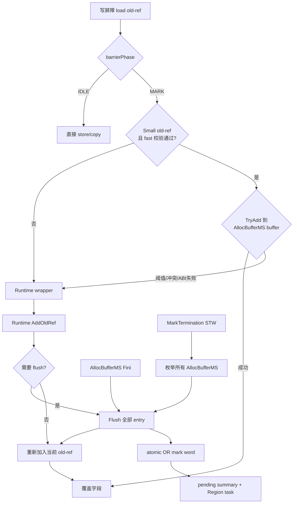

# Step63：MSGC 写屏障 TLS Bitmap Batch Runtime+LLVM 联动设计

## 0. 文档定位

本文给出 Region-scan MSGC 写屏障将 old-ref 对应的 bitmap 修改暂存在
`AllocBufferMS`、达到统一条件后批量提交的完整设计。

本文是设计规格，不表示代码已经实施。

固定代码范围如下，禁止与 Wbuf 工作区交叉引用：

- Region-scan Runtime：
  `/Users/lipeisheng/code/cangjie/cangjie/cangjie_runtime_region_mark/runtime`
- Region-scan LLVM：
  `/Users/lipeisheng/code/cangjie/cangjie/cangjie_compiler_region_mark/third_party/llvm-project`

本文以 2026-07-30 当前源码为基线。当前源码的重要事实是：

- Small Region 使用 `MSBitmapArena` 的连续 logical-word plane；
- Runtime barrier 使用栈上 `BarrierMarkContext + MSMarkWordBatch`；
- barrier 发布不再计算或累计 `cycleCompletedMarkWU_`；
- AArch64/X86 写屏障仅在 IDLE inline store/copy，MARK phase 回 Runtime wrapper；
- MarkTermination 已有 STW scheduler drain 和 pending Region reconciliation，
  但尚未枚举任何跨 barrier 调用存活的 TLS bitmap batch。

本文覆盖 `Step53` 中“单引用 barrier 不跨调用缓存”和“Bulk 返回前强制 flush”
这两条旧边界。`Step53` 当时没有跨调用 owner 生命周期、线程退出、epoch 和
MarkTermination 完整 drain 协议，因此采用保守作用域模型；本设计补齐这些协议后，
允许 scalar、Bulk 和 atomic 共用同一跨调用 batch。`Step53` 中未落地的 striped bitmap
不属于本设计，本设计继续使用当前连续 plane 布局。

## 1. 已确定的设计决策

本节记录本方案不可回退为旧作用域模型的已确认约束。

1. old-ref 对应的 Small Region bitmap mask 允许跨写屏障调用暂存在 owner-private
   buffer 中，不要求每个 barrier 返回前已经 OR 到全局 mark bitmap。
2. 普通 safepoint 和显式 saferegion 入口都不刷新 barrier buffer，也不调用任何
   barrier-buffer Runtime helper；publication 只由统一容量条件、owner 退出和
   MarkTermination STW 触发。
3. buffer 归属 `AllocBufferMS`，不直接内嵌进 `ThreadLocalData`，也不归属
   单个栈上 `BarrierMarkContext`。
4. 新建固定布局 POD 类型 `MSBarrierMarkBuffer`。Runtime 用 `static_assert`
   固定其大小和字段偏移，LLVM 在 `CJMSGCABI.h` 镜像相同常量。
5. LLVM AArch64/X86 MARK fast path 允许直接计算 Small old-ref 的
   `(wordKey, bitMask)` 并写入 `MSBarrierMarkBuffer`。
6. LLVM 不能完整处理、buffer 需要刷新、`AllocBufferMS == nullptr`、old-ref
   为 LARGE 或 Region 校验失败时，保留原 Runtime wrapper slow call。
7. Scalar、Bulk 和 atomic 不设置不同的“函数返回 flush”规则。Bulk 完成枚举后
   不调用 `FlushNow()`，尾部 entry 与 scalar 一样等待统一刷新条件。
8. Large Object 不进入 Small bitmap batch，继续走 Runtime canonical mark flag
   和 OBJECT task publication。
9. barrier buffer 的解析、提交和扫描工作不计算、不累计、不设置
   `cycleCompletedMarkWU_`。
10. buffer 不加入 scheduler task ledger；并发 Mark 允许在 TLS buffer 非空时
    进入 MarkTermination，最终正确性由 owner 退出 flush 和 STW 全量 drain 保证。

## 2. 当前源码基线

本节只描述当前 Region-scan Runtime 与 LLVM 源码，不采用 Wbuf 或历史文档中的旧实现。

### 2.1 Runtime barrier

当前 `src/Heap/MBarrier/MSMarkBarrier.cpp` 中：

```text
WriteRefField
  -> load oldRef
  -> BarrierMarkContext::AddOldRef(oldRef)
  -> BarrierMarkContext::Flush()
  -> store newRef
```

`BarrierMarkContext` 当前：

- 构造时通过 `barrierPhase + activeCollector_` 解析 mark owner；
- 第一次看到有效 old-ref 时在栈上构造 `MSMarkWordBatch`；
- `AddOldRef()` 调用 `AddManagedRefToMarkBatch()`；
- `Flush()` 调用 `FlushBarrierMarkBatch()`；
- 析构时要求 batch 已空。

Scalar 一次只加入一个 old-ref 后立即 flush。Bulk 能在单次 wrapper 内聚合多个
old-ref，但 `WriteStruct/WriteStaticStruct/CopyRefArray/CopyStructArray` 都在
`memcpy/memmove` 前显式 flush。

### 2.2 Runtime bitmap commit

当前 `src/Heap/MCollector/MarkSweepCollector.cpp` 已经具备可复用的 logical-word
提交语义：

```text
AddRefToMarkBatchImpl
  -> ResolveManagedMarkTarget
  -> SMALL: batch.Add(regionIdx, wordIdx, bitMask)
  -> LARGE: 立即设置 primary marked flag 并发布 OBJECT task

FlushMarkWordEntryImpl
  -> collect-set 情况下按 alloc plane 过滤空闲 slot
  -> relaxed probe 已标记 bit
  -> atomic_fetch_or(markWord, mask)
  -> newBits = mask & ~old
  -> HAS_REF: PublishPendingMarkWord + TryPublishRegion
```

barrier 路径使用 `MSNoopWorkUnitCounter`，因此不会更新
`cycleCompletedMarkWU_`。本设计保留这一点。

### 2.3 AllocBufferMS ownership

`AllocBufferMS` 是 per-OS-thread/per-P 对象：

- `ThreadLocalData::msAllocBuffer` 位于固定 TLS offset 88；
- `activeRegions_[36][2]` 从 `AllocBufferMS` offset 0 开始，共 576B；
- `AllocBufferMS::Init()` 将实例注册到
  `CentralRegionPool::msAllocBuffers_`；
- `CentralRegionPool::VisitAllocBufferMS()` 可在锁保护下枚举所有实例；
- `AllocBufferMS::Fini()` 在归还 Region 和注销前调用
  `MarkSweepCollector::NotifyAllocBufferExit()`。

这些现有能力使 `AllocBufferMS` 同时满足 fast-path TLS 可达性和 STW 全量枚举。

### 2.4 Mark cycle

当前一次 GC 的主要顺序是：

```text
PreEnumRoots
  -> activeCollector_ = this
  -> STW BuildCollectSet()
       -> currentMarkEpoch_ + 1
       -> publish currentMarkEpoch
  -> ClearAllMarkBitmaps()

EnumRoots
  -> phase = MS_MARK_SETUP

ConcurrentMark
  -> phase = MS_CONCURRENT_MARK

MarkTermination
  -> STW phase = MS_MARK_TERMINATION
  -> activeCollector_ = nullptr
  -> DrainSchedulerUnderSTW + pending Region reconciliation
  -> finalizer / resurrection / weak ref / verifier
  -> phase = IDLE
```

`MS_MARK_SETUP -> MS_CONCURRENT_MARK -> MS_MARK_TERMINATION -> IDLE`
只改变 phase，不改变 `currentMarkEpoch_`。epoch 只在下一轮
`BuildCollectSet()` 前进。

### 2.5 LLVM

当前 `AArch64MSGCEmitter.cpp` 和 `X86MSGCEmitter.cpp` 的写屏障行为是：

```text
load CJ_MRT_MSGCFastPathState.barrierPhase
  -> 0: inline store/memcpy/memmove
  -> nonzero: call existing Runtime wrapper
```

因此当前 LLVM 不解析 Small old-ref，也不直接修改 mark bitmap。本文设计需要重新
增加 MARK fast insertion，但提交对象改为 TLS `MSBarrierMarkBuffer`，不是立即
atomic OR mark bitmap。

## 3. 目标、非目标与核心不变式

本节定义优化目标、明确不处理的范围，并给出 SATB、epoch 和终止协议必须保持的条件。

### 3.1 目标

- 让 scalar barrier 能跨调用合并同一 bitmap word 的多个 bit。
- 让 Bulk 和 scalar 使用同一缓存、相同阈值和相同 flush 协议。
- 将多次 Small mark bitmap atomic RMW 合并为一次 word-level RMW。
- 降低 `PublishPendingMarkWord()` 和 `TryPublishRegion()` 调用频率。
- 在 MARK phase 的常见 Small old-ref 路径中避免每次调用 Runtime wrapper。
- 保持 Runtime 与 AArch64/X86 对 buffer 布局、hash、阈值和回退规则一致。

### 3.2 非目标

- 不修改 CopyGC/Wbuf。
- 不修改 mark/alloc/scan plane 的连续布局。
- 不把 Large Object 放入 Small bitmap buffer。
- 不让 GC helper 并发读取或窃取正在运行的 owner-private buffer。
- 不用 TLS pending 数量参与 scheduler ledger 或自然终止判断。
- 不重新引入 barrier WorkUnit 统计。
- 不在本步骤修改分配器 active Region 算法、Sweep 或 `freeSlotCount` 方案。

### 3.3 核心不变式

必须同时保持以下条件：

1. **old-before-overwrite**

   old-ref 的 coordinate mask 必须成功进入 owner-private buffer，或者已经由
   Runtime 立即提交，之后才能覆盖字段。

2. **termination-before-liveness**

   MarkTermination 必须在 finalizer 分类、WeakRef 清理、完整性校验和 Sweep
   publication 前 drain 所有 `AllocBufferMS` barrier buffer，并重新完成标记闭包。

3. **no-cross-epoch**

   非空 buffer 不能跨 `currentMarkEpoch_`。新 epoch 建立时只允许检查空 buffer
   并重置元数据，禁止把旧 entry 提交到新 bitmap。

4. **single owner**

   mutator 运行时只有所属 OS 线程读写 buffer；普通 safepoint 不读取 buffer。
   owner 退出路径由 owner 自己 flush，GC 只在 MarkTermination STW 后全量读取。

5. **global winner**

   TLS 内允许不同线程缓存同一个 bit。最终仍以全局 mark word 的
   `atomic_fetch_or` 返回值决定 `newBits` 和 scheduler publication。

6. **uniform policy**

   scalar、Bulk 和 atomic 只因 old-ref 类型或操作语义不同而选择 Add 路径，
   不因 wrapper 边界不同而增加额外 flush。

## 4. 总体架构

本节描述 old-ref 从 LLVM/Runtime barrier 进入 `AllocBufferMS` 私有 batch，
再由阈值/冲突、线程退出和 MarkTermination 提交的完整数据流。



### 4.1 Owner

每个 `AllocBufferMS` 内嵌一个 `MSBarrierMarkBuffer`：

```text
ThreadLocalData
  +88: AllocBufferMS*
          +0:   activeRegions_[36][2]
          +576: MSBarrierMarkBuffer
          +1104: Runtime-only fields
```

LLVM 只在当前 OS 线程拥有该 `AllocBufferMS` 时写 buffer。GC main 不在并发
Mark 中读取 buffer 内容，只在 STW 中通过 `VisitAllocBufferMS()` 枚举。

### 4.2 Publication 分层

本设计把 publication 分为两层：

```text
第一层：old-ref mask 写入 owner-private MSBarrierMarkBuffer
第二层：Runtime flush 后写入全局 mark bitmap 并发布 scheduler work
```

第一层完成即可允许字段覆盖，因为 pending mask 已经成为 GC 可在
MarkTermination STW 枚举的持久记录。第一层不是 scheduler 可见工作，因此最终终止不能只检查
`OutstandingHint()` 和 pending Region summary。

### 4.3 无 AllocBufferMS 的处理

`ThreadLocalData::msAllocBuffer == nullptr` 时不得在 LLVM 中解引用，也不要求
写屏障为了缓存而分配 native 对象。该操作完整回 Runtime wrapper：

- Runtime 可以直接用临时 batch 立即提交当前 old-ref；或者
- 若后续确认所有 managed mutator 在执行屏障前都已创建 `AllocBufferMS`，
  再统一改为创建/取得 owner buffer。

第一版采用“null 即立即提交”的保守行为，避免写屏障中出现 native allocation、
注册表锁和分配失败路径。

## 5. 固定布局 MSBarrierMarkBuffer

本节定义 Runtime POD 布局、`AllocBufferMS` 内偏移，以及 LLVM
`CJMSGCABI.h` 必须镜像的常量。

### 5.1 Runtime POD

建议新增：

`src/Heap/MBarrier/MSBarrierMarkBuffer.h`

```cpp
struct alignas(8) MSBarrierMarkEntry {
    uint64_t wordKey;       // +0, (regionIdx << 6) | logicalWordIdx
    uint64_t mask;          // +8
};                          // sizeof = 16

struct alignas(8) MSBarrierMarkBuffer {
    // entries first: with a 64B-aligned AllocBufferMS, each 4-way set is one
    // complete cache line instead of straddling two lines.
    MSBarrierMarkEntry entries[32];     // +0, 512B
    uint32_t markEpoch;                 // +512
    uint32_t occupancy;                 // +516, bit i => entries[i] valid
    uint32_t pendingBitCount;           // +520, unique pending old-ref bits
    uint8_t lastEntry;                  // +524, 0..31 or 0xff
    uint8_t reserved[3];                // +525
};                                      // sizeof = 528
```

该结构必须保持 standard-layout、trivially copyable，不包含构造函数、析构函数、
虚函数、模板成员、指针或平台相关字段。操作函数放在独立 inline helper 或
collector 中，不能把 C++ 实现细节变成 LLVM ABI。

字段语义：

| 字段 | 作用 |
|---|---|
| `markEpoch` | 非空 entry 所属的 `currentMarkEpoch` |
| `occupancy` | 32 个固定 slot 的有效位，是 entry 有效性的唯一真值 |
| `pendingBitCount` | 上次 flush 后新增的 unique pending bit 数，最大 128 |
| `lastEntry` | 上一次命中的 entry，下次优先探测；`0xff` 表示无 |
| `entries[i]` | 一个 `wordKey -> pending mask` |

其中：

```cpp
wordKey = (static_cast<uint64_t>(regionIdx) << 6) | logicalWordIdx;
regionIdx = wordKey >> 6;
logicalWordIdx = wordKey & 63;
```

采用一个 64 位 `wordKey` 而不是 `regionIdx + wordIdx + padding`，有三个收益：

- LLVM key 比较只需一次 64 位比较；
- mark word 地址可直接按 `markPlaneBase + wordKey * 8` 形成；
- Runtime flush 可从 key 无损恢复 Region 和 word，不在 entry 中保存指针。

`entryCount` 不进入固定布局。一个新 key 只能进入其目标 set；若该 set 四个 way
都有效，就已经是冲突 slow path。因此“全局 32 entry 已满”不需要单独计数，
Debug 一致性检查使用 `popcount(occupancy)` 即可。

### 5.2 AllocBufferMS 固定前缀

当前 `activeRegions_[36][2]` 占用：

```text
36 * 2 * 8 = 576B
```

让 `AllocBufferMS` 本体 64B 对齐，并将 `barrierMarkBuffer_` 放在固定前缀之后：

```cpp
class alignas(64) AllocBufferMS {
MSRegionInfo* activeRegions_[36][2];  // +0, 576B
MSBarrierMarkBuffer barrierMarkBuffer_; // +576, 528B
// Runtime-only fields start at +1104
};
```

`576` 是 64 的整数倍；只要 `AllocBufferMS` 基址 64B 对齐，
`barrierMarkBuffer_.entries[set * 4]` 就必然从 cache-line 边界开始。不要把
`MSBarrierMarkBuffer` 自身声明为 `alignas(64)`，否则 C++ 会把其 `sizeof` 从
528B 向上补齐为 576B。

需要增加 Runtime 断言：

```cpp
static_assert(alignof(AllocBufferMS) == 64, "compiler/cache ABI");
static_assert(offsetof(AllocBufferMS, activeRegions_) == 0, "compiler ABI");
static_assert(offsetof(AllocBufferMS, barrierMarkBuffer_) == 576, "compiler ABI");
static_assert(sizeof(MSBarrierMarkEntry) == 16, "compiler ABI");
static_assert(offsetof(MSBarrierMarkBuffer, entries) == 0, "compiler ABI");
static_assert(offsetof(MSBarrierMarkBuffer, markEpoch) == 512, "compiler ABI");
static_assert(sizeof(MSBarrierMarkBuffer) == 528, "compiler ABI");
```

`ThreadLocalData` 不增加字段，`msAllocBuffer` 继续保持 offset 88。构造/销毁测试
还必须检查普通和 `nothrow` aligned-new 路径返回的实例地址满足 64B 对齐。

### 5.3 LLVM 镜像

`llvm/include/llvm/CodeGen/CJMSGCABI.h` 增加：

```cpp
inline constexpr int64_t MSGCBarrierBufferOffsetInAllocBuffer = 576;
inline constexpr int64_t MSGCBarrierBufferEntriesOffset = 0;
inline constexpr int64_t MSGCBarrierBufferEpochOffset = 512;
inline constexpr int64_t MSGCBarrierBufferOccupancyOffset = 516;
inline constexpr int64_t MSGCBarrierBufferPendingBitCountOffset = 520;
inline constexpr int64_t MSGCBarrierBufferLastEntryOffset = 524;
inline constexpr int64_t MSGCBarrierBufferEntryWordKeyOffset = 0;
inline constexpr int64_t MSGCBarrierBufferEntryMaskOffset = 8;
inline constexpr int64_t MSGCBarrierBufferEntryStride = 16;
inline constexpr int64_t MSGCBarrierBufferSize = 528;
inline constexpr unsigned MSGCBarrierBufferCapacity = 32;
```

Runtime contract test 必须编译上述布局并与 LLVM 常量文本/生成测试交叉校验。

### 5.4 Capability signature

新 LLVM 直接写 `AllocBufferMS + 576`，因此必须识别 Runtime 是否支持该 ABI。
复用当前 `CJ_MRT_MSGCFastPathState.reservedAbi`：

```cpp
constexpr uint64_t kMSBarrierMarkBufferAbiV3 =
    UINT64_C(0x4D53424203100240);
// "MSBB" + layout version 3 + entry size 16 + buffer offset 0x0240
```

`reservedAbi` 继续发布该值，用于启动期诊断和 ABI contract。热路径不应在每个
barrier 再做一次 64 位 signature load/compare；改用 versioned phase byte：

```text
barrierPhase = 0  IDLE
barrierPhase = 1  MARK_WRAPPER_ONLY
barrierPhase = 2  MARK_TLS_BATCH_V3
```

新 LLVM 只有观察到 `MARK_TLS_BATCH_V3` 才直接访问 buffer，其他非零值都回原
wrapper。旧 LLVM 对任何非零值本来就回 wrapper，因此新 Runtime 发布值 2 不会
让旧代码错误访问布局；新 LLVM 搭配旧 Runtime 值 1 也会安全回退。这样一次 phase
load 同时完成 phase 与 capability gate。

`barrierPhase` 的非零 fast 值本身就是热路径 wire-version。任何不兼容布局都必须
分配新的 phase 值（例如未来 V4 使用 3）和新 signature；V3 LLVM 看到 3 时会回
wrapper。不得继续发布值 2 后原地调整 offset、entry size、capacity 或 hash
语义。当前源码没有“Runtime 在启动时获知每个已编译模块期望 signature”的注册
握手，因此 `reservedAbi` 只能用于 SDK contract/诊断，不能虚构成 Runtime 可自动
识别任意旧目标文件；真正的运行期隔离依靠 versioned phase。

## 6. Buffer 查找、合并与统一刷新条件

本节定义 32-entry、8-set、4-way 的查找方式，以及标量、Bulk、atomic
共同使用的刷新条件。

### 6.1 Entry 容量与 oldRef 上限的关系

32-entry 表示最多缓存 32 个不同的 bitmap logical word，不是 32 个 old-ref。
一个 entry 的 64 位 mask 最多合并同一 word 内 64 个对象：

```text
old-ref slot 3、7、12
  -> 同一 wordKey
  -> mask = bit(3) | bit(7) | bit(12)
  -> flush 时一次 atomic_fetch_or
```

`entryCapacity` 与 `oldRefFlushThreshold` 不是一一相等，但必须按预期的
“不同 bitmap word / 有效 oldRef”比例配套设计：

```text
distinctWordRatio = 新建 word entry 数 / 有效 oldRef 数
```

- 最理想的密集情况：128 个 oldRef 只落到约 2 个 logical word；
- 高重复图：128 个 oldRef 可能只占少量 entry；
- 随机图引用：128 个 oldRef 最坏可以对应 128 个不同 word。

因此任何有限 mask cache 都不能覆盖最坏随机情况。容量的目标不是无条件保存所有
oldRef，而是在合理空间内覆盖常见局部工作集。16-entry 配 1024 oldRef 上限的比例为
1:64，只覆盖极高局部性的理想情况，实际会被 set 冲突或容量提前打断；32-entry 配
128 oldRef 上限的比例为 1:4，更适合作为第一版。

### 6.2 内存占用

单个 entry 固定为 16B：

```text
32 entries * 16B = 512B
buffer header       = 16B
合计                = 528B / AllocBufferMS
```

这里不需要为 128 个 oldRef 分别保存 8B 指针；`pendingBitCount=128` 只是触发阈值，
实际保存的是最多 32 个 word mask。

按 registered `AllocBufferMS` 数量估算新增常驻 native 内存：

| AllocBufferMS 数量 | 新增内存 |
|---:|---:|
| 8 | 4,224B，约 4.1KiB |
| 32 | 16,896B，约 16.5KiB |
| 64 | 33,792B，约 33.0KiB |
| 100 | 52,800B，约 51.6KiB |
| 128 | 67,584B，约 66.0KiB |
| 150 | 79,200B，约 77.3KiB |

以上是 `MSBarrierMarkBuffer` 的净增量，不包含 `AllocBufferMS` 已有的
`activeRegions_`、root staging 和 pacing 字段。buffer 自身仍按 8B 对齐、大小
528B；`AllocBufferMS` 基址改为 64B 对齐可能给整个对象增加最多 63B 的尾部 padding
或分配器对齐开销，但不把每个 buffer 扩成 576B。验收时应同时报告
`sizeof(AllocBufferMS)` 的实际增量。

### 6.3 Set-associative 查找

使用 8 set、每 set 4 way：

```cpp
regionIdx = wordKey >> 6;
wordIdx = wordKey & 63;
set = (regionIdx ^ (wordIdx * 5U)) & 7U;
firstSlot = set * 4;
```

探测顺序：

1. `lastEntry` 有效且 `entry.wordKey == wordKey`：直接处理；
2. occupancy 只加载一次，提取目标 set 的 4-bit nibble；
3. nibble 为零时直接选择该 set 的第一个 way；
4. 否则只对 nibble 中有效的 way 比较 `wordKey`；
5. key miss 后用 nibble 找空 way；
6. nibble 为 `0xf` 且 key 全不同时进入冲突 slow path。

entry 初始化时写入 key/mask 后再一次性 OR occupancy；不要为四个 way 重复读取
header。X86 可用 bit-test/`tzcnt` 类选择，AArch64 可用 nibble mask/`rbit+clz`
类选择；若这些指令导致目标或 feature 约束复杂，四路固定分支仍是正确基线。

key 命中后先计算：

```cpp
newLocalBit = bitMask & ~entry.mask;
```

`newLocalBit == 0` 表示该 old-ref 已经可靠暂存，直接返回，不增加计数，也不访问
全局 mark plane。这一点对 atomic CAS 重试尤其重要：重复 expected 值不会因为
重复计数而频繁触发 flush。

不允许直接覆盖有效 entry。若选择 victim eviction，覆盖前必须先提交 victim，
否则 victim.mask 代表的 old edge 会永久丢失。当前栈上 `MSMarkWordBatch` 正是
通过回调先 flush victim 再复用 slot。

新 TLS 方案第一版不采用逐 victim flush：LLVM 发生 set 冲突时本来就必须进入
Runtime，Runtime 一次全量 flush 所有 occupied entry 后再加入当前 oldRef。
这样一次 slow call 可以摊销多个 bitmap word，避免低局部性下出现“一次冲突、
一次 Runtime call、只提交一个 victim”的调用风暴。代价是其他 entry 也会比
理论最晚时机更早提交，这是性能权衡，不影响最终标记集合。

hash 公式是 hidden ABI。Runtime 和 LLVM 必须共享相同 set/way/capacity；
修改公式时提升 capability signature version。

当前 hash 只使用 `regionIdx/wordIdx` 的低位。若 profile 显示 Region index 相差
8 的对象或 word index 相差 8 的对象形成系统性冲突，可评估加入高位 XOR fold；
不要只在 Runtime 单边改 hash。指标至少记录每个 set 的 insert/conflict 分布。

### 6.4 本地优先与全局 mark probe

LLVM/Runtime Add 的基础顺序是：

```text
解析 old-ref -> wordKey/bitMask
  -> lastEntry / 目标 set 本地探测
       -> exact bit 已 pending：直接成功
       -> key 命中但 bit 新增：可以直接本地合并
  -> 新 key 在占用 entry 前做全局 mark probe
       -> 已全局 marked：直接成功，不占 entry
  -> pendingBitCount/冲突检查
  -> merge 或 insert
```

不能在每次 Add 一开始就先取全局 mark bitmap。按本地优先排列后，同一 logical
word 的连续写只访问 owner-private cache；只有新 key 才从已经用于 phase gate 的
`MSGCFastPathState*` 读取 `markPlaneBase`。若 key 已在本地、只是加入一个新 bit，
直接 OR 到本地 mask 通常比访问共享 mark plane 更便宜，而且不增加 entry 压力。

全局 probe 是 relaxed load，不是 CAS/RMW。第一版对“新 key”保留它，因为当前
Runtime 注释和实现都表明 shared/cyclic graph 的“已被其他边标记”命中很常见，
新 key 命中时还能避免占用 entry 和触发冲突。对“已有 key 的新 bit”默认不 probe，
把它留给批量 `fetch_or` 去重。

该策略不影响正确性，可以按实测切换为以下三档：

| 策略 | 每次 Add 的共享 bitmap load | buffer 压力 | 适用情况 |
|---|---:|---:|---|
| 所有本地非 exact bit 都 probe | 较多 | 最低 | 全局已标记命中率极高 |
| 仅新 key probe（推荐首版） | 中等 | 中等 | 兼顾热路径和 entry 利用率 |
| 完全不 probe | 最少 | 最高 | mark plane cache miss 很昂贵 |

必须用 `barrierGlobalProbeLoads/barrierGlobalMarkedHits`、本地 key-hit 和冲突率共同
决定，不能只看 global hit 数；命中率低但每次都访问冷 mark cache line 仍可能劣化。

### 6.5 Pending bit 计数阈值

初始常量：

```cpp
kMSBarrierBufferPendingBitFlushThreshold = 128;
```

`pendingBitCount` 只统计第一次进入 buffer 的 unique old-ref bit：

- 新建 entry：加一；
- 同 word 合并一个此前不存在的新 bit：加一；
- exact bit 已在本地 pending：不加；
- 全局 mark probe 已经命中、null、非 heap：不加；
- LARGE 立即处理：不加。

尝试加入一个 `newLocalBit` 前若 `pendingBitCount >= 128`，Runtime 先 flush
全部 entry，再加入当前 old-ref。该阈值把每个 owner 在终止前最多暂存的 unique
old-ref 数限制在 128；重复 barrier/CAS retry 不需要人为推动 publication。

阈值是性能协议而不是 liveness 协议。Runtime 与 LLVM 使用不同阈值不会直接漏标，
但会造成路径和测试漂移，因此仍应在 `CJMSGCABI.h` 统一定义并由 contract test
约束。

### 6.6 统一 flush 条件

Scalar、Bulk 和 atomic 全部使用以下条件：

| 条件 | 行为 |
|---|---|
| 准备加入新 unique bit 且 `pendingBitCount` 已为 128 | 全量 flush，再加入当前 old-ref |
| 目标 set 的 4 way 冲突 | 全量 flush，重新加入当前 old-ref |
| `AllocBufferMS::Fini()` | 注销前 flush |
| MarkTermination STW | 枚举并 flush 全部 registered `AllocBufferMS` |
| Runtime/heap teardown | 清理 bitmap arena 前 assert/flush |
| Debug 强制验证点 | 可显式 flush 并检查为空 |

下列事件不是 flush 条件：

- scalar wrapper 返回；
- Bulk 枚举完成或 `memcpy/memmove` 即将执行；
- atomic 操作成功返回；
- 遇到 LARGE old-ref；
- scheduler 的并发 `OutstandingHint()` 暂时为零；
- MARK_SETUP、CONCURRENT_MARK 之间的普通 phase 切换。

### 6.7 Flush 后状态

同一 mark epoch 内 flush 后：

```text
occupancy = 0
pendingBitCount = 0
lastEntry = 0xff
markEpoch 保持当前 epoch
```

entry 内旧 key/mask 可以不清零，因为 occupancy 是有效性真值；Debug/ASAN 构建
可选择清零以便检查。mark cycle 完成后再把 `markEpoch` 重置为
`NO_COLLECT_EPOCH`。

## 7. Runtime 设计

本节定义 `BarrierMarkContext`、collector 提交接口、普通 safepoint 非介入规则、
`AllocBufferMS` 生命周期和 MarkTermination 收尾顺序。

### 7.1 BarrierMarkContext

`BarrierMarkContext` 保留，但变成非 owning、非 flushing 的轻量句柄：

```cpp
class BarrierMarkContext {
public:
    BarrierMarkContext();
    void AddOldRef(BaseObject* ref);

private:
    MarkSweepCollector* collector_;
    AllocBufferMS* allocBuffer_;
    MSBarrierMarkBuffer* buffer_;
};
```

构造时只做一次：

- acquire 读取 barrier phase；
- 解析 `activeCollector_`；
- 读取当前 `ThreadLocalData::msAllocBuffer`；
- 若存在，取得其中的 `barrierMarkBuffer_`。

析构函数不 flush，也不检查 buffer 为空。删除栈上 aligned storage、
`batchInitialized_`、`GetOrCreateBatch()` 和当前 `Flush()` 接口。

Bulk 继续在函数入口构造一个 context，并在 old-ref 枚举循环中重复
`AddOldRef()`，从而避免 per-ref phase/TLS 查找；枚举完成后直接执行 copy，
不调用 `FlushNow()`。

### 7.2 Collector API

新增职责明确的接口：

```cpp
void AddManagedRefToBarrierBuffer(
    BaseObject* ref, MSBarrierMarkBuffer& buffer);

void FlushBarrierMarkBuffer(MSBarrierMarkBuffer& buffer);

void FlushAllBarrierMarkBuffersUnderSTW(CentralRegionPool& central);
```

`AddManagedRefToBarrierBuffer()`：

1. 解析 old-ref；
2. LARGE 继续立即 mark/publish；
3. SMALL 形成 `(wordKey, bitMask)`；
4. 先做 `lastEntry + set` 本地探测，exact pending bit 直接返回；
5. 已有 key 的新 bit 直接合并；新 key 在占用 entry 前做 relaxed global mark
   probe；
6. 校验/初始化 buffer epoch；
7. 根据 unique-bit 阈值和 set 冲突决定是否先 flush；
8. 将 `(wordKey, bitMask)` merge/insert 到 buffer。

`FlushBarrierMarkBuffer()`：

1. 空 buffer 立即返回；
2. 检查 `buffer.markEpoch == currentMarkEpoch`；
3. 一次读取 alloc/mark plane base；
4. 遍历 occupancy；
5. 从 `wordKey` 恢复 `regionIdx/wordIdx`；
6. collect-set entry 用 stable alloc word 过滤空闲 slot；
7. 对每个不同 mark word 做 probe 和 `atomic_fetch_or`；
8. 将 `newBits` 非零的 HAS_REF word 按 Region 聚合为 `pendingWordsMask`；
9. 每个 Region 只做一次 pending-summary OR 和一次 `TryPublishRegion()`；
10. 清空 occupancy/pendingBitCount/lastEntry。

该路径使用 no-op WorkUnit policy，不访问 `cycleCompletedMarkWU_`。

当前源码的 `FlushMarkWordEntryImpl()` 是每个 word 分别
`PublishPendingMarkWord + TryPublishRegion`。TLS batch 最多有 32 个 word，若多个
word 属于同一 Region，逐 word publication 会重复执行 pending-summary 原子 RMW
和 scan-state CAS。建议新增：

```cpp
void PublishPendingMarkWords(uint64_t wordMask);
```

flush 先完成所有 mark-word winner 竞争，再按 Region 合并 publication。这不会减少
不同 mark word 必需的全局 `atomic_fetch_or`，但能把后续竞争从“每 word 一次”
降低到“每 Region 一次”。

聚合是 flush 冷路径，不应把额外状态塞进固定 TLS ABI。实现可以使用最多 32 项的
栈上临时 `{regionIdx, pendingWordsMask}` 数组线性合并，或者在消费 entry 时复用
其 storage；两种方式都只用普通内存。先以简单、可验证的线性合并实现，只有 profile
证明 flush 的 Region 聚合本身成为热点时再引入排序或第二级 hash。

### 7.3 普通 safepoint 不刷新

以下路径都不访问、不检查、不刷新 `MSBarrierMarkBuffer`：

- `HandleSafepoint(ThreadLocalData*)`；
- `HandleSafepointForArm(ThreadLocalData*)`；
- `DoEnterSaferegion()`；
- 普通 safepoint poll；
- managed/native execution 的常规切换。

因此不新增 `FlushCurrentBarrierMarkBufferAtSafepoint()`，也不修改
`MutatorManager`/`Mutator` 的 safepoint 热路径。普通 safepoint 只承担现有线程
停止和 phase 同步职责，不承担 barrier work publication。

线程到达 safepoint 后 buffer 可以继续保持非空。MarkTermination 必须等待世界
停止，再通过 `CentralRegionPool::VisitAllocBufferMS()` 枚举全部 registered
buffer；已经处于 saferegion 的线程同样由这次 STW 注册表枚举覆盖。

### 7.4 AllocBufferMS 生命周期

`AllocBufferMS::Init()`：

- 将 `barrierMarkBuffer_` 初始化为空；
- `markEpoch = NO_COLLECT_EPOCH`；
- 然后注册到 `CentralRegionPool`。

`AllocBufferMS::Fini()`：

```text
NotifyAllocBufferExit
  -> active collector 存在：flush buffer
  -> active collector 不存在：要求 buffer 为空
ReturnAllRegionsToCentral
RemoveAllocBufferMS
销毁其他 Runtime-only 资源
```

不能先从注册表删除再处理 pending entry，也不能在 collector 为 null 时静默丢弃
非空 buffer。

### 7.5 MarkTermination

当前顺序需要调整为：

```text
ScopedStopTheWorld(MS_MARK_TERMINATION)
  -> 所有 mutator 已停止
  -> VisitAllocBufferMS
       -> FlushBarrierMarkBuffer(each)
  -> Debug assert 所有 barrier buffer 为空
  -> activeCollector_ = nullptr
  -> DrainSchedulerUnderSTW()
  -> pending Region reconciliation fixed point
  -> finalizer classification
  -> resurrection closure
  -> WeakRef
  -> mark completeness verifier
  -> phase = IDLE
```

STW flush 必须发生在普通 closure drain 和 finalizer 分类之前。GC 等待 mutator
停止期间不会由普通 safepoint 发布 barrier work；世界停止后，注册表 flush 一次性
提交所有 owner 的剩余 entry，之后 fixed-point drain 消费新产生的 Region task。

### 7.6 下一轮 PreEnum

下一轮 `BuildCollectSet()` 前所有 buffer 必须为空。PreEnum STW 增加：

```text
VisitAllocBufferMS
  -> CHECK occupancy == 0
  -> CHECK pendingBitCount == 0
  -> reset markEpoch/lastEntry
Build/发布新 epoch 或在现有顺序中取得新 epoch
```

具体 reset 可以放在 `BuildCollectSet + ClearAllMarkBitmaps` 的同一 STW 临界区，
但不能把旧 epoch entry flush 到已经清零的新 mark plane。

## 8. LLVM 设计

本节定义 AArch64/X86 MARK 快路径直接写 TLS batch 的规则、失败回退，
以及 wrapper/statepoint 边界。

### 8.1 公共 lowering 保持不变

前端 intrinsic 和六个 MSGC wrapper 名称保持不变。`CJBarrierLowering` 仍只负责
根据 `Cangjie_GCMode` 选择 MSGC wrapper，不在公共 LLVM IR 中展开
Region/TLS/buffer 算法。

最终发码继续位于：

- `llvm/lib/Target/AArch64/AArch64MSGCEmitter.cpp`
- `llvm/lib/Target/X86/X86MSGCEmitter.cpp`

### 8.2 MARK scalar fast insertion

Ref/StaticRef 的目标语义：

```text
1. acquire/TSO load barrierPhase
2. IDLE: 原 store
3. MARK_WRAPPER_ONLY/未知非零值：原 wrapper
4. MARK_TLS_BATCH_V3:
   a. load old-ref
   b. old == new/null/non-heap -> store 或相应快出
   c. 从当前 TLS 读取 msAllocBuffer
   d. 解析 Region/Small slot，形成 wordKey/bitMask
   e. 先探测本地 buffer，再按需 probe 全局 mark word
   f. 尝试写 MSBarrierMarkBuffer
   g. 成功后 store new-ref
   h. 任一步失败则在 store 前调用原 wrapper
```

解析 Small coordinate 至少需要镜像并校验：

- heap reserved start/end；
- Region size 32KB；
- `MSRegionInfo` 大小 64B；
- RegionInfo array；
- Region kind/layout；
- `sizeClass` 和 36 档 slot size/div-magic；
- `regionEnd`/regionOffset；
- mark plane base 和 512B per-Region plane stride。

LLVM 不能在 emitter 内生成硬件整数除法来计算 slot。应在 `CJMSGCABI.h` 固定一个
紧凑 size-class descriptor，并由 AArch64/X86 共用同一份数值：

```cpp
struct MSGCMarkSizeClassDesc {
    uint32_t divMagic;
    uint16_t slotSize;
    uint16_t totalSlots;
};
```

可由 compiler 在模块只读区发出一次，或由 Runtime 通过新增稳定 C ABI pointer
发布；两种方式只能选一种。第一版优先复用当前 emitter 已有的 size-class table
发射设施并扩展 `divMagic/totalSlots`，避免每个 callsite 复制 36 档 compare-chain。
当前只读表只有 allocation 使用的 `size -> class` 和 `class -> slotSize`；需要新增
36 项、每项 8B 的 mark descriptor table，共 288B/module。即使模块没有 dynamic
allocation、只含 direct MARK barrier，也必须由独立的“mark descriptor needed”
标志保证该表被发出，不能错误依赖现有 `MSGCDynamicTablesNeeded`。

只有精确落在已分配 Small slot 起始地址的 old-ref 才能进入 cache。FREE、
SPAN、LARGE、未知 layout、错误 size class、未对齐 slot 全部回 wrapper。

collect-set 中的空闲位由 Runtime flush 使用 stable alloc plane 最终过滤。
OUTSIDE_SET old-ref 在 cache 前必须保持当前 Runtime 对有效对象/TypeInfo 的校验
等价性；若目标 emitter 不能低成本证明，回 wrapper，不得放宽为任意 heap 地址。

第一版推荐只 direct 处理 `info.collectEpoch == currentMarkEpoch` 的 collect-set
Small 对象，OUTSIDE_SET 直接回 wrapper，由 Runtime 完成 TypeInfo 校验。理由是：

- `collectEpoch` 与刚读取的 `sizeClass/layout` 位于同一 64B RegionInfo cache line；
- `currentMarkEpoch` 与 phase 位于同一 64B `MSGCFastPathState`；
- 这样不需要把对象头/TypeInfo 访问规则再扩成一套 LLVM ABI；
- collect-set 是并发标记主要对象集合，首版覆盖率通常足够。

exact local pending bit 或 global marked bit 已经是可靠记录，可以在该分支前快出。
后续若指标证明 OUTSIDE_SET wrapper 占比高，再增加与 Runtime 完全一致的 TypeInfo
校验 direct path；不能只凭 slot 对齐就缓存任意 OUTSIDE_SET 地址。

### 8.3 Buffer fast add

LLVM fast add 只允许 owner-private 普通 load/store：

```text
if occupancy == 0:
    buffer.markEpoch = currentMarkEpoch
    buffer.lastEntry = 0xff

epoch = buffer.markEpoch
wordKey = (regionIdx << 6) | wordIdx
先检查 lastEntry，再检查目标 set 的 four ways

exact-bit-pending:
    goto overwrite

local key match/new bit:
    if info.collectEpoch != epoch:
        goto wrapper
    if pendingBitCount >= 128:
        goto wrapper
    entry.mask |= bitMask
    pendingBitCount++
    lastEntry = selected entry
    goto overwrite

new key:
    if global mark bit 已置位:
        goto overwrite
    if info.collectEpoch != epoch:
        goto wrapper
    if pendingBitCount >= 128:
        goto wrapper
    if four-way conflict:
        goto wrapper
    先写 wordKey/mask，再设置 occupancy bit
    pendingBitCount++
    lastEntry = selected entry
    goto overwrite
```

非空 buffer 不在每次 Add 重读全局 `currentMarkEpoch`，直接使用
`buffer.markEpoch` 与目标 Region 的 `collectEpoch` 比较。epoch 只会在 STW
`BuildCollectSet()` 推进，而上一轮 MarkTermination 已要求所有 buffer 为空；
若该不变式被破坏，Runtime flush/PreEnum 的 fatal consistency check 负责发现，
不在 LLVM 热路径重复支付全局 epoch load。

entry 内容必须在 occupancy bit 之前写完。虽然 owner 运行时没有并发消费者，
该顺序仍是 MarkTermination STW 读取协议的一部分。

### 8.4 Slow wrapper

所有 fast insertion 失败都复用原 wrapper slow call。wrapper 已改为使用同一个
`AllocBufferMS::barrierMarkBuffer_`：

- threshold/冲突时先全量 flush，再插入当前 old-ref；
- LARGE 立即处理，已有 Small pending entry 保留；
- 无 `AllocBufferMS` 时使用立即提交 fallback；
- 完成 old-ref capture 后执行原 store/copy/atomic。

不要求 emitter 生成一个新的任意 Runtime flush call。这样保留原 wrapper 的
calling convention、statepoint、stackmap 和参数映射。

### 8.5 各类 LLVM 屏障覆盖边界

“共用同一个 TLS buffer”与“全部在 LLVM 直接插入 buffer”是两件不同的事：

| 屏障类别 | 当前 LLVM inline | V3 第一版 MARK | 是否共用持久 buffer |
|---|---|---|---|
| Ref | IDLE store | collect-set Small 直接 TLS fast-add | 是 |
| StaticRef | IDLE store | collect-set Small 直接 TLS fast-add | 是 |
| Struct | IDLE memcpy | 仅 descriptor 可静态证明且很短时 direct；否则 wrapper | 是 |
| StaticStruct | IDLE memcpy | constant/short GCTib 可 direct；否则 wrapper | 是 |
| gcwrite.generic | 已归一化到 Struct wrapper | 按 Struct 规则 | 是 |
| ArrayCopyRef | IDLE memmove | wrapper | 是 |
| ArrayCopyStruct | IDLE memmove | wrapper | 是 |
| AtomicWrite/Swap/CAS | 部分只有 IDLE IR fast path | wrapper | 是 |
| Assign/CopyGeneric 等动态入口 | Runtime 分类 | Runtime | 最终经 WriteStruct/Copy 路径共用 |

所以答案不是“六类现有 inline wrapper 都立刻展开 MARK TLS 逻辑”。第一版只把
Ref/StaticRef 作为无循环、无动态 descriptor 的可靠 target-inline 路径；其余
wrapper 虽然仍调用 Runtime，但 Runtime 的 `BarrierMarkContext` 必须落到同一个
`AllocBufferMS::barrierMarkBuffer_`，函数结束不 flush。

### 8.6 Struct/Bulk fast path

Struct/StaticStruct 对编译器可解析的 ref descriptor 逐个执行同一 fast-add。
中途任意 old-ref 回退时：

```text
已经加入 TLS buffer 的 mask 保留
  -> 调用原 struct wrapper
  -> wrapper 重新枚举整个被覆盖范围
  -> 重复 bit 在 TLS mask 或最终 atomic winner 中去重
  -> wrapper 完成 copy
```

不能在 partial fast path 中先执行任何目标内存覆盖。

ArrayCopyRef/ArrayCopyStruct 第一版继续在 MARK phase 回 wrapper；Runtime bulk
枚举使用持久 buffer，并且函数返回前不特殊 flush。

Atomic barrier 第一版同样继续回 Runtime，避免在 target emitter 中复制 CAS
成功/失败和 memory order 规则。

### 8.7 AArch64 与 X86

两端必须生成相同逻辑，但保留目标差异：

| 项目 | AArch64 | X86-64 |
|---|---|---|
| phase load | acquire byte load | TSO byte load |
| TLS `msAllocBuffer` | 现有 TLS base + 88 | 现有 TLS base + 88 |
| wordKey compare | 普通 `CMP/B.cond` | 普通 `cmp/jcc` |
| mask merge | 普通 `ORR/STR` | 普通 `or/mov` |
| occupancy | word load/store | word load/store |
| pendingBitCount | word load/store | word load/store |
| slow call | 原 AArch64 wrapper operand | 原 SysV/Win64 wrapper operand |

TLS buffer 是单 owner，fast add 不使用 LSE、LL/SC、`lock` 或 cmpxchg。原子操作
只存在于 Runtime flush 的全局 mark bitmap commit。

### 8.8 Code size 控制

优先实施顺序：

1. Ref；
2. StaticRef；
3. 有专门 descriptor contract 的 short Struct/StaticStruct；
4. 评估后再决定是否扩展更多 inline bulk。

hash/lookup 逻辑可在同一函数的 leaf thunk 中复用，避免每个 struct ref descriptor
复制完整 4-way 查找序列。若 code size 或寄存器压力超过当前 callsite emission
预算，必须回 wrapper，不能生成半条 fast path。

## 9. Phase、mark epoch 与 bitmap plane 协议

本节说明 mark epoch 的唯一切换点、跨周期检查和 plane base 的读取规则。

### 9.1 Epoch 唯一推进点

`currentMarkEpoch_` 只在下一轮 PreEnum STW 的 `BuildCollectSet()` 中推进。以下
phase 共用同一个 epoch：

```text
MS_MARK_SETUP
MS_CONCURRENT_MARK
MS_MARK_TERMINATION
IDLE/Sweep（保留上轮 epoch 值，但 barrier 不再写）
```

因此不增加 MARK_SETUP -> CONCURRENT_MARK 或 CONCURRENT_MARK ->
MARK_TERMINATION 的 epoch flush。

### 9.2 Buffer epoch 状态机

```text
初始:
  occupancy=0, markEpoch=NO_COLLECT_EPOCH

当前 epoch 第一次 Add:
  markEpoch=currentMarkEpoch

同 epoch Flush:
  occupancy/pendingBitCount 清零，markEpoch 可保持 current

MarkTermination 完成:
  buffer 必须为空

下一轮 PreEnum:
  assert 为空
  markEpoch=NO_COLLECT_EPOCH

下一轮第一次 Add:
  markEpoch=new currentMarkEpoch
```

若 `occupancy != 0 && markEpoch != currentMarkEpoch`，说明上一轮终止协议漏 drain。
Runtime 必须报一致性错误；禁止把 entry flush 到新 plane，也禁止静默清空。

### 9.3 collectEpoch

`MSRegionInfo::collectEpoch == buffer.markEpoch` 表示该 Region 属于本轮冻结
collect-set：

- alloc plane 是稳定的；
- bit 1 表示 free slot；
- flush 使用 `mask &= ~allocWord & validTailMask`。

不相等表示 OUTSIDE_SET active/新 supply Region：

- 不读取可能仍由 owner 修改的 alloc plane；
- old-ref 在加入 buffer 前必须已经完成有效对象校验；
- 该 Region 本轮不被 Sweep，coordinate 在终止 flush 前保持稳定。

### 9.4 Plane bases

新 `MSBarrierMarkBuffer` 不保存 `allocPlaneBase`、`markPlaneBase`：

- LLVM fast path只在可选的“已标记 probe”中读取 mark plane；
- Runtime 每次全量 flush 只读取一次全局 alloc/mark plane base；
- 之后按 `base + wordKey * 8` 定址。

plane base 在 heap/bitmap arena 初始化后发布，正常 GC cycle 不改变。arena cleanup
前必须保证所有 buffer 已空。scan plane 不参与 barrier buffer commit。

不建议把 plane base 再复制进每个 TLS buffer：LLVM 已经为了 phase gate 得到
`MSGCFastPathState*`，local hit 完全不需要 plane；new-key miss 只多一次 `+40`
的 mark-base load。Runtime flush 也只需每批加载一次。把三个 pointer 放进每个
buffer 会扩大 ABI，却不能减少 local-hit 路径。

### 9.5 Bitmap coordinate 与地址形成优化

Small old-ref 的推荐计算链固定为：

```text
heapOffset   = oldRef - heapReservedStart
regionIdx    = heapOffset >> 15
regionOffset = heapOffset & (32KB - 1)
info         = regionInfoArray + regionIdx * 64
slotIdx      = (regionOffset * desc.divMagic) >> 32
wordKey      = (regionIdx << 6) | (slotIdx >> 6)
bitMask      = 1ULL << (slotIdx & 63)
markWord     = markPlaneBase + wordKey * 8
```

这里不读取 `MSRegionInfo::allocBitmap` 指针，也不执行整数除法；`slotIdx *
slotSize == regionOffset` 和 `slotIdx < totalSlots` 同时完成对象起始地址校验。
`regionInfoArray + regionIdx * 64`、`markPlaneBase + wordKey * 8` 都是 shift/add，
适合 AArch64/X86 emitter。

可继续做的微优化按优先级如下：

1. `lastEntry` 命中时不读取 mark plane、size-class descriptor 和其他 entry；
2. 将 `{regionIdx, wordIdx}` 合成 `wordKey`，只比较一次并直接形成 plane 地址；
3. mark descriptor 使用 8B 紧凑只读表，避免硬件除法和 36 档分支；
4. Runtime flush 一次缓存 plane base，并按 Region 合并 publication；
5. entries-first，并把 `AllocBufferMS` 基址而不是 buffer 类型设为 64B 对齐，
   使每个 4-way set 恰好占一条 cache line，同时保持 buffer 528B；
6. 若 profile 证明 coordinate 解析而不是 lookup/plane miss 成为热点，再评估增加
   `lastOldRef` 或 last-Region descriptor cache。它们会扩大固定 ABI，首版不加。

### 9.6 与旧 MSMarkWordBatch 元数据的关系

当前栈上 `MSMarkWordBatch` 使用：

- `markEpochInitialized_`；
- `markEpoch_`；
- `bitmapPlaneBasesInitialized_`；
- alloc/mark plane base。

这些字段仍可供 GC worker/root/resurrection 的短生命周期 batch 使用。新的固定
TLS `MSBarrierMarkBuffer` 不复用该 C++ 对象布局：

- occupancy 非零即表示 epoch 已初始化；
- epoch 直接存于 POD header；
- plane base 在 flush 时读取；
- 不存在析构时“必须为空”的 C++ ABI。

## 10. 并发与内存序

本节定义 owner-private buffer、STW 枚举、bitmap RMW 和 scheduler publication
之间的同步关系。

### 10.1 Owner-private 写入

mutator 正常运行时：

- 只有当前 OS 线程访问自己的 `barrierMarkBuffer_`；
- entry key、mask、occupancy、pendingBitCount/lastEntry 使用普通 load/store；
- 不对 TLS mask 使用 atomic RMW；
- GC helper/assist 不并发读取该 buffer。

这也是选择 `AllocBufferMS` 的原因：它已经是 per-OS-thread owner 对象。

### 10.2 Capture 与字段覆盖

写屏障机器码/C++ 顺序必须保持：

```text
load old-ref
  -> 完成 buffer entry 写入和 occupancy publication
  -> store/copy/CAS 覆盖 old edge
```

fast insertion 到覆盖之间不能出现“先 store，后补 occupancy”的重排。目标 emitter
按固定指令顺序发射；Runtime C++ helper 调用在 store/CAS 前完成。

TLS 写入不需要 release atomic，因为 GC 不在 owner 运行时并发读取。
MarkTermination 的 STW 停止协议提供普通写对 GC 线程可见的同步边界。

### 10.3 Safepoint 与 STW

普通 safepoint 不读取或刷新 buffer。它只让 owner 进入 quiescent/stopped 状态；
buffer 中的 entry 仍保持 owner-private pending 状态。

如果 safepoint request 在 fast insertion 序列执行期间到达，mutator 必须先完成
当前非 safepoint 序列，之后才能被视为 stopped。MarkTermination 等所有 mutator
停止后统一枚举 buffer，不能在 owner 仍可能写入时提前读取。

### 10.4 STW 枚举

MarkTermination 的 `VisitAllocBufferMS()` 只有在所有 mutator 已停止后才能读取
buffer。`msAllocBufferLock_` 保护注册表结构和实例生命周期，不替代 STW 对 entry
普通内存的 owner synchronization。

### 10.5 全局 commit

Runtime commit 继续使用：

```cpp
old = atomic_fetch_or(markWord, mask, relaxed);
newBits = mask & ~old;
```

随后：

```text
各 mark word RMW
  -> 按 Region 聚合 winning word mask
  -> PublishPendingMarkWords(mask)  // 每 Region 一次 release RMW
  -> TryPublishRegion()             // 每 Region 至多一次
```

Region owner通过 acquire 读取 pending summary。不同 TLS buffer 重复提交同一 bit
只会增加 loser，不能重复产生 winner。

### 10.6 Phase publication

Runtime 继续以 release 发布 `barrierPhase`，AArch64 acquire、X86 TSO 读取。
观察到 `MARK_TLS_BATCH_V3` 后，LLVM 才读取 heap range、plane base 和
`msAllocBuffer`；值 1 或未知非零值完整回 wrapper。`reservedAbi` 用于启动期
contract/诊断，不在每次 barrier 重复比较。

MarkTermination 在 STW drain 全部 buffer 后才清除 `activeCollector_`，并在恢复
mutator 前发布 IDLE。不存在 mutator 在最后一次 drain 后继续加入旧 epoch buffer
的窗口。

### 10.7 不增加全局 pending 计数

不为每个 empty->non-empty 增加全局 atomic counter，原因是：

- 会把减少 bitmap atomic 的收益换成另一个 barrier 热原子；
- scheduler 无法在不停止 owner 的情况下安全消费 TLS 内容；
- MarkTermination 本来就必须执行 STW final drain。

并发 Mark 可以在 TLS pending 非空时判定 ready queue 收敛。该 pending 在
owner 退出或 MarkTermination STW 转换为 scheduler work，并由既有 fixed-point
drain 完成。

### 10.8 当前与 TLS 方案中的原子/CAS位置

| 操作 | 当前源码 | TLS Add 热路径 | TLS flush/slow path |
|---|---|---|---|
| 普通 Ref/StaticRef 字段写 | 普通 store | 普通 store | 普通 store |
| Small mark bitmap | 每次 wrapper flush 做 relaxed `fetch_or` | 无 RMW；最多 relaxed probe load | 每个不同 word 一次 relaxed `fetch_or` |
| pendingWordSummary | 每个 winning word 一次 release `fetch_or` | 无 | 按 Region 合并后一次 release `fetch_or` |
| Region scan state | `IDLE -> QUEUED` CAS | 无 | 每个需发布 Region 至多一次 CAS |
| ready stack | tagged-head CAS push | 无 | 只有 publication winner 执行 |
| LARGE mark flag | control-word relaxed `fetch_or` | LARGE 不进 buffer | 仍立即 `fetch_or`/发布 OBJECT |
| AtomicWrite/Swap 字段 | CAS retry loop | 第一版仍在 Runtime | 字段 CAS 不能由 bitmap batch 消除 |
| CompareAndSwap 字段 | 一次 CAS | 第一版仍在 Runtime | 字段 CAS 不能由 bitmap batch 消除 |

因此“普通 Small AddOldRef 无 CAS”是成立的，但不能表述成“整个写屏障系统无竞争”。
全局 bitmap commit 和 scheduler publication 天生是多 producer；atomic 字段的
CAS 又是用户可见原子语义，不能为了 GC batch 删除。

## 11. 标量、Bulk、atomic 与 Large Object 行为

本节逐类规定各写屏障如何使用同一 buffer 和同一刷新策略。

| 屏障 | old-ref capture | 函数返回前强制 flush | LLVM 第一版 |
|---|---|---:|---|
| `WriteReference` | 一个 old-ref 加入 TLS buffer | 否 | Small fast add |
| `WriteStaticRef` | 一个 old-ref 加入 TLS buffer | 否 | Small fast add |
| `WriteStruct` | 按目标对象 TypeInfo 枚举并加入同一 buffer | 否 | 有专门 descriptor contract 才 inline |
| `WriteStaticStruct` | 按 GCTib 枚举并加入同一 buffer | 否 | constant/short GCTib 才 inline |
| `CopyRefArray` | 逐个枚举目标覆盖范围 old-ref | 否 | MARK 继续 wrapper |
| `CopyStructArray` | 按 component TypeInfo 枚举目标范围 | 否 | MARK 继续 wrapper |
| `AtomicWriteReference` | 每次 CAS 尝试前 capture 当前 expected | 否 | wrapper |
| `AtomicSwapReference` | 每次 CAS 尝试前 capture 当前 expected | 否 | wrapper |
| `CompareAndSwapReference` | CAS 前保守 capture oldRef | 否 | wrapper |
| LARGE old-ref | Runtime 立即设置 canonical marked flag | 不触发 Small batch flush | wrapper |

### 11.1 Scalar

```text
load old
old != new
  -> AddOldRef(old)
       -> cache 成功或 Runtime 完成 capture
store new
```

`AddOldRef()` 返回表示 capture 已完成，不表示全局 mark bitmap 已更新。

### 11.2 Bulk

Bulk 保持完整 old-before-copy：

```text
BarrierMarkContext context
for each old ref in destination:
    context.AddOldRef(old)
memcpy/memmove
```

这里“完整”指每个 old-ref 已经进入可靠的 owner-private buffer。删除
`marker.Flush()` 不改变 old-before-copy，但把全局 bitmap publication 延后到统一
条件。即使 Bulk 尾部只有一个 entry，也允许跨 wrapper 返回保留。

Bulk 大范围枚举通常会自然触发 pendingBitCount threshold 或 set 冲突，因此不会无限制
积累；最后不足阈值的 tail 由后续 scalar/Bulk、owner 退出或 termination flush。

### 11.3 Atomic

当前 CAS-loop 语义保留：

```text
expected = load
loop:
    AddOldRef(expected)
    if CAS(expected, new) succeeds:
        return
    expected = reload
```

CAS 成功前 old-ref 已经写入 TLS buffer即可满足 deletion barrier。失败尝试产生的
冗余 old-ref在本地 mask 或全局 winner 中去重。memory order 参数和 failure order
修正规则保持不变。

同一个 expected old-ref 的 CAS 重试命中 exact local bit，不增加
`pendingBitCount`，也不访问全局 bitmap。只有失败后观察到不同 expected、且它对应
尚未记录的新 bit，才新增 pending bit；字段自身的 CAS/重试竞争仍然存在。

### 11.4 LARGE

LARGE/SPAN 需要：

- 解析 canonical LARGE primary；
- 校验对象基址和 TypeInfo；
- 原子设置 `CONTROL_LARGE_MARKED`；
- HAS_REF winner 发布 OBJECT task。

它不写 `MSBarrierMarkBuffer`，也不因为遇到 LARGE 而 flush 已有 Small entry。
LARGE 频率较低，第一版不增加第二个 TLS object lane。

### 11.5 Null、非 heap 与已标记

- null：直接跳过；
- 非 heap：直接跳过；
- old == new：允许直接跳过整个 barrier capture；
- Small mark bit 已经全局置位：不加入 buffer；
- 同一 bit 只存在于本地 pending mask、尚未全局置位：合并命中已有 entry。

### 11.6 读屏障

Region-scan MSGC 读屏障继续是 raw reference load/copy，不访问
`MSBarrierMarkBuffer`。本设计只改变写侧 old-ref publication。

## 12. 正确性分析

本节覆盖 SATB old-before-overwrite、并发 Mark 提前收敛、线程退出、
phase race、epoch race 和 MarkTermination fixed point。

### 12.1 为什么允许覆盖前不立即 OR bitmap

Deletion-style SATB 要求被删除的 old edge 不丢失。可靠记录可以是：

- 已经置位的全局 mark bit；
- 已经发布的日志；
- GC 能在终止前枚举的 owner-private pending buffer。

本设计使用第三种记录：

```text
old-ref coordinate/mask 已写入 registered AllocBufferMS
  -> 之后才覆盖字段
  -> owner 退出或 MarkTermination STW 必定提交
```

因此“不在 wrapper 返回前 atomic OR”不等于丢失 old edge。

### 12.2 并发 Mark 提前看到空队列

可能发生：

```text
global scheduler empty
TLS buffer non-empty
ConcurrentMark 判定 NATURAL
```

这是允许的。之后：

1. 进入 MarkTermination 并停止所有 mutator；
2. 普通 safepoint handler 不做 buffer flush；
3. STW 后枚举全部 registered `AllocBufferMS` flush；
4. 新产生的 Region/Object task 由 `DrainSchedulerUnderSTW()` 消费；
5. pending Region reconciliation 继续到 fixed point。

代价是低于容量/冲突阈值的扫描工作会移动到 STW，而不是 correctness failure。
128 unique-bit threshold 和 4-way 冲突 flush 用于限制这部分尾部。

### 12.3 Bulk 返回后 tail 仍 pending

Bulk 在 copy 前已把每个目标 old-ref 写入 buffer，因此 copy 不会销毁 GC 的唯一
记录。tail 跨 wrapper 返回只延迟第二层全局 publication，不改变最终 mark set。

需要用专门用例覆盖：

```text
Bulk 只生成 1~15 个不同 word
  -> 不达到阈值
  -> copy 删除所有原 edge
  -> 无后续写屏障
  -> MarkTermination STW drain
  -> 所有 old referent 及其闭包仍存活
```

### 12.4 Thread exit

线程可能在 mark phase：

```text
写入 pending mask
  -> 未达到阈值或冲突条件
  -> 直接退出
```

`AllocBufferMS::Fini()` 必须在注销前通过 `NotifyAllocBufferExit()` flush。退出
路径不能依赖稍后的 `VisitAllocBufferMS()`，因为实例可能已经从注册表移除或销毁。

### 12.5 Phase race

phase 从 MARK 切到 IDLE 只在 MarkTermination STW 内发生。正确顺序是：

```text
停止所有 mutator
  -> drain buffer
  -> drain closure
  -> publish IDLE
  -> 恢复 mutator
```

因此不存在 mutator 观察 MARK、写入 buffer，而 GC 已经完成最后 drain 并开始 Sweep
的合法交错。

若 LLVM 在 MARK fast path 的任一步不能保证完整 capture，必须在覆盖前走 wrapper。
不能先 store，再根据最新 phase 决定是否补记。

### 12.6 Epoch race

非空 buffer跨 epoch 是 fatal invariant violation。旧 epoch entry 包含的 Region
可能在新一轮边界中被重新分类，alloc/mark plane 也已清零；此时再提交会标错新对象
或掩盖上一轮漏标。

因此：

- 旧 epoch 结束点负责 drain；
- 新 epoch 建立点只 assert empty/reset；
- mismatch 不尝试“补救 flush”。

### 12.7 Coordinate 生命周期

collect-set Region 在本轮 MarkTermination 前不会被 Sweep；OUTSIDE_SET active/
新 supply Region 本轮也不会被 Sweep。由合法 old-ref 解析得到的 Small
`(regionIdx, wordIdx, bit)` 在同一 mark epoch 的 pending 生命周期内稳定。

这一结论依赖 PreEnum 先停止上一轮 Sweep、冻结 collect-set 和新分配 Region 使用新
sweep generation 的现有协议。若未来允许 Mark 与同一批 Region 的 Sweep 重叠，
本设计必须重新评估，不能继续只缓存 coordinate。

### 12.8 Finalizer、WeakRef 和 verifier

finalizer unreachable 分类、resurrection mark、WeakRef 清理和 mark completeness
verifier 都必须位于 TLS drain 加 ordinary closure fixed point 之后。否则它们可能
把只存在于 TLS pending mask 的对象误判为不可达。

resurrection/root/worker 的短生命周期 `MSMarkWordBatch` 保持原逻辑，不改成
`MSBarrierMarkBuffer`。

### 12.9 Scheduler publication race

flush 仍遵守：

```text
mark word first
pendingWordSummary second
TryPublishRegion third
```

若 Region 正处于 OWNED，pending summary 是 durable record；owner release recheck
和 MarkTermination reconciliation 处理尾部 race。TLS 延迟只改变 producer 何时
进入这套协议，不改变协议内部顺序。

### 12.10 Failure atomicity

对一个 barrier 操作，只有两种允许结果：

1. old-ref 已经成功进入 TLS buffer/立即提交，然后覆盖目标；
2. fast path 未改变目标，完整调用 wrapper。

不允许：

- occupancy 已设置但 entry key/mask 未完成；
- 部分覆盖 struct 后回 wrapper；
- buffer 冲突后丢弃当前 old-ref；
- wrapper 在 buffer 非空时因 active collector 为空静默返回。

## 13. 实施步骤

本节按 Runtime ABI、Runtime 行为、owner-exit/termination、LLVM emitter
和最终清理分阶段实施。

### 阶段 A：先建立 RED contract

1. Runtime layout test 定义期望 entry/buffer/AllocBuffer offset。
2. barrier contract 要求 scalar/Bulk 不调用函数尾 `Flush()`。
3. safepoint contract 要求普通 safepoint/saferegion 路径不调用 buffer flush。
4. MarkTermination contract 要求 buffer drain 位于
   `activeCollector_=nullptr` 和 ordinary closure 前。
5. LLVM contract 要求 `CJMSGCABI.h` 存在 buffer offset/size/capacity/hash/
   threshold/signature 常量。

### 阶段 B：Runtime 固定 ABI

1. 新增 `MSBarrierMarkBuffer.h`。
2. 将 POD buffer 放到 `AllocBufferMS::activeRegions_` 后。
3. 将 `AllocBufferMS` 设为 64B 对齐，增加所有
   `alignof/sizeof/offsetof/standard-layout` 静态断言。
4. 初始化、Fini 和 Debug consistency API。
5. 在 `MSGCFastPathState::reservedAbi` 发布 V3 capability signature；启用 TLS
   direct batch 时 mark phase 发布 `MARK_TLS_BATCH_V3`，以后任何不兼容布局使用
   新 phase 值。

该阶段只建立布局，不改变 barrier 行为。

### 阶段 C：Runtime Add/Flush

1. 抽取 `AddManagedRefToBarrierBuffer()`。
2. 实现 `wordKey`、`lastEntry`、8-set/4-way 本地优先查找和 128 unique-bit
   threshold。
3. 实现 `FlushBarrierMarkBuffer()`，复用现有 logical-word commit 语义并按
   Region 合并 pending-summary/scan publication。
4. LARGE 保留当前立即 publication。
5. null `AllocBufferMS` 保留临时 batch/立即提交 fallback。
6. 保证 barrier 路径继续使用 no-op WorkUnit policy。

### 阶段 D：切换 Runtime barrier

1. 将 `BarrierMarkContext` 改成非 owning handle。
2. scalar 删除 `marker.Flush()`。
3. 四类 Bulk 删除 copy 前 `marker.Flush()`。
4. atomic 删除 CAS 前的全局 flush，但保留 Add-before-CAS。
5. 删除 `BarrierMarkContext` 的 batch storage、析构 pending 检查和 Flush API。
6. 增加低于阈值 tail 的 Runtime 正确性测试。

阶段 D 完成后，即使 LLVM MARK 仍全部回 wrapper，也已经能验证 Runtime TLS
batch 协议。

### 阶段 E：退出和终止

1. 保持普通 safepoint、显式 saferegion 和 managed/native 切换路径不访问 buffer。
2. `NotifyAllocBufferExit()` 实现 owner 退出 flush。
3. MarkTermination STW 枚举全部 `AllocBufferMS` 并 flush。
4. 调整 `activeCollector_` 清除顺序。
5. PreEnum 新 epoch 建立前 assert empty/reset metadata。
6. Runtime teardown 在 bitmap arena cleanup 前检查所有 buffer。

### 阶段 F：LLVM ABI 与 Ref/StaticRef

1. `CJMSGCABI.h` 增加所有布局、phase、hash、threshold、signature、RegionInfo
   字段和紧凑 mark size-class descriptor 常量。
2. AArch64 emitter 增加 MARK Small coordinate 和 four-way fast add，并在需要
   direct barrier 时发出 mark descriptor table。
3. X86 emitter 实现相同逻辑和相同 table contract。
4. phase 不是 `MARK_TLS_BATCH_V3`、buffer null、OUTSIDE_SET、Region 校验失败、
   LARGE 都回原 wrapper；V3 signature 由跨仓 contract 固定，未来不兼容版本必须
   发布新的 phase 值。
5. 保留 IDLE 现有 store fast path。
6. 添加 Mach-O/ELF/COFF CodeGen、object relocation 和 slow-call 测试。

### 阶段 G：Struct 与剩余 wrapper

1. short-GCTib Struct/StaticStruct 逐 ref 使用相同 fast add。
2. partial fast path 回退前不得 copy。
3. ArrayCopy MARK 保持 Runtime，但验证不再在 wrapper 尾 flush。
4. atomic 保持 Runtime，并增加成功/失败/交换循环测试。

### 阶段 H：清理与文档同步

1. 删除只服务旧栈上 barrier batch 的接口和 contract。
2. 保留 worker/root/resurrection 使用的 `MSMarkWordBatch`。
3. 更新 `Docs/06`、`Docs/15` 和相关 Implementation 中过时的
   “barrier 返回前全局 publication”描述。
4. 明确 `Step53` 的旧作用域边界已由 Step63 覆盖。
5. 因方案同时修改 LLVM 与 Runtime，构建、安装和验证固定使用
   `/Users/lipeisheng/code/cangjie/cangjie/cangjie_runtime_region_mark/runtime/build/scripts/incremental_rebuild_msgc_sdk.py`；
   不得自行拼装局部构建流程，也不能混用旧 Runtime/新 LLVM 生成物。

## 14. 测试与验收矩阵

本节定义 Runtime 单测、跨仓 ABI contract、LLVM CodeGen、GC 正确性和性能验收。

### 14.1 Runtime 数据结构

| 用例 | 期望 |
|---|---|
| 同 key 加入多个 bit | 一个 entry，mask 合并 |
| 同一 bit 重复 Add 128 次 | `pendingBitCount == 1`，不触发 threshold flush |
| 同一 key 加入 64 个不同 bit | `pendingBitCount == 64` |
| 四个 key 落同 set | 占用 four ways |
| 第五个不同 key 落同 set | Runtime 全量 flush 后加入当前 key |
| 32 个 entry | `popcount(occupancy) == 32` |
| 128 个不同 bit，分布在不超过 32 个 key 且无 set conflict | `pendingBitCount == 128`，buffer 不溢出 |
| 第 129 个不同 bit | 先 flush 前 128 个 unique bit，再缓存当前 bit |
| 已全局标记 bit | 不进入 buffer |
| 已有 key 的全局 marked 新 bit | 允许本地冗余合并，flush 时成为 loser |
| 新 key 的全局 marked bit | probe 命中，不占 entry |
| 36 个 size class 的全部首/末 slot | divMagic 得到的 slot/word/bit 与 Runtime 一致 |
| slot 内部地址、Region 尾部无效 slot | direct path 拒绝并回 wrapper |
| 首/末 Region 的 wordKey | `planeBase + wordKey * 8` 与 Runtime plane 地址一致 |
| collect-set free slot | flush 时被 alloc word 过滤 |
| OUTSIDE_SET 合法对象 | 不读取 live alloc plane，mark 正确 |
| NO_REF Region | mark bit 更新，不发布 Region scan task |
| HAS_REF Region | `newBits` winner 发布 pending word/task |
| 两线程重复 bit | 只有一个全局 winner |
| empty flush | 完全 no-op |
| barrier flush | 不改变 `cycleCompletedMarkWU_` |

### 14.2 ABI contract

必须锁定：

- `ThreadLocalData::msAllocBuffer == 88`；
- `AllocBufferMS::barrierMarkBuffer_ == 576`；
- `alignof(AllocBufferMS) == 64`，运行时实例地址也为 64B 对齐；
- entry size 16；
- entries offset 0；header offsets 512/516/520/524；
- buffer size 528；
- capacity 32、set 8、way 4；
- hash multiplier 5；
- unique pending-bit threshold 128；
- capability signature；
- phase 值 `IDLE/WRAPPER_ONLY/TLS_BATCH_V3`；
- mark size-class descriptor 的 8B 布局、36 项内容和 emission 条件；
- Runtime/LLVM 的 Region size、MSRegionInfo size、plane stride 和相关字段偏移。

至少一个 C++ contract 同时包含 Runtime 布局头并读取 LLVM 镜像常量，防止仅靠两边
各自 static_assert 但数值漂移。

### 14.3 Safepoint 非介入与生命周期

1. 缓存一个未提交 old-ref，触发普通 safepoint，验证 buffer 仍非空且未发生
   barrier bitmap commit。
2. 线程进入/离开 saferegion，验证 buffer 状态不变且没有调用 flush helper。
3. 线程 mark 中退出，验证 `NotifyAllocBufferExit()` 在注销前 flush。
4. `AllocBufferMS == nullptr`，验证 wrapper 立即提交且不创建 buffer。
5. 线程已经在 saferegion，验证 MarkTermination STW 仍通过注册表 drain 其 buffer。
6. Runtime teardown 前 buffer 非空，Debug 必须报错或先按合法 owner flush。

### 14.4 MarkTermination

构造 scheduler 已空、所有 old-ref 只存在 TLS tail 的场景：

```text
ConcurrentMark 结束
  -> MarkTermination STW
  -> TLS drain 产生新 Region task
  -> ordinary closure fixed point 扫描子图
  -> finalizer/WeakRef 结果正确
```

额外检查：

- drain 发生在 `activeCollector_=nullptr` 前；
- finalizer classification 前普通 closure 完成；
- verifier 不报告 reachable-unmarked edge；
- termination 后所有 buffer occupancy 为零；
- 下一轮 epoch 能正常初始化。

### 14.5 Barrier 语义

- Scalar：只保留一个 old edge、删除后无后续写，终止时仍存活。
- Bulk：1、31、32、33、127、128、129 个 old-ref；同 word 和随机 word。
- overlapping `memmove`。
- static struct/GCTib。
- Atomic store/swap/CAS 成功、失败和高竞争重试。
- null、非 heap、NO_REF、HAS_REF、LARGE、SPAN、FREE/stale。
- old == new。
- 多轮 GC epoch 循环和 epoch wrap 的定向单测。

### 14.6 LLVM CodeGen

AArch64 与 X86 均检查：

- IDLE 仍是 store/memcpy/memmove；
- MARK Small cache hit 不调用 wrapper；
- cache hit路径不产生全局 bitmap atomic；
- entry key/mask 写在 occupancy 之前；
- store new-ref 位于成功 Add 之后；
- threshold/set conflict 在 store 前回 wrapper；
- phase=1/未知非零值回 wrapper；
- phase=2 只按 V3 layout 发码；模拟未来 phase=3 时 V3 代码回 wrapper；
- null `msAllocBuffer` 回 wrapper；
- OUTSIDE_SET Small 第一版回 wrapper，Runtime 完成 TypeInfo 校验并加入同一 buffer；
- LARGE/非法 Region 回 wrapper；
- 36 档 size class 的代表 slot 不生成硬件整数除法，coordinate 与 Runtime
  `OffsetToSlotIndex()` 一致；
- 只有 direct MARK barrier、没有 dynamic allocation 的模块仍发出 mark descriptor
  table；
- struct partial fast path失败时未执行 copy；
- slow wrapper call/stackmap/relocation 保持正确。

平台覆盖：

- AArch64 Mach-O；
- AArch64 ELF；
- X86-64 ELF；
- X86-64 MinGW COFF；
- 不支持目标完整保留 wrapper。

### 14.7 集成与性能

正确性验收完成后，使用完整重编 SDK 测量：

- barrier Runtime wrapper call 数；
- owner-private Add 指令数和 L1 miss；
- global mark probe load 数及命中数；
- mark bitmap RMW 数；
- `bitsPerFlush`；
- pending word publication 数；
- Region task publication 数；
- 每次 flush 的 Region 数、每 Region winning word 数和 publication CAS 尝试数；
- MarkTermination TLS drain entry/bits；
- concurrent mark 与 termination STW 时间；
- 总吞吐、CPU 和峰值 RSS。

同一 benchmark 必须固定 heap、P 数、compiler/runtime/stdlib 来源，替换 Runtime
后重新编译 `.cj` 用例。

## 15. 指标、风险与回退

本节定义本地统计、预期收益、潜在劣化和安全回退方式。

### 15.1 本地指标

统计放在 `AllocBufferMS` Runtime-only 字段，owner 普通累加，MarkTermination
或线程退出汇总，禁止 barrier 热路径全局 atomic：

| 指标 | 含义 |
|---|---|
| `barrierCandidates` | 通过基本校验的 Small old-ref |
| `barrierLocalExactHits` | 同一 bit 已在 owner-private mask，直接返回 |
| `barrierGlobalMarkedHits` | 全局 mark probe 已命中 |
| `barrierGlobalProbeLoads` | 实际读取全局 mark word 的次数 |
| `barrierOutsideSetFallbacks` | 首版因 OUTSIDE_SET 回 wrapper 的次数 |
| `barrierLocalMerges` | 合并进已有 entry |
| `barrierNewEntries` | 新占用 entry |
| `barrierThresholdFlushes` | `pendingBitCount` 达到 unique-bit 阈值触发 |
| `barrierConflictFlushes` | four-way 冲突触发 |
| `barrierSetInserts[8]` | 各 set 的新 entry 分布 |
| `barrierSetConflicts[8]` | 各 set 的冲突分布，用于判断是否需要 high-bit fold |
| `barrierExitFlushes` | owner 退出触发 |
| `barrierTerminationFlushes` | STW 兜底触发 |
| `barrierSubmittedBits` | flush mask popcount |
| `barrierWinningBits` | atomic winner popcount |
| `barrierLostBits` | 跨线程/已标记 loser |
| `barrierPublishedRegions` | Region 聚合后执行 publication 的数量 |
| `barrierPublishedWords` | 聚合前有 winning bit 的 word 数 |
| `barrierTerminationMaxBits` | 单 owner 在 termination 留下的最大 unique-bit tail |

这些指标不计入 `cycleCompletedMarkWU_`。

### 15.2 预期收益

- scalar 同 word 写入由多次 atomic OR 合并为一次；
- Bulk tail 可与后续 scalar/Bulk 继续合并；
- MARK scalar 常见路径不调用 Runtime；
- 全局 pending summary 和 ready publication 降低；
- bitmap cache-line 竞争下降。

### 15.3 主要风险

| 风险 | 表现 | 控制 |
|---|---|---|
| STW tail 增大 | 低写入线程的 pending 工作集中到 MarkTermination | 128 unique-bit threshold、4-way 冲突 flush、统计 termination tail |
| 低局部性冲突 | 频繁 four-way flush | 统计 conflict；评估 hash/容量 |
| mark plane probe 劣化 | inline Add 引入随机共享 bitmap load/L1 miss | 本地优先；首版仅新 key probe；按 probe/hit 数据切换策略 |
| LLVM code size | instruction cache/寄存器压力 | 分阶段只开 Ref；leaf thunk；失败回 wrapper |
| ABI 混用 | 越界写 `AllocBufferMS` | versioned phase + signature contract + 全量重编 |
| aligned-new 平台差异 | `AllocBufferMS` 实例未满足 64B 对齐 | 跨平台构造/销毁测试；不满足时禁止发布 V3 phase |
| null AllocBuffer | fast path 解引用空指针 | null 直接 wrapper |
| safepoint耦合 | 普通线程同步路径被 barrier 优化污染 | 明确禁止 safepoint/saferegion 调用 buffer helper |
| epoch 漏 drain | 新周期 bitmap 污染 | mismatch fatal；PreEnum assert empty |
| Region 生命周期改变 | coordinate stale | 保持 Mark/Sweep 边界；未来重叠时重审 |
| partial bulk fallback | 漏记或先覆盖 | copy 前完成全部 capture；fallback 可重复扫描 |
| flush publication 竞争 | 多线程同时提交同一 Region 时 summary/scan-state/ready-stack 争用 | 按 Region 聚合；统计 CAS 尝试和 loser；不在 Add 热路径增加全局 counter |

### 15.4 优化实施优先级

| 优先级 | 项目 | 原因 |
|---|---|---|
| P0 | `wordKey`、移除 `entryCount`、local-first、unique-bit threshold | 同时缩短热路径并简化固定 ABI |
| P0 | phase byte capability、跨仓 layout contract | 防止新 LLVM 越界访问旧 Runtime |
| P0 | termination/owner-exit drain 和 epoch fatal check | 正确性前提 |
| P0 | flush 按 Region 合并 publication | 直接减少 summary RMW 和 scan-state/ready-stack 竞争 |
| P1 | `lastEntry` 快速命中、仅新 key global probe | 降低 entry 探测和共享 bitmap load |
| P1 | collect-set Ref/StaticRef LLVM direct，OUTSIDE_SET/其他入口先回 Runtime | 控制第一版 code size 和语义风险 |
| P1 | probe、按 set 冲突、winning/lost、termination-tail 指标 | 决定 threshold/hash/probe 后续参数 |
| P2 | short Struct direct、lookup leaf thunk | 需要先确认 descriptor contract 与机器码预算 |
| P2 | `lastOldRef`/last-Region cache、扩大容量或 LARGE TLS lane | 都会扩大 ABI/内存，只能由 profile 驱动 |

### 15.5 回退

wrapper 始终保留为完整正确路径。提供启动期诊断开关：

```text
CJ_MS_BARRIER_TLS_BATCH=0
```

关闭时：

- Runtime 保留 V3 layout/signature 供诊断，但 mark phase 只发布
  `MARK_WRAPPER_ONLY`，不发布 `MARK_TLS_BATCH_V3`；
- LLVM 自动回 wrapper；
- Runtime wrapper 使用立即提交或容量 1 的兼容路径；
- 不改变固定结构布局，避免同一 SDK 内 ABI 变化。

回退开关必须在 mutator 启动前确定，不能在 mark cycle 中动态切换 phase capability。

## 16. 源码修改清单

本节列出预计修改的 Region-scan Runtime 与 LLVM 文件。

### 16.1 Region-scan Runtime

| 文件 | 修改 |
|---|---|
| `src/Heap/MBarrier/MSBarrierMarkBuffer.h` | 新增固定 POD ABI 和常量 |
| `src/Heap/MBarrier/MSMarkBarrier.cpp` | 非 owning context；scalar/Bulk/atomic 不做返回点 flush |
| `src/Heap/MAllocator/MSAllocBuffer.h/.cpp` | 内嵌 buffer、初始化、Fini flush、local stats |
| `src/Heap/MAllocator/MSCentralRegionPool.h/.cpp` | STW 枚举/epoch prepare helper |
| `src/Heap/MCollector/MarkSweepCollector.h/.cpp` | Add/Flush/termination/exit API |
| `src/Heap/MSGCFastPath.h` | V3 signature、versioned barrier phase 语义 |
| `src/Heap/Heap.cpp` | 启动期 contract 与 phase capability publication |
| `src/Mutator/ThreadLocal.cpp` | 保持 offset 88并增加相关 ABI assert |
| `test/` | layout、buffer、barrier、termination 和 epoch contract |

### 16.2 Region-scan LLVM

| 文件 | 修改 |
|---|---|
| `llvm/include/llvm/CodeGen/CJMSGCABI.h` | buffer/Region/plane/phase/signature/mark descriptor 镜像常量 |
| `llvm/lib/Target/AArch64/AArch64MSGCEmitter.cpp` | MARK TLS buffer fast insertion与 mark descriptor table |
| `llvm/lib/Target/AArch64/AArch64CangjieCallSize.cpp` | 与实际 emission decision/size 同步 |
| `llvm/lib/Target/X86/X86MSGCEmitter.cpp` | X86-64 MARK TLS buffer fast insertion与 mark descriptor table |
| `llvm/lib/CodeGen/AsmPrinter/AsmPrinter.cpp` | 仅在需要新增共享 TLS offset getter 时修改 |
| `llvm/test/CodeGen/AArch64/` | phase/cache/slow fallback/FileCheck |
| `llvm/test/CodeGen/X86/` | ELF/COFF/cache/slow fallback/FileCheck |
| 跨仓 contract | Runtime 布局与 LLVM 常量一致性 |

公共 intrinsic、wrapper 名称和 `CJBarrierLowering` 的 GCMode 分流原则上不修改。

## 17. 最终结论

本节总结推荐落地边界和实施完成的判定标准。

最终结构为：

```text
每个 AllocBufferMS
  -> 一个 32-entry MSBarrierMarkBuffer

LLVM/Runtime barrier
  -> old-ref 在覆盖前加入 owner-private bitmap mask

统一 flush
  -> threshold / set conflict
  -> owner exit
  -> MarkTermination STW

Runtime commit
  -> atomic OR mark word
  -> 按 Region 合并 pending word summary
  -> Region/Object scheduler publication
```

Bulk 不再拥有特殊的函数返回 flush 边界；`BarrierMarkContext` 仍保留，但只作为
collector、`AllocBufferMS` 和 buffer 的非 owning handle。

性能边界必须明确：

- 普通 Small Ref/StaticRef 成功加入 owner-private TLS buffer 的路径只有普通
  load/store，不执行 CAS、`fetch_or` 或全局计数；
- flush 仍对每个不同 mark word 执行一次 `fetch_or`，并对每个需要发布的 Region
  执行 summary RMW、scan-state CAS 和可能的 ready-stack CAS；
- LARGE 与原子字段屏障仍保留各自的原子操作；
- LLVM 第一版只让 collect-set Small Ref/StaticRef 直接写 TLS；OUTSIDE_SET、
  ArrayCopy 和 atomic 仍回 Runtime，Struct 仅在 descriptor 可静态证明时扩展，
  但所有入口最终共用同一个持久 buffer；
- bitmap 获取采用 `wordKey + divMagic descriptor + local-first/new-key probe`，
  不在 TLS buffer 缓存 plane pointer，也不在 hot Add 上做整数除法。

实施完成必须同时满足：

1. Runtime/LLVM 固定 ABI contract 通过；
2. scalar、Bulk、atomic old-before-overwrite 正确；
3. ordinary safepoint 保持非介入，线程退出和 MarkTermination 两条生命周期
   drain 路径全部覆盖；
4. 非空 buffer 不跨 epoch；
5. finalizer、WeakRef、verifier 和 Sweep 只观察最终闭包；
6. barrier 继续不统计 `cycleCompletedMarkWU_`；
7. AArch64/X86 fast path失败时完整回 wrapper；
8. 完整重编 SDK 和 `.cj` 用例后正确性、STW 尾部和吞吐指标达到验收要求。

## 18. 2026-07-30 实施状态

本节记录当前工作树对本设计的实际落地状态。若本节与前文的“预计修改”措辞冲突，
以本节和当前源码为准。

| 阶段 | 状态 | 当前实现 |
|---|---|---|
| A | 完成 | layout、policy、跨仓 ABI、生命周期、LLVM direct 与 BarrierMarkContext contract 已建立 |
| B | 完成 | 528B 固定 POD、`AllocBufferMS + 576`、64B 对齐、V3 signature/phase 已落地 |
| C | 完成 | Runtime local-first Add、8-set/4-way、128 unique-bit、按 Region 聚合 flush、LARGE 立即路径已落地 |
| D | 完成 | `BarrierMarkContext` 已改为非 owning handle；scalar/bulk/atomic 均无返回点 flush |
| E | 完成 | ordinary safepoint 非介入；owner-exit、MarkTermination STW drain 与 PreEnum epoch check 已落地 |
| F | 完成 | AArch64/X86 Ref/StaticRef phase-2 direct、36-entry mark descriptor table 与 slow fallback 已落地 |
| G | 第一版完成 | ArrayCopy、atomic、Struct/StaticStruct 共用 Runtime 持久 buffer且不在 wrapper 尾 flush；short-GCTib target direct 按 15.4 的 P2 边界暂不启用 |
| H | 完成 | 旧 barrier stack-batch 公共接口删除；Docs/06、Docs/15 已同步；worker/root 的 `MSMarkWordBatch` 保留 |

short-GCTib direct 没有作为 V3 第一版的完成前提。原因不是语义缺失：Runtime wrapper
已经把 Struct/StaticStruct 的全部 old ref 加入同一持久 buffer；而是当前 target
callsite 没有一个同时满足“descriptor 可静态证明、机器码预算可控、partial fallback
不先 copy”的稳定 contract。按照 8.8 和 15.4，它保留为 profile/descriptor 驱动的 P2，
不能为了名义上的 inline 覆盖扩大首版 ABI。

当前实现还删除了只服务旧 barrier 栈内 batch 的
`AddManagedRefToMarkBatch`/`FlushBarrierMarkBatch` 公共接口。phase-1 或无
`AllocBufferMS` 的立即 fallback 在 collector 内部直接复用 no-op WorkUnit policy，
不重新暴露旧接口，也不更新 `cycleCompletedMarkWU_`。

已完成的验证包括：

- 使用规定的 `incremental_rebuild_msgc_sdk.py --jobs 8` 完整构建并安装到
  `output/msgc`；
- Runtime layout/policy/ABI/lifecycle/context/copied-length contract；
- 安装版 LLVM 的 AArch64 Mach-O assembly/object/no-inline，以及 X86-64
  ELF/MinGW/COFF relocation FileCheck；
- 安装版 `cjc --gc-mode=marksweep` 编译并运行 `MSMarkHelperWidthStress.cj`，
  默认 V3 与 `CJ_MS_BARRIER_TLS_BATCH=0` wrapper-only 两种模式均在
  `cjMSVerifyMark=true` 下通过。

前文 15.1 的细粒度性能指标仍属于 profile instrumentation 清单，不进入 V3 固定
buffer ABI；首版正确性与 ABI capability 不依赖这些计数器。后续若启用，统计应放在
`AllocBufferMS` 的 Runtime-only 尾部或采样设施中，不能改动 `+576..+1103` 的固定布局。
