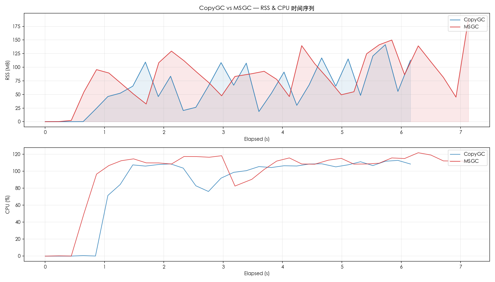
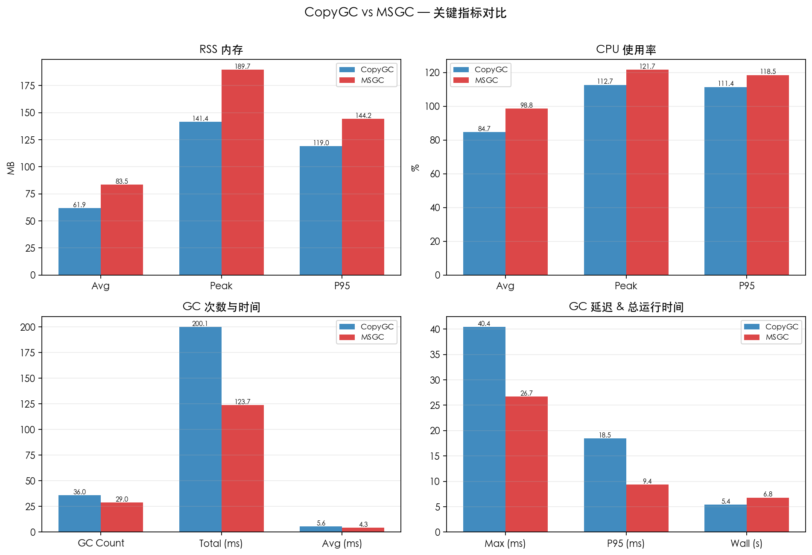
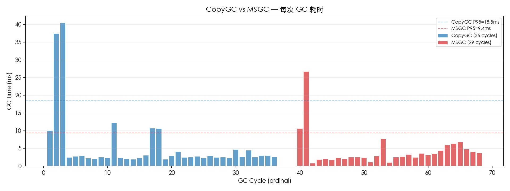

# CopyGC vs MSGC 对比报告

- 左侧 (CopyGC): `copygc` (gc_mode=copygc)
- 右侧 (MSGC): `msgc` (gc_mode=msgc)
- 用例: unknown
- 堆大小: unknown

## 对比图表

### RSS & CPU 时间序列对比

### 关键指标汇总对比

### GC 单次耗时对比

## 运行时间

| 指标 | CopyGC | MSGC | 变化 |
| --- | ---: | ---: | ---: |
| 总运行时间 (ms) | 5387 | 6798 | +26.2% |

## RSS 内存

| 指标 | CopyGC | MSGC | 变化 |
| --- | ---: | ---: | ---: |
| RSS 平均 (MB) | 61.90 | 83.47 | +34.8% |
| RSS 峰值 (MB) | 141.42 | 189.73 | +34.2% |
| RSS P95 (MB) | 118.98 | 144.23 | +21.2% |

## CPU 使用率

| 指标 | CopyGC | MSGC | 变化 |
| --- | ---: | ---: | ---: |
| CPU 平均 (%) | 84.74 | 98.75 | +16.5% |
| CPU 峰值 (%) | 112.70 | 121.70 | +8.0% |
| CPU P95 (%) | 111.43 | 118.48 | +6.3% |

## GC 性能

| 指标 | CopyGC | MSGC | 变化 |
| --- | ---: | ---: | ---: |
| GC 次数 | 36 | 29 | -19.4% |
| GC 总时间 (ms) | 200.06 | 123.65 | -38.2% |
| GC 平均时间 (ms) | 5.56 | 4.26 | -23.3% |
| GC 最大时间 (ms) | 40.43 | 26.70 | -34.0% |
| GC P95 时间 (ms) | 18.46 | 9.40 | -49.1% |

## GC 时间分布

### CopyGC

| 区间 | 次数 | 占比 |
| --- | ---: | ---: |
| 1-2ms | 4 | 11.1% |
| 2-5ms | 26 | 72.2% |
| 5-10ms | 1 | 2.8% |
| 10-20ms | 3 | 8.3% |
| 20-50ms | 2 | 5.6% |

### MSGC

| 区间 | 次数 | 占比 |
| --- | ---: | ---: |
| < 1ms | 2 | 6.9% |
| 1-2ms | 5 | 17.2% |
| 2-5ms | 16 | 55.2% |
| 5-10ms | 4 | 13.8% |
| 10-20ms | 1 | 3.4% |
| 20-50ms | 1 | 3.4% |

