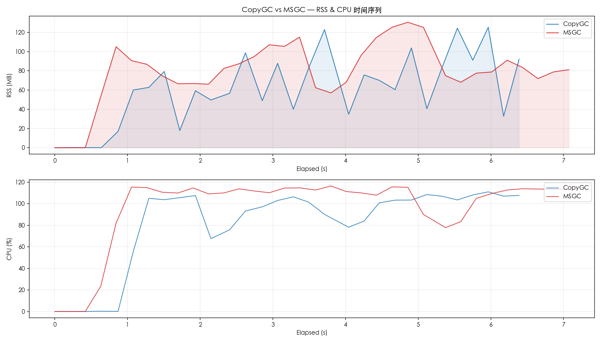
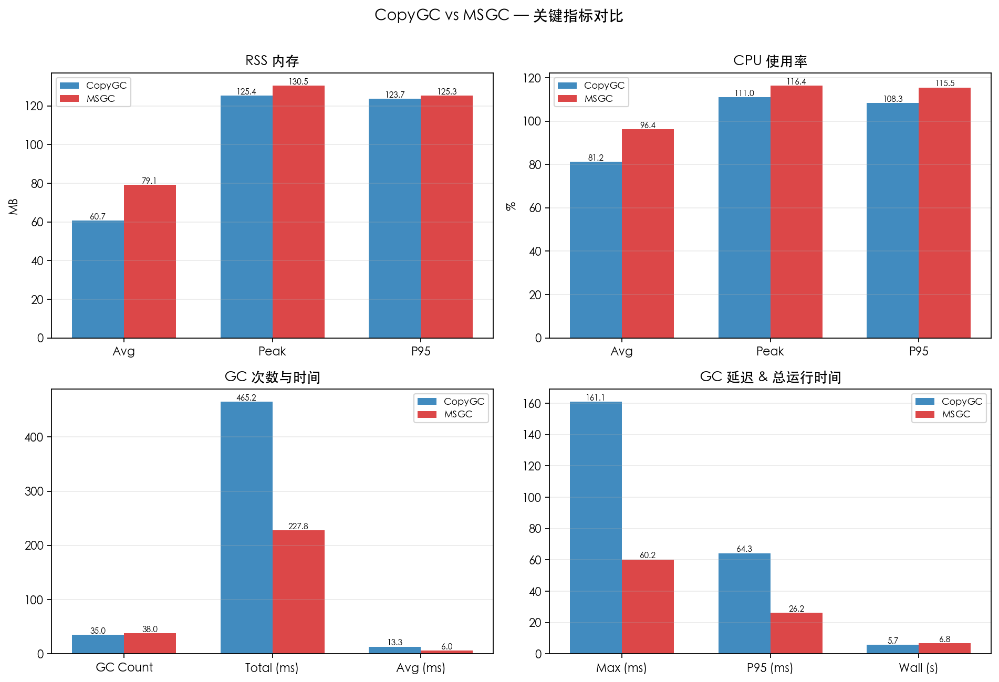
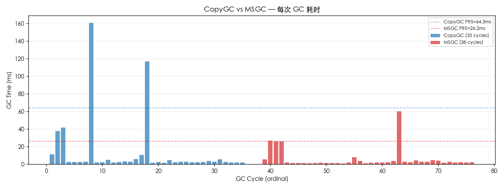

# CopyGC vs MSGC 对比报告

- 左侧 (CopyGC): `copygc` (gc_mode=copygc)
- 右侧 (MSGC): `msgc` (gc_mode=msgc)
- 用例: case1_baseline
- 堆大小: 256mb

## 对比图表

### RSS & CPU 时间序列对比

### 关键指标汇总对比

### GC 单次耗时对比

## 运行时间

| 指标 | CopyGC | MSGC | 变化 |
| --- | ---: | ---: | ---: |
| 总运行时间 (ms) | 5693 | 6754 | +18.6% |

## RSS 内存

| 指标 | CopyGC | MSGC | 变化 |
| --- | ---: | ---: | ---: |
| RSS 平均 (MB) | 60.72 | 79.10 | +30.3% |
| RSS 峰值 (MB) | 125.38 | 130.55 | +4.1% |
| RSS P95 (MB) | 123.75 | 125.31 | +1.3% |

## CPU 使用率

| 指标 | CopyGC | MSGC | 变化 |
| --- | ---: | ---: | ---: |
| CPU 平均 (%) | 81.17 | 96.37 | +18.7% |
| CPU 峰值 (%) | 111.00 | 116.40 | +4.9% |
| CPU P95 (%) | 108.32 | 115.53 | +6.7% |

## GC 性能

| 指标 | CopyGC | MSGC | 变化 |
| --- | ---: | ---: | ---: |
| GC 次数 | 35 | 38 | +8.6% |
| GC 总时间 (ms) | 465.16 | 227.81 | -51.0% |
| GC 平均时间 (ms) | 13.29 | 6.00 | -54.9% |
| GC 最大时间 (ms) | 161.08 | 60.23 | -62.6% |
| GC P95 时间 (ms) | 64.32 | 26.15 | -59.3% |

## GC 时间分布

### CopyGC

| 区间 | 次数 | 占比 |
| --- | ---: | ---: |
| 1-2ms | 2 | 5.7% |
| 2-5ms | 24 | 68.6% |
| 5-10ms | 3 | 8.6% |
| 10-20ms | 2 | 5.7% |
| 20-50ms | 2 | 5.7% |
| 100-200ms | 2 | 5.7% |

### MSGC

| 区间 | 次数 | 占比 |
| --- | ---: | ---: |
| < 1ms | 1 | 2.6% |
| 1-2ms | 14 | 36.8% |
| 2-5ms | 17 | 44.7% |
| 5-10ms | 2 | 5.3% |
| 20-50ms | 3 | 7.9% |
| 50-100ms | 1 | 2.6% |

