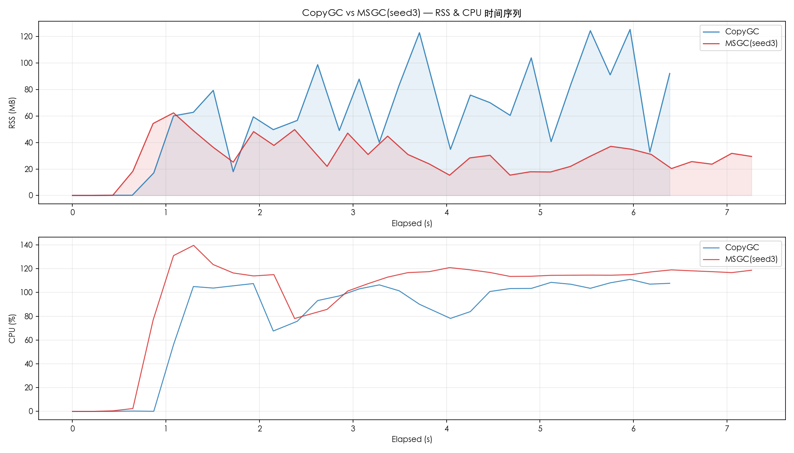
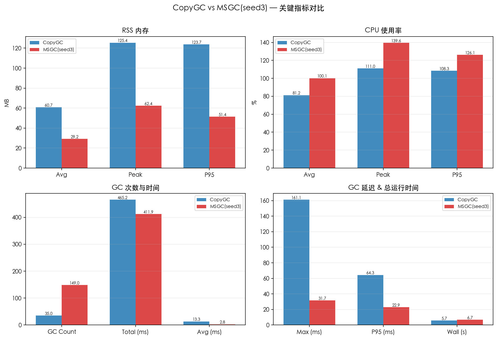
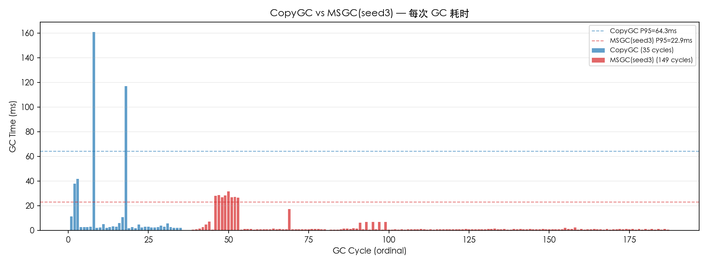

# CopyGC vs MSGC(seed3) 对比报告

- 左侧 (CopyGC): `copygc` (gc_mode=copygc)
- 右侧 (MSGC(seed3)): `20260406_214225_seed3_ultra_marksweep` (gc_mode=msgc)
- 用例: case1_baseline
- 堆大小: 256mb

## 对比图表

### RSS & CPU 时间序列对比

### 关键指标汇总对比

### GC 单次耗时对比

## 运行时间

| 指标 | CopyGC | MSGC(seed3) | 变化 |
| --- | ---: | ---: | ---: |
| 总运行时间 (ms) | 5693 | 6692 | +17.5% |

## RSS 内存

| 指标 | CopyGC | MSGC(seed3) | 变化 |
| --- | ---: | ---: | ---: |
| RSS 平均 (MB) | 60.72 | 29.17 | -52.0% |
| RSS 峰值 (MB) | 125.38 | 62.39 | -50.2% |
| RSS P95 (MB) | 123.75 | 51.36 | -58.5% |

## CPU 使用率

| 指标 | CopyGC | MSGC(seed3) | 变化 |
| --- | ---: | ---: | ---: |
| CPU 平均 (%) | 81.17 | 100.09 | +23.3% |
| CPU 峰值 (%) | 111.00 | 139.60 | +25.8% |
| CPU P95 (%) | 108.32 | 126.12 | +16.4% |

## GC 性能

| 指标 | CopyGC | MSGC(seed3) | 变化 |
| --- | ---: | ---: | ---: |
| GC 次数 | 35 | 149 | +325.7% |
| GC 总时间 (ms) | 465.16 | 411.87 | -11.5% |
| GC 平均时间 (ms) | 13.29 | 2.76 | -79.2% |
| GC 最大时间 (ms) | 161.08 | 31.71 | -80.3% |
| GC P95 时间 (ms) | 64.32 | 22.86 | -64.5% |

## GC 时间分布

### CopyGC

| 区间 | 次数 | 占比 |
| --- | ---: | ---: |
| 1-2ms | 2 | 5.7% |
| 2-5ms | 24 | 68.6% |
| 5-10ms | 3 | 8.6% |
| 10-20ms | 2 | 5.7% |
| 20-50ms | 2 | 5.7% |
| 100-200ms | 2 | 5.7% |

### MSGC(seed3)

| 区间 | 次数 | 占比 |
| --- | ---: | ---: |
| < 1ms | 89 | 59.7% |
| 1-2ms | 42 | 28.2% |
| 2-5ms | 3 | 2.0% |
| 5-10ms | 6 | 4.0% |
| 10-20ms | 1 | 0.7% |
| 20-50ms | 8 | 5.4% |

