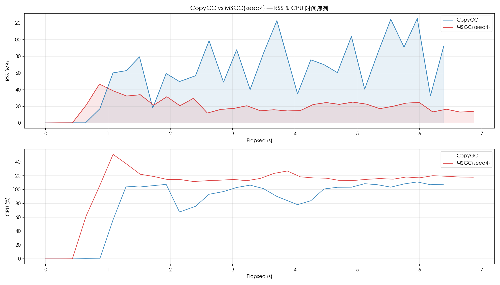
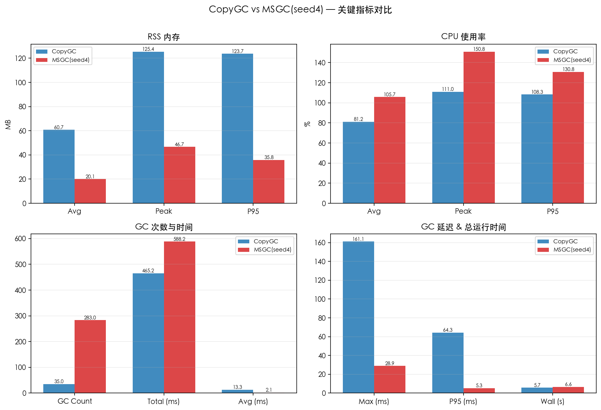
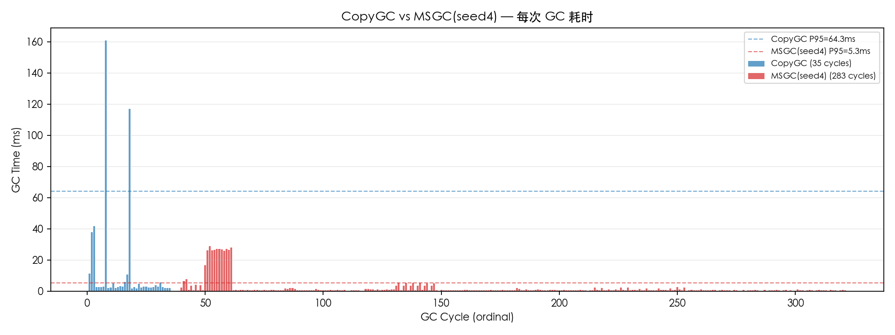

# CopyGC vs MSGC(seed4) 对比报告

- 左侧 (CopyGC): `copygc` (gc_mode=copygc)
- 右侧 (MSGC(seed4)): `20260406_214540_seed4_extreme_marksweep` (gc_mode=msgc)
- 用例: case1_baseline
- 堆大小: 256mb

## 对比图表

### RSS & CPU 时间序列对比

### 关键指标汇总对比

### GC 单次耗时对比

## 运行时间

| 指标 | CopyGC | MSGC(seed4) | 变化 |
| --- | ---: | ---: | ---: |
| 总运行时间 (ms) | 5693 | 6565 | +15.3% |

## RSS 内存

| 指标 | CopyGC | MSGC(seed4) | 变化 |
| --- | ---: | ---: | ---: |
| RSS 平均 (MB) | 60.72 | 20.08 | -66.9% |
| RSS 峰值 (MB) | 125.38 | 46.73 | -62.7% |
| RSS P95 (MB) | 123.75 | 35.83 | -71.1% |

## CPU 使用率

| 指标 | CopyGC | MSGC(seed4) | 变化 |
| --- | ---: | ---: | ---: |
| CPU 平均 (%) | 81.17 | 105.75 | +30.3% |
| CPU 峰值 (%) | 111.00 | 150.80 | +35.9% |
| CPU P95 (%) | 108.32 | 130.80 | +20.8% |

## GC 性能

| 指标 | CopyGC | MSGC(seed4) | 变化 |
| --- | ---: | ---: | ---: |
| GC 次数 | 35 | 283 | +708.6% |
| GC 总时间 (ms) | 465.16 | 588.20 | +26.5% |
| GC 平均时间 (ms) | 13.29 | 2.08 | -84.4% |
| GC 最大时间 (ms) | 161.08 | 28.92 | -82.0% |
| GC P95 时间 (ms) | 64.32 | 5.33 | -91.7% |

## GC 时间分布

### CopyGC

| 区间 | 次数 | 占比 |
| --- | ---: | ---: |
| 1-2ms | 2 | 5.7% |
| 2-5ms | 24 | 68.6% |
| 5-10ms | 3 | 8.6% |
| 10-20ms | 2 | 5.7% |
| 20-50ms | 2 | 5.7% |
| 100-200ms | 2 | 5.7% |

### MSGC(seed4)

| 区间 | 次数 | 占比 |
| --- | ---: | ---: |
| < 1ms | 218 | 77.0% |
| 1-2ms | 27 | 9.5% |
| 2-5ms | 19 | 6.7% |
| 5-10ms | 7 | 2.5% |
| 10-20ms | 1 | 0.4% |
| 20-50ms | 11 | 3.9% |

