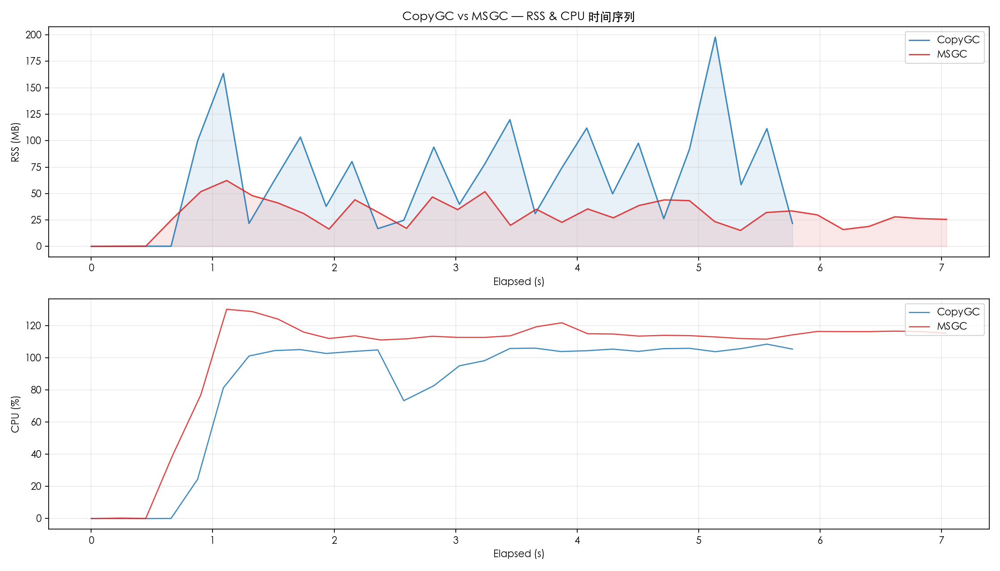
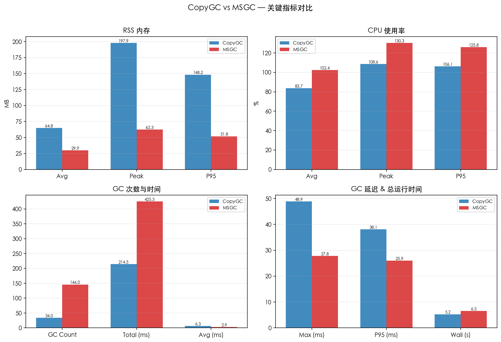
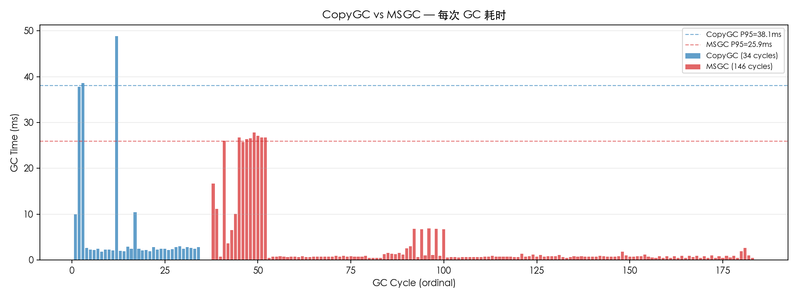

# CopyGC vs MSGC 对比报告

- 左侧 (CopyGC): `copygc` (gc_mode=copygc)
- 右侧 (MSGC): `msgc` (gc_mode=msgc)
- 用例: case1_baseline
- 堆大小: 256mb

## 对比图表

### RSS & CPU 时间序列对比

### 关键指标汇总对比

### GC 单次耗时对比

## 运行时间

| 指标 | CopyGC | MSGC | 变化 |
| --- | ---: | ---: | ---: |
| 总运行时间 (ms) | 5246 | 6527 | +24.4% |

## RSS 内存

| 指标 | CopyGC | MSGC | 变化 |
| --- | ---: | ---: | ---: |
| RSS 平均 (MB) | 64.77 | 29.93 | -53.8% |
| RSS 峰值 (MB) | 197.89 | 62.31 | -68.5% |
| RSS P95 (MB) | 148.23 | 51.79 | -65.1% |

## CPU 使用率

| 指标 | CopyGC | MSGC | 变化 |
| --- | ---: | ---: | ---: |
| CPU 平均 (%) | 83.72 | 102.35 | +22.3% |
| CPU 峰值 (%) | 108.60 | 130.30 | +20.0% |
| CPU P95 (%) | 106.06 | 125.84 | +18.6% |

## GC 性能

| 指标 | CopyGC | MSGC | 变化 |
| --- | ---: | ---: | ---: |
| GC 次数 | 34 | 146 | +329.4% |
| GC 总时间 (ms) | 214.52 | 425.32 | +98.3% |
| GC 平均时间 (ms) | 6.31 | 2.91 | -53.8% |
| GC 最大时间 (ms) | 48.89 | 27.80 | -43.1% |
| GC P95 时间 (ms) | 38.07 | 25.95 | -31.8% |

## GC 时间分布

### CopyGC

| 区间 | 次数 | 占比 |
| --- | ---: | ---: |
| 1-2ms | 4 | 11.8% |
| 2-5ms | 25 | 73.5% |
| 5-10ms | 1 | 2.9% |
| 10-20ms | 1 | 2.9% |
| 20-50ms | 3 | 8.8% |

### MSGC

| 区间 | 次数 | 占比 |
| --- | ---: | ---: |
| < 1ms | 108 | 74.0% |
| 1-2ms | 16 | 11.0% |
| 2-5ms | 4 | 2.7% |
| 5-10ms | 6 | 4.1% |
| 10-20ms | 3 | 2.1% |
| 20-50ms | 9 | 6.2% |

