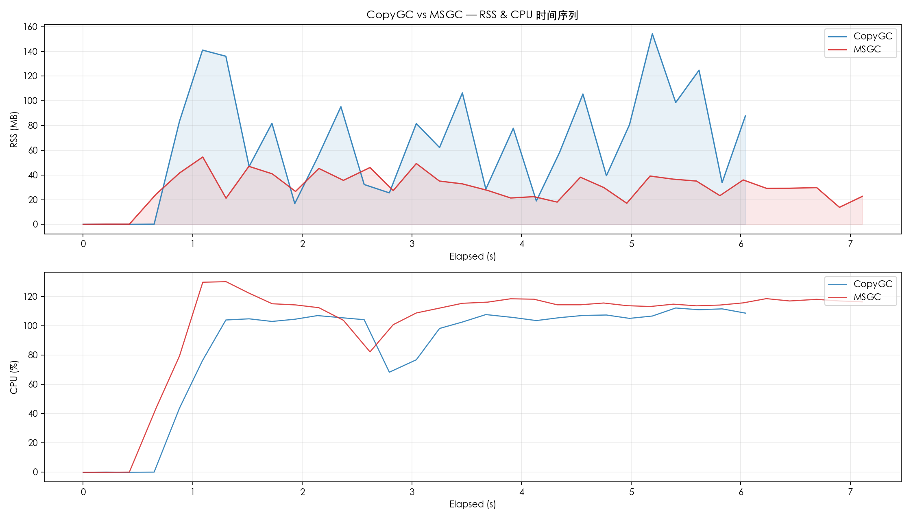
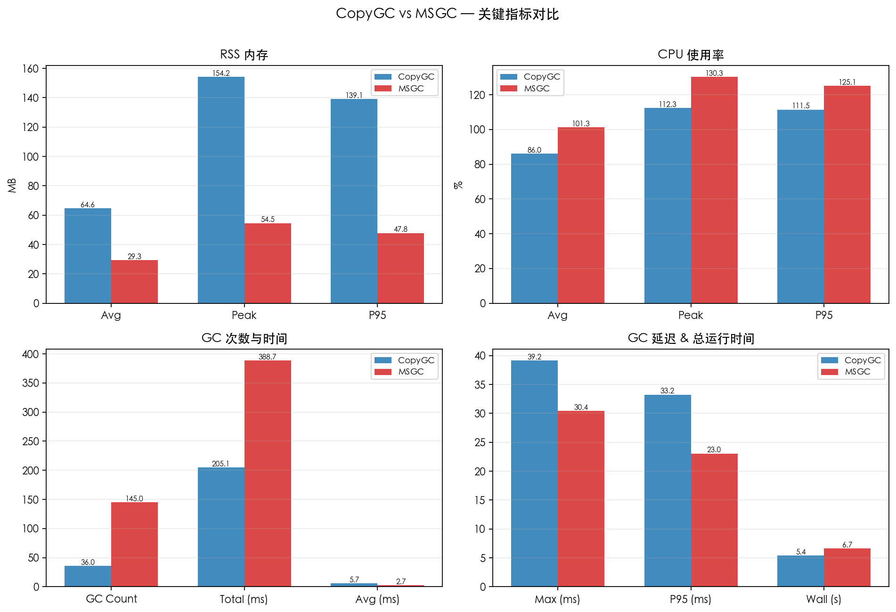
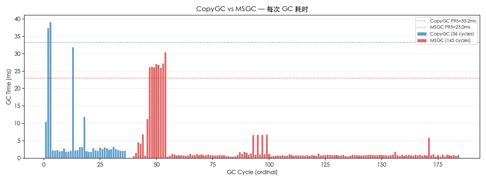

# CopyGC vs MSGC 对比报告

- 左侧 (CopyGC): `copygc` (gc_mode=copygc)
- 右侧 (MSGC): `msgc` (gc_mode=msgc)
- 用例: case1_baseline
- 堆大小: 256mb

## 对比图表

### RSS & CPU 时间序列对比

### 关键指标汇总对比

### GC 单次耗时对比

## 运行时间

| 指标 | CopyGC | MSGC | 变化 |
| --- | ---: | ---: | ---: |
| 总运行时间 (ms) | 5404 | 6655 | +23.1% |

## RSS 内存

| 指标 | CopyGC | MSGC | 变化 |
| --- | ---: | ---: | ---: |
| RSS 平均 (MB) | 64.56 | 29.34 | -54.5% |
| RSS 峰值 (MB) | 154.25 | 54.52 | -64.7% |
| RSS P95 (MB) | 139.07 | 47.79 | -65.6% |

## CPU 使用率

| 指标 | CopyGC | MSGC | 变化 |
| --- | ---: | ---: | ---: |
| CPU 平均 (%) | 86.00 | 101.28 | +17.8% |
| CPU 峰值 (%) | 112.30 | 130.30 | +16.0% |
| CPU P95 (%) | 111.46 | 125.09 | +12.2% |

## GC 性能

| 指标 | CopyGC | MSGC | 变化 |
| --- | ---: | ---: | ---: |
| GC 次数 | 36 | 145 | +302.8% |
| GC 总时间 (ms) | 205.12 | 388.73 | +89.5% |
| GC 平均时间 (ms) | 5.70 | 2.68 | -52.9% |
| GC 最大时间 (ms) | 39.17 | 30.43 | -22.3% |
| GC P95 时间 (ms) | 33.25 | 23.04 | -30.7% |

## GC 时间分布

### CopyGC

| 区间 | 次数 | 占比 |
| --- | ---: | ---: |
| 1-2ms | 6 | 16.7% |
| 2-5ms | 25 | 69.4% |
| 10-20ms | 2 | 5.6% |
| 20-50ms | 3 | 8.3% |

### MSGC

| 区间 | 次数 | 占比 |
| --- | ---: | ---: |
| < 1ms | 102 | 70.3% |
| 1-2ms | 26 | 17.9% |
| 2-5ms | 2 | 1.4% |
| 5-10ms | 6 | 4.1% |
| 10-20ms | 1 | 0.7% |
| 20-50ms | 8 | 5.5% |

