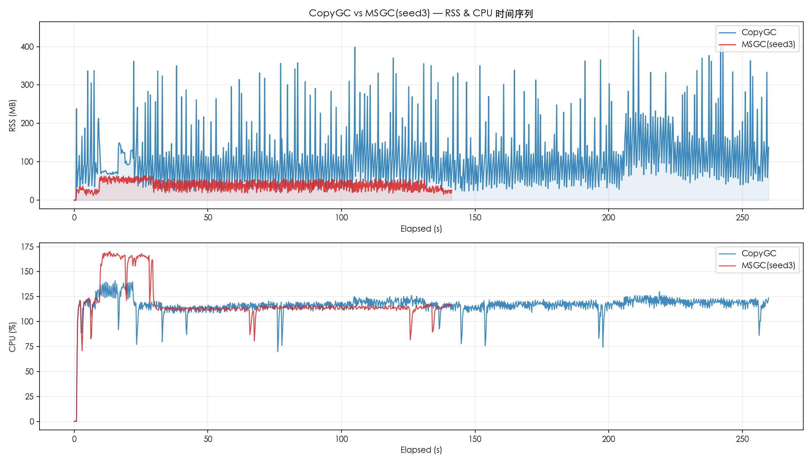
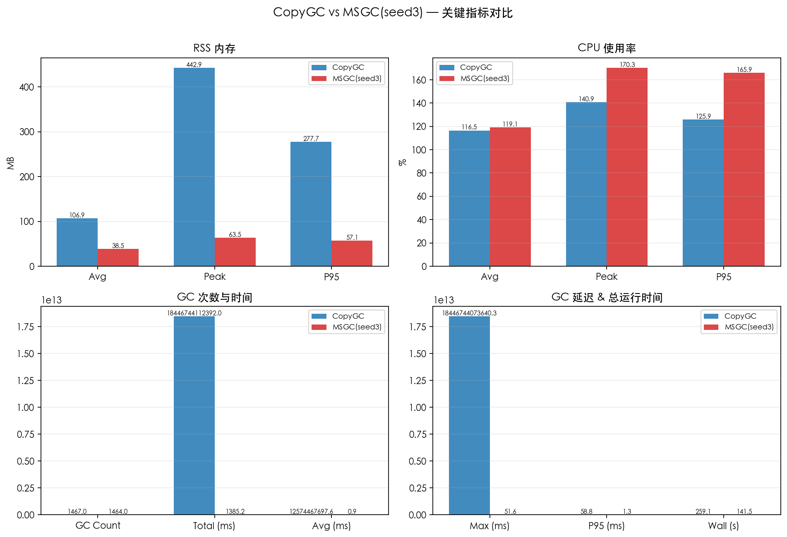
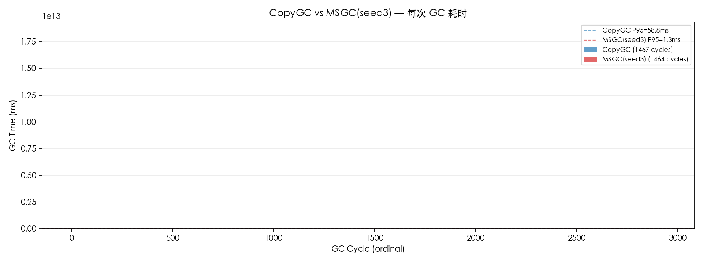

# CopyGC vs MSGC(seed3) 对比报告

- 左侧 (CopyGC): `copygc` (gc_mode=copygc)
- 右侧 (MSGC(seed3)): `msgc` (gc_mode=msgc)
- 用例: case2_50x_pressure
- 堆大小: 4gb

## 对比图表

### RSS & CPU 时间序列对比

### 关键指标汇总对比

### GC 单次耗时对比

## 运行时间

| 指标 | CopyGC | MSGC(seed3) | 变化 |
| --- | ---: | ---: | ---: |
| 总运行时间 (ms) | 259129 | 141455 | -45.4% |

## RSS 内存

| 指标 | CopyGC | MSGC(seed3) | 变化 |
| --- | ---: | ---: | ---: |
| RSS 平均 (MB) | 106.91 | 38.52 | -64.0% |
| RSS 峰值 (MB) | 442.86 | 63.55 | -85.7% |
| RSS P95 (MB) | 277.72 | 57.09 | -79.4% |

## CPU 使用率

| 指标 | CopyGC | MSGC(seed3) | 变化 |
| --- | ---: | ---: | ---: |
| CPU 平均 (%) | 116.51 | 119.12 | +2.2% |
| CPU 峰值 (%) | 140.90 | 170.30 | +20.9% |
| CPU P95 (%) | 125.90 | 165.94 | +31.8% |

## GC 性能

| 指标 | CopyGC | MSGC(seed3) | 变化 |
| --- | ---: | ---: | ---: |
| GC 次数 | 1467 | 1464 | -0.2% |
| GC 总时间 (ms) | 18446744112391.96 | 1385.20 | -100.0% |
| GC 平均时间 (ms) | 12574467697.61 | 0.95 | -100.0% |
| GC 最大时间 (ms) | 18446744073640.25 | 51.56 | -100.0% |
| GC P95 时间 (ms) | 58.85 | 1.33 | -97.7% |

## GC 时间分布

### CopyGC

| 区间 | 次数 | 占比 |
| --- | ---: | ---: |
| 10-20ms | 1 | 0.1% |
| 20-50ms | 1386 | 94.5% |
| 50-100ms | 73 | 5.0% |
| 100-200ms | 6 | 0.4% |
| > 1s | 1 | 0.1% |

### MSGC(seed3)

| 区间 | 次数 | 占比 |
| --- | ---: | ---: |
| < 1ms | 1119 | 76.4% |
| 1-2ms | 336 | 23.0% |
| 2-5ms | 4 | 0.3% |
| 5-10ms | 1 | 0.1% |
| 10-20ms | 2 | 0.1% |
| 20-50ms | 1 | 0.1% |
| 50-100ms | 1 | 0.1% |

