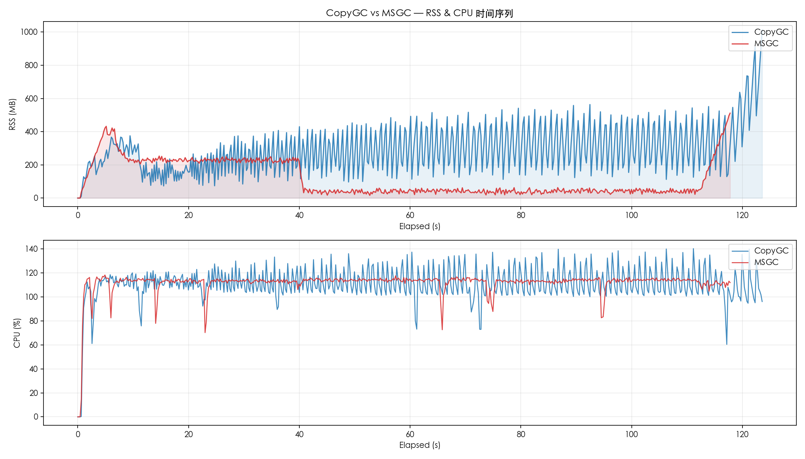
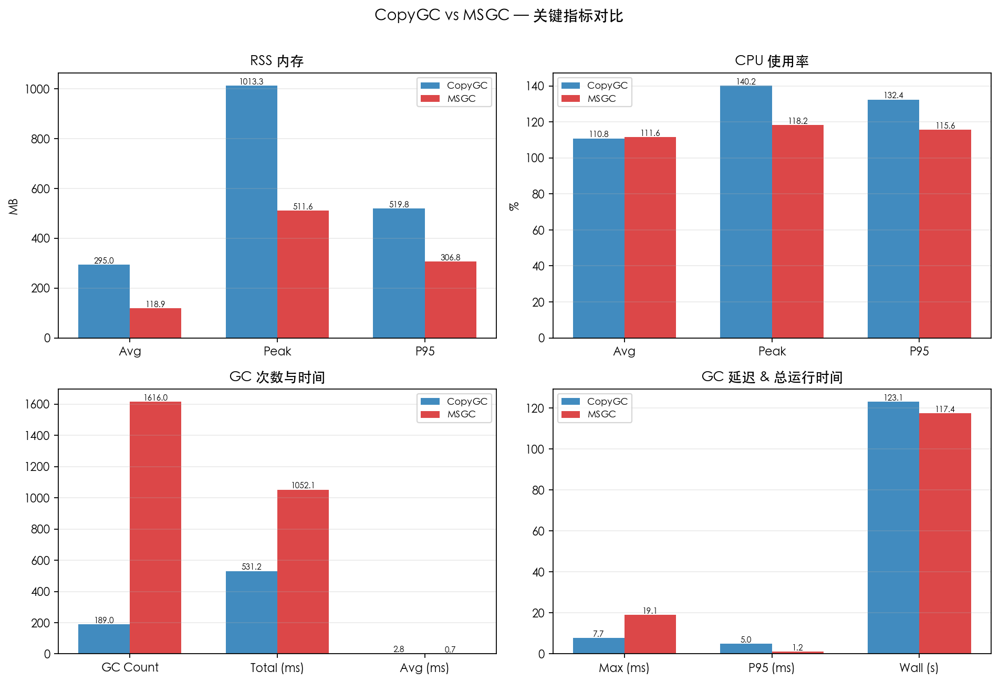
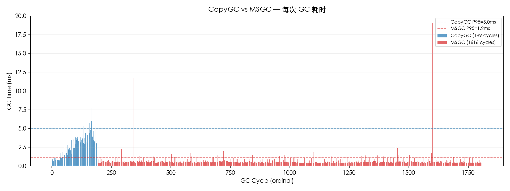

# CopyGC vs MSGC 对比报告

- 左侧 (CopyGC): `copygc` (gc_mode=msgc)
- 右侧 (MSGC): `msgc` (gc_mode=msgc)
- 用例: case3_half_alive
- 堆大小: 2gb

## 对比图表

### RSS & CPU 时间序列对比

### 关键指标汇总对比

### GC 单次耗时对比

## 运行时间

| 指标 | CopyGC | MSGC | 变化 |
| --- | ---: | ---: | ---: |
| 总运行时间 (ms) | 123083 | 117426 | -4.6% |

## RSS 内存

| 指标 | CopyGC | MSGC | 变化 |
| --- | ---: | ---: | ---: |
| RSS 平均 (MB) | 295.00 | 118.90 | -59.7% |
| RSS 峰值 (MB) | 1013.30 | 511.56 | -49.5% |
| RSS P95 (MB) | 519.78 | 306.83 | -41.0% |

## CPU 使用率

| 指标 | CopyGC | MSGC | 变化 |
| --- | ---: | ---: | ---: |
| CPU 平均 (%) | 110.78 | 111.63 | +0.8% |
| CPU 峰值 (%) | 140.20 | 118.20 | -15.7% |
| CPU P95 (%) | 132.40 | 115.60 | -12.7% |

## GC 性能

| 指标 | CopyGC | MSGC | 变化 |
| --- | ---: | ---: | ---: |
| GC 次数 | 189 | 1616 | +755.0% |
| GC 总时间 (ms) | 531.18 | 1052.12 | +98.1% |
| GC 平均时间 (ms) | 2.81 | 0.65 | -76.8% |
| GC 最大时间 (ms) | 7.72 | 19.06 | +146.9% |
| GC P95 时间 (ms) | 4.98 | 1.16 | -76.8% |

## GC 时间分布

### CopyGC

| 区间 | 次数 | 占比 |
| --- | ---: | ---: |
| < 1ms | 28 | 14.8% |
| 1-2ms | 37 | 19.6% |
| 2-5ms | 115 | 60.8% |
| 5-10ms | 9 | 4.8% |

### MSGC

| 区间 | 次数 | 占比 |
| --- | ---: | ---: |
| < 1ms | 1469 | 90.9% |
| 1-2ms | 136 | 8.4% |
| 2-5ms | 7 | 0.4% |
| 5-10ms | 1 | 0.1% |
| 10-20ms | 3 | 0.2% |

