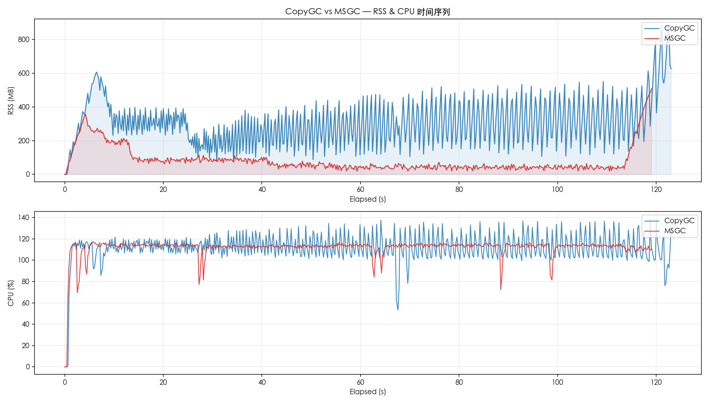
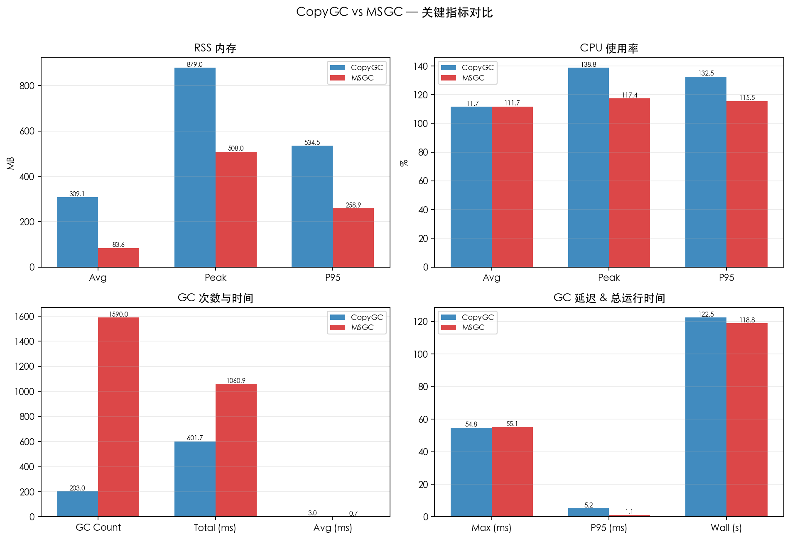
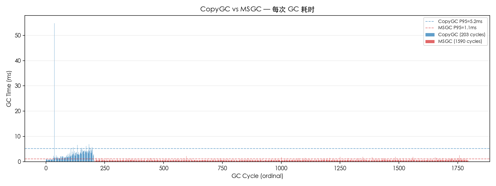

# CopyGC vs MSGC 对比报告

- 左侧 (CopyGC): `copygc` (gc_mode=msgc)
- 右侧 (MSGC): `msgc` (gc_mode=msgc)
- 用例: case3_half_alive
- 堆大小: 2gb

## 对比图表

### RSS & CPU 时间序列对比

### 关键指标汇总对比

### GC 单次耗时对比

## 运行时间

| 指标 | CopyGC | MSGC | 变化 |
| --- | ---: | ---: | ---: |
| 总运行时间 (ms) | 122501 | 118804 | -3.0% |

## RSS 内存

| 指标 | CopyGC | MSGC | 变化 |
| --- | ---: | ---: | ---: |
| RSS 平均 (MB) | 309.14 | 83.56 | -73.0% |
| RSS 峰值 (MB) | 879.02 | 507.97 | -42.2% |
| RSS P95 (MB) | 534.47 | 258.86 | -51.6% |

## CPU 使用率

| 指标 | CopyGC | MSGC | 变化 |
| --- | ---: | ---: | ---: |
| CPU 平均 (%) | 111.67 | 111.74 | +0.1% |
| CPU 峰值 (%) | 138.80 | 117.40 | -15.4% |
| CPU P95 (%) | 132.50 | 115.51 | -12.8% |

## GC 性能

| 指标 | CopyGC | MSGC | 变化 |
| --- | ---: | ---: | ---: |
| GC 次数 | 203 | 1590 | +683.3% |
| GC 总时间 (ms) | 601.68 | 1060.89 | +76.3% |
| GC 平均时间 (ms) | 2.96 | 0.67 | -77.5% |
| GC 最大时间 (ms) | 54.76 | 55.14 | +0.7% |
| GC P95 时间 (ms) | 5.22 | 1.14 | -78.2% |

## GC 时间分布

### CopyGC

| 区间 | 次数 | 占比 |
| --- | ---: | ---: |
| < 1ms | 27 | 13.3% |
| 1-2ms | 54 | 26.6% |
| 2-5ms | 111 | 54.7% |
| 5-10ms | 9 | 4.4% |
| 10-20ms | 1 | 0.5% |
| 50-100ms | 1 | 0.5% |

### MSGC

| 区间 | 次数 | 占比 |
| --- | ---: | ---: |
| < 1ms | 1427 | 89.7% |
| 1-2ms | 160 | 10.1% |
| 2-5ms | 2 | 0.1% |
| 50-100ms | 1 | 0.1% |

