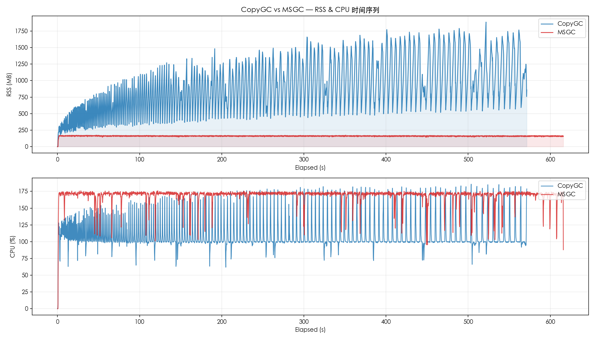
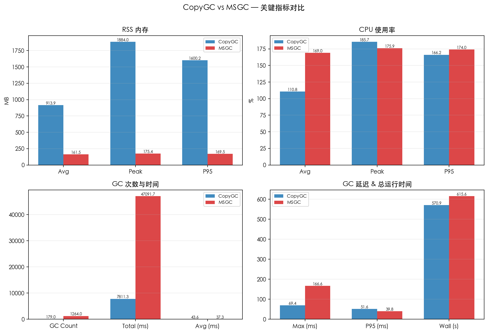
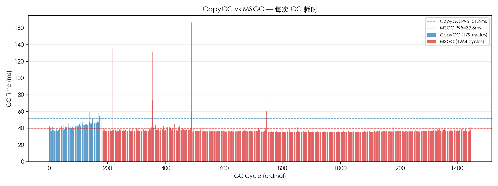

# CopyGC vs MSGC 对比报告

- 左侧 (CopyGC): `copygc` (gc_mode=msgc)
- 右侧 (MSGC): `msgc` (gc_mode=msgc)
- 用例: case4_read_heavy
- 堆大小: 512mb

## 对比图表

### RSS & CPU 时间序列对比

### 关键指标汇总对比

### GC 单次耗时对比

## 运行时间

| 指标 | CopyGC | MSGC | 变化 |
| --- | ---: | ---: | ---: |
| 总运行时间 (ms) | 570881 | 615591 | +7.8% |

## RSS 内存

| 指标 | CopyGC | MSGC | 变化 |
| --- | ---: | ---: | ---: |
| RSS 平均 (MB) | 913.94 | 161.51 | -82.3% |
| RSS 峰值 (MB) | 1884.02 | 175.42 | -90.7% |
| RSS P95 (MB) | 1600.18 | 169.51 | -89.4% |

## CPU 使用率

| 指标 | CopyGC | MSGC | 变化 |
| --- | ---: | ---: | ---: |
| CPU 平均 (%) | 110.78 | 168.96 | +52.5% |
| CPU 峰值 (%) | 185.70 | 175.90 | -5.3% |
| CPU P95 (%) | 166.20 | 174.00 | +4.7% |

## GC 性能

| 指标 | CopyGC | MSGC | 变化 |
| --- | ---: | ---: | ---: |
| GC 次数 | 179 | 1264 | +606.1% |
| GC 总时间 (ms) | 7811.31 | 47091.74 | +502.9% |
| GC 平均时间 (ms) | 43.64 | 37.26 | -14.6% |
| GC 最大时间 (ms) | 69.36 | 166.65 | +140.2% |
| GC P95 时间 (ms) | 51.57 | 39.83 | -22.8% |

## GC 时间分布

### CopyGC

| 区间 | 次数 | 占比 |
| --- | ---: | ---: |
| 20-50ms | 166 | 92.7% |
| 50-100ms | 13 | 7.3% |

### MSGC

| 区间 | 次数 | 占比 |
| --- | ---: | ---: |
| 20-50ms | 1254 | 99.2% |
| 50-100ms | 6 | 0.5% |
| 100-200ms | 4 | 0.3% |

