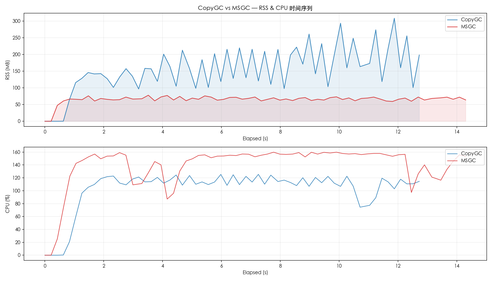
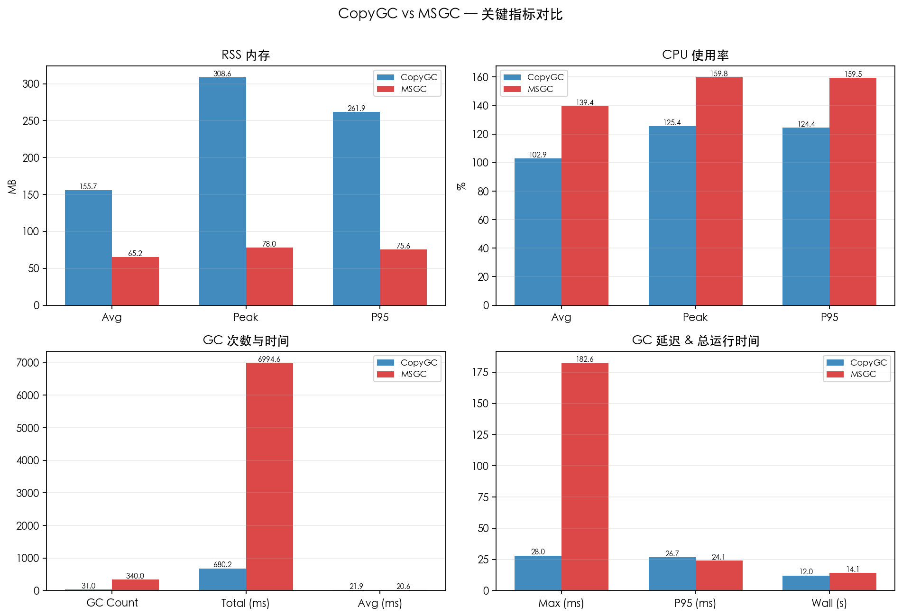
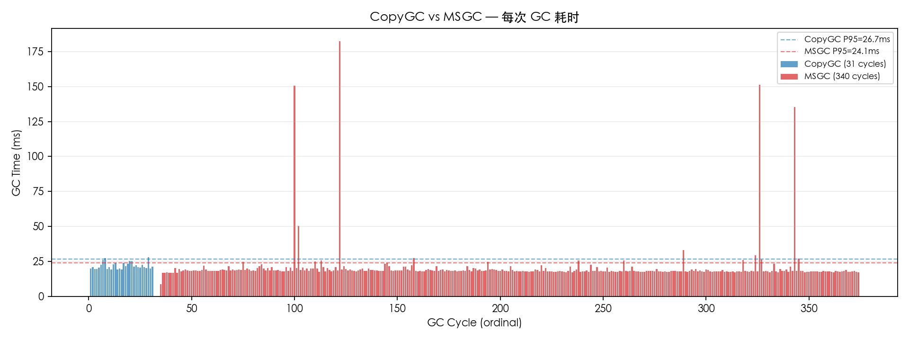

# CopyGC vs MSGC 对比报告

- 左侧 (CopyGC): `copygc` (gc_mode=msgc)
- 右侧 (MSGC): `msgc` (gc_mode=msgc)
- 用例: case5_mixed_objects
- 堆大小: 1gb

## 对比图表

### RSS & CPU 时间序列对比

### 关键指标汇总对比

### GC 单次耗时对比

## 运行时间

| 指标 | CopyGC | MSGC | 变化 |
| --- | ---: | ---: | ---: |
| 总运行时间 (ms) | 11997 | 14129 | +17.8% |

## RSS 内存

| 指标 | CopyGC | MSGC | 变化 |
| --- | ---: | ---: | ---: |
| RSS 平均 (MB) | 155.73 | 65.19 | -58.1% |
| RSS 峰值 (MB) | 308.64 | 78.05 | -74.7% |
| RSS P95 (MB) | 261.90 | 75.60 | -71.1% |

## CPU 使用率

| 指标 | CopyGC | MSGC | 变化 |
| --- | ---: | ---: | ---: |
| CPU 平均 (%) | 102.89 | 139.44 | +35.5% |
| CPU 峰值 (%) | 125.40 | 159.80 | +27.4% |
| CPU P95 (%) | 124.42 | 159.48 | +28.2% |

## GC 性能

| 指标 | CopyGC | MSGC | 变化 |
| --- | ---: | ---: | ---: |
| GC 次数 | 31 | 340 | +996.8% |
| GC 总时间 (ms) | 680.18 | 6994.61 | +928.4% |
| GC 平均时间 (ms) | 21.94 | 20.57 | -6.2% |
| GC 最大时间 (ms) | 28.00 | 182.56 | +551.9% |
| GC P95 时间 (ms) | 26.74 | 24.13 | -9.7% |

## GC 时间分布

### CopyGC

| 区间 | 次数 | 占比 |
| --- | ---: | ---: |
| 10-20ms | 7 | 22.6% |
| 20-50ms | 24 | 77.4% |

### MSGC

| 区间 | 次数 | 占比 |
| --- | ---: | ---: |
| 5-10ms | 1 | 0.3% |
| 10-20ms | 282 | 82.9% |
| 20-50ms | 52 | 15.3% |
| 50-100ms | 1 | 0.3% |
| 100-200ms | 4 | 1.2% |

