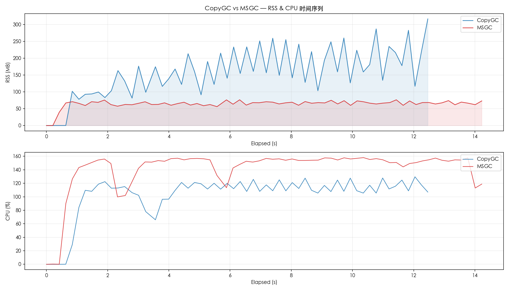
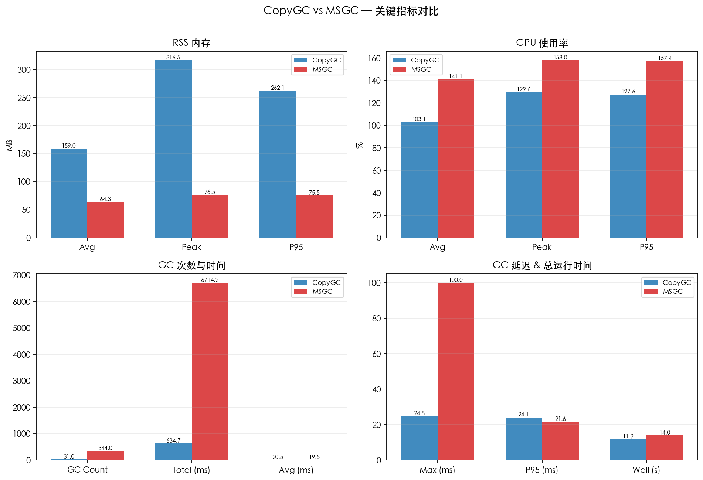
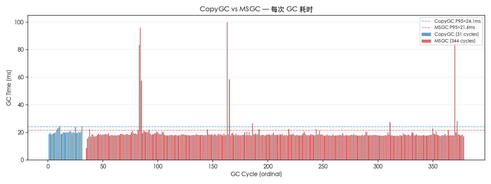

# CopyGC vs MSGC 对比报告

- 左侧 (CopyGC): `copygc` (gc_mode=msgc)
- 右侧 (MSGC): `msgc` (gc_mode=msgc)
- 用例: case5_mixed_objects
- 堆大小: 1gb

## 对比图表

### RSS & CPU 时间序列对比

### 关键指标汇总对比

### GC 单次耗时对比

## 运行时间

| 指标 | CopyGC | MSGC | 变化 |
| --- | ---: | ---: | ---: |
| 总运行时间 (ms) | 11889 | 13972 | +17.5% |

## RSS 内存

| 指标 | CopyGC | MSGC | 变化 |
| --- | ---: | ---: | ---: |
| RSS 平均 (MB) | 159.00 | 64.30 | -59.6% |
| RSS 峰值 (MB) | 316.48 | 76.50 | -75.8% |
| RSS P95 (MB) | 262.14 | 75.52 | -71.2% |

## CPU 使用率

| 指标 | CopyGC | MSGC | 变化 |
| --- | ---: | ---: | ---: |
| CPU 平均 (%) | 103.08 | 141.09 | +36.9% |
| CPU 峰值 (%) | 129.60 | 158.00 | +21.9% |
| CPU P95 (%) | 127.60 | 157.44 | +23.4% |

## GC 性能

| 指标 | CopyGC | MSGC | 变化 |
| --- | ---: | ---: | ---: |
| GC 次数 | 31 | 344 | +1009.7% |
| GC 总时间 (ms) | 634.74 | 6714.22 | +957.8% |
| GC 平均时间 (ms) | 20.48 | 19.52 | -4.7% |
| GC 最大时间 (ms) | 24.77 | 100.00 | +303.7% |
| GC P95 时间 (ms) | 24.12 | 21.57 | -10.6% |

## GC 时间分布

### CopyGC

| 区间 | 次数 | 占比 |
| --- | ---: | ---: |
| 10-20ms | 16 | 51.6% |
| 20-50ms | 15 | 48.4% |

### MSGC

| 区间 | 次数 | 占比 |
| --- | ---: | ---: |
| 5-10ms | 1 | 0.3% |
| 10-20ms | 307 | 89.2% |
| 20-50ms | 30 | 8.7% |
| 50-100ms | 5 | 1.5% |
| 100-200ms | 1 | 0.3% |

