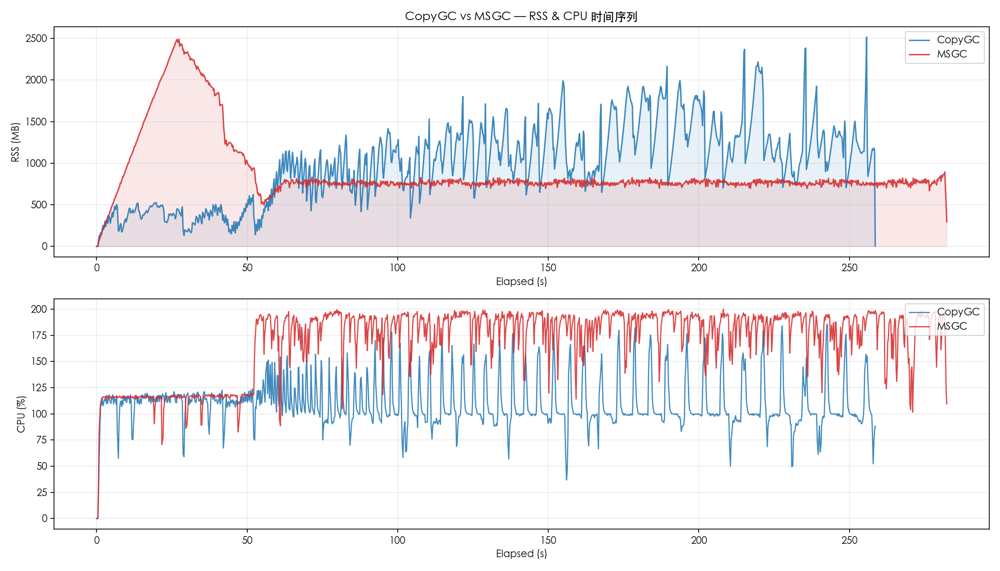
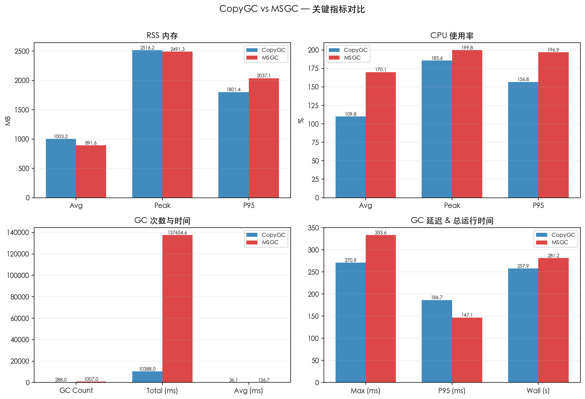
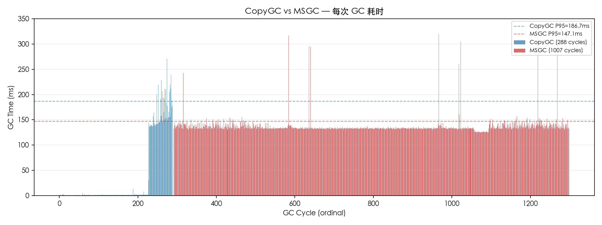

# CopyGC vs MSGC 对比报告

- 左侧 (CopyGC): `copygc` (gc_mode=msgc)
- 右侧 (MSGC): `msgc` (gc_mode=msgc)
- 用例: case6_10g_scale
- 堆大小: 12gb

## 对比图表

### RSS & CPU 时间序列对比

### 关键指标汇总对比

### GC 单次耗时对比

## 运行时间

| 指标 | CopyGC | MSGC | 变化 |
| --- | ---: | ---: | ---: |
| 总运行时间 (ms) | 257880 | 281222 | +9.1% |

## RSS 内存

| 指标 | CopyGC | MSGC | 变化 |
| --- | ---: | ---: | ---: |
| RSS 平均 (MB) | 1003.15 | 891.55 | -11.1% |
| RSS 峰值 (MB) | 2516.22 | 2491.30 | -1.0% |
| RSS P95 (MB) | 1801.37 | 2037.06 | +13.1% |

## CPU 使用率

| 指标 | CopyGC | MSGC | 变化 |
| --- | ---: | ---: | ---: |
| CPU 平均 (%) | 109.83 | 170.09 | +54.9% |
| CPU 峰值 (%) | 185.60 | 199.80 | +7.7% |
| CPU P95 (%) | 156.77 | 196.93 | +25.6% |

## GC 性能

| 指标 | CopyGC | MSGC | 变化 |
| --- | ---: | ---: | ---: |
| GC 次数 | 288 | 1007 | +249.7% |
| GC 总时间 (ms) | 10387.97 | 137654.61 | +1225.1% |
| GC 平均时间 (ms) | 36.07 | 136.70 | +279.0% |
| GC 最大时间 (ms) | 270.93 | 333.63 | +23.1% |
| GC P95 时间 (ms) | 186.67 | 147.08 | -21.2% |

## GC 时间分布

### CopyGC

| 区间 | 次数 | 占比 |
| --- | ---: | ---: |
| < 1ms | 70 | 24.3% |
| 1-2ms | 144 | 50.0% |
| 2-5ms | 9 | 3.1% |
| 5-10ms | 2 | 0.7% |
| 10-20ms | 1 | 0.3% |
| 20-50ms | 1 | 0.3% |
| 100-200ms | 50 | 17.4% |
| 200-500ms | 11 | 3.8% |

### MSGC

| 区间 | 次数 | 占比 |
| --- | ---: | ---: |
| 100-200ms | 998 | 99.1% |
| 200-500ms | 9 | 0.9% |

