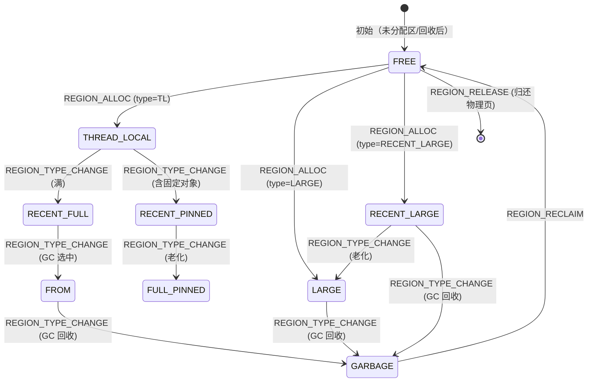
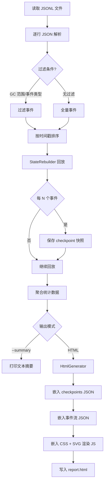

# CJMemView — 仓颉运行时内存可视化工具 设计方案

> **版本**: v1.0  
> **日期**: 2026-02-20  
> **状态**: 设计阶段

---

## 目录

1. [概述](#1-概述)
2. [整体架构](#2-整体架构)
3. [事件模型](#3-事件模型)
4. [C++ 埋点层设计](#4-c-埋点层设计)
5. [埋点位置清单](#5-埋点位置清单)
6. [状态重建算法](#6-状态重建算法)
7. [Python 离线工具 (cjmemview)](#7-python-离线工具-cjmemview)
8. [HTML 可视化设计](#8-html-可视化设计)
9. [实施计划与配置参考](#9-实施计划与配置参考)

---

## 1. 概述

### 1.1 背景与动机

仓颉运行时（Cangjie Runtime）的堆空间由三大区域组成：**MAIN Space**（普通对象 + MAIN 侧大对象）、**RESERVE Zone**（动态缓冲区）、**LOS Space**（大对象专用空间）。运行过程中，Region 会经历创建、使用、标记为垃圾、回收、迁移、借用/归还等复杂生命周期，且三个空间之间存在动态扩缩容和对象迁移。

目前缺少直观工具来观察**任意时刻**的完整内存布局状态，导致：

- GC 调参依赖经验，缺乏数据支撑
- 碎片化、空间利用率问题难以定位
- RESERVE 借还策略效果难以评估
- 大对象迁移 / LOS 压缩效果不可见

### 1.2 目标

构建 **CJMemView** 工具，实现：

1. **全量内存快照**：在任意时间点还原完整堆内存状态 — 每个 Region 的位置、大小、类型、使用状态
2. **事件追踪**：记录所有影响内存布局的关键事件（分配、回收、迁移、扩缩容、借还）
3. **时间线回放**：在时间轴上滑动，查看内存布局如何随时间演变
4. **零运行时依赖**：离线分析，不影响运行时核心路径性能

### 1.3 非目标

- 不替代 DLOG/VLOG 调试日志
- 不做实时在线监控
- 不追踪单个对象级别的分配（粒度为 Region 级）

---

## 2. 整体架构

### 2.1 三层架构

```
┌─────────────────────────────────────────────────────────────────┐
│                    仓颉运行时进程 (C++)                          │
│                                                                 │
│  ┌──────────┐   ┌──────────────┐   ┌─────────────────────────┐ │
│  │ LOSMgr   │──▸│              │   │                         │ │
│  │ RegionMgr│──▸│  MemTracer   │──▸│  Ring Buffer (64K条)    │ │
│  │ ReserveMgr──▸│  (埋点 API)  │   │  → flush → JSONL 文件   │ │
│  │ WCollector│──▸│              │   │                         │ │
│  └──────────┘   └──────────────┘   └────────────┬────────────┘ │
│                                                  │              │
└──────────────────────────────────────────────────┼──────────────┘
                                                   │ cjmem_trace.jsonl
                                                   ▼
┌─────────────────────────────────────────────────────────────────┐
│                   cjmemview (Python 离线工具)                    │
│                                                                 │
│  ┌────────────┐   ┌────────────────┐   ┌────────────────────┐  │
│  │ JSONL      │──▸│ 状态重建引擎    │──▸│ HTML 生成器        │  │
│  │ Parser     │   │ (事件回放)      │   │ (自包含, 无CDN)    │  │
│  └────────────┘   └────────────────┘   └─────────┬──────────┘  │
│                                                   │             │
└───────────────────────────────────────────────────┼─────────────┘
                                                    │ report.html
                                                    ▼
┌─────────────────────────────────────────────────────────────────┐
│                   浏览器 (HTML + SVG + JS)                       │
│                                                                 │
│  ┌─────────────┐ ┌─────────────┐ ┌──────────┐ ┌────────────┐  │
│  │ 内存布局图   │ │ 事件时间线   │ │ Region   │ │ 统计面板   │  │
│  │ (SVG)       │ │ (表格+过滤) │ │ 生命周期  │ │ (图表)     │  │
│  └─────────────┘ └─────────────┘ └──────────┘ └────────────┘  │
│           ◀──── 时间轴滑块 (拖动查看任意时刻) ────▶             │
└─────────────────────────────────────────────────────────────────┘
```

### 2.2 数据流

```
运行时埋点 API 调用
  → MemTracer::Emit(event)
    → 写入 Ring Buffer (lock-free 单生产者 or mutex)
      → 缓冲区满 / GC 结束 / 进程退出时 flush
        → 追加写入 cjmem_trace.jsonl
```

```
cjmemview parse cjmem_trace.jsonl
  → 按时间戳排序事件流
    → 事件回放：维护 MemoryState 快照
      → 每个时间点生成完整内存布局
        → 渲染为 HTML (嵌入 JSON 数据 + SVG + JS)
```

### 2.3 内存布局模型

整个堆空间线性排列：

```
低地址                                                         高地址
 ├═══════════════╤═══════════════╤═══════════════╤═══════════════┤
 │  RegionInfo   │   MAIN Space  │  RESERVE Zone │   LOS Space   │
 │  Metadata     │               │               │               │
 ├═══════════════╧══════╤════════╧═══════╤═══════╧═══════════════┤
 ↑                      ↑               ↑                        ↑
 regionInfoStart   mainEnd(↕)    reserveStart              losEnd
                        ↑         ↕mainWM  losWM↕     ↕losInactiveZone
                   inactiveZone                        losStart
```

**三空间动态边界**：
- **MAIN**: `[regionHeapStart, mainEnd)` — `inactiveZone` 水位线标记已分配区上界
- **RESERVE**: `[reserveStart, reserveEnd)` — `mainWatermark`(↑) 和 `losWatermark`(↓) 双向侵蚀
- **LOS**: `[losStart, losEnd)` — `losInactiveZone` 从高地址向低地址增长

---

## 3. 事件模型

### 3.1 JSONL 格式规范

每行一个 JSON 对象，按时间戳单调递增排列：

```jsonc
{"ts": 1708401234567890, "ev": "REGION_ALLOC", "gc": 3, ...事件特有字段}
```

**公共字段**：

| 字段 | 类型 | 说明 |
|------|------|------|
| `ts` | `uint64` | 时间戳（纳秒，`std::chrono::steady_clock`） |
| `ev` | `string` | 事件类型标识符 |
| `gc` | `uint32` | 当前 GC 周期编号（0 = GC 前首次分配期） |
| `tid` | `uint32` | 线程 ID（可选，仅并发事件需要） |

### 3.2 事件分类与定义

#### 3.2.1 Category A — 堆初始化事件

在运行时启动时发射一次，建立初始内存布局基线。

| 事件 | 字段 | 说明 |
|------|------|------|
| `HEAP_INIT` | `heapStart`, `heapEnd`, `mainEnd`, `reserveStart`, `reserveEnd`, `losStart`, `losEnd`, `unitSize`, `totalUnits` | 堆空间初始化完成，记录所有空间边界 |

**示例**：
```json
{"ts":100,"ev":"HEAP_INIT","gc":0,"heapStart":"0x700000000","heapEnd":"0x740000000","mainEnd":"0x724000000","reserveStart":"0x724000000","reserveEnd":"0x730000000","losStart":"0x730000000","losEnd":"0x740000000","unitSize":4096,"totalUnits":262144}
```

#### 3.2.2 Category B — Region 生命周期事件

追踪 MAIN 空间中每个 Region 从创建到销毁的完整生命周期。

| 事件 | 字段 | 说明 |
|------|------|------|
| `REGION_ALLOC` | `addr`, `units`, `unitIdx`, `type`, `src` | 分配新 Region |
| `REGION_TYPE_CHANGE` | `addr`, `units`, `unitIdx`, `oldType`, `newType` | Region 类型转换（如 TL→RECENT_FULL→FROM→GARBAGE→FREE） |
| `REGION_RECLAIM` | `addr`, `units`, `unitIdx`, `type` | 回收 Region（标记为 FREE，加入空闲列表） |
| `REGION_RELEASE` | `addr`, `units`, `unitIdx` | 释放 Region（madvise 归还物理页） |

**`type` 枚举值**（对应 `RegionType`）：

| 值 | 名称 | 可视化颜色建议 |
|----|------|----------------|
| 0 | `FREE` | 浅灰 `#E0E0E0` |
| 1 | `THREAD_LOCAL` | 绿色 `#4CAF50` |
| 2 | `RECENT_FULL` | 深绿 `#2E7D32` |
| 3 | `FROM` | 橙色 `#FF9800` |
| 4 | `LONE_FROM` | 深橙 `#E65100` |
| 5 | `UNMOVABLE_FROM` | 红橙 `#BF360C` |
| 6 | `TO` | 蓝色 `#2196F3` |
| 7 | `FULL_PINNED` | 紫色 `#9C27B0` |
| 8 | `RECENT_PINNED` | 浅紫 `#CE93D8` |
| 9 | `RAW_PTR_PINNED` | 深紫 `#4A148C` |
| 10 | `TL_RAW_PTR` | 浅绿 `#81C784` |
| 11 | `TL_LARGE_RAW_PTR` | 黄绿 `#C0CA33` |
| 12 | `LARGE` | 靛蓝 `#3F51B5` |
| 13 | `RECENT_LARGE` | 浅靛 `#7986CB` |
| 14 | `GARBAGE` | 红色 `#F44336` |

**`src` 来源**（Region 分配来自何处）：

| 值 | 说明 |
|----|------|
| `"free_list"` | 从空闲 Region 列表分配 |
| `"garbage_reuse"` | 重用垃圾 Region |
| `"inactive_zone"` | 从未分配区扩展 |
| `"reserve_borrow"` | 从 RESERVE 借用 |

**示例**：
```json
{"ts":200,"ev":"REGION_ALLOC","gc":0,"addr":"0x700100000","units":1,"unitIdx":256,"type":1,"src":"inactive_zone"}
{"ts":350,"ev":"REGION_TYPE_CHANGE","gc":1,"addr":"0x700100000","units":1,"unitIdx":256,"oldType":2,"newType":3}
{"ts":500,"ev":"REGION_RECLAIM","gc":1,"addr":"0x700100000","units":1,"unitIdx":256,"type":14}
```

#### 3.2.3 Category C — 大对象 (LOS) 事件

追踪 LOS 空间中的大对象分配与回收。

| 事件 | 字段 | 说明 |
|------|------|------|
| `LOS_ALLOC` | `addr`, `size`, `units`, `unitIdx`, `src` | LOS 大对象分配成功 |
| `LOS_ALLOC_FAIL` | `size`, `units`, `reason` | LOS 分配失败（回退 MAIN） |
| `LOS_RECLAIM` | `addr`, `size`, `units`, `unitIdx`, `isBorrowed` | LOS 大对象回收 |
| `LOS_RELEASE` | `addr`, `size`, `units`, `unitIdx` | LOS Region 物理页释放 |

**`src` 来源**（LOS 分配来自何处）：

| 值 | 说明 |
|----|------|
| `"free_mgr"` | 从 LOS FreeRegionManager 分配 |
| `"inactive_zone"` | 从 LOS 未活跃区扩展 |
| `"reserve_borrow"` | 从 RESERVE 借用 |

**示例**：
```json
{"ts":250,"ev":"LOS_ALLOC","gc":0,"addr":"0x73FF00000","size":65536,"units":16,"unitIdx":245744,"src":"free_mgr"}
{"ts":600,"ev":"LOS_RECLAIM","gc":1,"addr":"0x73FF00000","size":65536,"units":16,"unitIdx":245744,"isBorrowed":false}
```

#### 3.2.4 Category D — RESERVE 借还事件

追踪 RESERVE 区的动态分配（MAIN 和 LOS 双向借用/归还）。

| 事件 | 字段 | 说明 |
|------|------|------|
| `RESERVE_MAIN_BORROW` | `addr`, `size`, `newMainWM` | MAIN 从 RESERVE 借用（mainWatermark ↑） |
| `RESERVE_MAIN_RETURN` | `addr`, `size`, `newMainWM`, `isHole` | MAIN 归还 RESERVE（水位线退回或标记空洞） |
| `RESERVE_LOS_BORROW` | `addr`, `size`, `newLosWM` | LOS 从 RESERVE 借用（losWatermark ↓） |
| `RESERVE_LOS_RETURN` | `addr`, `size`, `newLosWM`, `isHole` | LOS 归还 RESERVE（水位线退回或标记空洞） |
| `RESERVE_COALESCE` | `side`, `reclaimedUnits`, `newWM` | 空洞合并（水位线退回） |

**示例**：
```json
{"ts":300,"ev":"RESERVE_MAIN_BORROW","gc":0,"addr":"0x724100000","size":65536,"newMainWM":"0x724110000"}
{"ts":700,"ev":"RESERVE_MAIN_RETURN","gc":1,"addr":"0x724100000","size":65536,"newMainWM":"0x724100000","isHole":false}
```

#### 3.2.5 Category E — 扩缩容 & 迁移事件

追踪空间边界变化、LOS 压缩、对象迁移。

| 事件 | 字段 | 说明 |
|------|------|------|
| `MAIN_EXPAND` | `oldInactiveZone`, `newInactiveZone`, `allocUnits` | MAIN 未活跃区扩展 |
| `MAIN_SHRINK` | `oldInactiveZone`, `newInactiveZone`, `freedBytes` | MAIN 未活跃区收缩（ShrinkInactiveZone） |
| `LOS_EXPAND` | `oldInactiveZone`, `newInactiveZone`, `allocUnits` | LOS 未活跃区扩展 |
| `LOS_COMPACT_BEGIN` | `fragRatio`, `liveCount`, `liveBytes`, `freeBytes` | LOS 压缩开始 |
| `LOS_COMPACT_MOVE` | `fromAddr`, `toAddr`, `size` | LOS 压缩：单个对象滑动移动 |
| `LOS_COMPACT_END` | `movedBytes`, `freedBytes`, `shrunkBytes`, `newInactiveZone` | LOS 压缩完成 |
| `LOS_MIGRATE` | `fromAddr`, `toAddr`, `size` | MAIN→LOS 大对象迁移 |
| `LOS_MIGRATE_DONE` | `count`, `totalBytes` | 批量迁移完成 |

**示例**：
```json
{"ts":400,"ev":"LOS_COMPACT_BEGIN","gc":2,"fragRatio":0.35,"liveCount":12,"liveBytes":524288,"freeBytes":262144}
{"ts":410,"ev":"LOS_COMPACT_MOVE","gc":2,"fromAddr":"0x73F000000","toAddr":"0x73E000000","size":65536}
{"ts":450,"ev":"LOS_COMPACT_END","gc":2,"movedBytes":196608,"freedBytes":262144,"shrunkBytes":131072,"newInactiveZone":"0x73F800000"}
```

#### 3.2.6 Category F — GC 生命周期事件

标记 GC 周期的开始/结束及关键阶段，为事件流提供时间锚点。

| 事件 | 字段 | 说明 |
|------|------|------|
| `GC_START` | `gcId`, `reason` | GC 周期开始 |
| `GC_PHASE` | `gcId`, `phase` | GC 进入某个阶段 |
| `GC_END` | `gcId`, `duration`, `reclaimedBytes` | GC 周期结束 |

**`phase` 枚举**：`"mark"`, `"trace"`, `"postTrace"`, `"sweep"`, `"compact"`, `"migrate"`, `"returnReserve"`

**`reason` 枚举**：`"alloc_fail"`, `"threshold"`, `"explicit"`, `"oom"`

**示例**：
```json
{"ts":1000,"ev":"GC_START","gc":1,"gcId":1,"reason":"threshold"}
{"ts":1100,"ev":"GC_PHASE","gc":1,"gcId":1,"phase":"postTrace"}
{"ts":1500,"ev":"GC_END","gc":1,"gcId":1,"duration":500000,"reclaimedBytes":1048576}
```

### 3.3 事件量估算

| 场景 | 事件/秒 (估) | 1分钟数据量 |
|------|-------------|-------------|
| 低负载（少量分配） | ~100 | ~1 MB |
| 中负载（频繁分配 + GC） | ~1,000 | ~10 MB |
| 高负载（大量大对象） | ~5,000 | ~50 MB |

Ring Buffer 容量 64K 条 ≈ 覆盖中负载约 1 分钟的事件，超出时自动 flush。

---

## 4. C++ 埋点层设计

### 4.1 开关机制

使用环境变量控制，**默认关闭**，对 Release 版本零开销：

```
CJ_MEM_TRACE=1          # 启用内存追踪
CJ_MEM_TRACE_FILE=path  # 输出文件路径（默认: cjmem_trace.jsonl）
CJ_MEM_TRACE_BUF=65536  # Ring Buffer 条目数（默认: 64K）
```

编译期通过宏 `CJ_MEM_TRACE_ENABLED` 控制是否编译埋点代码：

```cpp
// 在 config.cmake 中:
// option(CJ_MEM_TRACE "Enable memory tracing" OFF)

#ifdef CJ_MEM_TRACE_ENABLED
#define MEM_TRACE(ev, ...) MemTracer::Instance().Emit(ev, __VA_ARGS__)
#else
#define MEM_TRACE(ev, ...) (void)(0)
#endif
```

### 4.2 MemTracer 类设计

```
文件位置: src/Utils/MemTracer.h / src/Utils/MemTracer.cpp
```

#### 4.2.1 核心接口

```cpp
class MemTracer {
public:
    // 单例（进程唯一）
    static MemTracer& Instance();

    // 初始化：读取环境变量，打开输出文件，分配缓冲区
    void Init();

    // 关闭：flush 剩余事件，关闭文件
    void Shutdown();

    // 是否已启用
    bool IsEnabled() const { return enabled_; }

    // ── 事件发射 API ──

    // Category A: 堆初始化
    void EmitHeapInit(uintptr_t heapStart, uintptr_t heapEnd,
                      uintptr_t mainEnd, uintptr_t reserveStart,
                      uintptr_t reserveEnd, uintptr_t losStart,
                      uintptr_t losEnd, size_t unitSize, size_t totalUnits);

    // Category B: Region 生命周期
    void EmitRegionAlloc(uintptr_t addr, size_t units, size_t unitIdx,
                         uint8_t type, const char* src);
    void EmitRegionTypeChange(uintptr_t addr, size_t units, size_t unitIdx,
                              uint8_t oldType, uint8_t newType);
    void EmitRegionReclaim(uintptr_t addr, size_t units, size_t unitIdx,
                           uint8_t type);
    void EmitRegionRelease(uintptr_t addr, size_t units, size_t unitIdx);

    // Category C: LOS 大对象
    void EmitLOSAlloc(uintptr_t addr, size_t size, size_t units,
                      size_t unitIdx, const char* src);
    void EmitLOSAllocFail(size_t size, size_t units, const char* reason);
    void EmitLOSReclaim(uintptr_t addr, size_t size, size_t units,
                        size_t unitIdx, bool isBorrowed);
    void EmitLOSRelease(uintptr_t addr, size_t size, size_t units,
                        size_t unitIdx);

    // Category D: RESERVE 借还
    void EmitReserveBorrow(const char* side, uintptr_t addr, size_t size,
                           uintptr_t newWM);
    void EmitReserveReturn(const char* side, uintptr_t addr, size_t size,
                           uintptr_t newWM, bool isHole);
    void EmitReserveCoalesce(const char* side, size_t reclaimedUnits,
                             uintptr_t newWM);

    // Category E: 扩缩容 & 迁移
    void EmitSpaceExpand(const char* space, uintptr_t oldZone,
                         uintptr_t newZone, size_t allocUnits);
    void EmitSpaceShrink(const char* space, uintptr_t oldZone,
                         uintptr_t newZone, size_t freedBytes);
    void EmitLOSCompactBegin(double fragRatio, size_t liveCount,
                             size_t liveBytes, size_t freeBytes);
    void EmitLOSCompactMove(uintptr_t from, uintptr_t to, size_t size);
    void EmitLOSCompactEnd(size_t movedBytes, size_t freedBytes,
                           size_t shrunkBytes, uintptr_t newInactiveZone);
    void EmitLOSMigrate(uintptr_t from, uintptr_t to, size_t size);
    void EmitLOSMigrateDone(size_t count, size_t totalBytes);

    // Category F: GC 生命周期
    void EmitGCStart(uint32_t gcId, const char* reason);
    void EmitGCPhase(uint32_t gcId, const char* phase);
    void EmitGCEnd(uint32_t gcId, uint64_t durationNs, size_t reclaimedBytes);

    // 手动 flush（GC 结束时调用）
    void Flush();

private:
    MemTracer() = default;
    ~MemTracer();

    void FlushLocked();           // 持锁写入文件
    uint64_t Now() const;         // steady_clock 纳秒时间戳
    void WriteJsonLine(const char* json, size_t len);

    bool enabled_ = false;
    uint32_t gcCycle_ = 0;        // 当前 GC 周期号
    int fd_ = -1;                 // 输出文件描述符
    std::mutex mutex_;            // 保护 buffer_ 和 fd_

    // Ring Buffer
    struct Entry {
        char data[512];           // 单条 JSON 行（足够覆盖最长事件）
        uint16_t len;
    };
    Entry* buffer_ = nullptr;
    size_t bufCapacity_ = 0;
    size_t bufHead_ = 0;         // 下一个写入位置
    size_t bufCount_ = 0;        // 当前缓冲条目数
};
```

#### 4.2.2 性能设计

| 关注点 | 策略 |
|--------|------|
| **零开销（关闭时）** | 编译宏 `CJ_MEM_TRACE_ENABLED` 消除所有调用；运行时 `enabled_` 短路 |
| **低开销（开启时）** | 写入 Ring Buffer (内存操作) 而非直接 I/O |
| **线程安全** | `mutex_` 保护 buffer 写入和 flush（GC 阶段多为 STW，竞争极少） |
| **缓冲策略** | 64K 条 × 512B ≈ 32MB 内存；缓冲区满时自动 flush |
| **flush 时机** | ① 缓冲区满 ② `GC_END` 事件 ③ `Shutdown()` |
| **I/O 优化** | 批量 `writev()` 写入，减少系统调用次数 |

#### 4.2.3 JSON 序列化

不引入第三方 JSON 库，使用 `snprintf` 手工序列化：

```cpp
void MemTracer::EmitRegionAlloc(uintptr_t addr, size_t units,
                                 size_t unitIdx, uint8_t type,
                                 const char* src) {
    if (!enabled_) return;
    Entry entry;
    entry.len = static_cast<uint16_t>(snprintf(
        entry.data, sizeof(entry.data),
        "{\"ts\":%" PRIu64 ",\"ev\":\"REGION_ALLOC\",\"gc\":%u,"
        "\"addr\":\"0x%zx\",\"units\":%zu,\"unitIdx\":%zu,"
        "\"type\":%u,\"src\":\"%s\"}\n",
        Now(), gcCycle_, addr, units, unitIdx, type, src));
    Append(entry);
}
```

#### 4.2.4 生命周期集成

```
CangjieRuntime::Init()
  → MemTracer::Instance().Init()      // 读环境变量，开文件
  → ... 堆初始化 ...
  → MEM_TRACE(HEAP_INIT, ...)         // 记录初始布局

CangjieRuntime::Fini()
  → MemTracer::Instance().Shutdown()  // flush + 关文件
```

---

## 5. 埋点位置清单

以下列出每个事件在源代码中的具体插桩位置，以现有 `DLOG(REGION, ...)` 日志点为参照。

### 5.1 Category A — 堆初始化

| 事件 | 源文件 | 函数 | 插入位置 |
|------|--------|------|----------|
| `HEAP_INIT` | `src/Heap/Allocator/RegionManager.cpp` | `RegionManager::Initialize()` | 所有空间边界计算完成后（LOSManager & ReserveManager 初始化之后） |

### 5.2 Category B — Region 生命周期 (MAIN)

| 事件 | 源文件 | 函数 | 插入位置 |
|------|--------|------|----------|
| `REGION_ALLOC` (空闲列表) | `RegionManager.cpp` | `TakeGarbageRegion()` | 垃圾 Region 重用成功后 |
| `REGION_ALLOC` (未活跃区) | `RegionManager.cpp` | `TakeInactiveRegion()` | `inactiveZone` 移动后 |
| `REGION_ALLOC` (RESERVE 借用) | `RegionManager.cpp` | `BorrowFromReserve()` | 借用成功后 |
| `REGION_TYPE_CHANGE` | `RegionManager.cpp` | `PrependRegionToList()` | 每次 Region 加入新列表、类型变更时 |
| `REGION_RECLAIM` | `RegionManager.cpp` | `ReclaimRegion()` | Region 重置为 FREE 加入空闲列表后 |
| `REGION_RELEASE` | `RegionManager.cpp` | `ReleaseRegion()` | `madvise` 释放物理页后 |

### 5.3 Category C — LOS 大对象

| 事件 | 源文件 | 函数 | 插入位置 |
|------|--------|------|----------|
| `LOS_ALLOC` (freeMgr) | `LOSManager.cpp` | `AllocLarge()` | 从 `losFreeMgr` 分配成功（`DLOG "LOS alloc large from"` 处） |
| `LOS_ALLOC` (未活跃区) | `LOSManager.cpp` | `AllocFromInactiveZone()` | `losInactiveZone` 移动后（`DLOG "LOS inactive zone expanded"` 处） |
| `LOS_ALLOC` (RESERVE) | `LOSManager.cpp` | `AllocLarge()` | RESERVE 借用路径成功后 |
| `LOS_ALLOC_FAIL` | `LOSManager.cpp` | `AllocLarge()` | 所有路径失败（`DLOG "LOS alloc large failed"` 处） |
| `LOS_RECLAIM` | `LOSManager.cpp` | `ReclaimLOSRegion()` | 大对象标记为垃圾并回收（`DLOG "LOS reclaim region"` 处） |
| `LOS_RELEASE` | `LOSManager.cpp` | `ReleaseLOSRegion()` | 物理页释放（`DLOG "LOS release region"` 处） |

### 5.4 Category D — RESERVE 借还

| 事件 | 源文件 | 函数 | 插入位置 |
|------|--------|------|----------|
| `RESERVE_MAIN_BORROW` | `ReserveManager.cpp` | `BorrowForMain()` | `mainWatermark` 提交后 |
| `RESERVE_LOS_BORROW` | `ReserveManager.cpp` | `BorrowForLOS()` | `losWatermark` 提交后 |
| `RESERVE_MAIN_RETURN` | `RegionManager.cpp` | `ReturnBorrowedToReserve()` | 水位线退回或空洞标记后 |
| `RESERVE_LOS_RETURN` | `LOSManager.cpp` | `ReturnBorrowedToReserve()` | 水位线退回或空洞标记后（`DLOG "LOS ReturnBorrowedToReserve"` 处） |
| `RESERVE_COALESCE` | `ReserveManager.cpp` | `TryCoalesceHoles()` | 空洞合并、水位线退回后 |

### 5.5 Category E — 扩缩容 & 迁移

| 事件 | 源文件 | 函数 | 插入位置 |
|------|--------|------|----------|
| `MAIN_EXPAND` | `RegionManager.cpp` | `TakeInactiveRegion()` | `inactiveZone` 扩展时 |
| `MAIN_SHRINK` | `RegionManager.cpp` | `ShrinkInactiveZone()` | 收缩完成后 |
| `LOS_EXPAND` | `LOSManager.cpp` | `AllocFromInactiveZone()` | `losInactiveZone` 扩展时 |
| `LOS_COMPACT_BEGIN` | `LOSManager.cpp` | `CompactLOS()` | 压缩开始 |
| `LOS_COMPACT_MOVE` | `LOSManager.cpp` | `CompactLOS()` → 滑动循环内 | 每次对象移动后（`DLOG "LOS compact: moved"` 处） |
| `LOS_COMPACT_END` | `LOSManager.cpp` | `CompactLOS()` | 压缩完成、freeMgr 重建后 |
| `LOS_MIGRATE` | `LOSManager.cpp` | `MigrateLargeObjectsFromMain()` | 每个对象迁移后（`DLOG "LOS migration: obj"` 处） |
| `LOS_MIGRATE_DONE` | `LOSManager.cpp` | `MigrateLargeObjectsFromMain()` | 批量迁移完成后 |

### 5.6 Category F — GC 生命周期

| 事件 | 源文件 | 函数 | 插入位置 |
|------|--------|------|----------|
| `GC_START` | `WCollector.cpp` | `DoGarbageCollection()` | 函数入口 |
| `GC_PHASE` | `WCollector.cpp` | `PostTrace()` 等 | 各阶段入口 |
| `GC_END` | `WCollector.cpp` | `DoGarbageCollection()` | 函数末尾（触发 `Flush()`） |

### 5.7 埋点总结

```
埋点文件统计:
  LOSManager.cpp        ~12 个埋点
  RegionManager.cpp     ~10 个埋点
  ReserveManager.cpp    ~5  个埋点
  WCollector.cpp         ~4  个埋点
  CangjieRuntime.cpp     ~2  个埋点 (Init/Shutdown)
  ──────────────────────────────────
  合计                   ~33 个埋点
```

**原则**: 每个埋点与现有 `DLOG(REGION, ...)` 位置一一对应，使用 `MEM_TRACE(...)` 宏紧跟在 `DLOG` 之后。

---

## 6. 状态重建算法

### 6.1 核心思想

**从事件流重建任意时刻的完整内存快照**。不依赖运行时 dump — 仅通过事件回放，在 Python 端维护一个 `MemoryState` 对象，该对象完整描述所有 Region 的位置、大小、类型和空间边界。

```
事件流: E₁, E₂, E₃, ..., Eₙ
         ↓   ↓   ↓        ↓
状态:   S₀ → S₁ → S₂ → ... → Sₙ

用户选择时间 t (Sₖ.ts ≤ t < Sₖ₊₁.ts) → 展示 Sₖ
```

### 6.2 MemoryState 数据结构

```python
@dataclass
class RegionState:
    addr: int           # Region 起始地址
    units: int          # Region 大小（unit 数）
    unit_idx: int       # 全局 unit 索引
    type: RegionType    # 当前类型枚举
    space: str          # "MAIN" | "LOS"
    src: str            # 来源 ("free_list", "inactive_zone", ...)
    born_ts: int        # 创建时间戳
    born_gc: int        # 创建时 GC 周期
    last_change_ts: int # 最后状态变更时间

@dataclass
class SpaceBounds:
    heap_start: int
    heap_end: int
    main_end: int
    reserve_start: int
    reserve_end: int
    los_start: int
    los_end: int
    unit_size: int

@dataclass
class MemoryState:
    ts: int                          # 快照时间戳
    gc_cycle: int                    # 当前 GC 周期
    bounds: SpaceBounds              # 空间边界（不变）

    # 动态水位线
    main_inactive_zone: int          # MAIN 已分配上界
    los_inactive_zone: int           # LOS 已分配下界
    main_watermark: int              # RESERVE MAIN 侧借用水位
    los_watermark: int               # RESERVE LOS 侧借用水位

    # Region 注册表: unit_idx -> RegionState
    regions: Dict[int, RegionState]

    # GC 状态
    gc_active: bool                  # 当前是否在 GC 中
    gc_phase: str                    # 当前 GC 阶段
```

### 6.3 Region 生命周期状态机



### 6.4 事件回放规则

每种事件对 `MemoryState` 的修改规则：

| 事件 | 状态修改 |
|------|----------|
| `HEAP_INIT` | 初始化 `bounds`、所有水位线 |
| `REGION_ALLOC` | `regions[unitIdx] = RegionState(...)` |
| `REGION_TYPE_CHANGE` | `regions[unitIdx].type = newType` |
| `REGION_RECLAIM` | `regions[unitIdx].type = FREE`（保留条目，显示为已回收） |
| `REGION_RELEASE` | `del regions[unitIdx]`（从注册表移除） |
| `LOS_ALLOC` | `regions[unitIdx] = RegionState(space="LOS", ...)` |
| `LOS_RECLAIM` | `regions[unitIdx].type = FREE` |
| `LOS_RELEASE` | `del regions[unitIdx]` |
| `MAIN_EXPAND` | `main_inactive_zone = newInactiveZone` |
| `MAIN_SHRINK` | `main_inactive_zone = newInactiveZone` |
| `LOS_EXPAND` | `los_inactive_zone = newInactiveZone` |
| `RESERVE_*_BORROW` | 更新 `main_watermark` 或 `los_watermark` |
| `RESERVE_*_RETURN` | 更新 `main_watermark` 或 `los_watermark` |
| `LOS_COMPACT_MOVE` | 移动 Region: `regions[newIdx] = regions.pop(oldIdx)` + 更新 addr |
| `LOS_MIGRATE` | 在 MAIN 侧删除 + 在 LOS 侧创建新条目 |
| `GC_START` | `gc_active = True` |
| `GC_PHASE` | `gc_phase = phase` |
| `GC_END` | `gc_active = False`, `gc_cycle += 1` |

### 6.5 快照索引策略

对于长事件流，每 N 个事件（默认 1000）保存一个完整快照作为 **checkpoint**：

```
事件:     E₀  E₁  ...  E₉₉₉  E₁₀₀₀ ... E₁₉₉₉  E₂₀₀₀ ...
快照:     S₀ ─────────── C₁ ──────────── C₂ ─────────── ...
                checkpoint        checkpoint
```

**查询时间 t 的状态**：
1. 找到 t 之前最近的 checkpoint Cₖ
2. 从 Cₖ 开始回放至 t
3. 最多回放 N 个事件 → 查询复杂度 O(N)

HTML 中嵌入所有 checkpoints 的 JSON 数据，JS 端做 ≤1000 步回放即可定位到任意时刻。

---

## 7. Python 离线工具 (cjmemview)

### 7.1 工具定位

```
文件位置: tools/cjmemview/cjmemview.py   (单文件，无第三方依赖)
Python 版本: 3.8+
依赖: 仅标准库 (json, argparse, html, os, sys, dataclasses)
```

### 7.2 命令行接口

```bash
# 基本用法：从 JSONL 生成 HTML 报告
python3 cjmemview.py cjmem_trace.jsonl -o report.html

# 指定 checkpoint 间隔
python3 cjmemview.py cjmem_trace.jsonl -o report.html --checkpoint-interval 500

# 仅输出统计摘要（文本模式，不生成 HTML）
python3 cjmemview.py cjmem_trace.jsonl --summary

# 过滤时间范围
python3 cjmemview.py cjmem_trace.jsonl -o report.html --from-gc 5 --to-gc 10

# 过滤事件类型
python3 cjmemview.py cjmem_trace.jsonl -o report.html --events LOS_ALLOC,LOS_RECLAIM,GC_START,GC_END
```

**参数列表**：

| 参数 | 默认值 | 说明 |
|------|--------|------|
| `input` | (必需) | 输入 JSONL 文件路径 |
| `-o, --output` | `report.html` | 输出 HTML 文件路径 |
| `--checkpoint-interval` | `1000` | 快照 checkpoint 间隔（事件数） |
| `--summary` | `false` | 仅输出文本摘要 |
| `--from-gc` | `0` | 起始 GC 周期（含） |
| `--to-gc` | `∞` | 结束 GC 周期（含） |
| `--events` | 全部 | 逗号分隔的事件类型过滤 |
| `--max-events` | `500000` | 最大处理事件数（防 OOM） |

### 7.3 模块结构

```python
# cjmemview.py 内部结构（单文件）

# ── 数据模型 ──
class RegionType(IntEnum): ...         # 枚举，与 C++ RegionType 对应
class RegionState: ...                  # 单个 Region 状态
class SpaceBounds: ...                  # 空间边界
class MemoryState: ...                  # 完整内存快照

# ── 解析层 ──
class JsonlParser:
    def parse(path) -> List[dict]      # 逐行解析 JSONL，过滤+排序

# ── 状态机回放 ──
class StateRebuilder:
    def __init__(checkpoint_interval)
    def replay(events) -> (checkpoints, final_state, stats)
    def apply_event(state, event)      # 单事件应用
    def take_checkpoint(state, idx)    # 深拷贝快照

# ── 统计聚合 ──
class StatsCollector:
    def collect(events, final_state) -> dict
    #   - 总分配/回收次数
    #   - 各空间峰值使用量
    #   - GC 周期时长分布
    #   - LOS 碎片率变化曲线
    #   - RESERVE 借还次数

# ── HTML 生成 ──
class HtmlGenerator:
    def generate(checkpoints, events, stats, bounds) -> str
    #   - 嵌入 JSON 数据到 <script>
    #   - 嵌入 CSS + JS（自包含，零 CDN）
    #   - 输出单个 .html 文件

# ── 主入口 ──
def main():
    args = parse_args()
    events = JsonlParser.parse(args.input)
    checkpoints, final, stats = StateRebuilder(args.checkpoint_interval).replay(events)
    if args.summary:
        print_summary(stats)
    else:
        html = HtmlGenerator().generate(checkpoints, events, stats, final.bounds)
        write_file(args.output, html)
```

### 7.4 处理流程



### 7.5 文本摘要示例

```
═══════════════════════════════════════════════
  CJMemView Summary — cjmem_trace.jsonl
═══════════════════════════════════════════════
  Duration:       12.34 s (45,678 events)
  GC Cycles:      23
  ─────────────────────────────────────────────
  MAIN Space:
    Peak regions:   1,024 (4,096 KB)
    Alloc/Reclaim:  3,456 / 3,200
    Inactive zone:  0x710000000 → 0x718000000
  ─────────────────────────────────────────────
  LOS Space:
    Peak regions:   48 (12,288 KB)
    Alloc/Reclaim:  156 / 142
    Compactions:    3 (moved 2.1 MB, freed 1.5 MB)
    Migrations:     12 objects (768 KB)
  ─────────────────────────────────────────────
  RESERVE Zone:
    MAIN borrow:    8 chunks (512 KB)
    MAIN return:    6 chunks (384 KB)
    LOS borrow:     4 chunks (256 KB)
    LOS return:     3 chunks (192 KB)
    Hole coalesce:  2 times
═══════════════════════════════════════════════
```

---

## 8. HTML 可视化设计

### 8.1 总体布局

自包含单 HTML 文件，内嵌 CSS + JS + SVG，无任何外部 CDN 依赖。

```
┌─────────────────────────────────────────────────────────────┐
│  CJMemView — Cangjie Runtime Memory Visualizer              │
├─────────────────────────────────────────────────────────────┤
│  ◀──── 时间轴滑块 ────▶  GC #5  ts: 1234567890  phase: sweep │
├───────────────────────────┬─────────────────────────────────┤
│                           │                                 │
│   Panel A:  内存布局图     │   Panel B:  统计面板             │
│   (SVG, 可缩放)           │   (数值 + 迷你图表)             │
│                           │                                 │
├───────────────────────────┴─────────────────────────────────┤
│                                                             │
│   Panel C:  事件时间线 (表格 + 过滤)                          │
│                                                             │
├─────────────────────────────────────────────────────────────┤
│                                                             │
│   Panel D:  Region 生命周期瀑布图                             │
│                                                             │
└─────────────────────────────────────────────────────────────┘
```

### 8.2 Panel A — 内存布局图

核心面板，展示**当前时间点**的完整堆内存状态。

#### 布局模型

```
▼ 线性地址空间（从左到右 = 从低地址到高地址）

┌──────────────────┬───────────────┬──────────────────┐
│   MAIN Space     │  RESERVE Zone │    LOS Space     │
│                  │               │                  │
│ ┌─┬─┬─┬─┬─┬─┬─┐ │ ┌───┬───┬───┐ │ ┌────┬────┬────┐ │
│ │T│F│R│G│ │ │ │ │ │M▲ │   │L▼ │ │ │LIVE│FREE│LIVE│ │
│ │L│U│C│A│ │ │ │ │ │bor│ F │bor│ │ │ 4u │ 2u │ 8u │ │
│ │ │L│N│R│ │ │ │ │ │row│ R │row│ │ │    │    │    │ │
│ │ │L│T│B│ │ │ │ │ │   │ E │   │ │ │    │    │    │ │
│ └─┴─┴─┴─┴─┴─┴─┘ │ └───┴───┴───┘ │ └────┴────┴────┘ │
│  ▲inactive_zone  │ ▲mWM    lWM▲  │  ▲losInactive    │
└──────────────────┴───────────────┴──────────────────┘
```

#### SVG 渲染规则

| 元素 | 渲染 | 说明 |
|------|------|------|
| 每个 Region | 矩形 `<rect>` | 宽度 ∝ units，颜色 = RegionType 对应色 |
| 空闲区 | 浅灰矩形 | 未分配或已回收的 unit 范围 |
| 水位线 | 虚线 `<line>` | inactiveZone / mainWatermark / losWatermark |
| 空间边界 | 实线 `<line>` | mainEnd / reserveStart / losStart |
| 鼠标悬停 | `<title>` tooltip | 显示 Region 地址、大小、类型、创建时间 |
| GC 状态指示 | 顶部色条 | GC 进行中 = 红色闪烁；空闲 = 绿色 |

#### 颜色方案

使用 §3.2.2 定义的类型→颜色映射。额外状态色：

| 状态 | 颜色 | 说明 |
|------|------|------|
| 未分配区 (inactive) | 白色 `#FFFFFF` | 从未使用过的地址空间 |
| RESERVE 空闲 | 浅蓝 `#E3F2FD` | RESERVE 未被借用的区域 |
| RESERVE MAIN 借用 | 浅绿条纹 | MAIN 侧已借走 |
| RESERVE LOS 借用 | 浅靛条纹 | LOS 侧已借走 |
| RESERVE 空洞 | 黄色斜纹 | 已归还但水位线未退回 |

### 8.3 Panel B — 统计面板

实时显示当前时间点的统计数据：

```
┌─────────────────────────────┐
│  MAIN                       │
│  ██████████░░░░  64% used   │
│  regions: 256 / 400 total   │
│  garbage:  32 (128 KB)      │
├─────────────────────────────┤
│  LOS                        │
│  ████░░░░░░░░░░  28% used   │
│  regions: 12 / 18 allocated │
│  frag ratio: 22%            │
├─────────────────────────────┤
│  RESERVE                    │
│  M◀████ ░░░░ ████▶L        │
│  MAIN borrow: 128 KB       │
│  LOS borrow:   64 KB       │
│  free: 320 KB               │
├─────────────────────────────┤
│  GC #5 | duration: 2.3 ms  │
│  reclaimed: 1,024 KB       │
└─────────────────────────────┘
```

### 8.4 Panel C — 事件时间线

可滚动、可过滤的事件表格：

| 时间 | GC# | 事件 | 详情 |
|------|-----|------|------|
| +0.000s | 0 | `HEAP_INIT` | heap [0x700..., 0x740...] |
| +0.001s | 0 | `REGION_ALLOC` | @0x700100000 1u TL from inactive |
| +0.050s | 1 | `GC_START` | reason: threshold |
| +0.051s | 1 | `GC_PHASE` | phase: postTrace |
| ... | | | |

**过滤器**：按事件类型、GC 周期、空间（MAIN/LOS/RESERVE）过滤。

### 8.5 Panel D — Region 生命周期瀑布图

横轴 = 时间，纵轴 = Region (按地址排序)，每行一个 Region 的生命周期色条：

```
Region          时间 →
@0x700100000  ┃▓▓▓▓▓▓████░░░░░░░░░░░  (TL → FULL → FROM → GARBAGE → FREE)
@0x700200000  ┃▓▓▓▓▓▓▓▓▓▓▓▓████░░░░░  (TL → FULL → FROM → GARBAGE → FREE)
@0x73FF00000  ┃████████████████░░░░░░  (LOS_LARGE → GARBAGE → FREE)
              ┃  GC#1     GC#2   GC#3
```

颜色 = RegionType 色，灰色 = FREE/已回收。

### 8.6 交互逻辑

| 操作 | 效果 |
|------|------|
| **拖动时间滑块** | 从最近 checkpoint 回放至目标时间，刷新所有面板 |
| **点击事件行** | 时间跳转到该事件，高亮相关 Region |
| **悬停 Region 色块** | tooltip 显示详细信息（地址、大小、类型、存活时间） |
| **点击 Region 色块** | 在事件面板中过滤该 Region 的所有事件 |
| **GC 边界标记** | 时间轴上用垂直虚线标记每次 GC 的开始/结束 |
| **键盘快捷键** | `←` `→` 按事件步进; `[` `]` 按 GC 周期跳转 |

### 8.7 HTML 内部结构

```html
<!DOCTYPE html>
<html>
<head>
  <style>/* 全部 CSS 内嵌 */</style>
</head>
<body>
  <!-- 时间轴控件 -->
  <div id="timeline">...</div>
  <!-- 四个面板容器 -->
  <div id="panel-layout">...</div>
  <div id="panel-stats">...</div>
  <div id="panel-events">...</div>
  <div id="panel-lifecycle">...</div>

  <script>
    // ── 嵌入数据 ──
    const BOUNDS = {...};                    // 空间边界
    const CHECKPOINTS = [{ts, state}, ...];  // checkpoint 快照数组
    const EVENTS = [{ts, ev, ...}, ...];     // 完整事件流
    const STATS = {...};                     // 聚合统计

    // ── 状态重建引擎 (JS 版) ──
    function applyEvent(state, event) { ... }
    function getStateAt(ts) { ... }

    // ── SVG 渲染器 ──
    function renderLayout(state) { ... }
    function renderStats(state) { ... }
    function renderLifecycle(events) { ... }

    // ── 交互控制 ──
    slider.oninput = () => {
      const state = getStateAt(slider.value);
      renderLayout(state);
      renderStats(state);
    };
  </script>
</body>
</html>
```

---

## 9. 实施计划与配置参考

### 9.1 分阶段实施

#### Phase 1 — 基础设施 (C++ MemTracer 类)

| 任务 | 文件 | 工作量 |
|------|------|--------|
| 创建 `MemTracer` 类（Init/Shutdown/Ring Buffer/Flush） | `src/Utils/MemTracer.h`, `src/Utils/MemTracer.cpp` | 1d |
| 定义 `MEM_TRACE` 宏和编译开关 | `src/Utils/MemTracer.h`, `config.cmake` | 0.5d |
| CMake 集成（新增 `CJ_MEM_TRACE` 编译选项） | `CMakeLists.txt`, `src/CMakeLists.txt` | 0.5d |
| 运行时 Init/Shutdown 集成 | `src/CangjieRuntime.cpp` | 0.5d |

**里程碑**: 编译通过，`CJ_MEM_TRACE=1` 可输出空的 JSONL 文件

#### Phase 2 — 核心埋点 (HEAP_INIT + Region + GC)

| 任务 | 文件 | 工作量 |
|------|------|--------|
| `HEAP_INIT` 事件 | `RegionManager.cpp` | 0.5d |
| Category B: Region 生命周期事件 (~6 个埋点) | `RegionManager.cpp` | 1d |
| Category F: GC 生命周期事件 (~3 个埋点) | `WCollector.cpp` | 0.5d |

**里程碑**: 运行简单程序可输出 MAIN Region 分配/回收/GC 事件

#### Phase 3 — LOS + RESERVE 埋点

| 任务 | 文件 | 工作量 |
|------|------|--------|
| Category C: LOS 事件 (~6 个埋点) | `LOSManager.cpp` | 1d |
| Category D: RESERVE 事件 (~5 个埋点) | `ReserveManager.cpp`, `RegionManager.cpp`, `LOSManager.cpp` | 1d |
| Category E: 扩缩容 + 迁移事件 (~8 个埋点) | `LOSManager.cpp`, `RegionManager.cpp` | 1d |

**里程碑**: 全部 ~33 个埋点就绪，JSONL 包含完整事件流

#### Phase 4 — Python 工具 (cjmemview)

| 任务 | 文件 | 工作量 |
|------|------|--------|
| JSONL 解析器 + 事件过滤 | `cjmemview.py` | 0.5d |
| 状态重建引擎 (StateRebuilder) | `cjmemview.py` | 1d |
| 文本摘要输出 (--summary) | `cjmemview.py` | 0.5d |

**里程碑**: `python3 cjmemview.py trace.jsonl --summary` 输出统计

#### Phase 5 — HTML 可视化

| 任务 | 文件 | 工作量 |
|------|------|--------|
| HTML 生成框架 + 数据嵌入 | `cjmemview.py` | 0.5d |
| Panel A: 内存布局 SVG 渲染 (JS) | 嵌入 HTML | 2d |
| Panel B: 统计面板 | 嵌入 HTML | 0.5d |
| Panel C: 事件时间线表格 + 过滤 | 嵌入 HTML | 1d |
| Panel D: Region 生命周期瀑布图 | 嵌入 HTML | 1d |
| 时间轴滑块 + checkpoint 回放 | 嵌入 HTML | 1d |

**里程碑**: 生成可交互的 HTML 报告

#### Phase 6 — 测试与集成

| 任务 | 说明 | 工作量 |
|------|------|--------|
| 端到端测试 | 运行简单仓颉程序 → 生成 JSONL → 生成 HTML → 验证可视化 | 1d |
| 性能评估 | 对比 trace 开/关的运行时开销 | 0.5d |
| 大数据量测试 | 50 万事件 JSONL → HTML 生成时间 / 文件大小 | 0.5d |

**总工作量估算**: ~15 人天

### 9.2 环境变量参考

| 环境变量 | 默认值 | 说明 |
|----------|--------|------|
| `CJ_MEM_TRACE` | `0` | 设为 `1` 启用内存追踪 |
| `CJ_MEM_TRACE_FILE` | `cjmem_trace.jsonl` | 输出文件路径 |
| `CJ_MEM_TRACE_BUF` | `65536` | Ring Buffer 条目数 |

### 9.3 编译选项

```cmake
# config.cmake 新增:
option(CJ_MEM_TRACE "Enable memory tracing instrumentation" OFF)

# 启用方式:
cmake ... -DCJ_MEM_TRACE=ON
# 或通过 build.py:
python3 build.py build --target native --build-type debug -v 0.0.1 --mem-trace
```

### 9.4 性能影响评估

| 场景 | 预期开销 |
|------|----------|
| **编译期关闭** (`CJ_MEM_TRACE` OFF) | **零开销**（宏展开为 `(void)(0)`) |
| **编译期开启，运行时关闭** (`CJ_MEM_TRACE=0`) | < 0.1%（每个埋点一次 `enabled_` bool 判断） |
| **运行时开启** (`CJ_MEM_TRACE=1`) | ~1-3%（Ring Buffer 写入 + 定期 flush I/O） |

### 9.5 文件组织

```
runtime/
├── src/
│   └── Utils/
│       ├── MemTracer.h          # MemTracer 类声明 + MEM_TRACE 宏
│       └── MemTracer.cpp        # MemTracer 实现
├── tools/
│   └── cjmemview/
│       ├── cjmemview.py         # Python 离线工具（单文件）
│       └── README.md            # 工具使用说明
└── doc/
    └── CJMemView_Design.md      # 本文档
```

---

## 附录 A — 完整 JSONL 示例

```jsonl
{"ts":100,"ev":"HEAP_INIT","gc":0,"heapStart":"0x700000000","heapEnd":"0x740000000","mainEnd":"0x724000000","reserveStart":"0x724000000","reserveEnd":"0x730000000","losStart":"0x730000000","losEnd":"0x740000000","unitSize":4096,"totalUnits":262144}
{"ts":200,"ev":"REGION_ALLOC","gc":0,"addr":"0x700100000","units":1,"unitIdx":256,"type":1,"src":"inactive_zone"}
{"ts":210,"ev":"MAIN_EXPAND","gc":0,"oldInactiveZone":"0x700100000","newInactiveZone":"0x700101000","allocUnits":1}
{"ts":250,"ev":"LOS_ALLOC","gc":0,"addr":"0x73FF00000","size":65536,"units":16,"unitIdx":245744,"src":"free_mgr"}
{"ts":300,"ev":"REGION_ALLOC","gc":0,"addr":"0x700200000","units":1,"unitIdx":512,"type":1,"src":"inactive_zone"}
{"ts":1000,"ev":"GC_START","gc":1,"gcId":1,"reason":"threshold"}
{"ts":1050,"ev":"GC_PHASE","gc":1,"gcId":1,"phase":"mark"}
{"ts":1100,"ev":"GC_PHASE","gc":1,"gcId":1,"phase":"postTrace"}
{"ts":1110,"ev":"REGION_TYPE_CHANGE","gc":1,"addr":"0x700100000","units":1,"unitIdx":256,"oldType":2,"newType":3}
{"ts":1120,"ev":"REGION_TYPE_CHANGE","gc":1,"addr":"0x700100000","units":1,"unitIdx":256,"oldType":3,"newType":14}
{"ts":1130,"ev":"REGION_RECLAIM","gc":1,"addr":"0x700100000","units":1,"unitIdx":256,"type":14}
{"ts":1140,"ev":"LOS_RECLAIM","gc":1,"addr":"0x73FF00000","size":65536,"units":16,"unitIdx":245744,"isBorrowed":false}
{"ts":1200,"ev":"LOS_COMPACT_BEGIN","gc":1,"fragRatio":0.35,"liveCount":5,"liveBytes":327680,"freeBytes":131072}
{"ts":1220,"ev":"LOS_COMPACT_MOVE","gc":1,"fromAddr":"0x73F000000","toAddr":"0x73E000000","size":65536}
{"ts":1250,"ev":"LOS_COMPACT_END","gc":1,"movedBytes":196608,"freedBytes":131072,"shrunkBytes":65536,"newInactiveZone":"0x73F800000"}
{"ts":1300,"ev":"MAIN_SHRINK","gc":1,"oldInactiveZone":"0x700300000","newInactiveZone":"0x700200000","freedBytes":65536}
{"ts":1500,"ev":"GC_END","gc":1,"gcId":1,"duration":500000,"reclaimedBytes":262144}
```

