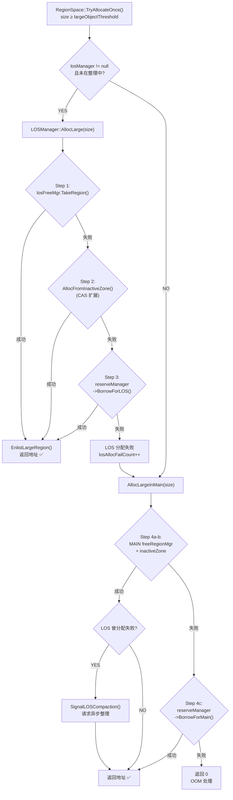
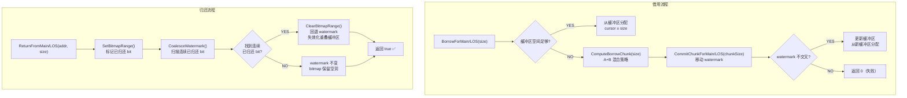
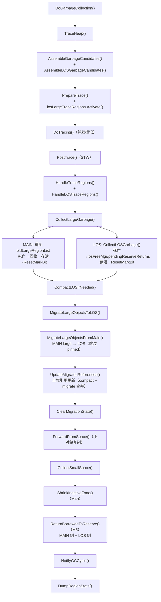
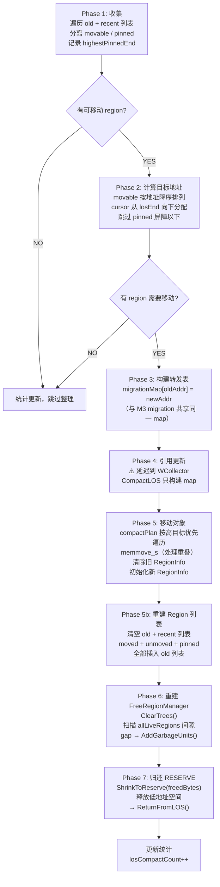
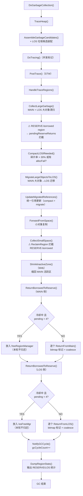

# 仓颉 Runtime — Large Object Space (LOS) 详细设计文档

**版本**：1.0  
**日期**：2026年2月20日  
**范围**：M1 ~ M5 全部里程碑实现

---

## 目录

- [1. 概述与设计目标](#1-概述与设计目标)
- [2. 整体架构与内存布局](#2-整体架构与内存布局)
- [3. 空间划分与初始化（M1）](#3-空间划分与初始化m1)
- [4. 大对象分配流程（M2）](#4-大对象分配流程m2)
- [5. RESERVE 借用与归还机制（M2/M5）](#5-reserve-借用与归还机制m2m5)
- [6. GC 回收与 MAIN→LOS 迁移（M3）](#6-gc-回收与-mainlos-迁移m3)
- [7. LOS 滑动整理（M4a）](#7-los-滑动整理m4a)
- [8. MAIN 碎片整理与 inactiveZone 缩回（M4b）](#8-main-碎片整理与-inactivezone-缩回m4b)
- [9. 动态调度机制（M5）](#9-动态调度机制m5)
- [10. 配置项、统计与源码索引](#10-配置项统计与源码索引)

---

## 1. 概述与设计目标

### 1.1 问题背景

仓颉 Runtime 的 GC 采用平滑并发复制式收集器（WCollector），在统一的 region 堆中以 region list 管理大对象（≥ 32KB）。原有设计中，大对象与小对象共享同一堆空间和 `FreeRegionManager`，存在以下问题：

1. **碎片放大**：大对象需要连续多 unit 的 region，与小对象交错分配后，空闲空间被切割成碎片，有效 region 利用率下降。
2. **无独立回收策略**：大对象仅做标记-清扫，不参与复制式 GC 的搬迁逻辑，但与小对象共享空闲管理器的竞争。
3. **缺乏弹性调度**：堆空间一旦初始化即固定分配，无法根据运行时大对象/小对象的实际比例动态调整空间。

### 1.2 设计目标

| 目标 | 说明 |
|------|------|
| **空间隔离** | 大对象拥有独立的 LOS 空间，与 MAIN（小对象）物理隔离 |
| **弹性调度** | 通过 RESERVE 缓冲区支持 MAIN ↔ LOS 动态借还空间 |
| **碎片消除** | LOS 支持滑动整理（Sliding Compaction）清除碎片 |
| **零侵入降级** | 比例配置为 0 时完全回退到原有行为，无性能损失 |
| **GC 集成** | 与现有 WCollector GC 流程无缝集成 |

### 1.3 里程碑概览

| 里程碑 | 名称 | 核心内容 |
|--------|------|----------|
| M1 | 空间划分 + 骨架 | 三段堆划分、LOSManager / ReserveManager 骨架 |
| M2 | 分配分流 | LOS 优先分配、RESERVE 借用、MAIN 降级回退 |
| M3 | GC 回收 + 迁移 | LOS 标记-清扫、MAIN→LOS 大对象迁移、引用更新 |
| M4a | LOS 滑动整理 | 7 阶段 Sliding Compaction + Pinned 屏障 + 异步触发 |
| M4b | MAIN 碎片整理 | 低地址优先分配 + ShrinkInactiveZone |
| M5 | 动态调度 | RESERVE 借还拦截、冷却/迟滞、Hole Bitmap |

---

## 2. 整体架构与内存布局

### 2.1 三段内存模型

堆空间在初始化时按可配置比例划分为三段：

```
regionHeapStart                                                            regionHeapEnd
    │                              │                    │                        │
    ▼                              ▼                    ▼                        ▼
    ┌──────────────────────────────┬────────────────────┬────────────────────────┐
    │         MAIN Space           │   RESERVE Zone     │       LOS Space        │
    │      （小对象 + 降级）        │    （弹性缓冲）     │     （大对象专用）       │
    │                              │                    │                        │
    │   inactiveZone ──────►       │◄── mainWatermark   │    ◄── losInactiveZone │
    │   低地址 → 高地址增长         │    losWatermark ──►│    高地址 → 低地址增长   │
    └──────────────────────────────┴────────────────────┴────────────────────────┘
    │<────── 默认 60% ────────────>│<──── 默认 30% ────>│<───── 默认 10% ───────>│
```

**关键设计原则**：

- **MAIN** 从低地址向高地址增长（`inactiveZone` 右移）
- **LOS** 从高地址向低地址增长（`losInactiveZone` 左移）
- **RESERVE** 夹在中间，两端可被借用：MAIN 从低端取（`mainWatermark` 右移），LOS 从高端取（`losWatermark` 左移）
- 两个 watermark 不可交叉，保证 RESERVE 完整性

### 2.2 管理器关系

```
┌─────────────────────────────────────────────────────────────────┐
│                        RegionManager                            │
│   - 堆 owner，持有全局 RegionInfo 数组                           │
│   - AllocLarge() 入口：路由到 LOS / MAIN                        │
│   - 持有 losManager、reserveManager 指针                        │
│   - GC 集成：DumpRegionStats、ReturnBorrowedToReserve           │
│                                                                 │
│   ┌───────────────┐   ┌──────────────────┐   ┌───────────────┐ │
│   │  FreeRegion    │   │   ReserveManager  │   │  LOSManager   │ │
│   │  Manager       │   │                  │   │               │ │
│   │  (MAIN)        │   │  - 水位线管理     │   │  - FreeRegion │ │
│   │  baseUnit=0    │◄──┤  - A+B 分块策略  ├──►│    Manager    │ │
│   │                │   │  - Hole Bitmap   │   │    (LOS)      │ │
│   │  dirtyTree     │   │  - 冷却/迟滞     │   │   baseUnit=   │ │
│   │  releaseTree   │   │                  │   │   losUnitStart│ │
│   └───────────────┘   └──────────────────┘   │               │ │
│                                               │  - CompactLOS │ │
│                                               │  - 迁移管理    │ │
│                                               └───────────────┘ │
└─────────────────────────────────────────────────────────────────┘
                              │
                    ┌─────────┴─────────┐
                    ▼                   ▼
              ┌──────────┐       ┌──────────────┐
              │WCollector │       │FinalizerProc │
              │GC 主流程  │       │异步 LOS 整理  │
              └──────────┘       └──────────────┘
```

### 2.3 核心类职责

| 类 | 源文件 | 职责 |
|----|--------|------|
| `RegionManager` | `RegionManager.h/cpp` | 堆 owner，空间划分，分配入口路由，GC 统计 |
| `LOSManager` | `LOSManager.h/cpp` | LOS 空间管理：分配、GC 清扫、迁移、滑动整理 |
| `ReserveManager` | `ReserveManager.h/cpp` | RESERVE 缓冲区：借用/归还、A+B 分块、Hole Bitmap |
| `FreeRegionManager` | `FreeRegionManager.h` | 空闲 region 管理：CartesianTree (dirty + released) |
| `WCollector` | `WCollector.cpp` | GC 控制器：调度 LOS 清扫、整理、迁移、归还 |

---

## 3. 空间划分与初始化（M1）

### 3.1 比例计算

堆空间在 `RegionManager::Initialize()` 中按环境变量比例划分。比例通过以下环境变量控制（默认值产生 6:3:1 = MAIN 60%、RESERVE 30%、LOS 10%）：

```cpp
int mainRatio    = GetSpaceRatio("cjMainRatio", 6);     // 默认 6
int reserveRatio = GetSpaceRatio("cjReserveRatio", 3);   // 默认 3
int losRatio     = GetSpaceRatio("cjLOSRatio", 1);       // 默认 1
int totalRatio   = mainRatio + reserveRatio + losRatio;   // = 10
```

单位数计算（`nUnit` 为堆总 unit 数）：

```
losUnitCount     = (nUnit × losRatio)     / totalRatio
reserveUnitCount = (nUnit × reserveRatio) / totalRatio
mainUnitCount    = nUnit - losUnitCount - reserveUnitCount   // 余量归 MAIN
```

**降级兼容**：当 `cjLOSRatio=0` 且 `cjReserveRatio=0` 时，全部 unit 归 MAIN，`losManager` 和 `reserveManager` 均为 `nullptr`，行为等同原版本。

### 3.2 地址边界计算

```
regionHeapStart ─────────────────────────────────────────── regionHeapEnd
│← mainUnitCount × UNIT_SIZE →│← reserveUnitCount →│← losUnitCount →│
│                              │                    │                │
mainStart                  mainEnd              losStart          losEnd
                           = reserveStart       = reserveEnd
```

```cpp
uintptr_t mainEnd      = regionHeapStart + mainUnitCount * UNIT_SIZE;
uintptr_t reserveStart = mainEnd;
uintptr_t reserveEnd   = reserveStart + reserveUnitCount * UNIT_SIZE;
uintptr_t losStart     = reserveEnd;
uintptr_t losEnd       = regionHeapEnd;
```

### 3.3 管理器创建

初始化顺序：**ReserveManager → LOSManager → FreeRegionManager (MAIN)**

```cpp
// 1. 创建 ReserveManager（需在 LOSManager 之前，因为 LOS 构造函数引用它）
if (reserveRatio > 0 && reserveUnitCount > 0) {
    reserveManager = new ReserveManager();
    reserveManager->Initialize(reserveStart, reserveEnd, UNIT_SIZE);
}

// 2. 创建 LOSManager（传入 baseUnitIndex 用于 FreeRegionManager 的索引偏移）
if (losRatio > 0 && losUnitCount > 0) {
    size_t losUnitStart = mainUnitCount + reserveUnitCount;
    losManager = new LOSManager(*this, losUnitStart, reserveManager);
    losManager->Initialize(losStart, losEnd, losUnitStart, losUnitEnd);
}

// 3. MAIN 的 FreeRegionManager 只管理 [0, mainUnitCount) 范围
freeRegionManager.Initialize(mainUnitCount);
freeRegionManager.SetLowAddressFirst(true);  // M4b: 低地址优先
```

### 3.4 FreeRegionManager 的 baseUnit 机制

`CartesianTree` 内部使用局部索引 `[0, unitCount)`，但访问 `RegionInfo` 需要全局索引。通过 `baseUnit` 偏移解决：

```
全局 RegionInfo 索引:
  [0 .............. mainUnitCount-1][reserveUnits][losUnitStart ... nUnit-1]
   │<──── MAIN (base=0) ─────────>│              │<── LOS (base=losUnitStart) ──>│

转换规则:
  globalIdx = localIdx + baseUnit
  localIdx  = globalIdx - baseUnit

MAIN FreeRegionManager:  baseUnit = 0
LOS  FreeRegionManager:  baseUnit = losUnitStart
```

`TakeRegion()` 返回的 region 使用 `globalIdx`，`AddGarbageUnits()` / `AddReleaseUnits()` 接收 `globalIdx` 并内部转换为 `localIdx`。两个 FreeRegionManager 的 `dirtyTree` / `releaseTree` 完全独立，互不干扰。

---

## 4. 大对象分配流程（M2）

### 4.1 分配入口

`RegionSpace::TryAllocateOnce()` 中，当 `allocSize >= largeObjectThreshold`（默认 32KB）时，进入大对象分配路径：

```cpp
RegionManager::AllocLarge(size)
```

### 4.2 分配路由策略

LOS 优先 → MAIN 降级，具体分 3 + 2 步：

**LOS 内部 3 步**（`LOSManager::AllocLarge`）：

| 步骤 | 来源 | 说明 |
|------|------|------|
| Step 1 | `losFreeMgr.TakeRegion()` | 从 LOS 的 dirty/release tree 获取回收 region |
| Step 2 | `AllocFromInactiveZone()` | CAS 扩展 losInactiveZone 向低地址 |
| Step 3 | `reserveManager->BorrowForLOS()` | 从 RESERVE 高端借用空间 |

**MAIN 降级 2 步**（`RegionManager::AllocLargeInMain`）：

| 步骤 | 来源 | 说明 |
|------|------|------|
| Step 4a-b | `freeRegionManager.TakeRegion()` + inactiveZone | MAIN 常规分配 |
| Step 4c | `reserveManager->BorrowForMain()` | 从 RESERVE 低端借用空间 |

### 4.3 分配流程图



### 4.4 LOS inactiveZone CAS 扩展

LOS 从高地址向低地址增长，使用无锁 CAS 支持多线程并发分配：

```
losStart              losInactiveZone (移动后)               losEnd
    │                        │                                   │
    ▼                        ▼                                   ▼
    │ ··· inactive zone ··· │ region3 │ region2 │ region1 │
    
    ← CAS(losInactiveZone, current, current - regionSize)
```

```cpp
RegionInfo* LOSManager::AllocFromInactiveZone(size_t unitCount) {
    size_t regionSize = unitCount * RegionInfo::UNIT_SIZE;
    uintptr_t currentZone = losInactiveZone.load(std::memory_order_relaxed);
    if (currentZone < losStart + regionSize) return nullptr;

    uintptr_t newZone = currentZone - regionSize;
    while (!losInactiveZone.compare_exchange_weak(currentZone, newZone, ...)) {
        if (currentZone < losStart + regionSize) return nullptr;
        newZone = currentZone - regionSize;
    }
    return RegionInfo::InitRegionAt(newZone, unitCount, LARGE_SIZED_UNITS);
}
```

### 4.5 Region List 管理

新分配的 LOS region 根据 GC 阶段进入不同列表：

| GC 阶段 | 目标列表 | 说明 |
|---------|----------|------|
| TRACE / CLEAR_SATB | `losLargeTraceRegions` (cache) | 标记为 traceRegion，避免被本轮 GC 错误回收 |
| 其他 | `losRecentLargeRegionList` | 新生代列表，下一轮 GC 合并到 old |

三个列表与 MAIN 空间的 `oldLargeRegionList` / `recentLargeRegionList` / `largeTraceRegions` 完全对称。

### 4.6 MAIN 大对象对齐优化（M4b）

MAIN 空间分配大对象时，`regionCount` 向上对齐到 `maxUnitCountPerRegion` 整数倍：

```cpp
regionCount = ((regionCount + maxUnitCountPerRegion - 1) / maxUnitCountPerRegion) * maxUnitCountPerRegion;
```

效果：释放后形成标准大小 region，可被 `TakeRegion` 直接复用，利于 `ShrinkInactiveZone` 回收。

---

## 5. RESERVE 借用与归还机制（M2/M5）

### 5.1 水位线模型

RESERVE 区域通过双向水位线管理空间：

```
reserveStart                                                    reserveEnd
    │                                                               │
    ▼                                                               ▼
    ┌────────────────┬─────────────────────┬────────────────────────┐
    │  MAIN 已提交    │     未提交空间       │     LOS 已提交         │
    │  (mainBorrowed) │    (available)      │    (losBorrowed)       │
    └────────────────┴─────────────────────┴────────────────────────┘
                     ▲                     ▲
               mainWatermark          losWatermark

    mainWatermark 向右移（MAIN 借入）  │  losWatermark 向左移（LOS 借入）
    mainWatermark 向左退（MAIN 归还）  │  losWatermark 向右退（LOS 归还）
    
    约束：mainWatermark ≤ losWatermark（不可交叉）
```

### 5.2 A+B 混合分块策略

为减少 watermark 移动次数，每次借用时不仅分配请求大小，而是预提交一块较大的 chunk 缓存在 buffer 中：

```
chunkSize = align_up(
    max(requestSize, max(minChunk, available × 10%)),
    alignment
)
如果 chunkSize > available → 降级为精确请求大小
```

| 常量 | 值 | 含义 |
|------|----|------|
| `MIN_BORROW_CHUNK_UNITS` | 16 | 最小 chunk（16KB-page → 256KB） |
| `BORROW_CHUNK_ALIGN_UNITS` | 16 | chunk 对齐粒度 |
| `BORROW_RATIO_DIVISOR` | 10 | 比例因子：available 的 10% |

**设计要点**：当前可用空间越大时，chunk 越大（10% 比例），分摊 watermark 移动成本；空间紧张时，chunk 缩小到最小值或精确大小，避免过度预占。

### 5.3 内部缓冲区机制

MAIN 和 LOS 各自持有缓冲区，避免每次小请求都移动 watermark：

```
MAIN 缓冲区（低→高）：               LOS 缓冲区（高→低）：
  [mainBufCursor → mainBufCeiling)     [losBufFloor ← losBufCursor)
  
  ├── 已分配 ──┤── 可用 ──┤            ├── 可用 ──┤── 已分配 ──┤
```

**借用流程**：

1. 尝试从缓冲区直接分配（无锁竞争，已在 mutex 保护下）
2. 缓冲区不足 → `ComputeBorrowChunk()` 计算 chunk 大小
3. `CommitChunkForMain/LOS()` 移动 watermark 提交新 chunk
4. 更新缓冲区边界 → 从新缓冲区分配

### 5.4 Hole Bitmap（M5 灵活归还）

#### 5.4.1 问题

M2-M4 阶段的归还只支持 LIFO（栈式）——只能从 watermark 边缘归还。但 GC 回收的 RESERVE-borrowed region 不一定在 watermark 边缘，导致归还失败、空间泄漏。

#### 5.4.2 方案

每个 RESERVE unit 用 1 bit 的 bitmap 记录归还状态。归还时标记 bitmap，然后从 watermark 边缘扫描连续已归还 bit，批量回退 watermark：

```
归还前:
  Bitmap:     0  0  0  0  │  0  0  0  0
  mainWatermark ──────────┘ (index=4)

归还 unit2 + unit3:
  Bitmap:     0  0  1  1  │  0  0  0  0
                ↑  ↑        ▲
             已归还 bit     mainWatermark 仍在 4

Coalesce 扫描 (从 wmIdx-1=3 向下):
  bit[3]=1, bit[2]=1, bit[1]=0 → 停止
  → 清除 bit[2..3]，mainWatermark 回退到 2

  Bitmap:     0  0  0  0  │  0  0  0  0
                          ▲
                   mainWatermark = 2   ✅ 回收了 2 个 unit
```

**内存开销极低**：64MB RESERVE @ 16KB unit size = 4096 units → 512 bytes bitmap。

#### 5.4.3 Coalesce 规则

- **MAIN 侧** `CoalesceMainWatermark()`：从 `wmIdx - 1` 向下扫描连续 `bit=1`
- **LOS 侧** `CoalesceLOSWatermark()`：从 `losWmIdx` 向上扫描连续 `bit=1`
- Coalesce 后清除 bitmap、移动 watermark、失效化重叠的缓冲区
- **不跨侧共享**：MAIN 归还的空洞不影响 LOS 的 watermark，反之亦然

### 5.5 借用/归还流程图



---

## 6. GC 回收与 MAIN→LOS 迁移（M3）

### 6.1 GC 生命周期中的 LOS 集成点

LOS 的 GC 处理嵌入 WCollector 的已有 GC 流程中，不改变整体阶段顺序：

| GC 阶段 | LOS 操作 | 函数 |
|---------|----------|------|
| TraceHeap → Assemble | 装配 LOS 垃圾候选 | `AssembleLOSGarbageCandidates()` |
| TraceHeap → Prepare | 激活 LOS trace cache | `losLargeTraceRegions.Activate()` |
| PostTrace → HandleTrace | 合并 LOS trace regions | `HandleLOSTraceRegions()` |
| PostTrace → CollectLarge | LOS 死亡 region 清扫 | `CollectLOSGarbage()` |
| PostTrace → Compact | 条件性 LOS 整理 | `CompactLOSIfNeeded()` |
| PostTrace → Migrate | MAIN→LOS 迁移 + 引用更新 | `MigrateLargeObjectsToLOS()` |
| GC 结束 | 归还 RESERVE 借用 | `ReturnBorrowedToReserve()` |

### 6.2 垃圾候选装配

GC 标记前，`AssembleLOSGarbageCandidates()` 将 recent 列表合并到 old 列表，并清除所有 region 的存活信息：

```cpp
losOldLargeRegionList.MergeRegionList(losRecentLargeRegionList, LARGE_REGION);
for (region : losOldLargeRegionList) {
    region->ClearLiveInfo();
}
```

### 6.3 LOS 标记-清扫

GC 标记阶段使用 region 级标记位（大对象 region 只包含一个对象，offset=0）。  
标记完成后，`CollectLOSGarbage()` 遍历 `losOldLargeRegionList` 执行清扫：

**两级回收策略**：

| 条件 | 方法 | 路由 |
|------|------|------|
| regionSize ≤ 4MB | `ReclaimLOSRegion()` | → `losFreeMgr.AddGarbageUnits()` (dirtyTree) |
| regionSize > 4MB | `ReleaseLOSRegion()` | → 物理释放 + `losFreeMgr.AddReleaseUnits()` (releaseTree) |

**M5 RESERVE 拦截**：如果死亡 region 位于 RESERVE 借用区域（`addr < losStart`），不进入 `losFreeMgr`，而是暂存到 `pendingReserveReturns`，等待 GC 结束后统一归还。

### 6.4 MAIN→LOS 迁移

`MigrateLargeObjectsFromMain()` 在 PostTrace（STW）中执行，`CollectLargeGarbage()` 之后调用：

1. 遍历 MAIN 的 `oldLargeRegionList`
2. 跳过 pinned 对象（`rawPointerCount > 0`）
3. 在 LOS 中 `AllocLarge()` 分配等大空间
4. `memmove_s` 拷贝对象数据
5. 记录 `old → new` 地址到 `migrationMap`
6. 旧 MAIN region 移入 `garbageRegionList` 等待回收
7. LOS 分配失败则停止本轮迁移

### 6.5 统一引用更新

`migrationMap` 是 `std::unordered_map<uintptr_t, uintptr_t>`，同时存储 M4a compaction 和 M3 migration 的转发条目。只做一次 `UpdateMigratedReferences()` 全堆扫描：

- **堆对象**：`Heap::ForEachObj()` → `obj->ForEachRefField(updateRefField)`
- **静态根**：`Heap::VisitStaticRoots(updateRefField)`

使用 `unordered_map` 提供 O(1) 查找效率。STW 期间无并发写入，直接写 field 安全。

### 6.6 GC 回收流程图



---

## 7. LOS 滑动整理（M4a）

### 7.1 触发条件

`NeedsCompaction()` 在以下任一条件满足时返回 true：

| 条件 | 阈值 | 计算方式 |
|------|------|----------|
| 碎片率过高 | > 30% | `freeUnits / activeUnits > LOS_COMPACTION_FRAG_THRESHOLD` |
| 分配失败 | > 0 | `losAllocFailCount > lastCompactAllocFailCount` |

还有外部异步请求路径：`compactionRequested` 标志由 `SignalLOSCompaction()` 设置。

### 7.2 整理策略：Strategy A（Pinned 屏障）

**方向**：所有可移动对象向高地址（`losEnd`）滑动，紧凑排列。

**Pinned 屏障**：如果存在 pinned 对象（`rawPointerCount > 0`），以最高 pinned 对象的结束地址作为屏障，只整理屏障以上的区域。屏障以下的可移动对象不搬迁。

```
整理前:
losStart  [ obj1 ][ 空 ][ obj2 ][ PIN ][ obj3 ][ 空 ][ obj4 ]  losEnd
                                  ^^^^ highestPinnedEnd

整理后:
losStart  [ 空闲→归还 RESERVE ][ PIN ][ obj1 ][ obj2 ][ obj3 ][ obj4 ]  losEnd
                                       │<──── 紧凑排列 ──────────────>│
```

### 7.3 CompactLOS 七阶段流程



### 7.4 关键实现细节

#### 7.4.1 排序与目标分配

可移动 region 按地址**降序**排列。从 `losEnd` 向下分配目标地址（cursor 递减）。由于原始排序是降序，第一个 region（最高地址）获得最高目标（紧贴 `losEnd`），保证滑动方向始终向高地址（`newStart > oldStart`）。

#### 7.4.2 移动顺序与重叠安全

`compactPlan` 按高目标优先遍历，先写最高地址。由于对象都向高地址滑动（`newStart ≥ oldStart`），高目标先写不会覆盖尚未搬迁的低地址数据。`memmove_s` 额外处理个别重叠情况。

#### 7.4.3 RebuildFreeRegionManager

ClearTrees 后，遍历已排序的 `allLiveRegions`，计算相邻 region 之间的间隙，将间隙作为 free units 插入 losFreeMgr。

#### 7.4.4 引用更新合并

`CompactLOS()` 只向 `migrationMap` 追加条目，不调用 `UpdateMigratedReferences()`。与后续 M3 `MigrateLargeObjectsFromMain()` 的条目合并后，WCollector 只做一次全堆扫描，节省一次 O(heap) 遍历。

### 7.5 异步整理触发

当 GC 未触发但 LOS 碎片严重时，分配路径可异步请求整理：

```
AllocLarge() LOS 失败 → AllocLargeInMain() MAIN 成功
    → SignalLOSCompaction()
        → losManager->SetCompactionRequested(true)
        → FinalizerProcessor::NotifyToCompactLOS()
            → PerformLOSCompaction()
                → SetCompacting(true)     // 阻止 LOS 新分配
                → RequestGC(sync)         // STW 中执行 CompactLOS()
                → SetCompacting(false)
```

**`isCompacting` 标志**：当为 true 时，`LOSManager::AllocLarge()` 立即返回 0，强制所有大对象降级到 MAIN，避免与正在进行的整理冲突。

---

## 8. MAIN 碎片整理与 inactiveZone 缩回（M4b）

### 8.1 问题背景

WCollector 的 `ForwardFromSpace` 阶段分配 to-region 时不偏好地址方向，导致小对象复制后分散在整个 MAIN 活跃区。高地址存在零散存活 region 时，`inactiveZone` 无法缩回，MAIN 空间无法释放给 RESERVE。

### 8.2 低地址优先分配

在 `FreeRegionManager` 中引入 `lowAddressFirst` 标志。启用后，`TakeRegion()` 使用 `TakeUnitsLowAddr()` 算法——利用 CartesianTree 的 BST on index（左子树 = 低地址）+ Max-heap on count 双重性质，O(log n) 找到最低地址的满足条件节点。

```cpp
freeRegionManager.SetLowAddressFirst(true);  // RegionManager::Initialize() 中设置
```

效果：新分配和复制目标 region 集中在低地址区域，高地址区域自然空出。

### 8.3 ShrinkInactiveZone

每次 GC 后执行（`CollectSmallSpace()` 之后）：

1. **Pass 1**：扫描 `[regionHeapStart, inactiveZone)` 找到最高存活 region 的结束地址 `highestLiveEnd`
2. **Pass 2**：`ClearTrees()` + 重新扫描，将 `[regionHeapStart, highestLiveEnd)` 内的空闲 region 重新插入 `freeRegionManager`
3. 将 `inactiveZone` 缩回到 `highestLiveEnd`

**Pinned 限制**：高地址 pinned region 阻止 inactiveZone 缩回（无法搬迁），极端情况下退化为只做碎片整理。

### 8.4 与 LOS 的协同

MAIN inactiveZone 缩回后释放的空间并不直接归还 RESERVE（因为 MAIN 原始空间在 RESERVE 左侧）。但 MAIN 占用缩小后，RESERVE 借给 MAIN 的空间可以通过 `ReturnBorrowedToReserve()` 归还。两者联合实现 MAIN 空间的弹性收缩。

---

## 9. 动态调度机制（M5）

### 9.1 核心问题与方案

M2-M4 中借用的 RESERVE 空间在 GC 回收后进入各自的 FreeRegionManager 复用，但永远不会归还给 RESERVE。M5 通过以下机制解决：

1. **pendingReserveReturns 拦截**：GC 回收时检测 RESERVE-borrowed region，暂存而非放入 freeMgr
2. **集中归还**：GC 结束后统一调用 `ReturnBorrowedToReserve()`
3. **冷却/迟滞**：避免频繁借还振荡

### 9.2 RESERVE 领域检测

```
regionHeapStart    mainEnd   reserveStart          reserveEnd   losStart        losEnd
    [  MAIN 原始  ][ MAIN借 ][   RESERVE 未提交   ][ LOS 借  ][ LOS 原始      ]
                     ^                                  ^
               mainWatermark                       losWatermark
```

| 检测方法 | 判据 | 使用处 |
|----------|------|--------|
| `RegionManager::IsInReserveTerritory(addr)` | `addr >= mainEnd` | MAIN 回收拦截 |
| `LOSManager::IsInReserveTerritory(addr)` | `addr < losStart` | LOS 回收拦截 |

### 9.3 拦截与暂存流程

GC 回收 region 时（`ReclaimRegion` / `ReleaseRegion` 及 LOS 的 `ReclaimLOSRegion` / `ReleaseLOSRegion`），如果 region 在 RESERVE 领域，不进入 freeMgr，而是暂存到 `pendingReserveReturns`：

```cpp
// RegionManager::ReclaimRegion() 中
if (IsInReserveTerritory(region->GetRegionStart())) {
    pendingReserveReturns.push_back({unitIndex, unitCount});
    return;  // 不进入 freeRegionManager
}
freeRegionManager.AddGarbageUnits(unitIndex, unitCount);
```

LOS 侧的 `ReclaimLOSRegion()` / `ReleaseLOSRegion()` 逻辑完全对称。

### 9.4 冷却机制（Cooldown）

防止 MAIN/LOS 与 RESERVE 之间高频借还振荡：

| 规则 | 含义 | 周期数 |
|------|------|--------|
| 归还后抑制借入 | `lastReturnCycle + BORROW_COOLDOWN_CYCLES > gcCycleCount` | 2 |
| 借入后抑制归还 | `lastBorrowCycle + RETURN_COOLDOWN_CYCLES > gcCycleCount` | 2 |

MAIN 和 LOS 各自独立追踪冷却状态（`lastMainBorrowCycle` / `lastLOSBorrowCycle` / `lastMainReturnCycle` / `lastLOSReturnCycle`）。

**紧急绕过**：当 `pendingReserveReturns.size() >= 4` 时，说明归还压力大（大量 region 已死亡），忽略冷却限制直接归还。

### 9.5 迟滞阈值（Hysteresis）

| 阈值 | 值 | 含义 |
|------|----|------|
| `RETURN_USAGE_THRESHOLD` | 0.6 | 使用率低于 60% 才触发归还 |
| `BORROW_USAGE_THRESHOLD` | 0.8 | 使用率高于 80% 才触发借入 |
| `LOS_RESERVE_RETURN_THRESHOLD` | 0.4 | LOS 空闲率 > 40% 触发归还 |

### 9.6 GC 完整生命周期流程图



---

## 10. 配置项、统计与源码索引

### 10.1 环境变量配置

| 环境变量 | 默认值 | 说明 |
|---------|--------|------|
| `cjMainRatio` | 6 | MAIN 空间比例分子 |
| `cjReserveRatio` | 3 | RESERVE 空间比例分子 |
| `cjLOSRatio` | 1 | LOS 空间比例分子 |
| `cjLargeThresholdSize` | 32KB | 大对象阈值（≥ 此值走大对象路径） |

**关闭 LOS**：`cjLOSRatio=0 cjReserveRatio=0`，全部空间归 MAIN，等同原版本。

**调大 LOS**：`cjMainRatio=5 cjReserveRatio=2 cjLOSRatio=3`，LOS 获 30% 空间。

### 10.2 编译期常量

| 常量 | 值 | 所在类 | 含义 |
|------|----|--------|------|
| `LOS_COMPACTION_FRAG_THRESHOLD` | 0.3 | LOSManager | 碎片率 > 30% 触发整理 |
| `LOS_RESERVE_RETURN_THRESHOLD` | 0.4 | LOSManager | LOS 空闲率 > 40% 触发归还 |
| `MIN_BORROW_CHUNK_UNITS` | 16 | ReserveManager | 最小借用 chunk（16 units） |
| `BORROW_CHUNK_ALIGN_UNITS` | 16 | ReserveManager | chunk 对齐粒度 |
| `BORROW_RATIO_DIVISOR` | 10 | ReserveManager | 比例因子（available 的 10%） |
| `BORROW_COOLDOWN_CYCLES` | 2 | ReserveManager | 归还后抑制借入的 GC 周期数 |
| `RETURN_COOLDOWN_CYCLES` | 2 | ReserveManager | 借入后抑制归还的 GC 周期数 |
| `RETURN_USAGE_THRESHOLD` | 0.6 | ReserveManager | 使用率低于此值才归还 |
| `BORROW_USAGE_THRESHOLD` | 0.8 | ReserveManager | 使用率高于此值才借入 |
| `LARGE_OBJECT_RELEASE_THRESHOLD` | 4MB | RegionInfo | 超此阈值物理释放（releaseTree） |

### 10.3 运行时统计指标

**RESERVE 统计**（`DumpRegionStats` 输出）：

| 指标 | 来源 | 含义 |
|------|------|------|
| capacity | `reserveManager->GetCapacity()` | RESERVE 总容量 |
| available | `reserveManager->GetAvailable()` | RESERVE 未提交空间 |
| mainBorrowed | `reserveManager->GetMainBorrowedSize()` | MAIN 已借用大小 |
| losBorrowed | `reserveManager->GetLOSBorrowedSize()` | LOS 已借用大小 |
| mainReturned | `reserveManager->GetMainReturnBytes()` | MAIN 累计归还 |
| losReturned | `reserveManager->GetLOSReturnBytes()` | LOS 累计归还 |

**LOS 统计**：

| 指标 | 来源 | 含义 |
|------|------|------|
| capacity | `losManager->GetCapacity()` | LOS 总容量 |
| used | `losManager->GetUsedSize()` | LOS 已使用（losEnd - inactiveZone） |
| free | `losManager->GetFreeSize()` | LOS 空闲（inactiveZone - losStart） |
| allocCount | `losManager->GetAllocCount()` | LOS 分配成功次数 |
| allocFailCount | `losManager->GetAllocFailCount()` | LOS 分配失败次数 |
| fallbackCount | `losManager->GetFallbackCount()` | 降级到 MAIN 的次数 |
| reserveBorrowCount | `losManager->GetReserveBorrowCount()` | RESERVE 借用次数 |
| compactCount | `losManager->GetCompactCount()` | 整理执行次数 |
| garbageCollectedBytes | `losManager->GetGarbageCollectedBytes()` | 上一轮 GC 回收字节 |
| migrateInCount | `losManager->GetMigrateInCount()` | 从 MAIN 迁入的对象数 |
| compactMovedBytes | `losManager->GetCompactMovedBytes()` | 整理移动字节 |
| compactFreedBytes | `losManager->GetCompactFreedBytes()` | 整理释放字节 |
| compactShrunkBytes | `losManager->GetCompactShrunkBytes()` | 整理归还 RESERVE 字节 |

**TRACE_COUNT 性能计数器**（供外部监控采集）：

```
CJRT_GC_reserveCapacity, CJRT_GC_reserveAvailable
CJRT_GC_losCapacity, CJRT_GC_losUsed, CJRT_GC_losFree
CJRT_GC_losAllocCount, CJRT_GC_losAllocFailCount
CJRT_GC_losCompactions, CJRT_GC_losMigrateIn
```

### 10.4 源码文件索引

| 文件 | 行数 | 核心职责 |
|------|------|----------|
| `src/Heap/Allocator/LOSManager.h` | ~280 | LOS 管理器头文件：所有公共接口声明 |
| `src/Heap/Allocator/LOSManager.cpp` | ~750 | LOS 管理器实现：AllocLarge、CollectLOSGarbage、CompactLOS、MigrateLargeObjectsFromMain |
| `src/Heap/Allocator/ReserveManager.h` | ~240 | RESERVE 管理器头文件：水位线、bitmap、A+B 策略声明 |
| `src/Heap/Allocator/ReserveManager.cpp` | ~250 | RESERVE 管理器实现：Borrow/Return、bitmap helpers、coalesce |
| `src/Heap/Allocator/RegionManager.h` | ~760 | 堆 owner 头文件：AllocLarge 入口、LOS/RESERVE accessor |
| `src/Heap/Allocator/RegionManager.cpp` | ~1400+ | 堆 owner 实现：Initialize 空间划分、ShrinkInactiveZone、ReturnBorrowedToReserve |
| `src/Heap/Allocator/FreeRegionManager.h` | - | 空闲管理器：CartesianTree 包装、baseUnit 偏移 |
| `src/Heap/Allocator/CartesianTree.h/cpp` | - | 笛卡尔树：baseIndex、TakeUnitsLowAddr |
| `src/Heap/WCollector/WCollector.cpp` | ~600+ | GC 控制器：CompactLOSIfNeeded、MigrateLargeObjectsToLOS、ReturnBorrowed |

### 10.5 关键函数速查

| 场景 | 入口函数 | 调用链 |
|------|----------|--------|
| 大对象分配 | `RegionManager::AllocLarge()` | → `LOSManager::AllocLarge()` → fallback `AllocLargeInMain()` |
| LOS GC 清扫 | `LOSManager::CollectLOSGarbage()` | `PostTrace` → `CollectLargeGarbage` → `CollectLOSGarbage` |
| MAIN→LOS 迁移 | `LOSManager::MigrateLargeObjectsFromMain()` | `PostTrace` → `MigrateLargeObjectsToLOS` |
| LOS 滑动整理 | `LOSManager::CompactLOS()` | `PostTrace` → `CompactLOSIfNeeded` → `CompactLOS` |
| 引用更新 | `LOSManager::UpdateMigratedReferences()` | `MigrateLargeObjectsToLOS` 中调用 |
| RESERVE 借用 | `ReserveManager::BorrowForMain/LOS()` | `AllocLarge` / `AllocLargeInMain` 分配失败时 |
| RESERVE 归还 | `RegionManager::ReturnBorrowedToReserve()` | GC 结束后 → `ReturnFromMain/LOS` |
| MAIN 缩回 | `RegionManager::ShrinkInactiveZone()` | GC 结束后 `CollectSmallSpace` 之后 |
| 异步整理信号 | `RegionManager::SignalLOSCompaction()` | `AllocLargeInMain` 成功 + LOS 失败时 |

---

*文档结束*

