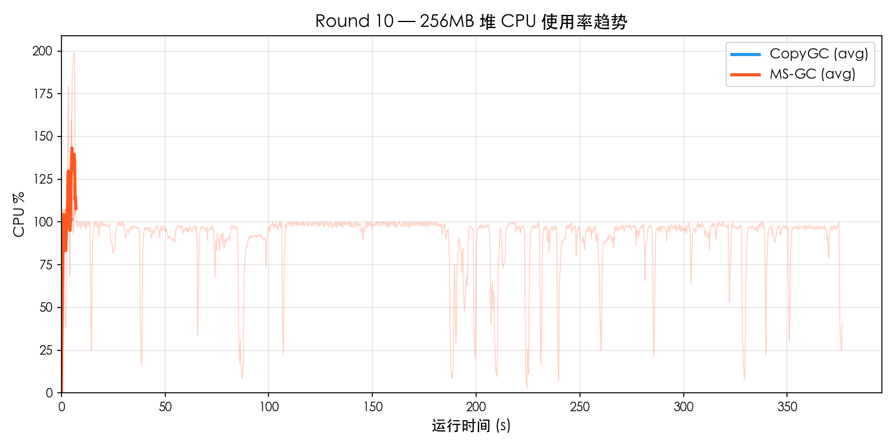
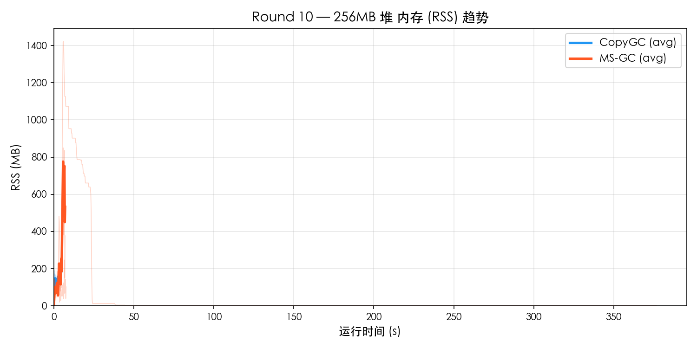
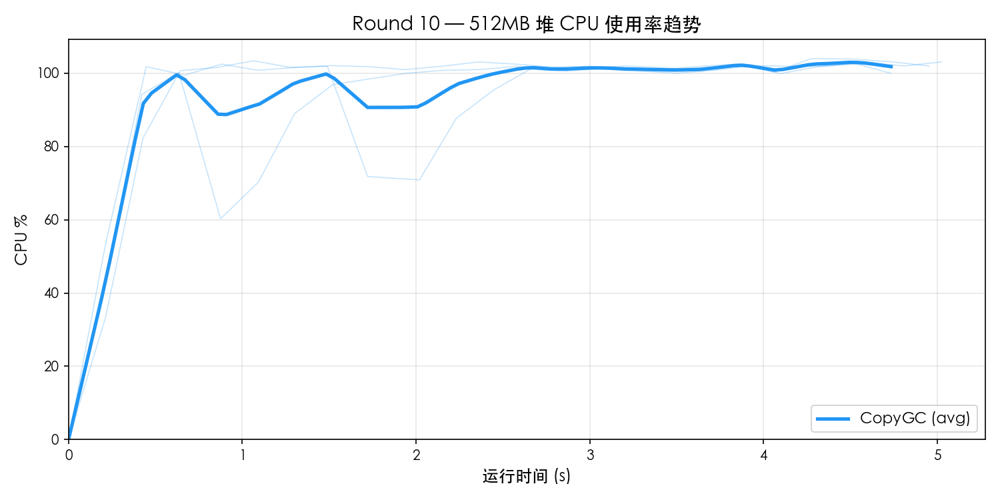
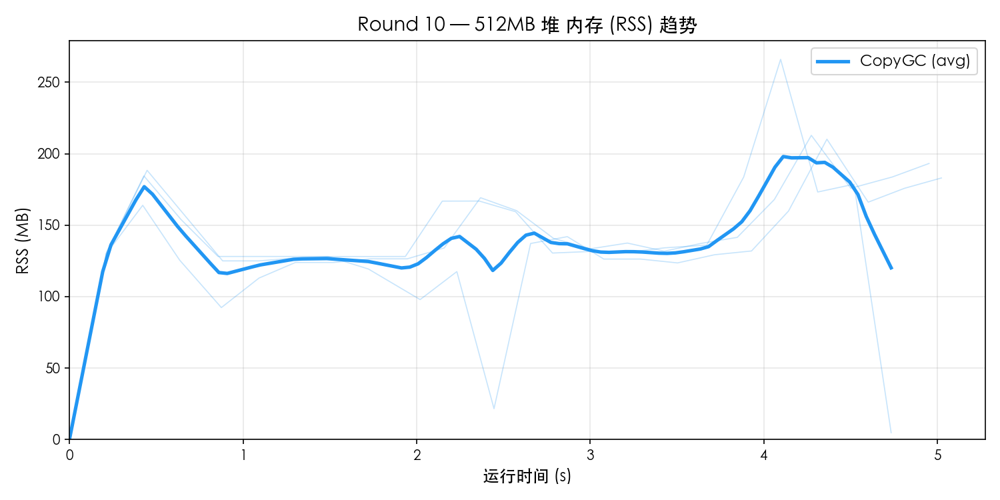

# Round 10 — MS-GC vs CopyGC Benchmark 对比

- **日期**: 2026-03-19
- **平台**: macOS aarch64 (Apple Silicon)
- **构建类型**: Release (`-O2`), MS-GC 使用 `--gc-mode marksweep`
- **测试集**: `gc_benchmark.cj`
- **堆大小**: 256MB / 512MB
- **每组重复**: 3 轮取平均
- **资源采样**: `ps -p PID -o rss=,%cpu=` 每 0.2s 采样

---

## 1. 256MB 堆对比

### 功能完整性

| 测试项 | CopyGC | MS-GC |
|--------|--------|-------|
| F1_TreeIntegrity | PASS | N/A |
| F2_Generational | PASS | N/A |
| F3_LargeObject | PASS | N/A |
| F4_LinkedList | PASS | N/A |
| F5_HashMap | PASS | N/A |
| **通过率** | **5/5** | **0/5** |

### 性能对比

| 测试项 | CopyGC | MS-GC | MS/Copy |
|--------|--------|-------|---------|
| P1_SmallAlloc | 230 ms | 200 ms | 0.87× |
| P2_LargeAlloc | 831 ms | 998 ms | 1.20× |
| P3_MixedWorkload | 524 ms | 480 ms | 0.92× |
| P4_LongLivedChurn | 411 ms | 374 ms | 0.91× |
| P5_Fragmentation | 647 ms | 595 ms | 0.92× |
| **Total** | **4898 ms** | **4729 ms** | **0.97×** |

### 资源使用

| 指标 | CopyGC | MS-GC | 差距 |
|------|--------|-------|------|
| 平均 CPU% | 89.4% | 95.2% | MS 高 6% |
| 峰值 CPU% | 102.8% | 163.9% | MS 高 59% |
| 平均 RSS | 137.5 MB | 134.4 MB | MS 低 2% |
| 峰值 RSS | 219.9 MB | 840.0 MB | MS 高 282% |

### 资源趋势图

## 2. 512MB 堆对比

### 功能完整性

| 测试项 | CopyGC | MS-GC |
|--------|--------|-------|
| F1_TreeIntegrity | PASS | N/A |
| F2_Generational | PASS | N/A |
| F3_LargeObject | PASS | N/A |
| F4_LinkedList | PASS | N/A |
| F5_HashMap | PASS | N/A |
| **通过率** | **5/5** | **0/5** |

### 性能对比

| 测试项 | CopyGC | MS-GC | MS/Copy |
|--------|--------|-------|---------|
| P1_SmallAlloc | 237 ms | 0 ms | 0.00× |
| P2_LargeAlloc | 823 ms | 0 ms | 0.00× |
| P3_MixedWorkload | 509 ms | 0 ms | 0.00× |
| P4_LongLivedChurn | 402 ms | 0 ms | 0.00× |
| P5_Fragmentation | 640 ms | 0 ms | 0.00× |
| **Total** | **4909 ms** | **0 ms** | **0.00×** |

### 资源使用

| 指标 | CopyGC | MS-GC | 差距 |
|------|--------|-------|------|
| 平均 CPU% | 92.1% | 0.0% | MS 低 100% |
| 峰值 CPU% | 103.5% | 0.0% | MS 低 100% |
| 平均 RSS | 136.6 MB | 0.0 MB | MS 低 100% |
| 峰值 RSS | 229.7 MB | 0.0 MB | MS 低 100% |

### 资源趋势图

## 3. 多堆尺寸横向对比

### 总耗时

| 堆大小 | CopyGC | MS-GC | MS/Copy |
|--------|--------|-------|---------|
| 256 MB | 4898 ms | 4729 ms | 0.97× |
| 512 MB | 4909 ms | 0 ms | 0.00× |

### Peak RSS

| 堆大小 | CopyGC Peak | MS-GC Peak | 比值 |
|--------|-------------|------------|------|
| 256 MB | 220 MB | 840 MB | 3.82× |
| 512 MB | 230 MB | 0 MB | 0.00× |

### CPU 使用率

| 堆大小 | CopyGC Avg | MS-GC Avg | CopyGC Max | MS-GC Max |
|--------|-----------|-----------|-----------|-----------|
| 256 MB | 89.4% | 95.2% | 102.8% | 163.9% |
| 512 MB | 92.1% | 0.0% | 103.5% | 0.0% |

## 4. MS-GC vs CopyGC 对比倍率汇总

| 指标 | 256MB | 512MB |
|------|------ | ------|
| Total 性能 | 0.97× | — |
| 峰值 RSS | 3.82× | — |
| 平均 CPU% | 1.06× | — |

## 5. 结论

### 判定结果

| 维度 | 判定 |
|------|------|
| 功能完整性 | 存在 FAIL |
| Total 性能 (256MB) | 0.97× → **达标** (< 1.5×) |
| 峰值 RSS (256MB) | 3.82× → 未达标 (>= 1.3×) |
| 平均 CPU (256MB) | 1.06× → **达标** (< 1.5×) |
