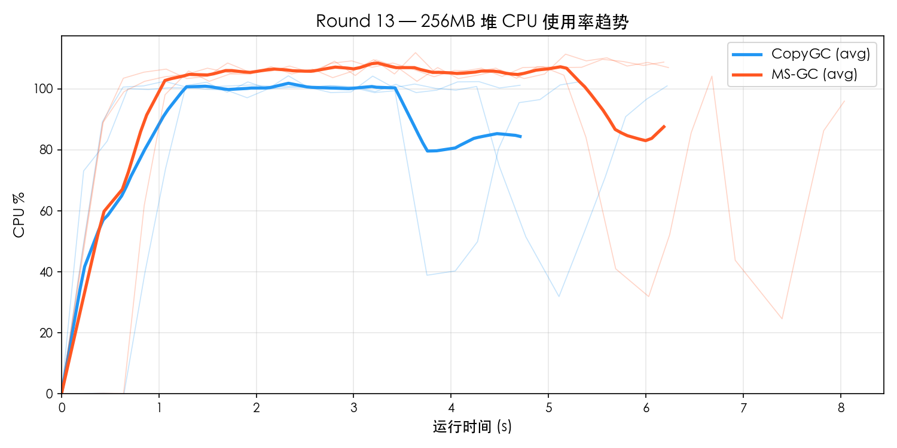
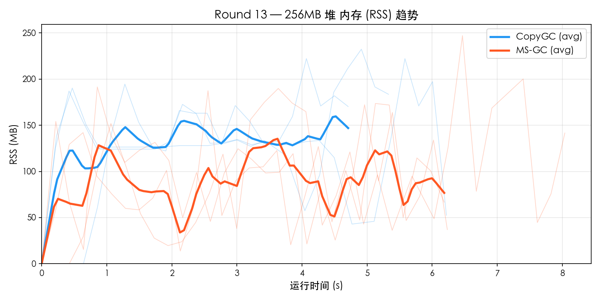
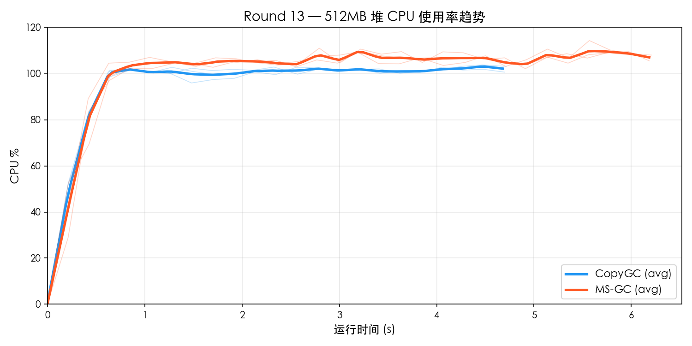
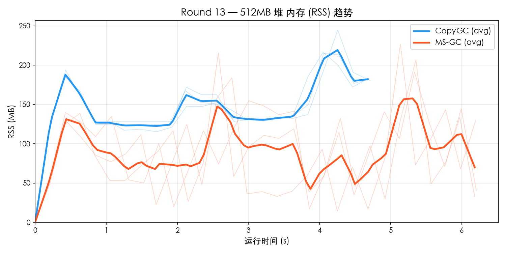

# Round 13 — MS-GC vs CopyGC Benchmark 对比

- **日期**: 2026-03-19
- **平台**: macOS aarch64 (Apple Silicon)
- **构建类型**: Release (`-O2`), MS-GC 使用 `--gc-mode marksweep`
- **测试集**: `gc_benchmark.cj`
- **堆大小**: 256MB / 512MB
- **每组重复**: 3 轮取平均
- **资源采样**: `ps -p PID -o rss=,%cpu=` 每 0.2s 采样

---

## 1. 256MB 堆对比

### 功能完整性

| 测试项 | CopyGC | MS-GC |
|--------|--------|-------|
| F1_TreeIntegrity | PASS | PASS |
| F2_Generational | PASS | PASS |
| F3_LargeObject | PASS | PASS |
| F4_LinkedList | PASS | PASS |
| F5_HashMap | PASS | PASS |
| **通过率** | **5/5** | **5/5** |

### 性能对比

| 测试项 | CopyGC | MS-GC | MS/Copy |
|--------|--------|-------|---------|
| P1_SmallAlloc | 229 ms | 295 ms | 1.29× |
| P2_LargeAlloc | 823 ms | 1086 ms | 1.32× |
| P3_MixedWorkload | 841 ms | 883 ms | 1.05× |
| P4_LongLivedChurn | 505 ms | 553 ms | 1.10× |
| P5_Fragmentation | 642 ms | 1111 ms | 1.73× |
| **Total** | **5194 ms** | **6695 ms** | **1.29×** |

### 资源使用

| 指标 | CopyGC | MS-GC | 差距 |
|------|--------|-------|------|
| 平均 CPU% | 85.3% | 93.4% | MS 高 10% |
| 峰值 CPU% | 103.6% | 111.0% | MS 高 7% |
| 平均 RSS | 131.8 MB | 90.8 MB | MS 低 31% |
| 峰值 RSS | 225.6 MB | 208.7 MB | MS 低 8% |

### 资源趋势图

## 2. 512MB 堆对比

### 功能完整性

| 测试项 | CopyGC | MS-GC |
|--------|--------|-------|
| F1_TreeIntegrity | PASS | PASS |
| F2_Generational | PASS | PASS |
| F3_LargeObject | PASS | PASS |
| F4_LinkedList | PASS | PASS |
| F5_HashMap | PASS | PASS |
| **通过率** | **5/5** | **5/5** |

### 性能对比

| 测试项 | CopyGC | MS-GC | MS/Copy |
|--------|--------|-------|---------|
| P1_SmallAlloc | 227 ms | 298 ms | 1.31× |
| P2_LargeAlloc | 816 ms | 1095 ms | 1.34× |
| P3_MixedWorkload | 513 ms | 668 ms | 1.30× |
| P4_LongLivedChurn | 397 ms | 533 ms | 1.34× |
| P5_Fragmentation | 650 ms | 898 ms | 1.38× |
| **Total** | **4787 ms** | **6260 ms** | **1.31×** |

### 资源使用

| 指标 | CopyGC | MS-GC | 差距 |
|------|--------|-------|------|
| 平均 CPU% | 93.7% | 99.6% | MS 高 6% |
| 峰值 CPU% | 103.5% | 111.6% | MS 高 8% |
| 平均 RSS | 143.8 MB | 89.2 MB | MS 低 38% |
| 峰值 RSS | 225.5 MB | 216.4 MB | MS 低 4% |

### 资源趋势图

## 3. 多堆尺寸横向对比

### 总耗时

| 堆大小 | CopyGC | MS-GC | MS/Copy |
|--------|--------|-------|---------|
| 256 MB | 5194 ms | 6695 ms | 1.29× |
| 512 MB | 4787 ms | 6260 ms | 1.31× |

### Peak RSS

| 堆大小 | CopyGC Peak | MS-GC Peak | 比值 |
|--------|-------------|------------|------|
| 256 MB | 226 MB | 209 MB | 0.92× |
| 512 MB | 225 MB | 216 MB | 0.96× |

### CPU 使用率

| 堆大小 | CopyGC Avg | MS-GC Avg | CopyGC Max | MS-GC Max |
|--------|-----------|-----------|-----------|-----------|
| 256 MB | 85.3% | 93.4% | 103.6% | 111.0% |
| 512 MB | 93.7% | 99.6% | 103.5% | 111.6% |

## 4. MS-GC vs CopyGC 对比倍率汇总

| 指标 | 256MB | 512MB |
|------|------ | ------|
| Total 性能 | 1.29× | 1.31× |
| 峰值 RSS | 0.92× | 0.96× |
| 平均 CPU% | 1.10× | 1.06× |

## 5. 结论

### 判定结果

| 维度 | 判定 |
|------|------|
| 功能完整性 | **全部 PASS** |
| Total 性能 (256MB) | 1.29× → **达标** (< 1.5×) |
| 峰值 RSS (256MB) | 0.92× → **优秀** (MS 更省) |
| 平均 CPU (256MB) | 1.10× → **达标** (< 1.5×) |
| Total 性能 (512MB) | 1.31× → **达标** (< 1.5×) |
| 峰值 RSS (512MB) | 0.96× → **优秀** (MS 更省) |
| 平均 CPU (512MB) | 1.06× → **达标** (< 1.5×) |
