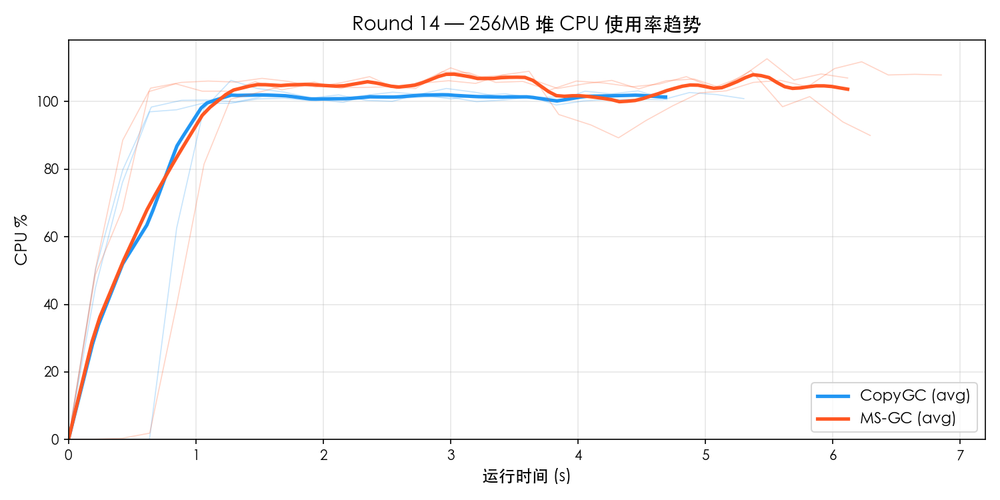
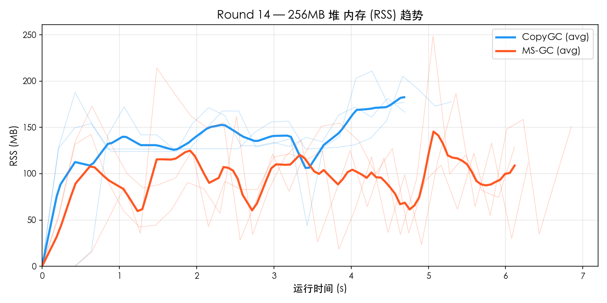
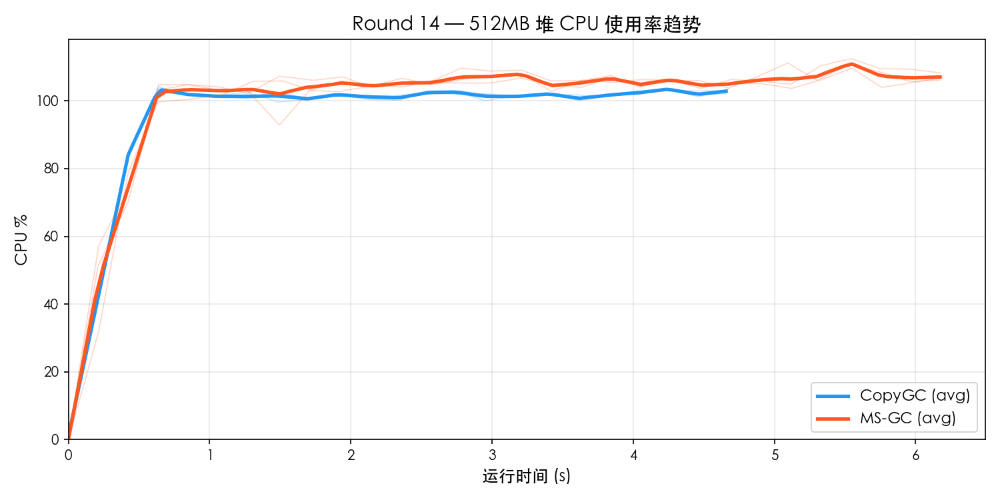
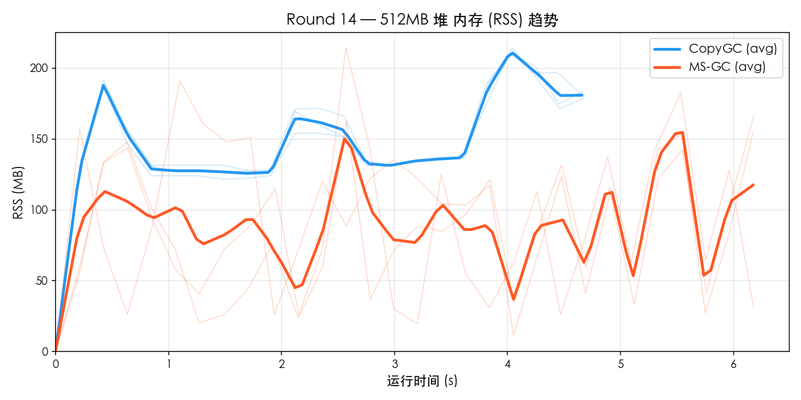

# Round 14 — MS-GC vs CopyGC Benchmark 对比

- **日期**: 2026-03-20
- **平台**: macOS aarch64 (Apple Silicon)
- **构建类型**: Release (`-O2`), MS-GC 使用 `--gc-mode marksweep`
- **测试集**: `gc_benchmark.cj`
- **堆大小**: 256MB / 512MB
- **每组重复**: 3 轮取平均
- **资源采样**: `ps -p PID -o rss=,%cpu=` 每 0.2s 采样

---

## 1. 256MB 堆对比

### 功能完整性

| 测试项 | CopyGC | MS-GC |
|--------|--------|-------|
| F1_TreeIntegrity | PASS | PASS |
| F2_Generational | PASS | PASS |
| F3_LargeObject | PASS | PASS |
| F4_LinkedList | PASS | PASS |
| F5_HashMap | PASS | PASS |
| **通过率** | **5/5** | **5/5** |

### 性能对比

| 测试项 | CopyGC | MS-GC | MS/Copy |
|--------|--------|-------|---------|
| P1_SmallAlloc | 226 ms | 299 ms | 1.32× |
| P2_LargeAlloc | 819 ms | 1125 ms | 1.37× |
| P3_MixedWorkload | 510 ms | 665 ms | 1.30× |
| P4_LongLivedChurn | 399 ms | 551 ms | 1.38× |
| P5_Fragmentation | 634 ms | 922 ms | 1.45× |
| **Total** | **4765 ms** | **6313 ms** | **1.32×** |

### 资源使用

| 指标 | CopyGC | MS-GC | 差距 |
|------|--------|-------|------|
| 平均 CPU% | 90.3% | 95.5% | MS 高 6% |
| 峰值 CPU% | 104.1% | 111.5% | MS 高 7% |
| 平均 RSS | 134.1 MB | 93.0 MB | MS 低 31% |
| 峰值 RSS | 201.3 MB | 216.5 MB | MS 高 8% |

### 资源趋势图

## 2. 512MB 堆对比

### 功能完整性

| 测试项 | CopyGC | MS-GC |
|--------|--------|-------|
| F1_TreeIntegrity | PASS | PASS |
| F2_Generational | PASS | PASS |
| F3_LargeObject | PASS | PASS |
| F4_LinkedList | PASS | PASS |
| F5_HashMap | PASS | PASS |
| **通过率** | **5/5** | **5/5** |

### 性能对比

| 测试项 | CopyGC | MS-GC | MS/Copy |
|--------|--------|-------|---------|
| P1_SmallAlloc | 222 ms | 301 ms | 1.36× |
| P2_LargeAlloc | 810 ms | 1089 ms | 1.34× |
| P3_MixedWorkload | 500 ms | 665 ms | 1.33× |
| P4_LongLivedChurn | 389 ms | 529 ms | 1.36× |
| P5_Fragmentation | 628 ms | 902 ms | 1.44× |
| **Total** | **4681 ms** | **6257 ms** | **1.34×** |

### 资源使用

| 指标 | CopyGC | MS-GC | 差距 |
|------|--------|-------|------|
| 平均 CPU% | 94.1% | 99.1% | MS 高 5% |
| 峰值 CPU% | 103.7% | 111.1% | MS 高 7% |
| 平均 RSS | 145.4 MB | 88.9 MB | MS 低 39% |
| 峰值 RSS | 211.7 MB | 189.6 MB | MS 低 10% |

### 资源趋势图

## 3. 多堆尺寸横向对比

### 总耗时

| 堆大小 | CopyGC | MS-GC | MS/Copy |
|--------|--------|-------|---------|
| 256 MB | 4765 ms | 6313 ms | 1.32× |
| 512 MB | 4681 ms | 6257 ms | 1.34× |

### Peak RSS

| 堆大小 | CopyGC Peak | MS-GC Peak | 比值 |
|--------|-------------|------------|------|
| 256 MB | 201 MB | 216 MB | 1.08× |
| 512 MB | 212 MB | 190 MB | 0.90× |

### CPU 使用率

| 堆大小 | CopyGC Avg | MS-GC Avg | CopyGC Max | MS-GC Max |
|--------|-----------|-----------|-----------|-----------|
| 256 MB | 90.3% | 95.5% | 104.1% | 111.5% |
| 512 MB | 94.1% | 99.1% | 103.7% | 111.1% |

## 4. MS-GC vs CopyGC 对比倍率汇总

| 指标 | 256MB | 512MB |
|------|------ | ------|
| Total 性能 | 1.32× | 1.34× |
| 峰值 RSS | 1.08× | 0.90× |
| 平均 CPU% | 1.06× | 1.05× |

## 5. 结论

### 判定结果

| 维度 | 判定 |
|------|------|
| 功能完整性 | **全部 PASS** |
| Total 性能 (256MB) | 1.32× → **达标** (< 1.5×) |
| 峰值 RSS (256MB) | 1.08× → **达标** (< 1.3×) |
| 平均 CPU (256MB) | 1.06× → **达标** (< 1.5×) |
| Total 性能 (512MB) | 1.34× → **达标** (< 1.5×) |
| 峰值 RSS (512MB) | 0.90× → **优秀** (MS 更省) |
| 平均 CPU (512MB) | 1.05× → **达标** (< 1.5×) |
