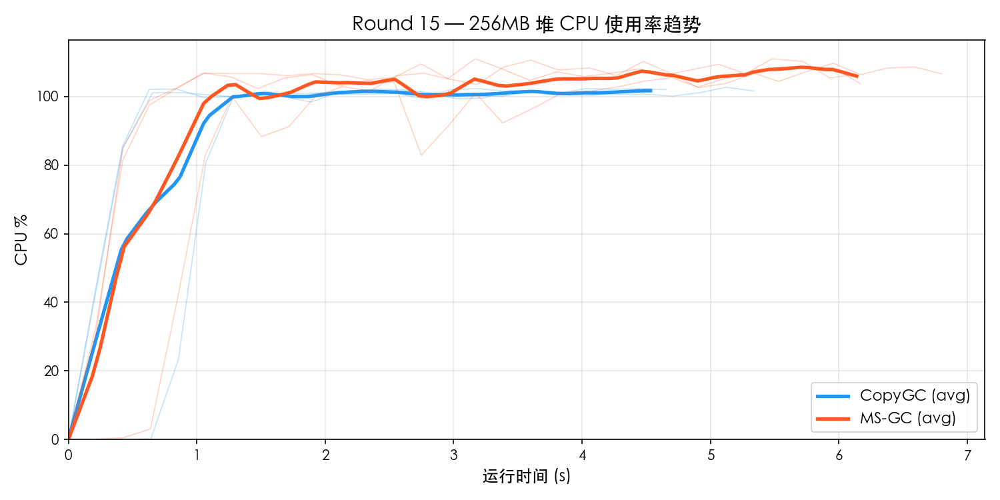
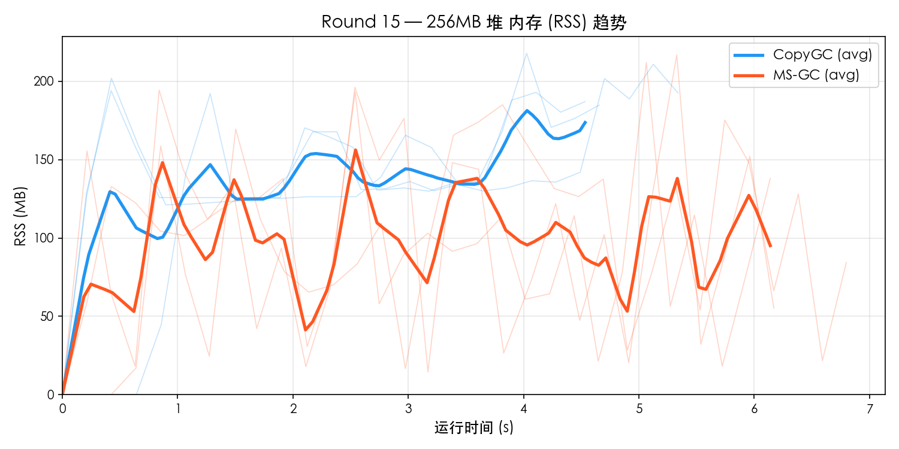
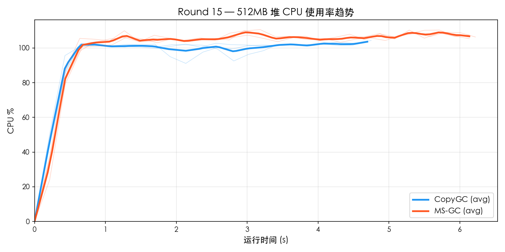
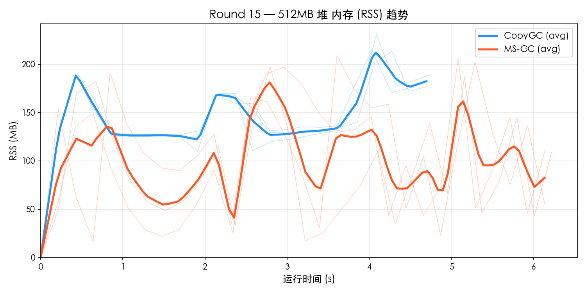

# Round 15 — MS-GC vs CopyGC Benchmark 对比

- **日期**: 2026-03-20
- **平台**: macOS aarch64 (Apple Silicon)
- **构建类型**: Release (`-O2`), MS-GC 使用 `--gc-mode marksweep`
- **测试集**: `gc_benchmark.cj`
- **堆大小**: 256MB / 512MB
- **每组重复**: 3 轮取平均
- **资源采样**: `ps -p PID -o rss=,%cpu=` 每 0.2s 采样

---

## 1. 256MB 堆对比

### 功能完整性

| 测试项 | CopyGC | MS-GC |
|--------|--------|-------|
| F1_TreeIntegrity | PASS | PASS |
| F2_Generational | PASS | PASS |
| F3_LargeObject | PASS | PASS |
| F4_LinkedList | PASS | PASS |
| F5_HashMap | PASS | PASS |
| **通过率** | **5/5** | **5/5** |

### 性能对比

| 测试项 | CopyGC | MS-GC | MS/Copy |
|--------|--------|-------|---------|
| P1_SmallAlloc | 222 ms | 297 ms | 1.34× |
| P2_LargeAlloc | 813 ms | 1099 ms | 1.35× |
| P3_MixedWorkload | 503 ms | 660 ms | 1.31× |
| P4_LongLivedChurn | 393 ms | 523 ms | 1.33× |
| P5_Fragmentation | 632 ms | 892 ms | 1.41× |
| **Total** | **4695 ms** | **6270 ms** | **1.34×** |

### 资源使用

| 指标 | CopyGC | MS-GC | 差距 |
|------|--------|-------|------|
| 平均 CPU% | 89.4% | 95.1% | MS 高 6% |
| 峰值 CPU% | 102.4% | 110.1% | MS 高 7% |
| 平均 RSS | 136.3 MB | 95.2 MB | MS 低 30% |
| 峰值 RSS | 210.2 MB | 204.6 MB | MS 低 3% |

### 资源趋势图

## 2. 512MB 堆对比

### 功能完整性

| 测试项 | CopyGC | MS-GC |
|--------|--------|-------|
| F1_TreeIntegrity | PASS | PASS |
| F2_Generational | PASS | PASS |
| F3_LargeObject | PASS | PASS |
| F4_LinkedList | PASS | PASS |
| F5_HashMap | PASS | PASS |
| **通过率** | **5/5** | **5/5** |

### 性能对比

| 测试项 | CopyGC | MS-GC | MS/Copy |
|--------|--------|-------|---------|
| P1_SmallAlloc | 224 ms | 298 ms | 1.33× |
| P2_LargeAlloc | 843 ms | 1083 ms | 1.29× |
| P3_MixedWorkload | 505 ms | 665 ms | 1.32× |
| P4_LongLivedChurn | 394 ms | 527 ms | 1.34× |
| P5_Fragmentation | 633 ms | 898 ms | 1.42× |
| **Total** | **4765 ms** | **6243 ms** | **1.31×** |

### 资源使用

| 指标 | CopyGC | MS-GC | 差距 |
|------|--------|-------|------|
| 平均 CPU% | 93.7% | 99.1% | MS 高 6% |
| 峰值 CPU% | 103.8% | 110.0% | MS 高 6% |
| 平均 RSS | 142.7 MB | 98.7 MB | MS 低 31% |
| 峰值 RSS | 219.6 MB | 204.3 MB | MS 低 7% |

### 资源趋势图

## 3. 多堆尺寸横向对比

### 总耗时

| 堆大小 | CopyGC | MS-GC | MS/Copy |
|--------|--------|-------|---------|
| 256 MB | 4695 ms | 6270 ms | 1.34× |
| 512 MB | 4765 ms | 6243 ms | 1.31× |

### Peak RSS

| 堆大小 | CopyGC Peak | MS-GC Peak | 比值 |
|--------|-------------|------------|------|
| 256 MB | 210 MB | 205 MB | 0.97× |
| 512 MB | 220 MB | 204 MB | 0.93× |

### CPU 使用率

| 堆大小 | CopyGC Avg | MS-GC Avg | CopyGC Max | MS-GC Max |
|--------|-----------|-----------|-----------|-----------|
| 256 MB | 89.4% | 95.1% | 102.4% | 110.1% |
| 512 MB | 93.7% | 99.1% | 103.8% | 110.0% |

## 4. MS-GC vs CopyGC 对比倍率汇总

| 指标 | 256MB | 512MB |
|------|------ | ------|
| Total 性能 | 1.34× | 1.31× |
| 峰值 RSS | 0.97× | 0.93× |
| 平均 CPU% | 1.06× | 1.06× |

## 5. 结论

### 判定结果

| 维度 | 判定 |
|------|------|
| 功能完整性 | **全部 PASS** |
| Total 性能 (256MB) | 1.34× → **达标** (< 1.5×) |
| 峰值 RSS (256MB) | 0.97× → **优秀** (MS 更省) |
| 平均 CPU (256MB) | 1.06× → **达标** (< 1.5×) |
| Total 性能 (512MB) | 1.31× → **达标** (< 1.5×) |
| 峰值 RSS (512MB) | 0.93× → **优秀** (MS 更省) |
| 平均 CPU (512MB) | 1.06× → **达标** (< 1.5×) |
