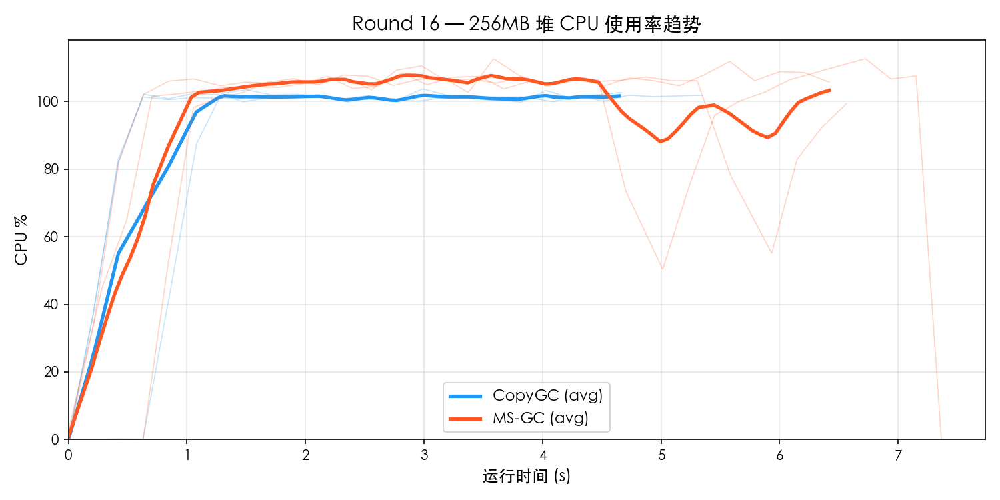
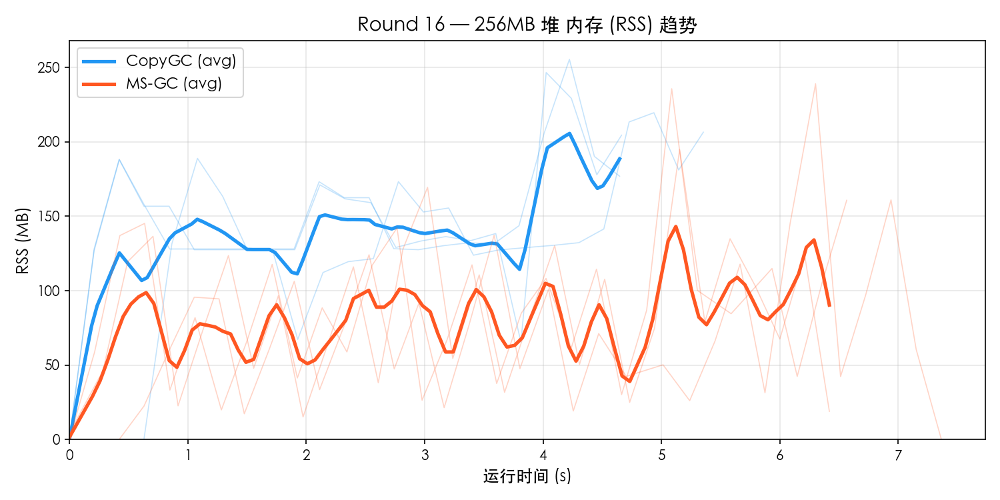
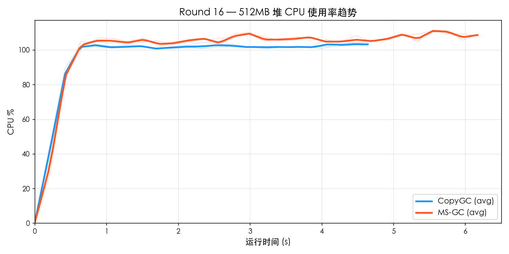
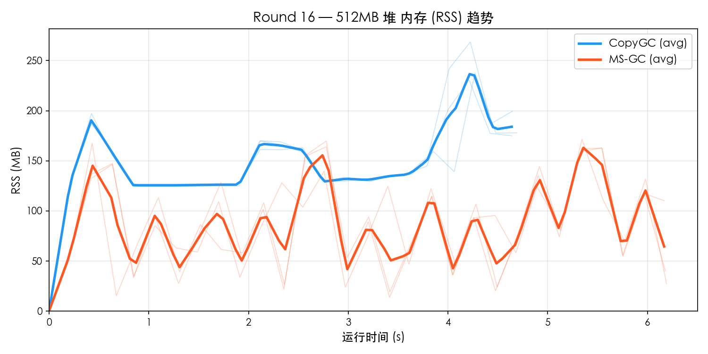

# Round 16 — MS-GC vs CopyGC Benchmark 对比

- **日期**: 2026-03-20
- **平台**: macOS aarch64 (Apple Silicon)
- **构建类型**: Release (`-O2`), MS-GC 使用 `--gc-mode marksweep`
- **测试集**: `gc_benchmark.cj`
- **堆大小**: 256MB / 512MB
- **每组重复**: 3 轮取平均
- **资源采样**: `ps -p PID -o rss=,%cpu=` 每 0.2s 采样

---

## 1. 256MB 堆对比

### 功能完整性

| 测试项 | CopyGC | MS-GC |
|--------|--------|-------|
| F1_TreeIntegrity | PASS | PASS |
| F2_Generational | PASS | PASS |
| F3_LargeObject | PASS | PASS |
| F4_LinkedList | PASS | PASS |
| F5_HashMap | PASS | PASS |
| **通过率** | **5/5** | **5/5** |

### 性能对比

| 测试项 | CopyGC | MS-GC | MS/Copy |
|--------|--------|-------|---------|
| P1_SmallAlloc | 227 ms | 302 ms | 1.33× |
| P2_LargeAlloc | 828 ms | 1218 ms | 1.47× |
| P3_MixedWorkload | 508 ms | 669 ms | 1.32× |
| P4_LongLivedChurn | 403 ms | 534 ms | 1.33× |
| P5_Fragmentation | 641 ms | 1013 ms | 1.58× |
| **Total** | **4763 ms** | **6572 ms** | **1.38×** |

### 资源使用

| 指标 | CopyGC | MS-GC | 差距 |
|------|--------|-------|------|
| 平均 CPU% | 89.9% | 93.5% | MS 高 4% |
| 峰值 CPU% | 103.2% | 111.7% | MS 高 8% |
| 平均 RSS | 138.9 MB | 79.5 MB | MS 低 43% |
| 峰值 RSS | 240.5 MB | 223.2 MB | MS 低 7% |

### 资源趋势图

## 2. 512MB 堆对比

### 功能完整性

| 测试项 | CopyGC | MS-GC |
|--------|--------|-------|
| F1_TreeIntegrity | PASS | PASS |
| F2_Generational | PASS | PASS |
| F3_LargeObject | PASS | PASS |
| F4_LinkedList | PASS | PASS |
| F5_HashMap | PASS | PASS |
| **通过率** | **5/5** | **5/5** |

### 性能对比

| 测试项 | CopyGC | MS-GC | MS/Copy |
|--------|--------|-------|---------|
| P1_SmallAlloc | 225 ms | 300 ms | 1.33× |
| P2_LargeAlloc | 822 ms | 1090 ms | 1.33× |
| P3_MixedWorkload | 507 ms | 671 ms | 1.32× |
| P4_LongLivedChurn | 401 ms | 531 ms | 1.33× |
| P5_Fragmentation | 643 ms | 909 ms | 1.41× |
| **Total** | **4748 ms** | **6258 ms** | **1.32×** |

### 资源使用

| 指标 | CopyGC | MS-GC | 差距 |
|------|--------|-------|------|
| 平均 CPU% | 94.5% | 99.7% | MS 高 6% |
| 峰值 CPU% | 104.5% | 111.3% | MS 高 6% |
| 平均 RSS | 145.6 MB | 84.8 MB | MS 低 42% |
| 峰值 RSS | 245.7 MB | 169.7 MB | MS 低 31% |

### 资源趋势图

## 3. 多堆尺寸横向对比

### 总耗时

| 堆大小 | CopyGC | MS-GC | MS/Copy |
|--------|--------|-------|---------|
| 256 MB | 4763 ms | 6572 ms | 1.38× |
| 512 MB | 4748 ms | 6258 ms | 1.32× |

### Peak RSS

| 堆大小 | CopyGC Peak | MS-GC Peak | 比值 |
|--------|-------------|------------|------|
| 256 MB | 241 MB | 223 MB | 0.93× |
| 512 MB | 246 MB | 170 MB | 0.69× |

### CPU 使用率

| 堆大小 | CopyGC Avg | MS-GC Avg | CopyGC Max | MS-GC Max |
|--------|-----------|-----------|-----------|-----------|
| 256 MB | 89.9% | 93.5% | 103.2% | 111.7% |
| 512 MB | 94.5% | 99.7% | 104.5% | 111.3% |

## 4. MS-GC vs CopyGC 对比倍率汇总

| 指标 | 256MB | 512MB |
|------|------ | ------|
| Total 性能 | 1.38× | 1.32× |
| 峰值 RSS | 0.93× | 0.69× |
| 平均 CPU% | 1.04× | 1.06× |

## 5. 结论

### 判定结果

| 维度 | 判定 |
|------|------|
| 功能完整性 | **全部 PASS** |
| Total 性能 (256MB) | 1.38× → **达标** (< 1.5×) |
| 峰值 RSS (256MB) | 0.93× → **优秀** (MS 更省) |
| 平均 CPU (256MB) | 1.04× → **达标** (< 1.5×) |
| Total 性能 (512MB) | 1.32× → **达标** (< 1.5×) |
| 峰值 RSS (512MB) | 0.69× → **优秀** (MS 更省) |
| 平均 CPU (512MB) | 1.06× → **达标** (< 1.5×) |
