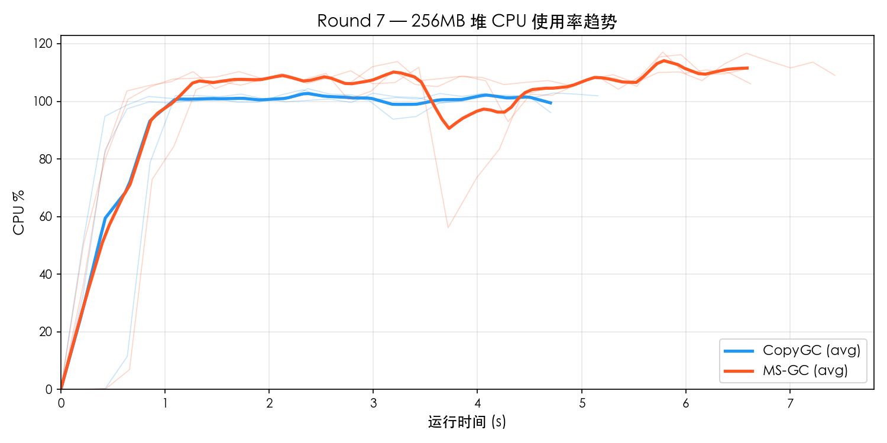
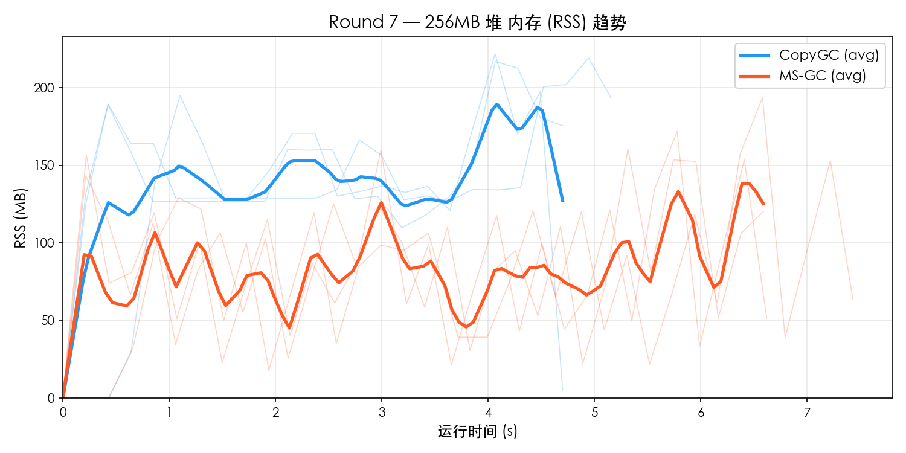
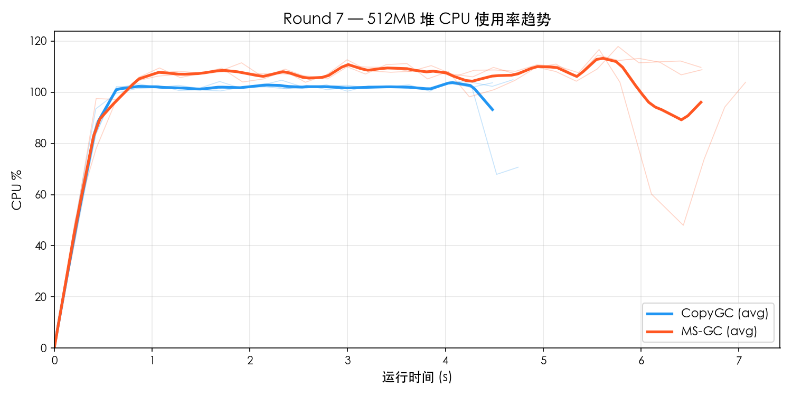
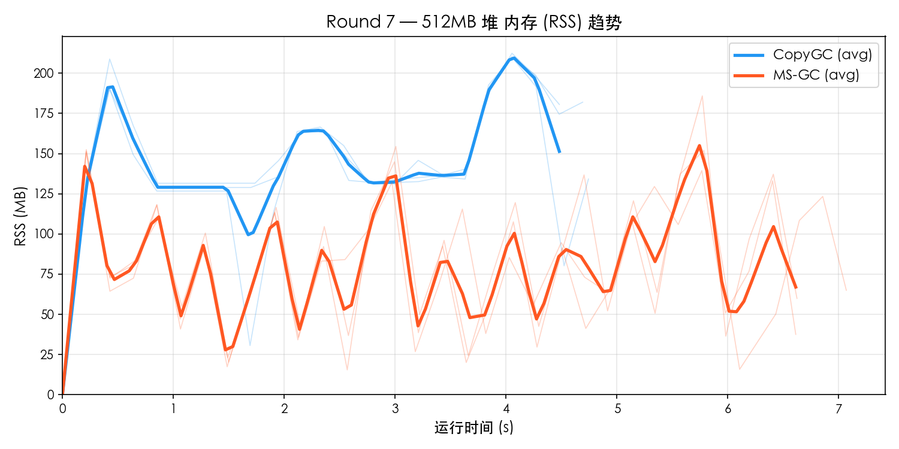

# Round 7 — MS-GC vs CopyGC Benchmark 对比

- **日期**: 2026-03-19
- **平台**: macOS aarch64 (Apple Silicon)
- **构建类型**: Release (`-O2`), MS-GC 使用 `--gc-mode marksweep`
- **测试集**: `gc_benchmark.cj`
- **堆大小**: 256MB / 512MB
- **每组重复**: 3 轮取平均
- **资源采样**: `ps -p PID -o rss=,%cpu=` 每 0.2s 采样

---

## 1. 256MB 堆对比

### 功能完整性

| 测试项 | CopyGC | MS-GC |
|--------|--------|-------|
| F1_TreeIntegrity | PASS | PASS |
| F2_Generational | PASS | PASS |
| F3_LargeObject | PASS | PASS |
| F4_LinkedList | PASS | PASS |
| F5_HashMap | PASS | PASS |
| **通过率** | **5/5** | **5/5** |

### 性能对比

| 测试项 | CopyGC | MS-GC | MS/Copy |
|--------|--------|-------|---------|
| P1_SmallAlloc | 226 ms | 366 ms | 1.62× |
| P2_LargeAlloc | 834 ms | 1163 ms | 1.39× |
| P3_MixedWorkload | 510 ms | 708 ms | 1.39× |
| P4_LongLivedChurn | 396 ms | 567 ms | 1.43× |
| P5_Fragmentation | 644 ms | 980 ms | 1.52× |
| **Total** | **4754 ms** | **6765 ms** | **1.42×** |

### 资源使用

| 指标 | CopyGC | MS-GC | 差距 |
|------|--------|-------|------|
| 平均 CPU% | 90.3% | 98.0% | MS 高 9% |
| 峰值 CPU% | 103.8% | 116.7% | MS 高 12% |
| 平均 RSS | 136.9 MB | 83.1 MB | MS 低 39% |
| 峰值 RSS | 219.3 MB | 175.5 MB | MS 低 20% |

### 资源趋势图

## 2. 512MB 堆对比

### 功能完整性

| 测试项 | CopyGC | MS-GC |
|--------|--------|-------|
| F1_TreeIntegrity | PASS | PASS |
| F2_Generational | PASS | PASS |
| F3_LargeObject | PASS | PASS |
| F4_LinkedList | PASS | PASS |
| F5_HashMap | PASS | PASS |
| **通过率** | **5/5** | **5/5** |

### 性能对比

| 测试项 | CopyGC | MS-GC | MS/Copy |
|--------|--------|-------|---------|
| P1_SmallAlloc | 221 ms | 322 ms | 1.46× |
| P2_LargeAlloc | 807 ms | 1168 ms | 1.45× |
| P3_MixedWorkload | 502 ms | 712 ms | 1.42× |
| P4_LongLivedChurn | 398 ms | 578 ms | 1.45× |
| P5_Fragmentation | 700 ms | 1141 ms | 1.63× |
| **Total** | **4744 ms** | **6826 ms** | **1.44×** |

### 资源使用

| 指标 | CopyGC | MS-GC | 差距 |
|------|--------|-------|------|
| 平均 CPU% | 93.5% | 100.4% | MS 高 7% |
| 峰值 CPU% | 104.1% | 116.4% | MS 高 12% |
| 平均 RSS | 142.4 MB | 80.8 MB | MS 低 43% |
| 峰值 RSS | 210.8 MB | 164.3 MB | MS 低 22% |

### 资源趋势图

## 3. 多堆尺寸横向对比

### 总耗时

| 堆大小 | CopyGC | MS-GC | MS/Copy |
|--------|--------|-------|---------|
| 256 MB | 4754 ms | 6765 ms | 1.42× |
| 512 MB | 4744 ms | 6826 ms | 1.44× |

### Peak RSS

| 堆大小 | CopyGC Peak | MS-GC Peak | 比值 |
|--------|-------------|------------|------|
| 256 MB | 219 MB | 176 MB | 0.80× |
| 512 MB | 211 MB | 164 MB | 0.78× |

### CPU 使用率

| 堆大小 | CopyGC Avg | MS-GC Avg | CopyGC Max | MS-GC Max |
|--------|-----------|-----------|-----------|-----------|
| 256 MB | 90.3% | 98.0% | 103.8% | 116.7% |
| 512 MB | 93.5% | 100.4% | 104.1% | 116.4% |

## 4. MS-GC vs CopyGC 对比倍率汇总

| 指标 | 256MB | 512MB |
|------|------ | ------|
| Total 性能 | 1.42× | 1.44× |
| 峰值 RSS | 0.80× | 0.78× |
| 平均 CPU% | 1.09× | 1.07× |

## 5. 结论

### 判定结果

| 维度 | 判定 |
|------|------|
| 功能完整性 | **全部 PASS** |
| Total 性能 (256MB) | 1.42× → **达标** (< 1.5×) |
| 峰值 RSS (256MB) | 0.80× → **优秀** (MS 更省) |
| 平均 CPU (256MB) | 1.09× → **达标** (< 1.5×) |
| Total 性能 (512MB) | 1.44× → **达标** (< 1.5×) |
| 峰值 RSS (512MB) | 0.78× → **优秀** (MS 更省) |
| 平均 CPU (512MB) | 1.07× → **达标** (< 1.5×) |
