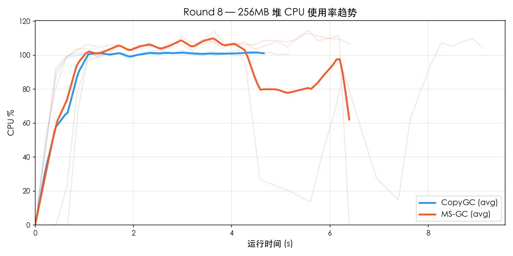
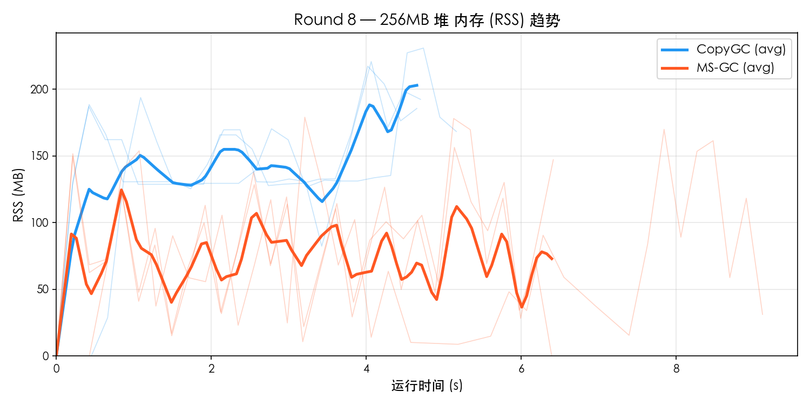
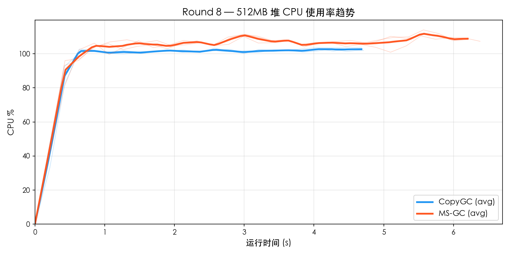
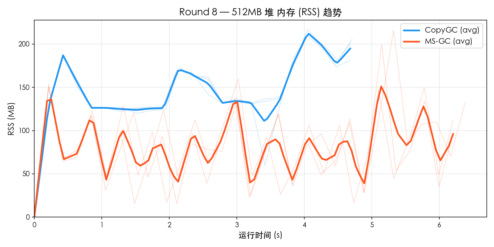

# Round 8 — MS-GC vs CopyGC Benchmark 对比

- **日期**: 2026-03-19
- **平台**: macOS aarch64 (Apple Silicon)
- **构建类型**: Release (`-O2`), MS-GC 使用 `--gc-mode marksweep`
- **测试集**: `gc_benchmark.cj`
- **堆大小**: 256MB / 512MB
- **每组重复**: 3 轮取平均
- **资源采样**: `ps -p PID -o rss=,%cpu=` 每 0.2s 采样

---

## 1. 256MB 堆对比

### 功能完整性

| 测试项 | CopyGC | MS-GC |
|--------|--------|-------|
| F1_TreeIntegrity | PASS | PASS |
| F2_Generational | PASS | PASS |
| F3_LargeObject | PASS | PASS |
| F4_LinkedList | PASS | PASS |
| F5_HashMap | PASS | PASS |
| **通过率** | **5/5** | **5/5** |

### 性能对比

| 测试项 | CopyGC | MS-GC | MS/Copy |
|--------|--------|-------|---------|
| P1_SmallAlloc | 225 ms | 310 ms | 1.38× |
| P2_LargeAlloc | 812 ms | 1540 ms | 1.90× |
| P3_MixedWorkload | 507 ms | 966 ms | 1.90× |
| P4_LongLivedChurn | 394 ms | 551 ms | 1.40× |
| P5_Fragmentation | 632 ms | 917 ms | 1.45× |
| **Total** | **4700 ms** | **7139 ms** | **1.52×** |

### 资源使用

| 指标 | CopyGC | MS-GC | 差距 |
|------|--------|-------|------|
| 平均 CPU% | 90.2% | 91.3% | MS 高 1% |
| 峰值 CPU% | 102.6% | 114.0% | MS 高 11% |
| 平均 RSS | 140.0 MB | 77.5 MB | MS 低 45% |
| 峰值 RSS | 223.0 MB | 171.2 MB | MS 低 23% |

### 资源趋势图

## 2. 512MB 堆对比

### 功能完整性

| 测试项 | CopyGC | MS-GC |
|--------|--------|-------|
| F1_TreeIntegrity | PASS | PASS |
| F2_Generational | PASS | PASS |
| F3_LargeObject | PASS | PASS |
| F4_LinkedList | PASS | PASS |
| F5_HashMap | PASS | PASS |
| **通过率** | **5/5** | **5/5** |

### 性能对比

| 测试项 | CopyGC | MS-GC | MS/Copy |
|--------|--------|-------|---------|
| P1_SmallAlloc | 223 ms | 306 ms | 1.37× |
| P2_LargeAlloc | 808 ms | 1098 ms | 1.36× |
| P3_MixedWorkload | 507 ms | 691 ms | 1.36× |
| P4_LongLivedChurn | 395 ms | 556 ms | 1.41× |
| P5_Fragmentation | 633 ms | 911 ms | 1.44× |
| **Total** | **4709 ms** | **6368 ms** | **1.35×** |

### 资源使用

| 指标 | CopyGC | MS-GC | 差距 |
|------|--------|-------|------|
| 平均 CPU% | 94.0% | 100.6% | MS 高 7% |
| 峰值 CPU% | 103.3% | 112.2% | MS 高 9% |
| 平均 RSS | 144.3 MB | 81.5 MB | MS 低 44% |
| 峰值 RSS | 212.9 MB | 189.8 MB | MS 低 11% |

### 资源趋势图

## 3. 多堆尺寸横向对比

### 总耗时

| 堆大小 | CopyGC | MS-GC | MS/Copy |
|--------|--------|-------|---------|
| 256 MB | 4700 ms | 7139 ms | 1.52× |
| 512 MB | 4709 ms | 6368 ms | 1.35× |

### Peak RSS

| 堆大小 | CopyGC Peak | MS-GC Peak | 比值 |
|--------|-------------|------------|------|
| 256 MB | 223 MB | 171 MB | 0.77× |
| 512 MB | 213 MB | 190 MB | 0.89× |

### CPU 使用率

| 堆大小 | CopyGC Avg | MS-GC Avg | CopyGC Max | MS-GC Max |
|--------|-----------|-----------|-----------|-----------|
| 256 MB | 90.2% | 91.3% | 102.6% | 114.0% |
| 512 MB | 94.0% | 100.6% | 103.3% | 112.2% |

## 4. MS-GC vs CopyGC 对比倍率汇总

| 指标 | 256MB | 512MB |
|------|------ | ------|
| Total 性能 | 1.52× | 1.35× |
| 峰值 RSS | 0.77× | 0.89× |
| 平均 CPU% | 1.01× | 1.07× |

## 5. 结论

### 判定结果

| 维度 | 判定 |
|------|------|
| 功能完整性 | **全部 PASS** |
| Total 性能 (256MB) | 1.52× → 未达标 (>= 1.5×) |
| 峰值 RSS (256MB) | 0.77× → **优秀** (MS 更省) |
| 平均 CPU (256MB) | 1.01× → **达标** (< 1.5×) |
| Total 性能 (512MB) | 1.35× → **达标** (< 1.5×) |
| 峰值 RSS (512MB) | 0.89× → **优秀** (MS 更省) |
| 平均 CPU (512MB) | 1.07× → **达标** (< 1.5×) |
