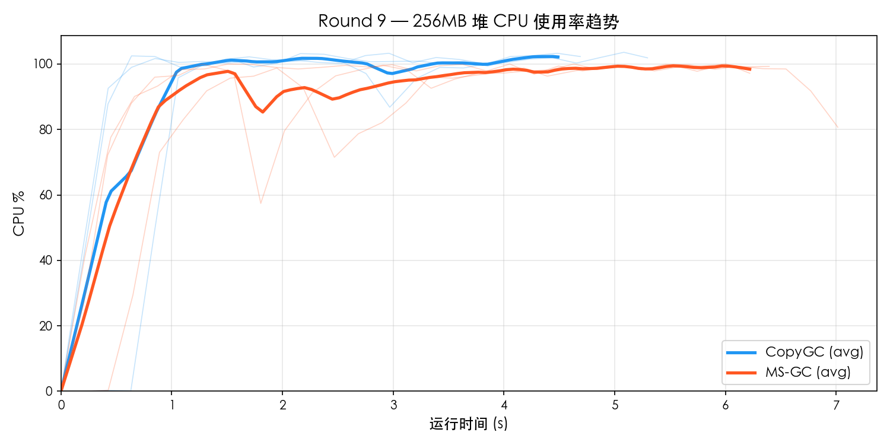
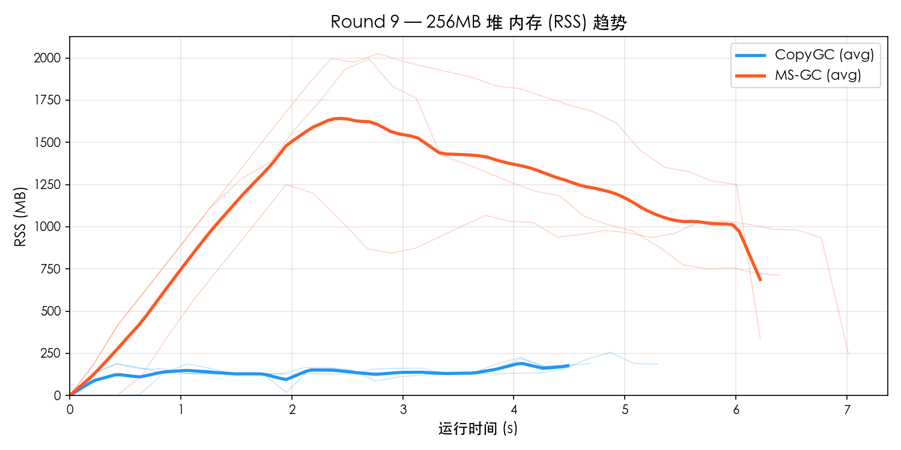
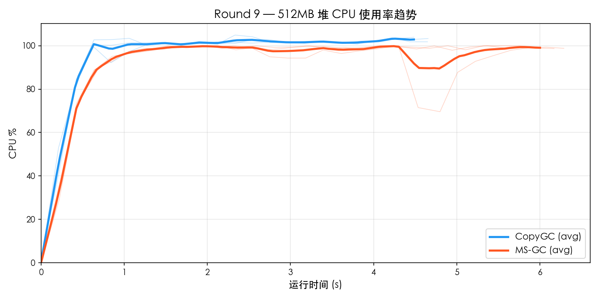
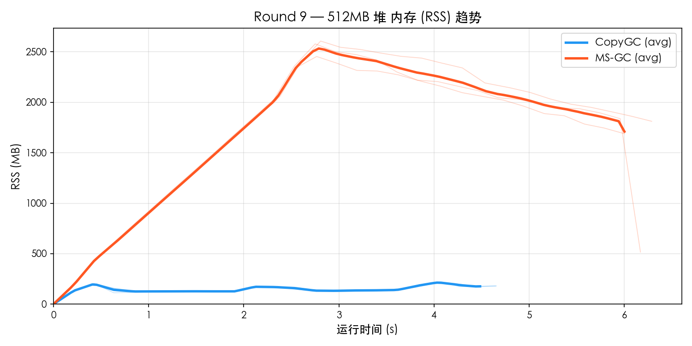

# Round 9 — MS-GC vs CopyGC Benchmark 对比

- **日期**: 2026-03-19
- **平台**: macOS aarch64 (Apple Silicon)
- **构建类型**: Release (`-O2`), MS-GC 使用 `--gc-mode marksweep`
- **测试集**: `gc_benchmark.cj`
- **堆大小**: 256MB / 512MB
- **每组重复**: 3 轮取平均
- **资源采样**: `ps -p PID -o rss=,%cpu=` 每 0.2s 采样

---

## 1. 256MB 堆对比

### 功能完整性

| 测试项 | CopyGC | MS-GC |
|--------|--------|-------|
| F1_TreeIntegrity | PASS | PASS |
| F2_Generational | PASS | PASS |
| F3_LargeObject | PASS | PASS |
| F4_LinkedList | PASS | PASS |
| F5_HashMap | PASS | PASS |
| **通过率** | **5/5** | **5/5** |

### 性能对比

| 测试项 | CopyGC | MS-GC | MS/Copy |
|--------|--------|-------|---------|
| P1_SmallAlloc | 222 ms | 295 ms | 1.33× |
| P2_LargeAlloc | 844 ms | 1081 ms | 1.28× |
| P3_MixedWorkload | 497 ms | 657 ms | 1.32× |
| P4_LongLivedChurn | 392 ms | 530 ms | 1.35× |
| P5_Fragmentation | 631 ms | 924 ms | 1.46× |
| **Total** | **4709 ms** | **6314 ms** | **1.34×** |

### 资源使用

| 指标 | CopyGC | MS-GC | 差距 |
|------|--------|-------|------|
| 平均 CPU% | 89.9% | 88.0% | MS 低 2% |
| 峰值 CPU% | 103.4% | 100.0% | MS 低 3% |
| 平均 RSS | 137.0 MB | 1098.7 MB | MS 高 702% |
| 峰值 RSS | 233.6 MB | 1757.0 MB | MS 高 652% |

### 资源趋势图

## 2. 512MB 堆对比

### 功能完整性

| 测试项 | CopyGC | MS-GC |
|--------|--------|-------|
| F1_TreeIntegrity | PASS | PASS |
| F2_Generational | PASS | PASS |
| F3_LargeObject | PASS | PASS |
| F4_LinkedList | PASS | PASS |
| F5_HashMap | PASS | PASS |
| **通过率** | **5/5** | **5/5** |

### 性能对比

| 测试项 | CopyGC | MS-GC | MS/Copy |
|--------|--------|-------|---------|
| P1_SmallAlloc | 221 ms | 291 ms | 1.32× |
| P2_LargeAlloc | 806 ms | 1088 ms | 1.35× |
| P3_MixedWorkload | 498 ms | 721 ms | 1.45× |
| P4_LongLivedChurn | 386 ms | 524 ms | 1.36× |
| P5_Fragmentation | 639 ms | 880 ms | 1.38× |
| **Total** | **4689 ms** | **6135 ms** | **1.31×** |

### 资源使用

| 指标 | CopyGC | MS-GC | 差距 |
|------|--------|-------|------|
| 平均 CPU% | 93.8% | 91.0% | MS 低 3% |
| 峰值 CPU% | 104.0% | 100.0% | MS 低 4% |
| 平均 RSS | 145.6 MB | 1694.4 MB | MS 高 1064% |
| 峰值 RSS | 215.1 MB | 2546.1 MB | MS 高 1084% |

### 资源趋势图

## 3. 多堆尺寸横向对比

### 总耗时

| 堆大小 | CopyGC | MS-GC | MS/Copy |
|--------|--------|-------|---------|
| 256 MB | 4709 ms | 6314 ms | 1.34× |
| 512 MB | 4689 ms | 6135 ms | 1.31× |

### Peak RSS

| 堆大小 | CopyGC Peak | MS-GC Peak | 比值 |
|--------|-------------|------------|------|
| 256 MB | 234 MB | 1757 MB | 7.52× |
| 512 MB | 215 MB | 2546 MB | 11.84× |

### CPU 使用率

| 堆大小 | CopyGC Avg | MS-GC Avg | CopyGC Max | MS-GC Max |
|--------|-----------|-----------|-----------|-----------|
| 256 MB | 89.9% | 88.0% | 103.4% | 100.0% |
| 512 MB | 93.8% | 91.0% | 104.0% | 100.0% |

## 4. MS-GC vs CopyGC 对比倍率汇总

| 指标 | 256MB | 512MB |
|------|------ | ------|
| Total 性能 | 1.34× | 1.31× |
| 峰值 RSS | 7.52× | 11.84× |
| 平均 CPU% | 0.98× | 0.97× |

## 5. 结论

### 判定结果

| 维度 | 判定 |
|------|------|
| 功能完整性 | **全部 PASS** |
| Total 性能 (256MB) | 1.34× → **达标** (< 1.5×) |
| 峰值 RSS (256MB) | 7.52× → 未达标 (>= 1.3×) |
| 平均 CPU (256MB) | 0.98× → **达标** (< 1.5×) |
| Total 性能 (512MB) | 1.31× → **达标** (< 1.5×) |
| 峰值 RSS (512MB) | 11.84× → 未达标 (>= 1.3×) |
| 平均 CPU (512MB) | 0.97× → **达标** (< 1.5×) |
